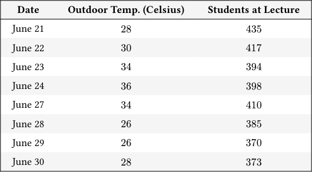
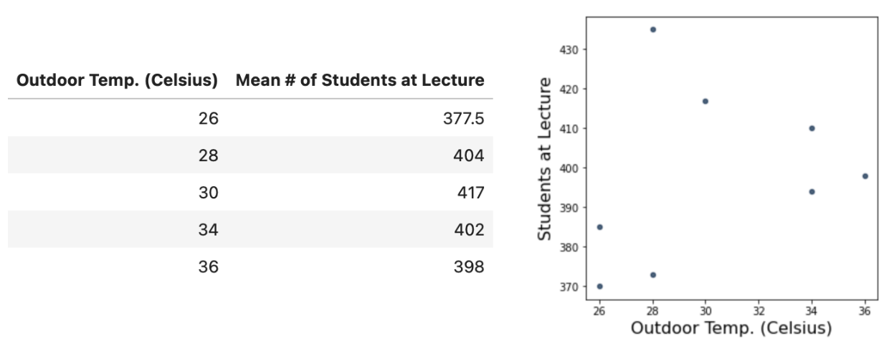
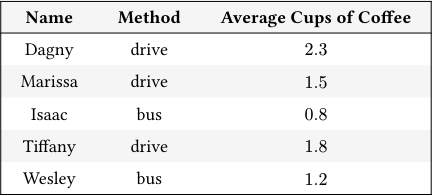

# Discussion 02 Data C8 Spring 2026

## Page 1

## Intro to Tables & Causation

Discussion 02

Data C8: Foundations of Data Science UC Berkeley, Spring 2026

### 1. Warmup

A study followed 369 people with cardiovascular disease, randomly selected from all hospital patients with cardiovascular disease. A year later, those who owned a dog were four times more likely to be alive than those who did not. For all of the following questions, please provide a brief explanation. (Spring 2017 Practice Midterm Question 3b)

#### (a) True or False. This study is a randomized controlled experiment.

#### (b) True or False. This study shows that dog owners live longer than cat owners on average.

- True or False. This study shows that for someone with cardiovascular disease, adopting a dog causes them to live longer.

### 2. Fun with Arrays

Suppose we have executed the following lines of code. Answer each question with the appropriate output associated with each line of code, or write ERROR if you think the operation is not possible.

odd = make_array(1, 3, 5, 7) even = np.arange(2, 10, 2) nums = make_array('1', '2', '3', '4')

#### (a) odd + even

#### (b) odd + nums

#### (c) even.item(3) * odd.item(1)

#### (d) odd * 3

#### (e) odd + 1 == even

#### (f) nums.item(3) + '0'

- sum(odd > 4) Hint: Boolean values of True and False are equivalent to integer values of 1 and 0 respectively.

#### (h) sum(odd > 4) / len(odd > 4). What does this output represent? Discuss with peers.

#### (i) odd + make_array(True, True, False, False)

## Page 2

### 3. Rise and Shine

Tables are a fundamental way of representing data. A table can be viewed in two ways:

- A sequence of named columns that each describe a single attribute of all entries in a data set, or
- A sequence of rows where each row contains all the attribute information about that entry in the data set

Data 8 uses a library consisting of many Table functions that will allow you to manipulate and visualize data. All of the functions we will use in this course are listed on the Data 8 website under Python Reference, and a similar reference sheet will be provided during exams.

In this question, let’s look at an example table called weather. The table has 8 rows, each corresponding to a day of the year. Each row has three attributes: the date, the outdoor temperature in Celsius, and the number of students at lecture that day.

#### Date Outdoor Temp. (Celsius) Students at Lecture

June 21 28 435

June 22 30 417

June 23 34 394

June 24 36 398

June 27 34 410

June 28 26 385

June 29 26 370

June 30 28 373

- Using just the information provided in the weather table, can you generate the following tables and visualizations? If not,

what additional information do you need? Note: You do not need to know/write the specifics of the code that you would use to generate these outputs.

Yes / No Yes/No

- Miriam likes using Fahrenheit more than Celsius. Suppose that she has access to a function called fahrenheit that takes

in a number (temperature in Celsius) and returns the temperature in Fahrenheit.

#### i. Write an expression that evaluates to 30°C in Fahrenheit. Hint: which function can we use?

#### ii. What will fahrenheit("thirty") output?

iii. Miriam assigns a variable temperature to the number 25. What will fahrenheit(temperature * 2) output?

Data C8 Spring 2026 Discussion 02 | 2

## Page 3

### 4. Made with ♡ & Coffee

Carisma collected the following information about her coworkers’ methods of getting to work and their coffee consumption. The data is stored in a table called coworkers:

#### Name Method Average Cups of Coffee

Dagny drive 2.3

Marissa drive 1.5

Isaac bus 0.8

Tiffany drive 1.8

Wesley bus 1.2

... (60 rows omitted)

The table contains three columns: - Name (string): The name of the coworker. - Method (string): The coworker’s way of commuting to work. - Average Cups of Coffee (float): The average number of cups of coffee consumed per day by the coworker.

#### (a) Help Carisma analyze her coworkers’ coffee consumption habits by creating the following tables.

- Carisma wants to focus on her coworkers who commute by driving to work. Create a table titled drivers that only

includes coworkers who drive to work.

drivers = __________________.__________________(_______________________, _______________________)

ii. Carisma wants to see which of her coworkers consume the most coffee. Create a table titled consumption that organizes

her coworkers from the highest average cups of coffee per day to the lowest.

consumption = _________________._________________(______________________, ______________________)

iii. Carisma decides she only wants to focus on her coworkers’ average coffee consumption and method of commuting to

work. Create a table titled coffee_and_commute that includes only the Average Cups of Coffee and Method columns in that order.

coffee_and_commute = _________________._________________(_______________________________________)

- Carisma wants to determine whether she is spending more money on coffee compared to boba over the course of 1 semester

(15 weeks long). Assume she purchases 4 coffees and 3 bobas per week. Complete the following lines of code, which should assign result to True if Carisma spends strictly more on coffee and False otherwise.

cost_coffee = 6.0 cost_boba = 7.0

total_coffee = ______________ * ______ * ______

total_boba = ________________ * ______ * ______

result = ______________________________________

Data C8 Spring 2026 Discussion 02 | 3
