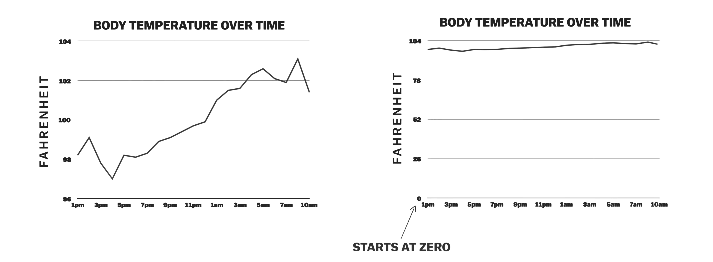
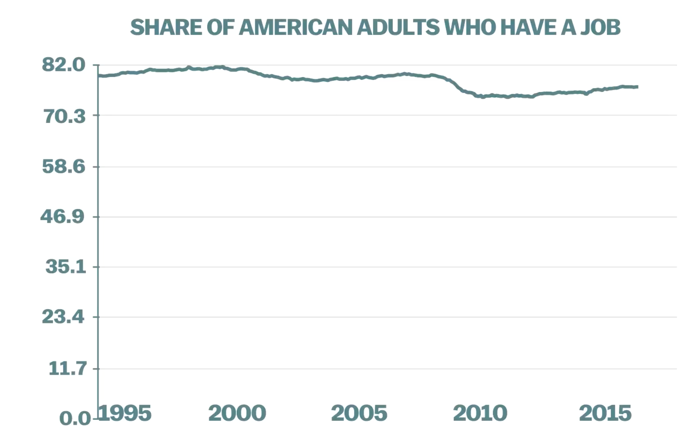
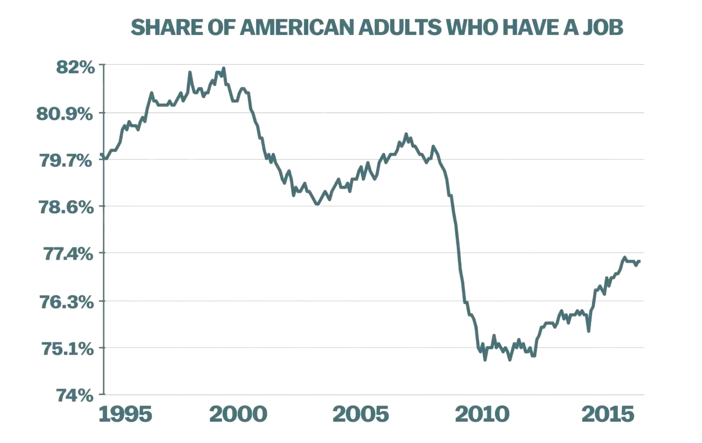
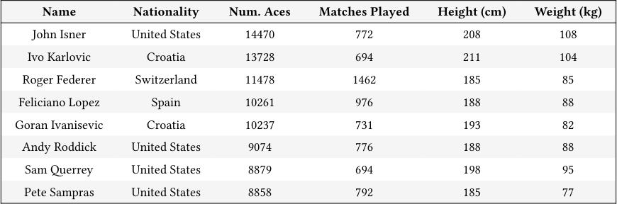
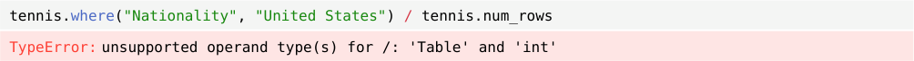
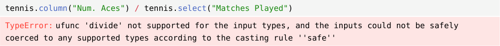
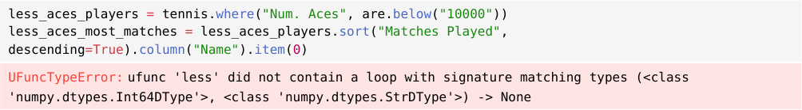
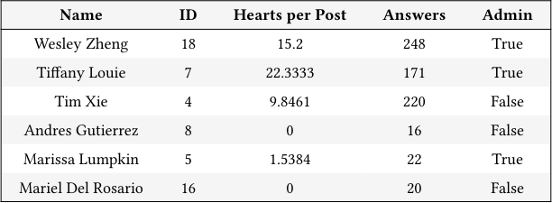
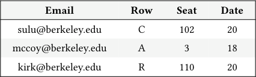

# Discussion 03 Data C8 Spring 2026

## Page 1

## Visualizations, Data Types, Extending Tables

Discussion 03

Data C8: Foundations of Data Science UC Berkeley, Spring 2026

An extremely important aspect of data science is visualizing the data in a precise, consistent manner.

### 1. Visualizations

A common discussion people have when visualizing data revolves around the scale of the y-axis on a chart. It is commonly believed that charts with numerical y-axis must always start at 0. After watching the video, do you think this is true? Discuss the following questions.

#### (a) In your opinion, when is it appropriate to start the y-axis at 0, and when not?

#### (b) In general, what should we consider when making a good data visualization?

## Page 2

## 2. Aces

In tennis, a player hits an ace when their serve is untouched by the opponent. Your friend Tim is interested in analyzing the 8 male tennis professionals who have hit the most aces throughout tennis history. The table below is called tennis and includes statistics obtained from the ATP Tour. The table is sorted in decreasing order of Num. Aces, the total number of aces (as an integer) hit by that player in their career.

#### Name Nationality Num. Aces Matches Played Height (cm) Weight (kg)

John Isner United States 14470 772 208 108

Ivo Karlovic Croatia 13728 694 211 104

Roger Federer Switzerland 11478 1462 185 85

Feliciano Lopez Spain 10261 976 188 88

Goran Ivanisevic Croatia 10237 731 193 82

Andy Roddick United States 9074 776 188 88

Sam Querrey United States 8879 694 198 95

Pete Sampras United States 8858 792 185 77

Unfortunately, the code Tim wrote to analyze the data has some issues. Below are some error messages that appeared, along with what Tim was trying to calculate. Describe the issues and explain how you would change the code to fix them.

#### (a) The proportion of players in the table that are from the United States.

tennis.where("Nationality", "United States") / tennis.num_rows

TypeError: unsupported operand type(s) for /: 'Table' and 'int'

#### (b) An array of the average number of aces hit per match for each player.

tennis.column("Num. Aces") / tennis.select("Matches Played")

TypeError: ufunc 'divide' not supported for the input types, and the inputs could not be safely

coerced to any supported types according to the casting rule ''safe''

- The name of the player with less than 10,000 aces who has played the most matches in their career.

less_aces_players = tennis.where("Num. Aces", are.below("10000")) less_aces_most_matches = less_aces_players.sort("Matches Played", descending=True).column("Name").item(0)

UFuncTypeError: ufunc 'less' did not contain a loop with signature matching types (<class

'numpy.dtypes.Int64DType'>, <class 'numpy.dtypes.StrDType'>) -> None

Data C8 Spring 2026 Discussion 03 | 2

## Page 3

### 3. Ed Discussion is Our Friend

Data 8 staff love to answer questions on Ed! The table staff contains information about the staff’s Fall 2025 Data 8 Ed statistics. There are 5 columns:

- Name (string): name of the staff member.
- ID (int): the ID of the staff member.
- Hearts per Post (float): the mean number of hearts awarded per post made by a staff member (0 if no posts made)
- Answers (int): number of answers to Ed questions and comments.
- Admin (boolean): whether or not the staff member was an admin of the Data 8 Fall 2025 Ed.

Some rows are shown below:

#### Name ID Hearts per Post Answers Admin

Wesley Zheng 18 15.2 248 True

Tiffany Louie 7 22.3333 171 True

Tim Xie 4 9.8461 220 False

Andres Gutierrez 8 0 16 False

Marissa Lumpkin 5 1.5384 22 True

Mariel Del Rosario 16 0 20 False

- For each of the columns in staff, identify if the data contained in that column is numerical or categorical.

- Professor DeNero wants to award a prize to a staff member based on their performance on Ed. To be eligible, the staff member

must receive at least one heart per post and hold an admin role. Among those who meet these criteria, the staff member with the highest number of answers will be selected as the winner. Fill in the code blanks to determine who earns the prize.

good_staff = staff.where(_______________________________________________).where(______________________)

lucky_staff_name = ____________.sort(____________________________________).column(____________).item(0)

Data C8 Spring 2026 Discussion 03 | 3

## Page 4

### 4. Warm Down (Optional)

A table named seats contains a row for each time a student submitted the attendance form in lecture on September 18th, 20th, or 22nd. The table contains four columns.

- Email (string): the email address of the student.
- Row (string): the letter of the row in which they claim to be seated.
- Seat (int): the number of the seat in which they claim to be seated.
- Date (int): the date of the submission, either 18, 20, or 22.

(Fall 2017 Midterm Question 2 Modified)

#### Email Row Seat Date

sulu@berkeley.edu C 102 20

mccoy@berkeley.edu A 3 18

kirk@berkeley.edu R 110 20

... (1747 rows omitted)

Fill in the blanks of the Python expressions to compute the described values. You must use all and only the lines provided. The last (or only) line of each answer should evaluate to the value described.

#### (a) The largest seat number in the seats table.

Method 1:

max(____________________________________)

Method 2:

_____________________.sort(_________________________, _____________________________)

.______________________________._______________________________

#### (b) The total number of attendance submissions for September 20th in rows A, B, C, D, or E.

Hint: You can use Table.where predicates to compare letters lexicographically (e.g. A is below B). You could alternatively use a different method that does not involve comparing lexicographically.

filtered_seats = seats.__________(________________, __________________)

filtered_seats.__________(________________, ________________).______________

Data C8 Spring 2026 Discussion 03 | 4
