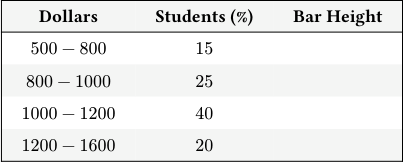
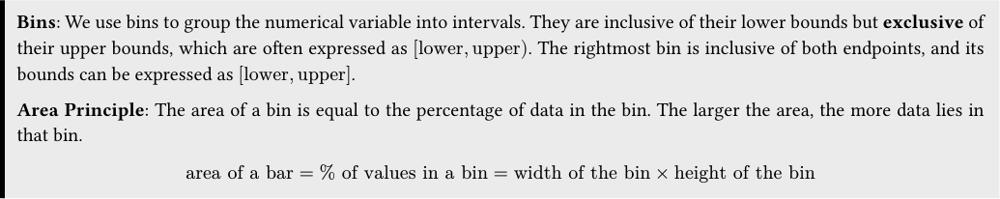
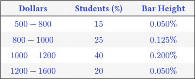
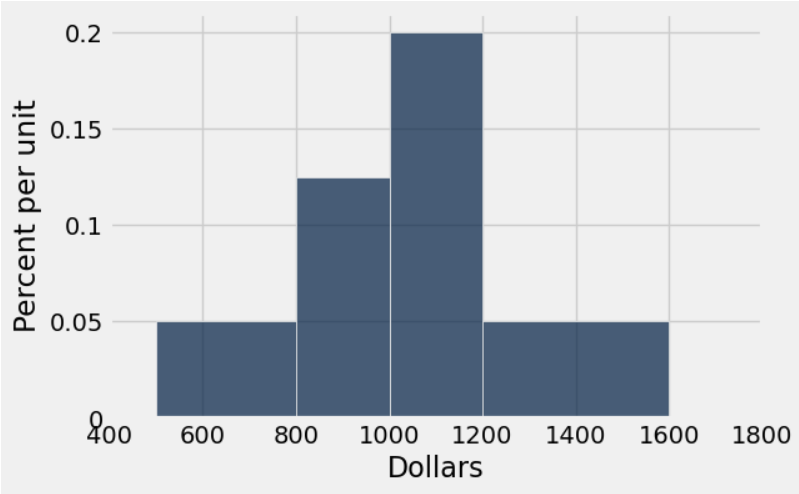
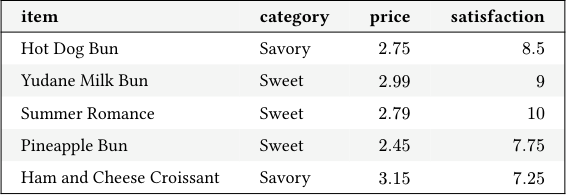
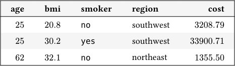

# Discussion 04 Data C8 Spring 2026

## Page 1

## More Visualizations, Intro to Functions

Discussion 04

Data C8: Foundations of Data Science UC Berkeley, Spring 2026

### 1. Rents & Ranges

The table below shows the distribution of rents paid by students in Boston. The first column consists of ranges of monthly rent, in dollars. Ranges include the lower bound but not the upper bound. The second column shows the percentage of students who pay rent in each of the ranges.

#### Dollars Students (%) Bar Height

500 −800 15

800 −1000 25

1000 −1200 40

1200 −1600 20

Bins: We use bins to group the numerical variable into intervals. They are inclusive of their lower bounds but exclusive of their upper bounds, which are often expressed as [lower, upper). The rightmost bin is inclusive of both endpoints, and its bounds can be expressed as [lower, upper].

Area Principle: The area of a bin is equal to the percentage of data in the bin. The larger the area, the more data lies in that bin.

area of a bar = % of values in a bin = width of the bin × height of the bin

- Calculate the heights of the bars for the bins listed in the table, with correct units. Recall the Area Principle.

#### Dollars Students (%) Bar Height

500 −800 15 0.050%

800 −1000 25 0.125%

1000 −1200 40 0.200%

1200 −1600 20 0.050%

Calculation (demonstrated on the 500-800 bin):

area width = 15% $800 −$500 = 0.050% per dollar

#### (b) Draw a histogram of the data. Make sure you label your axes!

## Page 2

#### (c) Based on the information that we have, can we create the following bins? Explain your answer.

#### i. [500, 1000)

Yes. We can combine the [500, 800) and [800, 1000) bins since we know that 15% of the students are in the first bin and 25% are in the second. The height of this bin will be

15% + 25% $300 + $200 = 40%

$500 = 0.08% per dollar

#### ii. [500, 650)

No. We do not know the percent of students who pay between $500 and $650 in monthly rent. Histograms tell us nothing about the distribution of data within individual bins. It could be the case that no students pay between $500 and $650 in monthly rent and 15% pay between $650 and $800.

#### iii. [800, 1200)

Yes. We can combine the [800, 1000) and [1000, 1200) bins since we know that 25% of the students are in the first bin and 40% are in the second. The height of this bin will be

25% + 40% $200 + $200 = 65%

$400 = 0.1625% per dollar

- True or False: If we combine the [500, 800) and [800, 1000) bins together, the height of the new bin would be greater than

the heights of both of the old bins. Please explain your answer and verify it by calculating the height of the new bin.

False: When we combine bins together, the height of the new bin is the weighted average of the old bin heights. Thus, the new bin height will be greater than the [500, 800) bin, but less than the [800, 1000) bin.

new height = area

width = 40% ($800 −$500) + ($1000 −$800) = 0.08% per dollar

Data C8 Spring 2026 Discussion 04 | 2

## Page 3

### 2. Fun(ctions)

- After learning about them in Data 8, Max wants to write a function that can calculate the hypotenuse of any right triangle.

He wants to use his function to assign C to the hypotenuse of a right triangle with legs (sides adjacent to the hypotenuse) A and B. However, he’s made many mistakes. Which ones can you identify?

Hint: There are 5 unique issues. Assume that numpy has been imported as np.

def hypotenuse(a, b) squares = make_array(side1, side2) * 2 sum = sum(squares) squareroot = np.sqrt(sum) print(squareroot)

C = hypotenuse(A, B) # C should be the numerical result

#### Issue 1: the function is missing a colon : after the arguments list.

#### Issue 2: squares should be squared with ** not *

Issue 3: We need to be consistent with our argument names so they get accurately assigned throughout the function. We can either replace a and b with side1 and side2, or vice versa.

Issue 4: The function will print the value of squareroot but will not return it, which means we will not have access to the value of squareroot anymore. That is, we will not be able to assign it to any values or use it as the argument to any functions! In this case, C will not be equal to anything (it will actually be None)!

Issue 5: When we assign sum to a number we have lost the original behavior of the built-in sum function. We should not re-assign variable names. (Note: in this specific question the redefined sum is a local variable and is only scoped within the hypotenuse function, though this is out of scope of Data 8. You should generally never override any function name, regardless of the scope of the variable.)

#### (b) Write a function that takes in the following arguments:

- tbl: a table.
- col: a string, name of a column in tbl.
- n: an int.

The function should return a table that contains the rows that have the 𝑛 largest values for the specified column.

def top_n(tbl, col, n):

sorted_tbl = __________________________________________________ top_n_rows = __________________________________________________ return ________________________________________________________

def top_n(tbl, col, n): sorted_tbl = tbl.sort(col, descending=True) top_n_rows = sorted_tbl.take(np.arange(n)) return top_n_rows

Data C8 Spring 2026 Discussion 04 | 3

## Page 4

### 3. Sheng Kee Fridays

Dagny’s favorite activity to celebrate Fridays is buying pastries at Sheng Kee before class. She stores her purchase data in a table,

pastries, to keep track of her spending. Assume she never purchases the same item twice. Each row represents an individual purchase. The first few rows look like this:

#### item category price satisfaction

Hot Dog Bun Savory 2.75 8.5

Yudane Milk Bun Sweet 2.99 9

Summer Romance Sweet 2.79 10

Pineapple Bun Sweet 2.45 7.75

Ham and Cheese Croissant Savory 3.15 7.25

The table has 4 columns:

- item (string): name of the pastry.
- category (string): whether the pastry is sweet or savory.
- price (float): price of the pastry.
- satisfaction (float): how satisfied (out of 10) Dagny was after eating the pastry.

- Write a line of code to calculate the average satisfaction Dagny felt after eating sweet pastries.

_________________(pastries.______________(____________________________________).column(________________))

np.mean(pastries.where("category", are.equal_to("Sweet")).column("satisfaction"))

- Dagny is curious if the average price for savory pastries is higher than the average price for sweet pastries. Write a line of

code that will output the category that is more expensive.

pastries.__________________(____________________, ____________________)

.sort(___________________________, ___________________________) .column(_________________________________________).item(______)

pastries.group("category", np.mean) .sort("price mean", descending=True) .column("category").item(0)

Note the new column name after .group is price mean. The .sort must take in the correct column name. Alternatively you may use the index of the column after grouping.

- Dagny’s budget is getting tight, and she wants to buy pastries that will give her the most satisfaction per dollar. Write lines

of code that will help us achieve this.

- First, create an array that contains each purchase’s satisfaction per dollar. Then, add a new column called “satisfaction

per $”, to the pastries table.

score_array = pastries.____________(__________________) / pastries._____________(__________________)

pastries = ____________.with_column(__________________________, ___________________________________)

score_array = pastries.column("satisfaction") / pastries.column("price") pastries = pastries.with_column("satisfaction per $", score_array)

Data C8 Spring 2026 Discussion 04 | 4

## Page 5

#### ii. Dagny defines a function score that takes in satisfaction and price (in that order) and returns the satisfaction per dollar.

#### Find a different way to compute score_array.

score_array = pastries._________________(__________________, __________________, __________________)

score_array = pastries.apply(score, "satisfaction", "price")

#### iii. Dagny is interested in finding the pastries in the table with the top 3 satisfaction values per dollar. Write code that will

#### output the names of these items as an array.

pastries_sorted = pastries.__________(_____________________________________, ______________________)

pastries_sorted.__________(______________________________________________).column(_________________)

pastries_sorted = pastries.sort("satisfaction per $", descending=True) pastries_sorted.take(np.arange(3)).column("item")

#### Data C8 Spring 2026 Discussion 04 | 5

## Page 6

### 4. Insurance (Optional)

The table insurance contains one row for each beneficiary that is covered by a particular insurance company:

#### age bmi smoker region cost

25 20.8 no southwest 3208.79

25 30.2 yes southwest 33900.71

62 32.1 no northeast 1355.50

... (20198 rows omitted)

The table contains five columns:

- age (int): the age of the beneficiary.
- bmi (float): the Body Mass Index (BMI) of the beneficiary.
- smoker (string): indicates whether the beneficiary smokes.
- region (string): the region of the United States where the beneficiary lives.
- cost (float): the total amount in medical costs that the insurance company paid for this beneficiary last year.

(Fall 2018 Midterm Question 2 Modified)

In each part below, fill in the blanks to achieve the desired outputs.

- A scatter plot comparing the amount paid last year vs. BMI (titles are usually written as Y vs. X) for only the beneficiaries

whose costs exceeded $25,000. Each dot on the scatter plot should represent one beneficiary.

high_cost = __________________.____________(_____________, ____________________________________________)

__________.______________________(__________________________________, _________________________________)

high_cost = insurance.where("cost", are.above(25000)) high_cost.scatter("bmi", "cost")

- Write a function that takes an age as an argument, and returns the average BMI among all beneficiaries of that age.

def average_bmi(age):

right_age = insurance.where(________________, ________________) bmis = right_age._______________(______________) avg = sum(bmis) / len(bmis) _____________________________________

def average_bmi(age): right_age = insurance.where("age", age) bmis = right_age.column("bmi") avg = sum(bmis) / len(bmis) return avg

Data C8 Spring 2026 Discussion 04 | 6
