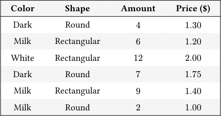
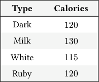
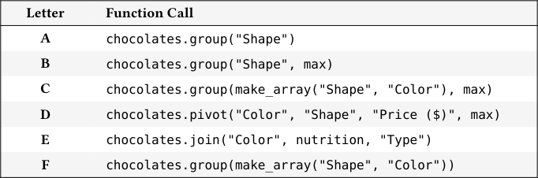
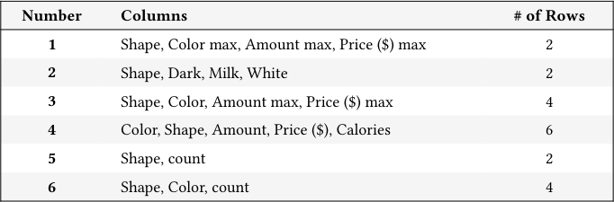
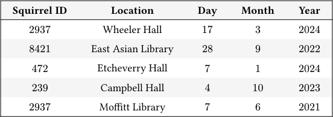
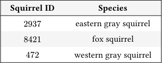

# Discussion 05 Data C8 Spring 2026

## Page 1

## Table Methods, Conditionals & Iteration

Discussion 05

Data C8: Foundations of Data Science UC Berkeley, Spring 2026

Welcome to the Project 1 Discussion Worksheet! This week we will cover table methods like .group and .pivot, conditional statements, and iteration. As a reminder, make use of the Python Reference and the Table Functions Visualizer on the Data 8 website, as well as the Discussion Reference sheet you are provided with!

### 1. Table Matchmaking

Shown below are the chocolates and nutrition tables respectively.

#### Color Shape Amount Price ($)

#### Type Calories

Dark Round 4 1.30

Dark 120

Milk Rectangular 6 1.20

Milk 130

White Rectangular 12 2.00

White 115

Dark Round 7 1.75

Ruby 120

Milk Rectangular 9 1.40

nutrition

Milk Round 2 1.00

chocolates

Match the following table method calls to the resulting descriptions of tables.

Hint: Pay attention to the column names of the resulting tables! For example, what happens to the column names when you specify an aggregating function in group()? What happens when you only specify one column name? How does the behavior of pivot() differ from group()?

#### Letter Function Call

#### A chocolates.group("Shape")

#### B chocolates.group("Shape", max)

#### C chocolates.group(make_array("Shape", "Color"), max)

#### D chocolates.pivot("Color", "Shape", "Price ($)", max)

#### E chocolates.join("Color", nutrition, "Type")

#### F chocolates.group(make_array("Shape", "Color"))

#### Number Columns # of Rows

#### 1 Shape, Color max, Amount max, Price ($) max 2

#### 2 Shape, Dark, Milk, White 2

#### 3 Shape, Color, Amount max, Price ($) max 4

#### 4 Color, Shape, Amount, Price ($), Calories 6

#### 5 Shape, count 2

#### 6 Shape, Color, count 4

#### A: _______________ B: _______________ C: _______________

#### D: _______________ E: _______________ F: _______________

## Page 2

## 2. Chocolate!

#### (a) The % operator returns the remainder if you divide by a certain number (e.g. 11 % 5 = 1). If a number n is odd, what will n

#### % 2 return?

#### (b) What will the following code output? Format your answer in the same way you expect Python to output the result of running

#### the following code.

for c in np.arange(5): if c < 2: print("Chocolate?") if c % 2 == 0: print("Yes sir! With or without nuts?") else: if c % 2 == 1: print("Again!?") else: print("CHOCOLATE" + ("!" * (c * 2 - 3)))

## 3. Getting Even

#### (a) The count_evens function takes in an array of integers and returns the number of even integers in the array.

#### Use a combination of iteration and conditionals to complete the skeleton code below.

def count_evens(arr): num_evens = 0 for ________________________________________________: if ________________________________________________: ________________________________________________ return ________________________________________________

#### (b) Now let’s see how we can write the same function using array operations instead of iteration.

def count_evens(arr):

remainder_array = ________________________________________________ return ________________________________________________

#### Data C8 Spring 2026 Discussion 05 | 2

## Page 3

### 4. Squirrel Sightings (Optional)

The table squirrel below contains some information on reported squirrel sightings across the Berkeley campus. Each row in the squirrel table represents one unique squirrel sighting:

- Squirrel ID (int): unique identification number for each squirrel.
- Location (string): common name of the nearest campus landmark where the squirrel was spotted.
- Month (int): numerical representation of the month when the squirrel was spotted.
- Day (int): day of the month when the squirrel was spotted.
- Year (int): year when the squirrel was spotted.

#### Squirrel ID Location Day Month Year

2937 Wheeler Hall 17 3 2024

8421 East Asian Library 28 9 2022

472 Etcheverry Hall 7 1 2024

239 Campbell Hall 4 10 2023

2937 Moffitt Library 7 6 2021

... (95 rows omitted)

- Write a line of code that evaluates to the proportion of Squirrel IDs in the table that are even.

- Alankrita wants to find the best location where she is most likely to find a squirrel. Write a line of code that evaluates to the

location with the most squirrel sightings.

- Alankrita is interested in how many squirrels were sighted at every location during every month. Create a table called

sightings where each cell contains the number of squirrel sightings that occurred in 2023 at each location during each month. Note: Each row should be in a different location.

squirrels_2023 = _______________________________________________________________________________________

sightings = ____________________________________________________________________________________________

- Alankrita now has access to another table, species, that contains information about the species of each squirrel.

A few rows from this table are shown below.

#### Squirrel ID Species

2937 eastern gray squirrel

8421 fox squirrel

472 western gray squirrel

Write lines of code to find the least observed species in 2024. If multiple species are tied for the least sightings, find the species that comes first alphabetically.

squirrels_2024 = _______________________________________________________________________________________

species_counts = _______________________________________________________________________________________

least_observed = _______________________________________________________________________________________

Data C8 Spring 2026 Discussion 05 | 3
