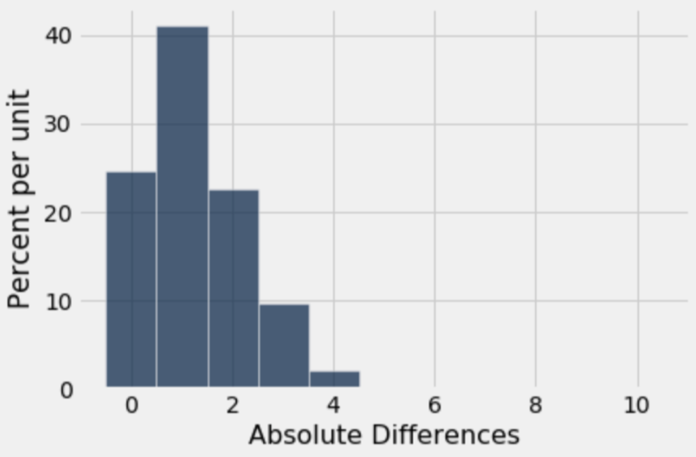
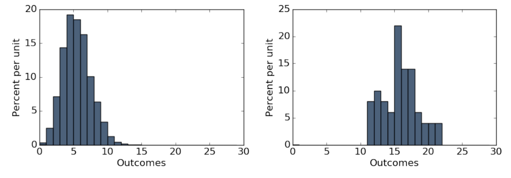

# Discussion 06 Data C8 Spring 2026

## Page 1

## Chance & Models

### Discussion 06

### Data C8: Foundations of Data Science UC Berkeley, Spring 2026

## 1. Marble Madness

#### (a) Tiffany has a bag with three marbles. One marble is orange, and the other two are purple. For each round of a game, she

#### draws from the bag 10 times with replacement. She wins the round by drawing at least one orange marble.

#### Write a function to simulate one round of Tiffany’s game. The function should return True if she wins and False if she loses.

def one_round():

bag = ____________________________________________________ one_sim = ________________________________________________ num_orange = _____________________________________________ return ___________________________________________________

def one_round(): bag = make_array("purple", "purple", "orange") one_sim = np.random.choice(bag, 10) num_orange = sum(one_sim == "orange") return num_orange >= 1

#### Instead of sum, students can also use np.count_nonzero(). They can also use sample_proportions with probabilities (2

#### 3, 1 3).

#### (b) Finish the following code to help Tiffany simulate 100 rounds of the game and assign the variable win_proportion to the

#### proportion of rounds she wins.

count = 0

for _____________________________________________:

if ________________________________________________: ________________________________________________________ win_proportion = _______________________________________________

count = 0 for i in np.arange(100): if one_round(): count = count + 1 win_proportion = count / 100

#### Note that the line if one_round() works by incrementing the count variable when one_round() evaluates to True (and will not if one_round() evaluates to False).

#### (c) For any one draw, what is the probability that Tiffany draws a purple marble?

#### ℙ[Draw a purple marble] = 2

#### 3

## Page 2

#### (d) For any individual round, what is the probability that Tiffany loses?

Using the multiplication rule:

10

ℙ[Tiffany loses one round] = ℙ[draw 10 purples] = ℙ[purple]10 = (2

3)

#### (e) For any individual round, what is the probability that Tiffany wins?

Using the complement rule:

10

ℙ[Tiffany wins one round] = 1 −ℙ[Tiffany loses one round] = 1 −(2

3)

Data C8 Spring 2026 Discussion 06 | 2

## Page 3

### 2. Flip Flop

Brandon is flipping a coin. He thinks it is unfair, but is not sure. He flips it 10 times and gets heads 9 times. He wants to determine whether the coin was actually unfair, or whether the coin was fair and his result of 9 heads in 10 flips was due to random chance.

#### (a) What is a possible model that he can simulate under?

A possible model that you could simulate under is that on each flip, there is a 50% chance that the coin lands heads and a 50% chance that the coin lands tails. Any difference is due to chance.

If you are more familiar with probability: The heads are like independent and identically distributed draws at random from a uniform distribution in which 50% are Heads and 50% are Tails.

- What is an alternative model for Brandon’s coin? You do not necessarily have to be able to simulate under this model.

An alternative model that Brandon might suggest is that the coin is unfair, and that the difference in the observed data is due to something other than just chance. We would not be able to simulate under this model because the statement “the coin is unfair” is not very specific (we can ask questions like “How unfair?” or “Biased towards heads or tails?”).

- What is a good test statistic that you could compute from the outcome of his flips? Calculate that statistic for your observed

data; this is our observed test statistic. Hint: If the coin was unfair, it could either be biased towards heads or biased towards tails.

A good test statistic is the absolute difference between the number of heads we observe and the expected number of heads (5). Our observed test statistic is |9 −5| = 4. Notice that this statistic is large for both a large number of heads, as well as a small number of heads.

We could also use proportions as our test statistic, e.g. |proportion of heads −0.5|.

#### (d) Complete the function flip_ten, which takes no arguments and does the following:

- Simulates flipping a fair coin 10 times
- Computes and returns one simulated test statistic, based on the test statistic chosen in the previous question

def flip_ten(): faces = make_array("Heads", "Tails") flips = ___________________________________________________________ num_heads = _______________________________________________________ return ____________________________________________________________

def flip_ten(): faces = make_array("Heads", "Tails") flips = np.random.choice(faces, 10) num_heads = np.count_nonzero(flips == "Heads") return abs(num_heads - 5)

- Complete the code below to simulate the experiment 10000 times and record the statistic computed in each of those trials in

an array called simulated_stats.

trials = _____________________________________________________________

simulated_stats = ____________________________________________________

for _________________________________________:

one_stat = ________________________________________ __________________________________ = ____________________________________________________

Data C8 Spring 2026 Discussion 06 | 3

## Page 4

trials = 10000 simulated_stats = make_array() for i in np.arange(trials): one_stat = flip_ten() simulated_stats = np.append(simulated_stats, one_stat)

- Suppose we performed the simulation and plotted a histogram of simulated_stats. The histogram is shown below.

#### Is our observed statistic from (c) consistent with the model we simulated under?

No, the observed statistic is not consistent with the model we simulated under. If we look for the observed statistic (4), we will see that it rarely ever happened in our simulation; most of the statistics generated in our simulations were in the range [0, 2]. Therefore, we would say that it is inconsistent with the model we simulated under.

Data C8 Spring 2026 Discussion 06 | 4

## Page 5

## 3. Large Numbers

#### (Spring 2017 Midterm Question 3 Modified)

#### (a) The roll function draws an empirical histogram of the number of results that are 𝑘 or larger, when 𝑛 fair 6-sided dice are

rolled. For example, if 𝑘= 5, 𝑛= 3, and rolling three dice results in the faces {6, 4, 5}, then two of the three dice are 5 or larger (the 6 and the 5). Fill in the blanks to complete its implementation.

def roll(k, n, trials): """Repeatedly roll `n` dice `trials` times and check how many results are `k` or larger.""" outcomes = make_array() possible_results = _______________________________________ for i in _________________________________________________: rolls = _____________________________________________________ outcomes = __________________________________________________ Table().with_column("Outcomes", outcomes).hist(bins=np.arange(30))

def roll(k, n, trials): """Repeatedly roll `n` dice `trials` times and check how many results are `k` or larger.""" outcomes = make_array() possible_results = np.arange(1, 7) for i in np.arange(trials): rolls = np.random.choice(possible_results, n) outcomes = np.append(outcomes, np.count_nonzero(rolls >= k)) Table().with_column(`Outcomes', outcomes).hist(bins = np.arange(30))

#### (b) Assume roll is implemented correctly for the below questions.

#### i. Which expression generates the first histogram?

roll(4, 30, 5000) roll(6, 30, 5000) roll(4, 30, 50) roll(6, 30, 50)

#### ii. Which expression generates the second histogram?

roll(4, 30, 5000) roll(6, 30, 5000) roll(4, 30, 50) roll(6, 30, 50)

#### Data C8 Spring 2026 Discussion 06 | 5

## Page 6

The left histogram’s outcome values are generally lower than those in the right histogram. This means that fewer dice rolls in the process that generated the left histogram were greater than or equal to k than in the process that generated the right histogram. Therefore, the left histogram was generated by a call to roll with k=6 and the right histogram by a call with k=4, since rolling a number greater than or equal to 6 is less likely than rolling a number greater than or equal to 4.

Additionally, the left histogram is smoother, which indicates that it is closer to a theoretical distribution. Using the Law of Large Numbers, this implies that the left histogram was generated by a process with more repetitions. Thus, the left histogram was generated by roll(6, 30, 5000) and the right by roll(4, 30, 50)

iii. The histogram generated by roll(6, 30, 5000) is most likely closer than a histogram generated by roll(6, 30, 50)

to the theoretical distribution of the number of 6s rolled when rolling 30 dice.

True

False

This is exactly what the Law of Large Numbers tells us: as a chance experiment is repeated independently and under identical conditions, the empirical distribution of its outcomes gets closer to the theoretical distribution.

Data C8 Spring 2026 Discussion 06 | 6
