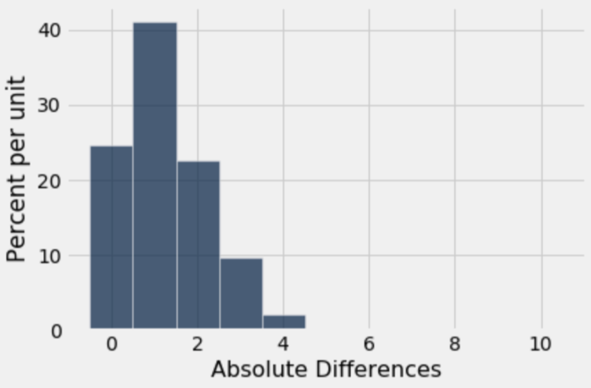
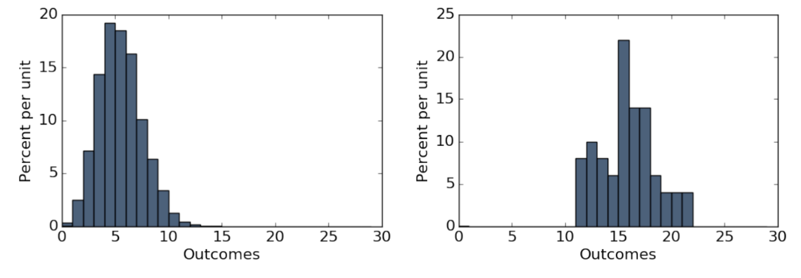

# Discussion 06 Data C8 Spring 2026

## Page 1

## Chance & Models

Discussion 06

Data C8: Foundations of Data Science UC Berkeley, Spring 2026

### 1. Marble Madness

- Tiffany has a bag with three marbles. One marble is orange, and the other two are purple. For each round of a game, she

draws from the bag 10 times with replacement. She wins the round by drawing at least one orange marble.

Write a function to simulate one round of Tiffany’s game. The function should return True if she wins and False if she loses.

def one_round():

bag = ____________________________________________________ one_sim = ________________________________________________ num_orange = _____________________________________________ return ___________________________________________________

- Finish the following code to help Tiffany simulate 100 rounds of the game and assign the variable win_proportion to the

proportion of rounds she wins.

count = 0

for _____________________________________________:

if ________________________________________________: ________________________________________________________ win_proportion = _______________________________________________

#### (c) For any one draw, what is the probability that Tiffany draws a purple marble?

#### (d) For any individual round, what is the probability that Tiffany loses?

#### (e) For any individual round, what is the probability that Tiffany wins?

## Page 2

### 2. Flip Flop

Brandon is flipping a coin. He thinks it is unfair, but is not sure. He flips it 10 times and gets heads 9 times. He wants to determine whether the coin was actually unfair, or whether the coin was fair and his result of 9 heads in 10 flips was due to random chance.

#### (a) What is a possible model that he can simulate under?

- What is an alternative model for Brandon’s coin? You do not necessarily have to be able to simulate under this model.

- What is a good test statistic that you could compute from the outcome of his flips? Calculate that statistic for your observed

data; this is our observed test statistic. Hint: If the coin was unfair, it could either be biased towards heads or biased towards tails.

#### (d) Complete the function flip_ten, which takes no arguments and does the following:

- Simulates flipping a fair coin 10 times
- Computes and returns one simulated test statistic, based on the test statistic chosen in the previous question

def flip_ten(): faces = make_array("Heads", "Tails") flips = ___________________________________________________________ num_heads = _______________________________________________________ return ____________________________________________________________

- Complete the code below to simulate the experiment 10000 times and record the statistic computed in each of those trials in

an array called simulated_stats.

trials = _____________________________________________________________

simulated_stats = ____________________________________________________

for _________________________________________:

one_stat = ________________________________________ __________________________________ = ____________________________________________________

Data C8 Spring 2026 Discussion 06 | 2

## Page 3

- Suppose we performed the simulation and plotted a histogram of simulated_stats. The histogram is shown below.

#### Is our observed statistic from (c) consistent with the model we simulated under?

Data C8 Spring 2026 Discussion 06 | 3

## Page 4

### 3. Large Numbers

(Spring 2017 Midterm Question 3 Modified)

- The roll function draws an empirical histogram of the number of results that are 𝑘 or larger, when 𝑛 fair 6-sided dice are

rolled. For example, if 𝑘= 5, 𝑛= 3, and rolling three dice results in the faces {6, 4, 5}, then two of the three dice are 5 or larger (the 6 and the 5). Fill in the blanks to complete its implementation.

def roll(k, n, trials): """Repeatedly roll `n` dice `trials` times and check how many results are `k` or larger.""" outcomes = make_array() possible_results = _______________________________________ for i in _________________________________________________: rolls = _____________________________________________________ outcomes = __________________________________________________ Table().with_column("Outcomes", outcomes).hist(bins=np.arange(30))

#### (b) Assume roll is implemented correctly for the below questions.

#### i. Which expression generates the first histogram?

roll(4, 30, 5000) roll(6, 30, 5000) roll(4, 30, 50) roll(6, 30, 50)

#### ii. Which expression generates the second histogram?

roll(4, 30, 5000) roll(6, 30, 5000) roll(4, 30, 50) roll(6, 30, 50)

iii. The histogram generated by roll(6, 30, 5000) is most likely closer than a histogram generated by roll(6, 30, 50)

to the theoretical distribution of the number of 6s rolled when rolling 30 dice.

True

False

Data C8 Spring 2026 Discussion 06 | 4
