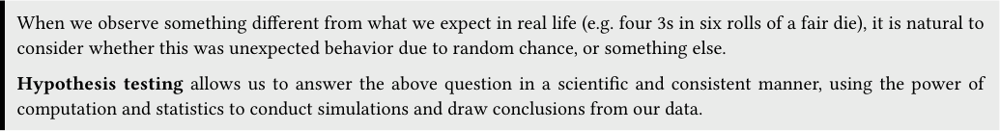
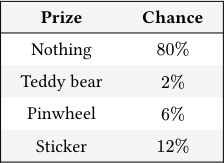
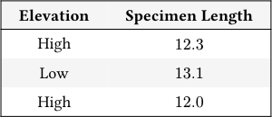
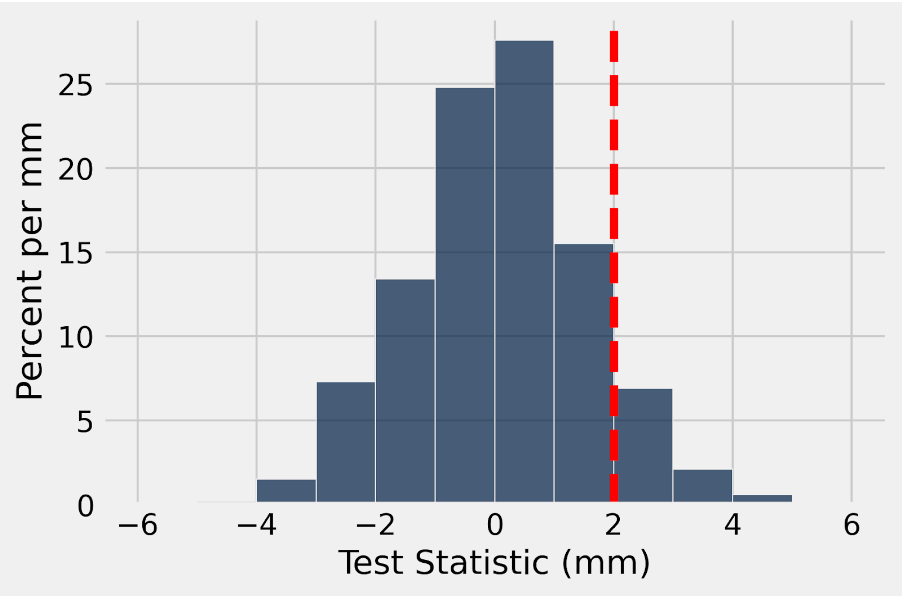

# Discussion 07 Data C8 Spring 2026

## Page 1

## Midterm Review

Discussion 07

Data C8: Foundations of Data Science UC Berkeley, Spring 2026

When we observe something different from what we expect in real life (e.g. four 3s in six rolls of a fair die), it is natural to consider whether this was unexpected behavior due to random chance, or something else.

Hypothesis testing allows us to answer the above question in a scientific and consistent manner, using the power of computation and statistics to conduct simulations and draw conclusions from our data.

### 1. Test Statistics

Dylan is playing with a coin and he wants to test whether his coin is fair. His experiment is to toss the coin 100 times. He chooses the following null hypothesis.

#### Null Hypothesis: The coin is fair and any observed deviation is due to chance.

For each of the alternative hypotheses listed below, determine whether or not the test statistic is valid and give an explanation.

#### (a) Alternative Hypothesis: The coin is biased towards heads.

#### Test Statistic: # of heads.

Valid

Invalid

#### (b) Alternative Hypothesis: The coin is not fair.

#### Test Statistic: # of heads.

Valid

Invalid

Invalid. We want more extreme values of our test statistic to favor the alternative hypothesis. We want to consider the two cases in which the coin is biased towards heads or that it’s biased towards tails, but simply counting the number of heads does not account for the second case.

#### (c) Alternative Hypothesis: The coin is not fair.

#### Test Statistic: |# of heads - expected # of heads|.

Valid

Invalid

#### (d) Alternative Hypothesis: The coin is biased towards heads.

#### Test Statistic: |# of heads - expected # of heads|.

Valid

Invalid

Invalid. This is the opposite case of part (b). We see that this test statistic will also account for a bias towards tails (because of the absolute value).

#### (e) Alternative Hypothesis: The coin is not fair.

#### Test Statistic: 1

2 −proportion of heads

## Page 2

Valid

Invalid

Invalid. Without the absolute value, we will not achieve large values of our test statistic leaning towards the alternative hypothesis.

Data C8 Spring 2026 Discussion 07 | 2

## Page 3

### 2. Hypothesis Testing

You are playing a wheel-spinning game at a carnival, where you can earn prizes based on where the wheel stops. The booth attendant claims the distribution of prizes is as below, but you think the game is rigged and doesn’t follow the listed probabilities.

#### Prize Chance

Nothing 80%

Teddy bear 2%

Pinwheel 6%

Sticker 12%

You would like to test your claim so you can report the carnival for fraud.

- Is the data we are working with numerical or categorical? Think about how this influences what test statistic we should use.

Numerical

Categorical

We have four named outcomes (the Prizes), and are not numeric measurements. This is therefore categorical, and we should consider using TVD as our test statistic (see part (e)).

#### (b) What is the booth attendant’s hypothesis?

The distribution of prizes follows the distribution listed by the carnival. Any observed difference is simply due to chance.

#### (c) What is your hypothesis?

The distribution of prizes does not follow the distribution listed by the carnival. Any observed difference is not just due to chance.

#### (d) Which hypothesis (of the two we defined) can you simulate under?

You could simulate under the booth attendant’s hypothesis. This is because it is a fully defined model, meaning we are able to describe the parameters of an experiment surrounding it. Your hypothesis is simply that the distribution is not the same as the carnival’s; there is no fully defined model that we can simulate under.

#### (e) What is a good test statistic to use?

TVD from expected distribution. When we are observing categorical distributions of data and want to compare them, we should use TVD. Note, this is a good example because we have four different components in the distribution that we would like to test.

- Write code that simulates playing the carnival game 1000 times, and returns an array of proportions corresponding to how

often each prize was won.

prize_chances = _______________________________________________________

my_simulation = _______________________________________________________

prize_chances = make_array(0.8, 0.02, 0.06, 0.12) my_simulation = sample_proportions(1000, prize_chances)

- Write one line of additional code that extracts the number of teddy bears we would have won in our simulation. You may

use my_simulation from the previous question.

Data C8 Spring 2026 Discussion 07 | 3

## Page 4

_______________________________________________________________________

my_simulation.item(1) * 1000

#### Data C8 Spring 2026 Discussion 07 | 4

## Page 5

### 3. A/B Testing

- Kevin, a museum curator, has recently been given specimens of caddisflies collected from various parts of Northern

California. The scientists who collected the caddisflies think that caddisflies collected at higher altitudes tend to be bigger. They tell him that the average length of the 560 caddisflies collected at high elevation is 14mm, while the average length of the 450 caddisflies collected from a slightly lower elevation is 12mm. He is not sure that this difference really matters and thinks that this could just be the result of chance in sampling.

What is an appropriate null hypothesis that Kevin can simulate under?

Null Hypothesis: The distribution of specimen lengths is the same for caddisflies sampled from high elevation as those sampled from low elevation. Any observed difference between the two samples is simply due to random chance.

- How could you test the null hypothesis in the A/B test from above? What assumption would you make to test the hypothesis,

and how would you simulate under that assumption?

If the null hypothesis is true – the caddisflies did not come from different distributions – then it should not matter how the samples were labeled (high elevation or low elevation). Under this assumption, you could shuffle the labels of the caddisflies and calculate your test statistic from this “relabeled” data.

- What would be a useful test statistic for the A/B test? Remember that the direction of your test statistic should come from

the initial setting.

Difference in mean lengths between the two groups. Note that this is not an absolute difference – we could choose either order for subtraction, but that would affect the direction of our alternative hypothesis so we need to be careful!

Assume flies refers to the following table (an excerpt is shown).

#### Elevation Specimen Length

High 12.3

Low 13.1

High 12.0

- Fill in the blanks in this code to generate one value of the test statistic simulated under the null hypothesis.

def one_simulation():

shuffled_labels = flies.____________________________________________.column(______________________) shuffled_flies = flies.with_columns(______________________, ______________________________________) grouped = shuffled_flies._______________________(________________________, _______________________) means = grouped.column(‘Specimen length mean’) statistic = ____________________________________ return statistic

def one_simulation(): shuffled_labels = flies.sample(with_replacement=False).column("Elevation") shuffled_flies = flies.with_columns("Elevation", shuffled_labels) grouped = shuffled_flies.group("Elevation", np.mean) means = grouped.column("Specimen length mean") statistic = means.item(0) - means.item(1) return statistic

Data C8 Spring 2026 Discussion 07 | 5

## Page 6

#### (e) Fill in the code below to simulate 10000 trials of our permutation test.

test_stats = ________________________________________________

repetitions = ________________________________________________

for i in np.arange(____________________________________):

one_stat = ________________________________________________ test_stats = np.append(test_stats, one_stat)

test_stats = make_array() repetitions = 10000 for i in np.arange(repetitions): one_stat = one_simulation() test_stats = np.append(test_stats, one_stat)

- The histogram of test_stats is plotted below with a vertical red line indicating the observed value of our test statistic. If

the p-value cutoff we use is 5%, what is the conclusion of our test?

We can inspect the histogram above to see that the area to the right of the observed value (which is our p-value) is greater than 5%. Since our p-value is greater than our p-value cutoff, we fail to reject the null hypothesis and conclude that the data tend to favor the null hypothesis.

- Suppose that the null hypothesis is true. If we ran this same hypothesis test 1000 times, each time from our flies table and

with a p-value cutoff of 5%, how many times would we expect to incorrectly reject the null hypothesis?

We would expect to reject the null hypothesis 1000 ⋅0.05 = 50. A p-value cutoff of 5% represents the probability of incorrectly rejecting the null hypothesis.

- What effect does decreasing our p-value cutoff have on the number of times we expect to incorrectly reject the null hypothesis?

If we decrease our p-value cutoff, we are reducing the expected number of times we will incorrectly reject the null.

#### (i) Answer the following True/False questions.

- A/B testing is used to determine whether or not we believe two samples come from the same underlying distribution.

True

False

This is the definition of A/B testing.

ii. To conduct a permutation test, you should sample your data with replacement with a sample size equal to the number

of rows in the original table.

Data C8 Spring 2026 Discussion 07 | 6

## Page 7

True

False

False, you should sample your data without replacement; otherwise, you would not get a permutation of your data.

iii. A/B testing is the same as using total variation distance as a test statistic for a hypothesis test.

True

False

False, total variation distance is just a test statistic that computes the distance between two distributions. It does not involve taking a random permutation of your data.

Data C8 Spring 2026 Discussion 07 | 7

## Page 8

### 4. Multiple Choice

- In the U.S. in 2000, there were 2.4 million deaths from all causes, compared to 1.9 million in 1970, which represents a 25%

increase. The data shows that the public’s health got worse over the period 1970-2000.

True False

False, because the population also got bigger between 1970 and 2000. It would be more appropriate to look at the total number of deaths compared to the total population at each year. In fact, the U.S. population in 1970 was 203 million, while in 2000 it was 281 million.

- A company is interested in knowing whether women are paid less than men in their organization. They share all their salary

data with you. An A/B test is the best way to examine the hypothesis that all employees in the company are paid equally.

True False

False, there is no room for statistical inference here. We have access to the whole population, so the answer can simply be retrieved by directly looking at the data. There is no need for an A/B test here.

- Consider a randomized controlled trial where participants are randomly split into treatment and control groups. We are 100%

certain there will be no systematic differences between the treatment and control groups if the process is followed correctly.

True False

Randomization can still give rise to significantly different treatment and control groups merely by chance, meaning there is still the possibility for systematic differences between the treatment and control groups.

As an example, if you were holding an RCT for a new energy drink, there’s a chance that the randomization, just by chance led to one group having a large majority of coffee drinkers and another having a large majority of non-caffeine users. In this case, the systematic difference refers to how the randomization did not effectively assign these two groups to control for their differences outside of the treatment.

RCTs can help minimize events like this occurring, but we cannot say it is impossible for something like this to occur.

- A researcher considers the following scheme for splitting people into control and treatment groups. People are arranged in

a line and for each person, a fair, six-sided die is rolled. If the die comes up to be a 1 or a 2, the person is allocated to the treatment group. If the die comes up to be a 3, 4, 5, or 6 then the person is allocated to the control group. This is a randomized control experiment.

True False

True, because the participants were randomly assigned to each group through the roll of a die. This makes it a randomized controlled experiment!

- You are conducting a hypothesis test to check whether a coin is fair. After you calculate your observed test statistic, you see

that its p-value is below the 5% cutoff. At this point, you can claim with certainty that the null hypothesis can not be true.

True False

False, remember the definition of a p-value: A p-value expresses the probability, under the null Hypothesis, that you observe a value for your test statistic that is at least as extreme as your observed test statistic in the direction of the alternative. Assuming that this probability is non 0 then we can not claim that the null can never be true. It could be the case that we simply got an unusual sample from our null.

- You roll a fair die a large number of times. While you are doing that, you observe the frequencies with which each face

appears and you make the following statement: “As I increase the number of times I roll the die, the probability histogram of the observed frequencies converges to the empirical histogram.”

True False

Data C8 Spring 2026 Discussion 07 | 8

## Page 9

False, the statement should be: “As I increase the number of times I roll the die, the empirical histogram of the observed frequencies converges to the probability histogram of a fair die.”

### 5. Probability

- A fair coin is tossed five times. Two possible sequences of results are HTHTH and HTHHH. Which sequence of results is more

likely? Explain your answer and calculate the probability of each sequence appearing.

They are equally likely since the coin is fair. By the multiplication rule, the probability that either of the two sequences appears is (1

2) 5.

#### For parts (b) - (d), assume we have a biased coin such that the probability of getting heads is 1

5 and the probability of getting tails is 4

1. The coin is tossed 3 times.

#### (b) What is the probability that you get exactly 2 heads? What about exactly 0 heads?

Here we need to consider all the possible outcomes that fall into this event and calculate their probabilities. There are 3 possible outcomes: HHT, HTH, THH. The probability for each of them is (1

5) 2 ⋅(4 5). Therefore, the probability of getting exactly 2 heads is 3 ⋅(1

5) 2 ⋅(4 5).

5) 3.

To get no heads, we must have gotten all tails, and the probability for that is: (4

#### (c) What is the probability of getting exactly 1 head or exactly 2 heads?

We can use the addition rule to add the probability of getting exactly 1 head, and the probability of getting exactly 2 heads. There are three possible outcomes for each case. The probability is: 3 ⋅(1

1. ⋅(4 5) 2 + 3 ⋅(1 5) 2 ⋅(4 5).

#### (d) What is the probability you get 1 or more heads?

We can use the complement rule here. The complement of getting at least 1 head is getting no heads, which we’ve just calculated in the previous question. Therefore, the probability is: 1 −(4

5) 3.

Data C8 Spring 2026 Discussion 07 | 9

## Page 10

### 6. More Hypothesis Testing

A tortoise and a hare want to have a race on a number line! They both start at 0 and the race lasts for 100 time steps. However, they move differently. At each time step the tortoise moves 1 step forward with a 1

2 chance (and stays in place with a 1 2 chance), and the hare moves 3 steps forward with a 1

6 chance.

They race, and the tortoise loses badly; the hare finished 50 steps ahead of the tortoise. Suspicious, the tortoise decides to conduct a hypothesis test to determine whether or not the hare is actually faster.

- Fill in the blanks below for the null and alternative hypotheses of this test, as well as a valid test statistic.

#### Null Hypothesis:

#### Alternative Hypothesis:

#### Test Statistic:

Null Hypothesis: The hare is not faster than the tortoise. The hare finishing 50 steps ahead of the tortoise was simply due to random chance.

Alternative Hypothesis: The hare is faster than the tortoise. The hare finishing 50 steps ahead of the tortoise was not just due to random chance.

Test Statistic: The difference in distances between the hare and the tortoise at the end of each race.

- Write a function called one_race() that simulates a single race of 100 time steps. It should return a two element array of the

final distances of both the tortoise and the hare (in that order) from the origin after 100 time steps.

def one_race():

tortoise_array = ________________________________________________ hare_array = ________________________________________________ tortoise_sim = ________________________________________________ hare_sim = ________________________________________________ tortoise_distance = ________________________________________________ hare_distance = ________________________________________________ return make_array(tortoise_distance, hare_distance)

Data C8 Spring 2026 Discussion 07 | 10

## Page 11

#### There are two solutions - one with sample_proportions and one with np.random.choice.

#### Solution 1:

def one_race(): tortoise_array = make_array(1/2, 1/2) hare_array = make_array(1/6, 5/6) tortoise_sim = sample_proportions(100, tortoise_array) hare_sim = sample_proportions(100, hare_array) tortoise_distance = tortoise_sim.item(0) * 100 hare_distance = hare_sim.item(0) * 300 return make_array(tortoise_distance, hare_distance)

#### or

#### Solution 2:

def one_race(): tortoise_array = make_array(1, 0) hare_array = make_array(3, 0, 0, 0, 0, 0) tortoise_sim = np.random.choice(tortoise_array, 100) hare_sim = np.random.choice(hare_array, 100) tortoise_distance = sum(tortoise_sim) hare_distance = sum(hare_sim) return make_array(tortoise_distance, hare_distance)

#### (c) We would now like to simulate what would happen if the tortoise and the hare race 10,000 times. Complete the code below

#### and record how far the tortoise and the hare end from the origin in the arrays tortoise_distances and hare_distances respectively.

tortoise_distances = make_array() hare_distances = make_array()

for ________________________________________________:

race = ________________________________________________ one_tortoise_dist = ________________________________________________ one_hare_dist = ________________________________________________ tortoise_distances = ________________________________________________ hare_distances = ________________________________________________

tortoise_distances = make_array() hare_distances = make_array()

for i in np.arange(10000): race = one_race() one_tortoise_dist = race.item(0) one_hare_dist = race.item(1) tortoise_distances = np.append(tortoise_distances, one_tortoise_dist) hare_distances = np.append(hare_distances, one_hare_dist)

#### The results table (20,000 rows) contains two columns recorded after 10,000 simulations:

#### • Competitor (string): the name of the competitor, either “tortoise” or “hare” • Distance (int): the final distance of the competitor at the end of the race

#### (d) Using the results table, create an overlaid histogram that shows the distribution of final distances for both the tortoise and

#### the hare.

#### Data C8 Spring 2026 Discussion 07 | 11

## Page 12

________________________.________________________(________________________, group=____________)

results.hist("Distance", group="Competitor")

- Create an array called differences where each value in the array represents how many steps the hare finished ahead of the

tortoise in a given race. Then, write a line of code to calculate the observed p-value of the hypothesis test. Finally, assuming a 5% p-value cutoff, describe the different conclusions you would come to based on the possible values of the observed p-value.

differences = ________________________________________________

p_value = ________________________________________________

differences = hare_distances - tortoise_distances p_value = np.count_nonzero(differences >= 50) / 10000

If the observed p-value is less than the 5% cutoff, we would consider this evidence against the null hypothesis and reject it in favor of the alternative hypothesis. If the observed p-value is greater than the 5% cutoff, our observation is consistent with our null hypothesis and we would fail to reject the null.

Data C8 Spring 2026 Discussion 07 | 12
