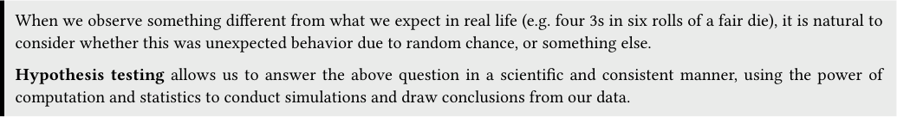
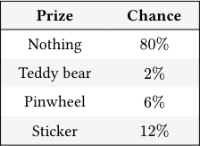
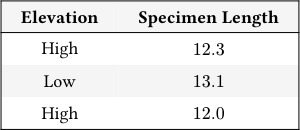
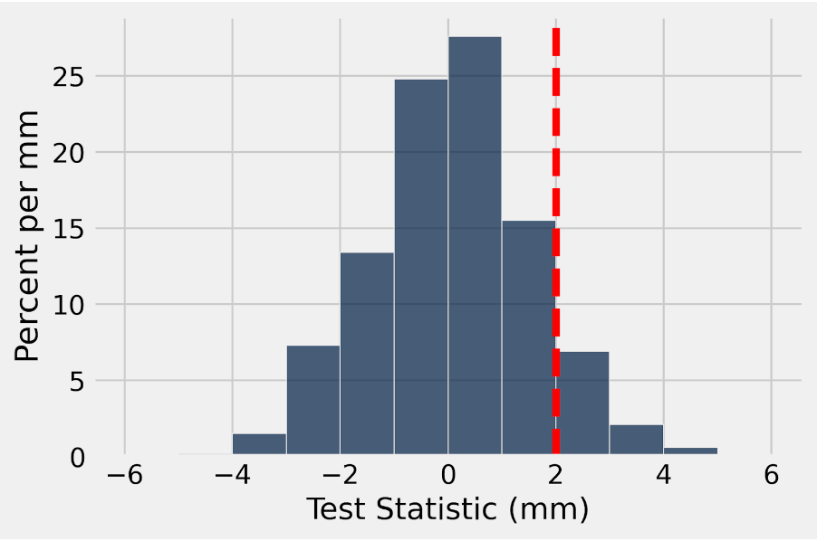

# Discussion 07 Data C8 Spring 2026

## Page 1

## Midterm Review

Discussion 07

Data C8: Foundations of Data Science UC Berkeley, Spring 2026

When we observe something different from what we expect in real life (e.g. four 3s in six rolls of a fair die), it is natural to consider whether this was unexpected behavior due to random chance, or something else.

Hypothesis testing allows us to answer the above question in a scientific and consistent manner, using the power of computation and statistics to conduct simulations and draw conclusions from our data.

### 1. Test Statistics

Dylan is playing with a coin and he wants to test whether his coin is fair. His experiment is to toss the coin 100 times. He chooses the following null hypothesis.

#### Null Hypothesis: The coin is fair and any observed deviation is due to chance.

For each of the alternative hypotheses listed below, determine whether or not the test statistic is valid and give an explanation.

#### (a) Alternative Hypothesis: The coin is biased towards heads.

#### Test Statistic: # of heads.

Valid

Invalid

#### (b) Alternative Hypothesis: The coin is not fair.

#### Test Statistic: # of heads.

Valid

Invalid

#### (c) Alternative Hypothesis: The coin is not fair.

#### Test Statistic: |# of heads - expected # of heads|.

Valid

Invalid

#### (d) Alternative Hypothesis: The coin is biased towards heads.

#### Test Statistic: |# of heads - expected # of heads|.

Valid

Invalid

#### (e) Alternative Hypothesis: The coin is not fair.

#### Test Statistic: 1

2 −proportion of heads

Valid

Invalid

## Page 2

### 2. Hypothesis Testing

You are playing a wheel-spinning game at a carnival, where you can earn prizes based on where the wheel stops. The booth attendant claims the distribution of prizes is as below, but you think the game is rigged and doesn’t follow the listed probabilities.

#### Prize Chance

Nothing 80%

Teddy bear 2%

Pinwheel 6%

Sticker 12%

You would like to test your claim so you can report the carnival for fraud.

- Is the data we are working with numerical or categorical? Think about how this influences what test statistic we should use.

Numerical

Categorical

#### (b) What is the booth attendant’s hypothesis?

#### (c) What is your hypothesis?

#### (d) Which hypothesis (of the two we defined) can you simulate under?

#### (e) What is a good test statistic to use?

- Write code that simulates playing the carnival game 1000 times, and returns an array of proportions corresponding to how

often each prize was won.

prize_chances = _______________________________________________________

my_simulation = _______________________________________________________

- Write one line of additional code that extracts the number of teddy bears we would have won in our simulation. You may

use my_simulation from the previous question.

_______________________________________________________________________

Data C8 Spring 2026 Discussion 07 | 2

## Page 3

### 3. A/B Testing

- Kevin, a museum curator, has recently been given specimens of caddisflies collected from various parts of Northern

California. The scientists who collected the caddisflies think that caddisflies collected at higher altitudes tend to be bigger. They tell him that the average length of the 560 caddisflies collected at high elevation is 14mm, while the average length of the 450 caddisflies collected from a slightly lower elevation is 12mm. He is not sure that this difference really matters and thinks that this could just be the result of chance in sampling.

What is an appropriate null hypothesis that Kevin can simulate under?

- How could you test the null hypothesis in the A/B test from above? What assumption would you make to test the hypothesis,

and how would you simulate under that assumption?

- What would be a useful test statistic for the A/B test? Remember that the direction of your test statistic should come from

the initial setting.

Assume flies refers to the following table (an excerpt is shown).

#### Elevation Specimen Length

High 12.3

Low 13.1

High 12.0

- Fill in the blanks in this code to generate one value of the test statistic simulated under the null hypothesis.

def one_simulation():

shuffled_labels = flies.____________________________________________.column(______________________) shuffled_flies = flies.with_columns(______________________, ______________________________________) grouped = shuffled_flies._______________________(________________________, _______________________) means = grouped.column(‘Specimen length mean’) statistic = ____________________________________ return statistic

Data C8 Spring 2026 Discussion 07 | 3

## Page 4

#### (e) Fill in the code below to simulate 10000 trials of our permutation test.

test_stats = ________________________________________________

repetitions = ________________________________________________

for i in np.arange(____________________________________):

one_stat = ________________________________________________ test_stats = np.append(test_stats, one_stat)

- The histogram of test_stats is plotted below with a vertical red line indicating the observed value of our test statistic. If

the p-value cutoff we use is 5%, what is the conclusion of our test?

- Suppose that the null hypothesis is true. If we ran this same hypothesis test 1000 times, each time from our flies table and

with a p-value cutoff of 5%, how many times would we expect to incorrectly reject the null hypothesis?

- What effect does decreasing our p-value cutoff have on the number of times we expect to incorrectly reject the null hypothesis?

#### (i) Answer the following True/False questions.

- A/B testing is used to determine whether or not we believe two samples come from the same underlying distribution.

True

False

ii. To conduct a permutation test, you should sample your data with replacement with a sample size equal to the number

of rows in the original table.

True

False

iii. A/B testing is the same as using total variation distance as a test statistic for a hypothesis test.

True

False

Data C8 Spring 2026 Discussion 07 | 4

## Page 5

### 4. Multiple Choice

- In the U.S. in 2000, there were 2.4 million deaths from all causes, compared to 1.9 million in 1970, which represents a 25%

increase. The data shows that the public’s health got worse over the period 1970-2000.

True False

- A company is interested in knowing whether women are paid less than men in their organization. They share all their salary

data with you. An A/B test is the best way to examine the hypothesis that all employees in the company are paid equally.

True False

- Consider a randomized controlled trial where participants are randomly split into treatment and control groups. We are 100%

certain there will be no systematic differences between the treatment and control groups if the process is followed correctly.

True False

- A researcher considers the following scheme for splitting people into control and treatment groups. People are arranged in

a line and for each person, a fair, six-sided die is rolled. If the die comes up to be a 1 or a 2, the person is allocated to the treatment group. If the die comes up to be a 3, 4, 5, or 6 then the person is allocated to the control group. This is a randomized control experiment.

True False

- You are conducting a hypothesis test to check whether a coin is fair. After you calculate your observed test statistic, you see

that its p-value is below the 5% cutoff. At this point, you can claim with certainty that the null hypothesis can not be true.

True False

- You roll a fair die a large number of times. While you are doing that, you observe the frequencies with which each face

appears and you make the following statement: “As I increase the number of times I roll the die, the probability histogram of the observed frequencies converges to the empirical histogram.”

True False

### 5. Probability

- A fair coin is tossed five times. Two possible sequences of results are HTHTH and HTHHH. Which sequence of results is more

likely? Explain your answer and calculate the probability of each sequence appearing.

#### For parts (b) - (d), assume we have a biased coin such that the probability of getting heads is 1

5 and the probability of getting tails is 4

1. The coin is tossed 3 times.

#### (b) What is the probability that you get exactly 2 heads? What about exactly 0 heads?

#### (c) What is the probability of getting exactly 1 head or exactly 2 heads?

#### (d) What is the probability you get 1 or more heads?

Data C8 Spring 2026 Discussion 07 | 5

## Page 6

### 6. More Hypothesis Testing

A tortoise and a hare want to have a race on a number line! They both start at 0 and the race lasts for 100 time steps. However, they move differently. At each time step the tortoise moves 1 step forward with a 1

2 chance (and stays in place with a 1 2 chance), and the hare moves 3 steps forward with a 1

6 chance.

They race, and the tortoise loses badly; the hare finished 50 steps ahead of the tortoise. Suspicious, the tortoise decides to conduct a hypothesis test to determine whether or not the hare is actually faster.

- Fill in the blanks below for the null and alternative hypotheses of this test, as well as a valid test statistic.

#### Null Hypothesis:

#### Alternative Hypothesis:

#### Test Statistic:

- Write a function called one_race() that simulates a single race of 100 time steps. It should return a two element array of the

final distances of both the tortoise and the hare (in that order) from the origin after 100 time steps.

def one_race():

tortoise_array = ________________________________________________ hare_array = ________________________________________________ tortoise_sim = ________________________________________________ hare_sim = ________________________________________________ tortoise_distance = ________________________________________________ hare_distance = ________________________________________________ return make_array(tortoise_distance, hare_distance)

- We would now like to simulate what would happen if the tortoise and the hare race 10,000 times. Complete the code below

and record how far the tortoise and the hare end from the origin in the arrays tortoise_distances and hare_distances respectively.

tortoise_distances = make_array() hare_distances = make_array()

for ________________________________________________:

race = ________________________________________________ one_tortoise_dist = ________________________________________________ one_hare_dist = ________________________________________________ tortoise_distances = ________________________________________________ hare_distances = ________________________________________________

Data C8 Spring 2026 Discussion 07 | 6

## Page 7

The results table (20,000 rows) contains two columns recorded after 10,000 simulations:

- Competitor (string): the name of the competitor, either “tortoise” or “hare”
- Distance (int): the final distance of the competitor at the end of the race

- Using the results table, create an overlaid histogram that shows the distribution of final distances for both the tortoise and

the hare.

________________________.________________________(________________________, group=____________)

- Create an array called differences where each value in the array represents how many steps the hare finished ahead of the

tortoise in a given race. Then, write a line of code to calculate the observed p-value of the hypothesis test. Finally, assuming a 5% p-value cutoff, describe the different conclusions you would come to based on the possible values of the observed p-value.

differences = ________________________________________________

p_value = ________________________________________________

Data C8 Spring 2026 Discussion 07 | 7
