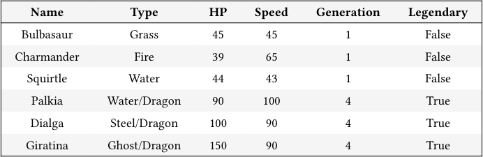
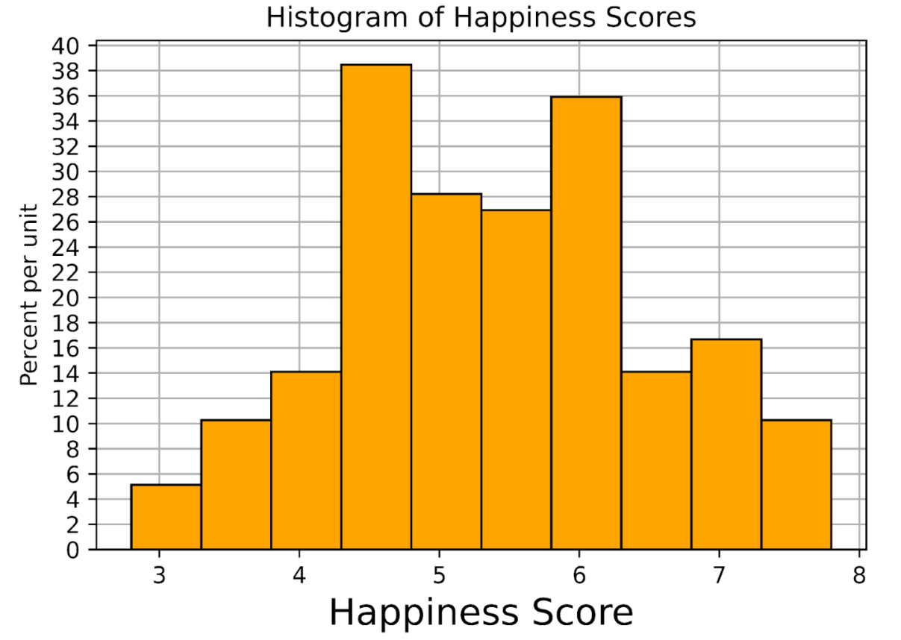
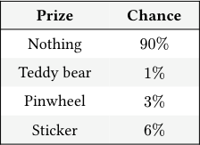
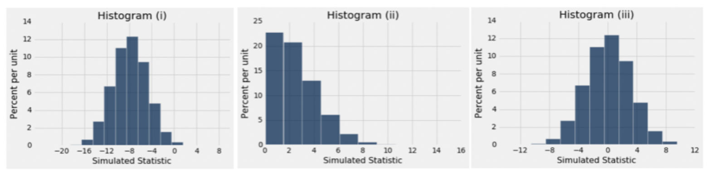
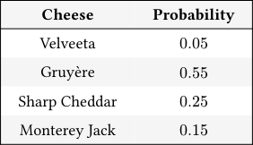

# Discussion 08 Data C8 Spring 2026

## Page 1

## More Midterm Review

### Discussion 08

### Data C8: Foundations of Data Science UC Berkeley, Spring 2026

## 1. Tables

#### You are given the following table called pokemon. For the following questions, fill in the blanks.

#### Name Type HP Speed Generation Legendary

Bulbasaur Grass 45 45 1 False

Charmander Fire 39 65 1 False

Squirtle Water 44 43 1 False

Palkia Water/Dragon 90 100 4 True

Dialga Steel/Dragon 100 90 4 True

Giratina Ghost/Dragon 150 90 4 True

#### (a) Find the name of the pokemon with highest HP among type Water pokemon.

water_pokemon = pokemon.________________________(________________________, ________________________)

water_pokemon.______________(________________________, _________________________).column("Name").item(0)

water_pokemon = pokemon.where("Type", are.equal_to("Water")) water_pokemon.sort("HP", descending = True).column("Name").item(0)

#### (b) Find the proportion of Fire-type Pokemon with a Speed less than 100.

fire_pokemon = pokemon.________________________(________________________, ________________________)

fire_pokemon.________________________(________________________, ____________________________________)

.________________________ / ________________________.________________________

fire_pokemon = pokemon.where("Type", "Fire") fire_pokemon.where("Speed", are.below(100)).num_rows / fire_pokemon.num_rows

#### (c) Create a table containing Type and Generation that is sorted in decreasing order by the average HP for each pair of Type

#### and Generation that appears in the table.

avg_hp = pokemon.________________________(________________________, ________________________)

avg_hp.sort("HP mean",________________________)

.________________________(________________________, ________________________)

avg_hp = pokemon.group(make_array("Type", "Generation"), np.mean) avg_hp.sort("HP mean", descending = True).select("Type", "Generation")

#### (d) Return an array that contains ratios of legendary to non-legendary pokemons for each generation. You may assume that the

#### Legendary column is a column of booleans.

helper = pokemon.________________________(________________________, ________________________)

ratios = helper._______________(_______________) / helper._______________(_______________)

## Page 2

helper = pokemon.pivot("Legendary", "Generation") ratios = helper.column("True") / helper.column("False")

#### Data C8 Spring 2026 Discussion 08 | 2

## Page 3

### 2. Histograms

World Happiness Report is a landmark study on the state of global happiness. This study calculated and ranked the happiness level for 155 countries using data from the Gallup World Poll. The histogram below shows the distribution of happiness scores computed from this study in 2019. Suppose the data is stored in the table called happiness. The following code was used to generate the histogram you see below:

happiness.hist("Score", bins = np.arange(2.8, 8, 0.5))

Note that the histogram may look a bit different from usual for the purpose of making the bar heights easier to interpret.

#### (a) What are the units of the y-axis in the histogram?

Percent per happiness score. Note that it is NOT “percent per country”. Although each data point used to generate the histogram represents a country, the values used to make the histogram are the happiness scores.

For parts (b) - (e), use the above histogram to calculate the following quantities. If it’s not possible, write “Cannot calculate” and explain your reasoning.

#### (b) The proportion of countries with happiness scores between 4.3 and 5.8.

Each bin has width 0.5. We’re interested in the [4.3, 4.8), [4.8, 5.3), and [5.3, 5.8) bins, which have heights approximately 38, 28, and 27 percent per unit respectively. We can use the Area principle to calculate the sum of the areas of these bins, which in turn represents the proportion we’re looking for:

Total Area = height1 ⋅width + height2 ⋅width + height3 ⋅width

= 0.5 ⋅(height1 + height2 + height3)

= 0.5 ⋅(38 + 28 + 27)

= 0.5 ⋅93 = 46.5% or as a proportion, 0.465

- The number of countries with happiness scores between 4.3 and 5.8 (round to the nearest country).

We can simply multiply the proportion of countries with happiness score between 4.3 and 5.8 (calculated in the previous question) by the number of countries represented in the histogram: Number of countries = 46.5% ⋅155 countries ≈72 countries

#### (d) The number of countries with happiness scores between 6 and 7.

Data C8 Spring 2026 Discussion 08 | 3

## Page 4

Cannot calculate; we don’t have bins that exactly comprise [6, 7), and we do not know the distribution of countries within bins.

#### (e) The height of the new bin after combining the three leftmost bins.

Combining the three leftmost bins is going to combine their areas. The total area of the three leftmost bins is: 0.5 ⋅(5 + 10 + 1. ≈14.5% The width of the new bin is going to be the sum of the widths of the original bins (0.5), so the new width is 1.5. Now that we have the area and width of the new bin, we can calculate the height:

Area = width ⋅height

⟹14.5 = 1.5 ⋅height

⟹height = 14.5

1.5 ≈9.67 % per unit

Data C8 Spring 2026 Discussion 08 | 4

## Page 5

### 3. Probability

Suppose the wheel-spinning game from Discussion 07 received a lot of complaints at the carnival, and the owners of the game are pressured to release their true distribution of prizes as below:

#### Prize Chance

Nothing 90%

Teddy bear 1%

Pinwheel 3%

Sticker 6%

Use the distribution above to answer the following probability questions.

#### (a) What is the probability of winning a prize from one spin of the wheel?

Using the Complement Rule:

ℙ[winning a prize] = 1 −ℙ[Nothing] = 1 −0.9 = 0.1 or 10%

#### (b) What is the probability of winning a Teddy bear and a Sticker in two spins?

ℙ[Teddy bear and Sticker] = 2 ⋅ℙ[Teddy bear] ⋅ℙ[Sticker] = 2 ⋅0.01 ⋅0.06 = 0.12%

We multiply by 2 because we could have won the Teddy bear and then the Sticker or the Sticker first and then the Teddy bear.

#### (c) What is the probability of winning at least one prize in 10 spins?

Complement Rule again:

ℙ[at least one prize] = 1 −ℙ[no prizes in 10 spins] = 1 −ℙ[Nothing]10 = 1 − (0.9)10

Data C8 Spring 2026 Discussion 08 | 5

## Page 6

### 4. Sampling

Researchers are studying the effectiveness of a particular flu vaccine. A large random sample was taken from the population of people who took the vaccine in 2016. Among the sampled people, 48% did not get the flu.

(Spring 2018 Midterm Question 4 Modified)

#### (a) What is the difference between a parameter and a statistic? Which of the two is random?

A parameter is a property of the population, so it is fixed and does not change. On the other hand, we calculate statistics from samples which are often random. Typically, we use statistics in order to estimate population parameters.

#### (b) What is the parameter and what is the statistic in this scenario?

#### Parameter: The proportion of people who took the vaccine in 2016 that did not get the flu.

#### Statistic: The proportion of people in the sample that did not get the flu.

In 2017, the researchers took another large random sample from among the people who took the vaccine that year. Among these sampled people, 40% did not get the flu.

- A researcher thinks the vaccine was less effective in 2017 than in 2016. To test this, a null hypothesis is needed. Which is the

correct null hypothesis?

The vaccine was less effective in the 2017 population than in the 2016 population, due to chance.

The vaccine was equally effective in the two samples but its effectiveness was different in the two populations due to chance.

The vaccine was equally effective in the two populations but its effectiveness was different in the two samples due to chance.

Option A - Incorrect as it describes a model that is difficult to simulate under. How can we quantify “less effective”?

Option B - Incorrect as the question tells us that the vaccine was not equally effective in the two samples (48% vs 40%).

Option C - Correct. The null hypothesis would state that the vaccine was equally effective in the two populations, and that the differences we observe in the two samples are simply due to chance.

- The researcher says, “The value of my observed test statistic is 40% −48% = −8%.” To perform the test, the statistic is

simulated under the null hypothesis. One of the figures below is the empirical histogram of the simulated values. Which is it?

Histogram (i)

Histogram (ii)

Histogram (iii)

Data C8 Spring 2026 Discussion 08 | 6

## Page 7

The test statistic we are using is the difference between the two sample percentages. Under the null hypothesis, this could be positive or negative depending on the sample. This rules out (ii).

Under the null hypothesis, the two sample percentages are expected to be equal and hence the difference is expected to be 1. This rules out (i).

Only (iii) has all the right properties.

Data C8 Spring 2026 Discussion 08 | 7

## Page 8

### 5. Hypothesis Testing

Chloe is a big fan of Trader Joe’s Frozen Mac ‘n Cheese, but she noticed that the cheese used in it varies from box to box. A Trader Joe’s employee provides her with some data about the 4 different cheeses used and the probability of them being used in each box:

#### Cheese Probability

Velveeta 0.05

Gruyère 0.55

Sharp Cheddar 0.25

Monterey Jack 0.15

Chloe is suspicious about this distribution. After all, Velveeta is much cheaper to use than Gruyère, and she has also never bought a box that uses Gruyère. Chloe decides to buy many boxes throughout the next month and tracks the type of cheese used in each box. She uses this to conduct a hypothesis test.

#### (a) Write a valid null and alternative hypothesis for this experiment.

#### Null Hypothesis:

#### Alternative Hypothesis:

Null Hypothesis: The types of cheese in the Frozen Mac ‘n Cheese boxes are distributed according to the probability distribution provided by the employee. Any observed difference is simply due to chance. Alternative Hypothesis: The types of cheese in the Frozen Mac ‘n Cheese boxes are not distributed according to the probability distribution provided by the employee. Any observed difference is not just due to chance.

observed_proportions = make_array(0.2, 0.3, 0.45, 0.05) employee_proportions = make_array(0.05, 0.55, 0.25, 0.15)

The array observed_proportions contains the proportions of cheese that Chloe observed in 20 boxes of Mac ‘n Cheese.

- Chloe wants to use the mean as a test statistic, but Katherine suggests that Chloe use the TVD (total variation distance)

instead. Which test statistic should Chloe use in this case? Briefly justify your answer. Then, write a line of code to assign the observed value of the test statistic to observed_stat.

observed_stat = ____________________________________________________________

Katherine is correct, we should use the total variation distance because she is comparing two categorical distributions (the observed distribution and the one provided by the Trader Joe’s employee).

observed_stat = sum(np.abs(observed_proportions - employee_proportions)) / 2

- Define the function one_simulated_test_stat to simulate a random sample according to the null hypothesis and return

the test statistic for that sample.

def one_simulated_test_stat():

sample_prop = ________________________________________________ return ________________________________________________

def one_simulated_test_stat(): sample_prop = sample_proportions(20, employee_proportions) return sum(abs(employee_proportions - sample_prop)) / 2

- Chloe simulates the test statistic 10,000 times and stores the results in an array called simulated_stats. The observed value

of the test statistic is stored in observed_stat. Complete the code below so that it evaluates to the p-value of the test:

Data C8 Spring 2026 Discussion 08 | 8

## Page 9

________________________(simulated_stats ____________ observed_statistic) / ____________________________

np.count_nonzero(simulated_stats >= observed_statistic) / 10000

- Given that the computed p-value is 0.0825, which of the following are true? Select all that may apply.

Using an 8% p-value cutoff, the null hypothesis should be rejected.

Using a 10% p-value cutoff, the null hypothesis should be rejected.

There is an 8.25% chance that the null hypothesis is true.

There is an 8.25% chance that the alternative hypothesis is true.

Data C8 Spring 2026 Discussion 08 | 9
