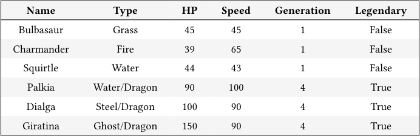
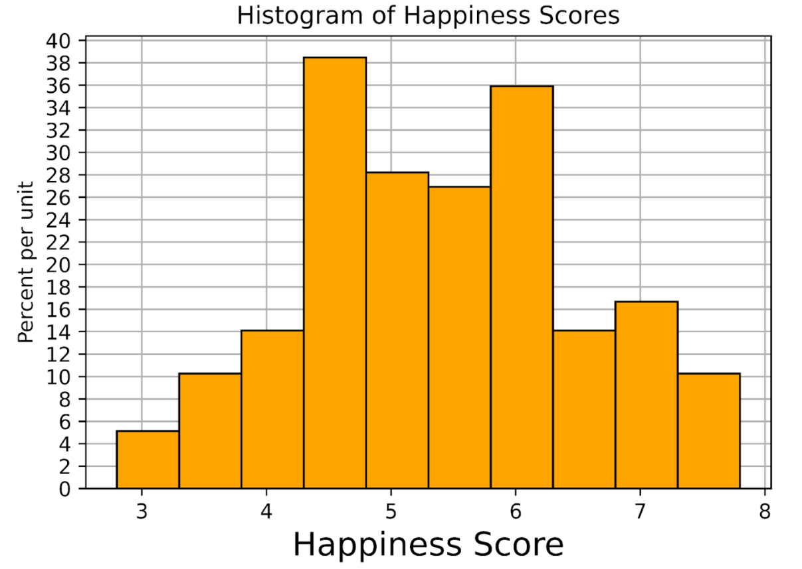
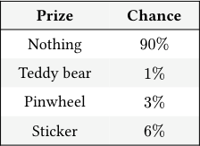
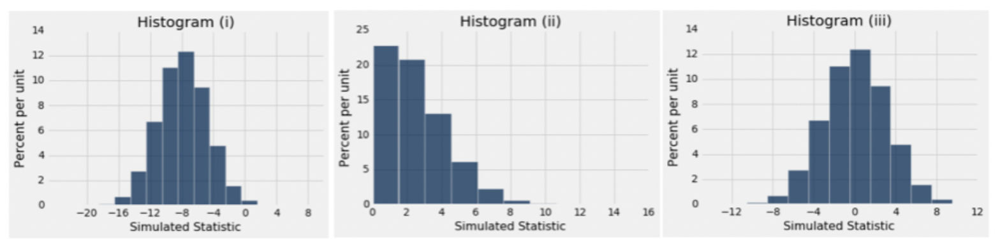
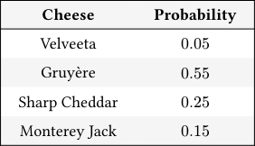

# Discussion 08 Data C8 Spring 2026

## Page 1

## More Midterm Review

### Discussion 08

### Data C8: Foundations of Data Science UC Berkeley, Spring 2026

## 1. Tables

#### You are given the following table called pokemon. For the following questions, fill in the blanks.

#### Name Type HP Speed Generation Legendary

Bulbasaur Grass 45 45 1 False

Charmander Fire 39 65 1 False

Squirtle Water 44 43 1 False

Palkia Water/Dragon 90 100 4 True

Dialga Steel/Dragon 100 90 4 True

Giratina Ghost/Dragon 150 90 4 True

#### (a) Find the name of the pokemon with highest HP among type Water pokemon.

water_pokemon = pokemon.________________________(________________________, ________________________)

water_pokemon.______________(________________________, _________________________).column("Name").item(0)

#### (b) Find the proportion of Fire-type Pokemon with a Speed less than 100.

fire_pokemon = pokemon.________________________(________________________, ________________________)

fire_pokemon.________________________(________________________, ____________________________________)

.________________________ / ________________________.________________________

#### (c) Create a table containing Type and Generation that is sorted in decreasing order by the average HP for each pair of Type

#### and Generation that appears in the table.

avg_hp = pokemon.________________________(________________________, ________________________)

avg_hp.sort("HP mean",________________________)

.________________________(________________________, ________________________)

#### (d) Return an array that contains ratios of legendary to non-legendary pokemons for each generation. You may assume that the

#### Legendary column is a column of booleans.

helper = pokemon.________________________(________________________, ________________________)

ratios = helper._______________(_______________) / helper._______________(_______________)

## Page 2

### 2. Histograms

World Happiness Report is a landmark study on the state of global happiness. This study calculated and ranked the happiness level for 155 countries using data from the Gallup World Poll. The histogram below shows the distribution of happiness scores computed from this study in 2019. Suppose the data is stored in the table called happiness. The following code was used to generate the histogram you see below:

happiness.hist("Score", bins = np.arange(2.8, 8, 0.5))

Note that the histogram may look a bit different from usual for the purpose of making the bar heights easier to interpret.

#### (a) What are the units of the y-axis in the histogram?

For parts (b) - (e), use the above histogram to calculate the following quantities. If it’s not possible, write “Cannot calculate” and explain your reasoning.

#### (b) The proportion of countries with happiness scores between 4.3 and 5.8.

- The number of countries with happiness scores between 4.3 and 5.8 (round to the nearest country).

#### (d) The number of countries with happiness scores between 6 and 7.

#### (e) The height of the new bin after combining the three leftmost bins.

Data C8 Spring 2026 Discussion 08 | 2

## Page 3

### 3. Probability

Suppose the wheel-spinning game from Discussion 07 received a lot of complaints at the carnival, and the owners of the game are pressured to release their true distribution of prizes as below:

#### Prize Chance

Nothing 90%

Teddy bear 1%

Pinwheel 3%

Sticker 6%

Use the distribution above to answer the following probability questions.

#### (a) What is the probability of winning a prize from one spin of the wheel?

#### (b) What is the probability of winning a Teddy bear and a Sticker in two spins?

#### (c) What is the probability of winning at least one prize in 10 spins?

Data C8 Spring 2026 Discussion 08 | 3

## Page 4

### 4. Sampling

Researchers are studying the effectiveness of a particular flu vaccine. A large random sample was taken from the population of people who took the vaccine in 2016. Among the sampled people, 48% did not get the flu.

(Spring 2018 Midterm Question 4 Modified)

#### (a) What is the difference between a parameter and a statistic? Which of the two is random?

#### (b) What is the parameter and what is the statistic in this scenario?

In 2017, the researchers took another large random sample from among the people who took the vaccine that year. Among these sampled people, 40% did not get the flu.

- A researcher thinks the vaccine was less effective in 2017 than in 2016. To test this, a null hypothesis is needed. Which is the

correct null hypothesis?

The vaccine was less effective in the 2017 population than in the 2016 population, due to chance.

The vaccine was equally effective in the two samples but its effectiveness was different in the two populations due to chance.

The vaccine was equally effective in the two populations but its effectiveness was different in the two samples due to chance.

- The researcher says, “The value of my observed test statistic is 40% −48% = −8%.” To perform the test, the statistic is

simulated under the null hypothesis. One of the figures below is the empirical histogram of the simulated values. Which is it?

Histogram (i)

Histogram (ii)

Histogram (iii)

Data C8 Spring 2026 Discussion 08 | 4

## Page 5

### 5. Hypothesis Testing

Chloe is a big fan of Trader Joe’s Frozen Mac ‘n Cheese, but she noticed that the cheese used in it varies from box to box. A Trader Joe’s employee provides her with some data about the 4 different cheeses used and the probability of them being used in each box:

#### Cheese Probability

Velveeta 0.05

Gruyère 0.55

Sharp Cheddar 0.25

Monterey Jack 0.15

Chloe is suspicious about this distribution. After all, Velveeta is much cheaper to use than Gruyère, and she has also never bought a box that uses Gruyère. Chloe decides to buy many boxes throughout the next month and tracks the type of cheese used in each box. She uses this to conduct a hypothesis test.

#### (a) Write a valid null and alternative hypothesis for this experiment.

#### Null Hypothesis:

#### Alternative Hypothesis:

observed_proportions = make_array(0.2, 0.3, 0.45, 0.05) employee_proportions = make_array(0.05, 0.55, 0.25, 0.15)

The array observed_proportions contains the proportions of cheese that Chloe observed in 20 boxes of Mac ‘n Cheese.

- Chloe wants to use the mean as a test statistic, but Katherine suggests that Chloe use the TVD (total variation distance)

instead. Which test statistic should Chloe use in this case? Briefly justify your answer. Then, write a line of code to assign the observed value of the test statistic to observed_stat.

observed_stat = ____________________________________________________________

- Define the function one_simulated_test_stat to simulate a random sample according to the null hypothesis and return

the test statistic for that sample.

def one_simulated_test_stat():

sample_prop = ________________________________________________ return ________________________________________________

- Chloe simulates the test statistic 10,000 times and stores the results in an array called simulated_stats. The observed value

of the test statistic is stored in observed_stat. Complete the code below so that it evaluates to the p-value of the test:

________________________(simulated_stats ____________ observed_statistic) / ____________________________

- Given that the computed p-value is 0.0825, which of the following are true? Select all that may apply.

Using an 8% p-value cutoff, the null hypothesis should be rejected.

Using a 10% p-value cutoff, the null hypothesis should be rejected.

There is an 8.25% chance that the null hypothesis is true.

There is an 8.25% chance that the alternative hypothesis is true.

Data C8 Spring 2026 Discussion 08 | 5
