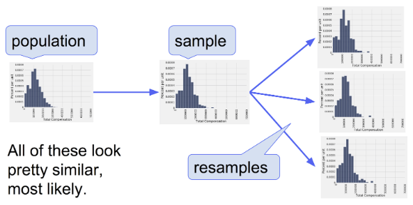

# Discussion 09 Data C8 Spring 2026

## Page 1

## The Bootstrap

Discussion 09

Data C8: Foundations of Data Science UC Berkeley, Spring 2026

### Mid-Semester Check In

Congrats on finishing the midterm!

What has been your favorite topic, assignment, lecture, or anything so far with the first half of the class done?

Please leave any comments you have about the content and any feedback for your TA here. Tear this page off and fold it so it is anonymous.

Additionally, if you have any concerns about your performance in the class so far, feel free to bring it up with your TA in person, or via email.

Congrats on finishing the midterm!

## Page 2

This page intentionally left blank

Data C8 Spring 2026 Discussion 09 | 2

## Page 3

### 1. The Bootstrap

Setup We want to be able to produce an estimate of a particular population parameter of interest, say the median. However, we know that if we had gotten a different sample, then our estimate of the population median could have also been different.

Main Objective Recall that it is often infeasible to take more samples from the population to construct a better estimate, due to resource constraints. If we have a representative sample, we could take the statistic of the sample as a reasonable prediction for the true parameter. This is the method of the bootstrap, sampling from our sample, to generate a range of values for which we believe our population parameter falls into.

Method 1. Given a large, simple random sample of a population, resample from the original sample with replacement. Generate many resamples with the same sample size as the original sample. 1. Calculate the statistic for each resample and store it in an array, as we saw in the case of hypothesis testing. 1. Repeat steps 1-2 multiple times to obtain an empirical distribution of your estimate.

#### (a) When we conduct a bootstrap resample, what size resample should we draw from our sample? Why?

The resample should have the same sample size as our original sample. This is because our original estimate of some parameter is based on a certain sample size. If we changed the sample size, the distribution and variability of the estimate would change.

#### (b) Why do we need to resample from our sample with replacement?

If we do not sample with replacement, then we will get the same exact sample every time! By sampling with replacement, this allows us to simulate different resamples from the sample.

- When we conduct a bootstrap resample, what is the underlying assumption/reasoning for resampling from our sample?

Why does it work?

The underlying assumption is that our sample looks similar to our population — that is, the sample is representative of what the population looks like. The validity of the bootstrap is based on this assumption because if the sample is unrepresentative of the population, we do not actually end up with a good picture of what range of values our estimate could take on.

Data C8 Spring 2026 Discussion 09 | 3

## Page 4

### 2. Thirsty

You are interested in investigating the liters of water consumed every day by UC Berkeley students. In particular, you want to study the proportion of students drinking less than 3 liters of water per day. You contact 150 random students from the directory and obtain the amounts of water each one of them drinks, storing them in the table water. The table has 1 column, amount, which stores the number of liters of water drunk by each student.

#### (a) What is the parameter and what is the statistic in this scenario?

#### Parameter: The proportion of UC Berkeley students who drink less than 3 liters of water per day.

#### Statistic: The proportion of students in the sample who drink less than 3 liters of water per day.

- Write a line of code to calculate the proportion of students in your sample who drank less than 3 liters of water per day.

_______________________________________________________________________________________________________

np.mean(water.column("amount") < 3)

#### or

water.where("amount", are.below(3)).num_rows / water.num_rows

- Write a line of code to perform a single bootstrap resample of the data stored in the water table.

_______________________________________________________________________________________________________

water.sample(water.num_rows, with_replacement=True)

Alternatively, given the default values of the arguments, you may simply write

water.sample()

- Fill in the following blanks to conduct 10,000 bootstrap resamples of your data, calculating the proportion of students in

each resample that drink less than 3 liters of water per day, then plotting the distribution of those proportions using an appropriate visualization.

proportions = _______________________________

for i in _______________________________:

resampled_table = ______________________________________________________________ resampled_statistic = ______________________________________________________________ proportions = ______________________________________________________________ proportions_table = Table().with_column("Resampled proportions", proportions)

proportions_table._______________________________

Data C8 Spring 2026 Discussion 09 | 4

## Page 5

proportions = make_array()

for i in np.arange(10000): resampled_table = water.sample(water.num_rows, with_replacement = True) resampled_statistic = np.mean(resampled_table.column("amount") < 3) proportions = np.append(proportions, resampled_statistic) proportions_table = Table().with_column("Resampled proportions", proportions) proportions_table.hist("Resampled proportions")

#### Data C8 Spring 2026 Discussion 09 | 5

## Page 6

### 3. Tennis Time

Ciara is interested in exploring the heights of women’s tennis players. She has collected a sample of 100 heights of professional women’s tennis players and wants to use this sample to estimate the true interquartile range (IQR) of all heights of professional women’s tennis players.

We define the interquartile range (IQR) as

IQR = 75th percentile −25th percentile

- In order to construct a 99% confidence interval for the IQR, what should our upper and lower endpoints be in terms of

percentiles?

Our lower endpoint should be the 0.5th percentile and the upper endpoint should be the 99.5th percentile.

- Define a function ci_iqr that constructs a 99% confidence interval for the IQR and returns an array containing the left

endpoint and right endpoint of the 99% confidence interval in that order. The function takes in the following arguments: - tbl: A one-column table consisting of a random sample from the population; you can assume this sample is large. - reps: The number of bootstrap repetitions.

To find the 25th and 75th percentile of an array, you can use the percentile function.

Fill in the blanks and then provide the full solution.

def ci_iqr(tbl, reps):

stats = _______________________________ for _______________________________: resample_col = _________________________________________________________________________ new_iqr = ______________________________________________________________________________ stats = ________________________________________________________________________________ left_end = _______________________________ right_end = _______________________________ return _______________________________

def ci_iqr(tbl, reps): stats = make_array() for i in np.arange(reps): resample_col = tbl.sample().column(0) new_iqr = percentile(75, resample_col) - percentile(25, resample_col) stats = np.append(stats, new_iqr) left_end = percentile(0.5, stats) right_end = percentile(99.5, stats) return make_array(left_end, right_end)

Data C8 Spring 2026 Discussion 09 | 6

## Page 7

- Say Ciara recruited 500 of her friends to perform the same bootstrapping process she did. In other words, each of her friends

drew a large, random sample of 100 heights from the population of professional women’s tennis players and constructed their own 99% confidence intervals.

- Approximately how many of these CIs do we expect to contain the actual IQR for the heights of professional women’s

tennis athletes?

We interpret a 99% confidence interval to mean that we are 99% confident in the process used to construct that given interval. In other words, 99% of the time we use this process we expect to construct an interval that contains the true population parameter.

Since we have 500 CIs, each at a 99% confidence level, we find that since 500 ⋅(0.99) = 495, we expect to have 495 of these CIs containing the actual IQR of heights.

ii. Note how in this example, we obtain different random samples from the population for each confidence interval, and

then re-sample from each to produce a confidence interval.

Why doesn’t each person just reuse the same original sample? Why is this distinction important?

Recall the “confidence” is the confidence in the process, and it is the process of drawing new, independent samples from the population and building a confidence interval for each. The re-sample is conditioned on the single sample you obtained, and models only the variability of that sample – we would just be constructing the same CI over and over.

iii. Ciara decided to do this process again, but this time with only 50 of her friends. Would the number of CIs that contain

the actual IQR be more or less close to the expected number of CIs, compared to her results with 500 friends?

#### It would be less close, by law of large numbers (higher variability).

#### (d) Ciara now decides to perform a hypothesis test, with the null hypothesis that the true IQR is 𝑞.

- How could Ciara perform this using her confidence intervals? Discuss the duality of confidence intervals and hypothesis

testing.

The confidence interval describes the region for which we can be 99% confident that it contains the true population parameter. This describes exactly the error of the p-value cutoff.

The decision rule for a hypothesis test testing whether the IQR is 𝑞 could therefore be - reject if 𝑞 is not contained in the 99% CI - fail to reject otherwise

ii. If Ciara conducted a two-tailed hypothesis test (e.g. her alternative was “the IQR is not 𝑞”), what p-value cutoff would

she choose if she used her confidence intervals?

1%, since we construct 99% confidence intervals, and we look at both tails.

iii. If Ciara conducted a one-tailed hypothesis test (e.g. her alternative was “the IQR is greater than 𝑞”), what p-value cutoff

would she choose if she used her confidence intervals?

The effective cutoff should be 0.5%, since we construct 99% confidence intervals, but only look at one tail. This is true since the confidence intervals we generate will have equal tails*, and therefore the same probability, so we can halve the tail region.

Typically, we would choose a p-value cutoff first, such as of 1% and then construct 98% confidence intervals to determine the outcome of the test. For the purposes of this question, we used the same confidence interval for both part (ii) and part (iii).

*Note: bootstrapped percentile confidence intervals have equal tails, but may not be symmetric. Confidence intervals generated in other ways, not taught in Data 8, may not have equal tails.

Data C8 Spring 2026 Discussion 09 | 7
