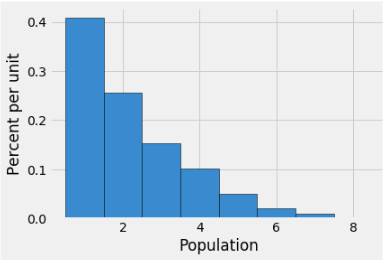
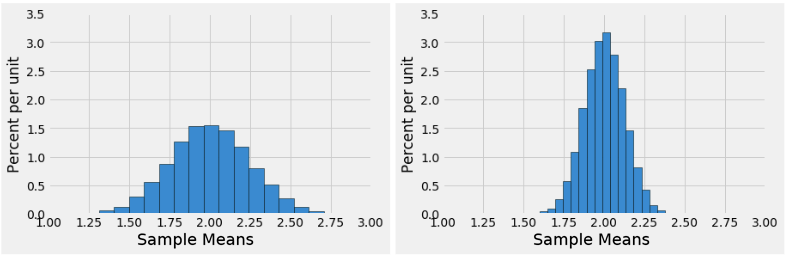

# Discussion 10 Data C8 Spring 2026

## Page 1

## The Central Limit Theorem

Discussion 10

Data C8: Foundations of Data Science UC Berkeley, Spring 2026

So far in the course, you have used the bootstrap to estimate different population parameters, such as the median or mean. You are now capable of building empirical distributions for these sample statistics. An empirical distribution for a sample statistic is usually obtained by repeatedly resampling and calculating the statistic for those resamples (bootstrapping).

Now we will introduce the Central Limit Theorem (CLT), which tells us more about the distribution of the sample mean. If you draw a large random sample with replacement from a population, then, regardless of the distribution of the population, the probability distribution for that sample’s mean is roughly normal, and centered at the population mean.

#### Furthermore, the standard deviation (spread) of the distribution of sample means can be described as

standard deviation of sample means = population standard deviation √sample size

Note, the standard deviation of the sample means is not the standard deviation of the sample. It is the spread of the distribution of all sample means obtain, not of a single sample.

### 1. Sample Means

Note that in this question, the empirical distribution of the sample mean is made up from the means of samples drawn from the population (not from resamples from a single sample).

Assume that you have a certain population of interest whose histogram is below.

- Cyrus takes many large random samples with replacement from the population, with the goal of generating an empirical

distribution of the sample mean. What shape do you expect this distribution to have? Which value will it be centered around?

- Why are we able to use the CLT to reason about the empirical distribution of the sample mean’s shape if the population data

is skewed?

## Page 2

- Suppose that Cyrus creates two empirical distributions of sample means, with different sample sizes. Which distribution

corresponds to a larger sample size? Why?

- Based solely on the information in the histogram, what is an estimate for the standard deviation of the sample mean on the

left? How did you determine this?

- Suppose you were told that the distribution on the right was generated based on a sample size of 100 and has a standard

deviation of 0.2. How big of a sample size would you need if you wanted the standard deviation of the distribution of sample means to be 10 times smaller?

Data C8 Spring 2026 Discussion 10 | 2

## Page 3

### 2. Want to Go to Main Stacks?

UC Berkeley students love studying in Main Stacks! You are working with Lena on constructing a confidence interval for the mean number of hours students spend in Main Stacks each year. To do this, you take a random sample of 400 UC Berkeley students and record how many hours each student spent studying in Main Stacks over the past year. Then, you compute the mean number of hours for your sample; it is 170 hours. You also calculate the standard deviation of your sample to be 10 hours.

- Lena claims that the distribution of all possible sample means is normal with an SD of 0.5 hours. Use this information to

construct an approximate 68% confidence interval for the mean hours spent studying in Main Stacks for all UC Berkeley students.

- If Lena had not told you what the SD of the distribution of sample means was, could you estimate it from the data in the

sample? If yes, how? If no, why not?

A helpful note. In Question 1, our large samples drawn with replacement were obtained directly from the population. As a result, our empirical distribution of the sample mean was centered around the population mean.

In contrast, in Question 2, we only have access to a single sample. As a result, we use the sample’s mean and standard deviation in place of the population’s mean and standard deviation, given the assumption that it is a representative sample.

If you bootstrap (resample) from a representative sample and obtain the empirical distribution of the sample means, it will be roughly centered around the original sample’s mean, not the population mean. However, it is helpful to note that as the sample size gets larger, your original sample’s mean will likely get closer and closer to the population mean, by the law of large numbers.

In both situations – whether resampling directly from the population or bootstrapping from a single representative sample - the Central Limit Theorem applies as long as its conditions are met.

Data C8 Spring 2026 Discussion 10 | 3

## Page 4

### 3. CLT with TLC

You are a super fan of the girl group TLC and are interested in estimating the average amount of plays their songs have online. You generate an 80% confidence interval for this parameter to be [700000, 1200000] based on a random sample of 50 songs. Are each of the following statements true or false? Give a brief explanation for each question.

Note: Generally, 𝑛≥30 is considered the minimum sample size for CLT to take effect!

#### (a) The value of our population parameter changes depending on our sampling process.

True False

- The empirical distribution of any statistic we choose will be roughly normal based on the Central Limit Theorem, but it

requires our population to have a normal distribution to begin with.

True False

- If we calculate a 95% confidence interval using the same sample and resamples, the interval will be narrower than the original

confidence interval because we are more certain of our results.

True False

- Using the same process to generate another 80% confidence interval, there is an 80% chance that the next confidence interval

you generate will contain the true average number of plays for TLC songs.

True False

- There is an 80% chance that a confidence interval we generated contains the true average number of plays for TLC songs.

True False

#### (f) 80% of TLC’s songs have between 700,000 and 1,200,000 plays.

True False

#### (g) The original sample mean you obtained was approximately 950,000 plays.

True False

Data C8 Spring 2026 Discussion 10 | 4
