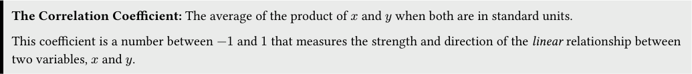
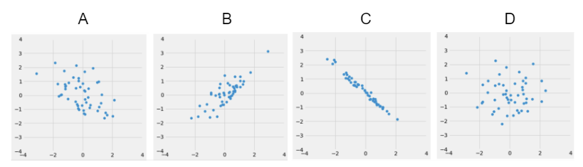
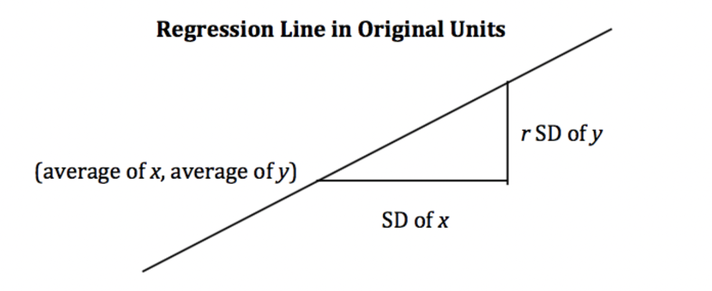
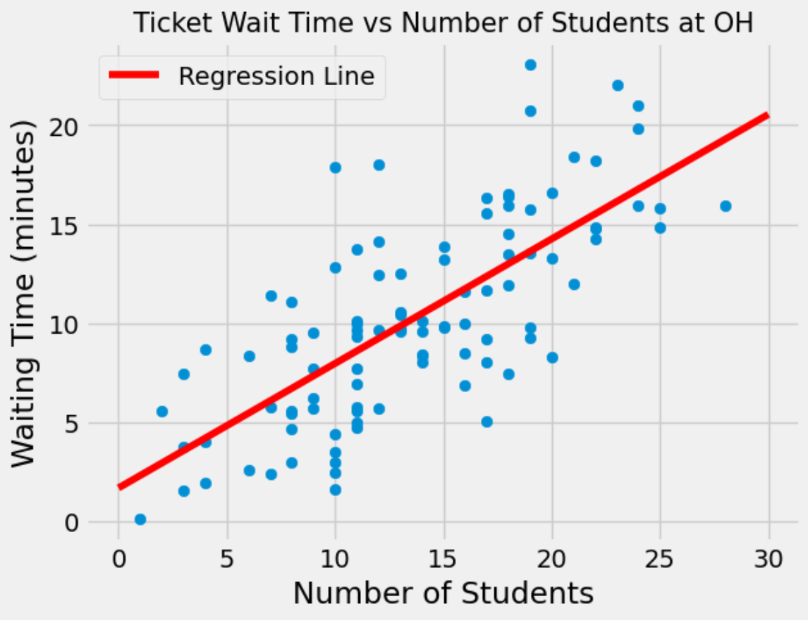
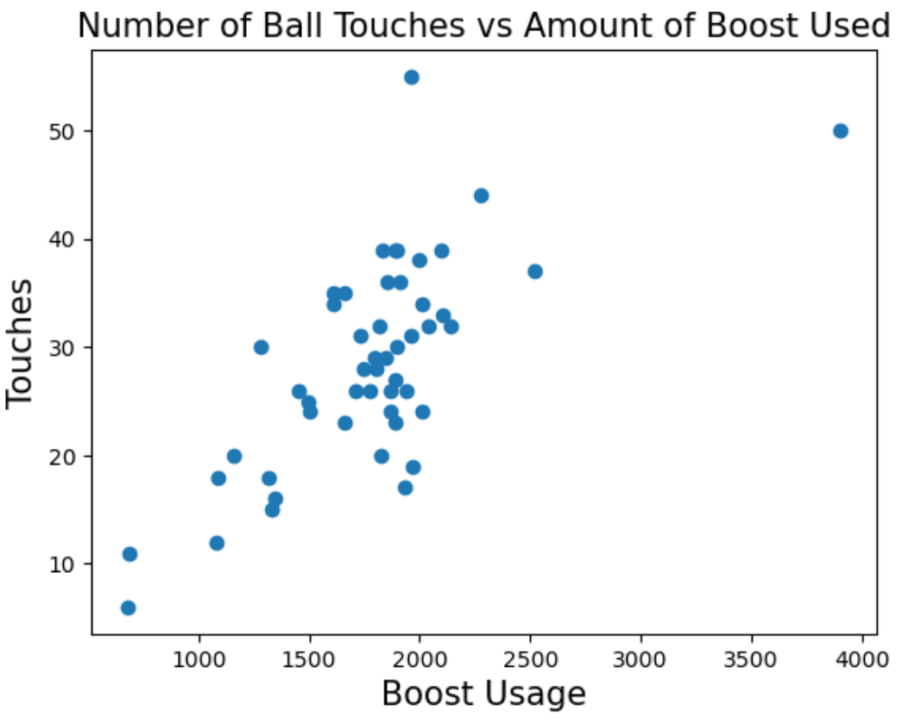

# Discussion 11 Data C8 Spring 2026

## Page 1

## Correlation & Regression

Discussion 11

Data C8: Foundations of Data Science UC Berkeley, Spring 2026

An important aspect of data science is using data to make predictions about the future based on the information that we currently have. A question one might ask would be, “Given a student’s score on the midterm exam, what would we predict their score on the final exam to be?” In order to answer this question, we will investigate a method of using one variable to predict another by looking at the correlation between two variables. 1. Standard Units and Correlation

#### The Correlation Coefficient: The average of the product of 𝑥 and 𝑦 when both are in standard units.

This coefficient is a number between −1 and 1 that measures the strength and direction of the linear relationship between two variables, 𝑥 and 𝑦.

#### (a) When calculating the correlation coefficient, why do we convert data to standard units?

We convert data to standard units in order to compare it with other data that may be of different units and scales. For example, if we wanted to compare the weights of cars (usually thousands of pounds) to the maximum speed of cars (usually tens of miles per hour), converting to standard units allows us to effectively compares the two variables.

Moreover, using standard units gives us the following nice properties: - r is a pure number with no units (because of standardization). - r is unaffected by changing the units on either axis (because of standardization).

- Write a function called convert which takes in an array of elements called xs and returns an array of the values represented

in standard units.

def convert(xs):

sd = ________________________________ mean = ______________________________ return ______________________________

def convert(xs): sd = np.std(xs) mean = np.mean(xs) return (xs - mean) / sd

- Write a function called correlation which takes in a table of data tbl containing the column names x and y and returns

the correlation coefficient.

def correlation(tbl, x, y):

x_su = ____________________________________________________________________________________ y_su = ____________________________________________________________________________________ return ____________________________________________________________________________________

## Page 2

def correlation(tbl, x, y): x_su = convert(tbl.column(x)) y_su = convert(tbl.column(y)) return np.mean(x_su * y_su)

#### Data C8 Spring 2026 Discussion 11 | 2

## Page 3

### 2. Comparing Correlation

- Look at the following four datasets. Rank them in order from weakest correlation to strongest correlation.

(Weakest) _______________ _______________ _______________ _______________ (Strongest)

#### D, A, B, C.

- D has almost no visible negative or positive trend as it is basically a blob, so its correlation is near 0. - A has a negative correlation, but the points are not very tightly clustered around a straight line, so the strength of its correlation is greater than D but still quite small. - B has a positive correlation, and the points are more tightly clustered around a positive sloping line, so the strength of its correlation is greater than A. - C has a negative correlation, and the points almost perfectly form a straight line. This indicates that the strength of the correlation is very close to 1.

We have introduced correlation as a way of quantifying the strength and direction of a linear relationship between two variables. The correlation coefficient can allow us to define the straight line about which the points are clustered, known as the regression line. In fact, by a remarkable fact in mathematics, the line uniquely defined by the slope and intercept below is always the best possible straight line we could construct.

slope = 𝑟⋅ SD𝑦

intercept = average of 𝑦−slope ⋅average of 𝑥

SD𝑥

#### Regression Line (in original units): estimate of 𝑦= slope ⋅𝑥+ intercept

For every 1 SD increase in 𝑥, the predicted value of 𝑦 increases by 𝑟 SDs of 𝑦.

- Bonus Question: Derive the slope and intercept above using the equation for the regression line in standard units (𝑦SU

represents 𝑦 in standard units)

𝑦SU = 𝑟⋅𝑥SU

Data C8 Spring 2026 Discussion 11 | 3

## Page 4

𝑦SU = 𝑟⋅𝑥SU 𝑦−average of 𝑦

SD of 𝑦 = 𝑟⋅ 𝑥−average of 𝑥

SD of 𝑥

𝑦−average of 𝑦= (𝑟⋅ SD of 𝑦

SD of 𝑥) ⋅(𝑥−average of 𝑥)

𝑦= slope ⋅(𝑥−average of 𝑥) + average of 𝑦

𝑦= slope ⋅𝑥+ (average of 𝑦−slope ⋅average of 𝑥)

𝑦= slope ⋅𝑥+ intercept

Data C8 Spring 2026 Discussion 11 | 4

## Page 5

### 3. Linear Regressi(OH)n

You just submitted a ticket at Office Hours and would like to know how long it will take to receive help. However, you don’t believe the estimated wait time displayed on the queue to be very accurate, so you decide to make your own predictions based on the total number of students present at OH when you submitted your ticket. You obtain data for 100 wait times and plot them below, also fitting a regression line to the data.

- Suppose that you submit a ticket at Office Hours when there were a total of 20 students present. Based on the regression

line, what would you predict the waiting time to be?

We observe 20 students at Office Hours, so we would want to look at the height of the regression line for 𝑥= 20. Looking at the scatter plot, we see that the regression line roughly passes through the point (20, 14) so we would predict the waiting time to be around 14 minutes.

- You go to Office Hours right before a homework assignment is due, and despite safety concerns, you observe 70 students at

Office Hours. Would it be appropriate to use your regression line to predict the waiting time? Explain.

It would not be appropriate to use the regression line to make a prediction. Most values that were used to construct the regression line were between 𝑥= 0 and 𝑥= 25. Since 𝑥= 70 is far out of that range, we cannot expect the regression line to make a very accurate prediction. Furthermore, since we don’t have data for 𝑥> 30, we are not sure that the linear trend continues for larger values of 𝑥. We must be very careful when extrapolating data past the range we have seen.

- When constructing your regression line, you find the correlation coefficient 𝑟 to be roughly 0.73. Does this value of 𝑟 suggest

that an increase in the number of students at Office Hours causes an increase in the waiting time? Explain.

Correlation does not imply causation! Just looking at the data it is unclear whether we account for confounding factors, and how they might contribute to the overall waiting time. For example, it is definitely possible that varying difficulties in the assignments across tickets affects the overall waiting time.

- Suppose you never generated the scatter plot at the beginning of this section. Knowing only that the value of 𝑟 is roughly

0.73, can you assume that the two variables have a linear association?

- Yes, 𝑟 tells us the strength of a linear association and a high value of 𝑟 always proves that the two variables have a linear association.

- Yes, because if we can compute the value of 𝑟, the two variables must have a linear association.

- No. A high value of 𝑟 does not necessarily imply that the relationship between the variables is linear.

- No, the value of 𝑟 = 0.73 is not high enough to imply a linear association.

For example, a quadratic or exponential relationship between 2 variables can still have a high value of 𝑟. To determine if the relationship between two variables is linear, it is a good idea to plot the data for a visual interpretation as well.

Data C8 Spring 2026 Discussion 11 | 5

## Page 6

### 4. This is Regression! (Optional)

(This question uses the same data as Question 3 on the Summer 2024 Final Exam) Conan has an unhealthy addiction to Rocket League, a game where players play soccer but with cars instead of people. Players can pick up boost pads that are scattered across the field, which players can use to make their cars go faster! Conan plays 50 games and records how much boost he used, as well as how many times he touched the ball in a given game.

#### (a) Select the correct option that corresponds to the data.

There appears to be a positive association.

There appears to be a negative association.

There is not enough information.

#### (b) Select the correct option that corresponds to the data.

An increase in Boost Usage causes an increase in Touches.

An increase in Boost Usage does not cause an increase in Touches.

There is not enough information.

#### (c) Conan runs some calculations and obtains the following statistics:

- The correlation coefficient between Touches and Boost Usage was approximately 0.705.
- The average number of Touches was 28.54 with a standard deviation of 9.51.
- The average of Boost Usage was 1773.4 with a standard deviation of 471.7.

#### i. Conan touched the ball 40 times in one of his games. What is this in standard units?

40 −28.54 9.51 ≈1.2

ii. Conan wishes to fit a regression line to the data. What would be the slope and intercept of the regression line in original

units?

slope = 𝑟⋅ SD of touches SD of boost usage = 0.705 ⋅( 9.51

471.7) ≈0.0142

intercept = average of touches −slope ⋅average of boost usage = 28.54 −0.0142 ⋅1773.4 ≈3.36

#### iii. What would the slope and intercept be if the data were in standard units?

Data C8 Spring 2026 Discussion 11 | 6

## Page 7

slope = 𝑟⋅ SD of touches (SU) SD of boost usage (SU) = 0.705 ⋅(1

1. = 0.705

intercept = average of touches (SU) −slope ⋅average of boost usage (SU) = 0 −0.705 ⋅0 = 0

When in standard units, the slope of the regression line is always 𝑟, and the intercept is always zero.

Data C8 Spring 2026 Discussion 11 | 7
