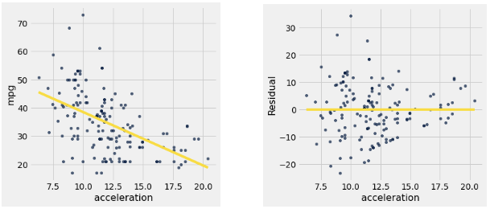
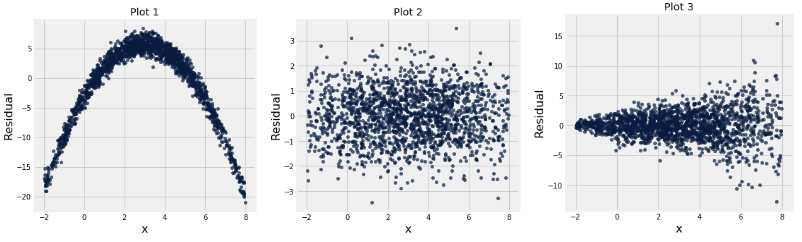
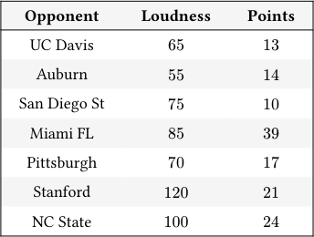
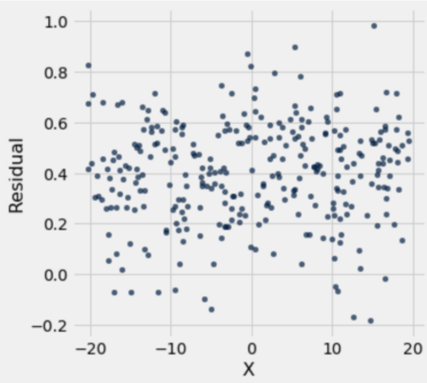
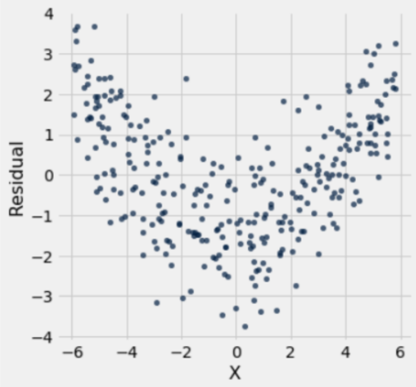
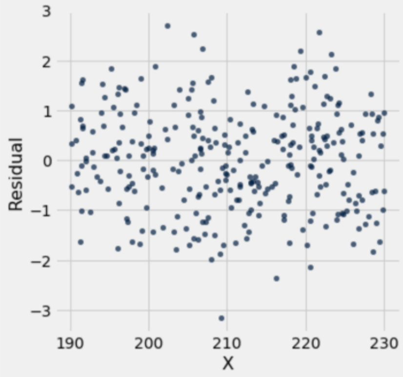
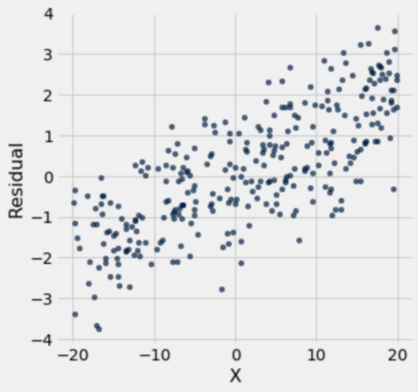

# Discussion 12 Data C8 Spring 2026

## Page 1

## Residuals

Discussion 12

Data C8: Foundations of Data Science UC Berkeley, Spring 2026

In data science, we can use linear regression in order to make predictions. When making predictions, it is also important to assess the accuracy of our predictions. To do so, we can examine the error between our actual data and the predictions; these errors are called residuals.

An example can be found below in the graph of miles per gallon (mpg) compared to the acceleration of a car. The left scatter plot shows the original data with a regression line fitted to it, and the right plot shows the corresponding residuals.

Key facts: - residual = actual value of 𝑦−predicted value of 𝑦 - When we perform linear regression with an intercept, the sum of the residuals will always be equal to 0. - In a well-fitted linear regression, the residual plot shows no pattern, and the residuals sum to 0. - When a residual plot shows a pattern, there may be a non-linear relation between the variables. - If the residual plot shows uneven variation about the horizontal line at 0, the regression estimates are not equally accurate across the range of the predictor variable. This is known as heteroscedasticity.

### 1. Visual Diagnostic

Displayed below are three residual plots. For which of the following residual plots is using linear regression a reasonable idea, and why? What might the original graphs have looked like?

## Page 2

### 2. Fight for California!

At a Cal football game the Mic Men, who are spirit leaders, claimed that our opponent’s ability to score was linearly affected by the student section’s noise level. Noah thinks they are wrong. Instead, he believes there is no linear relationship between student section noise and opponents’ scores. A friend gives Noah a table called noise which contains the following information:

- Opponent (string): Cal’s opponent for the game. - Loudness (int): Each row represents the maximum noise in decibels produced by the Student Section when Cal is on defense during a single home football game. - Points (int): The number of points scored by the opposing team.

A sample of the table with data from the 2024 season is below:

#### Opponent Loudness Points

UC Davis 65 13

Auburn 55 14

San Diego St 75 10

Miami FL 85 39

Pittsburgh 70 17

Stanford 120 21

NC State 100 24

- Noah thinks that there is no correlation between Loudness and Points and that the Mic Men’s claim is wrong. How can Noah

test his hypothesis?

#### Null Hypothesis:

#### Alternative Hypothesis:

#### Testing Method:

- Noah decides to write a function which produces one bootstrapped estimate of the correlation between Loudness and Points.

Define the one_relationship function below which takes in the following arguments:

- tbl (Table): a table that contains a sample and has the same columns as noise.
- x_col (string): the column name for the 𝑥 variable.
- y_col (string): the column name for the 𝑦 variable.

The function should return one bootstrapped estimate of the correlation coefficient 𝑟. You can assume that you have access to the function correlation(x, y), which returns the correlation between arrays 𝑥 and 𝑦.

def one_relationship(tbl, x_col, y_col):

bootstrap = ______________________________________________

x_values = ______________________________________________

y_values = ______________________________________________

return ______________________________________________

Data C8 Spring 2026 Discussion 12 | 2

## Page 3

- Noah decides to generate a 70% confidence interval for the true correlation between Loudness and Points using 1000 bootstrap

resamples. Fill in the following code to generate the interval.

______________________________________________________

for i in ______________________________________________________:

______________________________________________________

______________________________________________________

lower_bound = ______________________________________________________

upper_bound = ______________________________________________________

ci = make_array(lower_bound, upper_bound)

- Noah enjoys chaos so he decides to swap the x_col and y_col arguments each time he makes a call to one_relationship

inside his for loop. Will this impact his interval?

Yes

No

- After running the above code Noah gets an interval of [−0.75, −0.14]. Therefore, we _______________________________

the null hypothesis using a p-value cutoff of _______________________________.

- Regardless, Cal Athletics wants you to generate a line of best fit for your data. Should you use the method of least squares

(i.e., minimizing RMSE) or the regression equations? Is there a difference between the two?

Regression Equations

Least Squares

No Difference

Data C8 Spring 2026 Discussion 12 | 3

## Page 4

### 3. Rogue Residuals

Each of the following plots is a residual plot from an attempted linear regression of a variable 𝑦 on a variable 𝑥. For each one, indicate whether the regression line seems to be a good fit, a bad fit, or if it is invalid for a well-fit regression.

#### (a) Residual Plot 1

#### (b) Residual Plot 2

The regression seems to fit the data well.

The regression seems to fit the data well.

#### The regression does not seem to fit well.

#### The regression does not seem to fit well.

The residual plot is invalid.

The residual plot is invalid.

#### (c) Residual Plot 3

#### (d) Residual Plot 4

The regression seems to fit the data well.

The regression seems to fit the data well.

#### The regression does not seem to fit well.

#### The regression does not seem to fit well.

The residual plot is invalid.

The residual plot is invalid.

Data C8 Spring 2026 Discussion 12 | 4
