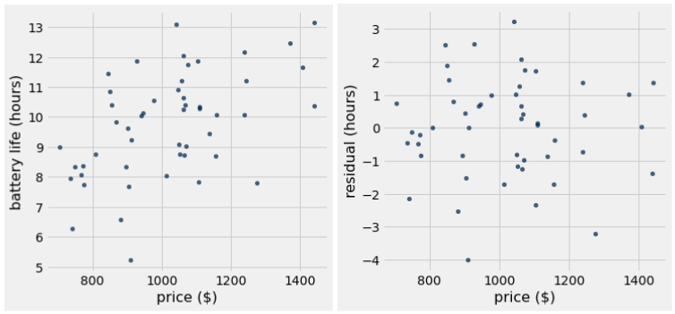
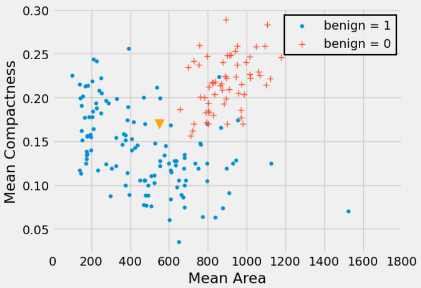
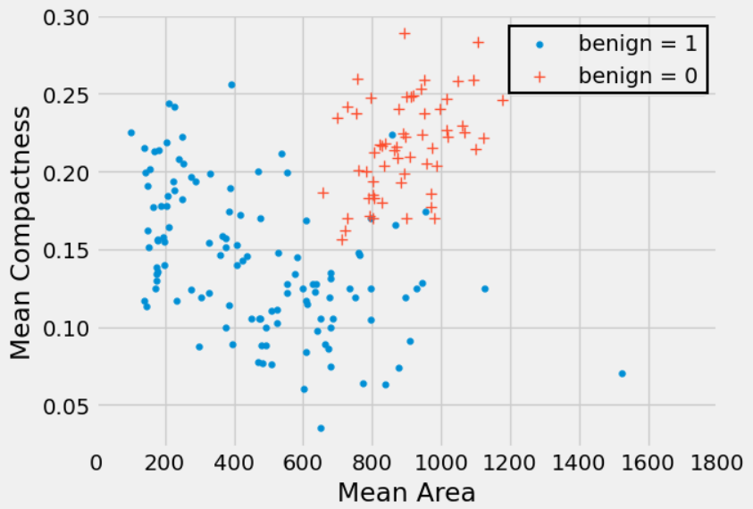
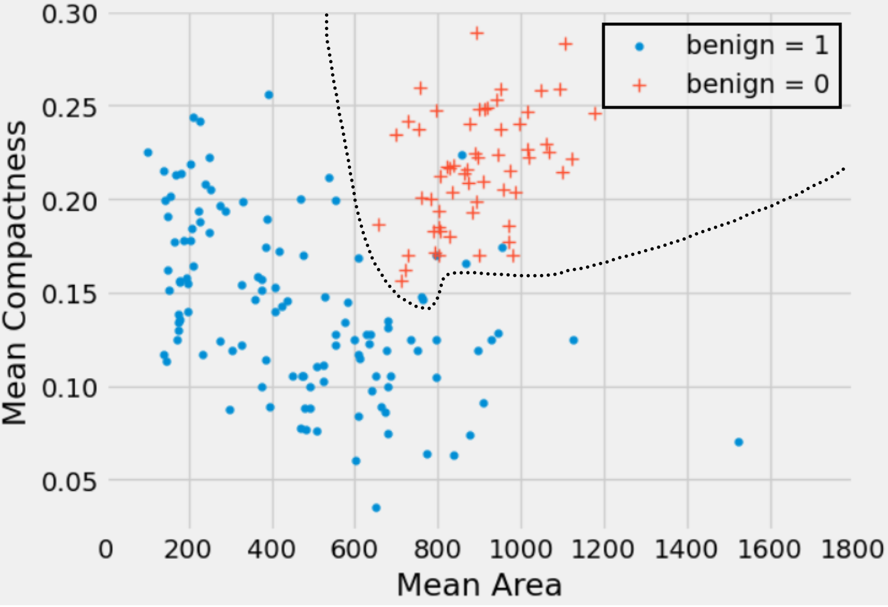

# Discussion 13 Data C8 Spring 2026

## Page 1

## Intervals for Predictions & kNN Classification

Discussion 13

Data C8: Foundations of Data Science UC Berkeley, Spring 2026

### 1. Confidence Intervals for Predictions

Anirra is looking to buy a new laptop for her birthday. She has a table laptops with information on different laptops with two columns:

- price (float): the price of the laptop in US dollars.
- battery life (float): the battery life of the laptop in hours.

- Inspect the following scatter plot and residual plot of Anirra’s data. Would using linear regression be appropriate for this

dataset?

Yes. The scatter plot exhibits a roughly linear relationship. The residual plot does not show any trend or pattern, and the residuals seem to add up to 0.

- Anirra wants to use a regression line to predict the battery life of a laptop given the price. Define the fitted_value function

below which takes in the following arguments:

- tbl (Table): a table with the data points used to generate the regression line.
- x (string): the column name for the x variable.
- y (string): the column name for the y variable.
- x_val (float): the x value we want to make a prediction at.

The function should return a float by using a regression line to predict a y-value for the given x-value. Assume the slope(tbl,

x, y) and intercept(tbl, x, y) functions are defined as in lecture.

def fitted_value(tbl, x, y, x_val):

m = ______________________________________________

b = ______________________________________________

__________________________________________________

## Page 2

def fitted_value(tbl, x, y, x_val): m = slope(tbl, x, y) b = intercept(tbl, x, y) return m * x_val + b

- Assume the average price of a laptop in Anirra’s dataset is $1,000. Anirra generates 90% confidence intervals for the predicted

battery life of laptops priced at $1,100 and $700.

#### i. Which one of these two intervals do we expect to be wider? Why?

The interval for laptops priced at $700 is wider. This is because $700 is further from the mean of $1,000. The further the 𝑥 value is from the mean 𝑥 value, the wider our interval is. See section 16.3 of the textbook for more details!

ii. Does the answer to the previous part change if we used a different confidence level? Why or why not?

Our answer does not change. If we use a different confidence level, both the interval at $1,100 and $700 will change in width, but the $700 interval will always be wider. The confidence level we use doesn’t impact the reasoning we used in part (i).

- Anirra believes that a laptop with a price of $1,300 should have a battery life of 14 hours. Complete the following code to

test her hypothesis with a 4% p-value cutoff. Assume Anirra has properly simulated 1,000 predicted battery lives for a laptop with price $1,300 and stored them in the array called predictions.

left = __________________________________________

right = _________________________________________

if _____________________________________________:

print("Fail to reject the null") else:

print(_____________________________________________)

left = percentile(2, predictions) right = percentile(98, predictions) if left <= 14 <= right: print("Fail to reject the null hypothesis") else: print("Reject the null hypothesis")

- For this question, assume we have a similar dataset to before, also well suited for linear regression but with a range of prices

between $0 and $1500. You find the correlation between price and battery life to be 𝑟= 0.8.

- A 90% confidence interval for predictions of a laptop with price $0 will have nearly the same lower and upper bounds

as a 90% confidence interval for the true intercept of the regression line in original units.

True

False

True. Computing the interval at a given x of 0 is the same as computing the confidence interval for the y-intercept. If our line of best fit is 𝑦= 𝑚∗𝑥+ 𝑏, then for a given 𝑥 of 0, the equation becomes 𝑦= 𝑏, which is just the intercept.

ii. A 90% confidence interval for predictions of a laptop with price 1 in standard units will have nearly the same lower and

upper bounds (in standard units) as a 90% confidence interval for the true correlation.

True

False

Data C8 Spring 2026 Discussion 13 | 2

## Page 3

True. In standard units, the line of best fit is 𝑦= 𝑟∗𝑥. If our given 𝑥 value is 1, then the equation becomes 𝑦= 𝑟, which is just the correlation coefficient.

iii. If we constructed one hundred 90% confidence intervals for predictions and one hundred 95% intervals for the battery

life of a laptop with price $950, we expect less of the 95% confidence intervals to contain the true battery life of a laptop with price $950 than the 90% confidence intervals.

True

False

False. Each 95% interval that we plan to generate has a 95% chance of containing the true prediction, while each 90% interval only has a 90% chance. We would expect 90 of the 90% confidence intervals to contain the true battery life and 95 of the 95% confidence intervals to contain the true battery life.

Data C8 Spring 2026 Discussion 13 | 3

## Page 4

### 2. kNN Classifier

Significant research has been done to understand whether a breast tumor is benign (not cancerous) or malignant (cancerous). Dagny wants to create a classifier that predicts whether a tumor is benign or not.

- Dagny wants to classify a new tumor (represented as a triangle in the scatter plot). Describe the steps she would take to

classify this new point based on a k-nearest neighbors classifier with k = 5.

- Convert the data to standard units so that Mean Area and Mean Compactness are on the same scale
- Compute the Euclidean distance between the new point and all the points in our dataset in standard units.
- Sort all the data in increasing order based on the calculated distance.
- Take the top 5 neighbors and take a majority vote.

#### In this particular case we can eyeball that the new point should be classified as benign = 1.

- Draw the decision boundary that the k-nearest neighbors algorithm (with k = 5) would generate for this problem.

Data C8 Spring 2026 Discussion 13 | 4

## Page 5

A decision boundary is the plane, curve, or line that separates the classification of one class from another. It is a boundary such that if a new point falls on the one side of the boundary, it will be classified as 0, and if it falls on the other side of the boundary, it will be classified as 1.

For areas where the split is not so well defined, trying moving an imaginary point across the plot and see when you would change your decision on what to classify the imaginary point as!

- Brandon suggests that Dagny should use a different k for her classifier like 𝑘= 4 or 𝑘= 8. Is Brandon’s suggestion

reasonable?

Not really. If we choose k to be even, we risk the danger that both classes will get the same number of votes. In that case, it would be unclear how we should decide to classify the new point.

- Suppose Dagny obtains a training set of labeled tumors and builds a nearest neighbor classifier with 𝑘= 1. She then applies

the classifier to predict the class of each point in the same training set. She notices something interesting about the results. What might she observe and why?

If we use our training set to “test” our 1-nearest neighbor classifier, the classifier will pass the test 100% of the time! Each point is its own nearest neighbors. But this gives a misleading impression of how well the classifier will perform on new data. As a result, we should not use the training set to test a classifier that is based on it.

- Suppose Dagny obtains a test set consisting of 50 data points. Should she repeatedly use her classifier on the test set, using

various values of 𝑘, to obtain the value of 𝑘 that yields the greatest accuracy? Explain.

The role of the test set is to have a way of understanding how well our classifier would perform in a real-world scenario with unseen data. It is important we only run our algorithm on the test data once after we are done selecting the value of k to use. Using the test set repeatedly to find the value of k that performs best can be very dangerous, as that can lead to overfitting! The classifier obtained using this process may perform well on the test set, but may do poorly on other unseen data.

Note that when we say to only run our algorithm on the test data “once“, this is referring to not changing aspects of the model (i.e., what our value of k is) after seeing how it currently performs on test data. If you were to choose “the best k” for the test data based on trial and error, this would defeat the purpose of using it as a way to evaluate how your model may do on real-world data (as we cherry-picked the best result). If you were to just re-run the Jupyter cell that tests the model on the test set though, this would be fine (in our case, you would just get the same result every time).

In this course though, we will not go into detail as to how to choose an optimal k value. For those who are curious, I encourage you to look up “validation set”!

Data C8 Spring 2026 Discussion 13 | 5

## Page 6

- Suppose in our breast tumor training dataset we have 60 benign = 0 data points and 150 benign = 1 data points. For what

values of 𝑘 would we always predict the same class?

Using overly large values of k will result in issues such as always predicting the same value. In this example, any k greater than or equal to 121 will always predict benign = 1 no matter what.

- Marissa suggests that we use a constant classifier which will always predict the class that is most common in the training

set. In our test set, there are 15 benign = 0 data points and 35 benign = 1 data points. What will the accuracy of the constant classifier be on our test set?

35 50 or 70%

Our constant classifier will always predict benign = 1 since it is more common in the training dataset, and the proportion of benign = 1 points in our test set is 35/50.

- Aside from the proportion of correct classifications, what are some other metrics we might want to consider in measuring

the quality of our predictions?

We might look into the relationship of the false positive/false negative rates. In different contexts, one of these types of errors might be more important than the other (e.g., in this example, we will want to consider if it is better to falsely classify a tumor as malignant when it is actually benign, or falsely classify it as benign when it is actually malignant), so it could be advantageous to tune our model to prefer one over the other. We will not dive deeply into this, but you’ll cover similar topics in Data 100!

Data C8 Spring 2026 Discussion 13 | 6
