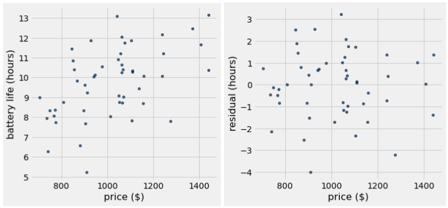
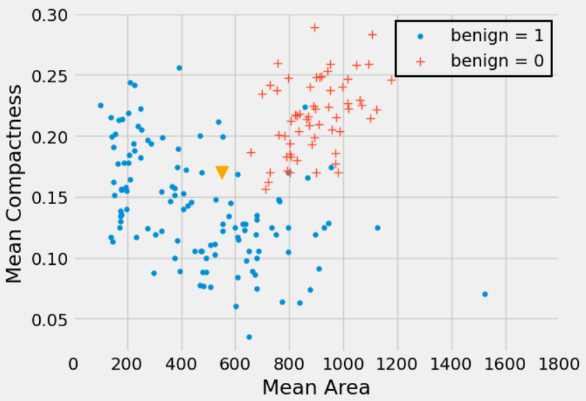
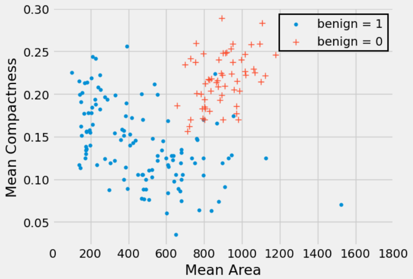

# Discussion 13 Data C8 Spring 2026

## Page 1

## Intervals for Predictions & kNN Classification

Discussion 13

Data C8: Foundations of Data Science UC Berkeley, Spring 2026

### 1. Confidence Intervals for Predictions

Anirra is looking to buy a new laptop for her birthday. She has a table laptops with information on different laptops with two columns:

- price (float): the price of the laptop in US dollars.
- battery life (float): the battery life of the laptop in hours.

- Inspect the following scatter plot and residual plot of Anirra’s data. Would using linear regression be appropriate for this

dataset?

- Anirra wants to use a regression line to predict the battery life of a laptop given the price. Define the fitted_value function

below which takes in the following arguments:

- tbl (Table): a table with the data points used to generate the regression line.
- x (string): the column name for the x variable.
- y (string): the column name for the y variable.
- x_val (float): the x value we want to make a prediction at.

The function should return a float by using a regression line to predict a y-value for the given x-value. Assume the slope(tbl,

x, y) and intercept(tbl, x, y) functions are defined as in lecture.

def fitted_value(tbl, x, y, x_val):

m = ______________________________________________

b = ______________________________________________

__________________________________________________

## Page 2

- Assume the average price of a laptop in Anirra’s dataset is $1,000. Anirra generates 90% confidence intervals for the predicted

battery life of laptops priced at $1,100 and $700.

#### i. Which one of these two intervals do we expect to be wider? Why?

ii. Does the answer to the previous part change if we used a different confidence level? Why or why not?

- Anirra believes that a laptop with a price of $1,300 should have a battery life of 14 hours. Complete the following code to

test her hypothesis with a 4% p-value cutoff. Assume Anirra has properly simulated 1,000 predicted battery lives for a laptop with price $1,300 and stored them in the array called predictions.

left = __________________________________________

right = _________________________________________

if _____________________________________________:

print("Fail to reject the null") else:

print(_____________________________________________)

- For this question, assume we have a similar dataset to before, also well suited for linear regression but with a range of prices

between $0 and $1500. You find the correlation between price and battery life to be 𝑟= 0.8.

- A 90% confidence interval for predictions of a laptop with price $0 will have nearly the same lower and upper bounds

as a 90% confidence interval for the true intercept of the regression line in original units.

True

False

ii. A 90% confidence interval for predictions of a laptop with price 1 in standard units will have nearly the same lower and

upper bounds (in standard units) as a 90% confidence interval for the true correlation.

True

False

iii. If we constructed one hundred 90% confidence intervals for predictions and one hundred 95% intervals for the battery

life of a laptop with price $950, we expect less of the 95% confidence intervals to contain the true battery life of a laptop with price $950 than the 90% confidence intervals.

True

False

Data C8 Spring 2026 Discussion 13 | 2

## Page 3

### 2. kNN Classifier

Significant research has been done to understand whether a breast tumor is benign (not cancerous) or malignant (cancerous). Dagny wants to create a classifier that predicts whether a tumor is benign or not.

- Dagny wants to classify a new tumor (represented as a triangle in the scatter plot). Describe the steps she would take to

classify this new point based on a k-nearest neighbors classifier with k = 5.

- Draw the decision boundary that the k-nearest neighbors algorithm (with k = 5) would generate for this problem.

Data C8 Spring 2026 Discussion 13 | 3

## Page 4

- Brandon suggests that Dagny should use a different k for her classifier like 𝑘= 4 or 𝑘= 8. Is Brandon’s suggestion

reasonable?

- Suppose Dagny obtains a training set of labeled tumors and builds a nearest neighbor classifier with 𝑘= 1. She then applies

the classifier to predict the class of each point in the same training set. She notices something interesting about the results. What might she observe and why?

- Suppose Dagny obtains a test set consisting of 50 data points. Should she repeatedly use her classifier on the test set, using

various values of 𝑘, to obtain the value of 𝑘 that yields the greatest accuracy? Explain.

- Suppose in our breast tumor training dataset we have 60 benign = 0 data points and 150 benign = 1 data points. For what

values of 𝑘 would we always predict the same class?

- Marissa suggests that we use a constant classifier which will always predict the class that is most common in the training

set. In our test set, there are 15 benign = 0 data points and 35 benign = 1 data points. What will the accuracy of the constant classifier be on our test set?

- Aside from the proportion of correct classifications, what are some other metrics we might want to consider in measuring

the quality of our predictions?

Data C8 Spring 2026 Discussion 13 | 4
