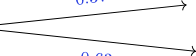
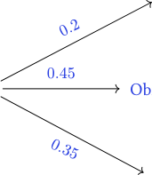
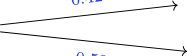
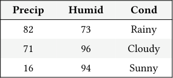
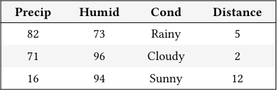

# Discussion 14 Data C8 Spring 2026

## Page 1

## Bayes & More Classification

Discussion 14

Data C8: Foundations of Data Science UC Berkeley, Spring 2026

### 1. Thomas' Bays

Thomas is an avid consumer of fish and is interested in finding ethically sourced fish to eat from 3 local bays near him. He researches online and finds the following information:

- Out of all fish, 20% of fish come from Labor Bay, 45% of fish come from Obi-Wan Keno Bay, and 35% come from Spelling Bay.
- In these three bays, there are only 2 types of fish: salmon and tuna.
- In Labor Bay, 37% of the fish are salmon.
- In Obi-Wan Keno Bay, 40% of the fish are tuna.
- In Spelling Bay, 42% of the fish are salmon.

#### (a) Draw a tree diagram to represent the result of Thomas’ research.

0.37

Salmon

Labor

Tuna

0.63

0.2

0.6

Salmon

0.45

Obi-Wan Keno

Tuna

0.4

0.35

0.42

Salmon

Spelling

Tuna

0.58

- Thomas is shopping for a fish at random. What is the chance he picks a tuna from Obi-Wan Keno Bay?

ℙ[Tuna and Obi-Wan Keno Bay] = ℙ[Tuna | OWK] ⋅ℙ[OWK] = 0.4 ⋅0.45

#### (c) Thomas chooses a fish at random.

#### i. What is the probability that the fish is a salmon?

ℙ[Salmon] = 0.2 ⋅0.37 + 0.45 ⋅0.6 + 0.35 ⋅0.42 = 0.491

#### ii. What is the probability that it is a tuna?

ℙ[Tuna] = 0.2 ⋅0.63 + 0.45 ⋅0.4 + 0.35 ⋅0.58 = 0.509

#### or we can compute the complement of the part (i) which gives

ℙ[Tuna] = 1 −ℙ[Salmon] = 0.509

#### (d) Thomas ends up buying a salmon. What is the probability the salmon came from Spelling Bay?

## Page 2

ℙ[Spelling Bay | Salmon] = ℙ[Spelling Bay and Salmon]

ℙ[Salmon]

= 0.35 ⋅0.42 0.2 ⋅0.37 + 0.45 ⋅0.6 + 0.35 ⋅0.42

- Thomas buys 10 fish at random. What is the probability that at least one of them is a salmon from Spelling Bay?

We can apply the complement rule here.

ℙ[Salmon from Spelling Bay] = 0.35 ⋅0.42

⟹ℙ[Salmon not from Spelling Bay] = 1 −(0.35 ⋅0.42)

ℙ[Salmon not from Spelling Bay for all 10 times] = ℙ[Salmon not from Spelling Bay]10 = (1 −0.35 ⋅0.42)10

⟹ℙ[at least one Salmon from Spelling Bay] = 1 − (1 −0.35 ⋅0.42)10

### 2. Blackboard Erasers

(Fall 2020 Final, Q3)

Mr. White is a teaching Chemistry class in Latimer Hall. His class has 100 undergraduate staff (uGSIs, tutors, etc.). Mr. White learns that one of his staff is stealing blackboard erasers from his lecture hall when the building is closed overnight. The only way the thief could access the building overnight is with a key card that belongs to them.

Suppose Mr. White discovers that 10 of his staff have a key card.

- If Mr. White randomly selects one of his staff, what is the probability that they are the eraser thief?

0.01. Mr. White has 100 staff members, and 1 is a thief, so 1 100 = 0.01

- If Mr. White randomly selects one of his staff, what is the probability that they are not the eraser thief and has a key card?

0.99 ⋅ 9 1. 99 out of 100 staff are not the thief. Since the thief must have the key card as well, we account for that probability.

ℙ[not eraser thief and has key card] = ℙ[has key card | not eraser thief] ⋅ℙ[not eraser thief] = 9 99 ⋅ 0.99

- At the next course staff meeting, Mr. White notices that one of his GSIs, Gus, has a key card sticking out of his wallet. Given

this information, what is the probability that Gus is the eraser thief?

Data C8 Spring 2026 Discussion 14 | 2

## Page 3

We want to compute ℙ[Gus is the thief | Gus has a key card] using Bayes, since the provided information was that Gus has a key card.

ℙ[Gus is the thief | Gus has a key card] = ℙ[Gus has a key card | Gus is the thief] ⋅ℙ[Gus is a thief]

ℙ[Gus has a key card]

= 1 ⋅0.01 ℙ[Gus has a key card]

The probability that Gus has a key card can be broken into two probabilities by complement rule - Gus is the thief and has a key card - Gus is not the thief and has a key card

Therefore we have

ℙ[Gus has a key card] = 0.01 + 0.99 ⋅ 9

99

and so the final answer is computed as

ℙ[Gus is the thief | Gus has a key card] = 1 ⋅0.01 0.01 ⋅1 + 0.99 ⋅ 9 99

- Mr. White is skeptical of his head GSI, Jesse. Prior to learning any information about Jesse’s key card access, Mr. White

believes there is a 25% probability that Jesse is the eraser thief.

Suppose Mr. White later discovers that Jesse has a key card. Given this new information, what is the probability that Jesse is the eraser thief?

The prior is ℙ[Jesse is the thief] = 0.25 and we want to compute ℙ[Jesse is the thief | Jesse has a key card].

Like above, we compute this with Bayes, except that we now have an updated prior,

ℙ[Jesse has a key card | Jesse is the thief] ⋅ℙ[Jesse is the thief]

ℙ[Jesse has a key card] = 1 ⋅0.25 0.25 ⋅1 + 0.75 ⋅ 9 99

### 3. Text Classification

#### (a) The attributes in a word embedding represent

The frequency of the word's occurence in the text

Synonymous words

The definition of the word

None of the above

- Due to the importance of grammar and context in determining the meaning of text, it is more effective to embed

Entire sentences

Individual words

#### (c) A neural network is

Any classification method modeled after the human brain

An algorithm that classifies a point based on the majority class of its nearest neighbors

Organized combinations of simple operations that can generate text embeddings from words

### 4. Don’t rain on my Glade!

Data C8 Spring 2026 Discussion 14 | 3

## Page 4

(Spring 2025 Final, Q3)

Marissa loves visiting the campus Glade at 4pm to relax after a long day of class, but wants to make sure the weather is nice ahead of time. She has access to a table called weather which contains historical information on the weather in Berkeley, California at 4pm for the past 10,000 days. A three-row sample from the table lies below.

- Precip (integer): precipitation; the percent chance of receiving at least 0.01 inches of rain. - Humid (integer): relative humidity; the percentage of possible water vapor that can exist in the air at the air’s current temperature. - Cond (string): weather conditions; the state of the weather (one of Rainy, Cloudy or Sunny).

#### Precip Humid Cond

82 73 Rainy

71 96 Cloudy

16 94 Sunny

... (9997 rows omitted)

- Marissa would like to use the weather table to build a predictive model for the weather conditions of an upcoming Berkeley

afternoon (Rainy, Cloudy or Sunny). What type of prediction problem is Marissa working on?

Regression Classification

- Complete the following code so that the weather table is split into two tables: one called training_set and one called

testing_set. The first eighty percent of the data in shuffled_table should be allocated to training_set.

shuffled_table = weather.sample(__________________________________________)

training_set = shuffled_table.________________(______________________________________)

testing_set = shuffled_table.________________(______________________________________)

shuffled_table = weather.sample(10000, with_replacement = False) training_set = shuffled_table.take(np.arange(8000))

testing_set = shuffled_table.take(np.arange(8000, weather.num_rows

- Marissa decides to use the k-nearest neighbors prediction algorithm. Which of the following formulae correctly computes a

distance between a new observation (new) and a training point (train)?

√(Precipnew −Preciptrain)2 + (Humidnew −Humidtrain)2 + (Condnew −Condtrain)2

√(Precipnew −Preciptrain) + (Humidnew −Humidtrain) + (Condnew −Condtrain)

√(Precipnew −Preciptrain)2 + (Humidnew −Humidtrain)2

√(Precipnew −Humidnew)2 + (Preciptrain −Humidtrain)2

√(Precipnew −Preciptrain) + (Humidnew −Humidtrain)

√(Precipnew −Humidnew) + (Preciptrain −Humidtrain)

- Before finding the k-nearest neighbors to a new observation, Marissa will first need to compute the distance between the

new observation and every point in the training set. Which of the following table methods or coding techniques can be used to compute these distances? Select all that apply.

group Iteration

join apply

Conditional statements pivot

Data C8 Spring 2026 Discussion 14 | 4

## Page 5

- Marissa computes the distance between her new observation and each training point, and then creates a new version of the

training_set table that includes these distances as an additional column called “Distance”. Below is a three row excerpt from the updated table.

#### Precip Humid Cond Distance

82 73 Rainy 5

71 96 Cloudy 2

16 94 Sunny 12

... (7997 rows omitted)

Fill in the skeleton code below to classify the new observation using the k-nearest neighbors prediction algorithm where k = 7.

nearest_nbrs = training_set.____________________________(____________________________)

.____________________________(__________________________________________)

neighbor_votes = nearest_nbrs.____________________________(____________________________)

.sort(__________________________________________)

majority_class = neighbor_votes.column("Cond").item(0)

nearest_nbrs = training_set.sort("Distance").take(np.arange(7))

neighbor_votes = nearest_nbrs.group("Cond").sort("count", descending = True)

majority_class = neighbor_votes.column("Cond").item(0)

- Marissa’s friend, Ishani, wonders if k = 7 offers the best predictive performance, and wants to try out a few different values

of k before finalizing the k-nearest neighbors prediction model. Ishani’s plan is to try out different values of k and choose the one which performs best on the testing set. Does this method make appropriate use of the testing set?

No

Data C8 Spring 2026 Discussion 14 | 5
