# Discussion Worksheets

## Discussion 01 — Student

### Page 1

### By the Numbers

Discussion 01

Data C8: Foundations of Data Science UC Berkeley, Spring 2026

Welcome to your first Data 8 lab! Data Science is about making sense of real numbers in the world, and this worksheet will help introduce you to the type of thinking you will learn in this class.

Answer the following questions to the best of your ability. Complete the worksheet with your table group. Be ready to discuss your reasoning behind each of your answers!

#### 1. Class Sizes

Which of the following numbers are closest to the average size of all undergraduate Berkeley classes in the 2024-2025 academic year?

30 40 50 60 70 80 90

#### 2. Popular Degrees

In the 2024-2025 academic year, close to half of all undergraduate degrees at Berkeley were awarded to students in the 10 largest major programs. The top five (in decreasing order of number of degrees awarded) are Data Science, CDSS Computer Science, Economics, MCB, and EECS. What are the next five?

#### 3. Healthy Living

“Life expectancy at birth” (LEB) measures roughly how many years a newborn baby is expected to live, and is a commonly used metric to quantify the health of a population. What two states would you expect to have the highest LEBs among all states in the US?

#### 4. Worldwide

Picking from the list of numbers below, fill in the numbers that you expect to be the closest to the 2022 LEB of the United States as well as the world.

69 71 73 75 77 79

United States: ______ World: ______

## Discussion 01 — Solution

### Page 1

### By the Numbers

Discussion 01

Data C8: Foundations of Data Science UC Berkeley, Spring 2026

Welcome to your first Data 8 lab! Data Science is about making sense of real numbers in the world, and this worksheet will help introduce you to the type of thinking you will learn in this class.

Answer the following questions to the best of your ability. Complete the worksheet with your table group. Be ready to discuss your reasoning behind each of your answers!

#### 1. Class Sizes

Which of the following numbers are closest to the average size of all undergraduate Berkeley classes in the 2024-2025 academic year?

30 40 50 60 70 80 90

50, the actual average was 53.6. It was 53.1 in the 2023-2024 academic year, 53.0 in the 2022-2023 academic year and 52.1 in the 2021-2022 academic year. Note: The classes used in this data set do not include independent studies classes, ungraded discussion/ lab secondary sections, or classes taught in the Summer term. UC Berkeley Class Size statistics

#### 2. Popular Degrees

In the 2024-2025 academic year, close to half of all undergraduate degrees at Berkeley were awarded to students in the 10 largest major programs. The top five (in decreasing order of number of degrees awarded) are Data Science, CDSS Computer Science, Economics, MCB, and EECS. What are the next five?

Political Science (409), Business Administration (408), Psychology (403), Media Studies (315), and Cognitive Science (303). The number of students in the top five largest programs are as follows: Data Science (1,074), CDSS Computer Science (1,029), Economics (798), MCB (621), and EECS (516). UC Berkeley Demographic statistics

#### 3. Healthy Living

“Life expectancy at birth” (LEB) measures roughly how many years a newborn baby is expected to live, and is a commonly used metric to quantify the health of a population. What two states would you expect to have the highest LEBs among all states in the US?

Hawaii (80.0) and Massachusetts (79.8), but there is some uncertainty in these predictions. New Jersey and New York are next at 79.6 and 79.5. United States Life Expectancy statistics table

#### 4. Worldwide

Picking from the list of numbers below, fill in the numbers that you expect to be the closest to the 2022 LEB of the United States as well as the world.

69 71 73 75 77 79

United States: ______ World: ______

United States: 76.4, World: 71. World Health Organization Life Expectancy statistics

## Discussion 02 — Student

### Page 1

### Intro to Tables & Causation

Discussion 02

Data C8: Foundations of Data Science UC Berkeley, Spring 2026

#### 1. Warmup

A study followed 369 people with cardiovascular disease, randomly selected from all hospital patients with cardiovascular disease. A year later, those who owned a dog were four times more likely to be alive than those who did not. For all of the following questions, please provide a brief explanation. (Spring 2017 Practice Midterm Question 3b)

##### (a) True or False. This study is a randomized controlled experiment.

##### (b) True or False. This study shows that dog owners live longer than cat owners on average.

- True or False. This study shows that for someone with cardiovascular disease, adopting a dog causes them to live longer.

#### 2. Fun with Arrays

Suppose we have executed the following lines of code. Answer each question with the appropriate output associated with each line of code, or write ERROR if you think the operation is not possible.

odd = make_array(1, 3, 5, 7) even = np.arange(2, 10, 2) nums = make_array('1', '2', '3', '4')

##### (a) odd + even

##### (b) odd + nums

##### (c) even.item(3) * odd.item(1)

##### (d) odd * 3

##### (e) odd + 1 == even

##### (f) nums.item(3) + '0'

- sum(odd > 4) Hint: Boolean values of True and False are equivalent to integer values of 1 and 0 respectively.

##### (h) sum(odd > 4) / len(odd > 4). What does this output represent? Discuss with peers.

##### (i) odd + make_array(True, True, False, False)

### Page 2

#### 3. Rise and Shine

Tables are a fundamental way of representing data. A table can be viewed in two ways:

- A sequence of named columns that each describe a single attribute of all entries in a data set, or
- A sequence of rows where each row contains all the attribute information about that entry in the data set

Data 8 uses a library consisting of many Table functions that will allow you to manipulate and visualize data. All of the functions we will use in this course are listed on the Data 8 website under Python Reference, and a similar reference sheet will be provided during exams.

In this question, let’s look at an example table called weather. The table has 8 rows, each corresponding to a day of the year. Each row has three attributes: the date, the outdoor temperature in Celsius, and the number of students at lecture that day.

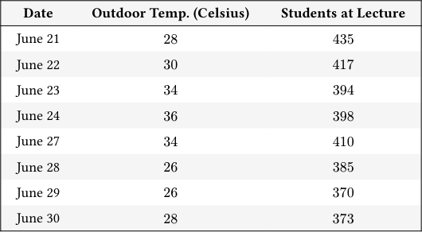

##### Date Outdoor Temp. (Celsius) Students at Lecture

June 21 28 435

June 22 30 417

June 23 34 394

June 24 36 398

June 27 34 410

June 28 26 385

June 29 26 370

June 30 28 373

- Using just the information provided in the weather table, can you generate the following tables and visualizations? If not,

what additional information do you need? Note: You do not need to know/write the specifics of the code that you would use to generate these outputs.

Yes / No Yes/No

- Miriam likes using Fahrenheit more than Celsius. Suppose that she has access to a function called fahrenheit that takes

in a number (temperature in Celsius) and returns the temperature in Fahrenheit.

##### i. Write an expression that evaluates to 30°C in Fahrenheit. Hint: which function can we use?

##### ii. What will fahrenheit("thirty") output?

iii. Miriam assigns a variable temperature to the number 25. What will fahrenheit(temperature * 2) output?

Data C8 Spring 2026 Discussion 02 | 2

### Page 3

#### 4. Made with ♡ & Coffee

Carisma collected the following information about her coworkers’ methods of getting to work and their coffee consumption. The data is stored in a table called coworkers:

##### Name Method Average Cups of Coffee

Dagny drive 2.3

Marissa drive 1.5

Isaac bus 0.8

Tiffany drive 1.8

Wesley bus 1.2

... (60 rows omitted)

The table contains three columns: - Name (string): The name of the coworker. - Method (string): The coworker’s way of commuting to work. - Average Cups of Coffee (float): The average number of cups of coffee consumed per day by the coworker.

##### (a) Help Carisma analyze her coworkers’ coffee consumption habits by creating the following tables.

- Carisma wants to focus on her coworkers who commute by driving to work. Create a table titled drivers that only

includes coworkers who drive to work.

drivers = __________________.__________________(_______________________, _______________________)

ii. Carisma wants to see which of her coworkers consume the most coffee. Create a table titled consumption that organizes

her coworkers from the highest average cups of coffee per day to the lowest.

consumption = _________________._________________(______________________, ______________________)

iii. Carisma decides she only wants to focus on her coworkers’ average coffee consumption and method of commuting to

work. Create a table titled coffee_and_commute that includes only the Average Cups of Coffee and Method columns in that order.

coffee_and_commute = _________________._________________(_______________________________________)

- Carisma wants to determine whether she is spending more money on coffee compared to boba over the course of 1 semester

(15 weeks long). Assume she purchases 4 coffees and 3 bobas per week. Complete the following lines of code, which should assign result to True if Carisma spends strictly more on coffee and False otherwise.

cost_coffee = 6.0 cost_boba = 7.0

total_coffee = ______________ * ______ * ______

total_boba = ________________ * ______ * ______

result = ______________________________________

Data C8 Spring 2026 Discussion 02 | 3

## Discussion 02 — Solution

### Page 1

### Intro to Tables & Causation

Discussion 02

Data C8: Foundations of Data Science UC Berkeley, Spring 2026

#### 1. Warmup

A study followed 369 people with cardiovascular disease, randomly selected from all hospital patients with cardiovascular disease. A year later, those who owned a dog were four times more likely to be alive than those who did not. For all of the following questions, please provide a brief explanation. (Spring 2017 Practice Midterm Question 3b)

##### (a) True or False. This study is a randomized controlled experiment.

False. The researchers did not randomly assign individuals to a treatment group (having a dog) and a control group (not having a dog). The experimenters had no control over who owned a dog.

##### (b) True or False. This study shows that dog owners live longer than cat owners on average.

False. The experiment compares those who owned a dog to those who didn’t (not specifically cat owners). Also, the experiment only involves people with cardiovascular disease, not all people.

- True or False. This study shows that for someone with cardiovascular disease, adopting a dog causes them to live longer.

False. An observational study does not imply causation. There may be confounding factors that contribute to the correlation between adopting a dog and living longer.

#### 2. Fun with Arrays

Suppose we have executed the following lines of code. Answer each question with the appropriate output associated with each line of code, or write ERROR if you think the operation is not possible.

odd = make_array(1, 3, 5, 7) even = np.arange(2, 10, 2) nums = make_array('1', '2', '3', '4')

##### (a) odd + even

array([3, 7, 11, 15])

##### (b) odd + nums

ERROR. Arrays can only be added together if they have the same size, and are of similar data types (i.e. ints and floats). In this case, one array contains integers and the other contains strings, so the operation is invalid.

##### (c) even.item(3) * odd.item(1)

24

##### (d) odd * 3

array([3, 9, 15, 21])

##### (e) odd + 1 == even

array([True, True, True, True]). Remember array operations are performed element-wise, including comparison operators.

##### (f) nums.item(3) + '0'

### Page 2

'40'

- sum(odd > 4) Hint: Boolean values of True and False are equivalent to integer values of 1 and 0 respectively.

1. This computes the number of elements in odd that are strictly greater than 4.

##### (h) sum(odd > 4) / len(odd > 4). What does this output represent? Discuss with peers.

0.5. This computes the proportion of values strictly greater than 4! It is equivalent to np.mean(odd > 4). We will revisit this during the hypothesis testing topic.

##### (i) odd + make_array(True, True, False, False)

array([2, 4, 5, 7]). Boolean values of True and False are equivalent to integer values of 1 and 0 respectively.

#### 3. Rise and Shine

Tables are a fundamental way of representing data. A table can be viewed in two ways:

- A sequence of named columns that each describe a single attribute of all entries in a data set, or
- A sequence of rows where each row contains all the attribute information about that entry in the data set

Data 8 uses a library consisting of many Table functions that will allow you to manipulate and visualize data. All of the functions we will use in this course are listed on the Data 8 website under Python Reference, and a similar reference sheet will be provided during exams.

In this question, let’s look at an example table called weather. The table has 8 rows, each corresponding to a day of the year. Each row has three attributes: the date, the outdoor temperature in Celsius, and the number of students at lecture that day.

##### Date Outdoor Temp. (Celsius) Students at Lecture

June 21 28 435

June 22 30 417

June 23 34 394

June 24 36 398

June 27 34 410

June 28 26 385

June 29 26 370

June 30 28 373

- Using just the information provided in the weather table, can you generate the following tables and visualizations? If not,

what additional information do you need? Note: You do not need to know/write the specifics of the code that you would use to generate these outputs.

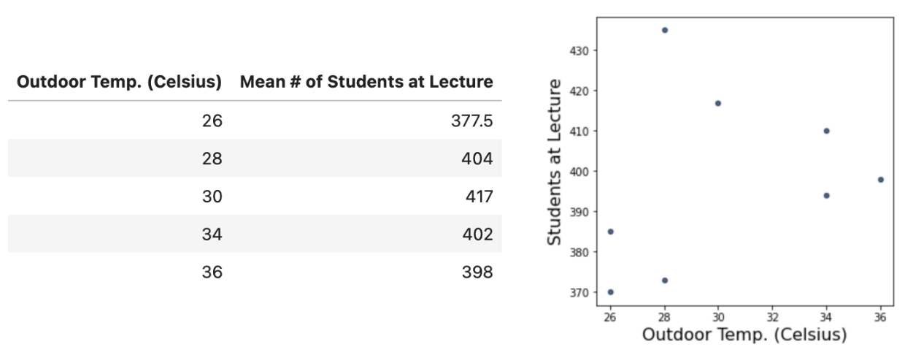

Data C8 Spring 2026 Discussion 02 | 2

### Page 3

Yes / No Yes/No

Yes, Yes.

- Miriam likes using Fahrenheit more than Celsius. Suppose that she has access to a function called fahrenheit that takes

in a number (temperature in Celsius) and returns the temperature in Fahrenheit.

##### i. Write an expression that evaluates to 30°C in Fahrenheit. Hint: which function can we use?

fahrenheit(30)

##### ii. What will fahrenheit("thirty") output?

ERROR. fahrenheit takes in a number, so we should only pass numbers into the function. Passing in something that is not a number will result in an error.

iii. Miriam assigns a variable temperature to the number 25. What will fahrenheit(temperature * 2) output?

The Fahrenheit value for 50°C, 122°F.

Data C8 Spring 2026 Discussion 02 | 3

### Page 4

#### 4. Made with ♡ & Coffee

Carisma collected the following information about her coworkers’ methods of getting to work and their coffee consumption. The data is stored in a table called coworkers:

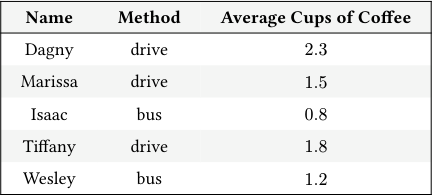

##### Name Method Average Cups of Coffee

Dagny drive 2.3

Marissa drive 1.5

Isaac bus 0.8

Tiffany drive 1.8

Wesley bus 1.2

... (60 rows omitted)

The table contains three columns: - Name (string): The name of the coworker. - Method (string): The coworker’s way of commuting to work. - Average Cups of Coffee (float): The average number of cups of coffee consumed per day by the coworker.

##### (a) Help Carisma analyze her coworkers’ coffee consumption habits by creating the following tables.

- Carisma wants to focus on her coworkers who commute by driving to work. Create a table titled drivers that only

includes coworkers who drive to work.

drivers = __________________.__________________(_______________________, _______________________)

drivers = coworkers.where("Method", "drive")

ii. Carisma wants to see which of her coworkers consume the most coffee. Create a table titled consumption that organizes

her coworkers from the highest average cups of coffee per day to the lowest.

consumption = _________________._________________(______________________, ______________________)

consumption = coworkers.sort("Average Cups of Coffee", descending=True)

iii. Carisma decides she only wants to focus on her coworkers’ average coffee consumption and method of commuting to

work. Create a table titled coffee_and_commute that includes only the Average Cups of Coffee and Method columns in that order.

coffee_and_commute = _________________._________________(_______________________________________)

coffee_and_commute = coworkers.select("Average Cups of Coffee", "Method")

- Carisma wants to determine whether she is spending more money on coffee compared to boba over the course of 1 semester

(15 weeks long). Assume she purchases 4 coffees and 3 bobas per week. Complete the following lines of code, which should assign result to True if Carisma spends strictly more on coffee and False otherwise.

cost_coffee = 6.0 cost_boba = 7.0

total_coffee = ______________ * ______ * ______

total_boba = ________________ * ______ * ______

result = ______________________________________

Data C8 Spring 2026 Discussion 02 | 4

### Page 5

cost_coffee = 6.0 cost_boba = 7.0 total_coffee = cost_coffee * 4 * 15 total_boba = cost_boba * 3 * 15 result = total_coffee > total_boba

##### Data C8 Spring 2026 Discussion 02 | 5

## Discussion 03 — Student

### Page 1

### Visualizations, Data Types, Extending Tables

Discussion 03

Data C8: Foundations of Data Science UC Berkeley, Spring 2026

An extremely important aspect of data science is visualizing the data in a precise, consistent manner.

#### 1. Visualizations

A common discussion people have when visualizing data revolves around the scale of the y-axis on a chart. It is commonly believed that charts with numerical y-axis must always start at 0. After watching the video, do you think this is true? Discuss the following questions.

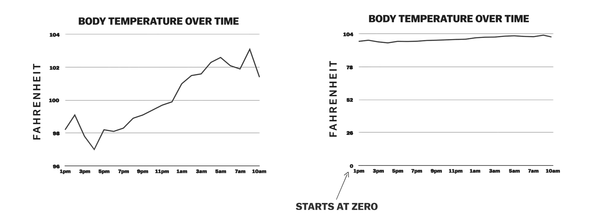

##### (a) In your opinion, when is it appropriate to start the y-axis at 0, and when not?

##### (b) In general, what should we consider when making a good data visualization?

### Page 2

### 2. Aces

In tennis, a player hits an ace when their serve is untouched by the opponent. Your friend Tim is interested in analyzing the 8 male tennis professionals who have hit the most aces throughout tennis history. The table below is called tennis and includes statistics obtained from the ATP Tour. The table is sorted in decreasing order of Num. Aces, the total number of aces (as an integer) hit by that player in their career.

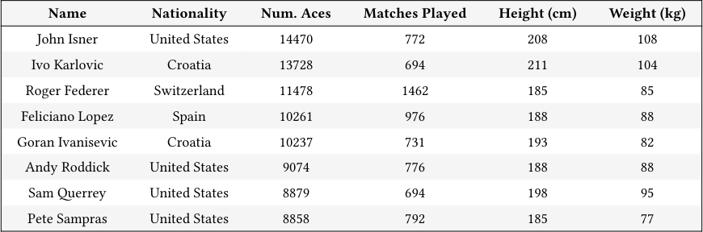

##### Name Nationality Num. Aces Matches Played Height (cm) Weight (kg)

John Isner United States 14470 772 208 108

Ivo Karlovic Croatia 13728 694 211 104

Roger Federer Switzerland 11478 1462 185 85

Feliciano Lopez Spain 10261 976 188 88

Goran Ivanisevic Croatia 10237 731 193 82

Andy Roddick United States 9074 776 188 88

Sam Querrey United States 8879 694 198 95

Pete Sampras United States 8858 792 185 77

Unfortunately, the code Tim wrote to analyze the data has some issues. Below are some error messages that appeared, along with what Tim was trying to calculate. Describe the issues and explain how you would change the code to fix them.

##### (a) The proportion of players in the table that are from the United States.

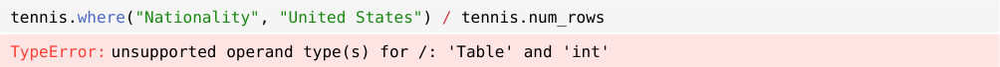

tennis.where("Nationality", "United States") / tennis.num_rows

TypeError: unsupported operand type(s) for /: 'Table' and 'int'

##### (b) An array of the average number of aces hit per match for each player.

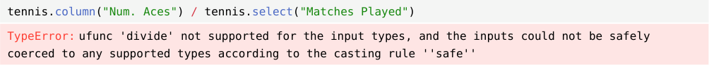

tennis.column("Num. Aces") / tennis.select("Matches Played")

TypeError: ufunc 'divide' not supported for the input types, and the inputs could not be safely

coerced to any supported types according to the casting rule ''safe''

- The name of the player with less than 10,000 aces who has played the most matches in their career.

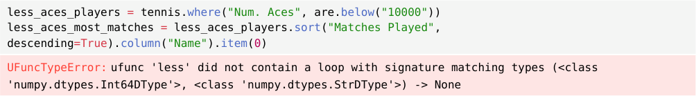

less_aces_players = tennis.where("Num. Aces", are.below("10000")) less_aces_most_matches = less_aces_players.sort("Matches Played", descending=True).column("Name").item(0)

UFuncTypeError: ufunc 'less' did not contain a loop with signature matching types (<class

'numpy.dtypes.Int64DType'>, <class 'numpy.dtypes.StrDType'>) -> None

Data C8 Spring 2026 Discussion 03 | 2

### Page 3

#### 3. Ed Discussion is Our Friend

Data 8 staff love to answer questions on Ed! The table staff contains information about the staff’s Fall 2025 Data 8 Ed statistics. There are 5 columns:

- Name (string): name of the staff member.
- ID (int): the ID of the staff member.
- Hearts per Post (float): the mean number of hearts awarded per post made by a staff member (0 if no posts made)
- Answers (int): number of answers to Ed questions and comments.
- Admin (boolean): whether or not the staff member was an admin of the Data 8 Fall 2025 Ed.

Some rows are shown below:

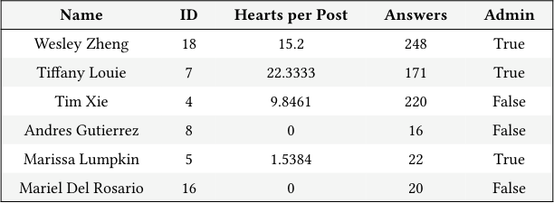

##### Name ID Hearts per Post Answers Admin

Wesley Zheng 18 15.2 248 True

Tiffany Louie 7 22.3333 171 True

Tim Xie 4 9.8461 220 False

Andres Gutierrez 8 0 16 False

Marissa Lumpkin 5 1.5384 22 True

Mariel Del Rosario 16 0 20 False

- For each of the columns in staff, identify if the data contained in that column is numerical or categorical.

- Professor DeNero wants to award a prize to a staff member based on their performance on Ed. To be eligible, the staff member

must receive at least one heart per post and hold an admin role. Among those who meet these criteria, the staff member with the highest number of answers will be selected as the winner. Fill in the code blanks to determine who earns the prize.

good_staff = staff.where(_______________________________________________).where(______________________)

lucky_staff_name = ____________.sort(____________________________________).column(____________).item(0)

Data C8 Spring 2026 Discussion 03 | 3

### Page 4

#### 4. Warm Down (Optional)

A table named seats contains a row for each time a student submitted the attendance form in lecture on September 18th, 20th, or 22nd. The table contains four columns.

- Email (string): the email address of the student.
- Row (string): the letter of the row in which they claim to be seated.
- Seat (int): the number of the seat in which they claim to be seated.
- Date (int): the date of the submission, either 18, 20, or 22.

(Fall 2017 Midterm Question 2 Modified)

##### Email Row Seat Date

sulu@berkeley.edu C 102 20

mccoy@berkeley.edu A 3 18

kirk@berkeley.edu R 110 20

... (1747 rows omitted)

Fill in the blanks of the Python expressions to compute the described values. You must use all and only the lines provided. The last (or only) line of each answer should evaluate to the value described.

##### (a) The largest seat number in the seats table.

Method 1:

max(____________________________________)

Method 2:

_____________________.sort(_________________________, _____________________________)

.______________________________._______________________________

##### (b) The total number of attendance submissions for September 20th in rows A, B, C, D, or E.

Hint: You can use Table.where predicates to compare letters lexicographically (e.g. A is below B). You could alternatively use a different method that does not involve comparing lexicographically.

filtered_seats = seats.__________(________________, __________________)

filtered_seats.__________(________________, ________________).______________

Data C8 Spring 2026 Discussion 03 | 4

## Discussion 03 — Solution

### Page 1

### Visualizations, Data Types, Extending Tables

Discussion 03

Data C8: Foundations of Data Science UC Berkeley, Spring 2026

An extremely important aspect of data science is visualizing the data in a precise, consistent manner.

#### 1. Visualizations

A common discussion people have when visualizing data revolves around the scale of the y-axis on a chart. It is commonly believed that charts with numerical y-axis must always start at 0. After watching the video, do you think this is true? Discuss the following questions.

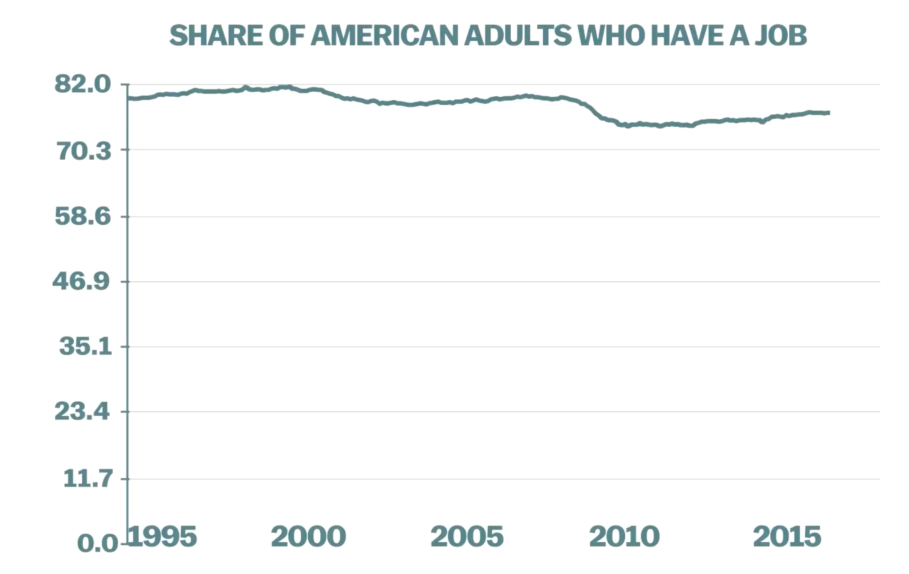

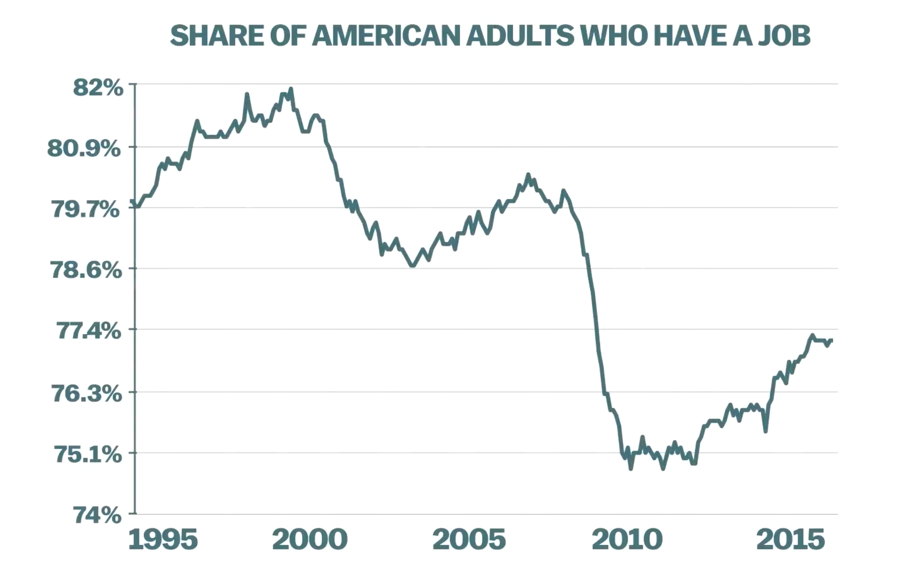

##### (a) In your opinion, when is it appropriate to start the y-axis at 0, and when not?

Answers vary. One possible idea is that we should start the y-axis at 0 when 0 is a good baseline value for the data we are trying to represent. Another idea is to start the y-axis at a different value if the magnitude of the changes we are trying to show is small.

##### (b) In general, what should we consider when making a good data visualization?

Answers vary. We may want to first think about the purpose of the visualization — what are we trying to show? Is there a trend of interest? A relationship between multiple variables? These questions will guide us toward choosing not only an appropriate type of visualization but also the best ways in which we can present them.

An example: body temperature never needing to reach 0, as seen in the graphs above.

### Page 2

### 2. Aces

In tennis, a player hits an ace when their serve is untouched by the opponent. Your friend Tim is interested in analyzing the 8 male tennis professionals who have hit the most aces throughout tennis history. The table below is called tennis and includes statistics obtained from the ATP Tour. The table is sorted in decreasing order of Num. Aces, the total number of aces (as an integer) hit by that player in their career.

##### Name Nationality Num. Aces Matches Played Height (cm) Weight (kg)

John Isner United States 14470 772 208 108

Ivo Karlovic Croatia 13728 694 211 104

Roger Federer Switzerland 11478 1462 185 85

Feliciano Lopez Spain 10261 976 188 88

Goran Ivanisevic Croatia 10237 731 193 82

Andy Roddick United States 9074 776 188 88

Sam Querrey United States 8879 694 198 95

Pete Sampras United States 8858 792 185 77

Unfortunately, the code Tim wrote to analyze the data has some issues. Below are some error messages that appeared, along with what Tim was trying to calculate. Describe the issues and explain how you would change the code to fix them.

##### (a) The proportion of players in the table that are from the United States.

tennis.where("Nationality", "United States") / tennis.num_rows

TypeError: unsupported operand type(s) for /: 'Table' and 'int'

The code errors because it tries to divide a table by an integer, which is not a valid operation.

Correct code: tennis.where("Nationality", "United States").num_rows / tennis.num_rows

##### (b) An array of the average number of aces hit per match for each player.

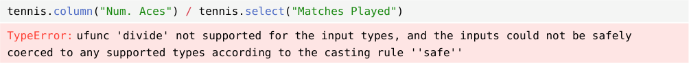

tennis.column("Num. Aces") / tennis.select("Matches Played")

TypeError: ufunc 'divide' not supported for the input types, and the inputs could not be safely

coerced to any supported types according to the casting rule ''safe''

The code errors because it attempts to divide an array by a table. Arrays can only be divided by an integer or another array of a similar data type and of the same length.

Correct code: tennis.column("Num. Aces") / tennis.column("Matches Played")

- The name of the player with less than 10,000 aces who has played the most matches in their career.

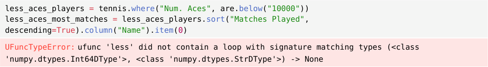

less_aces_players = tennis.where("Num. Aces", are.below("10000")) less_aces_most_matches = less_aces_players.sort("Matches Played", descending=True).column("Name").item(0)

UFuncTypeError: ufunc 'less' did not contain a loop with signature matching types (<class

'numpy.dtypes.Int64DType'>, <class 'numpy.dtypes.StrDType'>) -> None

The code errors because "10000" is a string, making comparisons with the values in the Num. Aces column (which are integers) invalid. Correct code:

less_aces_players = tennis.where("Num. Aces", are.below(10000)) less_aces_most_matches = less_aces_players.sort("Matches Played", descending=True).column("Name").item(0)

Note: If we wanted the code to evaluate to the actual name, we would need a new line to call less_aces_most_matches.

Data C8 Spring 2026 Discussion 03 | 2

### Page 3

#### 3. Ed Discussion is Our Friend

Data 8 staff love to answer questions on Ed! The table staff contains information about the staff’s Fall 2025 Data 8 Ed statistics. There are 5 columns:

- Name (string): name of the staff member.
- ID (int): the ID of the staff member.
- Hearts per Post (float): the mean number of hearts awarded per post made by a staff member (0 if no posts made)
- Answers (int): number of answers to Ed questions and comments.
- Admin (boolean): whether or not the staff member was an admin of the Data 8 Fall 2025 Ed.

Some rows are shown below:

##### Name ID Hearts per Post Answers Admin

Wesley Zheng 18 15.2 248 True

Tiffany Louie 7 22.3333 171 True

Tim Xie 4 9.8461 220 False

Andres Gutierrez 8 0 16 False

Marissa Lumpkin 5 1.5384 22 True

Mariel Del Rosario 16 0 20 False

- For each of the columns in staff, identify if the data contained in that column is numerical or categorical.

- Name: Categorical
- ID: Categorical
- Hearts per Post: Numerical
- Answers: Numerical
- Admin: Categorical

One way of determining if a column is numerical or not is to perform arithmetic operations on its values. For example, do we get a meaningful result if we add two IDs together? If not, the column may be categorical.

- Professor DeNero wants to award a prize to a staff member based on their performance on Ed. To be eligible, the staff member

must receive at least one heart per post and hold an admin role. Among those who meet these criteria, the staff member with the highest number of answers will be selected as the winner. Fill in the code blanks to determine who earns the prize.

good_staff = staff.where(_______________________________________________).where(______________________)

lucky_staff_name = ____________.sort(____________________________________).column(____________).item(0)

good_staff = staff.where("Hearts per Post", are.above_or_equal_to(1)).where("Admin", True) lucky_staff_name = good_staff.sort("Answers", descending=True).column("Name").item(0)

Note: If we wanted the code to evaluate to the actual name, we would need a new line to call lucky_staff_name.

Data C8 Spring 2026 Discussion 03 | 3

### Page 4

#### 4. Warm Down (Optional)

A table named seats contains a row for each time a student submitted the attendance form in lecture on September 18th, 20th, or 22nd. The table contains four columns.

- Email (string): the email address of the student.
- Row (string): the letter of the row in which they claim to be seated.
- Seat (int): the number of the seat in which they claim to be seated.
- Date (int): the date of the submission, either 18, 20, or 22.

(Fall 2017 Midterm Question 2 Modified)

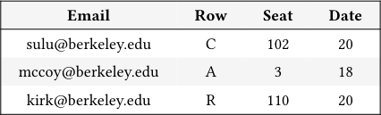

##### Email Row Seat Date

sulu@berkeley.edu C 102 20

mccoy@berkeley.edu A 3 18

kirk@berkeley.edu R 110 20

... (1747 rows omitted)

Fill in the blanks of the Python expressions to compute the described values. You must use all and only the lines provided. The last (or only) line of each answer should evaluate to the value described.

##### (a) The largest seat number in the seats table.

Method 1:

max(____________________________________)

Method 2:

_____________________.sort(_________________________, _____________________________)

.______________________________._______________________________

Method 1:

max(seats.column("Seat"))

Method 2:

seats.sort("Seat", descending=True).column("Seat").item(0)

##### (b) The total number of attendance submissions for September 20th in rows A, B, C, D, or E.

Hint: You can use Table.where predicates to compare letters lexicographically (e.g. A is below B). You could alternatively use a different method that does not involve comparing lexicographically.

filtered_seats = seats.__________(________________, __________________)

filtered_seats.__________(________________, ________________).______________

filtered_seats = seats.where("Row", are.below("F"))

##### or

filtered_seats = seats.where("Row", are.contained_in(make_array("A", "B", "C", "D", "E"))) filtered_seats.where("Date", 20).num_rows

Data C8 Spring 2026 Discussion 03 | 4

## Discussion 04 — Student

### Page 1

### More Visualizations, Intro to Functions

Discussion 04

Data C8: Foundations of Data Science UC Berkeley, Spring 2026

#### 1. Rents & Ranges

The table below shows the distribution of rents paid by students in Boston. The first column consists of ranges of monthly rent, in dollars. Ranges include the lower bound but not the upper bound. The second column shows the percentage of students who pay rent in each of the ranges.

##### Dollars Students (%) Bar Height

500 −800 15

800 −1000 25

1000 −1200 40

1200 −1600 20

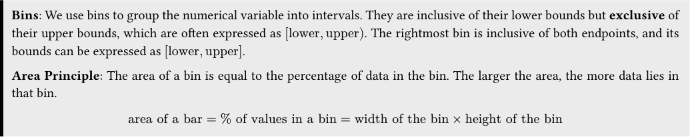

Bins: We use bins to group the numerical variable into intervals. They are inclusive of their lower bounds but exclusive of their upper bounds, which are often expressed as [lower, upper). The rightmost bin is inclusive of both endpoints, and its bounds can be expressed as [lower, upper].

Area Principle: The area of a bin is equal to the percentage of data in the bin. The larger the area, the more data lies in that bin.

area of a bar = % of values in a bin = width of the bin × height of the bin

- Calculate the heights of the bars for the bins listed in the table, with correct units. Recall the Area Principle.

##### (b) Draw a histogram of the data. Make sure you label your axes!

### Page 2

##### (c) Based on the information that we have, can we create the following bins? Explain your answer.

##### i. [500, 1000)

##### ii. [500, 650)

##### iii. [800, 1200)

- True or False: If we combine the [500, 800) and [800, 1000) bins together, the height of the new bin would be greater than

the heights of both of the old bins. Please explain your answer and verify it by calculating the height of the new bin.

Data C8 Spring 2026 Discussion 04 | 2

### Page 3

#### 2. Fun(ctions)

- After learning about them in Data 8, Max wants to write a function that can calculate the hypotenuse of any right triangle.

He wants to use his function to assign C to the hypotenuse of a right triangle with legs (sides adjacent to the hypotenuse) A and B. However, he’s made many mistakes. Which ones can you identify?

Hint: There are 5 unique issues. Assume that numpy has been imported as np.

def hypotenuse(a, b) squares = make_array(side1, side2) * 2 sum = sum(squares) squareroot = np.sqrt(sum) print(squareroot)

C = hypotenuse(A, B) # C should be the numerical result

##### (b) Write a function that takes in the following arguments:

- tbl: a table.
- col: a string, name of a column in tbl.
- n: an int.

The function should return a table that contains the rows that have the 𝑛 largest values for the specified column.

def top_n(tbl, col, n):

sorted_tbl = __________________________________________________ top_n_rows = __________________________________________________ return ________________________________________________________

Data C8 Spring 2026 Discussion 04 | 3

### Page 4

#### 3. Sheng Kee Fridays

Dagny’s favorite activity to celebrate Fridays is buying pastries at Sheng Kee before class. She stores her purchase data in a table,

pastries, to keep track of her spending. Assume she never purchases the same item twice. Each row represents an individual purchase. The first few rows look like this:

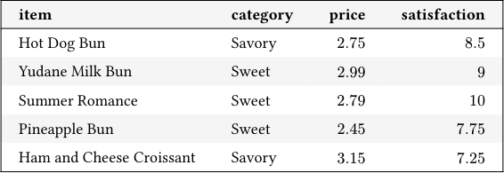

##### item category price satisfaction

Hot Dog Bun Savory 2.75 8.5

Yudane Milk Bun Sweet 2.99 9

Summer Romance Sweet 2.79 10

Pineapple Bun Sweet 2.45 7.75

Ham and Cheese Croissant Savory 3.15 7.25

The table has 4 columns:

- item (string): name of the pastry.
- category (string): whether the pastry is sweet or savory.
- price (float): price of the pastry.
- satisfaction (float): how satisfied (out of 10) Dagny was after eating the pastry.

- Write a line of code to calculate the average satisfaction Dagny felt after eating sweet pastries.

_________________(pastries.______________(____________________________________).column(________________))

- Dagny is curious if the average price for savory pastries is higher than the average price for sweet pastries. Write a line of

code that will output the category that is more expensive.

pastries.__________________(____________________, ____________________)

.sort(___________________________, ___________________________) .column(_________________________________________).item(______)

- Dagny’s budget is getting tight, and she wants to buy pastries that will give her the most satisfaction per dollar. Write lines

of code that will help us achieve this.

- First, create an array that contains each purchase’s satisfaction per dollar. Then, add a new column called “satisfaction

per $”, to the pastries table.

score_array = pastries.____________(__________________) / pastries._____________(__________________)

pastries = ____________.with_column(__________________________, ___________________________________)

ii. Dagny defines a function score that takes in satisfaction and price (in that order) and returns the satisfaction per dollar.

Find a different way to compute score_array.

score_array = pastries._________________(__________________, __________________, __________________)

iii. Dagny is interested in finding the pastries in the table with the top 3 satisfaction values per dollar. Write code that will

output the names of these items as an array.

pastries_sorted = pastries.__________(_____________________________________, ______________________)

pastries_sorted.__________(______________________________________________).column(_________________)

Data C8 Spring 2026 Discussion 04 | 4

### Page 5

#### 4. Insurance (Optional)

The table insurance contains one row for each beneficiary that is covered by a particular insurance company:

##### age bmi smoker region cost

25 20.8 no southwest 3208.79

25 30.2 yes southwest 33900.71

62 32.1 no northeast 1355.50

... (20198 rows omitted)

The table contains five columns:

- age (int): the age of the beneficiary.
- bmi (float): the Body Mass Index (BMI) of the beneficiary.
- smoker (string): indicates whether the beneficiary smokes.
- region (string): the region of the United States where the beneficiary lives.
- cost (float): the total amount in medical costs that the insurance company paid for this beneficiary last year.

(Fall 2018 Midterm Question 2 Modified)

In each part below, fill in the blanks to achieve the desired outputs.

- A scatter plot comparing the amount paid last year vs. BMI (titles are usually written as Y vs. X) for only the beneficiaries

whose costs exceeded $25,000. Each dot on the scatter plot should represent one beneficiary.

high_cost = __________________.____________(_____________, ____________________________________________)

__________.______________________(__________________________________, _________________________________)

- Write a function that takes an age as an argument, and returns the average BMI among all beneficiaries of that age.

def average_bmi(age):

right_age = insurance.where(________________, ________________) bmis = right_age._______________(______________) avg = sum(bmis) / len(bmis) _____________________________________

Data C8 Spring 2026 Discussion 04 | 5

## Discussion 04 — Solution

### Page 1

### More Visualizations, Intro to Functions

Discussion 04

Data C8: Foundations of Data Science UC Berkeley, Spring 2026

#### 1. Rents & Ranges

The table below shows the distribution of rents paid by students in Boston. The first column consists of ranges of monthly rent, in dollars. Ranges include the lower bound but not the upper bound. The second column shows the percentage of students who pay rent in each of the ranges.

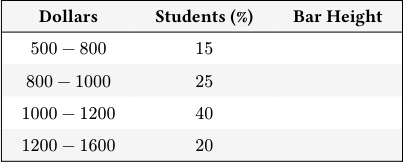

##### Dollars Students (%) Bar Height

500 −800 15

800 −1000 25

1000 −1200 40

1200 −1600 20

Bins: We use bins to group the numerical variable into intervals. They are inclusive of their lower bounds but exclusive of their upper bounds, which are often expressed as [lower, upper). The rightmost bin is inclusive of both endpoints, and its bounds can be expressed as [lower, upper].

Area Principle: The area of a bin is equal to the percentage of data in the bin. The larger the area, the more data lies in that bin.

area of a bar = % of values in a bin = width of the bin × height of the bin

- Calculate the heights of the bars for the bins listed in the table, with correct units. Recall the Area Principle.

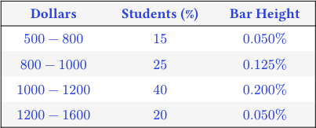

##### Dollars Students (%) Bar Height

500 −800 15 0.050%

800 −1000 25 0.125%

1000 −1200 40 0.200%

1200 −1600 20 0.050%

Calculation (demonstrated on the 500-800 bin):

area width = 15% $800 −$500 = 0.050% per dollar

##### (b) Draw a histogram of the data. Make sure you label your axes!

### Page 2

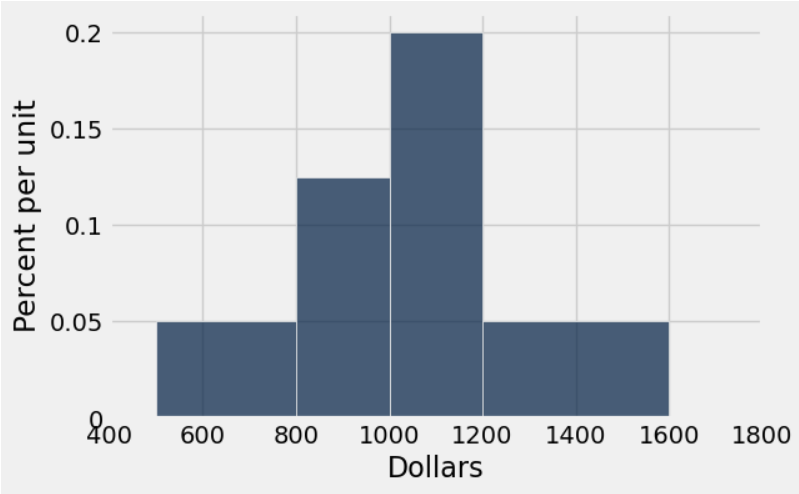

##### (c) Based on the information that we have, can we create the following bins? Explain your answer.

##### i. [500, 1000)

Yes. We can combine the [500, 800) and [800, 1000) bins since we know that 15% of the students are in the first bin and 25% are in the second. The height of this bin will be

15% + 25% $300 + $200 = 40%

$500 = 0.08% per dollar

##### ii. [500, 650)

No. We do not know the percent of students who pay between $500 and $650 in monthly rent. Histograms tell us nothing about the distribution of data within individual bins. It could be the case that no students pay between $500 and $650 in monthly rent and 15% pay between $650 and $800.

##### iii. [800, 1200)

Yes. We can combine the [800, 1000) and [1000, 1200) bins since we know that 25% of the students are in the first bin and 40% are in the second. The height of this bin will be

25% + 40% $200 + $200 = 65%

$400 = 0.1625% per dollar

- True or False: If we combine the [500, 800) and [800, 1000) bins together, the height of the new bin would be greater than

the heights of both of the old bins. Please explain your answer and verify it by calculating the height of the new bin.

False: When we combine bins together, the height of the new bin is the weighted average of the old bin heights. Thus, the new bin height will be greater than the [500, 800) bin, but less than the [800, 1000) bin.

new height = area

width = 40% ($800 −$500) + ($1000 −$800) = 0.08% per dollar

Data C8 Spring 2026 Discussion 04 | 2

### Page 3

#### 2. Fun(ctions)

- After learning about them in Data 8, Max wants to write a function that can calculate the hypotenuse of any right triangle.

He wants to use his function to assign C to the hypotenuse of a right triangle with legs (sides adjacent to the hypotenuse) A and B. However, he’s made many mistakes. Which ones can you identify?

Hint: There are 5 unique issues. Assume that numpy has been imported as np.

def hypotenuse(a, b) squares = make_array(side1, side2) * 2 sum = sum(squares) squareroot = np.sqrt(sum) print(squareroot)

C = hypotenuse(A, B) # C should be the numerical result

##### Issue 1: the function is missing a colon : after the arguments list.

##### Issue 2: squares should be squared with ** not *

Issue 3: We need to be consistent with our argument names so they get accurately assigned throughout the function. We can either replace a and b with side1 and side2, or vice versa.

Issue 4: The function will print the value of squareroot but will not return it, which means we will not have access to the value of squareroot anymore. That is, we will not be able to assign it to any values or use it as the argument to any functions! In this case, C will not be equal to anything (it will actually be None)!

Issue 5: When we assign sum to a number we have lost the original behavior of the built-in sum function. We should not re-assign variable names. (Note: in this specific question the redefined sum is a local variable and is only scoped within the hypotenuse function, though this is out of scope of Data 8. You should generally never override any function name, regardless of the scope of the variable.)

##### (b) Write a function that takes in the following arguments:

- tbl: a table.
- col: a string, name of a column in tbl.
- n: an int.

The function should return a table that contains the rows that have the 𝑛 largest values for the specified column.

def top_n(tbl, col, n):

sorted_tbl = __________________________________________________ top_n_rows = __________________________________________________ return ________________________________________________________

def top_n(tbl, col, n): sorted_tbl = tbl.sort(col, descending=True) top_n_rows = sorted_tbl.take(np.arange(n)) return top_n_rows

Data C8 Spring 2026 Discussion 04 | 3

### Page 4

#### 3. Sheng Kee Fridays

Dagny’s favorite activity to celebrate Fridays is buying pastries at Sheng Kee before class. She stores her purchase data in a table,

pastries, to keep track of her spending. Assume she never purchases the same item twice. Each row represents an individual purchase. The first few rows look like this:

##### item category price satisfaction

Hot Dog Bun Savory 2.75 8.5

Yudane Milk Bun Sweet 2.99 9

Summer Romance Sweet 2.79 10

Pineapple Bun Sweet 2.45 7.75

Ham and Cheese Croissant Savory 3.15 7.25

The table has 4 columns:

- item (string): name of the pastry.
- category (string): whether the pastry is sweet or savory.
- price (float): price of the pastry.
- satisfaction (float): how satisfied (out of 10) Dagny was after eating the pastry.

- Write a line of code to calculate the average satisfaction Dagny felt after eating sweet pastries.

_________________(pastries.______________(____________________________________).column(________________))

np.mean(pastries.where("category", are.equal_to("Sweet")).column("satisfaction"))

- Dagny is curious if the average price for savory pastries is higher than the average price for sweet pastries. Write a line of

code that will output the category that is more expensive.

pastries.__________________(____________________, ____________________)

.sort(___________________________, ___________________________) .column(_________________________________________).item(______)

pastries.group("category", np.mean) .sort("price mean", descending=True) .column("category").item(0)

Note the new column name after .group is price mean. The .sort must take in the correct column name. Alternatively you may use the index of the column after grouping.

- Dagny’s budget is getting tight, and she wants to buy pastries that will give her the most satisfaction per dollar. Write lines

of code that will help us achieve this.

- First, create an array that contains each purchase’s satisfaction per dollar. Then, add a new column called “satisfaction

per $”, to the pastries table.

score_array = pastries.____________(__________________) / pastries._____________(__________________)

pastries = ____________.with_column(__________________________, ___________________________________)

score_array = pastries.column("satisfaction") / pastries.column("price") pastries = pastries.with_column("satisfaction per $", score_array)

Data C8 Spring 2026 Discussion 04 | 4

### Page 5

##### ii. Dagny defines a function score that takes in satisfaction and price (in that order) and returns the satisfaction per dollar.

##### Find a different way to compute score_array.

score_array = pastries._________________(__________________, __________________, __________________)

score_array = pastries.apply(score, "satisfaction", "price")

##### iii. Dagny is interested in finding the pastries in the table with the top 3 satisfaction values per dollar. Write code that will

##### output the names of these items as an array.

pastries_sorted = pastries.__________(_____________________________________, ______________________)

pastries_sorted.__________(______________________________________________).column(_________________)

pastries_sorted = pastries.sort("satisfaction per $", descending=True) pastries_sorted.take(np.arange(3)).column("item")

##### Data C8 Spring 2026 Discussion 04 | 5

### Page 6

#### 4. Insurance (Optional)

The table insurance contains one row for each beneficiary that is covered by a particular insurance company:

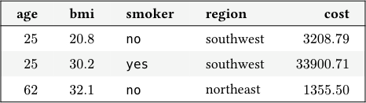

##### age bmi smoker region cost

25 20.8 no southwest 3208.79

25 30.2 yes southwest 33900.71

62 32.1 no northeast 1355.50

... (20198 rows omitted)

The table contains five columns:

- age (int): the age of the beneficiary.
- bmi (float): the Body Mass Index (BMI) of the beneficiary.
- smoker (string): indicates whether the beneficiary smokes.
- region (string): the region of the United States where the beneficiary lives.
- cost (float): the total amount in medical costs that the insurance company paid for this beneficiary last year.

(Fall 2018 Midterm Question 2 Modified)

In each part below, fill in the blanks to achieve the desired outputs.

- A scatter plot comparing the amount paid last year vs. BMI (titles are usually written as Y vs. X) for only the beneficiaries

whose costs exceeded $25,000. Each dot on the scatter plot should represent one beneficiary.

high_cost = __________________.____________(_____________, ____________________________________________)

__________.______________________(__________________________________, _________________________________)

high_cost = insurance.where("cost", are.above(25000)) high_cost.scatter("bmi", "cost")

- Write a function that takes an age as an argument, and returns the average BMI among all beneficiaries of that age.

def average_bmi(age):

right_age = insurance.where(________________, ________________) bmis = right_age._______________(______________) avg = sum(bmis) / len(bmis) _____________________________________

def average_bmi(age): right_age = insurance.where("age", age) bmis = right_age.column("bmi") avg = sum(bmis) / len(bmis) return avg

Data C8 Spring 2026 Discussion 04 | 6

## Discussion 05 — Student

### Page 1

### Table Methods, Conditionals & Iteration

Discussion 05

Data C8: Foundations of Data Science UC Berkeley, Spring 2026

Welcome to the Project 1 Discussion Worksheet! This week we will cover table methods like .group and .pivot, conditional statements, and iteration. As a reminder, make use of the Python Reference and the Table Functions Visualizer on the Data 8 website, as well as the Discussion Reference sheet you are provided with!

#### 1. Table Matchmaking

Shown below are the chocolates and nutrition tables respectively.

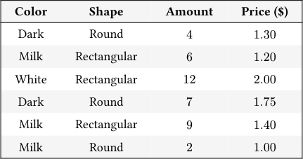

##### Color Shape Amount Price ($)

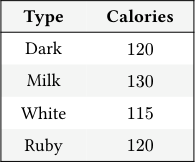

##### Type Calories

Dark Round 4 1.30

Dark 120

Milk Rectangular 6 1.20

Milk 130

White Rectangular 12 2.00

White 115

Dark Round 7 1.75

Ruby 120

Milk Rectangular 9 1.40

nutrition

Milk Round 2 1.00

chocolates

Match the following table method calls to the resulting descriptions of tables.

Hint: Pay attention to the column names of the resulting tables! For example, what happens to the column names when you specify an aggregating function in group()? What happens when you only specify one column name? How does the behavior of pivot() differ from group()?

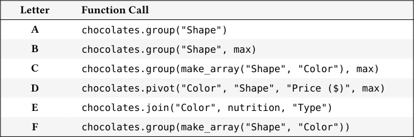

##### Letter Function Call

##### A chocolates.group("Shape")

##### B chocolates.group("Shape", max)

##### C chocolates.group(make_array("Shape", "Color"), max)

##### D chocolates.pivot("Color", "Shape", "Price ($)", max)

##### E chocolates.join("Color", nutrition, "Type")

##### F chocolates.group(make_array("Shape", "Color"))

##### Number Columns # of Rows

##### 1 Shape, Color max, Amount max, Price ($) max 2

##### 2 Shape, Dark, Milk, White 2

##### 3 Shape, Color, Amount max, Price ($) max 4

##### 4 Color, Shape, Amount, Price ($), Calories 6

##### 5 Shape, count 2

##### 6 Shape, Color, count 4

##### A: _______________ B: _______________ C: _______________

##### D: _______________ E: _______________ F: _______________

### Page 2

### 2. Chocolate!

##### (a) The % operator returns the remainder if you divide by a certain number (e.g. 11 % 5 = 1). If a number n is odd, what will n

##### % 2 return?

##### (b) What will the following code output? Format your answer in the same way you expect Python to output the result of running

##### the following code.

for c in np.arange(5): if c < 2: print("Chocolate?") if c % 2 == 0: print("Yes sir! With or without nuts?") else: if c % 2 == 1: print("Again!?") else: print("CHOCOLATE" + ("!" * (c * 2 - 3)))

### 3. Getting Even

##### (a) The count_evens function takes in an array of integers and returns the number of even integers in the array.

##### Use a combination of iteration and conditionals to complete the skeleton code below.

def count_evens(arr): num_evens = 0 for ________________________________________________: if ________________________________________________: ________________________________________________ return ________________________________________________

##### (b) Now let’s see how we can write the same function using array operations instead of iteration.

def count_evens(arr):

remainder_array = ________________________________________________ return ________________________________________________

##### Data C8 Spring 2026 Discussion 05 | 2

### Page 3

#### 4. Squirrel Sightings (Optional)

The table squirrel below contains some information on reported squirrel sightings across the Berkeley campus. Each row in the squirrel table represents one unique squirrel sighting:

- Squirrel ID (int): unique identification number for each squirrel.
- Location (string): common name of the nearest campus landmark where the squirrel was spotted.
- Month (int): numerical representation of the month when the squirrel was spotted.
- Day (int): day of the month when the squirrel was spotted.
- Year (int): year when the squirrel was spotted.

##### Squirrel ID Location Day Month Year

2937 Wheeler Hall 17 3 2024

8421 East Asian Library 28 9 2022

472 Etcheverry Hall 7 1 2024

239 Campbell Hall 4 10 2023

2937 Moffitt Library 7 6 2021

... (95 rows omitted)

- Write a line of code that evaluates to the proportion of Squirrel IDs in the table that are even.

- Alankrita wants to find the best location where she is most likely to find a squirrel. Write a line of code that evaluates to the

location with the most squirrel sightings.

- Alankrita is interested in how many squirrels were sighted at every location during every month. Create a table called

sightings where each cell contains the number of squirrel sightings that occurred in 2023 at each location during each month. Note: Each row should be in a different location.

squirrels_2023 = _______________________________________________________________________________________

sightings = ____________________________________________________________________________________________

- Alankrita now has access to another table, species, that contains information about the species of each squirrel.

A few rows from this table are shown below.

##### Squirrel ID Species

2937 eastern gray squirrel

8421 fox squirrel

472 western gray squirrel

Write lines of code to find the least observed species in 2024. If multiple species are tied for the least sightings, find the species that comes first alphabetically.

squirrels_2024 = _______________________________________________________________________________________

species_counts = _______________________________________________________________________________________

least_observed = _______________________________________________________________________________________

Data C8 Spring 2026 Discussion 05 | 3

## Discussion 05 — Solution

### Page 1

### Table Methods, Conditionals & Iteration

Discussion 05

Data C8: Foundations of Data Science UC Berkeley, Spring 2026

Welcome to the Project 1 Discussion Worksheet! This week we will cover table methods like .group and .pivot, conditional statements, and iteration. As a reminder, make use of the Python Reference and the Table Functions Visualizer on the Data 8 website, as well as the Discussion Reference sheet you are provided with!

#### 1. Table Matchmaking

Shown below are the chocolates and nutrition tables respectively.

##### Color Shape Amount Price ($)

##### Type Calories

Dark Round 4 1.30

Dark 120

Milk Rectangular 6 1.20

Milk 130

White Rectangular 12 2.00

White 115

Dark Round 7 1.75

Ruby 120

Milk Rectangular 9 1.40

nutrition

Milk Round 2 1.00

chocolates

Match the following table method calls to the resulting descriptions of tables.

Hint: Pay attention to the column names of the resulting tables! For example, what happens to the column names when you specify an aggregating function in group()? What happens when you only specify one column name? How does the behavior of pivot() differ from group()?

##### Letter Function Call

##### A chocolates.group("Shape")

##### B chocolates.group("Shape", max)

##### C chocolates.group(make_array("Shape", "Color"), max)

##### D chocolates.pivot("Color", "Shape", "Price ($)", max)

##### E chocolates.join("Color", nutrition, "Type")

##### F chocolates.group(make_array("Shape", "Color"))

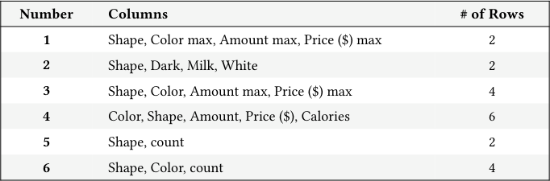

##### Number Columns # of Rows

##### 1 Shape, Color max, Amount max, Price ($) max 2

##### 2 Shape, Dark, Milk, White 2

##### 3 Shape, Color, Amount max, Price ($) max 4

##### 4 Color, Shape, Amount, Price ($), Calories 6

##### 5 Shape, count 2

##### 6 Shape, Color, count 4

##### A: _______________ B: _______________ C: _______________

##### D: _______________ E: _______________ F: _______________

### Page 2

##### A = 5

group() with no aggregating function yields a table with just the column that was grouped on, and a count column.

##### B = 1

group() with an aggregating function yields the grouped column, and the other columns of the original table with the function name added at the end of each one.

##### C = 3

group() with multiple columns and an aggregating function yields the columns that were grouped on, and the remaining columns with the function name added at the end.

##### D = 2

pivot() yields the second argument to pivot() (“Shape”), as well as all unique values in the column of the first argument (“Dark”, “Milk”, “White” from the “Color” column) as columns in the resulting table.

##### E = 4

join() gives you all the columns from the two tables, except for the extra column that is being used to join the two tables (“Type” is dropped in the resulting table).

##### F = 6

group() with multiple columns and no aggregating function yields the columns that were grouped on, and a count column.

Data C8 Spring 2026 Discussion 05 | 2

### Page 3

### 2. Chocolate!

##### (a) The % operator returns the remainder if you divide by a certain number (e.g. 11 % 5 = 1). If a number n is odd, what will n

##### % 2 return?

##### It will return 1. Note that if a number is even, n % 2 will return 0.

##### (b) What will the following code output? Format your answer in the same way you expect Python to output the result of running

##### the following code.

for c in np.arange(5): if c < 2: print("Chocolate?") if c % 2 == 0: print("Yes sir! With or without nuts?") else: if c % 2 == 1: print("Again!?") else: print("CHOCOLATE" + ("!" * (c * 2 - 3)))

Chocolate? Yes sir! With or without nuts? Chocolate? CHOCOLATE! Again!? CHOCOLATE!!!!!

### 3. Getting Even

##### (a) The count_evens function takes in an array of integers and returns the number of even integers in the array.

##### Use a combination of iteration and conditionals to complete the skeleton code below.

def count_evens(arr): num_evens = 0 for ________________________________________________: if ________________________________________________: ________________________________________________ return ________________________________________________

def count_evens(arr): num_evens = 0 for num in arr: if num % 2 == 0: num_evens = num_evens + 1 return num_evens

##### (b) Now let’s see how we can write the same function using array operations instead of iteration.

def count_evens(arr):

remainder_array = ________________________________________________ return ________________________________________________

##### Data C8 Spring 2026 Discussion 05 | 3

### Page 4

def count_evens(arr): remainder_array = arr % 2 return np.count_nonzero(remainder_array == 0)

##### or

def count_evens(arr): iseven = (arr % 2) == 0 return np.count_nonzero(iseven)

##### Note it is acceptable to use sum or np.sum instead of np.count_nonzero for the above two solutions.

##### or

def count_evens(arr): remainder_array = arr % 2 return len(remainder_array) - sum(remainder_array)

##### Data C8 Spring 2026 Discussion 05 | 4

### Page 5

#### 4. Squirrel Sightings (Optional)

The table squirrel below contains some information on reported squirrel sightings across the Berkeley campus. Each row in the squirrel table represents one unique squirrel sighting:

- Squirrel ID (int): unique identification number for each squirrel.
- Location (string): common name of the nearest campus landmark where the squirrel was spotted.
- Month (int): numerical representation of the month when the squirrel was spotted.
- Day (int): day of the month when the squirrel was spotted.
- Year (int): year when the squirrel was spotted.

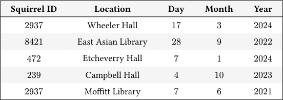

##### Squirrel ID Location Day Month Year

2937 Wheeler Hall 17 3 2024

8421 East Asian Library 28 9 2022

472 Etcheverry Hall 7 1 2024

239 Campbell Hall 4 10 2023

2937 Moffitt Library 7 6 2021

... (95 rows omitted)

- Write a line of code that evaluates to the proportion of Squirrel IDs in the table that are even.

np.mean(squirrel.column("Squirrel ID") % 2 == 0)

Any equivalent code is acceptable, e.g. using np.average.

- Alankrita wants to find the best location where she is most likely to find a squirrel. Write a line of code that evaluates to the

location with the most squirrel sightings.

squirrel.group("Location") .sort("count", descending=True) .column("Location").item(0)

- Alankrita is interested in how many squirrels were sighted at every location during every month. Create a table called

sightings where each cell contains the number of squirrel sightings that occurred in 2023 at each location during each month. Note: Each row should be in a different location.

squirrels_2023 = _______________________________________________________________________________________

sightings = ____________________________________________________________________________________________

squirrels_2023 = squirrel.where("Year", are.equal_to(2023)) sightings = squirrels_2023.pivot("Month", "Location")

- Alankrita now has access to another table, species, that contains information about the species of each squirrel.

A few rows from this table are shown below.

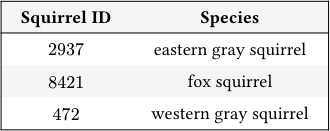

##### Squirrel ID Species

2937 eastern gray squirrel

8421 fox squirrel

472 western gray squirrel

Write lines of code to find the least observed species in 2024. If multiple species are tied for the least sightings, find the species that comes first alphabetically.

Data C8 Spring 2026 Discussion 05 | 5

### Page 6

squirrels_2024 = _______________________________________________________________________________________

species_counts = _______________________________________________________________________________________

least_observed = _______________________________________________________________________________________ squirrels_2024 = squirrel.where("Year", 2024) species_counts = squirrels_2024.join("Squirrel ID", species).group("Species") least_observed = species_counts.sort("Species").sort("count").column("Species").item(0)

##### Data C8 Spring 2026 Discussion 05 | 6

## Discussion 06 — Student

### Page 1

### Chance & Models

Discussion 06

Data C8: Foundations of Data Science UC Berkeley, Spring 2026

#### 1. Marble Madness

- Tiffany has a bag with three marbles. One marble is orange, and the other two are purple. For each round of a game, she

draws from the bag 10 times with replacement. She wins the round by drawing at least one orange marble.

Write a function to simulate one round of Tiffany’s game. The function should return True if she wins and False if she loses.

def one_round():

bag = ____________________________________________________ one_sim = ________________________________________________ num_orange = _____________________________________________ return ___________________________________________________

- Finish the following code to help Tiffany simulate 100 rounds of the game and assign the variable win_proportion to the

proportion of rounds she wins.

count = 0

for _____________________________________________:

if ________________________________________________: ________________________________________________________ win_proportion = _______________________________________________

##### (c) For any one draw, what is the probability that Tiffany draws a purple marble?

##### (d) For any individual round, what is the probability that Tiffany loses?

##### (e) For any individual round, what is the probability that Tiffany wins?

### Page 2

#### 2. Flip Flop

Brandon is flipping a coin. He thinks it is unfair, but is not sure. He flips it 10 times and gets heads 9 times. He wants to determine whether the coin was actually unfair, or whether the coin was fair and his result of 9 heads in 10 flips was due to random chance.

##### (a) What is a possible model that he can simulate under?

- What is an alternative model for Brandon’s coin? You do not necessarily have to be able to simulate under this model.

- What is a good test statistic that you could compute from the outcome of his flips? Calculate that statistic for your observed

data; this is our observed test statistic. Hint: If the coin was unfair, it could either be biased towards heads or biased towards tails.

##### (d) Complete the function flip_ten, which takes no arguments and does the following:

- Simulates flipping a fair coin 10 times
- Computes and returns one simulated test statistic, based on the test statistic chosen in the previous question

def flip_ten(): faces = make_array("Heads", "Tails") flips = ___________________________________________________________ num_heads = _______________________________________________________ return ____________________________________________________________

- Complete the code below to simulate the experiment 10000 times and record the statistic computed in each of those trials in

an array called simulated_stats.

trials = _____________________________________________________________

simulated_stats = ____________________________________________________

for _________________________________________:

one_stat = ________________________________________ __________________________________ = ____________________________________________________

Data C8 Spring 2026 Discussion 06 | 2

### Page 3

- Suppose we performed the simulation and plotted a histogram of simulated_stats. The histogram is shown below.

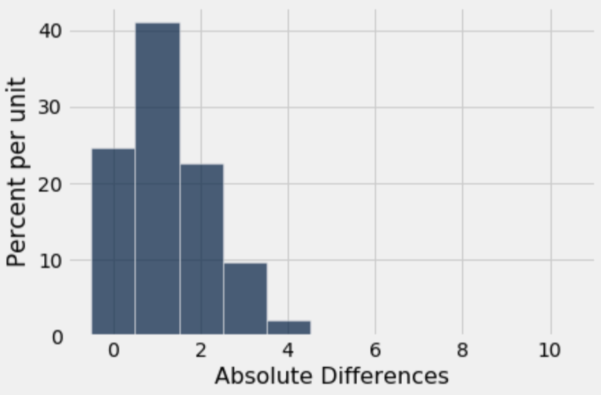

##### Is our observed statistic from (c) consistent with the model we simulated under?

Data C8 Spring 2026 Discussion 06 | 3

### Page 4

#### 3. Large Numbers

(Spring 2017 Midterm Question 3 Modified)

- The roll function draws an empirical histogram of the number of results that are 𝑘 or larger, when 𝑛 fair 6-sided dice are

rolled. For example, if 𝑘= 5, 𝑛= 3, and rolling three dice results in the faces {6, 4, 5}, then two of the three dice are 5 or larger (the 6 and the 5). Fill in the blanks to complete its implementation.

def roll(k, n, trials): """Repeatedly roll `n` dice `trials` times and check how many results are `k` or larger.""" outcomes = make_array() possible_results = _______________________________________ for i in _________________________________________________: rolls = _____________________________________________________ outcomes = __________________________________________________ Table().with_column("Outcomes", outcomes).hist(bins=np.arange(30))

##### (b) Assume roll is implemented correctly for the below questions.

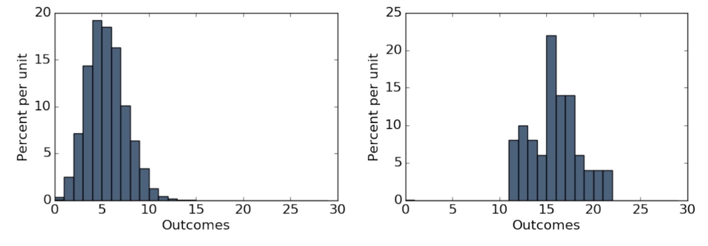

##### i. Which expression generates the first histogram?

roll(4, 30, 5000) roll(6, 30, 5000) roll(4, 30, 50) roll(6, 30, 50)

##### ii. Which expression generates the second histogram?

roll(4, 30, 5000) roll(6, 30, 5000) roll(4, 30, 50) roll(6, 30, 50)

iii. The histogram generated by roll(6, 30, 5000) is most likely closer than a histogram generated by roll(6, 30, 50)

to the theoretical distribution of the number of 6s rolled when rolling 30 dice.

True

False

Data C8 Spring 2026 Discussion 06 | 4

## Discussion 06 — Solution

### Page 1

### Chance & Models

#### Discussion 06

#### Data C8: Foundations of Data Science UC Berkeley, Spring 2026

### 1. Marble Madness

##### (a) Tiffany has a bag with three marbles. One marble is orange, and the other two are purple. For each round of a game, she

##### draws from the bag 10 times with replacement. She wins the round by drawing at least one orange marble.

##### Write a function to simulate one round of Tiffany’s game. The function should return True if she wins and False if she loses.

def one_round():

bag = ____________________________________________________ one_sim = ________________________________________________ num_orange = _____________________________________________ return ___________________________________________________

def one_round(): bag = make_array("purple", "purple", "orange") one_sim = np.random.choice(bag, 10) num_orange = sum(one_sim == "orange") return num_orange >= 1

##### Instead of sum, students can also use np.count_nonzero(). They can also use sample_proportions with probabilities (2

##### 3, 1 3).

##### (b) Finish the following code to help Tiffany simulate 100 rounds of the game and assign the variable win_proportion to the

##### proportion of rounds she wins.

count = 0

for _____________________________________________:

if ________________________________________________: ________________________________________________________ win_proportion = _______________________________________________

count = 0 for i in np.arange(100): if one_round(): count = count + 1 win_proportion = count / 100

##### Note that the line if one_round() works by incrementing the count variable when one_round() evaluates to True (and will not if one_round() evaluates to False).

##### (c) For any one draw, what is the probability that Tiffany draws a purple marble?

##### ℙ[Draw a purple marble] = 2

##### 3

### Page 2

##### (d) For any individual round, what is the probability that Tiffany loses?

Using the multiplication rule:

10

ℙ[Tiffany loses one round] = ℙ[draw 10 purples] = ℙ[purple]10 = (2

3)

##### (e) For any individual round, what is the probability that Tiffany wins?

Using the complement rule:

10

ℙ[Tiffany wins one round] = 1 −ℙ[Tiffany loses one round] = 1 −(2

3)

Data C8 Spring 2026 Discussion 06 | 2

### Page 3

#### 2. Flip Flop

Brandon is flipping a coin. He thinks it is unfair, but is not sure. He flips it 10 times and gets heads 9 times. He wants to determine whether the coin was actually unfair, or whether the coin was fair and his result of 9 heads in 10 flips was due to random chance.

##### (a) What is a possible model that he can simulate under?

A possible model that you could simulate under is that on each flip, there is a 50% chance that the coin lands heads and a 50% chance that the coin lands tails. Any difference is due to chance.

If you are more familiar with probability: The heads are like independent and identically distributed draws at random from a uniform distribution in which 50% are Heads and 50% are Tails.

- What is an alternative model for Brandon’s coin? You do not necessarily have to be able to simulate under this model.

An alternative model that Brandon might suggest is that the coin is unfair, and that the difference in the observed data is due to something other than just chance. We would not be able to simulate under this model because the statement “the coin is unfair” is not very specific (we can ask questions like “How unfair?” or “Biased towards heads or tails?”).

- What is a good test statistic that you could compute from the outcome of his flips? Calculate that statistic for your observed

data; this is our observed test statistic. Hint: If the coin was unfair, it could either be biased towards heads or biased towards tails.

A good test statistic is the absolute difference between the number of heads we observe and the expected number of heads (5). Our observed test statistic is |9 −5| = 4. Notice that this statistic is large for both a large number of heads, as well as a small number of heads.

We could also use proportions as our test statistic, e.g. |proportion of heads −0.5|.

##### (d) Complete the function flip_ten, which takes no arguments and does the following:

- Simulates flipping a fair coin 10 times
- Computes and returns one simulated test statistic, based on the test statistic chosen in the previous question

def flip_ten(): faces = make_array("Heads", "Tails") flips = ___________________________________________________________ num_heads = _______________________________________________________ return ____________________________________________________________

def flip_ten(): faces = make_array("Heads", "Tails") flips = np.random.choice(faces, 10) num_heads = np.count_nonzero(flips == "Heads") return abs(num_heads - 5)

- Complete the code below to simulate the experiment 10000 times and record the statistic computed in each of those trials in

an array called simulated_stats.

trials = _____________________________________________________________

simulated_stats = ____________________________________________________

for _________________________________________:

one_stat = ________________________________________ __________________________________ = ____________________________________________________

Data C8 Spring 2026 Discussion 06 | 3

### Page 4

trials = 10000 simulated_stats = make_array() for i in np.arange(trials): one_stat = flip_ten() simulated_stats = np.append(simulated_stats, one_stat)

- Suppose we performed the simulation and plotted a histogram of simulated_stats. The histogram is shown below.

##### Is our observed statistic from (c) consistent with the model we simulated under?

No, the observed statistic is not consistent with the model we simulated under. If we look for the observed statistic (4), we will see that it rarely ever happened in our simulation; most of the statistics generated in our simulations were in the range [0, 2]. Therefore, we would say that it is inconsistent with the model we simulated under.

Data C8 Spring 2026 Discussion 06 | 4

### Page 5

### 3. Large Numbers

##### (Spring 2017 Midterm Question 3 Modified)

##### (a) The roll function draws an empirical histogram of the number of results that are 𝑘 or larger, when 𝑛 fair 6-sided dice are

rolled. For example, if 𝑘= 5, 𝑛= 3, and rolling three dice results in the faces {6, 4, 5}, then two of the three dice are 5 or larger (the 6 and the 5). Fill in the blanks to complete its implementation.

def roll(k, n, trials): """Repeatedly roll `n` dice `trials` times and check how many results are `k` or larger.""" outcomes = make_array() possible_results = _______________________________________ for i in _________________________________________________: rolls = _____________________________________________________ outcomes = __________________________________________________ Table().with_column("Outcomes", outcomes).hist(bins=np.arange(30))

def roll(k, n, trials): """Repeatedly roll `n` dice `trials` times and check how many results are `k` or larger.""" outcomes = make_array() possible_results = np.arange(1, 7) for i in np.arange(trials): rolls = np.random.choice(possible_results, n) outcomes = np.append(outcomes, np.count_nonzero(rolls >= k)) Table().with_column(`Outcomes', outcomes).hist(bins = np.arange(30))

##### (b) Assume roll is implemented correctly for the below questions.

##### i. Which expression generates the first histogram?

roll(4, 30, 5000) roll(6, 30, 5000) roll(4, 30, 50) roll(6, 30, 50)

##### ii. Which expression generates the second histogram?

roll(4, 30, 5000) roll(6, 30, 5000) roll(4, 30, 50) roll(6, 30, 50)

##### Data C8 Spring 2026 Discussion 06 | 5

### Page 6

The left histogram’s outcome values are generally lower than those in the right histogram. This means that fewer dice rolls in the process that generated the left histogram were greater than or equal to k than in the process that generated the right histogram. Therefore, the left histogram was generated by a call to roll with k=6 and the right histogram by a call with k=4, since rolling a number greater than or equal to 6 is less likely than rolling a number greater than or equal to 4.

Additionally, the left histogram is smoother, which indicates that it is closer to a theoretical distribution. Using the Law of Large Numbers, this implies that the left histogram was generated by a process with more repetitions. Thus, the left histogram was generated by roll(6, 30, 5000) and the right by roll(4, 30, 50)

iii. The histogram generated by roll(6, 30, 5000) is most likely closer than a histogram generated by roll(6, 30, 50)

to the theoretical distribution of the number of 6s rolled when rolling 30 dice.

True

False

This is exactly what the Law of Large Numbers tells us: as a chance experiment is repeated independently and under identical conditions, the empirical distribution of its outcomes gets closer to the theoretical distribution.

Data C8 Spring 2026 Discussion 06 | 6

## Discussion 07 — Student

### Page 1

### Midterm Review

Discussion 07

Data C8: Foundations of Data Science UC Berkeley, Spring 2026

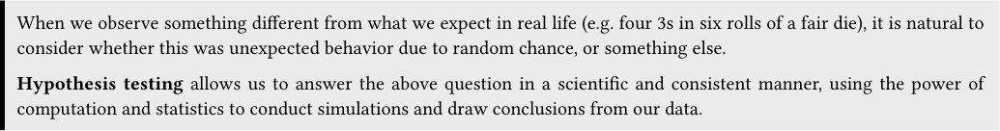

When we observe something different from what we expect in real life (e.g. four 3s in six rolls of a fair die), it is natural to consider whether this was unexpected behavior due to random chance, or something else.

Hypothesis testing allows us to answer the above question in a scientific and consistent manner, using the power of computation and statistics to conduct simulations and draw conclusions from our data.

#### 1. Test Statistics

Dylan is playing with a coin and he wants to test whether his coin is fair. His experiment is to toss the coin 100 times. He chooses the following null hypothesis.

##### Null Hypothesis: The coin is fair and any observed deviation is due to chance.

For each of the alternative hypotheses listed below, determine whether or not the test statistic is valid and give an explanation.

##### (a) Alternative Hypothesis: The coin is biased towards heads.

##### Test Statistic: # of heads.

Valid

Invalid

##### (b) Alternative Hypothesis: The coin is not fair.

##### Test Statistic: # of heads.

Valid

Invalid

##### (c) Alternative Hypothesis: The coin is not fair.

##### Test Statistic: |# of heads - expected # of heads|.

Valid

Invalid

##### (d) Alternative Hypothesis: The coin is biased towards heads.

##### Test Statistic: |# of heads - expected # of heads|.

Valid

Invalid

##### (e) Alternative Hypothesis: The coin is not fair.

##### Test Statistic: 1

2 −proportion of heads

Valid

Invalid

### Page 2

#### 2. Hypothesis Testing

You are playing a wheel-spinning game at a carnival, where you can earn prizes based on where the wheel stops. The booth attendant claims the distribution of prizes is as below, but you think the game is rigged and doesn’t follow the listed probabilities.

##### Prize Chance

Nothing 80%

Teddy bear 2%

Pinwheel 6%

Sticker 12%

You would like to test your claim so you can report the carnival for fraud.

- Is the data we are working with numerical or categorical? Think about how this influences what test statistic we should use.

Numerical

Categorical

##### (b) What is the booth attendant’s hypothesis?

##### (c) What is your hypothesis?

##### (d) Which hypothesis (of the two we defined) can you simulate under?

##### (e) What is a good test statistic to use?

- Write code that simulates playing the carnival game 1000 times, and returns an array of proportions corresponding to how

often each prize was won.

prize_chances = _______________________________________________________

my_simulation = _______________________________________________________

- Write one line of additional code that extracts the number of teddy bears we would have won in our simulation. You may

use my_simulation from the previous question.

_______________________________________________________________________

Data C8 Spring 2026 Discussion 07 | 2

### Page 3

#### 3. A/B Testing

- Kevin, a museum curator, has recently been given specimens of caddisflies collected from various parts of Northern

California. The scientists who collected the caddisflies think that caddisflies collected at higher altitudes tend to be bigger. They tell him that the average length of the 560 caddisflies collected at high elevation is 14mm, while the average length of the 450 caddisflies collected from a slightly lower elevation is 12mm. He is not sure that this difference really matters and thinks that this could just be the result of chance in sampling.

What is an appropriate null hypothesis that Kevin can simulate under?

- How could you test the null hypothesis in the A/B test from above? What assumption would you make to test the hypothesis,

and how would you simulate under that assumption?

- What would be a useful test statistic for the A/B test? Remember that the direction of your test statistic should come from

the initial setting.

Assume flies refers to the following table (an excerpt is shown).

##### Elevation Specimen Length

High 12.3

Low 13.1

High 12.0

- Fill in the blanks in this code to generate one value of the test statistic simulated under the null hypothesis.

def one_simulation():

shuffled_labels = flies.____________________________________________.column(______________________) shuffled_flies = flies.with_columns(______________________, ______________________________________) grouped = shuffled_flies._______________________(________________________, _______________________) means = grouped.column(‘Specimen length mean’) statistic = ____________________________________ return statistic

Data C8 Spring 2026 Discussion 07 | 3

### Page 4

##### (e) Fill in the code below to simulate 10000 trials of our permutation test.

test_stats = ________________________________________________

repetitions = ________________________________________________

for i in np.arange(____________________________________):

one_stat = ________________________________________________ test_stats = np.append(test_stats, one_stat)

- The histogram of test_stats is plotted below with a vertical red line indicating the observed value of our test statistic. If

the p-value cutoff we use is 5%, what is the conclusion of our test?

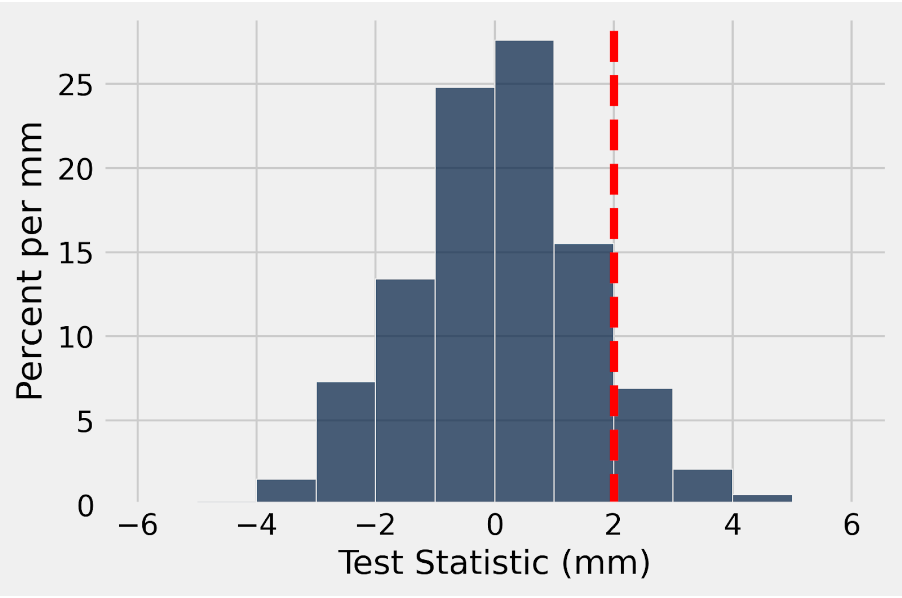

- Suppose that the null hypothesis is true. If we ran this same hypothesis test 1000 times, each time from our flies table and

with a p-value cutoff of 5%, how many times would we expect to incorrectly reject the null hypothesis?

- What effect does decreasing our p-value cutoff have on the number of times we expect to incorrectly reject the null hypothesis?

##### (i) Answer the following True/False questions.

- A/B testing is used to determine whether or not we believe two samples come from the same underlying distribution.

True

False

ii. To conduct a permutation test, you should sample your data with replacement with a sample size equal to the number

of rows in the original table.

True

False

iii. A/B testing is the same as using total variation distance as a test statistic for a hypothesis test.

True

False

Data C8 Spring 2026 Discussion 07 | 4

### Page 5

#### 4. Multiple Choice

- In the U.S. in 2000, there were 2.4 million deaths from all causes, compared to 1.9 million in 1970, which represents a 25%

increase. The data shows that the public’s health got worse over the period 1970-2000.

True False

- A company is interested in knowing whether women are paid less than men in their organization. They share all their salary

data with you. An A/B test is the best way to examine the hypothesis that all employees in the company are paid equally.

True False

- Consider a randomized controlled trial where participants are randomly split into treatment and control groups. We are 100%

certain there will be no systematic differences between the treatment and control groups if the process is followed correctly.

True False

- A researcher considers the following scheme for splitting people into control and treatment groups. People are arranged in

a line and for each person, a fair, six-sided die is rolled. If the die comes up to be a 1 or a 2, the person is allocated to the treatment group. If the die comes up to be a 3, 4, 5, or 6 then the person is allocated to the control group. This is a randomized control experiment.

True False

- You are conducting a hypothesis test to check whether a coin is fair. After you calculate your observed test statistic, you see

that its p-value is below the 5% cutoff. At this point, you can claim with certainty that the null hypothesis can not be true.

True False

- You roll a fair die a large number of times. While you are doing that, you observe the frequencies with which each face

appears and you make the following statement: “As I increase the number of times I roll the die, the probability histogram of the observed frequencies converges to the empirical histogram.”

True False

#### 5. Probability

- A fair coin is tossed five times. Two possible sequences of results are HTHTH and HTHHH. Which sequence of results is more

likely? Explain your answer and calculate the probability of each sequence appearing.

##### For parts (b) - (d), assume we have a biased coin such that the probability of getting heads is 1

5 and the probability of getting tails is 4

1. The coin is tossed 3 times.

##### (b) What is the probability that you get exactly 2 heads? What about exactly 0 heads?

##### (c) What is the probability of getting exactly 1 head or exactly 2 heads?

##### (d) What is the probability you get 1 or more heads?

Data C8 Spring 2026 Discussion 07 | 5

### Page 6

#### 6. More Hypothesis Testing

A tortoise and a hare want to have a race on a number line! They both start at 0 and the race lasts for 100 time steps. However, they move differently. At each time step the tortoise moves 1 step forward with a 1

2 chance (and stays in place with a 1 2 chance), and the hare moves 3 steps forward with a 1

6 chance.

They race, and the tortoise loses badly; the hare finished 50 steps ahead of the tortoise. Suspicious, the tortoise decides to conduct a hypothesis test to determine whether or not the hare is actually faster.

- Fill in the blanks below for the null and alternative hypotheses of this test, as well as a valid test statistic.

##### Null Hypothesis:

##### Alternative Hypothesis:

##### Test Statistic:

- Write a function called one_race() that simulates a single race of 100 time steps. It should return a two element array of the

final distances of both the tortoise and the hare (in that order) from the origin after 100 time steps.

def one_race():

tortoise_array = ________________________________________________ hare_array = ________________________________________________ tortoise_sim = ________________________________________________ hare_sim = ________________________________________________ tortoise_distance = ________________________________________________ hare_distance = ________________________________________________ return make_array(tortoise_distance, hare_distance)

- We would now like to simulate what would happen if the tortoise and the hare race 10,000 times. Complete the code below

and record how far the tortoise and the hare end from the origin in the arrays tortoise_distances and hare_distances respectively.

tortoise_distances = make_array() hare_distances = make_array()

for ________________________________________________:

race = ________________________________________________ one_tortoise_dist = ________________________________________________ one_hare_dist = ________________________________________________ tortoise_distances = ________________________________________________ hare_distances = ________________________________________________

Data C8 Spring 2026 Discussion 07 | 6

### Page 7

The results table (20,000 rows) contains two columns recorded after 10,000 simulations:

- Competitor (string): the name of the competitor, either “tortoise” or “hare”
- Distance (int): the final distance of the competitor at the end of the race

- Using the results table, create an overlaid histogram that shows the distribution of final distances for both the tortoise and

the hare.

________________________.________________________(________________________, group=____________)

- Create an array called differences where each value in the array represents how many steps the hare finished ahead of the

tortoise in a given race. Then, write a line of code to calculate the observed p-value of the hypothesis test. Finally, assuming a 5% p-value cutoff, describe the different conclusions you would come to based on the possible values of the observed p-value.

differences = ________________________________________________

p_value = ________________________________________________

Data C8 Spring 2026 Discussion 07 | 7

## Discussion 07 — Solution

### Page 1

### Midterm Review

Discussion 07

Data C8: Foundations of Data Science UC Berkeley, Spring 2026

When we observe something different from what we expect in real life (e.g. four 3s in six rolls of a fair die), it is natural to consider whether this was unexpected behavior due to random chance, or something else.

Hypothesis testing allows us to answer the above question in a scientific and consistent manner, using the power of computation and statistics to conduct simulations and draw conclusions from our data.

#### 1. Test Statistics

Dylan is playing with a coin and he wants to test whether his coin is fair. His experiment is to toss the coin 100 times. He chooses the following null hypothesis.

##### Null Hypothesis: The coin is fair and any observed deviation is due to chance.

For each of the alternative hypotheses listed below, determine whether or not the test statistic is valid and give an explanation.

##### (a) Alternative Hypothesis: The coin is biased towards heads.

##### Test Statistic: # of heads.

Valid

Invalid

##### (b) Alternative Hypothesis: The coin is not fair.

##### Test Statistic: # of heads.

Valid

Invalid

Invalid. We want more extreme values of our test statistic to favor the alternative hypothesis. We want to consider the two cases in which the coin is biased towards heads or that it’s biased towards tails, but simply counting the number of heads does not account for the second case.

##### (c) Alternative Hypothesis: The coin is not fair.

##### Test Statistic: |# of heads - expected # of heads|.

Valid

Invalid

##### (d) Alternative Hypothesis: The coin is biased towards heads.

##### Test Statistic: |# of heads - expected # of heads|.

Valid

Invalid

Invalid. This is the opposite case of part (b). We see that this test statistic will also account for a bias towards tails (because of the absolute value).

##### (e) Alternative Hypothesis: The coin is not fair.

##### Test Statistic: 1

2 −proportion of heads

### Page 2

Valid

Invalid

Invalid. Without the absolute value, we will not achieve large values of our test statistic leaning towards the alternative hypothesis.

Data C8 Spring 2026 Discussion 07 | 2

### Page 3

#### 2. Hypothesis Testing

You are playing a wheel-spinning game at a carnival, where you can earn prizes based on where the wheel stops. The booth attendant claims the distribution of prizes is as below, but you think the game is rigged and doesn’t follow the listed probabilities.

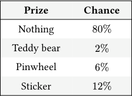

##### Prize Chance

Nothing 80%

Teddy bear 2%

Pinwheel 6%

Sticker 12%

You would like to test your claim so you can report the carnival for fraud.

- Is the data we are working with numerical or categorical? Think about how this influences what test statistic we should use.

Numerical

Categorical

We have four named outcomes (the Prizes), and are not numeric measurements. This is therefore categorical, and we should consider using TVD as our test statistic (see part (e)).

##### (b) What is the booth attendant’s hypothesis?

The distribution of prizes follows the distribution listed by the carnival. Any observed difference is simply due to chance.

##### (c) What is your hypothesis?

The distribution of prizes does not follow the distribution listed by the carnival. Any observed difference is not just due to chance.

##### (d) Which hypothesis (of the two we defined) can you simulate under?

You could simulate under the booth attendant’s hypothesis. This is because it is a fully defined model, meaning we are able to describe the parameters of an experiment surrounding it. Your hypothesis is simply that the distribution is not the same as the carnival’s; there is no fully defined model that we can simulate under.

##### (e) What is a good test statistic to use?

TVD from expected distribution. When we are observing categorical distributions of data and want to compare them, we should use TVD. Note, this is a good example because we have four different components in the distribution that we would like to test.

- Write code that simulates playing the carnival game 1000 times, and returns an array of proportions corresponding to how

often each prize was won.

prize_chances = _______________________________________________________

my_simulation = _______________________________________________________

prize_chances = make_array(0.8, 0.02, 0.06, 0.12) my_simulation = sample_proportions(1000, prize_chances)

- Write one line of additional code that extracts the number of teddy bears we would have won in our simulation. You may

use my_simulation from the previous question.

Data C8 Spring 2026 Discussion 07 | 3

### Page 4

_______________________________________________________________________

my_simulation.item(1) * 1000

##### Data C8 Spring 2026 Discussion 07 | 4

### Page 5

#### 3. A/B Testing

- Kevin, a museum curator, has recently been given specimens of caddisflies collected from various parts of Northern

California. The scientists who collected the caddisflies think that caddisflies collected at higher altitudes tend to be bigger. They tell him that the average length of the 560 caddisflies collected at high elevation is 14mm, while the average length of the 450 caddisflies collected from a slightly lower elevation is 12mm. He is not sure that this difference really matters and thinks that this could just be the result of chance in sampling.

What is an appropriate null hypothesis that Kevin can simulate under?

Null Hypothesis: The distribution of specimen lengths is the same for caddisflies sampled from high elevation as those sampled from low elevation. Any observed difference between the two samples is simply due to random chance.

- How could you test the null hypothesis in the A/B test from above? What assumption would you make to test the hypothesis,

and how would you simulate under that assumption?

If the null hypothesis is true – the caddisflies did not come from different distributions – then it should not matter how the samples were labeled (high elevation or low elevation). Under this assumption, you could shuffle the labels of the caddisflies and calculate your test statistic from this “relabeled” data.

- What would be a useful test statistic for the A/B test? Remember that the direction of your test statistic should come from

the initial setting.

Difference in mean lengths between the two groups. Note that this is not an absolute difference – we could choose either order for subtraction, but that would affect the direction of our alternative hypothesis so we need to be careful!

Assume flies refers to the following table (an excerpt is shown).

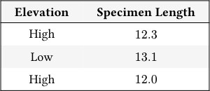

##### Elevation Specimen Length

High 12.3

Low 13.1

High 12.0

- Fill in the blanks in this code to generate one value of the test statistic simulated under the null hypothesis.

def one_simulation():

shuffled_labels = flies.____________________________________________.column(______________________) shuffled_flies = flies.with_columns(______________________, ______________________________________) grouped = shuffled_flies._______________________(________________________, _______________________) means = grouped.column(‘Specimen length mean’) statistic = ____________________________________ return statistic

def one_simulation(): shuffled_labels = flies.sample(with_replacement=False).column("Elevation") shuffled_flies = flies.with_columns("Elevation", shuffled_labels) grouped = shuffled_flies.group("Elevation", np.mean) means = grouped.column("Specimen length mean") statistic = means.item(0) - means.item(1) return statistic

Data C8 Spring 2026 Discussion 07 | 5

### Page 6

##### (e) Fill in the code below to simulate 10000 trials of our permutation test.

test_stats = ________________________________________________

repetitions = ________________________________________________

for i in np.arange(____________________________________):

one_stat = ________________________________________________ test_stats = np.append(test_stats, one_stat)

test_stats = make_array() repetitions = 10000 for i in np.arange(repetitions): one_stat = one_simulation() test_stats = np.append(test_stats, one_stat)

- The histogram of test_stats is plotted below with a vertical red line indicating the observed value of our test statistic. If

the p-value cutoff we use is 5%, what is the conclusion of our test?

We can inspect the histogram above to see that the area to the right of the observed value (which is our p-value) is greater than 5%. Since our p-value is greater than our p-value cutoff, we fail to reject the null hypothesis and conclude that the data tend to favor the null hypothesis.

- Suppose that the null hypothesis is true. If we ran this same hypothesis test 1000 times, each time from our flies table and

with a p-value cutoff of 5%, how many times would we expect to incorrectly reject the null hypothesis?

We would expect to reject the null hypothesis 1000 ⋅0.05 = 50. A p-value cutoff of 5% represents the probability of incorrectly rejecting the null hypothesis.

- What effect does decreasing our p-value cutoff have on the number of times we expect to incorrectly reject the null hypothesis?

If we decrease our p-value cutoff, we are reducing the expected number of times we will incorrectly reject the null.

##### (i) Answer the following True/False questions.

- A/B testing is used to determine whether or not we believe two samples come from the same underlying distribution.

True

False

This is the definition of A/B testing.

ii. To conduct a permutation test, you should sample your data with replacement with a sample size equal to the number

of rows in the original table.

Data C8 Spring 2026 Discussion 07 | 6

### Page 7

True

False

False, you should sample your data without replacement; otherwise, you would not get a permutation of your data.

iii. A/B testing is the same as using total variation distance as a test statistic for a hypothesis test.

True

False

False, total variation distance is just a test statistic that computes the distance between two distributions. It does not involve taking a random permutation of your data.

Data C8 Spring 2026 Discussion 07 | 7

### Page 8

#### 4. Multiple Choice

- In the U.S. in 2000, there were 2.4 million deaths from all causes, compared to 1.9 million in 1970, which represents a 25%

increase. The data shows that the public’s health got worse over the period 1970-2000.

True False

False, because the population also got bigger between 1970 and 2000. It would be more appropriate to look at the total number of deaths compared to the total population at each year. In fact, the U.S. population in 1970 was 203 million, while in 2000 it was 281 million.

- A company is interested in knowing whether women are paid less than men in their organization. They share all their salary

data with you. An A/B test is the best way to examine the hypothesis that all employees in the company are paid equally.

True False

False, there is no room for statistical inference here. We have access to the whole population, so the answer can simply be retrieved by directly looking at the data. There is no need for an A/B test here.

- Consider a randomized controlled trial where participants are randomly split into treatment and control groups. We are 100%

certain there will be no systematic differences between the treatment and control groups if the process is followed correctly.

True False

Randomization can still give rise to significantly different treatment and control groups merely by chance, meaning there is still the possibility for systematic differences between the treatment and control groups.

As an example, if you were holding an RCT for a new energy drink, there’s a chance that the randomization, just by chance led to one group having a large majority of coffee drinkers and another having a large majority of non-caffeine users. In this case, the systematic difference refers to how the randomization did not effectively assign these two groups to control for their differences outside of the treatment.

RCTs can help minimize events like this occurring, but we cannot say it is impossible for something like this to occur.

- A researcher considers the following scheme for splitting people into control and treatment groups. People are arranged in

a line and for each person, a fair, six-sided die is rolled. If the die comes up to be a 1 or a 2, the person is allocated to the treatment group. If the die comes up to be a 3, 4, 5, or 6 then the person is allocated to the control group. This is a randomized control experiment.

True False

True, because the participants were randomly assigned to each group through the roll of a die. This makes it a randomized controlled experiment!

- You are conducting a hypothesis test to check whether a coin is fair. After you calculate your observed test statistic, you see

that its p-value is below the 5% cutoff. At this point, you can claim with certainty that the null hypothesis can not be true.

True False

False, remember the definition of a p-value: A p-value expresses the probability, under the null Hypothesis, that you observe a value for your test statistic that is at least as extreme as your observed test statistic in the direction of the alternative. Assuming that this probability is non 0 then we can not claim that the null can never be true. It could be the case that we simply got an unusual sample from our null.

- You roll a fair die a large number of times. While you are doing that, you observe the frequencies with which each face

appears and you make the following statement: “As I increase the number of times I roll the die, the probability histogram of the observed frequencies converges to the empirical histogram.”

True False

Data C8 Spring 2026 Discussion 07 | 8

### Page 9

False, the statement should be: “As I increase the number of times I roll the die, the empirical histogram of the observed frequencies converges to the probability histogram of a fair die.”

#### 5. Probability

- A fair coin is tossed five times. Two possible sequences of results are HTHTH and HTHHH. Which sequence of results is more

likely? Explain your answer and calculate the probability of each sequence appearing.

They are equally likely since the coin is fair. By the multiplication rule, the probability that either of the two sequences appears is (1

2) 5.

##### For parts (b) - (d), assume we have a biased coin such that the probability of getting heads is 1

5 and the probability of getting tails is 4

1. The coin is tossed 3 times.

##### (b) What is the probability that you get exactly 2 heads? What about exactly 0 heads?

Here we need to consider all the possible outcomes that fall into this event and calculate their probabilities. There are 3 possible outcomes: HHT, HTH, THH. The probability for each of them is (1

5) 2 ⋅(4 5). Therefore, the probability of getting exactly 2 heads is 3 ⋅(1

5) 2 ⋅(4 5).

5) 3.

To get no heads, we must have gotten all tails, and the probability for that is: (4

##### (c) What is the probability of getting exactly 1 head or exactly 2 heads?

We can use the addition rule to add the probability of getting exactly 1 head, and the probability of getting exactly 2 heads. There are three possible outcomes for each case. The probability is: 3 ⋅(1

1. ⋅(4 5) 2 + 3 ⋅(1 5) 2 ⋅(4 5).

##### (d) What is the probability you get 1 or more heads?

We can use the complement rule here. The complement of getting at least 1 head is getting no heads, which we’ve just calculated in the previous question. Therefore, the probability is: 1 −(4

5) 3.

Data C8 Spring 2026 Discussion 07 | 9

### Page 10

#### 6. More Hypothesis Testing

A tortoise and a hare want to have a race on a number line! They both start at 0 and the race lasts for 100 time steps. However, they move differently. At each time step the tortoise moves 1 step forward with a 1

2 chance (and stays in place with a 1 2 chance), and the hare moves 3 steps forward with a 1

6 chance.

They race, and the tortoise loses badly; the hare finished 50 steps ahead of the tortoise. Suspicious, the tortoise decides to conduct a hypothesis test to determine whether or not the hare is actually faster.

- Fill in the blanks below for the null and alternative hypotheses of this test, as well as a valid test statistic.

##### Null Hypothesis:

##### Alternative Hypothesis:

##### Test Statistic:

Null Hypothesis: The hare is not faster than the tortoise. The hare finishing 50 steps ahead of the tortoise was simply due to random chance.

Alternative Hypothesis: The hare is faster than the tortoise. The hare finishing 50 steps ahead of the tortoise was not just due to random chance.

Test Statistic: The difference in distances between the hare and the tortoise at the end of each race.

- Write a function called one_race() that simulates a single race of 100 time steps. It should return a two element array of the

final distances of both the tortoise and the hare (in that order) from the origin after 100 time steps.

def one_race():

tortoise_array = ________________________________________________ hare_array = ________________________________________________ tortoise_sim = ________________________________________________ hare_sim = ________________________________________________ tortoise_distance = ________________________________________________ hare_distance = ________________________________________________ return make_array(tortoise_distance, hare_distance)

Data C8 Spring 2026 Discussion 07 | 10

### Page 11

##### There are two solutions - one with sample_proportions and one with np.random.choice.

##### Solution 1:

def one_race(): tortoise_array = make_array(1/2, 1/2) hare_array = make_array(1/6, 5/6) tortoise_sim = sample_proportions(100, tortoise_array) hare_sim = sample_proportions(100, hare_array) tortoise_distance = tortoise_sim.item(0) * 100 hare_distance = hare_sim.item(0) * 300 return make_array(tortoise_distance, hare_distance)

##### or

##### Solution 2:

def one_race(): tortoise_array = make_array(1, 0) hare_array = make_array(3, 0, 0, 0, 0, 0) tortoise_sim = np.random.choice(tortoise_array, 100) hare_sim = np.random.choice(hare_array, 100) tortoise_distance = sum(tortoise_sim) hare_distance = sum(hare_sim) return make_array(tortoise_distance, hare_distance)

##### (c) We would now like to simulate what would happen if the tortoise and the hare race 10,000 times. Complete the code below

##### and record how far the tortoise and the hare end from the origin in the arrays tortoise_distances and hare_distances respectively.

tortoise_distances = make_array() hare_distances = make_array()

for ________________________________________________:

race = ________________________________________________ one_tortoise_dist = ________________________________________________ one_hare_dist = ________________________________________________ tortoise_distances = ________________________________________________ hare_distances = ________________________________________________

tortoise_distances = make_array() hare_distances = make_array()

for i in np.arange(10000): race = one_race() one_tortoise_dist = race.item(0) one_hare_dist = race.item(1) tortoise_distances = np.append(tortoise_distances, one_tortoise_dist) hare_distances = np.append(hare_distances, one_hare_dist)

##### The results table (20,000 rows) contains two columns recorded after 10,000 simulations:

##### • Competitor (string): the name of the competitor, either “tortoise” or “hare” • Distance (int): the final distance of the competitor at the end of the race

##### (d) Using the results table, create an overlaid histogram that shows the distribution of final distances for both the tortoise and

##### the hare.

##### Data C8 Spring 2026 Discussion 07 | 11

### Page 12

________________________.________________________(________________________, group=____________)

results.hist("Distance", group="Competitor")

- Create an array called differences where each value in the array represents how many steps the hare finished ahead of the

tortoise in a given race. Then, write a line of code to calculate the observed p-value of the hypothesis test. Finally, assuming a 5% p-value cutoff, describe the different conclusions you would come to based on the possible values of the observed p-value.

differences = ________________________________________________

p_value = ________________________________________________

differences = hare_distances - tortoise_distances p_value = np.count_nonzero(differences >= 50) / 10000

If the observed p-value is less than the 5% cutoff, we would consider this evidence against the null hypothesis and reject it in favor of the alternative hypothesis. If the observed p-value is greater than the 5% cutoff, our observation is consistent with our null hypothesis and we would fail to reject the null.

Data C8 Spring 2026 Discussion 07 | 12

## Discussion 08 — Student

### Page 1

### More Midterm Review

#### Discussion 08

#### Data C8: Foundations of Data Science UC Berkeley, Spring 2026

### 1. Tables

##### You are given the following table called pokemon. For the following questions, fill in the blanks.

##### Name Type HP Speed Generation Legendary

Bulbasaur Grass 45 45 1 False

Charmander Fire 39 65 1 False

Squirtle Water 44 43 1 False

Palkia Water/Dragon 90 100 4 True

Dialga Steel/Dragon 100 90 4 True

Giratina Ghost/Dragon 150 90 4 True

##### (a) Find the name of the pokemon with highest HP among type Water pokemon.

water_pokemon = pokemon.________________________(________________________, ________________________)

water_pokemon.______________(________________________, _________________________).column("Name").item(0)

##### (b) Find the proportion of Fire-type Pokemon with a Speed less than 100.

fire_pokemon = pokemon.________________________(________________________, ________________________)

fire_pokemon.________________________(________________________, ____________________________________)

.________________________ / ________________________.________________________

##### (c) Create a table containing Type and Generation that is sorted in decreasing order by the average HP for each pair of Type

##### and Generation that appears in the table.

avg_hp = pokemon.________________________(________________________, ________________________)

avg_hp.sort("HP mean",________________________)

.________________________(________________________, ________________________)

##### (d) Return an array that contains ratios of legendary to non-legendary pokemons for each generation. You may assume that the

##### Legendary column is a column of booleans.

helper = pokemon.________________________(________________________, ________________________)

ratios = helper._______________(_______________) / helper._______________(_______________)

### Page 2

#### 2. Histograms

World Happiness Report is a landmark study on the state of global happiness. This study calculated and ranked the happiness level for 155 countries using data from the Gallup World Poll. The histogram below shows the distribution of happiness scores computed from this study in 2019. Suppose the data is stored in the table called happiness. The following code was used to generate the histogram you see below:

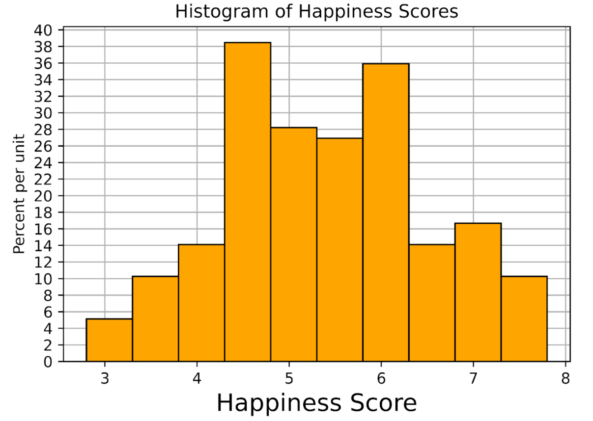

happiness.hist("Score", bins = np.arange(2.8, 8, 0.5))

Note that the histogram may look a bit different from usual for the purpose of making the bar heights easier to interpret.

##### (a) What are the units of the y-axis in the histogram?

For parts (b) - (e), use the above histogram to calculate the following quantities. If it’s not possible, write “Cannot calculate” and explain your reasoning.

##### (b) The proportion of countries with happiness scores between 4.3 and 5.8.

- The number of countries with happiness scores between 4.3 and 5.8 (round to the nearest country).

##### (d) The number of countries with happiness scores between 6 and 7.

##### (e) The height of the new bin after combining the three leftmost bins.

Data C8 Spring 2026 Discussion 08 | 2

### Page 3

#### 3. Probability

Suppose the wheel-spinning game from Discussion 07 received a lot of complaints at the carnival, and the owners of the game are pressured to release their true distribution of prizes as below:

##### Prize Chance

Nothing 90%

Teddy bear 1%

Pinwheel 3%

Sticker 6%

Use the distribution above to answer the following probability questions.

##### (a) What is the probability of winning a prize from one spin of the wheel?

##### (b) What is the probability of winning a Teddy bear and a Sticker in two spins?

##### (c) What is the probability of winning at least one prize in 10 spins?

Data C8 Spring 2026 Discussion 08 | 3

### Page 4

#### 4. Sampling

Researchers are studying the effectiveness of a particular flu vaccine. A large random sample was taken from the population of people who took the vaccine in 2016. Among the sampled people, 48% did not get the flu.

(Spring 2018 Midterm Question 4 Modified)

##### (a) What is the difference between a parameter and a statistic? Which of the two is random?

##### (b) What is the parameter and what is the statistic in this scenario?

In 2017, the researchers took another large random sample from among the people who took the vaccine that year. Among these sampled people, 40% did not get the flu.

- A researcher thinks the vaccine was less effective in 2017 than in 2016. To test this, a null hypothesis is needed. Which is the

correct null hypothesis?

The vaccine was less effective in the 2017 population than in the 2016 population, due to chance.

The vaccine was equally effective in the two samples but its effectiveness was different in the two populations due to chance.

The vaccine was equally effective in the two populations but its effectiveness was different in the two samples due to chance.

- The researcher says, “The value of my observed test statistic is 40% −48% = −8%.” To perform the test, the statistic is

simulated under the null hypothesis. One of the figures below is the empirical histogram of the simulated values. Which is it?

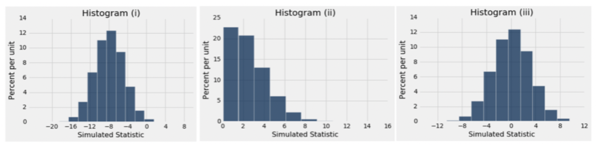

Histogram (i)

Histogram (ii)

Histogram (iii)

Data C8 Spring 2026 Discussion 08 | 4

### Page 5

#### 5. Hypothesis Testing

Chloe is a big fan of Trader Joe’s Frozen Mac ‘n Cheese, but she noticed that the cheese used in it varies from box to box. A Trader Joe’s employee provides her with some data about the 4 different cheeses used and the probability of them being used in each box:

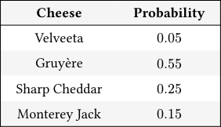

##### Cheese Probability

Velveeta 0.05

Gruyère 0.55

Sharp Cheddar 0.25

Monterey Jack 0.15

Chloe is suspicious about this distribution. After all, Velveeta is much cheaper to use than Gruyère, and she has also never bought a box that uses Gruyère. Chloe decides to buy many boxes throughout the next month and tracks the type of cheese used in each box. She uses this to conduct a hypothesis test.

##### (a) Write a valid null and alternative hypothesis for this experiment.

##### Null Hypothesis:

##### Alternative Hypothesis:

observed_proportions = make_array(0.2, 0.3, 0.45, 0.05) employee_proportions = make_array(0.05, 0.55, 0.25, 0.15)

The array observed_proportions contains the proportions of cheese that Chloe observed in 20 boxes of Mac ‘n Cheese.

- Chloe wants to use the mean as a test statistic, but Katherine suggests that Chloe use the TVD (total variation distance)

instead. Which test statistic should Chloe use in this case? Briefly justify your answer. Then, write a line of code to assign the observed value of the test statistic to observed_stat.

observed_stat = ____________________________________________________________

- Define the function one_simulated_test_stat to simulate a random sample according to the null hypothesis and return

the test statistic for that sample.

def one_simulated_test_stat():

sample_prop = ________________________________________________ return ________________________________________________

- Chloe simulates the test statistic 10,000 times and stores the results in an array called simulated_stats. The observed value

of the test statistic is stored in observed_stat. Complete the code below so that it evaluates to the p-value of the test:

________________________(simulated_stats ____________ observed_statistic) / ____________________________

- Given that the computed p-value is 0.0825, which of the following are true? Select all that may apply.

Using an 8% p-value cutoff, the null hypothesis should be rejected.

Using a 10% p-value cutoff, the null hypothesis should be rejected.

There is an 8.25% chance that the null hypothesis is true.

There is an 8.25% chance that the alternative hypothesis is true.

Data C8 Spring 2026 Discussion 08 | 5

## Discussion 08 — Solution

### Page 1

### More Midterm Review

#### Discussion 08

#### Data C8: Foundations of Data Science UC Berkeley, Spring 2026

### 1. Tables

##### You are given the following table called pokemon. For the following questions, fill in the blanks.

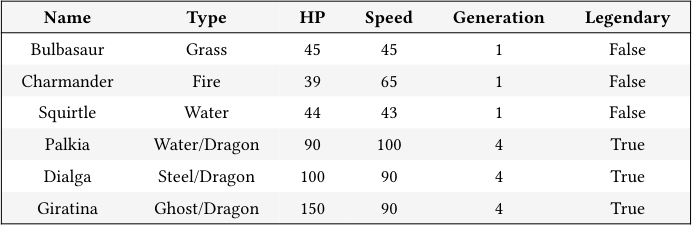

##### Name Type HP Speed Generation Legendary

Bulbasaur Grass 45 45 1 False

Charmander Fire 39 65 1 False

Squirtle Water 44 43 1 False

Palkia Water/Dragon 90 100 4 True

Dialga Steel/Dragon 100 90 4 True

Giratina Ghost/Dragon 150 90 4 True

##### (a) Find the name of the pokemon with highest HP among type Water pokemon.

water_pokemon = pokemon.________________________(________________________, ________________________)

water_pokemon.______________(________________________, _________________________).column("Name").item(0)

water_pokemon = pokemon.where("Type", are.equal_to("Water")) water_pokemon.sort("HP", descending = True).column("Name").item(0)

##### (b) Find the proportion of Fire-type Pokemon with a Speed less than 100.

fire_pokemon = pokemon.________________________(________________________, ________________________)

fire_pokemon.________________________(________________________, ____________________________________)

.________________________ / ________________________.________________________

fire_pokemon = pokemon.where("Type", "Fire") fire_pokemon.where("Speed", are.below(100)).num_rows / fire_pokemon.num_rows

##### (c) Create a table containing Type and Generation that is sorted in decreasing order by the average HP for each pair of Type

##### and Generation that appears in the table.

avg_hp = pokemon.________________________(________________________, ________________________)

avg_hp.sort("HP mean",________________________)

.________________________(________________________, ________________________)

avg_hp = pokemon.group(make_array("Type", "Generation"), np.mean) avg_hp.sort("HP mean", descending = True).select("Type", "Generation")

##### (d) Return an array that contains ratios of legendary to non-legendary pokemons for each generation. You may assume that the

##### Legendary column is a column of booleans.

helper = pokemon.________________________(________________________, ________________________)

ratios = helper._______________(_______________) / helper._______________(_______________)

### Page 2

helper = pokemon.pivot("Legendary", "Generation") ratios = helper.column("True") / helper.column("False")

##### Data C8 Spring 2026 Discussion 08 | 2

### Page 3

#### 2. Histograms

World Happiness Report is a landmark study on the state of global happiness. This study calculated and ranked the happiness level for 155 countries using data from the Gallup World Poll. The histogram below shows the distribution of happiness scores computed from this study in 2019. Suppose the data is stored in the table called happiness. The following code was used to generate the histogram you see below:

happiness.hist("Score", bins = np.arange(2.8, 8, 0.5))

Note that the histogram may look a bit different from usual for the purpose of making the bar heights easier to interpret.

##### (a) What are the units of the y-axis in the histogram?

Percent per happiness score. Note that it is NOT “percent per country”. Although each data point used to generate the histogram represents a country, the values used to make the histogram are the happiness scores.

For parts (b) - (e), use the above histogram to calculate the following quantities. If it’s not possible, write “Cannot calculate” and explain your reasoning.

##### (b) The proportion of countries with happiness scores between 4.3 and 5.8.

Each bin has width 0.5. We’re interested in the [4.3, 4.8), [4.8, 5.3), and [5.3, 5.8) bins, which have heights approximately 38, 28, and 27 percent per unit respectively. We can use the Area principle to calculate the sum of the areas of these bins, which in turn represents the proportion we’re looking for:

Total Area = height1 ⋅width + height2 ⋅width + height3 ⋅width

= 0.5 ⋅(height1 + height2 + height3)

= 0.5 ⋅(38 + 28 + 27)

= 0.5 ⋅93 = 46.5% or as a proportion, 0.465

- The number of countries with happiness scores between 4.3 and 5.8 (round to the nearest country).

We can simply multiply the proportion of countries with happiness score between 4.3 and 5.8 (calculated in the previous question) by the number of countries represented in the histogram: Number of countries = 46.5% ⋅155 countries ≈72 countries

##### (d) The number of countries with happiness scores between 6 and 7.

Data C8 Spring 2026 Discussion 08 | 3

### Page 4

Cannot calculate; we don’t have bins that exactly comprise [6, 7), and we do not know the distribution of countries within bins.

##### (e) The height of the new bin after combining the three leftmost bins.

Combining the three leftmost bins is going to combine their areas. The total area of the three leftmost bins is: 0.5 ⋅(5 + 10 + 1. ≈14.5% The width of the new bin is going to be the sum of the widths of the original bins (0.5), so the new width is 1.5. Now that we have the area and width of the new bin, we can calculate the height:

Area = width ⋅height

⟹14.5 = 1.5 ⋅height

⟹height = 14.5

1.5 ≈9.67 % per unit

Data C8 Spring 2026 Discussion 08 | 4

### Page 5

#### 3. Probability

Suppose the wheel-spinning game from Discussion 07 received a lot of complaints at the carnival, and the owners of the game are pressured to release their true distribution of prizes as below:

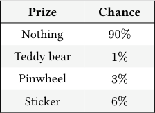

##### Prize Chance

Nothing 90%

Teddy bear 1%

Pinwheel 3%

Sticker 6%

Use the distribution above to answer the following probability questions.

##### (a) What is the probability of winning a prize from one spin of the wheel?

Using the Complement Rule:

ℙ[winning a prize] = 1 −ℙ[Nothing] = 1 −0.9 = 0.1 or 10%

##### (b) What is the probability of winning a Teddy bear and a Sticker in two spins?

ℙ[Teddy bear and Sticker] = 2 ⋅ℙ[Teddy bear] ⋅ℙ[Sticker] = 2 ⋅0.01 ⋅0.06 = 0.12%

We multiply by 2 because we could have won the Teddy bear and then the Sticker or the Sticker first and then the Teddy bear.

##### (c) What is the probability of winning at least one prize in 10 spins?

Complement Rule again:

ℙ[at least one prize] = 1 −ℙ[no prizes in 10 spins] = 1 −ℙ[Nothing]10 = 1 − (0.9)10

Data C8 Spring 2026 Discussion 08 | 5

### Page 6

#### 4. Sampling

Researchers are studying the effectiveness of a particular flu vaccine. A large random sample was taken from the population of people who took the vaccine in 2016. Among the sampled people, 48% did not get the flu.

(Spring 2018 Midterm Question 4 Modified)

##### (a) What is the difference between a parameter and a statistic? Which of the two is random?

A parameter is a property of the population, so it is fixed and does not change. On the other hand, we calculate statistics from samples which are often random. Typically, we use statistics in order to estimate population parameters.

##### (b) What is the parameter and what is the statistic in this scenario?

##### Parameter: The proportion of people who took the vaccine in 2016 that did not get the flu.

##### Statistic: The proportion of people in the sample that did not get the flu.

In 2017, the researchers took another large random sample from among the people who took the vaccine that year. Among these sampled people, 40% did not get the flu.

- A researcher thinks the vaccine was less effective in 2017 than in 2016. To test this, a null hypothesis is needed. Which is the

correct null hypothesis?

The vaccine was less effective in the 2017 population than in the 2016 population, due to chance.

The vaccine was equally effective in the two samples but its effectiveness was different in the two populations due to chance.

The vaccine was equally effective in the two populations but its effectiveness was different in the two samples due to chance.

Option A - Incorrect as it describes a model that is difficult to simulate under. How can we quantify “less effective”?

Option B - Incorrect as the question tells us that the vaccine was not equally effective in the two samples (48% vs 40%).

Option C - Correct. The null hypothesis would state that the vaccine was equally effective in the two populations, and that the differences we observe in the two samples are simply due to chance.

- The researcher says, “The value of my observed test statistic is 40% −48% = −8%.” To perform the test, the statistic is

simulated under the null hypothesis. One of the figures below is the empirical histogram of the simulated values. Which is it?

Histogram (i)

Histogram (ii)

Histogram (iii)

Data C8 Spring 2026 Discussion 08 | 6

### Page 7

The test statistic we are using is the difference between the two sample percentages. Under the null hypothesis, this could be positive or negative depending on the sample. This rules out (ii).

Under the null hypothesis, the two sample percentages are expected to be equal and hence the difference is expected to be 1. This rules out (i).

Only (iii) has all the right properties.

Data C8 Spring 2026 Discussion 08 | 7

### Page 8

#### 5. Hypothesis Testing

Chloe is a big fan of Trader Joe’s Frozen Mac ‘n Cheese, but she noticed that the cheese used in it varies from box to box. A Trader Joe’s employee provides her with some data about the 4 different cheeses used and the probability of them being used in each box:

##### Cheese Probability

Velveeta 0.05

Gruyère 0.55

Sharp Cheddar 0.25

Monterey Jack 0.15

Chloe is suspicious about this distribution. After all, Velveeta is much cheaper to use than Gruyère, and she has also never bought a box that uses Gruyère. Chloe decides to buy many boxes throughout the next month and tracks the type of cheese used in each box. She uses this to conduct a hypothesis test.

##### (a) Write a valid null and alternative hypothesis for this experiment.

##### Null Hypothesis:

##### Alternative Hypothesis:

Null Hypothesis: The types of cheese in the Frozen Mac ‘n Cheese boxes are distributed according to the probability distribution provided by the employee. Any observed difference is simply due to chance. Alternative Hypothesis: The types of cheese in the Frozen Mac ‘n Cheese boxes are not distributed according to the probability distribution provided by the employee. Any observed difference is not just due to chance.

observed_proportions = make_array(0.2, 0.3, 0.45, 0.05) employee_proportions = make_array(0.05, 0.55, 0.25, 0.15)

The array observed_proportions contains the proportions of cheese that Chloe observed in 20 boxes of Mac ‘n Cheese.

- Chloe wants to use the mean as a test statistic, but Katherine suggests that Chloe use the TVD (total variation distance)

instead. Which test statistic should Chloe use in this case? Briefly justify your answer. Then, write a line of code to assign the observed value of the test statistic to observed_stat.

observed_stat = ____________________________________________________________

Katherine is correct, we should use the total variation distance because she is comparing two categorical distributions (the observed distribution and the one provided by the Trader Joe’s employee).

observed_stat = sum(np.abs(observed_proportions - employee_proportions)) / 2

- Define the function one_simulated_test_stat to simulate a random sample according to the null hypothesis and return

the test statistic for that sample.

def one_simulated_test_stat():

sample_prop = ________________________________________________ return ________________________________________________

def one_simulated_test_stat(): sample_prop = sample_proportions(20, employee_proportions) return sum(abs(employee_proportions - sample_prop)) / 2

- Chloe simulates the test statistic 10,000 times and stores the results in an array called simulated_stats. The observed value

of the test statistic is stored in observed_stat. Complete the code below so that it evaluates to the p-value of the test:

Data C8 Spring 2026 Discussion 08 | 8

### Page 9

________________________(simulated_stats ____________ observed_statistic) / ____________________________

np.count_nonzero(simulated_stats >= observed_statistic) / 10000

- Given that the computed p-value is 0.0825, which of the following are true? Select all that may apply.

Using an 8% p-value cutoff, the null hypothesis should be rejected.

Using a 10% p-value cutoff, the null hypothesis should be rejected.

There is an 8.25% chance that the null hypothesis is true.

There is an 8.25% chance that the alternative hypothesis is true.

Data C8 Spring 2026 Discussion 08 | 9

## Discussion 09 — Student

### Page 1

### The Bootstrap

Discussion 09

Data C8: Foundations of Data Science UC Berkeley, Spring 2026

#### Mid-Semester Check In

Congrats on finishing the midterm!

What has been your favorite topic, assignment, lecture, or anything so far with the first half of the class done?

Please leave any comments you have about the content and any feedback for your TA here. Tear this page off and fold it so it is anonymous.

Additionally, if you have any concerns about your performance in the class so far, feel free to bring it up with your TA in person, or via email.

### Page 2

This page intentionally left blank

Data C8 Spring 2026 Discussion 09 | 2

### Page 3

#### 1. The Bootstrap

Setup We want to be able to produce an estimate of a particular population parameter of interest, say the median. However, we know that if we had gotten a different sample, then our estimate of the population median could have also been different.

Main Objective Recall that it is often infeasible to take more samples from the population to construct a better estimate, due to resource constraints. If we have a representative sample, we could take the statistic of the sample as a reasonable prediction for the true parameter. This is the method of the bootstrap, sampling from our sample, to generate a range of values for which we believe our population parameter falls into.

Method 1. Given a large, simple random sample of a population, resample from the original sample with replacement. Generate many resamples with the same sample size as the original sample. 1. Calculate the statistic for each resample and store it in an array, as we saw in the case of hypothesis testing. 1. Repeat steps 1-2 multiple times to obtain an empirical distribution of your estimate.

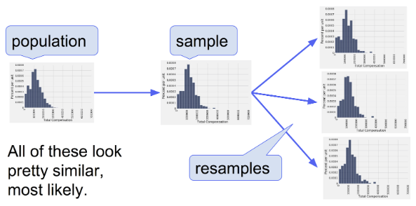

##### (a) When we conduct a bootstrap resample, what size resample should we draw from our sample? Why?

##### (b) Why do we need to resample from our sample with replacement?

- When we conduct a bootstrap resample, what is the underlying assumption/reasoning for resampling from our sample?

Why does it work?

Data C8 Spring 2026 Discussion 09 | 3

### Page 4

#### 2. Thirsty

You are interested in investigating the liters of water consumed every day by UC Berkeley students. In particular, you want to study the proportion of students drinking less than 3 liters of water per day. You contact 150 random students from the directory and obtain the amounts of water each one of them drinks, storing them in the table water. The table has 1 column, amount, which stores the number of liters of water drunk by each student.

##### (a) What is the parameter and what is the statistic in this scenario?

- Write a line of code to calculate the proportion of students in your sample who drank less than 3 liters of water per day.

_______________________________________________________________________________________________________

- Write a line of code to perform a single bootstrap resample of the data stored in the water table.

_______________________________________________________________________________________________________

- Fill in the following blanks to conduct 10,000 bootstrap resamples of your data, calculating the proportion of students in

each resample that drink less than 3 liters of water per day, then plotting the distribution of those proportions using an appropriate visualization.

proportions = _______________________________

for i in _______________________________:

resampled_table = ______________________________________________________________ resampled_statistic = ______________________________________________________________ proportions = ______________________________________________________________ proportions_table = Table().with_column("Resampled proportions", proportions)

proportions_table._______________________________

Data C8 Spring 2026 Discussion 09 | 4

### Page 5

#### 3. Tennis Time

Ciara is interested in exploring the heights of women’s tennis players. She has collected a sample of 100 heights of professional women’s tennis players and wants to use this sample to estimate the true interquartile range (IQR) of all heights of professional women’s tennis players.

We define the interquartile range (IQR) as

IQR = 75th percentile −25th percentile

- In order to construct a 99% confidence interval for the IQR, what should our upper and lower endpoints be in terms of

percentiles?

- Define a function ci_iqr that constructs a 99% confidence interval for the IQR and returns an array containing the left

endpoint and right endpoint of the 99% confidence interval in that order. The function takes in the following arguments: - tbl: A one-column table consisting of a random sample from the population; you can assume this sample is large. - reps: The number of bootstrap repetitions.

To find the 25th and 75th percentile of an array, you can use the percentile function.

Fill in the blanks and then provide the full solution.

def ci_iqr(tbl, reps):

stats = _______________________________ for _______________________________: resample_col = _________________________________________________________________________ new_iqr = ______________________________________________________________________________ stats = ________________________________________________________________________________ left_end = _______________________________ right_end = _______________________________ return _______________________________

Data C8 Spring 2026 Discussion 09 | 5

### Page 6

- Say Ciara recruited 500 of her friends to perform the same bootstrapping process she did. In other words, each of her friends

drew a large, random sample of 100 heights from the population of professional women’s tennis players and constructed their own 99% confidence intervals.

- Approximately how many of these CIs do we expect to contain the actual IQR for the heights of professional women’s

tennis athletes?

ii. Note how in this example, we obtain different random samples from the population for each confidence interval, and

then re-sample from each to produce a confidence interval.

Why doesn’t each person just reuse the same original sample? Why is this distinction important?

iii. Ciara decided to do this process again, but this time with only 50 of her friends. Would the number of CIs that contain

the actual IQR be more or less close to the expected number of CIs, compared to her results with 500 friends?

##### (d) Ciara now decides to perform a hypothesis test, with the null hypothesis that the true IQR is 𝑞.

- How could Ciara perform this using her confidence intervals? Discuss the duality of confidence intervals and hypothesis

testing.

ii. If Ciara conducted a two-tailed hypothesis test (e.g. her alternative was “the IQR is not 𝑞”), what p-value cutoff would

she choose if she used her confidence intervals?

iii. If Ciara conducted a one-tailed hypothesis test (e.g. her alternative was “the IQR is greater than 𝑞”), what p-value cutoff

would she choose if she used her confidence intervals?

Data C8 Spring 2026 Discussion 09 | 6

## Discussion 09 — Solution

### Page 1

### The Bootstrap

Discussion 09

Data C8: Foundations of Data Science UC Berkeley, Spring 2026

#### Mid-Semester Check In

Congrats on finishing the midterm!

What has been your favorite topic, assignment, lecture, or anything so far with the first half of the class done?

Please leave any comments you have about the content and any feedback for your TA here. Tear this page off and fold it so it is anonymous.

Additionally, if you have any concerns about your performance in the class so far, feel free to bring it up with your TA in person, or via email.

Congrats on finishing the midterm!

### Page 2

This page intentionally left blank

Data C8 Spring 2026 Discussion 09 | 2

### Page 3

#### 1. The Bootstrap

Setup We want to be able to produce an estimate of a particular population parameter of interest, say the median. However, we know that if we had gotten a different sample, then our estimate of the population median could have also been different.

Main Objective Recall that it is often infeasible to take more samples from the population to construct a better estimate, due to resource constraints. If we have a representative sample, we could take the statistic of the sample as a reasonable prediction for the true parameter. This is the method of the bootstrap, sampling from our sample, to generate a range of values for which we believe our population parameter falls into.

Method 1. Given a large, simple random sample of a population, resample from the original sample with replacement. Generate many resamples with the same sample size as the original sample. 1. Calculate the statistic for each resample and store it in an array, as we saw in the case of hypothesis testing. 1. Repeat steps 1-2 multiple times to obtain an empirical distribution of your estimate.

##### (a) When we conduct a bootstrap resample, what size resample should we draw from our sample? Why?

The resample should have the same sample size as our original sample. This is because our original estimate of some parameter is based on a certain sample size. If we changed the sample size, the distribution and variability of the estimate would change.

##### (b) Why do we need to resample from our sample with replacement?

If we do not sample with replacement, then we will get the same exact sample every time! By sampling with replacement, this allows us to simulate different resamples from the sample.

- When we conduct a bootstrap resample, what is the underlying assumption/reasoning for resampling from our sample?

Why does it work?

The underlying assumption is that our sample looks similar to our population — that is, the sample is representative of what the population looks like. The validity of the bootstrap is based on this assumption because if the sample is unrepresentative of the population, we do not actually end up with a good picture of what range of values our estimate could take on.

Data C8 Spring 2026 Discussion 09 | 3

### Page 4

#### 2. Thirsty

You are interested in investigating the liters of water consumed every day by UC Berkeley students. In particular, you want to study the proportion of students drinking less than 3 liters of water per day. You contact 150 random students from the directory and obtain the amounts of water each one of them drinks, storing them in the table water. The table has 1 column, amount, which stores the number of liters of water drunk by each student.

##### (a) What is the parameter and what is the statistic in this scenario?

##### Parameter: The proportion of UC Berkeley students who drink less than 3 liters of water per day.

##### Statistic: The proportion of students in the sample who drink less than 3 liters of water per day.

- Write a line of code to calculate the proportion of students in your sample who drank less than 3 liters of water per day.

_______________________________________________________________________________________________________

np.mean(water.column("amount") < 3)

##### or

water.where("amount", are.below(3)).num_rows / water.num_rows

- Write a line of code to perform a single bootstrap resample of the data stored in the water table.

_______________________________________________________________________________________________________

water.sample(water.num_rows, with_replacement=True)

Alternatively, given the default values of the arguments, you may simply write

water.sample()

- Fill in the following blanks to conduct 10,000 bootstrap resamples of your data, calculating the proportion of students in

each resample that drink less than 3 liters of water per day, then plotting the distribution of those proportions using an appropriate visualization.

proportions = _______________________________

for i in _______________________________:

resampled_table = ______________________________________________________________ resampled_statistic = ______________________________________________________________ proportions = ______________________________________________________________ proportions_table = Table().with_column("Resampled proportions", proportions)

proportions_table._______________________________

Data C8 Spring 2026 Discussion 09 | 4

### Page 5

proportions = make_array()

for i in np.arange(10000): resampled_table = water.sample(water.num_rows, with_replacement = True) resampled_statistic = np.mean(resampled_table.column("amount") < 3) proportions = np.append(proportions, resampled_statistic) proportions_table = Table().with_column("Resampled proportions", proportions) proportions_table.hist("Resampled proportions")

##### Data C8 Spring 2026 Discussion 09 | 5

### Page 6

#### 3. Tennis Time

Ciara is interested in exploring the heights of women’s tennis players. She has collected a sample of 100 heights of professional women’s tennis players and wants to use this sample to estimate the true interquartile range (IQR) of all heights of professional women’s tennis players.

We define the interquartile range (IQR) as

IQR = 75th percentile −25th percentile

- In order to construct a 99% confidence interval for the IQR, what should our upper and lower endpoints be in terms of

percentiles?

Our lower endpoint should be the 0.5th percentile and the upper endpoint should be the 99.5th percentile.

- Define a function ci_iqr that constructs a 99% confidence interval for the IQR and returns an array containing the left

endpoint and right endpoint of the 99% confidence interval in that order. The function takes in the following arguments: - tbl: A one-column table consisting of a random sample from the population; you can assume this sample is large. - reps: The number of bootstrap repetitions.

To find the 25th and 75th percentile of an array, you can use the percentile function.

Fill in the blanks and then provide the full solution.

def ci_iqr(tbl, reps):

stats = _______________________________ for _______________________________: resample_col = _________________________________________________________________________ new_iqr = ______________________________________________________________________________ stats = ________________________________________________________________________________ left_end = _______________________________ right_end = _______________________________ return _______________________________

def ci_iqr(tbl, reps): stats = make_array() for i in np.arange(reps): resample_col = tbl.sample().column(0) new_iqr = percentile(75, resample_col) - percentile(25, resample_col) stats = np.append(stats, new_iqr) left_end = percentile(0.5, stats) right_end = percentile(99.5, stats) return make_array(left_end, right_end)

Data C8 Spring 2026 Discussion 09 | 6

### Page 7

- Say Ciara recruited 500 of her friends to perform the same bootstrapping process she did. In other words, each of her friends

drew a large, random sample of 100 heights from the population of professional women’s tennis players and constructed their own 99% confidence intervals.

- Approximately how many of these CIs do we expect to contain the actual IQR for the heights of professional women’s

tennis athletes?

We interpret a 99% confidence interval to mean that we are 99% confident in the process used to construct that given interval. In other words, 99% of the time we use this process we expect to construct an interval that contains the true population parameter.

Since we have 500 CIs, each at a 99% confidence level, we find that since 500 ⋅(0.99) = 495, we expect to have 495 of these CIs containing the actual IQR of heights.

ii. Note how in this example, we obtain different random samples from the population for each confidence interval, and

then re-sample from each to produce a confidence interval.

Why doesn’t each person just reuse the same original sample? Why is this distinction important?

Recall the “confidence” is the confidence in the process, and it is the process of drawing new, independent samples from the population and building a confidence interval for each. The re-sample is conditioned on the single sample you obtained, and models only the variability of that sample – we would just be constructing the same CI over and over.

iii. Ciara decided to do this process again, but this time with only 50 of her friends. Would the number of CIs that contain

the actual IQR be more or less close to the expected number of CIs, compared to her results with 500 friends?

##### It would be less close, by law of large numbers (higher variability).

##### (d) Ciara now decides to perform a hypothesis test, with the null hypothesis that the true IQR is 𝑞.

- How could Ciara perform this using her confidence intervals? Discuss the duality of confidence intervals and hypothesis

testing.

The confidence interval describes the region for which we can be 99% confident that it contains the true population parameter. This describes exactly the error of the p-value cutoff.

The decision rule for a hypothesis test testing whether the IQR is 𝑞 could therefore be - reject if 𝑞 is not contained in the 99% CI - fail to reject otherwise

ii. If Ciara conducted a two-tailed hypothesis test (e.g. her alternative was “the IQR is not 𝑞”), what p-value cutoff would

she choose if she used her confidence intervals?

1%, since we construct 99% confidence intervals, and we look at both tails.

iii. If Ciara conducted a one-tailed hypothesis test (e.g. her alternative was “the IQR is greater than 𝑞”), what p-value cutoff

would she choose if she used her confidence intervals?

The effective cutoff should be 0.5%, since we construct 99% confidence intervals, but only look at one tail. This is true since the confidence intervals we generate will have equal tails*, and therefore the same probability, so we can halve the tail region.

Typically, we would choose a p-value cutoff first, such as of 1% and then construct 98% confidence intervals to determine the outcome of the test. For the purposes of this question, we used the same confidence interval for both part (ii) and part (iii).

*Note: bootstrapped percentile confidence intervals have equal tails, but may not be symmetric. Confidence intervals generated in other ways, not taught in Data 8, may not have equal tails.

Data C8 Spring 2026 Discussion 09 | 7

## Discussion 10 — Student

### Page 1

### The Central Limit Theorem

Discussion 10

Data C8: Foundations of Data Science UC Berkeley, Spring 2026

So far in the course, you have used the bootstrap to estimate different population parameters, such as the median or mean. You are now capable of building empirical distributions for these sample statistics. An empirical distribution for a sample statistic is usually obtained by repeatedly resampling and calculating the statistic for those resamples (bootstrapping).

Now we will introduce the Central Limit Theorem (CLT), which tells us more about the distribution of the sample mean. If you draw a large random sample with replacement from a population, then, regardless of the distribution of the population, the probability distribution for that sample’s mean is roughly normal, and centered at the population mean.

##### Furthermore, the standard deviation (spread) of the distribution of sample means can be described as

standard deviation of sample means = population standard deviation √sample size

Note, the standard deviation of the sample means is not the standard deviation of the sample. It is the spread of the distribution of all sample means obtain, not of a single sample.

#### 1. Sample Means

Note that in this question, the empirical distribution of the sample mean is made up from the means of samples drawn from the population (not from resamples from a single sample).

Assume that you have a certain population of interest whose histogram is below.

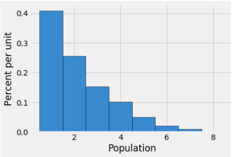

- Cyrus takes many large random samples with replacement from the population, with the goal of generating an empirical

distribution of the sample mean. What shape do you expect this distribution to have? Which value will it be centered around?

- Why are we able to use the CLT to reason about the empirical distribution of the sample mean’s shape if the population data

is skewed?

### Page 2

- Suppose that Cyrus creates two empirical distributions of sample means, with different sample sizes. Which distribution

corresponds to a larger sample size? Why?

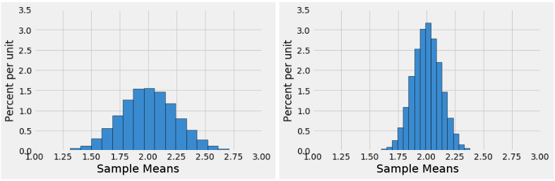

- Based solely on the information in the histogram, what is an estimate for the standard deviation of the sample mean on the

left? How did you determine this?

- Suppose you were told that the distribution on the right was generated based on a sample size of 100 and has a standard

deviation of 0.2. How big of a sample size would you need if you wanted the standard deviation of the distribution of sample means to be 10 times smaller?

Data C8 Spring 2026 Discussion 10 | 2

### Page 3

#### 2. Want to Go to Main Stacks?

UC Berkeley students love studying in Main Stacks! You are working with Lena on constructing a confidence interval for the mean number of hours students spend in Main Stacks each year. To do this, you take a random sample of 400 UC Berkeley students and record how many hours each student spent studying in Main Stacks over the past year. Then, you compute the mean number of hours for your sample; it is 170 hours. You also calculate the standard deviation of your sample to be 10 hours.

- Lena claims that the distribution of all possible sample means is normal with an SD of 0.5 hours. Use this information to

construct an approximate 68% confidence interval for the mean hours spent studying in Main Stacks for all UC Berkeley students.

- If Lena had not told you what the SD of the distribution of sample means was, could you estimate it from the data in the

sample? If yes, how? If no, why not?

A helpful note. In Question 1, our large samples drawn with replacement were obtained directly from the population. As a result, our empirical distribution of the sample mean was centered around the population mean.

In contrast, in Question 2, we only have access to a single sample. As a result, we use the sample’s mean and standard deviation in place of the population’s mean and standard deviation, given the assumption that it is a representative sample.

If you bootstrap (resample) from a representative sample and obtain the empirical distribution of the sample means, it will be roughly centered around the original sample’s mean, not the population mean. However, it is helpful to note that as the sample size gets larger, your original sample’s mean will likely get closer and closer to the population mean, by the law of large numbers.

In both situations – whether resampling directly from the population or bootstrapping from a single representative sample - the Central Limit Theorem applies as long as its conditions are met.

Data C8 Spring 2026 Discussion 10 | 3

### Page 4

#### 3. CLT with TLC

You are a super fan of the girl group TLC and are interested in estimating the average amount of plays their songs have online. You generate an 80% confidence interval for this parameter to be [700000, 1200000] based on a random sample of 50 songs. Are each of the following statements true or false? Give a brief explanation for each question.

Note: Generally, 𝑛≥30 is considered the minimum sample size for CLT to take effect!

##### (a) The value of our population parameter changes depending on our sampling process.

True False

- The empirical distribution of any statistic we choose will be roughly normal based on the Central Limit Theorem, but it

requires our population to have a normal distribution to begin with.

True False

- If we calculate a 95% confidence interval using the same sample and resamples, the interval will be narrower than the original

confidence interval because we are more certain of our results.

True False

- Using the same process to generate another 80% confidence interval, there is an 80% chance that the next confidence interval

you generate will contain the true average number of plays for TLC songs.

True False

- There is an 80% chance that a confidence interval we generated contains the true average number of plays for TLC songs.

True False

##### (f) 80% of TLC’s songs have between 700,000 and 1,200,000 plays.

True False

##### (g) The original sample mean you obtained was approximately 950,000 plays.

True False

Data C8 Spring 2026 Discussion 10 | 4

## Discussion 10 — Solution

### Page 1

### The Central Limit Theorem

Discussion 10

Data C8: Foundations of Data Science UC Berkeley, Spring 2026

So far in the course, you have used the bootstrap to estimate different population parameters, such as the median or mean. You are now capable of building empirical distributions for these sample statistics. An empirical distribution for a sample statistic is usually obtained by repeatedly resampling and calculating the statistic for those resamples (bootstrapping).

Now we will introduce the Central Limit Theorem (CLT), which tells us more about the distribution of the sample mean. If you draw a large random sample with replacement from a population, then, regardless of the distribution of the population, the probability distribution for that sample’s mean is roughly normal, and centered at the population mean.

##### Furthermore, the standard deviation (spread) of the distribution of sample means can be described as

standard deviation of sample means = population standard deviation √sample size

Note, the standard deviation of the sample means is not the standard deviation of the sample. It is the spread of the distribution of all sample means obtain, not of a single sample.

#### 1. Sample Means

Note that in this question, the empirical distribution of the sample mean is made up from the means of samples drawn from the population (not from resamples from a single sample).

Assume that you have a certain population of interest whose histogram is below.

- Cyrus takes many large random samples with replacement from the population, with the goal of generating an empirical

distribution of the sample mean. What shape do you expect this distribution to have? Which value will it be centered around?

By the Central Limit Theorem, the distribution will be normal (bell curve), centered around the population mean.

- Why are we able to use the CLT to reason about the empirical distribution of the sample mean’s shape if the population data

is skewed?

We are able to use the CLT, as we are drawing large random samples, with replacement, and the statistic is sum or mean. If these conditions are applied, the CLT can be used regardless of the population’s distribution.

- Suppose that Cyrus creates two empirical distributions of sample means, with different sample sizes. Which distribution

corresponds to a larger sample size? Why?

### Page 2

The distribution to the right corresponds to a larger sample size compared to the one to the left. We know this based on the spread of the two distributions. The larger the sample size you use, the less variable the distribution of the sample mean becomes.

You can see that increasing the sample size increases the denominator in calculating the SD of sample means, which decreases the standard deviation.

- Based solely on the information in the histogram, what is an estimate for the standard deviation of the sample mean on the

left? How did you determine this?

Approximately 0.3.

This is because the point of inflection on a normal distribution reflects 1 standard deviation away from the mean. Looking at the histogram, we can see that the inflection points occur at around 1.7 and 2.3, with the mean of the histogram being 2.0.

- Suppose you were told that the distribution on the right was generated based on a sample size of 100 and has a standard

deviation of 0.2. How big of a sample size would you need if you wanted the standard deviation of the distribution of sample means to be 10 times smaller?

First, find the Population SD.

0.2 = population SD √

100

√

⟹population SD = 0.2 ⋅

100 = 2

Then, calculate the new sample size needed.

0.2 10 = 2 √new sample size

⟹0.2 ⋅√new sample size = 2 ⋅10

⟹√new sample size = 100

new sample size = 10000

To divide the SD of the sample means by a factor of 10, we need to multiply the sample size by 102, which is 100. To skip the calculations, reference the square root law! (14.5.4 in textbook)

Data C8 Spring 2026 Discussion 10 | 2

### Page 3

#### 2. Want to Go to Main Stacks?

UC Berkeley students love studying in Main Stacks! You are working with Lena on constructing a confidence interval for the mean number of hours students spend in Main Stacks each year. To do this, you take a random sample of 400 UC Berkeley students and record how many hours each student spent studying in Main Stacks over the past year. Then, you compute the mean number of hours for your sample; it is 170 hours. You also calculate the standard deviation of your sample to be 10 hours.

- Lena claims that the distribution of all possible sample means is normal with an SD of 0.5 hours. Use this information to

construct an approximate 68% confidence interval for the mean hours spent studying in Main Stacks for all UC Berkeley students.

We know that the distribution is approximately normal and hence we know that roughly 68% of the area under the normal curve (or 68% of the data) is contained within 1 SD of the mean. Therefore, our confidence interval range will be

[170 −1 ⋅0.5, 170 + 1 ⋅0.5] = [169.5 hours, 170.5 hours]

- If Lena had not told you what the SD of the distribution of sample means was, could you estimate it from the data in the

sample? If yes, how? If no, why not?

We know that the sample size is 400 and that the standard deviation of our sample was 10 hours. Recall the equation for the SD of sample means is

standard deviation of sample means = population standard deviation √sample size

We can substitute the sample SD (10 hours) in place of the population SD in this formula (assuming the sample is represen­ tative of the population) and calculate the value!

standard deviation of sample means = 10 hours √

400 = 10 hours

20 = 0.5 hours

A helpful note. In Question 1, our large samples drawn with replacement were obtained directly from the population. As a result, our empirical distribution of the sample mean was centered around the population mean.

In contrast, in Question 2, we only have access to a single sample. As a result, we use the sample’s mean and standard deviation in place of the population’s mean and standard deviation, given the assumption that it is a representative sample.

If you bootstrap (resample) from a representative sample and obtain the empirical distribution of the sample means, it will be roughly centered around the original sample’s mean, not the population mean. However, it is helpful to note that as the sample size gets larger, your original sample’s mean will likely get closer and closer to the population mean, by the law of large numbers.

In both situations – whether resampling directly from the population or bootstrapping from a single representative sample - the Central Limit Theorem applies as long as its conditions are met.

Data C8 Spring 2026 Discussion 10 | 3

### Page 4

#### 3. CLT with TLC

You are a super fan of the girl group TLC and are interested in estimating the average amount of plays their songs have online. You generate an 80% confidence interval for this parameter to be [700000, 1200000] based on a random sample of 50 songs. Are each of the following statements true or false? Give a brief explanation for each question.

Note: Generally, 𝑛≥30 is considered the minimum sample size for CLT to take effect!

##### (a) The value of our population parameter changes depending on our sampling process.

True False

False. Our population parameter is fixed. It depends on an entire population that we know to be true. On the other hand, the sample statistic is dependent on what our sample looks like, which can vary. This is what allows us to describe probabilities regarding a confidence interval before we generate them but not after. (see part (d))

- The empirical distribution of any statistic we choose will be roughly normal based on the Central Limit Theorem, but it

requires our population to have a normal distribution to begin with.

True False

False. The Central Limit Theorem states that the probability distribution of the sum, average, or proportions of a large random sample drawn with replacement will be roughly normal, regardless of the distribution of the population from which the sample is drawn.

- If we calculate a 95% confidence interval using the same sample and resamples, the interval will be narrower than the original

confidence interval because we are more certain of our results.

True False

False. Using a 95% confidence level would result in a wider interval than an 80% confidence level. In fact, the 95% confidence interval will envelop the original 80% confidence interval. The “increased confidence” comes from having a wider interval, though we are less certain of actual value of the parameter.

- Using the same process to generate another 80% confidence interval, there is an 80% chance that the next confidence interval

you generate will contain the true average number of plays for TLC songs.

True False

True. Before we create the confidence interval, there is an 80% chance that the confidence interval we create next will contain the true population parameter. Confidence refers to the probability associated with our process of generating confidence intervals, not the probability associated with a single well-defined interval.

- There is an 80% chance that a confidence interval we generated contains the true average number of plays for TLC songs.

True False

False. Once we have calculated a confidence interval, it is fixed - it either contains the parameter or it does not. There is no chance involved.

##### (f) 80% of TLC’s songs have between 700,000 and 1,200,000 plays.

True False

False. Our confidence interval is estimating the average number of plays but makes absolutely NO claim about what percentage of songs have between 700,000 and 1,200,000 plays. A 𝑛% confidence interval contains 𝑛% of the statistics you simulated, but it does not suggest that 𝑛% of the population is in that interval!

##### (g) The original sample mean you obtained was approximately 950,000 plays.

True False

Data C8 Spring 2026 Discussion 10 | 4

### Page 5

True. If we sample repeatedly from the original sample to construct the confidence interval, the Central Limit Theorem tells us that the distribution of sample means will be roughly normal and that it will be centered around the sample mean.

Data C8 Spring 2026 Discussion 10 | 5

## Discussion 11 — Student

### Page 1

### Correlation & Regression

Discussion 11

Data C8: Foundations of Data Science UC Berkeley, Spring 2026

An important aspect of data science is using data to make predictions about the future based on the information that we currently have. A question one might ask would be, “Given a student’s score on the midterm exam, what would we predict their score on the final exam to be?” In order to answer this question, we will investigate a method of using one variable to predict another by looking at the correlation between two variables. 1. Standard Units and Correlation

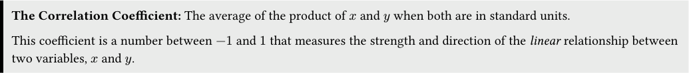

##### The Correlation Coefficient: The average of the product of 𝑥 and 𝑦 when both are in standard units.

This coefficient is a number between −1 and 1 that measures the strength and direction of the linear relationship between two variables, 𝑥 and 𝑦.

##### (a) When calculating the correlation coefficient, why do we convert data to standard units?

- Write a function called convert which takes in an array of elements called xs and returns an array of the values represented

in standard units.

def convert(xs):

sd = ________________________________ mean = ______________________________ return ______________________________

- Write a function called correlation which takes in a table of data tbl containing the column names x and y and returns

the correlation coefficient.

def correlation(tbl, x, y):

x_su = ____________________________________________________________________________________ y_su = ____________________________________________________________________________________ return ____________________________________________________________________________________

### Page 2

#### 2. Comparing Correlation

- Look at the following four datasets. Rank them in order from weakest correlation to strongest correlation.

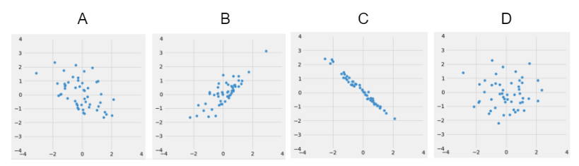

(Weakest) _______________ _______________ _______________ _______________ (Strongest)

We have introduced correlation as a way of quantifying the strength and direction of a linear relationship between two variables. The correlation coefficient can allow us to define the straight line about which the points are clustered, known as the regression line. In fact, by a remarkable fact in mathematics, the line uniquely defined by the slope and intercept below is always the best possible straight line we could construct.

slope = 𝑟⋅ SD𝑦

intercept = average of 𝑦−slope ⋅average of 𝑥

SD𝑥

##### Regression Line (in original units): estimate of 𝑦= slope ⋅𝑥+ intercept

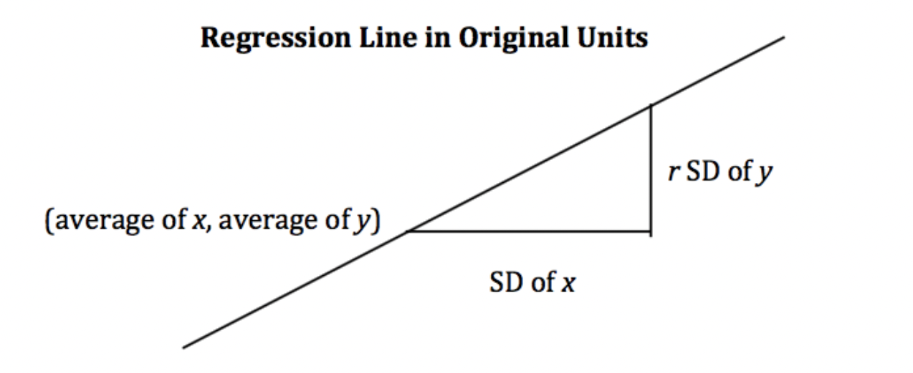

For every 1 SD increase in 𝑥, the predicted value of 𝑦 increases by 𝑟 SDs of 𝑦.

- Bonus Question: Derive the slope and intercept above using the equation for the regression line in standard units (𝑦SU

represents 𝑦 in standard units)

𝑦SU = 𝑟⋅𝑥SU

Data C8 Spring 2026 Discussion 11 | 2

### Page 3

#### 3. Linear Regressi(OH)n

You just submitted a ticket at Office Hours and would like to know how long it will take to receive help. However, you don’t believe the estimated wait time displayed on the queue to be very accurate, so you decide to make your own predictions based on the total number of students present at OH when you submitted your ticket. You obtain data for 100 wait times and plot them below, also fitting a regression line to the data.

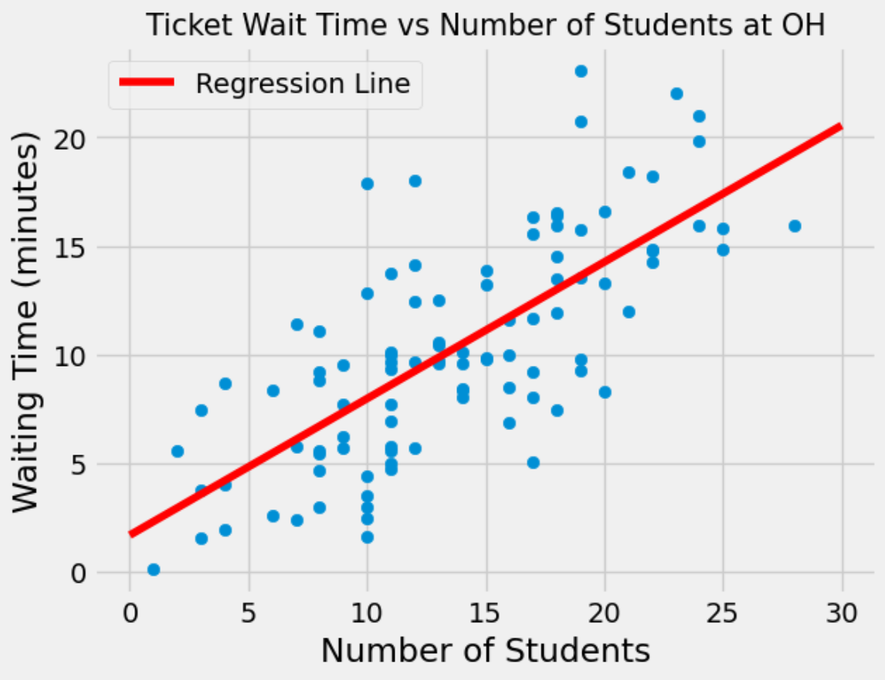

- Suppose that you submit a ticket at Office Hours when there were a total of 20 students present. Based on the regression

line, what would you predict the waiting time to be?

- You go to Office Hours right before a homework assignment is due, and despite safety concerns, you observe 70 students at

Office Hours. Would it be appropriate to use your regression line to predict the waiting time? Explain.

- When constructing your regression line, you find the correlation coefficient 𝑟 to be roughly 0.73. Does this value of 𝑟 suggest

that an increase in the number of students at Office Hours causes an increase in the waiting time? Explain.

- Suppose you never generated the scatter plot at the beginning of this section. Knowing only that the value of 𝑟 is roughly

0.73, can you assume that the two variables have a linear association?

- Yes, 𝑟 tells us the strength of a linear association and a high value of 𝑟 always proves that the two variables have a linear association.

- Yes, because if we can compute the value of 𝑟, the two variables must have a linear association.

- No. A high value of 𝑟 does not necessarily imply that the relationship between the variables is linear.

- No, the value of 𝑟 = 0.73 is not high enough to imply a linear association.

Data C8 Spring 2026 Discussion 11 | 3

### Page 4

#### 4. This is Regression! (Optional)

(This question uses the same data as Question 3 on the Summer 2024 Final Exam) Conan has an unhealthy addiction to Rocket League, a game where players play soccer but with cars instead of people. Players can pick up boost pads that are scattered across the field, which players can use to make their cars go faster! Conan plays 50 games and records how much boost he used, as well as how many times he touched the ball in a given game.

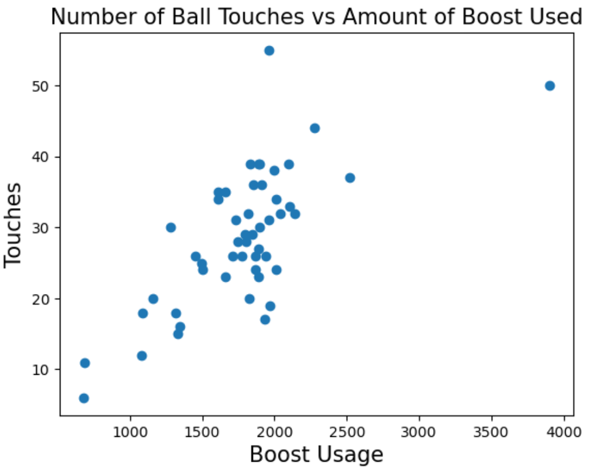

##### (a) Select the correct option that corresponds to the data.

There appears to be a positive association.

There appears to be a negative association.

There is not enough information.

##### (b) Select the correct option that corresponds to the data.

An increase in Boost Usage causes an increase in Touches.

An increase in Boost Usage does not cause an increase in Touches.

There is not enough information.

##### (c) Conan runs some calculations and obtains the following statistics:

- The correlation coefficient between Touches and Boost Usage was approximately 0.705.
- The average number of Touches was 28.54 with a standard deviation of 9.51.
- The average of Boost Usage was 1773.4 with a standard deviation of 471.7.

##### i. Conan touched the ball 40 times in one of his games. What is this in standard units?

ii. Conan wishes to fit a regression line to the data. What would be the slope and intercept of the regression line in original

units?

##### iii. What would the slope and intercept be if the data were in standard units?

Data C8 Spring 2026 Discussion 11 | 4

## Discussion 11 — Solution

### Page 1

### Correlation & Regression

Discussion 11

Data C8: Foundations of Data Science UC Berkeley, Spring 2026

An important aspect of data science is using data to make predictions about the future based on the information that we currently have. A question one might ask would be, “Given a student’s score on the midterm exam, what would we predict their score on the final exam to be?” In order to answer this question, we will investigate a method of using one variable to predict another by looking at the correlation between two variables. 1. Standard Units and Correlation

##### The Correlation Coefficient: The average of the product of 𝑥 and 𝑦 when both are in standard units.

This coefficient is a number between −1 and 1 that measures the strength and direction of the linear relationship between two variables, 𝑥 and 𝑦.

##### (a) When calculating the correlation coefficient, why do we convert data to standard units?

We convert data to standard units in order to compare it with other data that may be of different units and scales. For example, if we wanted to compare the weights of cars (usually thousands of pounds) to the maximum speed of cars (usually tens of miles per hour), converting to standard units allows us to effectively compares the two variables.

Moreover, using standard units gives us the following nice properties: - r is a pure number with no units (because of standardization). - r is unaffected by changing the units on either axis (because of standardization).

- Write a function called convert which takes in an array of elements called xs and returns an array of the values represented

in standard units.

def convert(xs):

sd = ________________________________ mean = ______________________________ return ______________________________

def convert(xs): sd = np.std(xs) mean = np.mean(xs) return (xs - mean) / sd

- Write a function called correlation which takes in a table of data tbl containing the column names x and y and returns

the correlation coefficient.

def correlation(tbl, x, y):

x_su = ____________________________________________________________________________________ y_su = ____________________________________________________________________________________ return ____________________________________________________________________________________

### Page 2

def correlation(tbl, x, y): x_su = convert(tbl.column(x)) y_su = convert(tbl.column(y)) return np.mean(x_su * y_su)

##### Data C8 Spring 2026 Discussion 11 | 2

### Page 3

#### 2. Comparing Correlation

- Look at the following four datasets. Rank them in order from weakest correlation to strongest correlation.

(Weakest) _______________ _______________ _______________ _______________ (Strongest)

##### D, A, B, C.

- D has almost no visible negative or positive trend as it is basically a blob, so its correlation is near 0. - A has a negative correlation, but the points are not very tightly clustered around a straight line, so the strength of its correlation is greater than D but still quite small. - B has a positive correlation, and the points are more tightly clustered around a positive sloping line, so the strength of its correlation is greater than A. - C has a negative correlation, and the points almost perfectly form a straight line. This indicates that the strength of the correlation is very close to 1.

We have introduced correlation as a way of quantifying the strength and direction of a linear relationship between two variables. The correlation coefficient can allow us to define the straight line about which the points are clustered, known as the regression line. In fact, by a remarkable fact in mathematics, the line uniquely defined by the slope and intercept below is always the best possible straight line we could construct.

slope = 𝑟⋅ SD𝑦

intercept = average of 𝑦−slope ⋅average of 𝑥

SD𝑥

##### Regression Line (in original units): estimate of 𝑦= slope ⋅𝑥+ intercept

For every 1 SD increase in 𝑥, the predicted value of 𝑦 increases by 𝑟 SDs of 𝑦.

- Bonus Question: Derive the slope and intercept above using the equation for the regression line in standard units (𝑦SU

represents 𝑦 in standard units)

𝑦SU = 𝑟⋅𝑥SU

Data C8 Spring 2026 Discussion 11 | 3

### Page 4

𝑦SU = 𝑟⋅𝑥SU 𝑦−average of 𝑦

SD of 𝑦 = 𝑟⋅ 𝑥−average of 𝑥

SD of 𝑥

𝑦−average of 𝑦= (𝑟⋅ SD of 𝑦

SD of 𝑥) ⋅(𝑥−average of 𝑥)

𝑦= slope ⋅(𝑥−average of 𝑥) + average of 𝑦

𝑦= slope ⋅𝑥+ (average of 𝑦−slope ⋅average of 𝑥)

𝑦= slope ⋅𝑥+ intercept

Data C8 Spring 2026 Discussion 11 | 4

### Page 5

#### 3. Linear Regressi(OH)n

You just submitted a ticket at Office Hours and would like to know how long it will take to receive help. However, you don’t believe the estimated wait time displayed on the queue to be very accurate, so you decide to make your own predictions based on the total number of students present at OH when you submitted your ticket. You obtain data for 100 wait times and plot them below, also fitting a regression line to the data.

- Suppose that you submit a ticket at Office Hours when there were a total of 20 students present. Based on the regression

line, what would you predict the waiting time to be?

We observe 20 students at Office Hours, so we would want to look at the height of the regression line for 𝑥= 20. Looking at the scatter plot, we see that the regression line roughly passes through the point (20, 14) so we would predict the waiting time to be around 14 minutes.

- You go to Office Hours right before a homework assignment is due, and despite safety concerns, you observe 70 students at

Office Hours. Would it be appropriate to use your regression line to predict the waiting time? Explain.

It would not be appropriate to use the regression line to make a prediction. Most values that were used to construct the regression line were between 𝑥= 0 and 𝑥= 25. Since 𝑥= 70 is far out of that range, we cannot expect the regression line to make a very accurate prediction. Furthermore, since we don’t have data for 𝑥> 30, we are not sure that the linear trend continues for larger values of 𝑥. We must be very careful when extrapolating data past the range we have seen.

- When constructing your regression line, you find the correlation coefficient 𝑟 to be roughly 0.73. Does this value of 𝑟 suggest

that an increase in the number of students at Office Hours causes an increase in the waiting time? Explain.

Correlation does not imply causation! Just looking at the data it is unclear whether we account for confounding factors, and how they might contribute to the overall waiting time. For example, it is definitely possible that varying difficulties in the assignments across tickets affects the overall waiting time.

- Suppose you never generated the scatter plot at the beginning of this section. Knowing only that the value of 𝑟 is roughly

0.73, can you assume that the two variables have a linear association?

- Yes, 𝑟 tells us the strength of a linear association and a high value of 𝑟 always proves that the two variables have a linear association.

- Yes, because if we can compute the value of 𝑟, the two variables must have a linear association.

- No. A high value of 𝑟 does not necessarily imply that the relationship between the variables is linear.

- No, the value of 𝑟 = 0.73 is not high enough to imply a linear association.

For example, a quadratic or exponential relationship between 2 variables can still have a high value of 𝑟. To determine if the relationship between two variables is linear, it is a good idea to plot the data for a visual interpretation as well.

Data C8 Spring 2026 Discussion 11 | 5

### Page 6

#### 4. This is Regression! (Optional)

(This question uses the same data as Question 3 on the Summer 2024 Final Exam) Conan has an unhealthy addiction to Rocket League, a game where players play soccer but with cars instead of people. Players can pick up boost pads that are scattered across the field, which players can use to make their cars go faster! Conan plays 50 games and records how much boost he used, as well as how many times he touched the ball in a given game.

##### (a) Select the correct option that corresponds to the data.

There appears to be a positive association.

There appears to be a negative association.

There is not enough information.

##### (b) Select the correct option that corresponds to the data.

An increase in Boost Usage causes an increase in Touches.

An increase in Boost Usage does not cause an increase in Touches.

There is not enough information.

##### (c) Conan runs some calculations and obtains the following statistics:

- The correlation coefficient between Touches and Boost Usage was approximately 0.705.
- The average number of Touches was 28.54 with a standard deviation of 9.51.
- The average of Boost Usage was 1773.4 with a standard deviation of 471.7.

##### i. Conan touched the ball 40 times in one of his games. What is this in standard units?

40 −28.54 9.51 ≈1.2

ii. Conan wishes to fit a regression line to the data. What would be the slope and intercept of the regression line in original

units?

slope = 𝑟⋅ SD of touches SD of boost usage = 0.705 ⋅( 9.51

471.7) ≈0.0142

intercept = average of touches −slope ⋅average of boost usage = 28.54 −0.0142 ⋅1773.4 ≈3.36

##### iii. What would the slope and intercept be if the data were in standard units?

Data C8 Spring 2026 Discussion 11 | 6

### Page 7

slope = 𝑟⋅ SD of touches (SU) SD of boost usage (SU) = 0.705 ⋅(1

1. = 0.705

intercept = average of touches (SU) −slope ⋅average of boost usage (SU) = 0 −0.705 ⋅0 = 0

When in standard units, the slope of the regression line is always 𝑟, and the intercept is always zero.

Data C8 Spring 2026 Discussion 11 | 7

## Discussion 12 — Student

### Page 1

### Residuals

Discussion 12

Data C8: Foundations of Data Science UC Berkeley, Spring 2026

In data science, we can use linear regression in order to make predictions. When making predictions, it is also important to assess the accuracy of our predictions. To do so, we can examine the error between our actual data and the predictions; these errors are called residuals.

An example can be found below in the graph of miles per gallon (mpg) compared to the acceleration of a car. The left scatter plot shows the original data with a regression line fitted to it, and the right plot shows the corresponding residuals.

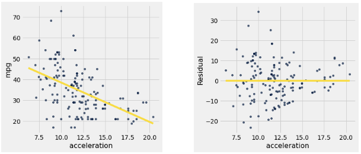

Key facts: - residual = actual value of 𝑦−predicted value of 𝑦 - When we perform linear regression with an intercept, the sum of the residuals will always be equal to 0. - In a well-fitted linear regression, the residual plot shows no pattern, and the residuals sum to 0. - When a residual plot shows a pattern, there may be a non-linear relation between the variables. - If the residual plot shows uneven variation about the horizontal line at 0, the regression estimates are not equally accurate across the range of the predictor variable. This is known as heteroscedasticity.

#### 1. Visual Diagnostic

Displayed below are three residual plots. For which of the following residual plots is using linear regression a reasonable idea, and why? What might the original graphs have looked like?

### Page 2

#### 2. Fight for California!

At a Cal football game the Mic Men, who are spirit leaders, claimed that our opponent’s ability to score was linearly affected by the student section’s noise level. Noah thinks they are wrong. Instead, he believes there is no linear relationship between student section noise and opponents’ scores. A friend gives Noah a table called noise which contains the following information:

- Opponent (string): Cal’s opponent for the game. - Loudness (int): Each row represents the maximum noise in decibels produced by the Student Section when Cal is on defense during a single home football game. - Points (int): The number of points scored by the opposing team.

A sample of the table with data from the 2024 season is below:

##### Opponent Loudness Points

UC Davis 65 13

Auburn 55 14

San Diego St 75 10

Miami FL 85 39

Pittsburgh 70 17

Stanford 120 21

NC State 100 24

- Noah thinks that there is no correlation between Loudness and Points and that the Mic Men’s claim is wrong. How can Noah

test his hypothesis?

##### Null Hypothesis:

##### Alternative Hypothesis:

##### Testing Method:

- Noah decides to write a function which produces one bootstrapped estimate of the correlation between Loudness and Points.

Define the one_relationship function below which takes in the following arguments:

- tbl (Table): a table that contains a sample and has the same columns as noise.
- x_col (string): the column name for the 𝑥 variable.
- y_col (string): the column name for the 𝑦 variable.

The function should return one bootstrapped estimate of the correlation coefficient 𝑟. You can assume that you have access to the function correlation(x, y), which returns the correlation between arrays 𝑥 and 𝑦.

def one_relationship(tbl, x_col, y_col):

bootstrap = ______________________________________________

x_values = ______________________________________________

y_values = ______________________________________________

return ______________________________________________

Data C8 Spring 2026 Discussion 12 | 2

### Page 3

- Noah decides to generate a 70% confidence interval for the true correlation between Loudness and Points using 1000 bootstrap

resamples. Fill in the following code to generate the interval.

______________________________________________________

for i in ______________________________________________________:

______________________________________________________

______________________________________________________

lower_bound = ______________________________________________________

upper_bound = ______________________________________________________

ci = make_array(lower_bound, upper_bound)

- Noah enjoys chaos so he decides to swap the x_col and y_col arguments each time he makes a call to one_relationship

inside his for loop. Will this impact his interval?

Yes

No

- After running the above code Noah gets an interval of [−0.75, −0.14]. Therefore, we _______________________________

the null hypothesis using a p-value cutoff of _______________________________.

- Regardless, Cal Athletics wants you to generate a line of best fit for your data. Should you use the method of least squares

(i.e., minimizing RMSE) or the regression equations? Is there a difference between the two?

Regression Equations

Least Squares

No Difference

Data C8 Spring 2026 Discussion 12 | 3

### Page 4

#### 3. Rogue Residuals

Each of the following plots is a residual plot from an attempted linear regression of a variable 𝑦 on a variable 𝑥. For each one, indicate whether the regression line seems to be a good fit, a bad fit, or if it is invalid for a well-fit regression.

##### (a) Residual Plot 1

##### (b) Residual Plot 2

The regression seems to fit the data well.

The regression seems to fit the data well.

##### The regression does not seem to fit well.

##### The regression does not seem to fit well.

The residual plot is invalid.

The residual plot is invalid.

##### (c) Residual Plot 3

##### (d) Residual Plot 4

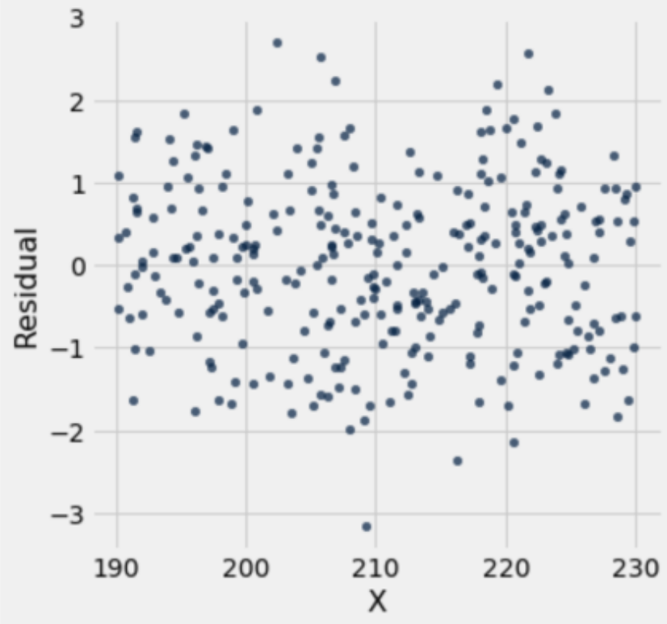

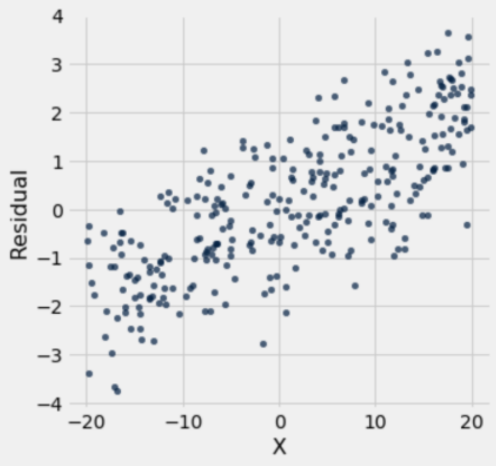

The regression seems to fit the data well.

The regression seems to fit the data well.

##### The regression does not seem to fit well.

##### The regression does not seem to fit well.

The residual plot is invalid.

The residual plot is invalid.

Data C8 Spring 2026 Discussion 12 | 4

## Discussion 12 — Solution

### Page 1

### Residuals

Discussion 12

Data C8: Foundations of Data Science UC Berkeley, Spring 2026

In data science, we can use linear regression in order to make predictions. When making predictions, it is also important to assess the accuracy of our predictions. To do so, we can examine the error between our actual data and the predictions; these errors are called residuals.

An example can be found below in the graph of miles per gallon (mpg) compared to the acceleration of a car. The left scatter plot shows the original data with a regression line fitted to it, and the right plot shows the corresponding residuals.

Key facts: - residual = actual value of 𝑦−predicted value of 𝑦 - When we perform linear regression with an intercept, the sum of the residuals will always be equal to 0. - In a well-fitted linear regression, the residual plot shows no pattern, and the residuals sum to 0. - When a residual plot shows a pattern, there may be a non-linear relation between the variables. - If the residual plot shows uneven variation about the horizontal line at 0, the regression estimates are not equally accurate across the range of the predictor variable. This is known as heteroscedasticity.

#### 1. Visual Diagnostic

Displayed below are three residual plots. For which of the following residual plots is using linear regression a reasonable idea, and why? What might the original graphs have looked like?

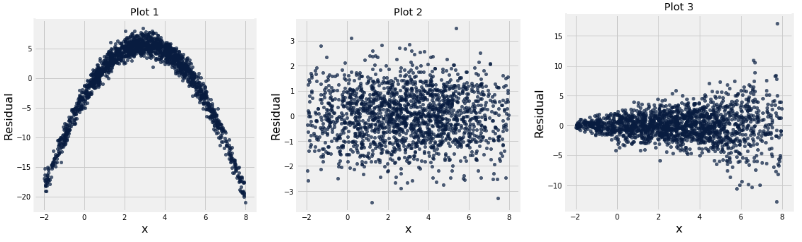

### Page 2

Plot 1 exhibits a clearly non-linear pattern which tells us that using linear regression is inappropriate.

Plot 2 is the best residual plot to use linear regression for, since the residuals have the pattern of a formless cloud. Plot 2 satisfies the two things that we are looking for: - The sum of the residuals add up to zero - There is no observable trend or pattern in the residuals.

Using linear regression for Plot 3 is a mixed bag, as the data still seems to follow a linear pattern but the residual plot is heteroscedastic, meaning the residuals are more spread out for different values of 𝑥. One consequence of heteroscedasticity is that our predictions will be less accurate, and although there are ways of combating heteroscedasticity, directly applying linear regression to the sample would not be appropriate.

Here are the original graphs:

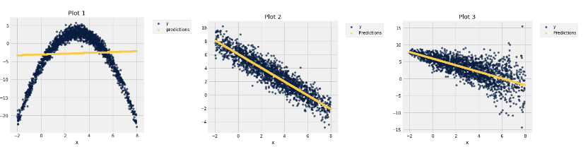

Data C8 Spring 2026 Discussion 12 | 2

### Page 3

#### 2. Fight for California!

At a Cal football game the Mic Men, who are spirit leaders, claimed that our opponent’s ability to score was linearly affected by the student section’s noise level. Noah thinks they are wrong. Instead, he believes there is no linear relationship between student section noise and opponents’ scores. A friend gives Noah a table called noise which contains the following information:

- Opponent (string): Cal’s opponent for the game. - Loudness (int): Each row represents the maximum noise in decibels produced by the Student Section when Cal is on defense during a single home football game. - Points (int): The number of points scored by the opposing team.

A sample of the table with data from the 2024 season is below:

##### Opponent Loudness Points

UC Davis 65 13

Auburn 55 14

San Diego St 75 10

Miami FL 85 39

Pittsburgh 70 17

Stanford 120 21

NC State 100 24

- Noah thinks that there is no correlation between Loudness and Points and that the Mic Men’s claim is wrong. How can Noah

test his hypothesis?

##### Null Hypothesis:

##### Alternative Hypothesis:

##### Testing Method:

Null Hypothesis: There is no linear association between Loudness and Points. The true correlation is 0. The non-zero correlation observed in the sample is simply due to chance.

Alternative Hypothesis: There is a linear association between Loudness and Points. The true correlation is non-zero (there is some linear relationship between the two variables). The non-zero correlation observed in the sample is not simply due to chance.

Testing Method: We are essentially trying to estimate the true value of 𝑟. Therefore, we can bootstrap the sample repeatedly, generate a confidence interval for 𝑟, and check to see if zero is included in the confidence interval.

- Noah decides to write a function which produces one bootstrapped estimate of the correlation between Loudness and Points.

Define the one_relationship function below which takes in the following arguments:

- tbl (Table): a table that contains a sample and has the same columns as noise.
- x_col (string): the column name for the 𝑥 variable.
- y_col (string): the column name for the 𝑦 variable.

The function should return one bootstrapped estimate of the correlation coefficient 𝑟. You can assume that you have access to the function correlation(x, y), which returns the correlation between arrays 𝑥 and 𝑦.

def one_relationship(tbl, x_col, y_col):

bootstrap = ______________________________________________

Data C8 Spring 2026 Discussion 12 | 3

### Page 4

x_values = ______________________________________________

y_values = ______________________________________________

return ______________________________________________

def one_relationship(tbl, x_col, y_col): bootstrap = tbl.sample() x_values = bootstrap.column(x_col) y_values = bootstrap.column(y_col) return correlation(x_values, y_values)

##### Data C8 Spring 2026 Discussion 12 | 4

### Page 5

- Noah decides to generate a 70% confidence interval for the true correlation between Loudness and Points using 1000 bootstrap

resamples. Fill in the following code to generate the interval.

______________________________________________________

for i in ______________________________________________________:

______________________________________________________

______________________________________________________

lower_bound = ______________________________________________________

upper_bound = ______________________________________________________

ci = make_array(lower_bound, upper_bound)

correlations = make_array()

for i in np.arange(1000): bootstrapped_corr = one_relationship(noise, "Loudness", "Points") correlations = np.append(correlations, bootstrapped_corr)

lower_bound = percentile(15, correlations) upper_bound = percentile(85, correlations) ci = make_array(lower_bound, upper_bound)

- Noah enjoys chaos so he decides to swap the x_col and y_col arguments each time he makes a call to one_relationship

inside his for loop. Will this impact his interval?

Yes

No

Correlation does not change if you change which variable is on each axis. Therefore, Noah can swap the axes and the interval will still be generated correctly, although it will likely be a little different since the process is random!

- After running the above code Noah gets an interval of [−0.75, −0.14]. Therefore, we _______________________________

the null hypothesis using a p-value cutoff of _______________________________.

We reject the null hypothesis because 0 is outside of the confidence interval for the true correlation. Since the interval is a 70% confidence interval, we are using a p-value cutoff of 30%.

- Regardless, Cal Athletics wants you to generate a line of best fit for your data. Should you use the method of least squares

(i.e., minimizing RMSE) or the regression equations? Is there a difference between the two?

Regression Equations

Least Squares

No Difference

It does not matter which method you use; they both result in the same line. This also means that the regression equations give you the unique line that minimizes the RMSE!

Data C8 Spring 2026 Discussion 12 | 5

### Page 6

#### 3. Rogue Residuals

Each of the following plots is a residual plot from an attempted linear regression of a variable 𝑦 on a variable 𝑥. For each one, indicate whether the regression line seems to be a good fit, a bad fit, or if it is invalid for a well-fit regression.

##### (a) Residual Plot 1

##### (b) Residual Plot 2

The regression seems to fit the data well.

The regression seems to fit the data well.

##### The regression does not seem to fit well.

##### The regression does not seem to fit well.

The residual plot is invalid.

The residual plot is invalid.

Invalid residual plot, since the sum of residuals is not equal to 0. Though this is an invalid residual plot, as in it would never exist with a well-fit regression, it is still appropriate to conclude the underlying data is appropriate for regres­ sion.

Parabolic shape in the residual plot, therefore linear regres­ sion is not appropriate. Regression therefore does not fit the data well.

##### (c) Residual Plot 3

##### (d) Residual Plot 4

The regression seems to fit the data well.

The regression seems to fit the data well.

##### The regression does not seem to fit well.

##### The regression does not seem to fit well.

The residual plot is invalid.

The residual plot is invalid.

No visible pattern in the residual plot and the residuals seem to sum to 0, so the regression fits well.

The regression line tends to overestimate for 𝑥< −10 and underestimate for 𝑥> 10. We can change the slope to produce a better regression line, which shouldn’t be possible because the regression line minimizes RMSE! This is an invalid residual plot, but the underlying relationship is still linear, as we see a linear trend in the residuals.

Data C8 Spring 2026 Discussion 12 | 6

## Discussion 13 — Student

### Page 1

### Intervals for Predictions & kNN Classification

Discussion 13

Data C8: Foundations of Data Science UC Berkeley, Spring 2026

#### 1. Confidence Intervals for Predictions

Anirra is looking to buy a new laptop for her birthday. She has a table laptops with information on different laptops with two columns:

- price (float): the price of the laptop in US dollars.
- battery life (float): the battery life of the laptop in hours.

- Inspect the following scatter plot and residual plot of Anirra’s data. Would using linear regression be appropriate for this

dataset?

- Anirra wants to use a regression line to predict the battery life of a laptop given the price. Define the fitted_value function

below which takes in the following arguments:

- tbl (Table): a table with the data points used to generate the regression line.
- x (string): the column name for the x variable.
- y (string): the column name for the y variable.
- x_val (float): the x value we want to make a prediction at.

The function should return a float by using a regression line to predict a y-value for the given x-value. Assume the slope(tbl,

x, y) and intercept(tbl, x, y) functions are defined as in lecture.

def fitted_value(tbl, x, y, x_val):

m = ______________________________________________

b = ______________________________________________

__________________________________________________

### Page 2

- Assume the average price of a laptop in Anirra’s dataset is $1,000. Anirra generates 90% confidence intervals for the predicted

battery life of laptops priced at $1,100 and $700.

##### i. Which one of these two intervals do we expect to be wider? Why?

ii. Does the answer to the previous part change if we used a different confidence level? Why or why not?

- Anirra believes that a laptop with a price of $1,300 should have a battery life of 14 hours. Complete the following code to

test her hypothesis with a 4% p-value cutoff. Assume Anirra has properly simulated 1,000 predicted battery lives for a laptop with price $1,300 and stored them in the array called predictions.

left = __________________________________________

right = _________________________________________

if _____________________________________________:

print("Fail to reject the null") else:

print(_____________________________________________)

- For this question, assume we have a similar dataset to before, also well suited for linear regression but with a range of prices

between $0 and $1500. You find the correlation between price and battery life to be 𝑟= 0.8.

- A 90% confidence interval for predictions of a laptop with price $0 will have nearly the same lower and upper bounds

as a 90% confidence interval for the true intercept of the regression line in original units.

True

False

ii. A 90% confidence interval for predictions of a laptop with price 1 in standard units will have nearly the same lower and

upper bounds (in standard units) as a 90% confidence interval for the true correlation.

True

False

iii. If we constructed one hundred 90% confidence intervals for predictions and one hundred 95% intervals for the battery

life of a laptop with price $950, we expect less of the 95% confidence intervals to contain the true battery life of a laptop with price $950 than the 90% confidence intervals.

True

False

Data C8 Spring 2026 Discussion 13 | 2

### Page 3

#### 2. kNN Classifier

Significant research has been done to understand whether a breast tumor is benign (not cancerous) or malignant (cancerous). Dagny wants to create a classifier that predicts whether a tumor is benign or not.

- Dagny wants to classify a new tumor (represented as a triangle in the scatter plot). Describe the steps she would take to

classify this new point based on a k-nearest neighbors classifier with k = 5.

- Draw the decision boundary that the k-nearest neighbors algorithm (with k = 5) would generate for this problem.

Data C8 Spring 2026 Discussion 13 | 3

### Page 4

- Brandon suggests that Dagny should use a different k for her classifier like 𝑘= 4 or 𝑘= 8. Is Brandon’s suggestion

reasonable?

- Suppose Dagny obtains a training set of labeled tumors and builds a nearest neighbor classifier with 𝑘= 1. She then applies

the classifier to predict the class of each point in the same training set. She notices something interesting about the results. What might she observe and why?

- Suppose Dagny obtains a test set consisting of 50 data points. Should she repeatedly use her classifier on the test set, using

various values of 𝑘, to obtain the value of 𝑘 that yields the greatest accuracy? Explain.

- Suppose in our breast tumor training dataset we have 60 benign = 0 data points and 150 benign = 1 data points. For what

values of 𝑘 would we always predict the same class?

- Marissa suggests that we use a constant classifier which will always predict the class that is most common in the training

set. In our test set, there are 15 benign = 0 data points and 35 benign = 1 data points. What will the accuracy of the constant classifier be on our test set?

- Aside from the proportion of correct classifications, what are some other metrics we might want to consider in measuring

the quality of our predictions?

Data C8 Spring 2026 Discussion 13 | 4

## Discussion 13 — Solution

### Page 1

### Intervals for Predictions & kNN Classification

Discussion 13

Data C8: Foundations of Data Science UC Berkeley, Spring 2026

#### 1. Confidence Intervals for Predictions

Anirra is looking to buy a new laptop for her birthday. She has a table laptops with information on different laptops with two columns:

- price (float): the price of the laptop in US dollars.
- battery life (float): the battery life of the laptop in hours.

- Inspect the following scatter plot and residual plot of Anirra’s data. Would using linear regression be appropriate for this

dataset?

Yes. The scatter plot exhibits a roughly linear relationship. The residual plot does not show any trend or pattern, and the residuals seem to add up to 0.

- Anirra wants to use a regression line to predict the battery life of a laptop given the price. Define the fitted_value function

below which takes in the following arguments:

- tbl (Table): a table with the data points used to generate the regression line.
- x (string): the column name for the x variable.
- y (string): the column name for the y variable.
- x_val (float): the x value we want to make a prediction at.

The function should return a float by using a regression line to predict a y-value for the given x-value. Assume the slope(tbl,

x, y) and intercept(tbl, x, y) functions are defined as in lecture.

def fitted_value(tbl, x, y, x_val):

m = ______________________________________________

b = ______________________________________________

__________________________________________________

### Page 2

def fitted_value(tbl, x, y, x_val): m = slope(tbl, x, y) b = intercept(tbl, x, y) return m * x_val + b

- Assume the average price of a laptop in Anirra’s dataset is $1,000. Anirra generates 90% confidence intervals for the predicted

battery life of laptops priced at $1,100 and $700.

##### i. Which one of these two intervals do we expect to be wider? Why?

The interval for laptops priced at $700 is wider. This is because $700 is further from the mean of $1,000. The further the 𝑥 value is from the mean 𝑥 value, the wider our interval is. See section 16.3 of the textbook for more details!

ii. Does the answer to the previous part change if we used a different confidence level? Why or why not?

Our answer does not change. If we use a different confidence level, both the interval at $1,100 and $700 will change in width, but the $700 interval will always be wider. The confidence level we use doesn’t impact the reasoning we used in part (i).

- Anirra believes that a laptop with a price of $1,300 should have a battery life of 14 hours. Complete the following code to

test her hypothesis with a 4% p-value cutoff. Assume Anirra has properly simulated 1,000 predicted battery lives for a laptop with price $1,300 and stored them in the array called predictions.

left = __________________________________________

right = _________________________________________

if _____________________________________________:

print("Fail to reject the null") else:

print(_____________________________________________)

left = percentile(2, predictions) right = percentile(98, predictions) if left <= 14 <= right: print("Fail to reject the null hypothesis") else: print("Reject the null hypothesis")

- For this question, assume we have a similar dataset to before, also well suited for linear regression but with a range of prices

between $0 and $1500. You find the correlation between price and battery life to be 𝑟= 0.8.

- A 90% confidence interval for predictions of a laptop with price $0 will have nearly the same lower and upper bounds

as a 90% confidence interval for the true intercept of the regression line in original units.

True

False

True. Computing the interval at a given x of 0 is the same as computing the confidence interval for the y-intercept. If our line of best fit is 𝑦= 𝑚∗𝑥+ 𝑏, then for a given 𝑥 of 0, the equation becomes 𝑦= 𝑏, which is just the intercept.

ii. A 90% confidence interval for predictions of a laptop with price 1 in standard units will have nearly the same lower and

upper bounds (in standard units) as a 90% confidence interval for the true correlation.

True

False

Data C8 Spring 2026 Discussion 13 | 2

### Page 3

True. In standard units, the line of best fit is 𝑦= 𝑟∗𝑥. If our given 𝑥 value is 1, then the equation becomes 𝑦= 𝑟, which is just the correlation coefficient.

iii. If we constructed one hundred 90% confidence intervals for predictions and one hundred 95% intervals for the battery

life of a laptop with price $950, we expect less of the 95% confidence intervals to contain the true battery life of a laptop with price $950 than the 90% confidence intervals.

True

False

False. Each 95% interval that we plan to generate has a 95% chance of containing the true prediction, while each 90% interval only has a 90% chance. We would expect 90 of the 90% confidence intervals to contain the true battery life and 95 of the 95% confidence intervals to contain the true battery life.

Data C8 Spring 2026 Discussion 13 | 3

### Page 4

#### 2. kNN Classifier

Significant research has been done to understand whether a breast tumor is benign (not cancerous) or malignant (cancerous). Dagny wants to create a classifier that predicts whether a tumor is benign or not.

- Dagny wants to classify a new tumor (represented as a triangle in the scatter plot). Describe the steps she would take to

classify this new point based on a k-nearest neighbors classifier with k = 5.

- Convert the data to standard units so that Mean Area and Mean Compactness are on the same scale
- Compute the Euclidean distance between the new point and all the points in our dataset in standard units.
- Sort all the data in increasing order based on the calculated distance.
- Take the top 5 neighbors and take a majority vote.

##### In this particular case we can eyeball that the new point should be classified as benign = 1.

- Draw the decision boundary that the k-nearest neighbors algorithm (with k = 5) would generate for this problem.

Data C8 Spring 2026 Discussion 13 | 4

### Page 5

A decision boundary is the plane, curve, or line that separates the classification of one class from another. It is a boundary such that if a new point falls on the one side of the boundary, it will be classified as 0, and if it falls on the other side of the boundary, it will be classified as 1.

For areas where the split is not so well defined, trying moving an imaginary point across the plot and see when you would change your decision on what to classify the imaginary point as!

- Brandon suggests that Dagny should use a different k for her classifier like 𝑘= 4 or 𝑘= 8. Is Brandon’s suggestion

reasonable?

Not really. If we choose k to be even, we risk the danger that both classes will get the same number of votes. In that case, it would be unclear how we should decide to classify the new point.

- Suppose Dagny obtains a training set of labeled tumors and builds a nearest neighbor classifier with 𝑘= 1. She then applies

the classifier to predict the class of each point in the same training set. She notices something interesting about the results. What might she observe and why?

If we use our training set to “test” our 1-nearest neighbor classifier, the classifier will pass the test 100% of the time! Each point is its own nearest neighbors. But this gives a misleading impression of how well the classifier will perform on new data. As a result, we should not use the training set to test a classifier that is based on it.

- Suppose Dagny obtains a test set consisting of 50 data points. Should she repeatedly use her classifier on the test set, using

various values of 𝑘, to obtain the value of 𝑘 that yields the greatest accuracy? Explain.

The role of the test set is to have a way of understanding how well our classifier would perform in a real-world scenario with unseen data. It is important we only run our algorithm on the test data once after we are done selecting the value of k to use. Using the test set repeatedly to find the value of k that performs best can be very dangerous, as that can lead to overfitting! The classifier obtained using this process may perform well on the test set, but may do poorly on other unseen data.

Note that when we say to only run our algorithm on the test data “once“, this is referring to not changing aspects of the model (i.e., what our value of k is) after seeing how it currently performs on test data. If you were to choose “the best k” for the test data based on trial and error, this would defeat the purpose of using it as a way to evaluate how your model may do on real-world data (as we cherry-picked the best result). If you were to just re-run the Jupyter cell that tests the model on the test set though, this would be fine (in our case, you would just get the same result every time).

In this course though, we will not go into detail as to how to choose an optimal k value. For those who are curious, I encourage you to look up “validation set”!

Data C8 Spring 2026 Discussion 13 | 5

### Page 6

- Suppose in our breast tumor training dataset we have 60 benign = 0 data points and 150 benign = 1 data points. For what

values of 𝑘 would we always predict the same class?

Using overly large values of k will result in issues such as always predicting the same value. In this example, any k greater than or equal to 121 will always predict benign = 1 no matter what.

- Marissa suggests that we use a constant classifier which will always predict the class that is most common in the training

set. In our test set, there are 15 benign = 0 data points and 35 benign = 1 data points. What will the accuracy of the constant classifier be on our test set?

35 50 or 70%

Our constant classifier will always predict benign = 1 since it is more common in the training dataset, and the proportion of benign = 1 points in our test set is 35/50.

- Aside from the proportion of correct classifications, what are some other metrics we might want to consider in measuring

the quality of our predictions?

We might look into the relationship of the false positive/false negative rates. In different contexts, one of these types of errors might be more important than the other (e.g., in this example, we will want to consider if it is better to falsely classify a tumor as malignant when it is actually benign, or falsely classify it as benign when it is actually malignant), so it could be advantageous to tune our model to prefer one over the other. We will not dive deeply into this, but you’ll cover similar topics in Data 100!

Data C8 Spring 2026 Discussion 13 | 6

## Discussion 14 — Student

### Page 1

### Bayes & More Classification

Discussion 14

Data C8: Foundations of Data Science UC Berkeley, Spring 2026

#### 1. Thomas' Bays

Thomas is an avid consumer of fish and is interested in finding ethically sourced fish to eat from 3 local bays near him. He researches online and finds the following information:

- Out of all fish, 20% of fish come from Labor Bay, 45% of fish come from Obi-Wan Keno Bay, and 35% come from Spelling Bay.
- In these three bays, there are only 2 types of fish: salmon and tuna.
- In Labor Bay, 37% of the fish are salmon.
- In Obi-Wan Keno Bay, 40% of the fish are tuna.
- In Spelling Bay, 42% of the fish are salmon.

##### (a) Draw a tree diagram to represent the result of Thomas’ research.

- Thomas is shopping for a fish at random. What is the chance he picks a tuna from Obi-Wan Keno Bay?

##### (c) Thomas chooses a fish at random.

##### i. What is the probability that the fish is a salmon?

##### ii. What is the probability that it is a tuna?

##### (d) Thomas ends up buying a salmon. What is the probability the salmon came from Spelling Bay?

- Thomas buys 10 fish at random. What is the probability that at least one of them is a salmon from Spelling Bay?

### Page 2

#### 2. Blackboard Erasers

(Fall 2020 Final, Q3)

Mr. White is a teaching Chemistry class in Latimer Hall. His class has 100 undergraduate staff (uGSIs, tutors, etc.). Mr. White learns that one of his staff is stealing blackboard erasers from his lecture hall when the building is closed overnight. The only way the thief could access the building overnight is with a key card that belongs to them.

Suppose Mr. White discovers that 10 of his staff have a key card.

- If Mr. White randomly selects one of his staff, what is the probability that they are the eraser thief?

- If Mr. White randomly selects one of his staff, what is the probability that they are not the eraser thief and has a key card?

- At the next course staff meeting, Mr. White notices that one of his GSIs, Gus, has a key card sticking out of his wallet. Given

this information, what is the probability that Gus is the eraser thief?

- Mr. White is skeptical of his head GSI, Jesse. Prior to learning any information about Jesse’s key card access, Mr. White

believes there is a 25% probability that Jesse is the eraser thief.

Suppose Mr. White later discovers that Jesse has a key card. Given this new information, what is the probability that Jesse is the eraser thief?

Data C8 Spring 2026 Discussion 14 | 2

### Page 3

#### 3. Text Classification

##### (a) The attributes in a word embedding represent

The frequency of the word's occurence in the text

Synonymous words

The definition of the word

None of the above

- Due to the importance of grammar and context in determining the meaning of text, it is more effective to embed

Entire sentences

Individual words

##### (c) A neural network is

Any classification method modeled after the human brain

An algorithm that classifies a point based on the majority class of its nearest neighbors

Organized combinations of simple operations that can generate text embeddings from words

#### 4. Don’t rain on my Glade!

(Spring 2025 Final, Q3)

Marissa loves visiting the campus Glade at 4pm to relax after a long day of class, but wants to make sure the weather is nice ahead of time. She has access to a table called weather which contains historical information on the weather in Berkeley, California at 4pm for the past 10,000 days. A three-row sample from the table lies below.

- Precip (integer): precipitation; the percent chance of receiving at least 0.01 inches of rain. - Humid (integer): relative humidity; the percentage of possible water vapor that can exist in the air at the air’s current temperature. - Cond (string): weather conditions; the state of the weather (one of Rainy, Cloudy or Sunny).

##### Precip Humid Cond

82 73 Rainy

71 96 Cloudy

16 94 Sunny

... (9997 rows omitted)

- Marissa would like to use the weather table to build a predictive model for the weather conditions of an upcoming Berkeley

afternoon (Rainy, Cloudy or Sunny). What type of prediction problem is Marissa working on?

Regression Classification

- Complete the following code so that the weather table is split into two tables: one called training_set and one called

testing_set. The first eighty percent of the data in shuffled_table should be allocated to training_set.

shuffled_table = weather.sample(__________________________________________)

training_set = shuffled_table.________________(______________________________________)

testing_set = shuffled_table.________________(______________________________________)

- Marissa decides to use the k-nearest neighbors prediction algorithm. Which of the following formulae correctly computes a

distance between a new observation (new) and a training point (train)?

Data C8 Spring 2026 Discussion 14 | 3

### Page 4

√(Precipnew −Preciptrain)2 + (Humidnew −Humidtrain)2 + (Condnew −Condtrain)2

√(Precipnew −Preciptrain) + (Humidnew −Humidtrain) + (Condnew −Condtrain)

√(Precipnew −Preciptrain)2 + (Humidnew −Humidtrain)2

√(Precipnew −Humidnew)2 + (Preciptrain −Humidtrain)2

√(Precipnew −Preciptrain) + (Humidnew −Humidtrain)

√(Precipnew −Humidnew) + (Preciptrain −Humidtrain)

- Before finding the k-nearest neighbors to a new observation, Marissa will first need to compute the distance between the

new observation and every point in the training set. Which of the following table methods or coding techniques can be used to compute these distances? Select all that apply.

group Iteration

join apply

Conditional statements pivot

- Marissa computes the distance between her new observation and each training point, and then creates a new version of the

training_set table that includes these distances as an additional column called “Distance”. Below is a three row excerpt from the updated table.

##### Precip Humid Cond Distance

82 73 Rainy 5

71 96 Cloudy 2

16 94 Sunny 12

... (7997 rows omitted)

Fill in the skeleton code below to classify the new observation using the k-nearest neighbors prediction algorithm where k = 7.

nearest_nbrs = training_set.____________________________(____________________________)

.____________________________(__________________________________________)

neighbor_votes = nearest_nbrs.____________________________(____________________________)

.sort(__________________________________________)

majority_class = neighbor_votes.column("Cond").item(0)

- Marissa’s friend, Ishani, wonders if k = 7 offers the best predictive performance, and wants to try out a few different values

of k before finalizing the k-nearest neighbors prediction model. Ishani’s plan is to try out different values of k and choose the one which performs best on the testing set. Does this method make appropriate use of the testing set?

Data C8 Spring 2026 Discussion 14 | 4

## Discussion 14 — Solution

### Page 1

### Bayes & More Classification

Discussion 14

Data C8: Foundations of Data Science UC Berkeley, Spring 2026

#### 1. Thomas' Bays

Thomas is an avid consumer of fish and is interested in finding ethically sourced fish to eat from 3 local bays near him. He researches online and finds the following information:

- Out of all fish, 20% of fish come from Labor Bay, 45% of fish come from Obi-Wan Keno Bay, and 35% come from Spelling Bay.
- In these three bays, there are only 2 types of fish: salmon and tuna.
- In Labor Bay, 37% of the fish are salmon.
- In Obi-Wan Keno Bay, 40% of the fish are tuna.
- In Spelling Bay, 42% of the fish are salmon.

##### (a) Draw a tree diagram to represent the result of Thomas’ research.

0.37

Salmon

Labor

Tuna

0.63

0.2

0.6

Salmon

0.45

Obi-Wan Keno

Tuna

0.4

0.35

0.42

Salmon

Spelling

Tuna

0.58

- Thomas is shopping for a fish at random. What is the chance he picks a tuna from Obi-Wan Keno Bay?

ℙ[Tuna and Obi-Wan Keno Bay] = ℙ[Tuna | OWK] ⋅ℙ[OWK] = 0.4 ⋅0.45

##### (c) Thomas chooses a fish at random.

##### i. What is the probability that the fish is a salmon?

ℙ[Salmon] = 0.2 ⋅0.37 + 0.45 ⋅0.6 + 0.35 ⋅0.42 = 0.491

##### ii. What is the probability that it is a tuna?

ℙ[Tuna] = 0.2 ⋅0.63 + 0.45 ⋅0.4 + 0.35 ⋅0.58 = 0.509

##### or we can compute the complement of the part (i) which gives

ℙ[Tuna] = 1 −ℙ[Salmon] = 0.509

##### (d) Thomas ends up buying a salmon. What is the probability the salmon came from Spelling Bay?

### Page 2

ℙ[Spelling Bay | Salmon] = ℙ[Spelling Bay and Salmon]

ℙ[Salmon]

= 0.35 ⋅0.42 0.2 ⋅0.37 + 0.45 ⋅0.6 + 0.35 ⋅0.42

- Thomas buys 10 fish at random. What is the probability that at least one of them is a salmon from Spelling Bay?

We can apply the complement rule here.

ℙ[Salmon from Spelling Bay] = 0.35 ⋅0.42

⟹ℙ[Salmon not from Spelling Bay] = 1 −(0.35 ⋅0.42)

ℙ[Salmon not from Spelling Bay for all 10 times] = ℙ[Salmon not from Spelling Bay]10 = (1 −0.35 ⋅0.42)10

⟹ℙ[at least one Salmon from Spelling Bay] = 1 − (1 −0.35 ⋅0.42)10

#### 2. Blackboard Erasers

(Fall 2020 Final, Q3)

Mr. White is a teaching Chemistry class in Latimer Hall. His class has 100 undergraduate staff (uGSIs, tutors, etc.). Mr. White learns that one of his staff is stealing blackboard erasers from his lecture hall when the building is closed overnight. The only way the thief could access the building overnight is with a key card that belongs to them.

Suppose Mr. White discovers that 10 of his staff have a key card.

- If Mr. White randomly selects one of his staff, what is the probability that they are the eraser thief?

0.01. Mr. White has 100 staff members, and 1 is a thief, so 1 100 = 0.01

- If Mr. White randomly selects one of his staff, what is the probability that they are not the eraser thief and has a key card?

0.99 ⋅ 9 1. 99 out of 100 staff are not the thief. Since the thief must have the key card as well, we account for that probability.

ℙ[not eraser thief and has key card] = ℙ[has key card | not eraser thief] ⋅ℙ[not eraser thief] = 9 99 ⋅ 0.99

- At the next course staff meeting, Mr. White notices that one of his GSIs, Gus, has a key card sticking out of his wallet. Given

this information, what is the probability that Gus is the eraser thief?

Data C8 Spring 2026 Discussion 14 | 2

### Page 3

We want to compute ℙ[Gus is the thief | Gus has a key card] using Bayes, since the provided information was that Gus has a key card.

ℙ[Gus is the thief | Gus has a key card] = ℙ[Gus has a key card | Gus is the thief] ⋅ℙ[Gus is a thief]

ℙ[Gus has a key card]

= 1 ⋅0.01 ℙ[Gus has a key card]

The probability that Gus has a key card can be broken into two probabilities by complement rule - Gus is the thief and has a key card - Gus is not the thief and has a key card

Therefore we have

ℙ[Gus has a key card] = 0.01 + 0.99 ⋅ 9

99

and so the final answer is computed as

ℙ[Gus is the thief | Gus has a key card] = 1 ⋅0.01 0.01 ⋅1 + 0.99 ⋅ 9 99

- Mr. White is skeptical of his head GSI, Jesse. Prior to learning any information about Jesse’s key card access, Mr. White

believes there is a 25% probability that Jesse is the eraser thief.

Suppose Mr. White later discovers that Jesse has a key card. Given this new information, what is the probability that Jesse is the eraser thief?

The prior is ℙ[Jesse is the thief] = 0.25 and we want to compute ℙ[Jesse is the thief | Jesse has a key card].

Like above, we compute this with Bayes, except that we now have an updated prior,

ℙ[Jesse has a key card | Jesse is the thief] ⋅ℙ[Jesse is the thief]

ℙ[Jesse has a key card] = 1 ⋅0.25 0.25 ⋅1 + 0.75 ⋅ 9 99

#### 3. Text Classification

##### (a) The attributes in a word embedding represent

The frequency of the word's occurence in the text

Synonymous words

The definition of the word

None of the above

- Due to the importance of grammar and context in determining the meaning of text, it is more effective to embed

Entire sentences

Individual words

##### (c) A neural network is

Any classification method modeled after the human brain

An algorithm that classifies a point based on the majority class of its nearest neighbors

Organized combinations of simple operations that can generate text embeddings from words

#### 4. Don’t rain on my Glade!

Data C8 Spring 2026 Discussion 14 | 3

### Page 4

(Spring 2025 Final, Q3)

Marissa loves visiting the campus Glade at 4pm to relax after a long day of class, but wants to make sure the weather is nice ahead of time. She has access to a table called weather which contains historical information on the weather in Berkeley, California at 4pm for the past 10,000 days. A three-row sample from the table lies below.

- Precip (integer): precipitation; the percent chance of receiving at least 0.01 inches of rain. - Humid (integer): relative humidity; the percentage of possible water vapor that can exist in the air at the air’s current temperature. - Cond (string): weather conditions; the state of the weather (one of Rainy, Cloudy or Sunny).

##### Precip Humid Cond

82 73 Rainy

71 96 Cloudy

16 94 Sunny

... (9997 rows omitted)

- Marissa would like to use the weather table to build a predictive model for the weather conditions of an upcoming Berkeley

afternoon (Rainy, Cloudy or Sunny). What type of prediction problem is Marissa working on?

Regression Classification

- Complete the following code so that the weather table is split into two tables: one called training_set and one called

testing_set. The first eighty percent of the data in shuffled_table should be allocated to training_set.

shuffled_table = weather.sample(__________________________________________)

training_set = shuffled_table.________________(______________________________________)

testing_set = shuffled_table.________________(______________________________________)

shuffled_table = weather.sample(10000, with_replacement = False) training_set = shuffled_table.take(np.arange(8000))

testing_set = shuffled_table.take(np.arange(8000, weather.num_rows

- Marissa decides to use the k-nearest neighbors prediction algorithm. Which of the following formulae correctly computes a

distance between a new observation (new) and a training point (train)?

√(Precipnew −Preciptrain)2 + (Humidnew −Humidtrain)2 + (Condnew −Condtrain)2

√(Precipnew −Preciptrain) + (Humidnew −Humidtrain) + (Condnew −Condtrain)

√(Precipnew −Preciptrain)2 + (Humidnew −Humidtrain)2

√(Precipnew −Humidnew)2 + (Preciptrain −Humidtrain)2

√(Precipnew −Preciptrain) + (Humidnew −Humidtrain)

√(Precipnew −Humidnew) + (Preciptrain −Humidtrain)

- Before finding the k-nearest neighbors to a new observation, Marissa will first need to compute the distance between the

new observation and every point in the training set. Which of the following table methods or coding techniques can be used to compute these distances? Select all that apply.

group Iteration

join apply

Conditional statements pivot

Data C8 Spring 2026 Discussion 14 | 4

### Page 5

- Marissa computes the distance between her new observation and each training point, and then creates a new version of the

training_set table that includes these distances as an additional column called “Distance”. Below is a three row excerpt from the updated table.

##### Precip Humid Cond Distance

82 73 Rainy 5

71 96 Cloudy 2

16 94 Sunny 12

... (7997 rows omitted)

Fill in the skeleton code below to classify the new observation using the k-nearest neighbors prediction algorithm where k = 7.

nearest_nbrs = training_set.____________________________(____________________________)

.____________________________(__________________________________________)

neighbor_votes = nearest_nbrs.____________________________(____________________________)

.sort(__________________________________________)

majority_class = neighbor_votes.column("Cond").item(0)

nearest_nbrs = training_set.sort("Distance").take(np.arange(7))

neighbor_votes = nearest_nbrs.group("Cond").sort("count", descending = True)

majority_class = neighbor_votes.column("Cond").item(0)

- Marissa’s friend, Ishani, wonders if k = 7 offers the best predictive performance, and wants to try out a few different values

of k before finalizing the k-nearest neighbors prediction model. Ishani’s plan is to try out different values of k and choose the one which performs best on the testing set. Does this method make appropriate use of the testing set?

No

Data C8 Spring 2026 Discussion 14 | 5
