# Data 8 hw solutions

Assignments included:

- hw01
- hw02
- hw03
- hw04
- hw05
- hw06
- hw07
- hw08
- hw09
- hw10
- hw11


---

# hw01

---
title: "Homework 1: Causality and Expressions"
assignment: hw01
semester: sp26
source: semester_assignments/sp26/hw/hw01/autograder/hw01.ipynb
version: solution (autograder) with student scaffolds
student_source: semester_assignments/sp26/hw/hw01/student/hw01.ipynb
total_points: 100
language: python
---


# Homework 1: Causality and Expressions

Please complete this notebook by filling in the cells provided. Before you begin, run the previous cell to load the provided tests.

**Recommended Readings:**

- [What is Data Science?](http://www.inferentialthinking.com/chapters/01/what-is-data-science.html)
- [Causality and Experiments](http://www.inferentialthinking.com/chapters/02/causality-and-experiments.html) 
- [Programming in Python](http://www.inferentialthinking.com/chapters/03/programming-in-python.html)

For all problems that you must write explanations and sentences for, you **must** provide your answer in the designated space. Moreover, throughout this homework and all future ones, please be sure to not re-assign variables throughout the notebook! For example, if you use `max_temperature` in your answer to one question, do not reassign it later on. Otherwise, you will fail tests that you thought you were passing previously!

**Deadline:**

This assignment is **due Thursday, 1/28 at 11:00am PT**. Submissions after this time will be accepted for 24 hours and will incur a 20% penalty. Any submissions later than Friday, 1/29 at 11:00am PT will not be accepted unless an extension has been granted. Turn it in by Wednesday, 1/27 at 11:00am PT for 5 extra credit points. For more information check our [syllabus](http://data8.org/su26/syllabus/) page.

Directly sharing answers is not okay, but discussing problems with the course staff or with other students is encouraged. Refer to the [syllabus](http://data8.org/su26/syllabus/#do-not-cheat) page to learn more about how to learn cooperatively.

You should start early so that you have time to get help if you're stuck. Office hours are held Monday-Friday. The schedule appears on [our website](https://www.data8.org/su26/calendar/).

---
## 1. Scary Arithmetic

---

**Question 1.1** An ad for ADT Security Systems says,

> "When you go on vacation, burglars go to work [...] According to FBI
statistics, over 25% of home burglaries occur between Memorial Day to Labor
Day."

Do the data in the ad support the claim that burglars are more likely to go to
work during the time between Memorial Day to Labor Day? Answer the
question by filling in the blanks below. For each blank, choose one of the
listed options. **(6 Points)**

`__(a)__`. Since `__(b)__`, we can conclude that `__(c)__`.

**Note:** You can assume that "over 25%" means only slightly over. Had it
been much over, say closer to 30%, then the marketers would have said so.

**Note:** Memorial Day is observed on the last Monday of May and Labor Day
is observed on the first Monday of September.

**Note:** If you run into a `NameError: name 'grader' is not defined` error in the autograder cell below (and in any assignment), please re-run the first cell at the very top of this notebook!

**Blank (a)** 
1. Yes 
2. No 
3. Not enough information

**Blank (b)** 

1. over 25% of home burglaries happen between Memorial Day and Labor Day, which is a large percentage
2. there is no controlled experiment in this observational analysis
3. the exact percentage of burglaries between Memorial Day and Labor Day is unknown
4. there is more than one plausible explanation for the high percentage of burglaries between Memorial Day and Labor Day
5. Labor Day is around 14 weeks after Memorial Day, which is slightly more than 25% of a year
6. the number of burglaries between Memorial Day and Labor Day varies from year to year

**Blank (c)** 

1. the number of burglaries is clearly elevated between Memorial Day and Labor Day
2. the rate of burglaries is clearly elevated between Memorial Day and Labor Day
3. the proportion of burglaries would be expected if burglars went to work at the same rate all year
4. the high rate of burgarlies in one year does not guarantee a high rate in future years
5. the evidence can neither support or deny this claim
6. the evidence is in favor of the claim

**Student scaffold:**

```python
a = ...
b = ...
c = ...
```

**Solution:**

```python
a = 2 # SOLUTION
b = 5 # SOLUTION
c = 3 # SOLUTION
```

**Test — `q1` (6 points)**

```python
>>> import hashlib
>>> hashlib.sha256(str([a, b, c]).encode('utf-8')).hexdigest() == 'c78bbe24fcc51f8900f2d50ff4894a2136c6fbcf2ce321fd0d94c78e5f234c68'
True
```

---
## 2. Characters in Little Women

In lecture, we counted the number of times that the literary characters were named in each chapter of the classic book, [*Little Women*](https://inferentialthinking.com/chapters/01/3/1/Literary_Characters.html?highlight=little%20women). In computer science, the word "character" also refers to a letter, digit, space, or punctuation mark; any single element of a text. The following code generates a scatter plot in which each dot corresponds to a chapter of *Little Women*. The horizontal position of a dot measures the number of periods in the chapter. The vertical position measures the total number of characters.

**Code:**

```python
# Just run this cell.

# This cell contains code that hasn't yet been covered in the course,
# but you should be able to interpret the scatter plot it generates.

from datascience import *
from urllib.request import urlopen
import numpy as np
%matplotlib inline

little_women_url = 'https://www.inferentialthinking.com/data/little_women.txt'
chapters = urlopen(little_women_url).read().decode().split('CHAPTER ')[1:]
text = Table().with_column('Chapters', chapters)
Table().with_columns(
    'Periods',    np.char.count(chapters, '.'),
    'Characters', text.apply(len, 0)
    ).scatter(0)
```

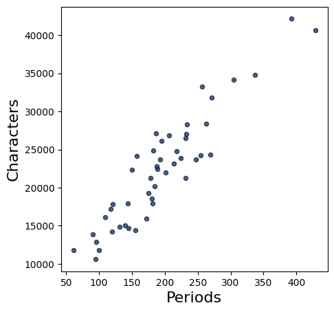

---

**Question 2.1.** Around how many periods are there in the chapter with the most characters? Assign either 1, 2, 3, 4, or 5 to the name `characters_q1` below. **(4 Points)**

1. 250
2. 390
3. 440
4. 32,000
5. 40,000

**Student scaffold:**

```python
characters_q1 = ...
```

**Solution:**

```python
characters_q1 = 2 # SOLUTION
```

**Test — `q2_1` (4 points)**

```python
>>> 1 <= characters_q1 <= 5
True

>>> import hashlib
>>> correctness_check_2_1 = hashlib.sha256(str(characters_q1).encode('utf-8')).hexdigest() == 'd4735e3a265e16eee03f59718b9b5d03019c07d8b6c51f90da3a666eec13ab35'
>>> correctness_check_2_1
True
```

---

**Question 2.2.** Which of the following chapters has the most characters *per* period? Assign either 1, 2, or 3 to the name `characters_q2` below. **(4 Points)**

1. The chapter with about 60 periods
2. The chapter with about 350 periods
3. The chapter with about 440 periods

**Student scaffold:**

```python
characters_q2 = ...
```

**Solution:**

```python
characters_q2 = 1 # SOLUTION
```

**Test — `q2_2` (4 points)**

```python
>>> 1 <= characters_q2 <= 3
True

>>> import hashlib
>>> correctness_check_2_2 = hashlib.sha256(str(characters_q2).encode('utf-8')).hexdigest() == '6b86b273ff34fce19d6b804eff5a3f5747ada4eaa22f1d49c01e52ddb7875b4b'
>>> correctness_check_2_2
True
```

To discover more interesting facts from this plot, check out [Section 1.3.2](https://inferentialthinking.com/chapters/01/3/2/Another_Kind_Of_Character.html) in the textbook.

---
## 3. Names and Assignment Statements

---

**Question 3.1.** When you run the following cell, Python produces a cryptic error message.

**Code:**

```python
4 = 2 + 2
```

*Error:*

```text
  Cell In[11], line 1
    4 = 2 + 2
    ^
SyntaxError: cannot assign to literal here. Maybe you meant '==' instead of '='?
```

Choose the best explanation of what's wrong with the code, and then assign 1, 2, 3, or 4 to `names_q1` below to indicate your answer. **(4 Points)**

1. Python is smart and already knows `4 = 2 + 2`.

2. In Python, it's a rule that the `=` sign must have a variable name to its left, and `4` isn't a variable name.

3. It should be `2 + 2 = 4`.

4. I don't get an error message. This is a trick question.

**Student scaffold:**

```python
names_q1 = ...
```

**Solution:**

```python
names_q1 = 2 # SOLUTION
```

**Test — `q3_1` (4 points)**

```python
>>> 1 <= names_q1 <= 4
True

>>> import hashlib
>>> correctness_check_3_1 = hashlib.sha256(str(names_q1).encode('utf-8')).hexdigest() == 'd4735e3a265e16eee03f59718b9b5d03019c07d8b6c51f90da3a666eec13ab35'
>>> correctness_check_3_1
True
```

---

**Question 3.2.** When you run the following cell, Python will produce another cryptic error message.

**Code:**

```python
two = 3
six = two plus two
```

*Error:*

```text
  Cell In[15], line 2
    six = two plus two
              ^
SyntaxError: invalid syntax
```

Choose the best explanation of what's wrong with the code and assign 1, 2, 3, or 4 to `names_q2` below to indicate your answer. **(4 Points)**

1. The `plus` operation only applies to numbers, not the word "two".

2. The name "two" cannot be assigned to the number 3.

3. Two plus two is four, not six.

4. The name `plus` isn't a built-in operator; instead, addition uses `+`.

**Student scaffold:**

```python
names_q2 = ...
```

**Solution:**

```python
names_q2 = 4 # SOLUTION
```

**Test — `q3_2` (4 points)**

```python
>>> 1 <= names_q2 <= 4
True

>>> import hashlib
>>> correctness_check_3_2 = hashlib.sha256(str(names_q2).encode('utf-8')).hexdigest() == '4b227777d4dd1fc61c6f884f48641d02b4d121d3fd328cb08b5531fcacdabf8a'
>>> correctness_check_3_2
True
```

---

**Question 3.3.** Run the following cell.

**Code:**

```python
x = 2
y = 3 * x
x = 4
```

What is `y` after running this cell, and why? Choose the best explanation and assign 1, 2, 3, or 4 to `names_q3` below to indicate your answer. **(4 Points)**

1. `y` is equal to 6, because the second `x = 4` has no effect since `x` was already defined.

2. `y` is equal to 6, because `x` was 2 when `y` was assigned, and 3 * 2 is 6.

3. `y` is equal to 12, because `x` is 4 and 3 * 4 is 12.

4. `y` is equal to 12, because assigning `x` to 4 will update `y` to 12 since `y` was defined in terms of `x`.

**Student scaffold:**

```python
names_q3 = ...
```

**Solution:**

```python
names_q3 = 2 # SOLUTION
```

**Test — `q3_3` (4 points)**

```python
>>> 1 <= names_q3 <= 4
True

>>> import hashlib
>>> correctness_check_3_3 = hashlib.sha256(str(names_q3).encode('utf-8')).hexdigest() == 'd4735e3a265e16eee03f59718b9b5d03019c07d8b6c51f90da3a666eec13ab35'
>>> correctness_check_3_3
True
```

---
## 4. Differences Between Majors

Berkeley’s Office of Planning and Analysis (OPA) provides data on numerous aspects of the campus. Adapted from the OPA website, the table below displays the number of degree recipients in three majors in the 2008-2009 and 2017-2018 academic years.

| Major                              | 2008-2009    | 2017-2018   |
|------------------------------------|--------------|-------------|
| Gender and Women's Studies         |      17      |    28       |
| Linguistics                        |      49      |    67       |
| Rhetoric                           |      113     |    56       |

---

**Question 4.1.** Suppose you want to find the **biggest** absolute difference between the number of degree recipients in the two years, among the three majors.

In the cell below, compute this value and call it `biggest_change`. Use a single expression (a single line of code) to compute the answer. Let Python perform all the arithmetic (like subtracting 49 from 67) rather than simplifying the expression yourself. The built-in `abs` function takes a numerical input and returns the absolute value. The built-in `max` function can take in 3 arguments and returns the maximum of the three numbers. **(5 Points)**

**Student scaffold:**

```python
biggest_change = ...
biggest_change
```

**Solution:**

```python
biggest_change = max(abs(17 - 28), abs(49 - 67), abs(113 - 56)) # SOLUTION
biggest_change
```

*Output:*

```text
57
```

**Test — `q4_1` (5 points)**

```python
>>> isinstance(biggest_change, (int, float))
True

>>> import hashlib
>>> correctness_check_4_1 = hashlib.sha256(str(biggest_change).encode('utf-8')).hexdigest() == 'c837649cce43f2729138e72cc315207057ac82599a59be72765a477f22d14a54'
>>> correctness_check_4_1
True
```

---

**Question 4.2.** Which of the three majors had the **smallest** absolute difference? Assign `smallest_change_major` to 1, 2, or 3 where each number corresponds to the following major:

1. Gender and Women's Studies  
2. Linguistics  
3. Rhetoric

Choose the number that corresponds to the major with the smallest absolute difference. **(4 Points)** 

_Hint:_ You should be able to answer by rough mental arithmetic, without having to calculate the exact value for each major.

**Student scaffold:**

```python
smallest_change_major = ...
smallest_change_major
```

**Solution:**

```python
smallest_change_major = 1 # SOLUTION
smallest_change_major
```

*Output:*

```text
1
```

**Test — `q4_2` (4 points)**

```python
>>> isinstance(smallest_change_major, (int, float))
True

>>> 1 <= smallest_change_major <= 3
True

>>> import hashlib
>>> correctness_check_4_2 = hashlib.sha256(str(smallest_change_major).encode('utf-8')).hexdigest() == '6b86b273ff34fce19d6b804eff5a3f5747ada4eaa22f1d49c01e52ddb7875b4b'
>>> correctness_check_4_2
True
```

---

**Question 4.3.**  For each major, define the “relative change” to be the following: $\large{\frac{\text{absolute difference}}{\text{value in 2008-2009}} * 100}$ 

Fill in the code below such that `gws_relative_change`, `linguistics_relative_change` and `rhetoric_relative_change` are assigned to the relative changes for their respective majors. **(5 Points)**

**Student scaffold:**

```python
gws_relative_change = (abs(...) / 17) * 100
linguistics_relative_change = ...
rhetoric_relative_change = ...
gws_relative_change, linguistics_relative_change, rhetoric_relative_change
```

**Solution:**

```python
"""# BEGIN PROMPT
gws_relative_change = (abs(...) / 17) * 100
"""; # END PROMPT
gws_relative_change = (abs(17 - 28) / 17) * 100 # SOLUTION NO PROMPT
linguistics_relative_change = (abs(49 - 67) / 49) * 100 # SOLUTION
rhetoric_relative_change = (abs(113 - 56) / 113) * 100 # SOLUTION
gws_relative_change, linguistics_relative_change, rhetoric_relative_change
```

*Output:*

```text
(64.70588235294117, 36.734693877551024, 50.442477876106196)
```

**Test — `q4_3` (5 points)**

```python
>>> isinstance(gws_relative_change, (int, float))
True

>>> isinstance(linguistics_relative_change, (int, float))
True

>>> isinstance(rhetoric_relative_change, (int, float))
True

>>> gws_relative_change >= 64 and gws_relative_change <= 66
True

>>> linguistics_relative_change >= 36 and linguistics_relative_change <= 38
True

>>> rhetoric_relative_change >= 50 and rhetoric_relative_change <= 52
True
```

---

**Question 4.4.** Assign `biggest_rel_change_major` to 1, 2, or 3 where each number corresponds to to the following: 

1. Gender and Women's Studies  
2. Linguistics  
3. Rhetoric

Choose the number that corresponds to the major with the biggest relative change. **(4 Points)**

**Student scaffold:**

```python
biggest_rel_change_major = ...
biggest_rel_change_major
```

**Solution:**

```python
biggest_rel_change_major = 1 # SOLUTION
biggest_rel_change_major
```

*Output:*

```text
1
```

**Test — `q4_4` (4 points)**

```python
>>> isinstance(biggest_rel_change_major, (int, float))
True

>>> 1 <= biggest_rel_change_major <= 3
True

>>> import hashlib
>>> correctness_check_4_4 = hashlib.sha256(str(biggest_rel_change_major).encode('utf-8')).hexdigest() == '6b86b273ff34fce19d6b804eff5a3f5747ada4eaa22f1d49c01e52ddb7875b4b'
>>> correctness_check_4_4
True
```

---
## 5. Nearsightedness Study

[Myopia](https://en.wikipedia.org/wiki/Myopia), or nearsightedness, results from a number of genetic and environmental factors. In 1999, Quinn et al studied the relation between myopia and ambient lighting at night (for example, from nightlights or room lights) during childhood.

---

**Question 5.1.** The data were gathered by the following procedure, reported in
the study. "Between January and June 1998, parents of children aged 2-16 years
[...] that were seen as outpatients in a university pediatric ophthalmology clinic
completed a questionnaire on the child's light exposure both at present and before
the age of 2 years."

Was this study observational, or was it a controlled experiment? Assign either 1 or
2 to the name `study_type` below. **(5 Points)**

1. The study was observational because the researchers didn't perform any
intervention.

2. The study was a controlled experiment because the researchers decided which
treatments the participants received.

**Student scaffold:**

```python
study_type = ...
```

**Solution:**

```python
study_type = 1 # SOLUTION
```

**Test — `q5_1` (5 points)**

```python
>>> import hashlib
>>> correctness_check_5_1 = hashlib.sha256(str(study_type).encode('utf-8')).hexdigest() == '6b86b273ff34fce19d6b804eff5a3f5747ada4eaa22f1d49c01e52ddb7875b4b'
>>> correctness_check_5_1
True
```

---

**Question 5.2.** The study found that of the children who slept with a room light on before the age of 2, 55% were myopic. Of the children who slept with a night light on before the age of 2, 34% were myopic. Of the children who slept in the dark before the age of 2, 10% were myopic. The study concluded the following: "The prevalence of myopia [...] during childhood was strongly associated with ambient light exposure during sleep at night in the first two years after birth."

Do the data support this statement? Assign either 1, 2, 3, or 4 to the name
`myopia_statement` below. **(5 Points)**

1. Yes, because sleeping with a room light on caused children in the study to
develop myopia.  
2. Yes, because there is a big difference in myopia rates between the groups.  
3. No, because only controlled experiments can show association.  
4. No, because there is no noticeable difference between the groups.

**Student scaffold:**

```python
myopia_statement = ...
```

**Solution:**

```python
myopia_statement = 2 # SOLUTION
```

**Test — `q5_2` (5 points)**

```python
>>> import hashlib
>>> correctness_check_5_2 = hashlib.sha256(str(myopia_statement).encode('utf-8')).hexdigest() == 'd4735e3a265e16eee03f59718b9b5d03019c07d8b6c51f90da3a666eec13ab35'
>>> correctness_check_5_2
True
```

---

**Question 5.3.** On May 13, 1999, CNN reported the results of this study under the headline, "Night light may lead to nearsightedness." Does the original study claim that night light causes nearsightedness? Assign either 1 or 2 to the name `causation_answer` below. **(5 Points)**

1. Yes. We can infer causation from the study because the difference in groups is so large.
2. No. We cannot infer causation from the study because it was observational.
1. Yes. We can infer causation from the study because the fact that night lights may lead to nearsightedness is consistent with the data.
2. No. We cannot infer causation from the study because the difference in groups could be due to chance.

**Student scaffold:**

```python
causation_answer = ...
```

**Solution:**

```python
causation_answer = 2 # SOLUTION
```

**Test — `q5_3` (5 points)**

```python
>>> import hashlib
>>> correctness_check_5_3 = hashlib.sha256(str(causation_answer).encode('utf-8')).hexdigest() == 'd4735e3a265e16eee03f59718b9b5d03019c07d8b6c51f90da3a666eec13ab35'
>>> correctness_check_5_3
True
```

---

**Question 5.4.** The final paragraph of the CNN report said that "several eye specialists" had pointed out that the study should have accounted for heredity.

Myopia is passed down from parents to children. Myopic parents are more likely to have myopic children, and may also be more likely to leave lights on habitually (since the parents have poor vision). In what ways does the knowledge of this possible genetic link affect how we interpret the data from the study?

Select all statements that are valid consequences of the possible genetic link between parents and children by assigning `myopia_factors` to a comma-separated sequence of numbers (e.g. `myopia_factors = 1, 3`). **(5 Points)**

1. If myopic parents are more likely to have myopic kids *and* leave the lights on at night, then myopic kids are more likely to have lights on at night.  
2. It is reasonable to assume that having myopic parents is a potential confounding factor that the original study did not account for.  
3. We are still able to find the observed association between night light exposure and myopia, even if night lights do not cause child myopia.

**Student scaffold:**

```python
myopia_factors = ...
```

**Solution:**

```python
myopia_factors = 1, 2, 3 # SOLUTION
```

**Test — `q5_4` (5 points)**

```python
>>> import hashlib
>>> correctness_check_5_4 = hashlib.sha256(str(myopia_factors).encode('utf-8')).hexdigest() == 'dfd5726d86ed2c8b202855bbea88990ec37a26ab1d2217b55a61b4b6719ff6fd'
>>> correctness_check_5_4
True
```

---
## 6. Studying the Survivors

---

**Question 6.1.** The Reverend Henry Whitehead was skeptical of John Snow’s conclusion about the Broad Street pump. After the Broad Street cholera epidemic ended, Whitehead set about trying to prove Snow wrong.  (The history of the event is detailed [here](http://www.ncbi.nlm.nih.gov/pmc/articles/PMC1034367/pdf/medhist00183-0026.pdf).)

He realized that Snow had focused his analysis almost entirely on those who had died. Whitehead, therefore, investigated the drinking habits of people in the Broad Street area who had not died in the outbreak.

What is the main reason it was important to study this group? Assign either 1, 2, or 3 to the name `survivor_answer` below. **(4 Points)**

1. If Whitehead had found that many people had drunk water from the Broad Street pump and not caught cholera, that would have been evidence against Snow's hypothesis.

2. Survivors could provide additional information about what else could have caused the cholera, potentially unearthing another cause.

3. Through considering the survivors, Whitehead could have identified a cure for cholera.

**Student scaffold:**

```python
survivor_answer = ...
```

**Solution:**

```python
survivor_answer = 1 # SOLUTION
```

**Test — `q6_1` (4 points)**

```python
>>> 1 <= survivor_answer <= 3
True

>>> import hashlib
>>> correctness_check_6_1 = hashlib.sha256(str(survivor_answer).encode('utf-8')).hexdigest() == '6b86b273ff34fce19d6b804eff5a3f5747ada4eaa22f1d49c01e52ddb7875b4b'
>>> correctness_check_6_1
True
```

**Note:** Whitehead ended up finding further proof that the Broad Street pump played a central role in spreading the disease to the people who lived near it. Eventually, he became one of Snow’s greatest defenders.

---
## 7. Policies and Administrivia

This section of the homework is to ensure that you have read over the policies and frequently asked questions for the course. 

**It's important that you read through this section of the homework very carefully**. If you can get through all of this section and are sure you have all of the correct resources set up, you will be able to focus on the actual material this semester!

Reading through the [syllabus](http://data8.org/su26/syllabus/) and the [FAQ](http://data8.org/su26/faq/) will help you get through this section very easily. It is recommended you do this before proceeding.

---

**Question 7.1.** You have a question regarding the grading of your assignments that has not been previously answered on Ed or the FAQ. Who do you contact? Assign `contact` to the number corresponding to the best choice below. **(4 Points)**

1. The Instructors
2. Post on Ed
3. Contact your Lab TA

**Student scaffold:**

```python
contact = ...
```

**Solution:**

```python
contact = 3 # SOLUTION
```

**Test — `q7_1` (4 points)**

```python
>>> import hashlib
>>> correctness_check_7_1 = hashlib.sha256(str(contact).encode('utf-8')).hexdigest() == '4637e99b28a1ce112e8f4009dbf144f3a75a04d3e4b0c30b084aef21c5e3cfe6'
>>> correctness_check_7_1
False
```

---

**Question 7.2.** What is true about our extension policy? Assign `extension` to the number corresponding to the best choice below. **(4 Points)**

1. I should post on Ed if I want an extension.
2. Extension requests need to be submitted on the Extensions form at least 24 hours before the deadline to be considered.
3. My extension will automatically be approved, regardless of the reason.

**Student scaffold:**

```python
extension = ...
```

**Solution:**

```python
extension = 2 # SOLUTION
```

**Test — `q7_2` (4 points)**

```python
>>> import hashlib
>>> correctness_check_7_2 = hashlib.sha256(str(extension).encode('utf-8')).hexdigest() == 'd4735e3a265e16eee03f59718b9b5d03019c07d8b6c51f90da3a666eec13ab35'
>>> correctness_check_7_2
True
```

---

**Question 7.3.** Regrade deadline dates will always be posted on the same Ed post that releases the assignment grades, common mistakes, and solutions. Can you ask for parts of your assignment regraded after the regrade request window has passed? Assign `regrade` to the number corresponding to the best choice below. **(4 Points)**

1. Yes
2. No

**Student scaffold:**

```python
regrade = ...
```

**Solution:**

```python
regrade = 2 # SOLUTION
```

**Test — `q7_3` (4 points)**

```python
>>> import hashlib
>>> correctness_check_7_3 = hashlib.sha256(str(regrade).encode('utf-8')).hexdigest() == 'd4735e3a265e16eee03f59718b9b5d03019c07d8b6c51f90da3a666eec13ab35'
>>> correctness_check_7_3
True
```

---

**Question 7.4.** Do you have an Pensieve account? Head to [pensieve.co](https://www.pensieve.co/) and check if you see Data 8. If you do not, please send your Lab TA an email with your email and student ID number. Assign `pensieve` to True if you have access.

**Student scaffold:**

```python
pensieve = ...
```

**Solution:**

```python
pensieve = True #SOLUTION
```

**Test — `q7_4` (4 points)**

```python
>>> pensieve == True
True
```

---

**Question 7.5.** Given the following scenarios, assign `acceptable` to the corresponding number of the scenario that is permissible given the guidelines on the [syllabus](http://data8.org/su26/syllabus/) page. **(4 Points)**

1. Dagny gets stuck on a homework assignment, so she googles a fix. She stumbles across a pdf of the solutions for the homework assignment from a previous semester's offering of Data 8. After inspecting the solution, Dagny writes her own solution and submits the assignment.

2. After getting confused by a project, Brandon asks his friend for help. His friend Isaac helps by walking Brandon through his own logic, without showing his code, pointing out areas that are important given the context of the question. Upon hearing his friend's logic, Brandon writes his own code and completes the project.

3. Marissa (who is in a regular lab) has an extremely busy schedule, so she really wants to leave lab early by finishing it and getting checked off. Her neighbor, Wesley, simply turns his computer so Marissa can see how he completed some questions. After looking at his code, Marissa finishes the lab and gets checked off.

**Student scaffold:**

```python
acceptable = ...
```

**Solution:**

```python
acceptable = 2 # SOLUTION
```

**Test — `q7_5` (4 points)**

```python
>>> import hashlib
>>> correctness_check_7_5 = hashlib.sha256(str(acceptable).encode('utf-8')).hexdigest() == 'd4735e3a265e16eee03f59718b9b5d03019c07d8b6c51f90da3a666eec13ab35'
>>> correctness_check_7_5
True
```

---

**Question 7.6.** To make sure you have read through the [syllabus](http://data8.org/su26/syllabus/) and the [FAQ](http://data8.org/su26/faq/) carefully, how many HW and lab drops are there? Assign `drops` to the number corresponding to the best choice below. **(4 Points)**

1. Two homework drops and three lab drops
2. Two homework drops and two lab drops
3. Only two homework drops
4. One homework drop and two lab drops

*Note:* You should reserve drops for extenuating circumstances.

**Student scaffold:**

```python
drops = ...
```

**Solution:**

```python
drops = 2 # SOLUTION
```

**Test — `q7_6` (4 points)**

```python
>>> import hashlib
>>> correctness_check_7_6 = hashlib.sha256(str(drops).encode('utf-8')).hexdigest() == 'd4735e3a265e16eee03f59718b9b5d03019c07d8b6c51f90da3a666eec13ab35'
>>> correctness_check_7_6
True
```

---

**Question 7.7.** Does Data 8 offer alternate midterm exam to those with class conflicts? Assign `exams` to the number corresponding to the best choice below. **(3 Points)**

1. Yes
2. No

**Student scaffold:**

```python
exams = ...
```

**Solution:**

```python
exams = 1 # SOLUTION
```

**Test — `q7_7` (3 points)**

```python
>>> import hashlib
>>> correctness_check_7_7 = hashlib.sha256(str(exams).encode('utf-8')).hexdigest() == '6b86b273ff34fce19d6b804eff5a3f5747ada4eaa22f1d49c01e52ddb7875b4b'
>>> correctness_check_7_7
True
```

---

**Question 7.8:** Are you actually checking Ed? Go to this semester's [Data 8 Ed](https://edstem.org/us/courses/91618/discussion) and find a lead posted thread with a certain secret phrase. Assign `secret` to this secret phrase in quotes (i.e. as a string). **(4 Points)**

**Student scaffold:**

```python
secret = ...
```

**Solution:**

```python
secret = "d8 is great" # SOLUTION
```

**Test — `q7_8` (4 points)**

```python
>>> type(secret) == str
True

>>> len(secret)
11

>>> import hashlib
>>> correctness_check_7_8 = hashlib.sha256(str(secret).encode('utf-8')).hexdigest() == '92c67a4cae5a49695b277c31d6ac7a4028f27308850f3ed447d17c20b71d49b2'
>>> correctness_check_7_8
True
```

---
## 8. Welcome Survey

---

**Question 8.1.** Please complete the welcome survey below in order to receive credit for Homework 1. Keep an eye out for the secret phrase once you submit! **(1 Point)**

- [Spring 2026 Welcome Survey](https://docs.google.com/forms/d/e/1FAIpQLScgv9isIwnFkmEQE-CZDyfmF5wPpctQxQsHneuy6xA9YYi_Dg/viewform?usp=dialog)

Assign `survey` to the secret phrase given at the end of the welcome survey. Make sure the phrase is in quotes (i.e. is a string)!

**Student scaffold:**

```python
survey = ...
```

**Solution:**

```python
survey = "data8 is data gr8" # SOLUTION
```

**Test — `q8_1` (1 point)**

```python
>>> import hashlib
>>> correctness_check_8_1 = hashlib.sha256(str(survey).encode('utf-8')).hexdigest() == '78c04327888d3d29903d44b3c9d42906e9ae35df6d5c68ff9e396a02500eb1df'
>>> correctness_check_8_1
True
```

---

##  Submitting Your Work
All assignments in the course will be distributed as notebooks like this one, and you will submit your work from the notebook. We will use a system called Otter Grader and Pensieve to check your work and help you submit. If you haven’t already, make sure you have run the cell at the top of this notebook to initialize OtterGrader.

Watch this [video](https://drive.google.com/file/d/1H9UwEb7uQrc1eK0PKGxtu95woP4IcyGI/view?usp=sharing) to see how to submit an assignment!

---

You're done with Homework 1! 

Once you have submitted to the autograder, your Pensieve assignment should look something like the following image if you have passed all public tests.

**Note:** *This is a photo of a generic Pensieve submission result, and it does not included the same test numbers as this assignment. Please check that all test cases have passed for each question.*

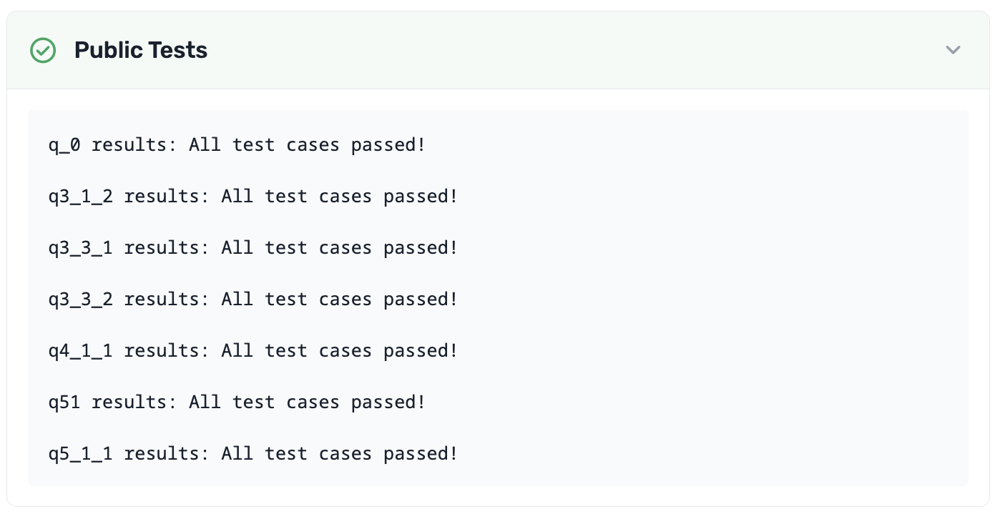

---

To double-check your work, the cell below will rerun all of the autograder tests.

## Submission

Make sure you have run all cells in your notebook in order before running the cell below, so that all images/graphs appear in the output. The cell below will generate a zip file for you to submit. **Please save before exporting!**


---

# hw02

---
title: "Homework 2: Arrays and Tables"
assignment: hw02
semester: sp26
source: semester_assignments/sp26/hw/hw02/autograder/hw02.ipynb
version: solution (autograder) with student scaffolds
student_source: semester_assignments/sp26/hw/hw02/student/hw02.ipynb
total_points: 100
language: python
---


# Homework 2: Arrays and Tables

Please complete this notebook by filling in the cells provided. Before you begin, execute the previous cell to load the provided tests.

**Helpful Resource:**
- [Python Reference](http://data8.org/su26/reference/): Cheat sheet of helpful array & table methods used in Data 8!

**Recommended Readings:**
- [Arrays](https://inferentialthinking.com/chapters/05/1/Arrays.html)
- [Data 8 Arrays Guide](https://drive.google.com/file/d/1vTduvivHyEX7cdpMCq9B2jC4iy6A3Tru/view?usp=sharing)
- [What is Data Science?](http://www.inferentialthinking.com/chapters/01/what-is-data-science.html)
- [Causality and Experiments](http://www.inferentialthinking.com/chapters/02/causality-and-experiments.html) 
- [Programming in Python](http://www.inferentialthinking.com/chapters/03/programming-in-python.html)

For all problems that you must write explanations and sentences for, you **must** provide your answer in the designated space. Moreover, throughout this homework and all future ones, **please be sure to not re-assign variables throughout the notebook!** For example, if you use `max_temperature` in your answer to one question, do not reassign it later on. Otherwise, you will fail tests that you thought you were passing previously!

**Deadline:**

This assignment is **due Wednesday, 2/4 at 11:00am PT**. Submissions after this time will be accepted for 24 hours and will incur a 20% penalty. Any submissions later than this 24 hour period will not be accepted unless an extension has been granted as per the [syllabus](http://data8.org/su26/syllabus/) page. Turn it in by Tuesday, 2/3 at 11:00am PT for 5 extra credit points.

Directly sharing answers is not okay, but discussing problems with the course staff or with other students is encouraged. Refer to the syllabus page to learn more about how to learn cooperatively.

You should start early so that you have time to get help if you're stuck. Office hours are held Monday through Friday in [Warren Hall](https://www.berkeley.edu/map/warren-hall/) 101B. The office hours schedule appears on [https://www.data8.org/su26/calendar/](https://www.data8.org/su26/calendar/).

**Code:**

```python
# Run this cell and ignore the output. It is checking to see if you ran the first cell! 
# If you get a NameError, please run the cell at the very TOP of this notebook!

grader
```

*Output (stdout):*

```text
Unexpected exception formatting exception. Falling back to standard exception
```

*Output (stderr):*

```text
Traceback (most recent call last):
  File "/Users/marissalumpkin/Desktop/data8/assignments_new/env/lib/python3.13/site-packages/IPython/core/interactiveshell.py", line 3577, in run_code
    exec(code_obj, self.user_global_ns, self.user_ns)
    ~~~~^^^^^^^^^^^^^^^^^^^^^^^^^^^^^^^^^^^^^^^^^^^^^
  File "/var/folders/xv/tl5mnl5s0mz_ykhsrhdyb_rm0000gn/T/ipykernel_72709/2928856654.py", line 4, in <module>
    grader
NameError: name 'grader' is not defined

During handling of the above exception, another exception occurred:

Traceback (most recent call last):
  File "/Users/marissalumpkin/Desktop/data8/assignments_new/env/lib/python3.13/site-packages/IPython/core/interactiveshell.py", line 2168, in showtraceback
    stb = self.InteractiveTB.structured_traceback(
        etype, value, tb, tb_offset=tb_offset
    )
  File "/Users/marissalumpkin/Desktop/data8/assignments_new/env/lib/python3.13/site-packages/IPython/core/ultratb.py", line 1454, in structured_traceback
    return FormattedTB.structured_traceback(
           ~~~~~~~~~~~~~~~~~~~~~~~~~~~~~~~~^
        self, etype, evalue, etb, tb_offset, number_of_lines_of_context
        ^^^^^^^^^^^^^^^^^^^^^^^^^^^^^^^^^^^^^^^^^^^^^^^^^^^^^^^^^^^^^^^
    )
    ^
  File "/Users/marissalumpkin/Desktop/data8/assignments_new/env/lib/python3.13/site-packages/IPython/core/ultratb.py", line 1345, in structured_traceback
    return VerboseTB.structured_traceback(
           ~~~~~~~~~~~~~~~~~~~~~~~~~~~~~~^
        self, etype, value, tb, tb_offset, number_of_lines_of_context
        ^^^^^^^^^^^^^^^^^^^^^^^^^^^^^^^^^^^^^^^^^^^^^^^^^^^^^^^^^^^^^
    )
    ^
  File "/Users/marissalumpkin/Desktop/data8/assignments_new/env/lib/python3.13/site-packages/IPython/core/ultratb.py", line 1192, in structured_traceback
    formatted_exception = self.format_exception_as_a_whole(etype, evalue, etb, number_of_lines_of_context,
                                                           tb_offset)
  File "/Users/marissalumpkin/Desktop/data8/assignments_new/env/lib/python3.13/site-packages/IPython/core/ultratb.py", line 1082, in format_exception_as_a_whole
    self.get_records(etb, number_of_lines_of_context, tb_offset) if etb else []
    ~~~~~~~~~~~~~~~~^^^^^^^^^^^^^^^^^^^^^^^^^^^^^^^^^^^^^^^^^^^^
  File "/Users/marissalumpkin/Desktop/data8/assignments_new/env/lib/python3.13/site-packages/IPython/core/ultratb.py", line 1179, in get_records
    res = list(stack_data.FrameInfo.stack_data(etb, options=options))[tb_offset:]
          ~~~~^^^^^^^^^^^^^^^^^^^^^^^^^^^^^^^^^^^^^^^^^^^^^^^^^^^^^^^
  File "/Users/marissalumpkin/Desktop/data8/assignments_new/env/lib/python3.13/site-packages/stack_data/core.py", line 597, in stack_data
    yield from collapse_repeated(
    ...<4 lines>...
    )
  File "/Users/marissalumpkin/Desktop/data8/assignments_new/env/lib/python3.13/site-packages/stack_data/utils.py", line 83, in collapse_repeated
    yield from map(mapper, original_group)
  File "/Users/marissalumpkin/Desktop/data8/assignments_new/env/lib/python3.13/site-packages/stack_data/core.py", line 587, in mapper
    return cls(f, options)
  File "/Users/marissalumpkin/Desktop/data8/assignments_new/env/lib/python3.13/site-packages/stack_data/core.py", line 551, in __init__
    self.executing = Source.executing(frame_or_tb)
                     ~~~~~~~~~~~~~~~~^^^^^^^^^^^^^
  File "/Users/marissalumpkin/Desktop/data8/assignments_new/env/lib/python3.13/site-packages/executing/executing.py", line 283, in executing
    assert_(new_stmts <= stmts)
    ~~~~~~~^^^^^^^^^^^^^^^^^^^^
  File "/Users/marissalumpkin/Desktop/data8/assignments_new/env/lib/python3.13/site-packages/executing/executing.py", line 80, in assert_
    raise AssertionError(str(message))
AssertionError
```

---
## 1. Indexing Arrays

These exercises give you practice on accessing individual elements of arrays. In Python, each element is accessed by its index. An index indicates the position of an element within an array. For example, the first element is the element at index 0. Indices must be **integers**.

***Note:* If you have previous coding experience, you may be familiar with bracket notation. DO NOT use bracket notation when indexing (i.e. `arr[0]`).**

Be sure to refer to the [Python Reference](http://data8.org/su26/reference/) on the website if you feel stuck!

---

**Question 1.1.** The cell below creates an array of some numbers.  Set `third_element` to the third element of `some_numbers` using `item`. **(3 Points)**

_**Hint:** Remember that the first element is at index 0, the second element is at index 1, and so on!_

**Student scaffold:**

```python
some_numbers = make_array(-1, -3, -6, -10, -15)

third_element = ...
third_element
```

**Solution:**

```python
some_numbers = make_array(-1, -3, -6, -10, -15)

third_element = some_numbers.item(2) # SOLUTION 
third_element
```

*Output:*

```text
-6
```

**Test — `q1_1` (3 points)**

```python
>>> third_element != -10
True

>>> third_element == -6
True

>>> type(third_element) == int
True
```

---

**Question 1.2.** The next cell creates a table that displays some information about the elements of `some_numbers` and their order.  Run the cell to see the partially-completed table, then fill in the missing information (the cells that say "Ellipsis") by assigning `blank_a`, `blank_b`, `blank_c`, and `blank_d` to the correct elements in the table. **(4 Points)**

*Note:* Replace the `...` with strings or numbers. As a reminder, indices should be **integers**.

*Hint:* If you're confused about which location corresponds to each blank, try filling in one blank and seeing how the table changes!

**Student scaffold:**

```python
blank_a = ...
blank_b = ...
blank_c = ...
blank_d = ...
elements_of_some_numbers = Table().with_columns(
    "English name for position", make_array("first", "second", blank_a, blank_b, "fifth"),
    "Index",                     make_array(blank_c, 1, 2, blank_d, 4),
    "Element",                   some_numbers)
elements_of_some_numbers
```

**Solution:**

```python
blank_a = "third" #SOLUTION
blank_b = "fourth" #SOLUTION
blank_c = 0 #SOLUTION
blank_d = 3 #SOLUTION
elements_of_some_numbers = Table().with_columns(
    "English name for position", make_array("first", "second", blank_a, blank_b, "fifth"),
    "Index",                     make_array(blank_c, 1, 2, blank_d, 4),
    "Element",                   some_numbers)
elements_of_some_numbers
```

*Output:*

| English name for position | Index | Element |
| --- | --- | --- |
| first | 0 | -1 |
| second | 1 | -3 |
| third | 2 | -6 |
| fourth | 3 | -10 |
| fifth | 4 | -15 |

**Test — `q1_2` (4 points)**

```python
>>> elements_of_some_numbers.column(0).item(2) == 'third'
True

>>> elements_of_some_numbers.column(0).item(3) == 'fourth'
True

>>> elements_of_some_numbers.column(1).item(0) == 0
True

>>> elements_of_some_numbers.column(1).item(3) == 3
True
```

---

**Question 1.3.** You'll sometimes want to find the **last** element of an array.  Suppose an array has 142 elements.  What is the index of its last element? **(3 Points)**

*Note:* Your answer must be a positive integer. An integer is a whole number that does not include fractions or decimals.

**Student scaffold:**

```python
index_of_last_element = ...
```

**Solution:**

```python
index_of_last_element = 142 - 1 # (or just 141) #SOLUTION
```

**Test — `q1_3` (3 points)**

```python
>>> type(index_of_last_element) == int
True

>>> import hashlib
>>> correctness_check_1_3 = hashlib.sha256(str(index_of_last_element).encode('utf-8')).hexdigest() == '2c7d5490e6050836f8f2f0d496b1c8d6a38d4ffac2b898e6e77751bdcd20ebf5'
>>> correctness_check_1_3
True
```

More often, you don't know the number of elements in an array, which is its *length*.  (For example, it might be a large dataset you found on the Internet.)  The function `len` takes a single argument, an array, and returns an integer that represents the `len`gth of that array. You can see an example of `len` here:

**Code:**

```python
#Creating an array with five elements
five_element_array = make_array(1, 2, 3, 4, 5)

#Finding the length of the array, which is 5!
len(five_element_array)
```

*Output:*

```text
5
```

**Question 1.4.** The cell below loads an array called `president_birth_years`.  Calling `tbl.column(...)` on a table returns an array of the column specified, in this case the `Birth Year` column of the `president_births` table. The last element in that array is the most recent among the birth years of all the deceased Presidents. Assign that year to `most_recent_birth_year`. **(4 Points)**

**Note:** Do not Google the answer. You should be able to answer this question only using array methods.

**Student scaffold:**

```python
president_birth_years = Table.read_table("president_births.csv").column('Birth Year')

most_recent_birth_year = ...
most_recent_birth_year
```

**Solution:**

```python
president_birth_years = Table.read_table("president_births.csv").column('Birth Year')

most_recent_birth_year = president_birth_years.item(len(president_birth_years)-1) #SOLUTION
most_recent_birth_year
```

*Output:*

```text
1917
```

**Test — `q1_4` (4 points)**

```python
>>> most_recent_birth_year == 1917
True
```

---

**Question 1.5.** Finally, assign `min_of_birth_years` to the minimum of the first, sixteenth, and last birth years listed in `president_birth_years`. **(4 Points)**

**Note:** Use the Python `min` function and table methods to find the answer. Do not manually calculate the result yourself!

**Student scaffold:**

```python
min_of_birth_years = ...
min_of_birth_years
```

**Solution:**

```python
min_of_birth_years = min(make_array(president_birth_years.item(0), president_birth_years.item(15), president_birth_years.item(len(president_birth_years) - 1))) #SOLUTION
min_of_birth_years
```

*Output:*

```text
1732
```

**Test — `q1_5` (4 points)**

```python
>>> min_of_birth_years > 0
True

>>> import hashlib
>>> correctness_check_1_5 = hashlib.sha256(str(min_of_birth_years).encode('utf-8')).hexdigest() == 'bfea46db09aa46da5a6628ecd5d5fba31d9d50417f5178db9727d3676427e2df'
>>> correctness_check_1_5
True
```

---
## 2. Basic Array Arithmetic

---

**Question 2.1.** Multiply the numbers 42, -4224, 424224242, and 250 by 157. Assign each variable below such that `first_product` is assigned to the result of $42 * 157$, `second_product` is assigned to the result of $-4224 * 157$, and so on. **(3 Points)**

*Note*: For this question, **don't** use arrays.

**Student scaffold:**

```python
first_product = ...
second_product = ...
third_product = ...
fourth_product = ...
print("First Product:", first_product)
print("Second Product:", second_product)
print("Third Product:", third_product)
print("Fourth Product:", fourth_product)
```

**Solution:**

```python
first_product = 42 * 157 #SOLUTION
second_product = -4224 * 157 #SOLUTION
third_product = 424224242 * 157 #SOLUTION
fourth_product = 250 * 157 #SOLUTION
print("First Product:", first_product)
print("Second Product:", second_product)
print("Third Product:", third_product)
print("Fourth Product:", fourth_product)
```

*Output (stdout):*

```text
First Product: 6594
Second Product: -663168
Third Product: 66603205994
Fourth Product: 39250
```

**Test — `q2_1` (3 points)**

```python
>>> (first_product > 0, second_product < 0, third_product > 0, fourth_product > 0)
(True, True, True, True)

>>> import hashlib
>>> correctness_check_2_1 = hashlib.sha256(str(np.array([first_product, second_product, third_product, fourth_product])).encode('utf-8')).hexdigest() == '607e9f168887b39b1cc9b966c10023bc51ab49a63cddf7fa552389db1526c5b6'
>>> correctness_check_2_1
True
```

---

**Question 2.2.** Now, do the same calculation, but using an array called `numbers` and only a single multiplication (`*`) operator.  Store the 4 results in an array named `products`. **(3 Points)**

**Student scaffold:**

```python
numbers = ...
products = ...
products
```

**Solution:**

```python
numbers = make_array(42, -4224, 424224242, 250) #SOLUTION
products = numbers * 157 #SOLUTION
products
```

*Output:*

```text
array([       6594,     -663168, 66603205994,       39250])
```

**Test — `q2_2` (3 points)**

```python
>>> len(products) == 4
True

>>> import hashlib
>>> correctness_check_2_2 = hashlib.sha256(str(products).encode('utf-8')).hexdigest() == '607e9f168887b39b1cc9b966c10023bc51ab49a63cddf7fa552389db1526c5b6'
>>> correctness_check_2_2
True
```

---

**Question 2.3.** Oops, we made a typo!  Instead of 157, we wanted to multiply each number by 1577.  Compute the correct products in the cell below using array arithmetic.  Notice that your job is really easy if you previously defined an array containing the 4 numbers. **(3 Points)**

**Student scaffold:**

```python
correct_products = ...
correct_products
```

**Solution:**

```python
correct_products = numbers * 1577 # SOLUTION
correct_products
```

*Output:*

```text
array([       66234,     -6661248, 669001629634,       394250])
```

**Test — `q2_3` (3 points)**

```python
>>> len(correct_products) == 4
True

>>> import hashlib
>>> correctness_check_2_3 = hashlib.sha256(str(np.round(correct_products, decimals=0).astype(int).tolist()).encode('utf-8')).hexdigest() == '3ada446754f8b85db899e60987991c15e950c4deeb45093d5fab466f84758878'
>>> correctness_check_2_3
True
```

---

**Question 2.4.** We've loaded an array of temperatures in the next cell.  Each number is the highest temperature observed on a day at a climate observation station, mostly from the US.  Since they're from the US government agency [NOAA](https://www.noaa.gov/), all the temperatures are in Fahrenheit.

Convert all the temperatures to Celsius by first subtracting 32 from them, then multiplying the results by $\frac{5}{9}$, i.e. $C = (F - 32) * \frac{5}{9}$. After converting the temperatures to Celsius, make sure to **ROUND** the final result  to the nearest integer using the `np.round` function. **(4 Points)**

**Student scaffold:**

```python
max_temperatures = Table.read_table("temperatures.csv").column("Daily Max Temperature")

max_temperatures_celsius = ...
celsius_temps_rounded = ...
celsius_temps_rounded
```

**Solution:**

```python
max_temperatures = Table.read_table("temperatures.csv").column("Daily Max Temperature")

max_temperatures_celsius = (max_temperatures - 32) * 5/9 #SOLUTION
celsius_temps_rounded = np.round(max_temperatures_celsius) #SOLUTION
celsius_temps_rounded
```

*Output:*

```text
array([ -4.,  31.,  32., ...,  17.,  23.,  16.])
```

**Test — `q2_4` (4 points)**

```python
>>> sum(celsius_temps_rounded) != 356705.0
True

>>> celsius_temps_rounded.item(1) == 31.0
True

>>> sum(celsius_temps_rounded)
1280677.0

>>> len(celsius_temps_rounded)
65000
```

---

**Question 2.5.** The cell below loads all the *lowest* temperatures from each day (in Fahrenheit).  Compute the daily temperature range for each day. That is, compute the difference between each daily maximum temperature and the corresponding daily minimum temperature.  **Pay attention to the units and give your answer in Celsius!** <span style="color:red">Make sure **NOT** to round your answer for this question!</span> **(3 Points)**

*Hint:* Use `min_temperatures` and/or `max_temperatures`, and be careful with when you perform your unit conversions. Write out the mathematical computation by hand if you're stuck!

**Student scaffold:**

```python
min_temperatures = Table.read_table("temperatures.csv").column("Daily Min Temperature")

celsius_temperature_ranges = ...
celsius_temperature_ranges
```

**Solution:**

```python
min_temperatures = Table.read_table("temperatures.csv").column("Daily Min Temperature")

celsius_temperature_ranges = (5/9) * (max_temperatures - min_temperatures) #SOLUTION
celsius_temperature_ranges
```

*Output:*

```text
array([  6.66666667,  10.        ,  12.22222222, ...,  17.22222222,
        11.66666667,  11.11111111])
```

**Test — `q2_5` (3 points)**

```python
>>> type(celsius_temperature_ranges) is np.ndarray
True

>>> np.isclose(celsius_temperature_ranges.item(0), 7.222)
False

>>> np.isclose(round(sum(celsius_temperature_ranges)), 768487)
True

>>> len(celsius_temperature_ranges) == len(max_temperatures)
True
```

---
## 3. Old Faithful

Old Faithful is a geyser in Yellowstone that erupts every 44 to 125 minutes (according to [Wikipedia](https://en.wikipedia.org/wiki/Old_Faithful)). People are often told that the geyser erupts every hour, but in fact the waiting time between eruptions is more variable. Let's take a look.

---

**Question 3.1.** The first line below assigns `waiting_times` to an array of 272 consecutive waiting times between eruptions, taken from a classic 1938 dataset. Assign the names `shortest`, `longest`, and `average` so that the `print` statement is correct. **(4 Points)**

**Student scaffold:**

```python
waiting_times = Table.read_table('old_faithful.csv').column('waiting')

shortest = ...
longest = ...
average = ...

print("Old Faithful erupts every", shortest, "to", longest, "minutes and every", average, "minutes on average.")
```

**Solution:**

```python
waiting_times = Table.read_table('old_faithful.csv').column('waiting')

shortest = min(waiting_times) # SOLUTION
longest = max(waiting_times) # SOLUTION
average = np.mean(waiting_times) # SOLUTION

print("Old Faithful erupts every", shortest, "to", longest, "minutes and every", average, "minutes on average.")
```

*Output (stdout):*

```text
Old Faithful erupts every 43 to 96 minutes and every 70.8970588235 minutes on average.
```

**Test — `q3_1` (4 points)**

```python
>>> shortest <= average <= longest
True

>>> shortest == 43 and longest == 96
True

>>> import hashlib
>>> correctness_check_3_1 = hashlib.sha256(str(float(np.round(average, decimals=6))).encode('utf-8')).hexdigest() == 'e156244f5d51243e7794804bcf28d8b041581b44a59c1ce7944e5ff51dcf33c5'
>>> correctness_check_3_1
True
```

---

**Question 3.2.** Assign `biggest_decrease` to the biggest decrease in waiting time between two consecutive eruptions. For example, the third eruption occurred after 74 minutes and the fourth after 62 minutes, so the decrease in waiting time was 74 - 62 = 12 minutes. **(4 Points)**

*Hint*: We want to return the absolute value of the biggest decrease.

*Note*: `np.diff()` calculates the difference between subsequent values in an array. For example, calling `np.diff()` on the array `make_array(1, 8, 3, 5)` evaluates to `array([8 - 1, 3 - 8, 5 - 3])`, or `array([7, -5, 2])`. In this array, the biggest decrease would be from the second eruption to the third eruption.

**Student scaffold:**

```python
# np.diff() calculates the difference between subsequent values in a NumPy array
# where the first value is subtracted from the second value

differences = np.diff(waiting_times)
biggest_decrease = ...
biggest_decrease
```

**Solution:**

```python
# np.diff() calculates the difference between subsequent values in a NumPy array
# where the first value is subtracted from the second value

differences = np.diff(waiting_times)
biggest_decrease = abs(min((differences))) # SOLUTION
biggest_decrease
```

*Output:*

```text
45
```

**Test — `q3_2` (4 points)**

```python
>>> biggest_decrease == 47
False

>>> 30 <= biggest_decrease < 47
True

>>> import hashlib
>>> correctness_check_3_2 = hashlib.sha256(str(biggest_decrease).encode('utf-8')).hexdigest() == '811786ad1ae74adfdd20dd0372abaaebc6246e343aebd01da0bfc4c02bf0106c'
>>> correctness_check_3_2
True
```

---

**Question 3.3.** The `faithful_with_eruption_nums` table contains two columns: `eruption_number`, which represents the number of that eruption, and `waiting`, which represents the time spent waiting after that eruption. For example, take the first two rows of the table:

| eruption number | waiting |
|-----------------|---------|
| 1               | 79      |
| 2               | 54      |

We can read this as follows: after the first eruption, we waited 79 minutes for the second eruption. Then, after the second eruption, we waited 54 minutes for the third eruption.

Suppose Dylan and Tim started watching Old Faithful at the start of the first eruption. Assume that they watch until the end of the tenth eruption. For some of that time they will be watching eruptions, and for the rest of the time they will be waiting for Old Faithful to erupt. How many minutes will they spend waiting for eruptions? **(4 Points)**

*Hint #1:* You can start by using the `take` method on the table `faithful_with_eruption_nums`. 

*Hint #2:* `first_nine_waiting_times` must be an array.

**Student scaffold:**

```python
# The following two lines load in our faithful_with_eruption_nums table
faithful = Table.read_table('old_faithful.csv').drop("eruptions")
faithful_with_eruption_nums = faithful.with_column("eruption number", np.arange(faithful.num_rows) + 1).select(1, 0)

first_nine_waiting_times = ...
total_waiting_time_until_tenth = ...
total_waiting_time_until_tenth
```

**Solution:**

```python
# The following two lines load in our faithful_with_eruption_nums table
faithful = Table.read_table('old_faithful.csv').drop("eruptions")
faithful_with_eruption_nums = faithful.with_column("eruption number", np.arange(faithful.num_rows) + 1).select(1, 0)

first_nine_waiting_times = faithful_with_eruption_nums.where("eruption number", are.below(10)).column("waiting") # SOLUTION
total_waiting_time_until_tenth = sum(first_nine_waiting_times) # SOLUTION
total_waiting_time_until_tenth
```

*Output:*

```text
633
```

**Test — `q3_3` (4 points)**

```python
>>> len(first_nine_waiting_times)
9

>>> total_waiting_time_until_tenth
633
```

---

**Question 3.4.** Let’s imagine your guess for the next waiting time was always just the length of the previous waiting time. If you always guessed the previous waiting time, how big would your error in guessing the waiting times be, on average? **(4 Points)**

For example, since the first four waiting times are 79, 54, 74, and 62, the average difference between your guess and the actual time for just the second, third, and fourth eruptions would be $\frac{|79-54|+ |54-74|+ |74-62|}{3} = 19$.

**Student scaffold:**

```python
differences = np.diff(waiting_times)
average_error = ...
average_error
```

**Solution:**

```python
differences = np.diff(waiting_times)
average_error = np.average(abs(differences)) # SOLUTION
average_error
```

*Output:*

```text
20.520295202952031
```

**Test — `q3_4` (4 points)**

```python
>>> 15 <= average_error <= 25
True

>>> import hashlib
>>> correctness_check_3_4 = hashlib.sha256(str(float(np.round(average_error, decimals=6))).encode('utf-8')).hexdigest() == '59ba7bfb9138201c361b5b1e8c20778d44355d54cd559b6d75f1c2251e693aaf'
>>> correctness_check_3_4
True
```

---
## 4. Tables

---

**Question 4.1.** Suppose you have 4 apples, 3 oranges, and 3 pineapples.  (Perhaps you're using Python to solve a high school Algebra problem.)  Create a table that contains this information.  It should have two columns: `fruit name` and `amount`.  Assign the new table to the variable `fruits`. **(4 Points)**

*Note:* Use lower-case and singular words for the name of each fruit, like `"apple"`.

*Note:* Review [Chapter 6](https://inferentialthinking.com/chapters/06/Tables.html) if you get stuck!

**Student scaffold:**

```python
# Our solution uses 1 statement split over 3 lines.
fruits = ...
        ...
        ...
fruits
```

**Solution:**

```python
# Our solution uses 1 statement split over 3 lines.
fruits = Table().with_columns( #SOLUTION
        "fruit name", make_array("apple", "orange", "pineapple"), #SOLUTION
        "amount",     make_array(4,       3,        3)) #SOLUTION
fruits
```

*Output:*

| fruit name | amount |
| --- | --- |
| apple | 4 |
| orange | 3 |
| pineapple | 3 |

**Test — `q4_1` (4 points)**

```python
>>> fruits.sort(0)
fruit name | amount
apple      | 4
orange     | 3
pineapple  | 3
```

---

**Question 4.2.** The file `inventory.csv` contains information about the inventory at a fruit stand.  Each row represents the contents of one box of fruit. Load it as a table named `inventory` using the `Table.read_table()` function. `Table.read_table(...)` takes one argument (data file name in string format) and returns a table. **(4 Points)**

**Student scaffold:**

```python
inventory = ...
inventory
```

**Solution:**

```python
inventory = Table.read_table("inventory.csv") #SOLUTION
inventory
```

*Output:*

| box ID | fruit name | count |
| --- | --- | --- |
| 53686 | kiwi | 45 |
| 57181 | strawberry | 123 |
| 25274 | apple | 20 |
| 48800 | orange | 35 |
| 26187 | strawberry | 255 |
| 57930 | grape | 517 |
| 52357 | strawberry | 102 |
| 43566 | peach | 40 |

**Test — `q4_2` (4 points)**

```python
>>> inventory.sort(0).column(0).item(0)
25274
```

---

**Question 4.3.** Does each box at the fruit stand contain a different fruit? Set `all_different` to `True` if each box contains a different fruit or to `False` if multiple boxes contain the same fruit. **(4 Points)**

*Hint:* You don't have to write code to calculate the True/False value for `all_different`. Just look at the `inventory` table and assign `all_different` to either `True` or `False` according to what you can see from the table in answering the question.

*Note:* Make sure to capitalize `True` and `False`!

**Student scaffold:**

```python
all_different = ...
all_different
```

**Solution:**

```python
all_different = False # SOLUTION
all_different
```

*Output:*

```text
False
```

**Test — `q4_3` (4 points)**

```python
>>> all_different in {True, False}
True

>>> all_different == False
True
```

---

**Question 4.4.** The file `sales.csv` contains the number of fruit sold from each box last Saturday.  It has an extra column called `price per fruit ($)` that's the price *per item of fruit* for fruit in that box.  The rows are in the same order as the `inventory` table.  Load these data into a table called `sales`. **(5 Points)**

**Student scaffold:**

```python
sales = ...
sales
```

**Solution:**

```python
sales = Table.read_table("sales.csv") # SOLUTION
sales
```

*Output:*

| box ID | fruit name | count sold | price per fruit ($) |
| --- | --- | --- | --- |
| 53686 | kiwi | 3 | 0.5 |
| 57181 | strawberry | 101 | 0.2 |
| 25274 | apple | 0 | 0.8 |
| 48800 | orange | 35 | 0.6 |
| 26187 | strawberry | 25 | 0.15 |
| 57930 | grape | 355 | 0.06 |
| 52357 | strawberry | 102 | 0.25 |
| 43566 | peach | 17 | 0.8 |

**Test — `q4_4` (5 points)**

```python
>>> sales.sort(0)
box ID | fruit name | count sold | price per fruit ($)
25274  | apple      | 0          | 0.8
26187  | strawberry | 25         | 0.15
43566  | peach      | 17         | 0.8
48800  | orange     | 35         | 0.6
52357  | strawberry | 102        | 0.25
53686  | kiwi       | 3          | 0.5
57181  | strawberry | 101        | 0.2
57930  | grape      | 355        | 0.06
```

---

**Question 4.5.** How many fruits did the store sell in total on that day? **(5 Points)**

**Student scaffold:**

```python
total_fruits_sold = ...
total_fruits_sold
```

**Solution:**

```python
total_fruits_sold = sum(sales.column("count sold")) # SOLUTION
total_fruits_sold
```

*Output:*

```text
638
```

**Test — `q4_5` (5 points)**

```python
>>> total_fruits_sold > 10
True

>>> import hashlib
>>> correctness_check_4_5 = hashlib.sha256(str(total_fruits_sold).encode('utf-8')).hexdigest() == 'f4dd301311d96b70a2ee62a6bccfe21bb0d94a89ca2805333cf352c1a2381c13'
>>> correctness_check_4_5
True
```

---

**Question 4.6.** What was the store's total revenue (the total price of all fruits sold) on that day? **(5 Points)**

*Hint:* If you're stuck, think first about how you would compute the total revenue from just the grape sales.

**Student scaffold:**

```python
total_revenue = ...
total_revenue
```

**Solution:**

```python
total_revenue = sum(sales.column("count sold") * sales.column("price per fruit ($)")) # SOLUTION
total_revenue
```

*Output:*

```text
106.84999999999999
```

**Test — `q4_6` (5 points)**

```python
>>> 50 <= total_revenue <= 150
True

>>> import hashlib
>>> correctness_check_4_6 = hashlib.sha256(str(float(np.round(total_revenue, decimals=6))).encode('utf-8')).hexdigest() == 'aef26a24197c9822548845b35bd2e51e166af51419e757019f1f89055b54b3d7'
>>> correctness_check_4_6
True
```

---

**Question 4.7.** Make a new table called `remaining_inventory`.  It should have the same rows and columns as `inventory`, except that the amount of fruit sold from each box should be subtracted from that box's **original** count, so that the `count` column is **updated to be** the amount of fruit remaining after Saturday. **(5 Points)**

**Student scaffold:**

```python
remaining_inventory = ...
    ...
    ...
    ...
remaining_inventory
```

**Solution:**

```python
remaining_inventory = Table().with_columns( # SOLUTION
    "box ID", inventory.column("box ID"), # SOLUTION
    "fruit name", inventory.column("fruit name"), # SOLUTION
    "count", inventory.column("count") - sales.column("count sold")) # SOLUTION
remaining_inventory
```

*Output:*

| box ID | fruit name | count |
| --- | --- | --- |
| 53686 | kiwi | 42 |
| 57181 | strawberry | 22 |
| 25274 | apple | 20 |
| 48800 | orange | 0 |
| 26187 | strawberry | 230 |
| 57930 | grape | 162 |
| 52357 | strawberry | 0 |
| 43566 | peach | 23 |

**Test — `q4_7` (5 points)**

```python
>>> remaining_inventory.num_columns
3

>>> remaining_inventory.column('count').item(0) != 45
True

>>> remaining_inventory.where(1, 'grape')
box ID | fruit name | count
57930  | grape      | 162
```

---
## 5. Unemployment

The Great Recession of 2008-2009 was a period of economic decline observed globally, with scale and timing varying from country to country. In the United States, it resulted in a rapid rise in unemployment that affected industries and population groups to different extents.

The Federal Reserve Bank of St. Louis publishes data about jobs in the US.  Below, we've loaded data on unemployment in the United States. There are many ways of defining unemployment, and our dataset includes two notions of the unemployment rate:

1. *Non-Employment Index (or NEI)*: Among people who are able to work and are looking for a full-time job, the percentage who can't find a job.
2. *NEI-PTER*: Among people who are able to work and are looking for a full-time job, the percentage who can't find any job *or* are only working at a part-time job.  The latter group is called "Part-Time for Economic Reasons", so the acronym for this index is NEI-PTER.  (Economists are great at marketing.)

The source of the data is [here](https://fred.stlouisfed.org/categories/33509).

---

**Question 5.1.** The data are in a CSV file called `unemployment.csv`.  Load that file into a table called `unemployment`. **(1 Point)**

_Hint:_ After loading in the CSV file, the `unemployment` table should look like this:


**Student scaffold:**

```python
unemployment = ...
unemployment
```

**Solution:**

```python
unemployment = Table().read_table("unemployment.csv") # SOLUTION
unemployment
```

*Output:*

| Date | NEI | NEI-PTER |
| --- | --- | --- |
| 1994-01-01 | 10.0974 | 11.172 |
| 1994-04-01 | 9.6239 | 10.7883 |
| 1994-07-01 | 9.3276 | 10.4831 |
| 1994-10-01 | 9.1071 | 10.2361 |
| 1995-01-01 | 8.9693 | 10.1832 |
| 1995-04-01 | 9.0314 | 10.1071 |
| 1995-07-01 | 8.9802 | 10.1084 |
| 1995-10-01 | 8.9932 | 10.1046 |
| 1996-01-01 | 9.0002 | 10.0531 |
| 1996-04-01 | 8.9038 | 9.9782 |

**Test — `q5_1` (1 point)**

```python
>>> unemployment.select('Date', 'NEI', 'NEI-PTER').take(0)
Date       | NEI     | NEI-PTER
1994-01-01 | 10.0974 | 11.172
```

---

**Question 5.2.** Sort the data in descending order by NEI, naming the sorted table `by_nei`.  Create another table called `by_nei_pter` that's sorted in descending order by NEI-PTER instead. **(4 Points)**

**Student scaffold:**

```python
by_nei = ...
by_nei_pter = ...
```

**Solution:**

```python
by_nei = unemployment.sort("NEI", descending=True) # SOLUTION
by_nei_pter = unemployment.sort("NEI-PTER", descending=True) # SOLUTION
```

**Test — `q5_2` (4 points)**

```python
>>> by_nei.take(0)
Date       | NEI     | NEI-PTER
2009-10-01 | 10.9698 | 12.8557

>>> by_nei_pter.take(0)
Date       | NEI     | NEI-PTER
2009-10-01 | 10.9698 | 12.8557
```

**Code:**

```python
# Run this cell to check your by_nei table. You do not need to change the code.
by_nei.show(5)
```

*Output:*

| Date | NEI | NEI-PTER |
| --- | --- | --- |
| 2009-10-01 | 10.9698 | 12.8557 |
| 2010-01-01 | 10.9054 | 12.7311 |
| 2009-07-01 | 10.8089 | 12.7404 |
| 2009-04-01 | 10.7082 | 12.5497 |
| 2010-04-01 | 10.6597 | 12.5664 |

**Code:**

```python
# Run this cell to check your by_nei_pter table. You do not need to change the code.
by_nei_pter.show(5)
```

*Output:*

| Date | NEI | NEI-PTER |
| --- | --- | --- |
| 2009-10-01 | 10.9698 | 12.8557 |
| 2009-07-01 | 10.8089 | 12.7404 |
| 2010-01-01 | 10.9054 | 12.7311 |
| 2010-04-01 | 10.6597 | 12.5664 |
| 2009-04-01 | 10.7082 | 12.5497 |

---

**Question 5.3.** Using `take`, assign `greatest_nei` to a table containing the data for the 11 quarters when NEI was greatest.

`greatest_nei` should be sorted in descending order of `NEI`. Note that each row of `unemployment` represents a quarter. **(2 Points)**

**Student scaffold:**

```python
greatest_nei = ...
greatest_nei
```

**Solution:**

```python
greatest_nei = by_nei.take(np.arange(11)) # SOLUTION
greatest_nei
```

*Output:*

| Date | NEI | NEI-PTER |
| --- | --- | --- |
| 2009-10-01 | 10.9698 | 12.8557 |
| 2010-01-01 | 10.9054 | 12.7311 |
| 2009-07-01 | 10.8089 | 12.7404 |
| 2009-04-01 | 10.7082 | 12.5497 |
| 2010-04-01 | 10.6597 | 12.5664 |
| 2010-10-01 | 10.5856 | 12.4329 |
| 2010-07-01 | 10.5521 | 12.3897 |
| 2011-01-01 | 10.5024 | 12.3017 |
| 2011-07-01 | 10.4856 | 12.2507 |
| 2011-04-01 | 10.4409 | 12.247 |

**Test — `q5_3` (2 points)**

```python
>>> greatest_nei.take(0)
Date       | NEI     | NEI-PTER
2009-10-01 | 10.9698 | 12.8557

>>> import hashlib
>>> num_rows_check_5_3 = hashlib.sha256(str(greatest_nei.num_rows).encode('utf-8')).hexdigest() == '4fc82b26aecb47d2868c4efbe3581732a3e7cbcc6c2efb32062c08170a05eeb8'
>>> num_rows_check_5_3
True
```

---

**Question 5.4.** It's believed that many people became PTER (recall: "Part-Time for Economic Reasons") in the "Great Recession" of 2008-2009.  NEI-PTER is the percentage of people who are unemployed (included in the NEI) plus the percentage of people who are PTER.

Compute an array containing the percentage of people who were PTER in each quarter.  (The first element of the array should correspond to the first row of `unemployment`, and so on.) **(3 Points)**

*Note:* Use the original `unemployment` table for this.

**Student scaffold:**

```python
pter = ...
pter
```

**Solution:**

```python
pter = unemployment.column("NEI-PTER") - unemployment.column("NEI") # SOLUTION
pter
```

*Output:*

```text
array([ 1.0746,  1.1644,  1.1555,  1.129 ,  1.2139,  1.0757,  1.1282,
        1.1114,  1.0529,  1.0744,  1.1004,  1.0747,  1.0705,  1.0455,
        1.008 ,  0.9734,  0.9753,  0.8931,  0.9451,  0.8367,  0.8208,
        0.8105,  0.8248,  0.7578,  0.7251,  0.7445,  0.7543,  0.7423,
        0.7399,  0.7687,  0.8418,  0.9923,  0.9181,  0.9629,  0.9703,
        0.9575,  1.0333,  1.0781,  1.0675,  1.0354,  1.0601,  1.01  ,
        1.0042,  1.0368,  0.9704,  0.923 ,  0.9759,  0.93  ,  0.889 ,
        0.821 ,  0.9409,  0.955 ,  0.898 ,  0.8948,  0.9523,  0.9579,
        1.0149,  1.0762,  1.2873,  1.4335,  1.7446,  1.8415,  1.9315,
        1.8859,  1.8257,  1.9067,  1.8376,  1.8473,  1.7993,  1.8061,
        1.7651,  1.7927,  1.7286,  1.6387,  1.6808,  1.6805,  1.6629,
        1.6253,  1.6477,  1.6298,  1.4796,  1.5131,  1.4866,  1.4345,
        1.3675,  1.3097,  1.2319,  1.1735,  1.1844,  1.1746])
```

**Test — `q5_4` (3 points)**

```python
>>> round(pter.item(6), 4) != -1.1282
True

>>> round(pter.item(6), 4)
1.1282
```

---

**Question 5.5.** Add `pter` as a column to `unemployment` (name the column `PTER`) and sort the resulting table by that column in descending order.  Call the resulting table `by_pter`.

Try to do this with a single line of code, if you can. **(3 Points)**

**Student scaffold:**

```python
by_pter = ...
by_pter
```

**Solution:**

```python
by_pter = unemployment.with_column("PTER", pter).sort("PTER", descending=True) # SOLUTION
by_pter
```

*Output:*

| Date | NEI | NEI-PTER | PTER |
| --- | --- | --- | --- |
| 2009-07-01 | 10.8089 | 12.7404 | 1.9315 |
| 2010-04-01 | 10.6597 | 12.5664 | 1.9067 |
| 2009-10-01 | 10.9698 | 12.8557 | 1.8859 |
| 2010-10-01 | 10.5856 | 12.4329 | 1.8473 |
| 2009-04-01 | 10.7082 | 12.5497 | 1.8415 |
| 2010-07-01 | 10.5521 | 12.3897 | 1.8376 |
| 2010-01-01 | 10.9054 | 12.7311 | 1.8257 |
| 2011-04-01 | 10.4409 | 12.247 | 1.8061 |
| 2011-01-01 | 10.5024 | 12.3017 | 1.7993 |
| 2011-10-01 | 10.3287 | 12.1214 | 1.7927 |

**Test — `q5_5` (3 points)**

```python
>>> by_pter.take(0)
Date       | NEI     | NEI-PTER | PTER
2009-07-01 | 10.8089 | 12.7404  | 1.9315
```

---

**Question 5.6.** Create a line plot of PTER over time. To do this, create a new table called `pter_over_time` with the same columns as the `unemployment` table with the addition of two new columns: `Year` and `PTER` using the `year` array and the `pter` array, respectively. Then, generate a line plot using one of the table methods you've learned in class.

The order of the columns matter for our correctness tests, so be sure `Year` comes before `PTER`. **(4 Points)**

*Note:* When constructing `pter_over_time`, do not just add the `year` column to the `by_pter` table. Please follow the directions in the question above.

**Student scaffold:**

```python
year = 1994 + np.arange(by_pter.num_rows)/4
pter_over_time = ...
...
plt.ylim(0,2); # Do not change this line
```

**Solution:**

```python
year = 1994 + np.arange(by_pter.num_rows)/4
pter_over_time = unemployment.with_columns("Year", year, 'PTER', pter) # SOLUTION
pter_over_time.plot("Year", "PTER") # SOLUTION
plt.ylim(0,2); # Do not change this line
```

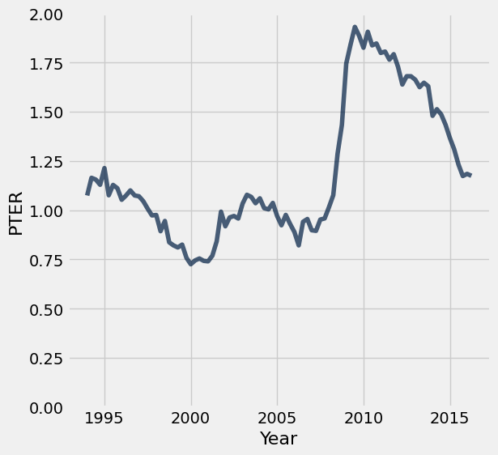

**Test — `q5_6` (4 points)**

```python
>>> pter_over_time.take(0)
Date       | NEI     | NEI-PTER | Year | PTER
1994-01-01 | 10.0974 | 11.172   | 1994 | 1.0746

>>> np.all(pter_over_time.column('PTER') == pter)
True

>>> import hashlib
>>> labels_check_5_6 = hashlib.sha256(str(pter_over_time.labels).encode('utf-8')).hexdigest() == 'db3c11c4ced5ec4dc6ed29e58450f5e070e56fb1835582c719d0c0f0c11c9c57'
>>> labels_check_5_6
True
```

---

**Question 5.7.** Were PTER rates high during the Great Recession (that is to say, were PTER rates particularly high in the years 2008 through 2011)? Assign `highPTER` to `True` if you think PTER rates were high in this period, or `False` if you think they weren't. **(1 Points)**

**Student scaffold:**

```python
highPTER = ...
```

**Solution:**

```python
highPTER = True # SOLUTION
```

**Test — `q5_7` (1 point)**

```python
>>> highPTER == True or highPTER == False
True

>>> highPTER == True
True
```

You're done with Homework 2!  

**Important submission information:** Be sure to run the tests and verify that they all pass, then choose **Save Notebook** from the **File** menu, then **run the final cell** and click the link to download the zip file. Then, go to [Pensieve](https://www.pensieve.co/) and submit the zip file to the corresponding assignment. The name of this assignment is "Homework 02 Autograder". **It is your responsibility to make sure your work is saved before running the last cell.**

Once you have submitted, your Pensieve assignment should show you passing all the tests you passed in your assignment notebook.

---

To double-check your work, the cell below will rerun all of the autograder tests.

## Submission

Make sure you have run all cells in your notebook in order before running the cell below, so that all images/graphs appear in the output. The cell below will generate a zip file for you to submit. **Please save before exporting!**

---

## Datasets

Datasets this notebook loads with `Table.read_table`. Column names are exact, including spaces and capitalization. Only the schema is recorded here — the data itself is not in this document, so any question about its values must be answered by running code, not by reasoning over the rows shown elsewhere in this file.

### `president_births.csv`

38 rows, 11 columns.

| Column | Type |
| --- | --- |
| `Name` | str |
| `Birth` | str |
| `Death` | str |
| `Birth Year` | int |
| `Birth Days (since 1 CE)` | int |
| `Days since January 1 at Birth` | int |
| `Death Year` | int |
| `Death Days (since 1 CE)` | int |
| `Days since January 1 at Death` | int |
| `Life Years` | int |
| `Life Days` | int |

### `temperatures.csv`

65,000 rows, 2 columns.

| Column | Type |
| --- | --- |
| `Daily Max Temperature` | int |
| `Daily Min Temperature` | int |

### `old_faithful.csv`

272 rows, 2 columns.

| Column | Type |
| --- | --- |
| `eruptions` | float |
| `waiting` | int |

### `inventory.csv`

8 rows, 3 columns.

| Column | Type |
| --- | --- |
| `box ID` | int |
| `fruit name` | str |
| `count` | int |

### `sales.csv`

8 rows, 4 columns.

| Column | Type |
| --- | --- |
| `box ID` | int |
| `fruit name` | str |
| `count sold` | int |
| `price per fruit ($)` | float |

### `unemployment.csv`

90 rows, 3 columns.

| Column | Type |
| --- | --- |
| `Date` | str |
| `NEI` | float |
| `NEI-PTER` | float |


---

# hw03

---
title: "Homework 3: Table Manipulation and Visualization"
assignment: hw03
semester: sp26
source: semester_assignments/sp26/hw/hw03/autograder/hw03.ipynb
version: solution (autograder) with student scaffolds
student_source: semester_assignments/sp26/hw/hw03/student/hw03.ipynb
total_points: 87
language: python
---


# Homework 3: Table Manipulation and Visualization

Please complete this notebook by filling in the cells provided. Before you begin, execute the previous cell to load the provided tests.

**Helpful Resource:**
- [Python Reference](http://data8.org/su26/reference/): Cheat sheet of helpful array & table methods used in Data 8!

**Recommended Reading**: 
* [Visualization](https://inferentialthinking.com/chapters/07/Visualization.html)

For all problems that you must write explanations and sentences for, you **must** provide your answer in the designated space. Moreover, throughout this homework and all future ones, **please be sure to not re-assign variables throughout the notebook!** For example, if you use `max_temperature` in your answer to one question, do not reassign it later on. Otherwise, you will fail tests that you thought you were passing previously!

**Deadline:**

This assignment is **due Wednesday, 2/11 at 11:00am PT**. Submissions after this time will be accepted for 24 hours and will incur a 20% penalty. Any submissions later than this 24 hour period will not be accepted unless an extension has been granted as per the [syllabus](http://data8.org/su26/syllabus/) page. Turn it in by Tuesday, 2/10 at 11:00am PT for 5 extra credit points.

Directly sharing answers is not okay, but discussing problems with the course staff or with other students is encouraged. Refer to the [syllabus](https://www.data8.org/su26/syllabus) page to learn more about how to learn cooperatively.

You should start early so that you have time to get help if you're stuck. Office hours are held Monday through Friday in [Warren Hall](https://www.berkeley.edu/map/warren-hall/) and online. The office hours schedule appears on our [office hours page](https://www.data8.org/su26/calendar/).

---

The point breakdown for this assignment is given in the table below:
| Category | Points |
| --- | --- |
| Autograder (Coding questions) | 87 |
| Manual (Visualization questions) | 13 |
| **Total** | 100 |

**Code:**

```python
# Don't change this cell; just run it. 

import numpy as np
from datascience import *
import warnings
warnings.simplefilter('ignore', FutureWarning)

# These lines do some fancy plotting magic.\n",
import matplotlib
%matplotlib inline
import matplotlib.pyplot as plt
plt.style.use('fivethirtyeight')
```

---
## 1. Birth Rates

The following table gives Census-based population estimates for each US state on both July 1, 2015 and July 1, 2016. The last four columns describe the components of the estimated change in population during this time interval. **For all questions below, assume that the word "states" refers to all 52 rows including Puerto Rico and the District of Columbia.**

The data was taken from [here](http://www2.census.gov/programs-surveys/popest/datasets/2010-2016/national/totals/nst-est2016-alldata.csv). (Note: If the file doesn't download for you when you click the link, you can copy and paste the link address it into your address bar!) If you want to read more about the different column descriptions, click [here](http://www2.census.gov/programs-surveys/popest/datasets/2010-2015/national/totals/nst-est2015-alldata.pdf).

The raw data is a bit messy—run the cell below to clean the table and make it easier to work with.

**Code:**

```python
# Don't change this cell; just run it.
pop = Table.read_table('nst-est2016-alldata.csv').where('SUMLEV', 40).select([1, 4, 12, 13, 27, 34, 62, 69])
pop = pop.relabeled('POPESTIMATE2015', 'START_POP').relabeled('POPESTIMATE2016', 'END_POP')
pop = pop.relabeled('BIRTHS2016', 'BIRTHS').relabeled('DEATHS2016', 'DEATHS')
pop = pop.relabeled('NETMIG2016', 'MIGRATION').relabeled('RESIDUAL2016', 'OTHER')
pop = pop.with_columns("REGION", np.array([int(region) if region != "X" else 0 for region in pop.column("REGION")]))
pop.set_format([2, 3, 4, 5, 6, 7], NumberFormatter(decimals=0)).show(5)
```

*Output:*

| REGION | NAME | START_POP | END_POP | BIRTHS | DEATHS | MIGRATION | OTHER |
| --- | --- | --- | --- | --- | --- | --- | --- |
| 3 | Alabama | 4,853,875 | 4,863,300 | 58,556 | 52,405 | 3,874 | -600 |
| 4 | Alaska | 737,709 | 741,894 | 11,255 | 4,511 | -2,557 | -2 |
| 4 | Arizona | 6,817,565 | 6,931,071 | 87,204 | 56,564 | 76,405 | 6,461 |
| 3 | Arkansas | 2,977,853 | 2,988,248 | 37,936 | 30,581 | 3,530 | -490 |
| 4 | California | 38,993,940 | 39,250,017 | 502,848 | 273,850 | 33,530 | -6,451 |

---

**Question 1.1.** Assign `us_birth_rate` to the total US annual birth rate during this time interval. The annual birth rate for a year-long period is the total number of births in that period as a proportion of the total population size at the start of the time period. **(7 Points)**

_Hint:_ What does each row in the `pop` table represent? How can we use this to find the total US population?

**Student scaffold:**

```python
us_birth_rate = ...
us_birth_rate
```

**Solution:**

```python
us_birth_rate = sum(pop.column('BIRTHS'))/sum(pop.column('START_POP')) # SOLUTION
us_birth_rate
```

*Output:*

```text
0.012358536498646102
```

**Test — `q1_1` (7 points)**

```python
>>> 0 < us_birth_rate < 1
True

>>> from hw03_check import correctness_check_1_1
>>> correctness_check_1_1(us_birth_rate, pop)
True
```

---

**Question 1.2.** Assign `movers` to the number of states for which the **absolute value** of the **annual rate of migration** was higher than 1%. The annual rate of migration for a year-long period is the net number of migrations (in minus out) as a proportion of the population size at the start of the period. The `MIGRATION` column contains estimated annual net migration counts by state. **(7 Points)**

*Hint*: `migration_rates` should be a table and `movers` should be a number.

**Student scaffold:**

```python
migration_rates = ...
movers = ...
movers
```

**Solution:**

```python
migration_rates = pop.with_column('Migration Rate', np.abs(pop.column('MIGRATION')/pop.column('START_POP'))) # SOLUTION
movers = migration_rates.where('Migration Rate', are.above(0.01)).num_rows # SOLUTION
movers
```

*Output:*

```text
9
```

**Test — `q1_2` (7 points)**

```python
>>> 0 < movers <= 52
True

>>> from hw03_check import correctness_check_1_2
>>> correctness_check_1_2(movers)
True
```

---

**Question 1.3.** Assign `west_births` to the total number of births that occurred in region 4 (the Western US). **(7 Points)**

*Hint:* Make sure you double check the type of the values in the `REGION` column and appropriately filter (i.e. the types must match!).

**Student scaffold:**

```python
west_births = ...
west_births
```

**Solution:**

```python
west_births = sum(pop.where('REGION', are.equal_to(4)).column('BIRTHS')) # SOLUTION
west_births
```

*Output:*

```text
979657
```

**Test — `q1_3` (7 points)**

```python
>>> 500000.0 < west_births < 1000000.0
True

>>> from hw03_check import correctness_check_1_3
>>> correctness_check_1_3(west_births)
True
```

---

**Question 1.4.** In the next question, you will be creating a visualization to understand the relationship between birth and death rates. The annual death rate for a year-long period is the total number of deaths in that period as a proportion of the population size at the start of the time period.

What visualization is most appropriate to see if there is an association between annual birth and death rates across multiple states in the United States?

1. Line Graph
2. Bar Chart
3. Scatter Plot

Assign `visualization` below to the number corresponding to the correct visualization. **(6 Points)**

**Student scaffold:**

```python
visualization = ...
```

**Solution:**

```python
visualization = 3 # SOLUTION
```

**Test — `q1_4` (6 points)**

```python
>>> type(visualization) == int
True

>>> 1 <= visualization <= 3
True

>>> from hw03_check import correctness_check_1_4
>>> correctness_check_1_4(visualization)
True
```

--- 

**Question 1.5.** In the code cell below, create a visualization that will help us determine if there is an association between birth rate and death rate during this time interval. It may be helpful to create an intermediate table containing the birth and death rates for each state. **(5 Points)**

Things to consider:

- What type of chart will help us illustrate an association between 2 variables?
- How can you manipulate a certain table to help generate your chart?
- Check out the [Recommended Reading](https://inferentialthinking.com/chapters/07/Visualization.html) for this homework!

**Note: All plotting and visualization questions in this homework will be manually graded on correctness. Even though these questions do not have a grader check cell, they will still count towards your score!**

**Student scaffold:**

```python
# In this cell, use birth_rates and death_rates to generate your visualization
birth_rates = pop.column('BIRTHS') / pop.column('START_POP')
death_rates = pop.column('DEATHS') / pop.column('START_POP')
...
```

**Solution:**

```python
# In this cell, use birth_rates and death_rates to generate your visualization
birth_rates = pop.column('BIRTHS') / pop.column('START_POP')
death_rates = pop.column('DEATHS') / pop.column('START_POP')
pop.with_columns("Birth Rate", birth_rates, "Death Rate", death_rates).scatter(8, 9) # SOLUTION
```

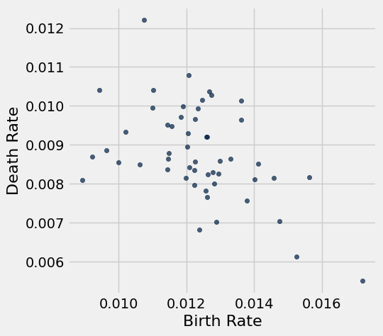

---

**Question 1.6.** True or False: There is an association between birth rate and death rate during this time interval. 

Assign `assoc` to `True` or `False` in the cell below. **(7 Points)**

**Student scaffold:**

```python
assoc = ...
```

**Solution:**

```python
assoc = True # SOLUTION
```

**Test — `q1_6` (7 points)**

```python
>>> type(assoc) is bool
True

>>> assoc == True
True
```

---
## 2. Uber

**Note:** We recommend reading [Chapter 7.2](https://inferentialthinking.com/chapters/07/2/Visualizing_Numerical_Distributions.html) of the textbook before starting on Question 3.

Below we load tables containing 200,000 weekday Uber rides in the Manila, Philippines, and Boston, Massachusetts metropolitan areas from the [Uber Movement](https://www.uber.com/newsroom/introducing-uber-movement-2/) project. The `sourceid` and `dstid` columns contain codes corresponding to start and end locations of each ride. The `hod` column contains codes corresponding to the hour of the day the ride took place. The `ride time` column contains the length of the ride in minutes.

**Code:**

```python
boston = Table.read_table("boston.csv")
manila = Table.read_table("manila.csv")
print("Boston Table")
boston.show(4)
print("Manila Table")
manila.show(4)
```

*Output (stdout):*

```text
Boston Table
```

*Output:*

| sourceid | dstid | hod | ride time |
| --- | --- | --- | --- |
| 584 | 33 | 7 | 11.866 |
| 1013 | 1116 | 13 | 17.7993 |
| 884 | 1190 | 22 | 19.3488 |
| 211 | 364 | 1 | 1.7235 |

*Output (stdout):*

```text
Manila Table
```

*Output:*

| sourceid | dstid | hod | ride time |
| --- | --- | --- | --- |
| 544 | 5 | 22 | 22.8115 |
| 302 | 240 | 21 | 7.02267 |
| 278 | 99 | 16 | 21.6437 |
| 720 | 775 | 18 | 13.0597 |

--- 

**Question 2.1.** Produce a histogram that visualizes the distributions of all ride times in Boston using the given bins in `equal_bins`. **(4 Points)**

*Hint:* See [Chapter 7.2](https://inferentialthinking.com/chapters/07/2/Visualizing_Numerical_Distributions.html) if you're stuck on how to specify bins.

**Note: All plotting and visualization questions in this homework will be manually graded on correctness. Even though these questions do not have a grader check cell, they will still count towards your score!**

**Student scaffold:**

```python
equal_bins = np.arange(0, 120, 5)
...
```

**Solution:**

```python
equal_bins = np.arange(0, 120, 5)
boston.select("ride time").hist(bins = equal_bins) # SOLUTION
```

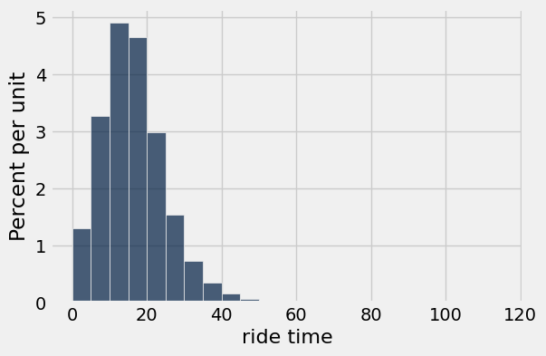

---

**Question 2.2.** Now, produce a histogram that visualizes the distribution of all ride times in Manila using the given bins. **(4 Points)**

**Student scaffold:**

```python
equal_bins = np.arange(0, 120, 5)
...

# Don't delete the following line!
plt.ylim(0, 0.05);
```

**Solution:**

```python
equal_bins = np.arange(0, 120, 5)
manila.select("ride time").hist(bins = equal_bins) # SOLUTION

# Don't delete the following line!
plt.ylim(0, 0.05);
```

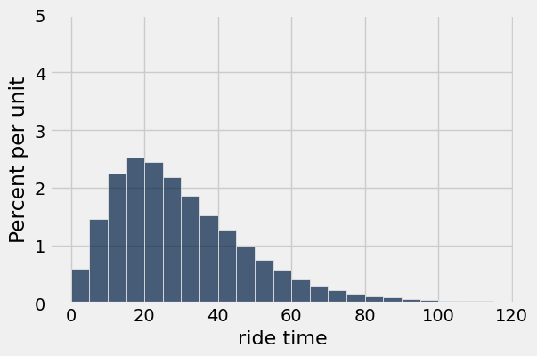

---

**Question 2.3.** Let's take a closer look at the y-axis label. Assign `unit_meaning` to an integer (1, 2, 3) that corresponds to the "unit" in "Percent per unit". **(7 Points)**

1. minute  
2. ride time  
3. second

**Student scaffold:**

```python
unit_meaning = ...
unit_meaning
```

**Solution:**

```python
unit_meaning = 1 # SOLUTION
unit_meaning
```

*Output:*

```text
1
```

**Test — `q2_3` (7 points)**

```python
>>> 1 <= unit_meaning <= 3
True

>>> from hw03_check import correctness_check_2_3
>>> correctness_check_2_3(unit_meaning)
True
```

---

**Question 2.4.** Assign `boston_under_15` and `manila_under_15` to the percentage of rides that are less than 15 minutes in their respective metropolitan areas. Use the height variables provided below in order to compute the percentages. Your solution should only use height variables, numbers, and mathematical operations. You should **not** access the tables `boston` and `manila` in any way. **(8 Points)**

> ***Note:*** that the height variables (i.e. `boston_under_5`) represent the height of the bin it describes.

**Student scaffold:**

```python
boston_under_5_bin_height = 1.2
manila_under_5_bin_height = 0.6
boston_5_to_under_10_bin_height = 3.2
manila_5_to_under_10_bin_height = 1.4
boston_10_to_under_15_bin_height = 4.9
manila_10_to_under_15_bin_height = 2.2

boston_under_15 = ...
manila_under_15 = ...

boston_under_15, manila_under_15
```

**Solution:**

```python
boston_under_5_bin_height = 1.2
manila_under_5_bin_height = 0.6
boston_5_to_under_10_bin_height = 3.2
manila_5_to_under_10_bin_height = 1.4
boston_10_to_under_15_bin_height = 4.9
manila_10_to_under_15_bin_height = 2.2

boston_under_15 = 5*boston_under_5_bin_height + 5*boston_5_to_under_10_bin_height + 5*boston_10_to_under_15_bin_height # SOLUTION
manila_under_15 = 5*manila_under_5_bin_height + 5*manila_5_to_under_10_bin_height + 5*manila_10_to_under_15_bin_height # SOLUTION

boston_under_15, manila_under_15
```

*Output:*

```text
(46.5, 21.0)
```

**Test — `q2_4` (8 points)**

```python
>>> boston_under_15 >= 0 and boston_under_15 <= 100
True

>>> manila_under_15 >= 0 and manila_under_15 <= 100
True

>>> from hw03_check import boston_check
>>> boston_check(boston_under_15)
True

>>> from hw03_check import manila_check
>>> manila_check(manila_under_15)
True
```

---

**Question 2.5.** Let's take a closer look at the distribution of ride times in Boston. Assign `boston_median_bin` to an integer (1, 2, 3, or 4) that corresponds to the bin that contains the median time. **(6 Points)**

1. 0-8 minutes  
2. 8-14 minutes  
3. 14-20 minutes  
4. 20-40 minutes  

*Hint:* The median of a sorted list has half of the list elements to its left, and half to its right.

**Student scaffold:**

```python
boston_median_bin = ...
boston_median_bin
```

**Solution:**

```python
boston_median_bin = 3 # SOLUTION
boston_median_bin
```

*Output:*

```text
3
```

**Test — `q2_5` (6 points)**

```python
>>> 1 <= boston_median_bin <= 4
True

>>> from hw03_check import correctness_check_2_5
>>> correctness_check_2_5(boston_median_bin)
True
```

---

**Question 2.6.** Identify the main differences between the two histograms, in terms of the statistical properties.

Assign all correct statements to the array `histogram_answer` (e.g. `histogram_answer = make_array(1,2,3)`).
> *Hint*: Without performing any calculations, what can you observe about the average or skew of each histogram? A distribution has a right skew if it has a long right “tail” of values. **(4 Points)**

1. Manila had a higher average ride time than Boston.
2. Boston had a higher average ride time than Manila.
3. The Manila histogram was more right skewed than the Boston histogram.
3. The Boston histogram was more right skewed than the Manila histogram.

**Student scaffold:**

```python
histogram_answer = ...
```

**Solution:**

```python
histogram_answer = make_array(1,3) # SOLUTION
```

**Test — `q2_6` (4 points)**

```python
>>> from hw03_check import correctness_check_2_6
>>> correctness_check_2_6(histogram_answer)
True
```

--- 

**Question 2.7.** Boston is known to have very cold winters, while Manila is known for having heavy traffic. These factors might help to explain the differences you observed in Question 2.6. 

Assign all statements that would support our observations about Boston and Manila ride times to the array `difference_factors`. **(4 Points)**

1. Boston’s colder weather encourages people to substitute walking with short rides, leading to shorter ride times on average.
2. Boston’s colder weather results in weather-related delays, leading to longer ride times on average.
3. Manila's heavy traffic encourages people to avoid traveling long distances, leading to shorter ride times on average.
4. Manila's heavy traffic causes frequent delays, leading to longer ride times on average.

**Student scaffold:**

```python
difference_factors = ...
```

**Solution:**

```python
difference_factors = make_array(1,4) # SOLUTION
```

**Test — `q2_7` (4 points)**

```python
>>> from hw03_check import correctness_check_2_7
>>> correctness_check_2_7(difference_factors)
True
```

---
## 3. Histograms

Consider the following scatter plot: 

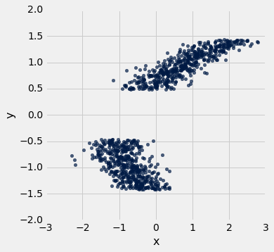

The axes of the plot represent values of two variables: $x$ and $y$.

Suppose we have a table called `t` that has two columns in it:

- `x`: a column containing the x-values of the points in the scatter plot
- `y`: a column containing the y-values of the points in the scatter plot

Below, you are given three histograms—one corresponds to column `x`, one corresponds to column `y`, and one does not correspond to either column.

**Histogram A:**
 
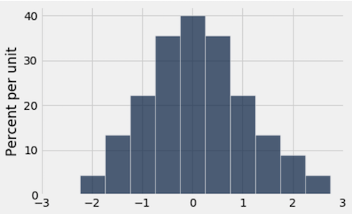

**Histogram B:**

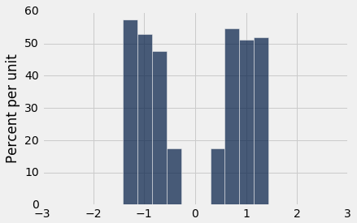

**Histogram C:**

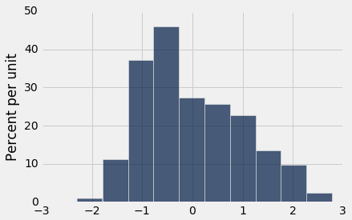

---

**Question 3.1.** Suppose we run `t.hist('x')`. Which histogram does this code produce? Assign `histogram_column_x` to either 1, 2, or 3. **(7 Points)**

1. Histogram A
2. Histogram B
3. Histogram C

**Student scaffold:**

```python
histogram_column_x = ...
```

**Solution:**

```python
histogram_column_x = 3 # SOLUTION
```

**Test — `q3_1` (7 points)**

```python
>>> histogram_column_x == 1 or histogram_column_x == 2 or histogram_column_x == 3
True

>>> from hw03_check import correctness_check_3_1
>>> correctness_check_3_1(histogram_column_x)
True
```

---

**Question 3.2.** Select all valid reasons why you chose the histogram from Question 1, and assign your answers to the array `histogram_reasoning_x`. **(5 Points)**

1. Since the scatter plot shows two roughly symmetric clusters to the left and right of 0 (on the $x$-axis), the histogram for $x$ should be approximately symmetric around 0.
2. Because there are no signficiant gaps in the values of the $x$-variable, we would expect the histogram for $x$ to have no gaps in it.
3. Since the scatter plot shows two distinct clusters, the histogram of $x$ should have two peaks with an empty gap between them.
4. The values of the $x$-variable range from approximately -2 to 3, so the histogram must also have a range of values from approximately -2 to 3.
5. Because the two clusters on the scatter plot overlap in the area between -1 and 0, we would expect the bins to be taller around the -1 to 0 area of the histogram, since each vertical slice in this range contains more points.

**Student scaffold:**

```python
histogram_reasoning_x = ...
```

**Solution:**

```python
histogram_reasoning_x = make_array(2,4,5) # SOLUTION
```

**Test — `q3_2` (5 points)**

```python
>>> from hw03_check import correctness_check_3_2
>>> correctness_check_3_2(histogram_reasoning_x)
True
```

---

**Question 3.3.** Suppose we run `t.hist('y')`. Which histogram does this code produce? Assign `histogram_column_y` to either 1, 2, or 3. **(7 Points)**

1. Histogram A
2. Histogram B
3. Histogram C

**Student scaffold:**

```python
histogram_column_y = ...
```

**Solution:**

```python
histogram_column_y = 2 # SOLUTION
```

**Test — `q3_3` (7 points)**

```python
>>> histogram_column_y == 1 or histogram_column_y == 2 or histogram_column_y == 3
True

>>> from hw03_check import correctness_check_3_3
>>> correctness_check_3_3(histogram_column_y)
True
```

---

**Question 3.4.** Select all valid reasons why you chose the histogram from Question 3, and assign your answers to the array `histogram_reasoning_y` **(5 Points)**

1. Since the scatter plot shows two roughly symmetric clusters to the left and right of 0 (on the $y$-axis), the histogram for $y$ should be approximately symmetric around 0.
2. The values of the $y$-variable range from approximately -1.5 to 1.5, so the histogram must also have a range of values from approximately -1.5 to 1.5.
3. Since the scatter plot shows two distinct clusters, the histogram of $y$ should have two peaks with an empty gap between them.
4. There is a are no gaps in the points in the $y$-direction, so we would not expect a gap in the histogram of those values.
5. Because the two masses on the scatter plot overlap in the area between -1 and 0, we would expect the bins to be taller around the -1 to 0 area of the histogram, since each vertical slice in this range contains more points.

**Student scaffold:**

```python
histogram_reasoning_y = ...
```

**Solution:**

```python
histogram_reasoning_y = make_array(1,2,3) # SOLUTION
```

**Test — `q3_4` (5 points)**

```python
>>> from hw03_check import correctness_check_3_4
>>> correctness_check_3_4(histogram_reasoning_y)
True
```

---

You're done with Homework 3!  

**Important submission steps:** 
1. Run the tests and verify that they all pass.
2. Choose **Save Notebook** from the **File** menu, then **run the final cell**. 
3. Click the link to download the zip file.
4. Go to [Pensieve](https://www.pensieve.co/) and submit the zip file to the corresponding assignment. The name of this assignment is "Homework 03 Autograder". 

**It is your responsibility to make sure your work is saved before running the last cell.**

---

To double-check your work, the cell below will rerun all of the autograder tests.

## Submission

Make sure you have run all cells in your notebook in order before running the cell below, so that all images/graphs appear in the output. The cell below will generate a zip file for you to submit. **Please save before exporting!**

---

## Datasets

Datasets this notebook loads with `Table.read_table`. Column names are exact, including spaces and capitalization. Only the schema is recorded here — the data itself is not in this document, so any question about its values must be answered by running code, not by reasoning over the rows shown elsewhere in this file.

### `nst-est2016-alldata.csv`

57 rows, 106 columns.

| Column | Type |
| --- | --- |
| `SUMLEV` | int |
| `REGION` | str |
| `DIVISION` | str |
| `STATE` | int |
| `NAME` | str |
| `CENSUS2010POP` | int |
| `ESTIMATESBASE2010` | int |
| `POPESTIMATE2010` | int |
| `POPESTIMATE2011` | int |
| `POPESTIMATE2012` | int |
| `POPESTIMATE2013` | int |
| `POPESTIMATE2014` | int |
| `POPESTIMATE2015` | int |
| `POPESTIMATE2016` | int |
| `NPOPCHG_2010` | int |
| `NPOPCHG_2011` | int |
| `NPOPCHG_2012` | int |
| `NPOPCHG_2013` | int |
| `NPOPCHG_2014` | int |
| `NPOPCHG_2015` | int |
| `NPOPCHG_2016` | int |
| `BIRTHS2010` | int |
| `BIRTHS2011` | int |
| `BIRTHS2012` | int |
| `BIRTHS2013` | int |
| `BIRTHS2014` | int |
| `BIRTHS2015` | int |
| `BIRTHS2016` | int |
| `DEATHS2010` | int |
| `DEATHS2011` | int |
| `DEATHS2012` | int |
| `DEATHS2013` | int |
| `DEATHS2014` | int |
| `DEATHS2015` | int |
| `DEATHS2016` | int |
| `NATURALINC2010` | int |
| `NATURALINC2011` | int |
| `NATURALINC2012` | int |
| `NATURALINC2013` | int |
| `NATURALINC2014` | int |

_... 66 more columns, all mixed_

### `boston.csv`

200,000 rows, 4 columns.

| Column | Type |
| --- | --- |
| `sourceid` | int |
| `dstid` | int |
| `hod` | int |
| `ride time` | float |

### `manila.csv`

200,000 rows, 4 columns.

| Column | Type |
| --- | --- |
| `sourceid` | int |
| `dstid` | int |
| `hod` | int |
| `ride time` | float |


---

# hw04

---
title: "Homework 4: Functions, Tables, and Groups"
assignment: hw04
semester: sp26
source: semester_assignments/sp26/hw/hw04/autograder/hw04.ipynb
version: solution (autograder) with student scaffolds
student_source: semester_assignments/sp26/hw/hw04/student/hw04.ipynb
total_points: 87
language: python
---


# Homework 4: Functions, Tables, and Groups

Please complete this notebook by filling in the cells provided. Before you begin, execute the previous cell to load the provided tests.

**Helpful Resource:**
- [Python Reference](http://data8.org/su26/reference/): Cheat sheet of helpful array & table methods used in Data 8!

**Recommended Readings**: 

* [Visualizing Numerical Distributions](https://www.inferentialthinking.com/chapters/07/2/Visualizing_Numerical_Distributions.html)
* [Functions and Tables](https://www.inferentialthinking.com/chapters/08/Functions_and_Tables.html)

Please complete this notebook by filling in the cells provided. **Before you begin, execute the cell below to setup the notebook by importing some helpful libraries.** Each time you start your server, you will need to execute this cell again.

For all problems that you must write explanations and sentences for, you **must** provide your answer in the designated space. Moreover, throughout this homework and all future ones, **please be sure to not re-assign variables throughout the notebook!** For example, if you use `max_temperature` in your answer to one question, do not reassign it later on. Otherwise, you will fail tests that you thought you were passing previously!

**Deadline:**

This assignment is **due Wednesday, 2/18 at 11:00am PT**. Submissions after this time will be accepted for 24 hours and will incur a 20% penalty. Any submissions later than this 24 hour period will not be accepted unless an extension has been granted as per the [syllabus](http://data8.org/su26/syllabus/) page. Turn it in by Tuesday, 2/17 at 11:00am PT for 5 extra credit points.

Directly sharing answers is not okay, but discussing problems with the course staff or with other students is encouraged. Refer to the [syllabus](https://www.data8.org/su26/syllabus) page to learn more about how to learn cooperatively.

You should start early so that you have time to get help if you're stuck. Office hours are held Monday through Friday in [Warren Hall](https://www.berkeley.edu/map/warren-hall/) and online. The office hours schedule appears on our [OH page](https://www.data8.org/su26/calendar/).

---

The point breakdown for this assignment is given in the table below:
| Category | Points |
| --- | --- |
| Autograder (Coding questions) | 88 |
| Written | 12 |
| **Total** | 100 |

---
## 0. Midterm Accommodations Form

---

**Question 1.** The DATA C8 Spring 2026 Midterm Exam will take place on **Tuesday, March 10th from 8:00 PM to 10:00 PM PT**. Please complete this form so that we can best accommodate you for the midterm.
_**All students are required to fill out this form**_. The deadline to submit this form is **Friday, February 20th by 11:59PM.** The link can be found below. **(1 Point)**

- [Spring 2026 Midterm Accommodations Survey](https://docs.google.com/forms/d/e/1FAIpQLSd4ZbnAQjE9bULhBMMuij4vcgtS9ehtYSO7RgGOZc4dymGKZA/viewform?usp=dialog)

Assign `secret_phrase` to the secret phrase given at the end of the accommodations survey. Make sure the phrase is in quotes (i.e. is a string)!

**Student scaffold:**

```python
secret_phrase = ...
```

**Solution:**

```python
secret_phrase = "valentine" #SOLUTION
```

**Test — `q0_1`**

```python
>>> type(secret_phrase) == str
True

>>> from hw04_check import correctness_check_0
>>> correctness_check_0(secret_phrase)
True
```

---
## 1. 2023 Cal Football Season

**Code:**

```python
# Run this cell to set up the notebook, but please don't change it.

# These lines import the Numpy and Datascience modules.
import numpy as np
from datascience import *

# These lines do some fancy plotting magic.
import matplotlib
%matplotlib inline
import matplotlib.pyplot as plt
plt.style.use('fivethirtyeight')

import warnings
warnings.simplefilter('ignore', FutureWarning)
warnings.filterwarnings("ignore")
```

Marissa and Tiffany are trying to analyze how well the Cal football team performed in the 2023 season. A football game is divided into four periods, called quarters. The number of points Cal scored in each quarter and the number of points their opponent scored in each quarter are stored in a table called `cal_fb.csv`.

**Code:**

```python
# Just run this cell
# Read in the cal_fb csv file
games = Table().read_table("cal_fb.csv")
games.show()
```

*Output:*

| Opponent | Cal 1Q | Cal 2Q | Cal 3Q | Cal 4Q | Opp 1Q | Opp 2Q | Opp 3Q | Opp 4Q |
| --- | --- | --- | --- | --- | --- | --- | --- | --- |
| North Texas | 14 | 19 | 15 | 10 | 7 | 14 | 0 | 0 |
| Auburn | 3 | 7 | 0 | 0 | 0 | 7 | 0 | 7 |
| Idaho | 0 | 14 | 14 | 3 | 10 | 7 | 0 | 0 |
| Washington | 6 | 6 | 7 | 13 | 24 | 21 | 7 | 7 |
| Arizona State | 7 | 3 | 7 | 7 | 7 | 0 | 6 | 8 |
| Oregon State | 0 | 17 | 15 | 8 | 7 | 14 | 14 | 17 |
| Utah | 7 | 0 | 7 | 0 | 0 | 14 | 10 | 10 |
| USC | 14 | 14 | 8 | 13 | 17 | 0 | 12 | 21 |
| Oregon | 10 | 3 | 6 | 0 | 14 | 21 | 7 | 21 |
| Washington State | 14 | 14 | 0 | 14 | 7 | 14 | 3 | 15 |
| Stanford | 7 | 7 | 7 | 6 | 3 | 3 | 9 | 0 |
| UCLA | 6 | 14 | 0 | 13 | 0 | 7 | 0 | 0 |
| Texas Tech | 14 | 0 | 0 | 0 | 7 | 17 | 7 | 3 |

Let's start by finding the total points each team scored in a game.

---

**Question 1.1.** Write a function called `sum_scores`.  It should take in four arguments, where each argument represents an integer corresponding to the team's score for each quarter. It should return the team's total score for that game as an integer. **(2 Points)**

*Hint:* Don't overthink this question!

**Student scaffold:**

```python
def sum_scores(..., ..., ..., ...):
    '''Returns the total score calculated by adding up the score of each quarter'''
    ...

sum_scores(14, 7, 3, 0) #DO NOT CHANGE THIS LINE
```

**Solution:**

```python
""" # BEGIN PROMPT  
def sum_scores(..., ..., ..., ...):
    '''Returns the total score calculated by adding up the score of each quarter'''
    ...
"""; # END PROMPT
# BEGIN SOLUTION NO PROMPT
def sum_scores(q1, q2, q3, q4):
    return q1 + q2 + q3 + q4
# END SOLUTION

sum_scores(14, 7, 3, 0) #DO NOT CHANGE THIS LINE
```

*Output:*

```text
24
```

**Test — `q1_1` (2 points)**

```python
>>> sum_scores(2, 3, 6, 1)
12

>>> sum_scores(-2, 3, 5, -10)
-4
```

---

**Question 1.2.** Create a new table `final_scores` with three columns in this *specific* order: `Opponent`, `Cal Score`, `Opponent Score`. You will have to create the `Cal Score` and `Opponent Score` columns. Use the function `sum_scores` you just defined in the previous question for this problem. **(4 Points)**

*Hint:* If you want to apply a function that takes in multiple arguments, you can pass multiple column names as arguments in `tbl.apply()`. The column values will be passed into the corresponding arguments of the function. Take a look at the [Python Reference](https://www.data8.org/su26/reference/)  and Lecture 9's demo for syntax.

*Note:* If you’re running into issues creating `final_scores`, check that `cal_scores` and `opp_scores` output what you want. If you're encountering `TypeError`s, check the [Python Reference](https://www.data8.org/su26/reference/) to see if the inputs/outputs of the function are what you expect.

**Student scaffold:**

```python
cal_scores = ...
opp_scores = ...
final_scores = ...
final_scores
```

**Solution:**

```python
cal_scores = games.apply(sum_scores, "Cal 1Q","Cal 2Q", "Cal 3Q", "Cal 4Q") # SOLUTION
opp_scores = games.apply(sum_scores, "Opp 1Q", "Opp 2Q", "Opp 3Q", "Opp 4Q") # SOLUTION
final_scores = games.with_columns("Cal Score", cal_scores, "Opponent Score", opp_scores).select("Opponent", "Cal Score", "Opponent Score") # SOLUTION
final_scores
```

*Output:*

| Opponent | Cal Score | Opponent Score |
| --- | --- | --- |
| North Texas | 58 | 21 |
| Auburn | 10 | 14 |
| Idaho | 31 | 17 |
| Washington | 32 | 59 |
| Arizona State | 24 | 21 |
| Oregon State | 40 | 52 |
| Utah | 14 | 34 |
| USC | 49 | 50 |
| Oregon | 19 | 63 |
| Washington State | 42 | 39 |

**Test — `q1_2` (4 points)**

```python
>>> final_scores.num_columns
3

>>> final_scores.num_rows
13

>>> set(['Opponent', 'Cal Score', 'Opponent Score']) == set(final_scores.labels)
True

>>> isinstance(final_scores.column(0).item(0), str)
True

>>> isinstance(final_scores.column(1).item(0), int)
True

>>> from hw04_check import correctness_check_1_2
>>> correctness_check_1_2(final_scores, games, sum_scores)
True
```

We can get specific row objects from a table. You can use `tbl.row(n)` to get the `n`th row of a table. `row.item("column_name")` will allow you to select the element that corresponds to `column_name` in a particular row. Here's an example:

**Code:**

```python
# Just run this cell
# We got the Axe!
games.row(10) # <-- this will return a row object
```

*Output:*

```text
Row(Opponent='Stanford', Cal 1Q=7, Cal 2Q=7, Cal 3Q=7, Cal 4Q=6, Opp 1Q=3, Opp 2Q=3, Opp 3Q=9, Opp 4Q=0)
```

**Code:**

```python
# Just run this cell
games.row(10).item("Cal 4Q") # <-- this will return a item (e.g. an int) from a row object
```

*Output:*

```text
6
```

---

**Question 1.3.** We want to see whether or not Cal lost for a particular game. Write a function called `did_cal_lose`.  It should take one argument: a **row object** from the `final_scores` table. It should return either `True` if Cal's score was less than the Opponent's score, and `False` otherwise. **(4 Points)**

*Note 1*: "Row object" means a row from the table extracted (behind the scenes) using `tbl.row(index)` that contains all the data for that specific row. It is **not** the index of a row. Do not try and call `final_scores.row(game_row)` inside of the function.

*Note 2*: If you're still confused by row objects, try printing out `final_scores.row(1)` in a new cell to visually see what it looks like! This piece of code is pulling out the row object located at index 1 of the `final_scores` table and returning it. When you display it in a cell, you'll see that it is not located within a table, but is instead a standalone row object! How can you access the relevant information within this row object?

Hint: You can use comparators like <, >, <=, >=, ==, and != to compare items from a row object

**Student scaffold:**

```python
def did_cal_lose(game_row):
    ...

did_cal_lose(final_scores.row(1)) #DO NOT CHANGE THIS LINE
```

**Solution:**

```python
""" # BEGIN PROMPT
def did_cal_lose(game_row):
    ...
"""; # END PROMPT
# BEGIN SOLUTION NO PROMPT
def did_cal_lose(game_row):
    return game_row.item("Cal Score") < game_row.item("Opponent Score")
# END SOLUTION

did_cal_lose(final_scores.row(1)) #DO NOT CHANGE THIS LINE
```

*Output:*

```text
True
```

**Test — `q1_3` (4 points)**

```python
>>> 'did_cal_lose' in globals()
True

>>> did_cal_lose(final_scores.row(1))
True

>>> from hw04_check import correctness_check_1_3
>>> correctness_check_1_3(did_cal_lose, final_scores)
True

>>> from hw04_check import same_score_check_1_3
>>> same_score_check_1_3(did_cal_lose)
True
```

---

**Question 1.4.** Marissa and Tiffany want to see how Cal did against every opponent during the 2023 season. Using the `final_scores` table:

1. Assign `results_array` to an array of `True` and `False` boolean values that correspond to whether or not Cal lost.
2. Add `results_array` to the `final_scores` table in a column named `Results`, and assign this to `final_scores_with_results`.
3. Then, respectively assign the number of wins and losses Cal had to `cal_wins` and `cal_losses`.

**(7 Points)**

*Hint*: `tbl.apply()` might be helpful. Refer to the [Python Reference](https://www.data8.org/su26/reference/) if you're unsure how it works!

**Student scaffold:**

```python
results_array = ...
final_scores_with_results = ...
cal_losses = ...
cal_wins = ...

# Don't delete or edit the following line:
print(f"In the 2023 Season, Cal Football won {cal_wins} games and lost {cal_losses} games. Go Bears! 🐻")
```

**Solution:**

```python
results_array = final_scores.apply(did_cal_lose) # SOLUTION
final_scores_with_results = final_scores.with_columns("Results", results_array) # SOLUTION
cal_losses = final_scores_with_results.where("Results", True).num_rows # SOLUTION
cal_wins = final_scores_with_results.num_rows - cal_losses # SOLUTION

# Don't delete or edit the following line:
print(f"In the 2023 Season, Cal Football won {cal_wins} games and lost {cal_losses} games. Go Bears! 🐻")
```

*Output (stdout):*

```text
In the 2023 Season, Cal Football won 6 games and lost 7 games. Go Bears! 🐻
```

**Test — `q1_4` (7 points)**

```python
>>> 0 <= cal_wins <= 13
True

>>> 0 <= cal_losses <= 13
True

>>> 'Results' in final_scores_with_results.labels
True

>>> from hw04_check import correctness_check_1_4
>>> correctness_check_1_4(cal_wins, cal_losses)
True

>>> from hw04_check import results_array_check_1_4
>>> results_array_check_1_4(results_array)
True
```

---
## 2. Burrito-ful San Diego

Brandon, Carisma and Dagny are trying to use Data Science to find the best burritos in San Diego! Their friends Dylan, Isaac, and Mariel provided them with two comprehensive datasets on burrito establishments in the San Diego area, taken and cleaned from [here](https://www.kaggle.com/srcole/burritos-in-san-diego/data).

The following cell reads in a table called `ratings` which contains names of burrito restaurants, along with their Yelp rating, Google rating, and overall rating. The `Overall` rating is not an average of the `Yelp` and `Google` ratings, but rather it is the overall rating of the customers that were surveyed in the study above.


It also reads in a table called `burritos_types` which contains names of burrito restaurants, their menu items, and the cost of the respective menu item at the restaurant.

**Code:**

```python
# Just run this cell
ratings = Table.read_table("ratings.csv")
ratings.show(5)
burritos_types = Table.read_table("burritos_types.csv").drop(0)
burritos_types.show(5)
```

*Output:*

| Name | Yelp | Google | Overall |
| --- | --- | --- | --- |
| Albertacos | 3.5 | 3.9 | 3.45 |
| Burrito Factory | 4.5 | 4.8 | 3.5 |
| Burros and Fries | 3.5 | 4.1 | 3.575 |
| Caliente Mexican Food | 3.5 | 4.4 | 3.25 |
| California Burrito Company | 3.5 | 4.4 | 3.2 |

*Output:*

| Name | Menu_Item | Cost |
| --- | --- | --- |
| Albertacos | California | 5.7 |
| Albertacos | Carne Asada | 5.25 |
| Alberto's 623 N Escondido Blvd, Escondido, CA 92025 | Carne Asada | 4.59 |
| Burrito Box | Steak With Guacamole | 11.5 |
| Burrito Factory | Steak Everything | 7.35 |

---

**Question 2.1.** It would be easier if we could combine the information in both tables. Assign `burritos` to the result of joining the two tables together, so that we have a table with the ratings for every corresponding menu item from every restaurant. Each menu item has the same rating as the restaurant from which it is from. **(7 Points)**

*Note:* It doesn't matter which table you put in as the argument to the table method, either order will work for the autograder tests.

*Hint:* Which function lets us combine information from two tables? Refer to the [Python Reference Sheet](http://data8.org/su26/reference/) if you're unsure!

**Student scaffold:**

```python
burritos = ...
burritos.show(10)
```

**Solution:**

```python
burritos = burritos_types.join("Name", ratings) # SOLUTION
burritos.show(10)
```

*Output:*

| Name | Menu_Item | Cost | Yelp | Google | Overall |
| --- | --- | --- | --- | --- | --- |
| Albertacos | California | 5.7 | 3.5 | 3.9 | 3.45 |
| Albertacos | Carne Asada | 5.25 | 3.5 | 3.9 | 3.45 |
| Burrito Factory | Steak Everything | 7.35 | 4.5 | 4.8 | 3.5 |
| Burros and Fries | California | 7.19 | 3.5 | 4.1 | 3.575 |
| Burros and Fries | Carne Asada | 6.89 | 3.5 | 4.1 | 3.575 |
| Burros and Fries | Shrimp California | 6.99 | 3.5 | 4.1 | 3.575 |
| Caliente Mexican Food | California | 6.47 | 3.5 | 4.4 | 3.25 |
| Caliente Mexican Food | Carne Asada | 5.56 | 3.5 | 4.4 | 3.25 |
| Caliente Mexican Food | Fried Fish | 5.56 | 3.5 | 4.4 | 3.25 |
| California Burrito Company | California | 5.5 | 3.5 | 4.4 | 3.2 |

**Test — `q2_1` (7 points)**

```python
>>> set(['Name', 'Menu_Item', 'Yelp', 'Google', 'Overall', 'Cost']) == set(burritos.labels)
True

>>> burritos.num_rows == 212
True

>>> from hw04_check import correctness_check_2_1
>>> correctness_check_2_1(burritos)
True
```

---

**Question 2.2.** Let's look at how the Yelp scores compare to the Google scores in the `burritos` table. First, assign `yelp_google_tbl` to a table only containing the columns `Yelp` and `Google`. Then, make a scatter plot with Yelp scores on the x-axis and the Google scores on the y-axis. **(6 Points)**

**Student scaffold:**

```python
yelp_google_tbl = ...
...

# Don't change/edit/remove the following line.
# To help you make conclusions, we have plotted a straight line on the graph (y=x).
plt.plot(np.arange(2.5,5,.5), np.arange(2.5,5,.5));
```

**Solution:**

```python
yelp_google_tbl = burritos.select("Yelp", "Google") # SOLUTION
yelp_google_tbl.scatter("Yelp", "Google") # SOLUTION

# Don't change/edit/remove the following line.
# To help you make conclusions, we have plotted a straight line on the graph (y=x).
plt.plot(np.arange(2.5,5,.5), np.arange(2.5,5,.5));
```

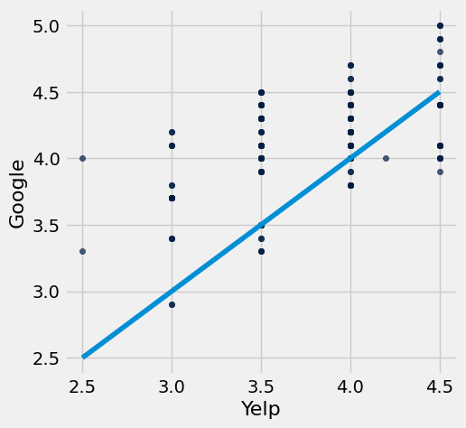

---

**Question 2.3.** Looking at the scatter plot you just made in Question 2.2, what patterns and relationships do you observe between Yelp and Google ratings? Assign your answers to the array `ratings_observations`. **(7 Points)**

1. The Google ratings are consistently lower than the Yelp ratings.

2. The Google ratings are consistently higher than the Yelp ratings.

3. The Google ratings and Yelp ratings are about the same on average.

4. There is a positive association between Google and Yelp ratings.

5. There is a negative association between Google and Yelp ratings.

6. There is no association between Google and Yelp ratings.

**Student scaffold:**

```python
ratings_observations = make_array(...)
```

**Solution:**

```python
"""# BEGIN PROMPT
ratings_observations = make_array(...)
"""; # END PROMPT
ratings_observations = make_array(2,4) # SOLUTION NO PROMPT
```

**Test — `q2_3` (7 points)**

```python
>>> from hw04_check import correctness_check_2_3
>>> correctness_check_2_3(ratings_observations)
True
```

Here's a refresher on how `.group` works! You can read how `.group` works in the [textbook](https://www.inferentialthinking.com/chapters/08/2/Classifying_by_One_Variable.html), or you can view the video below. The video resource was made by a past staff member, Divyesh Chotai!

You can also use the [Table Functions Visualizer](http://data8.org/interactive_table_functions/) to get some more hands-on experience with the `.group` function.

**Code:**

```python
# Don't worry about what this code does! It simply embeds a YouTube video into a code cell.
from IPython.display import YouTubeVideo
YouTubeVideo("HLoYTCUP0fc")
```

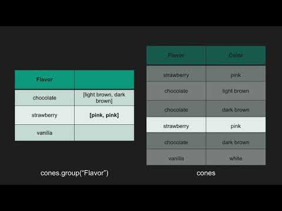

---

**Question 2.4.** There are so many types of California burritos in the `burritos` table! Carisma wants to consider her options for burritos based on rankings. For the sake of these questions, we are treating each menu item's rating the same as its respective restaurant's, as we do not have the rating of every single item at these restaurants. You do not need to worry about this fact, but we thought to mention it!

Create a table with two columns: the first column includes the **names of the burritos** and the second column should contain the **average overall rating** of that burrito across restaurants. **In your calculations, you should only compare burritos that contain the word "California".** For example, there are "California" burritos, "California Breakfast" burritos, "California Surf And Turf" burritos, etc. **(7 Points)**

*Hint:* “California” is case sensitive (“California” is not the same as “california”), so we only want burrito names containing “California” not “california”! 

*Note:* For reference, the staff solution only used one line. However, feel free to break up the solution into multiple lines and steps; just make sure you assign the final output table to `california_burritos`!

**Student scaffold:**

```python
california_burritos = ...
california_burritos
```

**Solution:**

```python
california_burritos = burritos.where("Menu_Item", are.containing("California")).select("Menu_Item", "Overall").group("Menu_Item", np.average) # SOLUTION
california_burritos
```

*Output:*

| Menu_Item | Overall average |
| --- | --- |
| California | 3.5242 |
| California (Only Cheese) | 4.1 |
| California + Guac + Sour Cream | 3.4 |
| California - Chicken | 3.45839 |
| California - Pork Adobada | 3.26429 |
| California - Steak | 3.26429 |
| California Breakfast | 2.75833 |
| California Chicken | 3.54815 |
| California Chipotle | 4.36667 |
| California Everything | 4.1 |

**Test — `q2_4` (7 points)**

```python
>>> california_burritos.num_columns == 2
True

>>> california_burritos.num_rows == 19
True

>>> from hw04_check import results_array_check_2_4
>>> results_array_check_2_4(california_burritos)
True
```

---

**Question 2.5.** Given this new table `california_burritos`, Dagny can figure out the name of the California burrito with the highest overall average rating! Assign `best_california_burrito` to a line of code that outputs the string that represents the name of the California burrito with the highest overall average rating. If multiple burritos satisfy this criteria, you can output any one of them. **(7 Points)**

**Student scaffold:**

```python
best_california_burrito = ...
best_california_burrito
```

**Solution:**

```python
best_california_burrito = california_burritos.sort("Overall average", descending=True).column("Menu_Item").item(0) # SOLUTION
best_california_burrito
```

*Output:*

```text
'California Chipotle'
```

**Test — `q2_5` (7 points)**

```python
>>> isinstance(best_california_burrito, (str, np.str_))
True

>>> from hw04_check import correctness_check_2_5
>>> correctness_check_2_5(best_california_burrito)
True
```

---

**Question 2.6.** Brandon thinks that burritos in San Diego are very affordable. Plot a histogram that visualizes the distribution of the costs of the burritos in the `burritos` table. Also use the provided `cost_bins` variable when making your histogram, so that the histogram is more visually informative. **(6 Points)**

**Student scaffold:**

```python
cost_bins = np.arange(0, 15, 1) # Do not change this line
# Please also use the provided bins
...
```

**Solution:**

```python
cost_bins = np.arange(0, 15, 1) # Do not change this line
# Please also use the provided bins
burritos.hist("Cost", bins = cost_bins) # SOLUTION
```

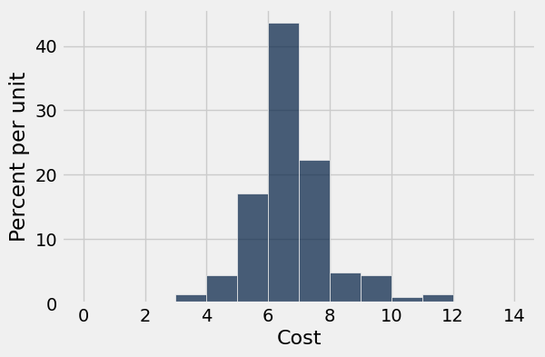

---

**Question 2.7.** What percentage of burritos in San Diego are less than $6? Assign `burritos_less_than_six` to your answer, **which should be between 0 and 100**. You should only use the histogram above to answer the question. Do not use code on the table to to find the answer, just eyeball the heights and use Python to evaluate your arithmetic! **(7 Points)**

*Note*: Your answer does not have to be exact, but it should be within a couple percentages of the staff answer.

*Hint:* It might be helpful to review [Section 7.2](https://inferentialthinking.com/chapters/07/2/Visualizing_Numerical_Distributions.html) of the textbook about calculating percentages from histograms.

**Student scaffold:**

```python
burritos_less_than_six = ...
```

**Solution:**

```python
burritos_less_than_six = 1 + 4 + 17.5 # SOLUTION
```

**Test — `q2_7` (7 points)**

```python
>>> 0 <= burritos_less_than_six <= 100
True

>>> from hw04_check import correctness_check_2_7
>>> correctness_check_2_7(burritos_less_than_six)
True
```

---
## 3. San Francisco City Employee Salaries

This exercise is designed to give you practice with using the Table methods `.pivot` and `.group`. Here is a link to the [Python Reference](http://data8.org/su26/reference/) in case you need a quick refresher. The [Table Function Visualizer](http://data8.org/interactive_table_functions/) may also be a helpful tool.

Run the cell below to view a demo on how you can use pivot on a table. (Thank you to past staff Divyesh Chotai!)

**Code:**

```python
# Don't worry about what this code does! It simply embeds a YouTube video into a code cell.
from IPython.display import YouTubeVideo
YouTubeVideo("4WzXo8eKLAg")
```

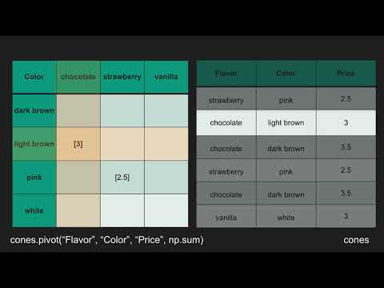

The data source we will use within this portion of the homework is [publicly provided](https://data.sfgov.org/City-Management-and-Ethics/Employee-Compensation/88g8-5mnd/data) by the City of San Francisco. We have filtered it to retain just the relevant columns and restricted the data to the calendar year 2019. Run the following cell to load our data into a table called `full_sf`.

**Code:**

```python
full_sf = Table.read_table("sf2019.csv")
full_sf.show(5)
```

*Output:*

| Organization Group | Department | Job Family | Job | Salary | Overtime | Benefits | Total Compensation |
| --- | --- | --- | --- | --- | --- | --- | --- |
| Public Protection | Adult Probation | Information Systems | IS Trainer-Journey | 91332 | 0 | 40059 | 131391 |
| Public Protection | Adult Probation | Information Systems | IS Engineer-Assistant | 123241 | 0 | 49279 | 172520 |
| Public Protection | Adult Probation | Information Systems | IS Business Analyst-Senior | 115715 | 0 | 46752 | 162468 |
| Public Protection | Adult Probation | Information Systems | IS Business Analyst-Principal | 159394 | 0 | 57312 | 216706 |
| Public Protection | Adult Probation | Information Systems | IS Programmer Analyst | 70035 | 0 | 28671 | 98706 |

The table has one row for each of the 44,525 San Francisco government employees in 2019.

The first four columns describe the employee's job. For example, the employee in the third row of the table had a job called "IS Business Analyst-Senior". We will call this the employee's *position* or *job title*. The job was in a Job Family called Information Systems (hence the IS in the job title), and was in the Adult Probation Department that is part of the Public Protection Organization Group of the government. You will mostly be working with the `Job` column.

The next three columns contain the dollar amounts paid to the employee in the calendar year 2019 for salary, overtime, and benefits. Note that an employee’s salary does not include their overtime earnings.

The last column contains the total compensation paid to the employee. It is the sum of the previous three columns:

$$\text{Total Compensation} = \text{Salary} + \text{Overtime} + \text{Benefits}$$

For this homework, we will be using the following columns:
1. `Organization Group`: A group of departments. For example, the Public Protection Org. Group includes departments such as the Police, Fire, Adult Protection, District Attorney, etc.
2. `Department`: The primary organizational unit used by the City and County of San Francisco.
3. `Job`: The specific position that a given worker fills.
4. `Total Compensation`: The sum of a worker's salary, overtime, and benefits in 2019.


Run the following cell to select the relevant columns and create a new table named `sf`.

**Code:**

```python
sf = full_sf.select("Job", "Department", "Organization Group",  "Total Compensation")
sf.show(5)
```

*Output:*

| Job | Department | Organization Group | Total Compensation |
| --- | --- | --- | --- |
| IS Trainer-Journey | Adult Probation | Public Protection | 131391 |
| IS Engineer-Assistant | Adult Probation | Public Protection | 172520 |
| IS Business Analyst-Senior | Adult Probation | Public Protection | 162468 |
| IS Business Analyst-Principal | Adult Probation | Public Protection | 216706 |
| IS Programmer Analyst | Adult Probation | Public Protection | 98706 |

We want to use this table to generate arrays with the job titles of the members of each **Organization Group**.

---

**Question 3.1.** Set `job_titles` to a table with two columns. The first column should be called `Organization Group` and have the name of every "Organization Group" each listed only once in this column, and the second column should be called `Jobs`, with each row in that second column containing an *array* of the names of all the job titles within that "Organization Group". Don't worry if there are multiple of the same job titles. **(7 Points)**

*Hint 1:* Think about how `group` works: it collects values into an array and then applies a function to that array. We have defined two functions below for you, and you will need to use one of them in your call to `group`. 

*Hint 2:* You might need to rename one of the columns.

**Student scaffold:**

```python
# Pick one of the two functions defined below in your call to group.
def first_item(array):
    '''Returns the first item'''
    return array.item(0)

def full_array(array):
    '''Returns the array that is passed through'''
    return array 

# Make a call to group using one of the functions above when you define job_titles
job_titles = ...
job_titles
```

**Solution:**

```python
# Pick one of the two functions defined below in your call to group.
def first_item(array):
    '''Returns the first item'''
    return array.item(0)

def full_array(array):
    '''Returns the array that is passed through'''
    return array 

# Make a call to group using one of the functions above when you define job_titles
job_titles = sf.drop("Department", "Total Compensation").group("Organization Group", full_array).relabeled("Job full_array", 'Jobs') # SOLUTION
job_titles
```

*Output:*

| Organization Group | Jobs |
| --- | --- |
| Community Health | ['Painter Supervisor 1' 'Painter' 'Painter' ..., 'Nursin ... |
| Culture & Recreation | ['Electrician' 'Executive Secretary 2' 'Bldgs & Grounds ... |
| General Administration & Finance | ['Painter' 'Painter' 'Electrician' ..., 'Investigator, T ... |
| Human Welfare & Neighborhood Development | ['Dept Head I' 'Administrative Analyst' 'Community Devel ... |
| Public Protection | ['IS Trainer-Journey' 'IS Engineer-Assistant' 'IS Busine ... |
| Public Works, Transportation & Commerce | ['Heavy Equip Ops Asst Sprv' 'Heavy Equipment Ops Sprv' ... |

**Test — `q3_1` (7 points)**

```python
>>> job_titles.num_columns
2

>>> job_titles.num_rows
6

>>> np.asarray(job_titles.labels).item(1) != 'Job full_array'
True

>>> np.asarray(job_titles.labels).item(1) == 'Jobs'
True

>>> len(job_titles.where('Organization Group', 'Culture & Recreation').column('Jobs').item(0))
3938

>>> len(job_titles.where('Organization Group', 'Public Protection').column('Jobs').item(0))
8361
```

---

**Question 3.2.** At the moment, the `Job` column of the `sf` table is not sorted (i.e, the rows are in no particular order). Select all true options below, and assign your answers to the array `sort_then_group`.  **(7 Points)**

1. If we first sorted the `sf` table alphabetically by the `Job` column before calling `.group`, then the arrays generated in the `Jobs` column of the previous question would be **different**.

2. If we first sorted the `sf` table alphabetically by the `Job` column before calling `.group`, then the arrays generated in the `Jobs` column of the previous question would be the **same**.

3. If we first sorted the `sf` table alphabetically by the `Organization Group` column before calling `.group`, then the arrays generated in the `Jobs` column of the previous question would be **different**.

4. If we first sorted the `sf` table alphabetically by the `Organization Group` column before calling `.group`, then the arrays generated in the `Jobs` column of the previous question would be the **same**.

5. When we call `.group`, it does a sequential search of the table (from top to bottom) and collects the values array in the order in which they appear. Once it has passed through all of the rows, the function in the second argument of `.group` is applied to the sequential array of values. 

6. When we call `.group`, it does a sequential search of the table (from top to bottom) and collects the values array in the order in which they appear. Once it has passsed through all of the rows, it sorts the values in the array in alphabetical or ascending order. Next, the function in the second argument of `.group` is applied to the alphabetical array of values. 

*Note:* Two arrays are the **same** if they contain the same number of elements and the elements located at corresponding indexes in the two arrays are identical. An example of arrays that are NOT the same: `array([1,2]) != array([2,1])`.

**Student scaffold:**

```python
sort_then_group = make_array(...)
```

**Solution:**

```python
"""# BEGIN PROMPT
sort_then_group = make_array(...)
"""; # END PROMPT
sort_then_group = make_array(1, 4, 5) # SOLUTION NO PROMPT
```

**Test — `q3_2` (7 points)**

```python
>>> from hw04_check import correctness_check_3_2
>>> correctness_check_3_2(sort_then_group)
True
```

---

**Question 3.3.** Set `department_ranges` to a table containing departments as the rows, and the organization groups as the columns. The values in the rows should correspond to a total compensation range, where range is defined as the **difference between the highest total compensation and the lowest total compensation in the department for that organization group**. **(7 Points)**

*Hint:* First you'll need to define a new function `compensation_range` which takes in an array of compensations and returns the range of compensations in that array.

*Hint:* It’s okay if your table contains some "weird" values.

**Student scaffold:**

```python
# Define compensation_range first
...
    ...

department_ranges = ...
department_ranges
```

**Solution:**

```python
# Define compensation_range first
def compensation_range(compensation): # SOLUTION
    return max(compensation) - min(compensation) # SOLUTION

department_ranges = sf.pivot("Organization Group", "Department", "Total Compensation", compensation_range) # SOLUTION
department_ranges
```

*Output:*

| Department | Community Health | Culture & Recreation | General Administration & Finance | Human Welfare & Neighborhood Development | Public Protection | Public Works, Transportation & Commerce |
| --- | --- | --- | --- | --- | --- | --- |
| Academy Of Sciences | 0 | 199121 | 0 | 0 | 0 | 0 |
| Administrative Services | 0 | 0 | 478784 | 0 | 0 | 0 |
| Adult Probation | 0 | 0 | 0 | 0 | 303419 | 0 |
| Airport Commission | 0 | 0 | 0 | 0 | 0 | 445092 |
| Art Commission | 0 | 251823 | 0 | 0 | 0 | 0 |
| Asian Art Museum | 0 | 298230 | 0 | 0 | 0 | 0 |
| Assessor | 0 | 0 | 277385 | 0 | 0 | 0 |
| Board Of Appeals | 0 | 0 | 0 | 0 | 0 | 243582 |
| Board Of Supervisors | 0 | 0 | 293773 | 0 | 0 | 0 |
| Building Inspection | 0 | 0 | 0 | 0 | 0 | 340852 |

**Test — `q3_3` (7 points)**

```python
>>> compensation_range(make_array(5, 1, 20, 1000)) == 999
True

>>> set(['Department', 'Community Health', 'Culture & Recreation', 'General Administration & Finance', 'Human Welfare & Neighborhood Development', 'Public Protection', 'Public Works, Transportation & Commerce']) == set(department_ranges.labels)
True

>>> sum(department_ranges.column(1))
554179.0

>>> from hw04_check import correctness_check_3_3
>>> correctness_check_3_3(department_ranges, sf)
True
```

--- 

**Question 3.4.** You may noticed that some of the cell values are `0` in the `department_ranges` table from the previous question. Select all statements that correctly explain why a cell in `department_ranges` might be `0`. **(7 Points)**

1. A department could have employees in an organization group, but their compensation values may have been filtered out during the pivot, resulting in a salary range of 0.

2. A department could have exactly one employee in a given organization group, so the maximum and minimum compensation are the same, meaning the true salary range is 0.

3. All employees in a given department and organization group could have the same salary, so the maximum and minimum compensation are the same, meaning the true salary range is 0.

4. There could be missing data for a department/organization group pair.

**Student scaffold:**

```python
zero_values = make_array(...)
```

**Solution:**

```python
"""# BEGIN PROMPT
zero_values = make_array(...)
"""; # END PROMPT
zero_values = make_array(2,3,4) # SOLUTION NO PROMPT
```

**Test — `q3_4` (7 points)**

```python
>>> from hw04_check import correctness_check_3_4
>>> correctness_check_3_4(zero_values)
True
```

---

**Question 3.5.** Find the number of departments appearing in the `sf` table that have an average total compensation of greater than 125,000 dollars; assign this value to the variable `num_over_125k`. **(7 Points)**

*Note:* The variable names provided are meant to help guide the intermediate steps and general thought process. Feel free to delete them if you'd prefer to start from scratch, but make sure your final answer is assigned to `num_over_125k`!

**Student scaffold:**

```python
depts_and_comp = ...
department_avgs = ...
num_over_125k = ...
num_over_125k
```

**Solution:**

```python
depts_and_comp = sf.select("Department", "Total Compensation") #SOLUTION
department_avgs = depts_and_comp.group("Department", np.average) #SOLUTION
num_over_125k = department_avgs.where("Total Compensation average", are.above(125000)).num_rows #SOLUTION
num_over_125k
```

*Output:*

```text
23
```

**Test — `q3_5` (7 points)**

```python
>>> isinstance(num_over_125k, (int, np.integer))
True

>>> 0 <= num_over_125k <= 51
True

>>> from hw04_check import correctness_check_3_5
>>> correctness_check_3_5(num_over_125k)
True
```

---

You're done with Homework 4!  

**Important submission steps:** 
1. Run the tests and verify that they all pass.
2. Choose **Save Notebook** from the **File** menu, then **run the final cell**. 
3. Click the link to download the zip file.
4. Go to [Pensieve](https://www.pensieve.co/) and submit the zip file to the corresponding assignment. The name of this assignment is "Homework 04 Autograder". 

**It is your responsibility to make sure your work is saved before running the last cell.**

---

To double-check your work, the cell below will rerun all of the autograder tests.

## Submission

Make sure you have run all cells in your notebook in order before running the cell below, so that all images/graphs appear in the output. The cell below will generate a zip file for you to submit. **Please save before exporting!**

---

## Datasets

Datasets this notebook loads with `Table.read_table`. Column names are exact, including spaces and capitalization. Only the schema is recorded here — the data itself is not in this document, so any question about its values must be answered by running code, not by reasoning over the rows shown elsewhere in this file.

### `cal_fb.csv`

13 rows, 9 columns.

| Column | Type |
| --- | --- |
| `Opponent` | str |
| `Cal 1Q` | int |
| `Cal 2Q` | int |
| `Cal 3Q` | int |
| `Cal 4Q` | int |
| `Opp 1Q` | int |
| `Opp 2Q` | int |
| `Opp 3Q` | int |
| `Opp 4Q` | int |

### `ratings.csv`

82 rows, 4 columns.

| Column | Type |
| --- | --- |
| `Name` | str |
| `Yelp` | float |
| `Google` | float |
| `Overall` | float |

### `burritos_types.csv`

249 rows, 4 columns.

| Column | Type |
| --- | --- |
| `Unnamed: 0` | int |
| `Name` | str |
| `Menu_Item` | str |
| `Cost` | float |

### `sf2019.csv`

44,525 rows, 8 columns.

| Column | Type |
| --- | --- |
| `Organization Group` | str |
| `Department` | str |
| `Job Family` | str |
| `Job` | str |
| `Salary` | float |
| `Overtime` | float |
| `Benefits` | float |
| `Total Compensation` | float |


---

# hw05

---
title: "Homework 5: Chance, Empirical Probability Distribution."
assignment: hw05
semester: sp26
source: semester_assignments/sp26/hw/hw05/autograder/hw05.ipynb
version: solution (autograder) with student scaffolds
student_source: semester_assignments/sp26/hw/hw05/student/hw05.ipynb
total_points: 100
language: python
---


# Homework 5: Chance, Empirical Probability Distribution.

Please complete this notebook by filling in the cells provided. Before you begin, execute the previous cell to load the provided tests.

**Helpful Resource:**
- [Python Reference](http://data8.org/su26/reference/): Cheat sheet of helpful array & table methods used in Data 8!
- [Sampling Methods Guide](https://drive.google.com/file/d/1k8uNN0Bg7J0BTgK-0Z5glDNtd_5FTJQl/view?usp=sharing): Guide for the randomization methods.

**Recommended Readings**: 
* [Randomness](https://www.inferentialthinking.com/chapters/09/Randomness.html)
* [Sampling and Empirical Distributions](https://www.inferentialthinking.com/chapters/10/Sampling_and_Empirical_Distributions.html)
* [Testing Hypotheses](https://www.inferentialthinking.com/chapters/11/Testing_Hypotheses.html)

Please complete this notebook by filling in the cells provided. **Before you begin, execute the cell below to setup the notebook by importing some helpful libraries.** Each time you start your server, you will need to execute this cell again.

For all problems that you must write explanations and sentences for, you **must** provide your answer in the designated space. Moreover, throughout this homework and all future ones, **please be sure to not re-assign variables throughout the notebook!** For example, if you use `max_temperature` in your answer to one question, do not reassign it later on. Otherwise, you will fail tests that you thought you were passing previously!

**Deadline:**

This assignment is **due Thursday, 2/26 at 11:00am PT** (note that this is one day later than the usual due date of Wednesdays at 11am). Submissions after this time will be accepted for 24 hours and will incur a 20% penalty. Any submissions later than this 24 hour period will not be accepted unless an extension has been granted as per the [syllabus](http://data8.org/su26/syllabus/) page. Turn it in by Wednesday, 2/25 at 11:00am PT for 5 extra credit points.

Directly sharing answers is not okay, but discussing problems with the course staff or with other students is encouraged. Refer to the [syllabus](http://data8.org/su26/syllabus) page to learn more about how to learn cooperatively.

You should start early so that you have time to get help if you're stuck. Office hours are held Monday through Friday in [Warren Hall](https://www.berkeley.edu/map/warren-hall/) 101B or online. The office hours schedule appears [here](https://data8.org/su26/calendar/).

---
## 1. Roulette

**Code:**

```python
# Run this cell to set up the notebook, but please don't change it.

# These lines import the Numpy and Datascience modules.
import numpy as np
from datascience import *

# These lines do some fancy plotting magic.
import matplotlib
%matplotlib inline
import matplotlib.pyplot as plt
plt.style.use('fivethirtyeight')
import warnings
warnings.simplefilter('ignore', FutureWarning)
```

A Nevada roulette wheel has 38 pockets and a small ball that rests on the wheel. When the wheel is spun, the ball comes to rest in one of the 38 pockets. That pocket is declared the winner. 

The pockets are labeled 0, 00, 1, 2, 3, 4, ... , 36. Pockets 0 and 00 are green, and the other pockets are alternately red and black. The table `wheel` is a representation of a Nevada roulette wheel. **Note that *both* columns consist of strings.** Below is an example of a roulette wheel!


Run the cell below to load the `wheel` table.

**Code:**

```python
wheel = Table.read_table('roulette_wheel.csv', dtype=str)
wheel
```

*Output:*

| Pocket | Color |
| --- | --- |
| 00 | green |
| 0 | green |
| 1 | red |
| 2 | black |
| 3 | red |
| 4 | black |
| 5 | red |
| 6 | black |
| 7 | red |
| 8 | black |

### Betting on Red ###
If you bet on *red*, you are betting that the winning pocket will be red. This bet *pays 1 to 1*. That means if you place a one-dollar bet on red, then:

- If the winning pocket is red, you gain 1 dollar. That is, you get your original dollar back, plus one more dollar.
- If the winning pocket is not red, you lose your dollar. In other words, you gain -1 dollars.

Let's see if you can make money by betting on red at roulette.

---

**Question 1.1.** Define a function `dollar_bet_on_red` that takes the name of a color, and returns your gain in dollars if that color won and you had placed a one-dollar bet on red. Remember that the gain can be negative. Make sure your function returns an integer. **(5 points)**

*Note:* You can assume that the only colors that will be passed as arguments are red, black, and green. Your function doesn't have to check that.

**Student scaffold:**

```python
def dollar_bet_on_red(...):
    ...
```

**Solution:**

```python
""" # BEGIN PROMPT
def dollar_bet_on_red(...):
    ...
"""; # END PROMPT
# BEGIN SOLUTION NO PROMPT
def dollar_bet_on_red(color):
    if color == 'red':
        return 1
    else:
        return -1
# END SOLUTION
```

**Test — `q1_1` (5 points)**

```python
>>> from hw05_check import correctness_check_1_11
>>> correctness_check_1_11(dollar_bet_on_red)
True

>>> from hw05_check import correctness_check_1_12
>>> correctness_check_1_12(dollar_bet_on_red)
True
```

Run the cell below to make sure your function is working.

**Code:**

```python
print(dollar_bet_on_red('green'))
print(dollar_bet_on_red('black'))
print(dollar_bet_on_red('red'))
```

*Output (stdout):*

```text
-1
-1
1
```

---

**Question 1.2.** Add a column labeled `Winnings: Red` to the table `wheel`. For each pocket, the column should contain your gain in dollars if that pocket won and you had bet one dollar on red. Your code should use the function `dollar_bet_on_red`. **(5 points)**

> *Hint:* You should not need a `for` loop for this question, instead try using a table method!

> *Note:* If you see the error `'ellipsis' object has no attribute 'apply'`, re-run the cell at the top of this question to load the `wheel` table again.

**Student scaffold:**

```python
red_winnings = ...
wheel = ...
wheel
```

**Solution:**

```python
red_winnings = wheel.apply(dollar_bet_on_red, 'Color') # SOLUTION
wheel = wheel.with_columns('Winnings: Red', red_winnings) # SOLUTION
wheel
```

*Output:*

| Pocket | Color | Winnings: Red |
| --- | --- | --- |
| 00 | green | -1 |
| 0 | green | -1 |
| 1 | red | 1 |
| 2 | black | -1 |
| 3 | red | 1 |
| 4 | black | -1 |
| 5 | red | 1 |
| 6 | black | -1 |
| 7 | red | 1 |
| 8 | black | -1 |

**Test — `q1_2` (5 points)**

```python
>>> wheel.labels[2] == 'Winnings: Red'
True

>>> from hw05_check import correctness_check_1_2
>>> correctness_check_1_2(wheel)
True
```

### Simulating 10 Bets on Red
Roulette wheels are set up so that each time they are spun, the winning pocket is equally likely to be any of the 38 pockets regardless of the results of all other spins. Let's see what would happen if we decided to bet one dollar on red each round.

--- 

**Question 1.3.** Create a table `ten_bets` by sampling the table `wheel` to simulate 10 spins of the roulette wheel. Your table should have the same three column labels as in `wheel`. Once you've created that table, set `sum_bets` to your net gain in all 10 bets, assuming that you bet one dollar on red each time. **(5 points)**

*Note:* The [Sampling Methods Guide](https://drive.google.com/file/d/1k8uNN0Bg7J0BTgK-0Z5glDNtd_5FTJQl/view?usp=sharing) may be helpful!

*Hint:* It may be helpful to print out `ten_bets` after you create it!

**Student scaffold:**

```python
ten_bets = ...
sum_bets = ...(ten_bets.column('Winnings: Red'))
sum_bets
```

**Solution:**

```python
ten_bets = wheel.sample(10) # SOLUTION
""" # BEGIN PROMPT
sum_bets = ...(ten_bets.column('Winnings: Red'))
"""; # END PROMPT
# BEGIN SOLUTION NO PROMPT
sum_bets = sum(ten_bets.column('Winnings: Red'))
# END SOLUTION
sum_bets
```

*Output:*

```text
2
```

**Test — `q1_3` (5 points)**

```python
>>> set(['Pocket', 'Color', 'Winnings: Red']) == set(ten_bets.labels)
True

>>> ten_bets.num_rows != wheel.num_rows
True

>>> from hw05_check import correctness_check_1_3
>>> correctness_check_1_3(ten_bets)
True
```

Run the cells above a few times to see how much money you would make if you made 10 one-dollar bets on red. Making a negative amount of money doesn't feel good, but it is a reality in gambling. Casinos are a business, and they make money when gamblers lose.

--- 

**Question 1.4.** Let's see what would happen if you made more bets. Define a function `net_gain_red` that takes in a number of bets and returns the net gain (a single integer representing the total amount won from betting on red that many times). **(5 points)**

*Hint:* You should use your `wheel` table within your function.

**Student scaffold:**

```python
def net_gain_red(...):
    ...
```

**Solution:**

```python
""" # BEGIN PROMPT
def net_gain_red(...):
    ...
"""; # END PROMPT
# BEGIN SOLUTION NO PROMPT
def net_gain_red(num_bets):
    all_bets = wheel.sample(num_bets)
    return sum(all_bets.column('Winnings: Red'))
# END SOLUTION
```

**Test — `q1_4` (5 points)**

```python
>>> net_gain_red(10000) != net_gain_red(10000)
True

>>> from hw05_check import correctness_check_1_4
>>> correctness_check_1_4(net_gain_red)
True
```

Run the cell below a few times to make sure that the results are similar to those you observed in the previous exercise.

**Code:**

```python
net_gain_red(10)
```

*Output:*

```text
2
```

---

**Question 1.5.** Complete the cell below to simulate the net gain in 200 one-dollar bets on red, repeating the process 10,000 times. After the cell is run, `simulated_gains_red` should be an array with 10,000 entries, each of which is the net gain in 200 one-dollar bets on red. **(5 points)**

*Hint:* Think about which computational tool might be helpful for simulating a process multiple times. [Section 9.3](https://inferentialthinking.com/chapters/09/3/Simulation.html) might be helpful!

*Note:* This cell might take a few seconds to run.

**Student scaffold:**

```python
num_bets = ...
repetitions = ...

simulated_gains_red = ...
...

len(simulated_gains_red) # Do not change this line! Check that simulated_gains_red is length 10000.
```

**Solution:**

```python
num_bets = 200 # SOLUTION
repetitions = 10000 # SOLUTION

simulated_gains_red = make_array() # SOLUTION
# BEGIN SOLUTION
for i in np.arange(repetitions):
    new_net_gain = net_gain_red(num_bets)
    simulated_gains_red = np.append(simulated_gains_red, new_net_gain)
# END SOLUTION

len(simulated_gains_red) # Do not change this line! Check that simulated_gains_red is length 10000.
```

*Output:*

```text
10000
```

**Test — `q1_5` (5 points)**

```python
>>> import numpy as np
>>> type(simulated_gains_red) == np.ndarray
True

>>> from hw05_check import correctness_check_1_51
>>> correctness_check_1_51(simulated_gains_red)
True

>>> from hw05_check import correctness_check_1_52
>>> correctness_check_1_52(simulated_gains_red)
True
```

Run the cell below to visualize the results of your simulation.

**Code:**

```python
gains = Table().with_columns('Net Gain on Red', simulated_gains_red)
gains.hist(bins = np.arange(-80, 41, 4))
```

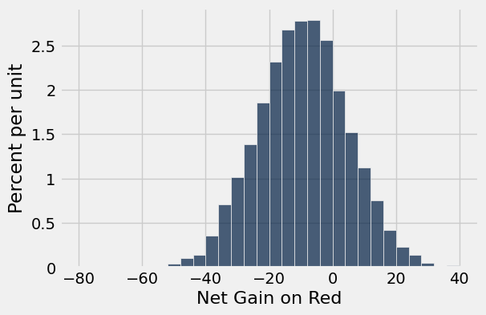

---

**Question 1.6:** Using the histogram above, decide whether the following statement is true or false:

>If you make 200 one-dollar bets on red, your chance of losing money is more than 50%.

Assign `loss_more_than_50` to either `True` or `False` depending on your answer to the question. **(5 points)**

**Student scaffold:**

```python
loss_more_than_50 = ...
```

**Solution:**

```python
loss_more_than_50 = True # SOLUTION
```

**Test — `q1_6` (5 points)**

```python
>>> type(loss_more_than_50) == bool
True

>>> loss_more_than_50 == True
True
```

### Betting on a Split ###
If betting on red doesn't seem like a good idea, maybe a gambler might want to try a different bet. A bet on a *split* is a bet on two consecutive numbers such as 5 and 6. This bet pays 17 to 1. That means if you place a one-dollar bet on the split 5 and 6, then:

- If the winning pocket is either 5 or 6, your gain is 17 dollars.
- If any other pocket wins, you lose your dollar, so your gain is -1 dollars.

---

**Question 1.7.** Define a function `dollar_bet_on_split` that takes a pocket number, and returns your gain in dollars if that pocket won and you had bet one dollar on the 5-6 split. **(5 points)**

*Hint:* Remember that the pockets are represented as strings.

*Hint:* Reference [Section 9.1](https://inferentialthinking.com/chapters/09/1/Conditional_Statements.html?highlight=conditionals)!

**Student scaffold:**

```python
def dollar_bet_on_split(...):
    ...
```

**Solution:**

```python
""" # BEGIN PROMPT
def dollar_bet_on_split(...):
    ...
"""; # END PROMPT
# BEGIN SOLUTION NO PROMPT
def dollar_bet_on_split(x): 
    if x == '5':
        return 17
    elif x == '6':
        return 17
    else:
        return -1
# END SOLUTION
```

**Test — `q1_7` (5 points)**

```python
>>> dollar_bet_on_split('5') == 17
True

>>> from hw05_check import correctness_check_1_71
>>> correctness_check_1_71(dollar_bet_on_split)
True

>>> from hw05_check import correctness_check_1_72
>>> correctness_check_1_72(dollar_bet_on_split)
True
```

Run the cell below to check that your function is doing what it should.

**Code:**

```python
print(dollar_bet_on_split('5'))
print(dollar_bet_on_split('6'))
print(dollar_bet_on_split('00'))
print(dollar_bet_on_split('23'))
```

*Output (stdout):*

```text
17
17
-1
-1
```

---

**Question 1.8.** Add a column `Winnings: Split` to the `wheel` table. For each pocket, the column should contain your gain in dollars if that pocket won and you had bet one dollar on the 5-6 split. **(5 points)**

**Student scaffold:**

```python
split_winnings = ...
wheel = ...
wheel.show(5) # Do not change this line.
```

**Solution:**

```python
split_winnings = wheel.apply(dollar_bet_on_split, 'Pocket') # SOLUTION
wheel = wheel.with_columns('Winnings: Split', split_winnings) # SOLUTION
wheel.show(5) # Do not change this line.
```

*Output:*

| Pocket | Color | Winnings: Red | Winnings: Split |
| --- | --- | --- | --- |
| 00 | green | -1 | -1 |
| 0 | green | -1 | -1 |
| 1 | red | 1 | -1 |
| 2 | black | -1 | -1 |
| 3 | red | 1 | -1 |

**Test — `q1_8` (5 points)**

```python
>>> wheel.labels[3] == 'Winnings: Split'
True

>>> from hw05_check import correctness_check_1_8
>>> correctness_check_1_8(wheel)
True
```

---

**Question 1.9.** Simulate the net gain in 200 one-dollar bets on the 5-6 split, repeating the process 10,000 times and saving your gains in the array `simulated_gains_split`. **(5 points)**

*Hint:* Your code in Questions 1.4 and 1.5 may be helpful here!

**Student scaffold:**

```python
simulated_gains_split = ...

...

# Do not change the two lines below
gains = gains.with_columns('Net Gain on Split', simulated_gains_split)
gains.hist(bins = np.arange(-200, 150, 20))
```

**Solution:**

```python
simulated_gains_split = make_array() # SOLUTION

# BEGIN SOLUTION
def net_gain_split(n):
    n_bets = wheel.sample(n)
    return sum(n_bets.column('Winnings: Split'))
    
for i in np.arange(repetitions):
    new_net_gain = net_gain_split(num_bets)
    simulated_gains_split = np.append(simulated_gains_split, new_net_gain) 
# END SOLUTION

# Do not change the two lines below
gains = gains.with_columns('Net Gain on Split', simulated_gains_split)
gains.hist(bins = np.arange(-200, 150, 20))
```

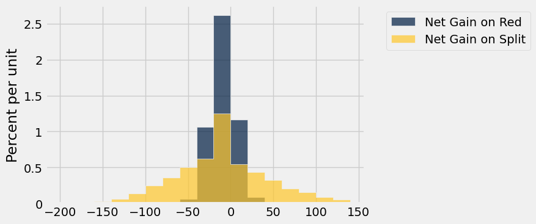

**Test — `q1_9` (5 points)**

```python
>>> import numpy as np
>>> type(simulated_gains_split) == np.ndarray
True

>>> from hw05_check import correctness_check_1_91
>>> correctness_check_1_91(simulated_gains_split)
True

>>> from hw05_check import correctness_check_1_92
>>> correctness_check_1_92(simulated_gains_split)
True
```

---

**Question 1.10.** Look carefully at the visualization above, and assign `histogram_statements` to an array containing the numbers of each statement below that can be correctly inferred from the overlaid histogram. **(5 points)**

1. If you bet one dollar 200 times on a split, your chance of losing money is more than 50%.
2. If you bet one dollar 200 times in roulette, your chance of making more than 50 dollars is greater if you bet on a split each time than if you bet on red each time.
3. If you bet one dollar 200 times in roulette, your chance of losing more than 50 dollars is greater if you bet on a split each time than if you bet on red each time.

*Hint:* We've already seen one of these statements in a prior question.

**Student scaffold:**

```python
histogram_statements = ...
```

**Solution:**

```python
histogram_statements = make_array(1, 2, 3) # SOLUTION
```

**Test — `q1_10` (5 points)**

```python
>>> import numpy as np
>>> type(histogram_statements) == np.ndarray
True

>>> 1 <= histogram_statements.item(0) <= 3
True

>>> all(histogram_statements <= 3) and all(histogram_statements >= 1)
True

>>> from hw05_check import correctness_check_1_10
>>> correctness_check_1_10(histogram_statements)
True
```

If this exercise has put you off playing roulette, it has done its job. If you are still curious about other bets, [here](https://en.wikipedia.org/wiki/Roulette#Bet_odds_table) they all are, and [here](https://en.wikipedia.org/wiki/Roulette#House_edge) is the bad news. The house – that is, the casino – always has an edge over the gambler.

---
## 2. Chances

Before you do this exercise, make sure you understand the logic behind all the examples in [Section 9.5](https://inferentialthinking.com/chapters/09/5/Finding_Probabilities.html). 

Good ways to approach probability calculations include:

- Thinking one trial at a time: What does the first one have to be? Then what does the next one have to be?
- Breaking up the event into distinct ways in which it can happen.
- Seeing if it is easier to find the chance that the event does not happen.

### Finding Chances

On each spin of a roulette wheel, all 38 pockets are equally likely to be the winner regardless of the results of other spins. Among the 38 pockets, 18 are red, 18 black, and 2 green. In each part below, write an expression that evaluates to the chance of the event described.

--- 

**Question 2.1.** The winning pocket is black on all of the first three spins. **(5 points)**

**Student scaffold:**

```python
first_three_black = ...
```

**Solution:**

```python
first_three_black = (18/38)**3 # SOLUTION
```

**Test — `q2_1` (5 points)**

```python
>>> 0 < first_three_black < 1
True

>>> from hw05_check import correctness_check_2_1
>>> correctness_check_2_1(first_three_black)
True
```

---

**Question 2.2.** The color green never wins in the first 10 spins. **(5 points)**

**Student scaffold:**

```python
no_green = ...
```

**Solution:**

```python
no_green = (36/38)**10 # SOLUTION
```

**Test — `q2_2` (5 points)**

```python
>>> 0 < no_green < 1
True

>>> from hw05_check import correctness_check_2_2
>>> correctness_check_2_2(no_green)
True
```

---

**Question 2.3.** The color green wins **at least once** on the first 10 spins. **(5 points)**

**Student scaffold:**

```python
at_least_one_green = ...
```

**Solution:**

```python
at_least_one_green = 1 - (36/38)**10 # SOLUTION
```

**Test — `q2_3` (5 points)**

```python
>>> 0 < at_least_one_green < 1
True

>>> from hw05_check import correctness_check_2_3
>>> correctness_check_2_3(at_least_one_green)
True
```

--- 

**Question 2.4.** Two of the three colors **never** win in the first 10 spins. **(6 points)**

*Hint:* What situation(s) lead to two of the three colors never winning in the first 10 spins?

**Student scaffold:**

```python
lone_winners = ...
```

**Solution:**

```python
lone_winners = (18/38)**10 + (18/38)**10 + (2/38)**10 # SOLUTION
```

**Test — `q2_4` (6 points)**

```python
>>> 0 < lone_winners < 1
True

>>> from hw05_check import correctness_check_2_4
>>> correctness_check_2_4(lone_winners)
True
```

### Comparing Chances
In each of Questions 2.5-2.7, two events A and B are described. Choose from one of the following three options and set each answer variable to a single integer:

1. Event A is more likely than Event B
2. Event B is more likely than Event A
3. The two events have the same chance.

You should be able to make the choices **without calculation**. Good ways to approach this exercise include imagining carrying out the chance experiments yourself, one trial at a time, and by thinking about the [law of averages](https://inferentialthinking.com/chapters/10/1/Empirical_Distributions.html#the-law-of-averages).

---

**Question 2.5.** A child picks four times at random from a box that has four toy animals: a bear, an elephant, a giraffe, and a kangaroo. **(5 points)**

- Event A: all four different animals are picked (assuming the child picks without replacement)
- Event B: all four different animals are picked (assuming the child picks with replacement)

**Student scaffold:**

```python
toys_option = ...
```

**Solution:**

```python
toys_option = 1 # SOLUTION
```

**Test — `q2_5` (5 points)**

```python
>>> type(toys_option) == int
True

>>> 1 <= toys_option <= 3
True

>>> toys_option == 1
True
```

---

**Question 2.6.** In a lottery, two numbers are drawn at random with replacement from the integers 1 through 1000. **(5 points)**

- Event A: The number 8 is picked on both draws
- Event B: The same number is picked on both draws

**Student scaffold:**

```python
lottery_option = ...
```

**Solution:**

```python
lottery_option = 2 # SOLUTION
```

**Test — `q2_6` (5 points)**

```python
>>> type(lottery_option) == int
True

>>> 1 <= lottery_option <= 3
True

>>> lottery_option == 2
True
```

---

**Question 2.7.** A fair coin is tossed repeatedly. **(5 points)**

- Event A: There are 60 or more heads in 100 tosses
- Event B: There are 600 or more heads in 1000 tosses

*Hint*: Think about the law of averages!

**Student scaffold:**

```python
coin_option = ...
```

**Solution:**

```python
coin_option = 1 # SOLUTION
```

**Test — `q2_7` (5 points)**

```python
>>> type(coin_option) == int
True

>>> 1 <= coin_option <= 3
True

>>> coin_option == 1
True
```

---
## 3. Three Ways Python Draws Random Samples

You have learned three ways to draw random samples using Python:

- `tbl.sample` draws a random sample of rows from the table `tbl`. The output is a table consisting of the sampled rows. 

- `np.random.choice` draws a random sample from a population whose elements are in an array. The output is an array consisting of the sampled elements.

- `sample_proportions` draws from a categorical distribution whose proportions are in an array. The output is an array consisting of the sampled proportions in all the categories.

**Code:**

```python
# Look through this code and run this cell for questions 1 and 2
top_movies = Table.read_table('top_movies_2017.csv').select(0, 1)
top_movies.show(3)
```

*Output:*

| Title | Studio |
| --- | --- |
| Gone with the Wind | MGM |
| Star Wars | Fox |
| The Sound of Music | Fox |

**Code:**

```python
# Look through this code and run this cell for questions 1 and 2
studios_with_counts = top_movies.group('Studio').sort('count', descending=True)
studios_with_counts.show(3)
```

*Output:*

| Studio | count |
| --- | --- |
| Buena Vista | 35 |
| Warner Brothers | 29 |
| Paramount | 25 |

**Code:**

```python
# Look through this code and run this cell for questions 1 and 2
studios_of_all_movies = top_movies.column('Studio')
distinct_studios = studios_with_counts.column('Studio')

print("studios_of_all_movies:", studios_of_all_movies[:10], "...")
print("\n distinct_studios:", distinct_studios)
```

*Output (stdout):*

```text
studios_of_all_movies: ['MGM' 'Fox' 'Fox' 'Universal' 'Paramount' 'Paramount' 'Universal' 'MGM'
 'Warner Brothers' 'Disney'] ...

 distinct_studios: ['Buena Vista' 'Warner Brothers' 'Paramount' 'Fox' 'Universal' 'Disney'
 'Columbia' 'MGM' 'United Artists' 'Newline' 'Paramount/Dreamworks' 'Sony'
 'Dreamworks' 'Lionsgate' 'RKO' 'Tristar' 'AVCO' 'IFC' 'Metro' 'NM' 'Orion'
 'Selz.' 'Sum.']
```

**Code:**

```python
# Look through this code and run this cell for questions 1 and 2
studio_counts_only = studios_with_counts.column('count')
studio_proportions_only = studio_counts_only / sum(studio_counts_only)

print("studio_counts_only:", studio_counts_only)
print("\n studio_proportions_only:", studio_proportions_only)
```

*Output (stdout):*

```text
studio_counts_only: [35 29 25 24 23 11  9  7  6  5  4  4  3  3  3  2  1  1  1  1  1  1  1]

 studio_proportions_only: [ 0.175  0.145  0.125  0.12   0.115  0.055  0.045  0.035  0.03   0.025
  0.02   0.02   0.015  0.015  0.015  0.01   0.005  0.005  0.005  0.005
  0.005  0.005  0.005]
```

In Questions 3.1 and 3.2, we will present a scenario. For each scenario, we will ask whether the desired result can be achieved by using a given function and the following tables/arrays: `top_movies`, `studios_with_counts`, `studios_of_all_movies`, `distinct_studios`, `studio_counts_only` and `studio_proportions_only`. For `studio_counts_only` and `studio_proportions_only`, you can assume that we know which index corresponds with the studio containing that count/proportion.

---

**Question 3.1.** Simulate a sample of 10 movies drawn at random with replacement from the 200 movies. Using just this sample, do we have enough information to output `True` if Paramount appears more often than Warner Brothers among studios that released the sampled movies, and `False` otherwise?

Select all possible solutions and assign them to the array `movie_frequency_answer`. **(7 points)**

1. Yes, by using `.sample` with `top_movies`.

2. Yes, by using `.sample` with `studios_with_counts`.

3. Yes, by using `np.random.choice` with `distinct_studios`.

4. Yes, by using `np.random.choice` with `studios_of_all_movies`.

5. Yes, by using `sample_proportions` with `studio_proportions_only`.

6. Yes, by using `sample_proportions` with `studio_counts_only`.

7. This is not possible with the provided tables/arrays.

*Hint*: Instead of just looking at the table/array, try and think about what the result would be after calling the sampling function on it!

**Student scaffold:**

```python
movie_frequency_answer = make_array(...)
```

**Solution:**

```python
"""# BEGIN PROMPT
movie_frequency_answer = make_array(...)
"""; # END PROMPT
movie_frequency_answer = make_array(1,4,5) # SOLUTION NO PROMPT
```

**Test — `q3_1` (7 points)**

```python
>>> from hw05_check import correctness_check_3_1
>>> correctness_check_3_1(movie_frequency_answer)
True
```

---

**Question 3.2.** Simulate a sample of 10 movies drawn at random with replacement from the 200 movies. Using just this sample, do we have enough information to output `True` if the first sampled movie was released by the same studio as the last sampled movie?

Select all possible solutions and assign them to the array `same_studio_answer`. **(7 points)**

1. Yes, by using `.sample` with `top_movies`.

2. Yes, by using `.sample` with `studios_with_counts`.

3. Yes, by using `np.random.choice` with `distinct_studios`.

4. Yes, by using `np.random.choice` with `studios_of_all_movies`.

5. Yes, by using `sample_proportions` with `studio_proportions_only`.

6. Yes, by using `sample_proportions` with `studio_counts_only`.

7. This is not possible with the provided tables/arrays.

**Student scaffold:**

```python
same_studio_answer = make_array(...)
```

**Solution:**

```python
"""# BEGIN PROMPT
same_studio_answer = make_array(...)
"""; # END PROMPT
same_studio_answer = make_array(1,4) # SOLUTION NO PROMPT
```

**Test — `q3_2` (7 points)**

```python
>>> from hw05_check import correctness_check_3_2
>>> correctness_check_3_2(same_studio_answer)
True
```

---

To double-check your work, the cell below will rerun all of the autograder tests.

## Submission

Make sure you have run all cells in your notebook in order before running the cell below, so that all images/graphs appear in the output. The cell below will generate a zip file for you to submit. **Please save before exporting!**

---

## Datasets

Datasets this notebook loads with `Table.read_table`. Column names are exact, including spaces and capitalization. Only the schema is recorded here — the data itself is not in this document, so any question about its values must be answered by running code, not by reasoning over the rows shown elsewhere in this file.

### `roulette_wheel.csv`

38 rows, 2 columns.

| Column | Type |
| --- | --- |
| `Pocket` | int |
| `Color` | str |

### `top_movies_2017.csv`

200 rows, 5 columns.

| Column | Type |
| --- | --- |
| `Title` | str |
| `Studio` | str |
| `Gross` | int |
| `Gross (Adjusted)` | int |
| `Year` | int |


---

# hw06

---
title: "Homework 6: Assessing Models and Testing Hypotheses"
assignment: hw06
semester: sp26
source: semester_assignments/sp26/hw/hw06/autograder/hw06.ipynb
version: solution (autograder) with student scaffolds
student_source: semester_assignments/sp26/hw/hw06/student/hw06.ipynb
total_points: 96.0
language: python
---


# Homework 6: Assessing Models and Testing Hypotheses

Please complete this notebook by filling in the cells provided. Before you begin, execute the previous cell to load the provided tests.

**Helpful Resource:**
- [Python Reference](http://data8.org/su26/reference/): Cheat sheet of helpful array & table methods used in Data 8!
- [Sampling Methods Guide](https://drive.google.com/file/d/1k8uNN0Bg7J0BTgK-0Z5glDNtd_5FTJQl/view?usp=sharing): Guide for the randomization methods.

**Recommended Readings**: 
* [Sampling and Empirical Distributions](https://www.inferentialthinking.com/chapters/10/Sampling_and_Empirical_Distributions.html)
* [Testing Hypotheses](https://www.inferentialthinking.com/chapters/11/Testing_Hypotheses.html)
* [A/B Testing](https://inferentialthinking.com/chapters/12/1/AB_Testing.html)

Please complete this notebook by filling in the cells provided. **Before you begin, execute the cell below to setup the notebook by importing some helpful libraries.** Each time you start your server, you will need to execute this cell again.

For all problems that you must write explanations and sentences for, you **must** provide your answer in the designated space. Moreover, throughout this homework and all future ones, **please be sure to not re-assign variables throughout the notebook!** For example, if you use `max_temperature` in your answer to one question, do not reassign it later on. Otherwise, you will fail tests that you thought you were passing previously!

**Deadline:**

This assignment is **due Friday, 3/6 at 11:00am PT**. Submissions after this time will be accepted for 24 hours and will incur a 20% penalty. Any submissions later than this 24 hour period will not be accepted unless an extension has been granted as per the [syllabus](https://www.data8.org/su26/syllabus) page. Turn it in by Thursday, 3/5 at 11:00am PT for 5 extra credit points.

Directly sharing answers is not okay, but discussing problems with the course staff or with other students is encouraged. Refer to the [syllabus](https://www.data8.org/su26/syllabus) page to learn more about how to learn cooperatively.

You should start early so that you have time to get help if you're stuck. Office hours are held Monday through Friday in [Warren Hall](https://www.berkeley.edu/map/warren-hall/) 101B. The office hours schedule appears [here](http://data8.org/su26/calendar/).

---

The point breakdown for this assignment is given in the table below:
| Category | Points |
| --- | --- |
| Autograder (Coding questions) | 96 |
| Written (Visualization questions) | 4 |
| **Total** | 100 |

**Code:**

```python
# Run this cell to set up the notebook, but please don't change it.

# These lines import the Numpy and Datascience modules.
import numpy as np
from datascience import *

# These lines do some fancy plotting magic.
import matplotlib
%matplotlib inline
import matplotlib.pyplot as plt
plt.style.use('fivethirtyeight')
import warnings
warnings.simplefilter('ignore', FutureWarning)
```

---
## 1. Assessing Jade's Models

Before you begin, [Section 10.4](https://inferentialthinking.com/chapters/10/4/Random_Sampling_in_Python.html) of the textbook is a useful reference for this part.

### Games with Jade
Our friend Jade comes over and asks us to play a game with her. The game works like this: 

> We will draw randomly with replacement from a simplified 13 card deck with 4 face cards (A, J, Q, K), and 9 numbered cards (2, 3, 4, 5, 6, 7, 8, 9, 10). Suppose we draw cards with replacement 13 times. If the number of face cards is greater than or equal to 4, we lose.
> 
> Otherwise, Jade loses.

We play the game once and we lose, observing 8 total face cards. We are angry and accuse Jade of cheating! Jade is adamant, however, that the deck is fair.

Jade's model claims that there is an equal chance of getting any of the cards (A, 2, 3, 4, 5, 6, 7, 8, 9, 10, J, Q, K), but we do not believe her. We believe that the deck is clearly rigged, with face cards (A, J, Q, K) being more likely than the numbered cards (2, 3, 4, 5, 6, 7, 8, 9, 10).

---

**Question 1.1.** Assign `deck_model_probabilities` to a two-item array containing the chance of drawing a face card as the first element, and the chance of drawing a numbered card as the second element under Jade's model. Since we're working with probabilities, make sure your values are between 0 and 1. **(3 Points)**

**Student scaffold:**

```python
deck_model_probabilities = ...
deck_model_probabilities
```

**Solution:**

```python
deck_model_probabilities = make_array(4/13, 9/13) #SOLUTION
deck_model_probabilities
```

*Output:*

```text
array([ 0.30769231,  0.69230769])
```

**Test — `q1_1` (3 points)**

```python
>>> type(deck_model_probabilities) == np.ndarray
True

>>> len(deck_model_probabilities) == 2
True

>>> sum(deck_model_probabilities) == 1
True

>>> from hw06_check import first_element_check
>>> first_element_check(deck_model_probabilities)
True

>>> from hw06_check import second_element_check
>>> second_element_check(deck_model_probabilities)
True
```

--- 

**Question 1.2.** We believe Jade's model is incorrect. In particular, we believe there to be a *larger* chance of getting a face card. Which of the following statistics can we use during our simulation to test between the model and our alternative? Assign `statistic_choice` to the correct answer. **(3 Points)**

1. The distance (absolute value) between the actual number of face cards in 13 draws and 4, the expected number of face cards in 13 draws
2. The expected number of face cards in 13 draws
3. The number of face cards we get in 13 draws

**Student scaffold:**

```python
statistic_choice = ...
statistic_choice
```

**Solution:**

```python
statistic_choice = 3 #SOLUTION
statistic_choice
```

*Output:*

```text
3
```

**Test — `q1_2` (3 points)**

```python
>>> type(statistic_choice) == int
True

>>> 1 <= statistic_choice <= 3
True

>>> from hw06_check import correctness_check_1_2
>>> correctness_check_1_2(statistic_choice)
True
```

---

**Question 1.3.** Define the function `deck_simulation_and_statistic`, which, given a sample size and an array of model proportions (like the one you created in Question 1), returns the **number of face cards** in one simulation of drawing cards under the model specified in `model_proportions`. **(4 Points)**

*Hint:* Think about how you can use the function `sample_proportions`.

**Student scaffold:**

```python
def deck_simulation_and_statistic(sample_size, model_proportions):
    ...

deck_simulation_and_statistic(13, deck_model_probabilities)
```

**Solution:**

```python
def deck_simulation_and_statistic(sample_size, model_proportions):
    # BEGIN SOLUTION
    simulation = sample_proportions(sample_size, model_proportions)
    statistic = sample_size * simulation.item(0)
    return statistic
    # END SOLUTION

deck_simulation_and_statistic(13, deck_model_probabilities)
```

*Output:*

```text
4.0
```

**Test — `q1_3` (4 points)**

```python
>>> num_face = deck_simulation_and_statistic(13, deck_model_probabilities)
>>> num_face % 1 == 0
True

>>> num_face = deck_simulation_and_statistic(13, deck_model_probabilities)
>>> 0 <= num_face <= 13
True
```

---

**Question 1.4.** Use your function from above to simulate the drawing of 13 cards 5000 times under the proportions that you specified in Question 1. Keep track of all of your statistics in the array `deck_statistics`. **(4 Points)**

**Student scaffold:**

```python
repetitions = 5000 
...

deck_statistics
```

**Solution:**

```python
repetitions = 5000 
# BEGIN SOLUTION
deck_statistics = make_array()

for i in np.arange(repetitions): 
    one_deck_stat = deck_simulation_and_statistic(13, deck_model_probabilities)
    deck_statistics = np.append(deck_statistics, one_deck_stat)

# END SOLUTION

deck_statistics
```

*Output:*

```text
array([ 3.,  1.,  2., ...,  5.,  5.,  4.])
```

**Test — `q1_4` (4 points)**

```python
>>> len(deck_statistics) == repetitions
True

>>> all([0 <= k <= 13 for k in deck_statistics])
True
```

Let’s take a look at the distribution of simulated statistics.

**Code:**

```python
# Draw a distribution of statistics 
Table().with_column('Deck Statistics', deck_statistics).hist()
```

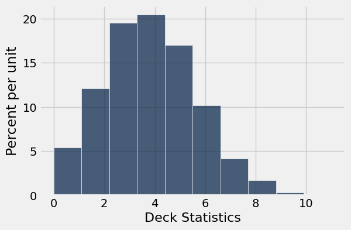

---

**Question 1.5.** Based on the observed value of 8 cards and the histogram of statistics simulated using Jade's model (produced above), which of the following statements are reasonable to infer? Assign your answers to the array `jade_conclusions` **(3 Points)**

1. Under Jade’s model, drawing 8 or more face cards occurs in about 2% of simulated trials, which is very unlikely.

2. Under Jade's model, the event of drawing 8 face cards is on the right tail of the histogram. There is very little area to the right of this point, telling us that drawing 8 or more face cards is very unlikely.

3. Under Jade's model, our histogram of simulated statistics includes the event of drawing 8 face cards, so this event is likely.

4. The results of our simulation support our null hypothesis, that Jade's model is reasonable and that the true probability of drawing a face card is around 4/13. 

5. The results of our simulation support our alternative hypothesis, that the deck is rigged and that the true probability of drawing a face card is greater than 4/13.

**Student scaffold:**

```python
jade_conclusions = ...
```

**Solution:**

```python
jade_conclusions = make_array(1,2,5) # SOLUTION
```

**Test — `q1_5` (3 points)**

```python
>>> from hw06_check import correctness_check_1_5
>>> correctness_check_1_5(jade_conclusions)
True
```

---
## 2. Vaccinations Across The Nation

A vaccination clinic has two types of vaccines against a disease. Each person who comes in to be vaccinated gets either Vaccine 1 or Vaccine 2. One week, everyone who came in on Monday, Wednesday, and Friday was given Vaccine 1. Everyone who came in on Tuesday and Thursday was given Vaccine 2. The clinic is closed on weekends.

Doctor DeNero at the clinic said, "Oh wow, the distribution of vaccines is like tossing a coin that lands heads with probability $\frac{3}{5}$. If the coin lands on heads, you get Vaccine 1 and if the coin lands on tails, you get Vaccine 2."

But Doctor Sahai said, "No, it's not. We're not doing anything like tossing a (biased) coin."

That week, the clinic gave Vaccine 1 to 211 people and Vaccine 2 to 107 people. Conduct a test of hypotheses to see which doctor's position is better supported by the data.

---

**Question 2.1.** Given the information above, what was the sample size for the data, and what was the percentage of people who got **Vaccine 1?** **(4 points)**

*Note*: Your percent should be a number between 0 and 100, not a proportion between 0 and 1.

**Student scaffold:**

```python
sample_size = ...
percent_V1 = ...

print(f"Sample Size: {sample_size}")
print(f"Vaccine 1 Percent: {percent_V1}")
```

**Solution:**

```python
sample_size = 211+107 # SOLUTION
percent_V1 = 100 * 211/sample_size # SOLUTION

print(f"Sample Size: {sample_size}")
print(f"Vaccine 1 Percent: {percent_V1}")
```

*Output (stdout):*

```text
Sample Size: 318
Vaccine 1 Percent: 66.35220125786164
```

**Test — `q2_1` (4 points)**

```python
>>> type(sample_size) == int
True

>>> type(percent_V1) == float or type(percent_V1) == int
True

>>> 100 <= sample_size <= 500
True

>>> 1 <= percent_V1 <= 100
True

>>> from hw06_check import sample_size_check
>>> sample_size_check(sample_size)
True

>>> from hw06_check import percentv1_check
>>> percentv1_check(percent_V1)
True
```

---

**Question 2.2.** Select the correct null hypothesis, and assign your answer to `vaccine_null`. It should reflect the position of either Dr. DeNero or Dr. Sahai. **(3 points)**

*Note:* Check out [11.3](https://inferentialthinking.com/chapters/11/3/Decisions_and_Uncertainty.html#step-1-the-hypotheses) for a refresher on hypotheses.

1. The assignment of vaccines is like tossing a coin that lands heads with probability 3/5, and any observed variation is due to chance.

2. The assignment of vaccines is like tossing a coin that lands heads with probability 3/5, and any observed variation is **not** due to chance alone.

3. The assignment of vaccines is **not** like tossing a coin, and any observed variation is due to chance.

4. The assignment of vaccines is **not** like tossing a coin, and any observed variation is **not** due to chance alone.

*Hint:* “Any observed variation” refers to differences between the observed data and what we would expect if the probability of receiving Vaccine 1 were exactly 3/5.

**Student scaffold:**

```python
vaccine_null = ...
```

**Solution:**

```python
vaccine_null = 1 # SOLUTION
```

**Test — `q2_2` (3 points)**

```python
>>> from hw06_check import correctness_check_2_2
>>> correctness_check_2_2(vaccine_null)
True
```

---

**Question 2.3.** Select the correct alternative hypothesis, and assign your answer to `vaccine_alt`. It should reflect the position of either Dr. DeNero or Dr. Sahai. **(3 points)**

1. The assignment of vaccines is like tossing a coin that lands heads with probability 3/5, and any observed variation is due to chance.

2. The assignment of vaccines is like tossing a coin that lands heads with probability 3/5, and any observed variation is likely influenced by other factors besides chance alone.

3. The assignment of vaccines is **not** like tossing a coin, and any observed variation is due to chance.

4. The assignment of vaccines is **not** like tossing a coin, and any observed variation is likely influenced by other factors besides chance alone.

**Student scaffold:**

```python
vaccine_alt = ...
```

**Solution:**

```python
vaccine_alt = 4 # SOLUTION
```

**Test — `q2_3` (3 points)**

```python
>>> from hw06_check import correctness_check_2_3
>>> correctness_check_2_3(vaccine_alt)
True
```

---

**Question 2.4.** One of the test statistics below is appropriate for testing these hypotheses. Assign the variable `valid_test_stat` to the number corresponding to the correct test statistic. **(3 points)**

_Hint:_ Recall that large values of the test statistic should favor the alternative hypothesis.

1. percent of heads - 50
2. |percent of heads - 50|
3. percent of heads - 60
4. |percent of heads - 60|

**Student scaffold:**

```python
valid_test_stat = ...
valid_test_stat
```

**Solution:**

```python
valid_test_stat = 4 # SOLUTION
valid_test_stat
```

*Output:*

```text
4
```

**Test — `q2_4` (3 points)**

```python
>>> type(valid_test_stat) == int
True

>>> any((valid_test_stat == x for x in np.arange(1, 5)))
True

>>> from hw06_check import correctness_check_2_4
>>> correctness_check_2_4(valid_test_stat)
True
```

---

**Question 2.5.** Using your answer from Questions 2.1 and 2.4, find the observed value of the test statistic and assign it to the variable `observed_statistic`. Recall that the observed statistic is the test statistic value that was observed in the real life data. **(3 points)**

**Student scaffold:**

```python
observed_statistic = ...
observed_statistic
```

**Solution:**

```python
observed_statistic = abs(percent_V1 - 60) # SOLUTION
observed_statistic
```

*Output:*

```text
6.352201257861637
```

**Test — `q2_5` (3 points)**

```python
>>> type(observed_statistic) == float
True

>>> 0 <= observed_statistic <= 100
True

>>> from hw06_check import correctness_check_2_5
>>> correctness_check_2_5(observed_statistic)
True
```

---

**Question 2.6.** In order to perform this hypothesis test, you must simulate the test statistic. From the four options below, pick the assumption that is needed for this simulation. Assign `assumption_needed` to an integer corresponding to the assumption. **(3 points)**

1. The statistic must be simulated under the null hypothesis.
2. The statistic must be simulated under the alternative hypothesis.
3. The statistic must be simulated under both hypotheses.
4. No assumptions are needed. We can just simulate the statistic.

**Student scaffold:**

```python
assumption_needed = ...
assumption_needed
```

**Solution:**

```python
assumption_needed = 1 # SOLUTION
assumption_needed
```

*Output:*

```text
1
```

**Test — `q2_6` (3 points)**

```python
>>> type(assumption_needed) == int
True

>>> 1 <= assumption_needed <= 4
True

>>> from hw06_check import correctness_check_2_6
>>> correctness_check_2_6(assumption_needed)
True
```

---

**Question 2.7.** Simulate 10,000 values of the test statistic under the assumption you picked in Question 2.6. **(4 points)** 

As usual, start by defining a function that simulates one value of the statistic. Your function should use `sample_proportions`. (You may find a variable defined in Question 2.1 useful here!) Then, write a `for` loop to simulate multiple values and collect them in the array `simulated_statistics`.

Use as many lines of code as you need. We have included the code that visualizes the distribution of the simulated values. The red dot represents the observed statistic you found in Question 2.5.

**Student scaffold:**

```python
def one_simulated_statistic():
    ...
```

**Solution:**

```python
""" # BEGIN PROMPT
def one_simulated_statistic():
    ...
"""; # END PROMPT
# BEGIN SOLUTION NO PROMPT
#SOLUTION
def one_simulated_statistic():
    percent_heads = 100 * sample_proportions(sample_size, make_array(0.6, 0.4)).item(0)
    return abs(percent_heads - 60)
# END SOLUTION
```

**Solution:**

```python
# Run the this cell a few times to see how the simulated statistic changes
one_simulated_statistic()
```

*Output:*

```text
3.3962264150943398
```

**Student scaffold:**

```python
num_simulations = 10000

simulated_statistics = ...
for ... in ...:
    ...
```

**Solution:**

```python
""" # BEGIN PROMPT
num_simulations = 10000

simulated_statistics = ...
for ... in ...:
    ...
"""; # END PROMPT
# BEGIN SOLUTION NO PROMPT
#SOLUTION
num_simulations = 10000

simulated_statistics = make_array()
for i in np.arange(num_simulations):
    simulated_statistics = np.append(simulated_statistics, one_simulated_statistic())
# END SOLUTION
```

**Code:**

```python
# Run this cell to produce a histogram of the simulated statistics

Table().with_columns('Simulated Statistic', simulated_statistics).hist()
plt.scatter(observed_statistic, -0.002, color='red', s=40);
```

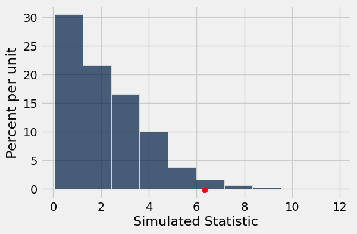

---

**Question 2.8.** Using `simulated_statistics`, `observed_statistic`, and `num_simulations`, find the empirical p-value based on the simulation. **(3 points)**

_Hint:_ Reading [11.3.6](https://inferentialthinking.com/chapters/11/3/Decisions_and_Uncertainty.html#the-meaning-of-consistent) might be helpful for this question.

**Student scaffold:**

```python
p_value = ...
p_value
```

**Solution:**

```python
p_value = np.count_nonzero(simulated_statistics >= observed_statistic) / num_simulations # SOLUTION
p_value
```

*Output:*

```text
0.0205
```

**Test — `q2_8` (3 points)**

```python
>>> import numpy as np
>>> type(p_value) == float or type(p_value) == np.float64
True

>>> 0 <= p_value <= 1
True

>>> from hw06_check import correctness_check_2_8
>>> correctness_check_2_8(p_value)
True
```

---

**Question 2.9.** Assign `correct_doctor` to the number corresponding to the correct statement below. Use the 5% cutoff for the p-value. **(4 points)**

1. The data support Dr. DeNero's position more than they support Dr. Sahai's.
2. The data support Dr. Sahai's position more than they support Dr. DeNero's.

As a reminder, here are the two claims made by Dr. DeNero and Dr. Sahai:
> **Doctor DeNero:** "Oh wow, it's just like tossing a coin that lands heads with chance $\frac{3}{5}$. Heads you get Vaccine 1 and Tails you get Vaccine 2."

>**Doctor Sahai:** "No, it's not. We're not doing anything like tossing a coin."

**Student scaffold:**

```python
correct_doctor = ...
correct_doctor
```

**Solution:**

```python
correct_doctor = 2 # SOLUTION
correct_doctor
```

*Output:*

```text
2
```

**Test — `q2_9` (4 points)**

```python
>>> type(correct_doctor) == int
True

>>> any((correct_doctor == x for x in (1, 2)))
True

>>> correct_doctor == 2
True
```

---
## 3. Using TVD as a Test Statistic

Before beginning this section, please read [this section](https://inferentialthinking.com/chapters/11/2/Multiple_Categories.html#a-new-statistic-the-distance-between-two-distributions) of the textbook on TVD!

**Total variation distance (TVD)** is a special type of test statistic that we use when we want to compare two distributions of *categorical data*. It is often used when we observe that a set of observed proportions/probabilities is different than what we expect under the null model. 

Consider a six-sided die that we roll 6,000 times. If the die is fair, we would expect that each face comes up $\frac{1}{6}$ of the time. By random chance, a fair die won't always result in equal proportions (that is, we won't get exactly 1,000 of each face). However, if we suspect that the die might be unfair based on the data, we can conduct a hypothesis test using TVD to compare the expected [$\frac{1}{6}$, $\frac{1}{6}$, $\frac{1}{6}$, $\frac{1}{6}$, $\frac{1}{6}$, $\frac{1}{6}$] distribution to what is actually observed.

In this part of the homework, we'll look at how we can use TVD to determine the effect that different factors have on happiness. 

We will be working with data from the [Gallup World Poll](https://worldhappiness.report/ed/2023/world-happiness-trust-and-social-connections-in-times-of-crisis/#ranking-of-happiness-2020-2022) that is presented in the World Happiness Report, a survey of the state of global happiness. The survey ranked 137 countries by overall happiness and estimated the influence that economic production, social support, life expectancy, freedom, absence of corruption, and generosity had on population happiness. The study has been repeated for several years, but we'll be looking at data from the 2023 survey.

Run the cell below to load in the `happiness_scores` table.

**Code:**

```python
happiness_scores = Table.read_table("happiness_scores.csv").drop(12, 13, 14).take(np.arange(137))
happiness_scores.show(5)
```

*Output:*

| Country | Happiness Rank | Happiness Score | Standard error of happiness score | Lower Confidence Interval | Upper Confidence Interval | Economy (Log GDP per capita) | Family | Health (life expectancy) | Freedom | Generosity | Trust (Government Corruption) |
| --- | --- | --- | --- | --- | --- | --- | --- | --- | --- | --- | --- |
| Finland | 1 | 7.804 | 0.036 | 7.875 | 7.733 | 1.888 | 1.585 | 0.535 | 0.772 | 0.126 | 0.535 |
| Denmark | 2 | 7.586 | 0.041 | 7.667 | 7.506 | 1.949 | 1.548 | 0.537 | 0.734 | 0.208 | 0.525 |
| Iceland | 3 | 7.53 | 0.049 | 7.625 | 7.434 | 1.926 | 1.62 | 0.559 | 0.738 | 0.25 | 0.187 |
| Israel | 4 | 7.473 | 0.032 | 7.535 | 7.411 | 1.833 | 1.521 | 0.577 | 0.569 | 0.124 | 0.158 |
| Netherlands | 5 | 7.403 | 0.029 | 7.46 | 7.346 | 1.942 | 1.488 | 0.545 | 0.672 | 0.251 | 0.394 |

Participants in the study were asked to evaluate their life satisfaction from a scale of 0 (worst possible life) to 10 (best possible life). The responses for each country were averaged to create the `Happiness Score`.

The columns `Economy (Log GDP per Capita)`, `Family`, `Health (Life Expectancy)`, `Freedom`, `Generosity`, and `Trust (Government Corruption)` estimate the extent to which each factor influences happiness, both for better or for worse. The happiness score is the sum of these factors; the larger a factor is, the more it contributes to overall happiness. [In other words, if you add up all the factors (in addition to a "Difference from Dystopia" value we excluded in the dataset), you get the happiness score.]

Let's look at the different factors that affect happiness in the United States. Run the cell below to view the row in `us_happiness` that contains data for the United States.

**Code:**

```python
us_happiness = happiness_scores.where("Country", "United States")
us_happiness
```

*Output:*

| Country | Happiness Rank | Happiness Score | Standard error of happiness score | Lower Confidence Interval | Upper Confidence Interval | Economy (Log GDP per capita) | Family | Health (life expectancy) | Freedom | Generosity | Trust (Government Corruption) |
| --- | --- | --- | --- | --- | --- | --- | --- | --- | --- | --- | --- |
| United States | 15 | 6.894 | 0.047 | 6.986 | 6.802 | 1.98 | 1.46 | 0.39 | 0.557 | 0.21 | 0.172 |

**To compare the different factors, we'll look at the proportion of the happiness score that is attributed to each variable. 
You can find these proportions in the table `us_happiness_factors` after running the cell below.**

*Note:* The factors shown in `us_happiness` don't add up exactly to the happiness score, so we adjusted the proportions to  only account for the data we have access to. The proportions were found by dividing each Happiness Factor value by the sum of all Happiness Factor values in `us_happiness`.

**Code:**

```python
us_happiness_factors = Table().read_table("us_happiness_factors.csv")
us_happiness_factors
```

*Output:*

| Happiness Factor | Proportion of Happiness Score |
| --- | --- |
| Economy (GDP per Capita) | 0.41521 |
| Family | 0.306036 |
| Health (Life Expectancy) | 0.0818086 |
| Freedom | 0.116865 |
| Trust (Government Corruption) | 0.0361179 |
| Generosity | 0.0439626 |

---

**Question 3.1.** Suppose we want to test whether or not each factor contributes the same amount to the overall Happiness Score. Fill in the blanks to correctly define the null hypothesis, alternative hypothesis, and test statistic in the cell below. You should write your answer to each blank as an integer that corresponds to the word listed in the options below (e.g. `a = 1`). **(4 points)**

Null Hypothesis: Each factor contributes \_\_(a)\_\_ to the overall happiness score. Any deviation is due to \_\_(b)\_\_.

Alternative Hypothesis: \_\_(c)\_\_ factors contribute \_\_(d)\_\_ to the happiness score than other factors.

Test Statistic: The \_\_(e)\_\_ between the observed score proportions and the expected score proportions under the null hypothesis.

1. random chance

2. total variation distance

3. some

4. equally

5. absolute difference

6. average difference

7. more

**Student scaffold:**

```python
a = ...
b = ...
c = ...
d = ...
e = ...
```

**Solution:**

```python
a = 4 # SOLUTION
b = 1 # SOLUTION
c = 3 # SOLUTION
d = 7 # SOLUTION
e = 2 # SOLUTION
```

**Test — `q3_1` (4 points)**

```python
>>> from hw06_check import correctness_check_3_1
>>> correctness_check_3_1(a, b, c, d, e)
True
```

---

**Question 3.2.** Write a function `calculate_tvd` that takes in the observed distribution (`obs_dist`) and expected distribution under the null hypothesis (`null_dist`) and calculates the total variation distance. Use this function to set `observed_tvd` to be equal to the observed test statistic. **(4 points)**

**Student scaffold:**

```python
null_distribution = make_array(1/6, 1/6, 1/6, 1/6, 1/6, 1/6)

def calculate_tvd(obs_dist, null_dist):
    ...
    
observed_tvd = ...
observed_tvd
```

**Solution:**

```python
null_distribution = make_array(1/6, 1/6, 1/6, 1/6, 1/6, 1/6)

def calculate_tvd(obs_dist, null_dist):
    # BEGIN SOLUTION
    return sum(abs(obs_dist - null_dist))/2
    # END SOLUTION
    
observed_tvd = calculate_tvd(us_happiness_factors.column("Proportion of Happiness Score"), null_distribution) # SOLUTION
observed_tvd
```

*Output:*

```text
0.38791256366666665
```

**Test — `q3_2` (4 points)**

```python
>>> type(observed_tvd) in set([float, np.float32, np.float64])
True

>>> np.isclose(round(observed_tvd, 6), 0.38791256)
True
```

---

**Question 3.3.** Create an array called `simulated_tvds` that contains 10,000 simulated values under the null hypothesis. Assume that the original sample consisted of 1,000 individuals. **(4 points)**

*Hint:* The `sample_proportions` function may be helpful to you. Refer to the [Python Reference Sheet](https://data8.org/su26/reference/) to read up on it!

**Student scaffold:**

```python
simulated_tvds = ...

...
```

**Solution:**

```python
simulated_tvds = make_array() # SOLUTION

# BEGIN SOLUTION
for i in np.arange(10000):
    simulated_proportions = sample_proportions(1000, null_distribution)
    one_tvd = calculate_tvd(simulated_proportions, null_distribution)
    simulated_tvds = np.append(simulated_tvds, one_tvd)
# END SOLUTION
```

**Test — `q3_3` (4 points)**

```python
>>> len(simulated_tvds) == 10000
True

>>> all(simulated_tvds >= 0)
True

>>> len(np.unique(simulated_tvds)) != 1
True

>>> np.mean(simulated_tvds) < 0.1
True
```

Run the cell below to plot a histogram of your simulated test statistics, as well as a red dot representing the observed value of the test statistic.

**Code:**

```python
Table().with_column("Simulated TVDs", simulated_tvds).hist()
plt.scatter(observed_tvd, 0.5, color='red', s=70, zorder=2);
plt.show();
```

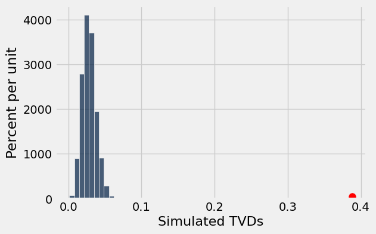

---

**Question 3.4.** Use your simulated statistics to calculate the p-value of your test. Make sure that this number is consistent with what you observed in the histogram above. **(4 points)**

**Student scaffold:**

```python
p_value_tvd = ...
p_value_tvd
```

**Solution:**

```python
p_value_tvd = np.count_nonzero(simulated_tvds >= observed_tvd) / 10000 # SOLUTION
p_value_tvd
```

*Output:*

```text
0.0
```

**Test — `q3_4` (4 points)**

```python
>>> 0 <= p_value_tvd <= 1
True
```

---

**Question 3.5.** Looking at the p-value you found above, which of the following statements can help us to interpret this value? Assign your answers to the array `pvalue_answers`. **(2 points)**

*Hint:* Look at your visualization from Question 3.3!

1. The p-value is the probability, under our null hypothesis, of observing a test statistic as extreme or more extreme than our observed one.

2. Our p-value indicates that our observed test statistic is impossible under the null hypothesis.

3. Our p-value indicates that none of our test statistics simulated under the null hypothesis were as extreme as our observed test statistic.

**Student scaffold:**

```python
pvalue_answers = make_array(...)
```

**Solution:**

```python
"""# BEGIN PROMPT
pvalue_answers = make_array(...)
"""; # END PROMPT
pvalue_answers = make_array(1,3) # SOLUTION NO PROMPT
```

**Test — `q3_5` (2 points)**

```python
>>> from hw06_check import correctness_check_3_5
>>> correctness_check_3_5(pvalue_answers)
True
```

---

**Question 3.6.** Based on the results of your hypothesis test and a 5% p-value cutoff, which of the following conclusions are appropriate? Assign your answers to the array `conclusion_answers`. **(2 points)**

1. The p-value is **less** than our cutoff, so the data is more consistent with our **null** hypothesis.

2. The p-value is **less** than our cutoff, so the data is more consistent with our **alternative** hypothesis.

3. The p-value is **greater** than our cutoff, so the data is more consistent with our **null** hypothesis.

4. The p-value is **greater** than our cutoff, so the data is more consistent with our **alternative** hypothesis.

5. We would conclude that the factors **do not** equally contribute to the overall happiness score of a country.

6. We would conclude that the factors equally contribute to the overall happiness score of a country.

**Student scaffold:**

```python
conclusion_answers = make_array(...)
```

**Solution:**

```python
"""# BEGIN PROMPT
conclusion_answers = make_array(...)
"""; # END PROMPT
conclusion_answers = make_array(2,5) # SOLUTION NO PROMPT
```

**Test — `q3_6` (2 points)**

```python
>>> from hw06_check import correctness_check_3_6
>>> correctness_check_3_6(conclusion_answers)
True
```

---
## 4. Who is Older?

Data scientists have drawn a simple random sample of size 500 from a large population of adults. Each member of the population happened to identify as either "male" or "female". (Though many people identify outside of the gender binary, in this particular population of interest, each member happened to identify as either male or female.) Data was collected on several attributes of the sampled people, including age. The table `sampled_ages` contains one row for each person in the sample, with columns containing the individual's gender identity.

**Code:**

```python
sampled_ages = Table.read_table('age.csv') 
sampled_ages.show(5)
```

*Output:*

| Gender | Age |
| --- | --- |
| male | 23 |
| male | 29 |
| male | 29 |
| female | 49 |
| female | 33 |

---

**Question 4.1.** How many females were there in our sample? Please use the provided skeleton code. **(4 points)**

*Hint:* Keep in mind that `.group` sorts categories in alphabetical order!

**Student scaffold:**

```python
num_females = sampled_ages.group(...)...
num_females
```

**Solution:**

```python
""" # BEGIN PROMPT
num_females = sampled_ages.group(...)...
num_females
"""; # END PROMPT
# BEGIN SOLUTION NO PROMPT
num_females = sampled_ages.group('Gender').column(1).item(0)
num_females
# END SOLUTION
```

*Output:*

```text
260
```

**Test — `q4_1` (3 points)**

```python
>>> 0 <= num_females <= 500
True

>>> from hw06_check import correctness_check_4_1
>>> correctness_check_4_1(num_females)
True
```

---

**Question 4.2.** Complete the cell below so that `avg_male_vs_female` evaluates to `True` if the sampled males are older than the sampled females on average, and `False` otherwise. Use Python code to achieve this. **(4 points)**

**Student scaffold:**

```python
group_mean_tbl = sampled_ages.group(...)
group_means = group_mean_tbl...       # array of mean ages
avg_male_vs_female = group_means... > group_means...
avg_male_vs_female
```

**Solution:**

```python
""" # BEGIN PROMPT
group_mean_tbl = sampled_ages.group(...)
group_means = group_mean_tbl...       # array of mean ages
avg_male_vs_female = group_means... > group_means...
avg_male_vs_female
"""; # END PROMPT
# BEGIN SOLUTION NO PROMPT
group_mean_tbl = sampled_ages.group('Gender', np.average)
group_means = group_mean_tbl.column(1)
avg_male_vs_female = group_means.item(1) > group_means.item(0)
avg_male_vs_female
# END SOLUTION
```

*Output:*

```text
True
```

**Test — `q4_2` (3 points)**

```python
>>> import numpy as np
>>> type(avg_male_vs_female) in set([bool, np.bool_])
True

>>> from hw06_check import correctness_check_4_2
>>> correctness_check_4_2(avg_male_vs_female)
True
```

---

**Question 4.3.** The data scientists want to use the data to test whether males are older than females. One of the following statements is their null hypothesis and another is their alternative hypothesis. Assign `null_statement_number` and `alternative_statement_number` to the numbers corresponding to the correct statements in the code cell below. **(4 points)**

1. In the sample, the males and females have the same distribution of ages; the sample averages of the two groups are different due to chance.
2. In the population, the males and females have the same distribution of ages; the sample averages of the two groups are different due to chance.
3. The age distributions of males and females in the population are different due to chance.
4. The males in the sample are older than the females, on average.
5. The males in the population are older than the females, on average.
6. The average ages of the males and females in the population are different.

**Student scaffold:**

```python
null_statement_number = ...
alternative_statement_number = ...
```

**Solution:**

```python
null_statement_number = 2 # SOLUTION
alternative_statement_number = 5 # SOLUTION
```

**Test — `q4_3` (3 points)**

```python
>>> type(null_statement_number) == int
True

>>> type(alternative_statement_number) == int
True

>>> any((null_statement_number == x for x in np.arange(1, 7)))
True

>>> any((alternative_statement_number == x for x in np.arange(1, 7)))
True

>>> null_statement_number != alternative_statement_number
True

>>> from hw06_check import correctness_check_4_3
>>> correctness_check_4_3(null_statement_number, alternative_statement_number)
True
```

---

**Question 4.4.** The data scientists have decided to use a permutation test. Assign `permutation_test_reason` to the number corresponding to the reason they made this choice. **(4 points)**

1. Since a person's age shouldn't be related to their gender, it doesn't matter who is labeled "male" and who is labeled "female", so you can use permutations.
2. Under the null hypothesis, permuting the labels in the `sampled_ages` table is equivalent to drawing a new random sample with the same number of males and females as in the original sample.
3. Under the null hypothesis, permuting the rows of `sampled_ages` table is equivalent to drawing a new random sample with the same number of males and females as in the original sample.

*Note:* Check out [12.1](https://inferentialthinking.com/chapters/12/1/AB_Testing.html#permutation-test) for a refresher on random permutations and permutation tests.

**Student scaffold:**

```python
permutation_test_reason = ...
permutation_test_reason
```

**Solution:**

```python
""" # BEGIN PROMPT
permutation_test_reason = ...
permutation_test_reason
"""; # END PROMPT
# BEGIN SOLUTION NO PROMPT
permutation_test_reason = 2 
# END SOLUTION
```

**Test — `q4_4` (3 points)**

```python
>>> type(permutation_test_reason) == int
True

>>> any((permutation_test_reason == x for x in np.arange(1, 5)))
True

>>> permutation_test_reason == 2
True
```

---

**Question 4.5.** To test their hypotheses, the data scientists have followed our textbook's advice and chosen a test statistic where the following statement is true: Large values of the test statistic favor the alternative hypothesis.

The data scientists' test statistic is one of the two options below. Which one is it? Assign the appropriate number to the variable `correct_test_stat`. **(4 points)**

1. "male age average - female age average" in a sample created by randomly shuffling the male/female labels
2. "|male age average - female age average|" in a sample created by randomly shuffling the male/female labels

**Student scaffold:**

```python
correct_test_stat = ...
correct_test_stat
```

**Solution:**

```python
correct_test_stat = 1 # SOLUTION
correct_test_stat
```

*Output:*

```text
1
```

**Test — `q4_5` (3 points)**

```python
>>> type(correct_test_stat) == int
True

>>> any((correct_test_stat == x for x in np.arange(1, 3)))
True

>>> correct_test_stat == 1
True
```

---

**Question 4.6.** Complete the cell below so that `observed_statistic_ab` evaluates to the observed value of the data scientists' test statistic. Use as many lines of code as you need, and remember that you can use any quantity, table, or array that you created earlier. **(4 points)**

**Student scaffold:**

```python
observed_statistic_ab = ...
observed_statistic_ab
```

**Solution:**

```python
""" # BEGIN PROMPT
observed_statistic_ab = ...
"""; # END PROMPT
# BEGIN SOLUTION NO PROMPT
# Note to staff: They'll get the same value even if they chose #2 in Q5.
# That's OK. If they chose #2 they'll have trouble later.
observed_statistic_ab = group_means.item(1) - group_means.item(0)
# END SOLUTION
observed_statistic_ab
```

*Output:*

```text
1.314102564102562
```

**Test — `q4_6` (3 points)**

```python
>>> type(observed_statistic_ab) in set([float, np.float64])
True

>>> observed_statistic_ab >= 0
True

>>> from hw06_check import correctness_check_4_6
>>> correctness_check_4_6(observed_statistic_ab)
True
```

---

**Question 4.7.** Assign `shuffled_labels` to an array of shuffled male/female labels. The rest of the code puts the array in a table along with the data in `sampled_ages`. **(4 points)**

**Student scaffold:**

```python
shuffled_labels = ...
original_with_shuffled_labels = sampled_ages.with_columns('Shuffled Label', shuffled_labels)
original_with_shuffled_labels
```

**Solution:**

```python
shuffled_labels = sampled_ages.select('Gender').sample(with_replacement=False).column(0) # SOLUTION
original_with_shuffled_labels = sampled_ages.with_columns('Shuffled Label', shuffled_labels)
original_with_shuffled_labels
```

*Output:*

| Gender | Age | Shuffled Label |
| --- | --- | --- |
| male | 23 | male |
| male | 29 | female |
| male | 29 | female |
| female | 49 | male |
| female | 33 | male |
| male | 31 | male |
| male | 60 | female |
| male | 38 | female |
| female | 60 | male |
| female | 27 | male |

**Test — `q4_7` (3 points)**

```python
>>> type(original_with_shuffled_labels) == Table
True

>>> original_with_shuffled_labels.labels == ('Gender', 'Age', 'Shuffled Label')
True

>>> original_with_shuffled_labels.num_rows == 500
True

>>> all(sampled_ages.column('Age') == original_with_shuffled_labels.column('Age'))
True

>>> from hw06_check import correctness_check_4_7
>>> correctness_check_4_7(original_with_shuffled_labels)
True

>>> all((x in original_with_shuffled_labels.column('Shuffled Label') for x in ('male', 'female')))
True
```

---

**Question 4.8.** The comparison below uses the array `shuffled_labels` from Question 4.7 and the count `num_females` from Question 4.1.

For this comparison, assign the variable `correct_q8` to the number corresponding to the correct answer. **Pretend this is a midterm problem and do not solve it using a code cell.** **(3 points)**

`comp = np.count_nonzero(shuffled_labels == 'female') == num_females`

1. `comp` is set to `True`.<br>
2. `comp` is set to `False`.<br>
3. `comp` is set to `True` or `False`, depending on how the shuffle came out.

**Student scaffold:**

```python
correct_q8 = ...
correct_q8
```

**Solution:**

```python
correct_q8 = 1 # SOLUTION
correct_q8
```

*Output:*

```text
1
```

**Test — `q4_8` (3 points)**

```python
>>> type(correct_q8) == int and 1 <= correct_q8 <= 3
True

>>> correct_q8 == 1
True
```

---

**Question 4.9.** Define a function `simulate_one_statistic` that takes no arguments and returns one simulated value of the test statistic. We've given you a skeleton, but feel free to approach this question in a way that makes sense to you. Use as many lines of code as you need. Refer to the code you have previously written in this problem, as you might be able to re-use some of it. **(3 points)**

**Student scaffold:**

```python
def simulate_one_statistic():
    "Returns one value of our simulated test statistic"
    shuffled_labels = ...
    shuffled_tbl = ...
    group_means = ...
    ...
```

**Solution:**

```python
def simulate_one_statistic():
    "Returns one value of our simulated test statistic"
    shuffled_labels = sampled_ages.select('Gender').sample(with_replacement=False).column(0) # SOLUTION
    shuffled_tbl = sampled_ages.select('Age').with_columns('Shuffled Label', shuffled_labels) # SOLUTION
    group_means = shuffled_tbl.group('Shuffled Label', np.average).column(1) # SOLUTION
    return group_means.item(1) - group_means.item(0) # SOLUTION
```

**Test — `q4_9` (3 points)**

```python
>>> -5 < simulate_one_statistic() < 5
True
```

After you have defined your function, run the following cell a few times to see how the statistic varies.

**Code:**

```python
simulate_one_statistic()
```

*Output:*

```text
-1.5304487179487154
```

---

**Question 4.10.** Complete the cell to simulate 5,000 values of the statistic. We have included the code that draws the empirical distribution of the statistic and shows the value of `observed_statistic_ab` from Question 4.6. Feel free to use as many lines of code as you need. **(3 points)**

*Note:* This cell will take around a minute to run.

**Student scaffold:**

```python
simulated_statistics_ab = make_array()

...
    simulated_statistics_ab = ...

# Do not change these lines
Table().with_columns('Simulated Statistic', simulated_statistics_ab).hist()
plt.scatter(observed_statistic_ab, -0.002, color='red', s=70);
```

**Solution:**

```python
simulated_statistics_ab = make_array()

for i in np.arange(5000):# SOLUTION
    simulated_statistics_ab = np.append(simulated_statistics_ab, simulate_one_statistic())  # SOLUTION

# Do not change these lines
Table().with_columns('Simulated Statistic', simulated_statistics_ab).hist()
plt.scatter(observed_statistic_ab, -0.002, color='red', s=70);
```

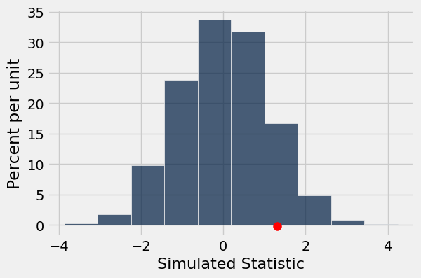

**Test — `q4_10` (3 points)**

```python
>>> from hw06_check import correctness_check_4_10
>>> correctness_check_4_10(simulated_statistics_ab)
True
```

---

**Question 4.11.** Use the simulation to find an empirical approximation to the p-value. Assign `p_val` to the appropriate p-value from this simulation. Then, assign `conclusion` to either `null_hyp` or `alt_hyp`. **(3 points)** 

*Note:* Assume that we use the 5% cutoff for the p-value.

**Student scaffold:**

```python
# These are variables provided for you to use.
null_hyp = 'The data are consistent with the null hypothesis.'
alt_hyp = 'The data support the alternative more than the null.'

p_val = ...
conclusion = ...

p_val, conclusion # Do not change this line
```

**Solution:**

```python
# These are variables provided for you to use.
null_hyp = 'The data are consistent with the null hypothesis.'
alt_hyp = 'The data support the alternative more than the null.'

p_val = np.count_nonzero(simulated_statistics_ab >= observed_statistic_ab) / len(simulated_statistics_ab) # SOLUTION
conclusion = null_hyp # SOLUTION

p_val, conclusion # Do not change this line
```

*Output:*

```text
(0.1134, 'The data are consistent with the null hypothesis.')
```

**Test — `q4_11` (3.0 points)**

```python
>>> type(p_val) in set([float, np.float32, np.float64])
True

>>> 0 <= p_val <= 1
True

>>> type(conclusion) == str
True

>>> from hw06_check import correctness_check_4_11
>>> correctness_check_4_11(p_val)
True

>>> from hw06_check import conclusion_check
>>> conclusion_check(conclusion)
True
```

You're done with Homework 6!  

**Important submission steps:** 
1. Run the tests and verify that they all pass.
2. Choose **Save Notebook** from the **File** menu, then **run the final cell**. 
3. Click the link to download the zip file.
4. Go to [Pensieve](https://www.pensieve.co) and submit the zip file to the corresponding assignment. The name of this assignment is "HW 06 Autograder". 

**It is your responsibility to make sure your work is saved before running the last cell.**

---

To double-check your work, the cell below will rerun all of the autograder tests.

## Submission

Make sure you have run all cells in your notebook in order before running the cell below, so that all images/graphs appear in the output. The cell below will generate a zip file for you to submit. **Please save before exporting!**

---

## Datasets

Datasets this notebook loads with `Table.read_table`. Column names are exact, including spaces and capitalization. Only the schema is recorded here — the data itself is not in this document, so any question about its values must be answered by running code, not by reasoning over the rows shown elsewhere in this file.

### `happiness_scores.csv`

1,000 rows, 15 columns.

| Column | Type |
| --- | --- |
| `Country` | str |
| `Happiness Rank` | float |
| `Happiness Score` | float |
| `Standard error of happiness score` | float |
| `Lower Confidence Interval` | float |
| `Upper Confidence Interval` | float |
| `Economy (Log GDP per capita)` | float |
| `Family` | float |
| `Health (life expectancy)` | float |
| `Freedom` | float |
| `Generosity` | float |
| `Trust (Government Corruption)` | float |
| `Unnamed: 12` | float |
| `Unnamed: 13` | float |
| `Unnamed: 14` | float |

### `us_happiness_factors.csv`

6 rows, 2 columns.

| Column | Type |
| --- | --- |
| `Happiness Factor` | str |
| `Proportion of Happiness Score` | float |

### `age.csv`

500 rows, 2 columns.

| Column | Type |
| --- | --- |
| `Gender` | str |
| `Age` | int |


---

# hw07

---
title: "Homework 7: Confidence Intervals"
assignment: hw07
semester: sp26
source: semester_assignments/sp26/hw/hw07/autograder/hw07.ipynb
version: solution (autograder) with student scaffolds
student_source: semester_assignments/sp26/hw/hw07/student/hw07.ipynb
total_points: 92
language: python
---


# Homework 7: Confidence Intervals

**Helpful Resource:**

- [Python Reference](http://data8.org/su26/reference/): Cheat sheet of helpful array & table methods used in Data 8!

**Recommended Reading**: 

* [Estimation](https://www.inferentialthinking.com/chapters/13/Estimation)

Please complete this notebook by filling in the cells provided. **Before you begin, execute the cell below to setup the notebook by importing some helpful libraries.** Each time you start your server, you will need to execute this cell again.

For all problems that you must write explanations and sentences for, you **must** provide your answer in the designated space. Moreover, throughout this homework and all future ones, **please be sure to not re-assign variables throughout the notebook!** For example, if you use `max_temperature` in your answer to one question, do not reassign it later on. Otherwise, you will fail tests that you thought you were passing previously!

**Deadline:**

This assignment is **due Wednesday, 4/1 at 11:00am PT**. Submissions after this time will be accepted for 24 hours and will incur a 20% penalty. Any submissions later than this 24 hour period will not be accepted unless an extension has been granted as per the [policies](http://data8.org/su26/syllabus/) page. Turn it in by Tuesday, 3/31 at 11:00am PT for 5 extra credit points.

Directly sharing answers is not okay, but discussing problems with the course staff or with other students is encouraged. Refer to the [policies](http://data8.org/su26/syllabus) page to learn more about how to learn cooperatively.

You should start early so that you have time to get help if you're stuck. Office hours are held Monday through Friday in [Warren Hall](https://www.berkeley.edu/map/warren-hall/) 101B or online. The office hours schedule appears [here](https://www.data8.org/su26/calendar/).

---

The point breakdown for this assignment is given in the table below:
| Category | Points |
| --- | --- |
| Autograder (Coding questions) | 92 |
| Written (Visualization questions) | 8 |
| **Total** | 100 |

**Code:**

```python
# Don't change this cell; just run it. 

import numpy as np
from datascience import *

# These lines do some fancy plotting magic.",
import matplotlib
%matplotlib inline
import matplotlib.pyplot as plt 
plt.style.use('fivethirtyeight')
import warnings
warnings.simplefilter('ignore', FutureWarning)
```

---
## 1. Thai Restaurants in Berkeley

Andrew and Marissa are trying to see what the best Thai restaurant in Berkeley is. They survey 1,500 UC Berkeley students selected uniformly at random and ask each student which Thai restaurant is the best. (*Note: This data is fabricated for the purposes of this homework.*) The choices of Thai restaurants are [Lucky House](https://www.google.com/maps/place/Lucky+House+Thai+Cuisine/@37.8707428,-122.270045,15.32z/data=!4m5!3m4!1s0x80857e9e69a8c921:0x7b6d80f58406fb26!8m2!3d37.8721393!4d-122.2672699), [Imm Thai](https://www.google.com/maps/place/Imm+Thai+Street+Food/@37.8704926,-122.2687372,15.51z/data=!4m5!3m4!1s0x80857e9eec4f1e63:0x5f54d96f0dccdb72!8m2!3d37.8719079!4d-122.2691186), [Thai Temple](https://www.google.com/maps/place/Wat+Mongkolratanaram/@37.8689514,-122.2698649,14.75z/data=!4m5!3m4!1s0x80857e886e39daf1:0xe309caa1b5710fc0!8m2!3d37.8563633!4d-122.2707584), and [Thai Basil](https://www.google.com/maps/place/Thai+Basil/@37.8691911,-122.266539,15.37z/data=!4m5!3m4!1s0x80857c2f6ae0e2f1:0x6978b6e8a72d58d4!8m2!3d37.868327!4d-122.258081). After compiling the results, Andrew and Marissa release the following percentages of votes that each restaurant received, from their sample:

|Thai Restaurant  | Percentage|
|:------------:|:------------:|
|Lucky House | 8% |
|Imm Thai | 53% |
|Thai Temple | 25% |
|Thai Basil | 14% |

These percentages represent a uniform random sample of the population of UC Berkeley students. We will attempt to estimate the corresponding *parameters*, or the percentage of the votes that each restaurant will receive from the population (i.e. all UC Berkeley students). We will use confidence intervals to compute a range of values that reflects the uncertainty of our estimates.

The table `votes` contains the results of Andrew and Marissa's survey.

**Code:**

```python
# Just run this cell
votes = Table.read_table('votes.csv')
votes
```

*Output:*

| Vote |
| --- |
| Lucky House |
| Lucky House |
| Lucky House |
| Lucky House |
| Lucky House |
| Lucky House |
| Lucky House |
| Lucky House |
| Lucky House |
| Lucky House |

---

**Question 1.1.** Complete the function `one_resampled_percentage` below. It should return Imm Thai's ***percentage*** of votes after taking the original table (`tbl`) and performing one bootstrap sample of it. Remember that a percentage is between 0 and 100. **(8 Points)**

*Note 1:* `tbl` will always be in the same format as `votes`.

*Note 2:* This function should be completed **without** `.group` or `.pivot`. Using these functions will cause your code to timeout.

*Hint:* Given a table of votes, how can you figure out what percentage of the votes are for a certain restaurant? **Be sure to use percentages, not proportions, for this question!**

**Student scaffold:**

```python
def one_resampled_percentage(tbl):
    ...

one_resampled_percentage(votes)
```

**Solution:**

```python
def one_resampled_percentage(tbl):
    # BEGIN SOLUTION
    bootstrap = tbl.sample()
    single_percentage = (np.count_nonzero(bootstrap.column('Vote') == 'Imm Thai') / tbl.num_rows) * 100 
    return single_percentage
    # END SOLUTION

one_resampled_percentage(votes)
```

*Output:*

```text
51.06666666666667
```

**Test — `q1_1` (8 points)**

```python
>>> bool(type(one_resampled_percentage(votes)) in set([float, np.float64]))
True

>>> bool(one_resampled_percentage(votes) > 1)
True

>>> bool(35 <= one_resampled_percentage(votes) <= 65)
True

>>> from hw07_check import correctness_check_1_1
>>> correctness_check_1_1(one_resampled_percentage, votes)
True
```

---

**Question 1.2.** Complete the `percentages_in_resamples` function such that it simulates and returns an array of **2025 elements**, where each element represents a bootstrapped estimate of the percentage of voters who will vote for Imm Thai. You should use the `one_resampled_percentage` function you wrote above. **(8 Points)**

_Note:_ We perform our simulation with **only 2025 trials** in this problem to reduce the runtime, but we should generally use more repetitions.

**Student scaffold:**

```python
def percentages_in_resamples():
    percentage_imm = make_array()
    ...
```

**Solution:**

```python
def percentages_in_resamples():
    percentage_imm = make_array()
    # BEGIN SOLUTION
    for i in np.arange(2025):
        single_percentage = one_resampled_percentage(votes)
        percentage_imm = np.append(percentage_imm, single_percentage)
    return percentage_imm
    # END SOLUTION
```

**Test — `q1_2` (8 points)**

```python
>>> bool(len(percentages_in_resamples()) == 2025)
True

>>> from hw07_check import correctness_check_1_2_1
>>> correctness_check_1_2_1(percentages_in_resamples)
True

>>> from hw07_check import correctness_check_1_2_2
>>> correctness_check_1_2_2(percentages_in_resamples)
True
```

In the following cell, we run the function you just defined, `percentages_in_resamples`, and create a histogram of the calculated statistic for the 2025 bootstrap estimates of the percentage of voters who voted for Imm Thai. 

*Note:* This might take a few seconds to run.

**Code:**

```python
resampled_percentages = percentages_in_resamples()
Table().with_column('Estimated Percentage', resampled_percentages).hist("Estimated Percentage")
```

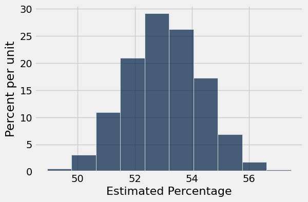

---

**Question 1.3.** Using the array `resampled_percentages`, find the values at the two ends of the middle 95% of the bootstrapped percentage estimates. Assign the lower and upper ends of the interval to `imm_lower_bound` and `imm_upper_bound` respectively. **(8 Points)**

*Hint:* If you are stuck on this question, try looking over [Chapter 13.1](https://inferentialthinking.com/chapters/13/1/Percentiles.html) of the textbook, and check out the `percentile` function on the [python reference sheet](https://www.data8.org/su26/reference/).

**Student scaffold:**

```python
imm_lower_bound = ...
imm_upper_bound = ...
print(f"Bootstrapped 95% confidence interval for the percentage of Imm Thai voters in the population: [{imm_lower_bound:.2f}, {imm_upper_bound:.2f}]")
```

**Solution:**

```python
imm_lower_bound = percentile(2.5, resampled_percentages) # SOLUTION
imm_upper_bound = percentile(97.5, resampled_percentages) # SOLUTION
print(f"Bootstrapped 95% confidence interval for the percentage of Imm Thai voters in the population: [{imm_lower_bound:.2f}, {imm_upper_bound:.2f}]")
```

*Output (stdout):*

```text
Bootstrapped 95% confidence interval for the percentage of Imm Thai voters in the population: [50.53, 55.53]
```

**Test — `q1_3` (8 points)**

```python
>>> bool(45 <= imm_lower_bound <= imm_upper_bound <= 65)
True

>>> from hw07_check import correctness_check_1_3
>>> correctness_check_1_3(imm_lower_bound, imm_upper_bound, resampled_percentages)
True
```

---

**Question 1.4.** The survey results seem to indicate that Imm Thai is beating all the other Thai restaurants among the voters. We would like to use confidence intervals to determine a range of likely values for Imm Thai's percentage lead over all the other restaurants combined. The calculation for Imm Thai's lead over Lucky House, Thai Temple, and Thai Basil combined is:

$$\text{Imm Thai's \% of Vote} - (\text{100\%} - \text{Imm Thai's \% of Vote})$$

Define the function `one_resampled_difference` that returns **exactly one value** of Imm Thai's percentage lead over Lucky House, Thai Temple, and Thai Basil combined from one bootstrap sample of `tbl`. **(8 Points)**

*Hint 1:* Imm Thai's lead can be negative.

*Hint 2:* Given a table of votes, how can you figure out what percentage of the votes are for a certain restaurant? **Be sure to use percentages, not proportions, for this question!**

*Note:* If the skeleton code provided within the function is not helpful for you, feel free to approach the question using your own variables.

**Student scaffold:**

```python
def one_resampled_difference(tbl):
    bootstrap = ...
    imm_percentage = ...
    ...
```

**Solution:**

```python
def one_resampled_difference(tbl):
    bootstrap = tbl.sample() #SOLUTION
    imm_percentage = (np.count_nonzero(bootstrap.column('Vote') == 'Imm Thai') / tbl.num_rows) * 100 #SOLUTION
    return imm_percentage - (100 - imm_percentage) #SOLUTION
```

**Test — `q1_4` (8 points)**

```python
>>> bool(type(one_resampled_difference(votes)) in set([float, np.float64]))
True

>>> bool(0 <= one_resampled_difference(votes) <= 100)
True

>>> from hw07_check import correctness_check_1_4
>>> correctness_check_1_4(one_resampled_difference, votes)
True
```

---

**Question 1.5.** Write a function called `leads_in_resamples` that computes 2025 bootstrapped elements of Imm Thai's percentage lead over Lucky House, Thai Temple, and Thai Basil combined (the result of calling `one_resampled_difference`). It should return an array of the 2025 bootstrapped estimates. Afterwards, run the cell to plot a histogram of the resulting samples. **(8 Points)**

*Hint:* If you see an error involving `NoneType`, consider what components a function needs to have!

**Student scaffold:**

```python
def leads_in_resamples():
    ...

sampled_leads = leads_in_resamples()
Table().with_column('Estimated Lead', sampled_leads).hist("Estimated Lead")
```

**Solution:**

```python
def leads_in_resamples():
    # BEGIN SOLUTION
    leads = make_array()
    for i in np.arange(2025):
        bootstrap_lead = one_resampled_difference(votes)
        leads = np.append(leads, bootstrap_lead)
    return leads
    # END SOLUTION

sampled_leads = leads_in_resamples()
Table().with_column('Estimated Lead', sampled_leads).hist("Estimated Lead")
```

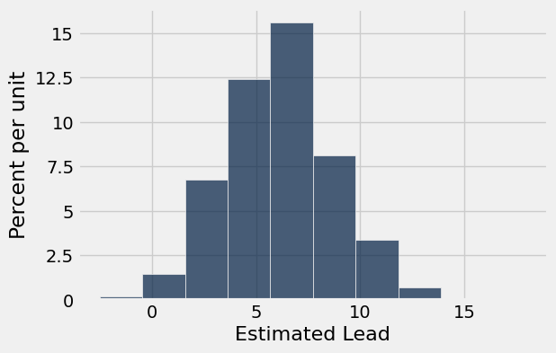

---

**Question 1.6.** Use the simulated data in `sampled_leads` from Question 1.5 to compute an approximate 95% confidence interval for Imm Thai's percentage lead over Lucky House, Thai Temple, and Thai Basil combined. **(10 Points)**

**Student scaffold:**

```python
diff_lower_bound = ...
diff_upper_bound = ...
print("Bootstrapped 95% confidence interval for Imm Thai's true lead over Lucky House, Thai Temple, and Thai Basil combined: [{:f}%, {:f}%]".format(diff_lower_bound, diff_upper_bound))
```

**Solution:**

```python
diff_lower_bound = percentile(2.5, sampled_leads) # SOLUTION
diff_upper_bound = percentile(97.5, sampled_leads) # SOLUTION
print("Bootstrapped 95% confidence interval for Imm Thai's true lead over Lucky House, Thai Temple, and Thai Basil combined: [{:f}%, {:f}%]".format(diff_lower_bound, diff_upper_bound))
```

*Output (stdout):*

```text
Bootstrapped 95% confidence interval for Imm Thai's true lead over Lucky House, Thai Temple, and Thai Basil combined: [1.200000%, 11.066667%]
```

**Test — `q1_6` (10 points)**

```python
>>> bool(-5 <= diff_lower_bound <= diff_upper_bound <= 20)
True

>>> from hw07_check import correctness_check_1_6_1
>>> correctness_check_1_6_1(diff_lower_bound, diff_upper_bound)
True

>>> from hw07_check import correctness_check_1_6_2
>>> correctness_check_1_6_2(diff_lower_bound, diff_upper_bound, sampled_leads)
True
```

---
## 2. Interpreting Confidence Intervals

Tim computed the following 95% confidence interval for the percentage of Imm Thai voters: 

$$[50.53, 55.53]$$

(Your answer from 1.3 may have been a bit different due to randomness; that doesn't mean it was wrong!)

---

**Question 2.1.** Tim also created 70%, 90%, and 99% confidence intervals from the same sample, but he forgot to label which confidence interval represented which percentages! ***First***, **match each confidence level (70%, 90%, 99%) with one of the corresponding intervals given** (e.g. `CI_70_percent = 1`). **(5 points)**

The intervals are below:

1. [50.03, 55.94]
2. [52.1, 54]
3. [50.97, 54.99]

*Hint:* If you are stuck on this question, try looking over Chapters [13.3](https://inferentialthinking.com/chapters/13/3/Confidence_Intervals.html) and [13.4](https://inferentialthinking.com/chapters/13/4/Using_Confidence_Intervals.html) of the textbook.

**Student scaffold:**

```python
CI_70_percent = ...
CI_90_percent = ...
CI_99_percent = ...
```

**Solution:**

```python
CI_70_percent = 2 # SOLUTION
CI_90_percent = 3 # SOLUTION
CI_99_percent = 1 # SOLUTION
```

**Test — `q2_1` (5 points)**

```python
>>> from hw07_check import correctness_check_2_1
>>> correctness_check_2_1(CI_70_percent, CI_90_percent, CI_99_percent)
True
```

**Question 2.2.** How did you arrive at your answer to Question 2.1? Select all correct answers that correctly interpet confidence levels and assign them to the array `confidence_answers`. (e.g. `confidence_answers = make_array(1,2,3)`) **(5 Points)**

1. Higher confidence levels lead to **wider** intervals because we include **more** of the statistics.

2. As confidence increases, we become **more** confident that the population parameter lies within our confidence interval.

3. Higher confidence levels lead to **smaller** intervals because we include **less** of the statistics.

4. As confidence increases, we become **less** confident that the population parameter lies within our confidence interval.

**Student scaffold:**

```python
confidence_answers = make_array(...)
```

**Solution:**

```python
"""# BEGIN PROMPT
confidence_answers = make_array(...)
"""; # END PROMPT
confidence_answers = make_array(1,2) # SOLUTION NO PROMPT
```

**Test — `q2_2` (5 points)**

```python
>>> from hw07_check import correctness_check_2_2
>>> correctness_check_2_2(confidence_answers)
True
```

---

**Question 2.3.** Suppose we produced **6,000 new samples** (each one a new/distinct uniform random sample of 1,500 students) from the population and **created a 95% confidence interval from each one**. **Roughly how many of those 6,000 intervals do you expect will actually contain the true percentage of the population?** **(10 Points)**

Assign your answer to `true_percentage_intervals`.

**Student scaffold:**

```python
true_percentage_intervals = ...
```

**Solution:**

```python
true_percentage_intervals = 5700 # SOLUTION
```

**Test — `q2_3` (10 points)**

```python
>>> bool(1000 <= true_percentage_intervals <= 10000)
True

>>> from hw07_check import correctness_check_2_3
>>> correctness_check_2_3(true_percentage_intervals)
True
```

Recall the second bootstrap confidence interval you created, which estimated Imm Thai's lead over Lucky House, Thai Temple, and Thai Basil combined. Among
voters in the sample, Imm Thai's lead was 6%. Tim's 95% confidence interval for the true lead (in the population of all voters) was:

$$[1.2, 11.2]$$

Suppose we are interested in testing a simple yes-or-no question:

> "Is the percentage of votes for Imm Thai equal to the percentage of votes for Lucky House, Thai Temple, and Thai Basil combined?"

Our null hypothesis is that the percentages are equal, or equivalently, that Imm Thai's lead is exactly 0. Our alternative hypothesis is that Imm Thai's lead is not equal to 0.  In the questions below, don't compute any confidence interval yourself—use only Tim's 95% confidence interval.

> Hint: Try thinking about the width of the 95% confidence interval in comparison to the new confidence intervals in the questions below. **Drawing a picture may help.**

---

**Question 2.4.** Say we use a 5% p-value cutoff. Do we reject the null, fail to reject the null, or are we unable to tell using Tim's confidence interval? **(10 Points)**

Assign `cutoff_five_percent` to the number corresponding to the correct answer.

1. Reject the null / Data is consistent with the alternative hypothesis
2. Fail to reject the null / Data is consistent with the null hypothesis
3. Unable to tell using Tim's confidence interval

*Hint:* Consider the relationship between the p-value cutoff and confidence. If you're confused, take a look at [this chapter](https://inferentialthinking.com/chapters/13/4/Using_Confidence_Intervals.html) of the textbook.

**Student scaffold:**

```python
cutoff_five_percent = ...
```

**Solution:**

```python
cutoff_five_percent = 1 # SOLUTION
```

**Test — `q2_4` (10 points)**

```python
>>> bool(1 <= cutoff_five_percent <= 3)
True

>>> bool(type(cutoff_five_percent) == int)
True

>>> from hw07_check import correctness_check_2_4
>>> correctness_check_2_4(cutoff_five_percent)
True
```

---

**Question 2.5.** What if, instead, we use a p-value cutoff of 1%? Do we reject the null, fail to reject the null, or are we unable to tell using Tim's confidence interval? **(10 Points)**

Assign `cutoff_one_percent` to the number corresponding to the correct answer.

1. Reject the null / Data is consistent with the alternative hypothesis
2. Fail to reject the null / Data is consistent with the null hypothesis
3. Unable to tell using Tim's confidence interval

**Student scaffold:**

```python
cutoff_one_percent = ...
```

**Solution:**

```python
cutoff_one_percent = 3 # SOLUTION
```

**Test — `q2_5` (10 points)**

```python
>>> bool(1 <= cutoff_one_percent <= 3)
True

>>> from hw07_check import correctness_check_2_5
>>> correctness_check_2_5(cutoff_one_percent)
True
```

---

**Question 2.6.** What if we use a p-value cutoff of 10%? Do we reject, fail to reject, or are we unable to tell using our confidence interval? **(10 Points)**

Assign `cutoff_ten_percent` to the number corresponding to the correct answer.

1. Reject the null / Data is consistent with the alternative hypothesis
2. Fail to reject the null / Data is consistent with the null hypothesis
3. Unable to tell using Tim's confidence interval

**Student scaffold:**

```python
cutoff_ten_percent = ...
```

**Solution:**

```python
cutoff_ten_percent = 1 # SOLUTION
```

**Test — `q2_6` (10 points)**

```python
>>> bool(1 <= cutoff_ten_percent <= 3)
True

>>> from hw07_check import correctness_check_2_6
>>> correctness_check_2_6(cutoff_ten_percent)
True
```

---
# 3. Midsemester Feedback Form

Fill out [this](https://docs.google.com/forms/d/e/1FAIpQLScpcSK2MHTeZK8DtBmapfPezTp6JoKjeQvcDZIOzpYN-wdV-A/viewform?usp=dialog) form to complete the homework. Please use your Berkeley email to access the form. At the end of the form, there will be a secret word that you should input into the box below. Remember to put the secret word in quotes when inputting it (i.e."hello"). The quotation marks indicate that it is a String type!

> **Note:** This is the same form as you filled out in lab. If you have completed Lab 07, you should have already filled out the form. If so, please feel free to copy your answer from the Lab!

**Student scaffold:**

```python
secret_word = ...
```

**Solution:**

```python
secret_word = "cherryblossom" # SOLUTION
```

**Test — `q3` (0 points)**

```python
>>> from hw07_check import correctness_check_3
>>> correctness_check_3(secret_word)
True
```

You're done with Homework 7!  

**Important submission steps:** 
1. Run the tests and verify that they all pass.
2. Choose **Save Notebook** from the **File** menu, then **run the final cell**. 
3. Click the link to download the zip file.
4. Go to [Pensive](https://www.pensieve.co) and submit the zip file to the corresponding assignment. The name of this assignment is "HW 07 Autograder". 

**It is your responsibility to make sure your work is saved before running the last cell.**

---

To double-check your work, the cell below will rerun all of the autograder tests.

## Submission

Make sure you have run all cells in your notebook in order before running the cell below, so that all images/graphs appear in the output. The cell below will generate a zip file for you to submit. **Please save before exporting!**

---

## Datasets

Datasets this notebook loads with `Table.read_table`. Column names are exact, including spaces and capitalization. Only the schema is recorded here — the data itself is not in this document, so any question about its values must be answered by running code, not by reasoning over the rows shown elsewhere in this file.

### `votes.csv`

1,500 rows, 1 columns.

| Column | Type |
| --- | --- |
| `Vote` | str |


---

# hw08

---
title: "Homework 8: Sample Sizes and Confidence Intervals"
assignment: hw08
semester: sp26
source: semester_assignments/sp26/hw/hw08/autograder/hw08.ipynb
version: solution (autograder) with student scaffolds
student_source: semester_assignments/sp26/hw/hw08/student/hw08.ipynb
total_points: 100
language: python
---


# Homework 8: Sample Sizes and Confidence Intervals

**Helpful Resource:**

- [Python Reference](http://data8.org/su26/reference/): Cheat sheet of helpful array & table methods used in Data 8!

**Recommended Readings**: 

* [Estimation](https://inferentialthinking.com/chapters/13/Estimation.html)
* [Why the Mean Matters](https://inferentialthinking.com/chapters/14/Why_the_Mean_Matters.html)

Please complete this notebook by filling in the cells provided. **Before you begin, execute the cell below to setup the notebook by importing some helpful libraries.** Each time you start your server, you will need to execute this cell again.

Throughout this homework and all future ones, **please be sure to not re-assign variables throughout the notebook!** For example, if you use `max_temperature` in your answer to one question, do not reassign it later on. Otherwise, you will fail tests that you thought you were passing previously!

**Deadline:**

This assignment is **due Wednesday, 4/8 at 11:00am PT**. Submissions after this time will be accepted for 24 hours and will incur a 20% penalty. Any submissions later than this 24 hour period will not be accepted unless an extension has been granted as per the [syllabus](http://data8.org/su26/syllabus/) page. Turn it in by Tuesday, 4/7 at 11:00am PT for 5 extra credit points.

Directly sharing answers is not okay, but discussing problems with the course staff or with other students is encouraged. Refer to the [syllabus](http://data8.org/su26/syllabus) page to learn more about how to learn cooperatively.

You should start early so that you have time to get help if you're stuck. Office hours are held Monday through Friday in [Warren Hall](https://www.berkeley.edu/map/warren-hall/) 101B or online. The office hours schedule appears [here](http://data8.org/su26/calendar/).

**Code:**

```python
# Don't change this cell; just run it. 

import numpy as np
from datascience import *
from math import *

# These lines do some fancy plotting magic.
import matplotlib
%matplotlib inline
import matplotlib.pyplot as plt
plt.style.use('fivethirtyeight')
import warnings
warnings.simplefilter('ignore', FutureWarning)
```

---
## 1. Bounding the Tail of a Distribution

A community has an average age of 45 years with a standard deviation of 5 years. **We do not know how the ages are distributed.**

In each part below, fill in the blank with a percent that makes the statement true **without further assumptions**, and **explain your answer**.

*Note:* **Do not round your answers.** Give the best answer that is possible with the information given.

> ***Please review [Section 14.2](https://inferentialthinking.com/chapters/14/2/Variability.html) and [Section 14.2.5](https://inferentialthinking.com/chapters/14/2/Variability.html#chebychev-s-bounds) of the textbook before proceeding with this section. You will be able to understand and solve the problems more efficiently!***

---
**Question 1.1.** Answer the following statement: At least _______% of the people are between 25 and 65 years old. Assign your answer (a number between 0 and 100 without the % symbol) to the variable `q1_1_percentage`. 

Next, select **all** valid reasons why you chose your answer, and assign them to the array `q1_1_reasoning`.

1. We must use Chebyshev’s inequality to create a bound on the percentage of people between 25 and 65 years old because we cannot make any assumptions about the distribution of ages within the community.
2. We can use what we know about the Normal distribution to create a bound on the percentage of people between 25 and 65 years old because we can assume the distribution of ages within the community are normally distributed.
3. 25 is 4 SDs below the mean and 65 is 4 SDs above the mean, so our bound is in the range between +/- 4 SDs from the mean.
4. 25 is 2 SDs below the mean and 65 is 2 SDs above the mean, so our bound is in the range between +/- 2 SDs from the mean.

 **(6 Points)**

**Student scaffold:**

```python
q1_1_percentage = ...
q1_1_reasoning = make_array(...)
```

**Solution:**

```python
q1_1_percentage = 93.75 #SOLUTION
"""# BEGIN PROMPT
q1_1_reasoning = make_array(...)
"""; # END PROMPT
q1_1_reasoning = make_array(1, 3) # SOLUTION NO PROMPT
```

**Test — `q1_1` (6 points)**

```python
>>> from hw08_check import correctness_check_1_1_a
>>> correctness_check_1_1_a(q1_1_percentage)
True

>>> from hw08_check import correctness_check_1_1_b
>>> correctness_check_1_1_b(q1_1_reasoning)
True
```

---
**Question 1.2.** Answer the following statement: At most _______% of the people have ages that are not in the range 25 years to 65 years. Assign your answer (a number between 0 and 100 without the % symbol) to the variable `q1_2_percentage`. 

Next, explain your answer by assigning **one** of the following statements to the variable `q1_2_reasoning`. *Hint: Consider what relationship exists between your answer to 1.1 and 1.2, and recall the percentage value you stored in `q1_1_percentage`!*

1. Since we know that at least `q1_1_percentage`% of the people are between 25 and 65 years old, we subtract that from 100% to determine the maximum percentage of people that are not in this range.
2. Since we know that at least `q1_1_percentage`% of the people are between 25 and 65 years old, we divide by 2 to determine the maximum percentage of people that are not in this range.
3. Since we know that at least `q1_1_percentage`% of the people are between 25 and 65 years old, we subtract that from 100% and divide the difference by 2 to determine the maximum percentage of people that are not in this range.

 **(6 Points)**

**Student scaffold:**

```python
q1_2_percentage = ...
q1_2_reasoning = ...
```

**Solution:**

```python
q1_2_percentage = 6.25 #SOLUTION
q1_2_reasoning = 1 #SOLUTION
```

**Test — `q1_2` (6 points)**

```python
>>> from hw08_check import correctness_check_1_2_a
>>> correctness_check_1_2_a(q1_2_percentage)
True

>>> from hw08_check import correctness_check_1_2_b
>>> correctness_check_1_2_b(q1_2_reasoning)
True
```

---
**Question 1.3.** Answer the following statement: At most _______% of the people are more than 65 years old. Assign your answer (a number between 0 and 100 without the % symbol) to the variable `q1_3_percentage`.

Next, explain your answer by assigning **one** of the following statements to the variable `q1_3_reasoning`.

*Hint:* If you're stuck, try thinking about what the distribution may look like in this case.

1. Since the distribution is symmetric around the mean, at most half of the people outside the 25 to 65 years range must be more than 65 years old.
2. Since we do not know anything about the distribution, at most half of the people outside the 25 to 65 years range must be more than 65 years old. 
3. Since the distribution is symmetric around the mean, the maximum possible percentage of people more than 65 years old is the same as the maximum amount of people that are not in the 25 to 65 years range.
4. Since we do not know anything about the distribution, the maximum possible percentage of people more than 65 years old is the same as the maximum amount of people that are not in the 25 to 65 years range.

**(6 Points)**

**Student scaffold:**

```python
q1_3_percentage = ...
q1_3_reasoning = ...
```

**Solution:**

```python
q1_3_percentage = 6.25 #SOLUTION
q1_3_reasoning = 4 # SOLUTION
```

**Test — `q1_3` (6 points)**

```python
>>> from hw08_check import correctness_check_1_3_a
>>> correctness_check_1_3_a(q1_3_percentage)
True

>>> from hw08_check import correctness_check_1_3_b
>>> correctness_check_1_3_b(q1_3_reasoning)
True
```

---
## 2. Sample Size and Confidence Level

A data science class at the large Data 8 University wants to estimate the percent of Facebook users among students at the school. To do this, they need to take a random sample of students. You can assume that their method of sampling is equivalent to drawing at random with replacement from students at the school.

> ***Please review [Section 14.6](https://inferentialthinking.com/chapters/14/6/Choosing_a_Sample_Size.html#) of the textbook before proceeding with this section. There is a helpful formula that will help you solve the problems!***

---
**Question 2.1.** Assign `smallest` to the smallest number of students they should sample to ensure that a **95%** confidence interval for the parameter has a width of no more than 6% from left end to right end. **(6 points)**

*Hint:* How can our data be represented to show if a student in the sample is a Facebook user or not? Given this, what assumptions can we make for the SD of the population? [Section 14.6](https://inferentialthinking.com/chapters/14/6/Choosing_a_Sample_Size.html#) might be helpful!

*Note:* The `ceil` function will round up a float to the next highest integer. While your calculations for the smallest possible sample size may result in a float, a sample size must always be an integer. Write your calculations for the smallest possible sample size inside of `ceil(...)` to ensure that `smallest` is assigned to the smallest integer sample size that will satisfy our width requirements.

**Student scaffold:**

```python
smallest = ceil(...)
smallest
```

**Solution:**

```python
"""# BEGIN PROMPT
smallest = ceil(...)
"""; # END PROMPT
smallest = ceil((4 * 0.5/0.06)**2) # SOLUTION NO PROMPT
smallest
```

*Output:*

```text
1112
```

**Test — `q2_1` (6 points)**

```python
>>> 1100 <= smallest <= 1150
True

>>> from hw08_check import correctness_check_2_1
>>> correctness_check_2_1(smallest)
True
```

---
**Question 2.2.** Suppose the data science class decides to construct a 90% confidence interval instead of a 95% confidence interval, but they still require that the width of the interval is no more than 6% from left end to right end. Will they need the same sample size as in 2.1? Assign `sample_size_answer` to the correct answer. **(6 Points)**

1. Yes, they must use the same sample size, because the maximum width of the confidence interval has not changed.

2. No, a smaller sample size will work. A 90% confidence interval spans fewer standard deviations than a 95% confidence interval, so a smaller sample size can achieve the same maximum width of 6%.

3. No, they will need a bigger sample. A 90% confidence interval spans more standard deviations than a 95% confidence interval, so a larger sample size is needed to achieve the same maximum width of 6%.

**Student scaffold:**

```python
sample_size_answer = ...
sample_size_answer
```

**Solution:**

```python
sample_size_answer = 2 # SOLUTION
sample_size_answer
```

*Output:*

```text
2
```

**Test — `q2_2` (6 points)**

```python
>>> type(sample_size_answer) == int
True

>>> 1 <= sample_size_answer <= 3
True

>>> from hw08_check import correctness_check_2_2
>>> correctness_check_2_2(sample_size_answer)
True
```

---
**Question 2.3.** The professor tells the class that a 90% confidence interval for the parameter is constructed exactly like a 95% confidence interval, except that you have to go only **1.65 SDs** on either side of the estimate (±1.65) instead of **2 SDs** on either side (±2). Assign `smallest_num` to the smallest number of students they should sample to ensure that a **90%** confidence interval for the parameter has a **width of no more than 6%** from left end to right end. **(6 points)**

*Note:* The `ceil` function will round up a float to the next highest integer. While your calculations for the smallest possible sample size may result in a float, a sample size must always be an integer. Write your calculations for the smallest possible sample size inside of `ceil(...)` to ensure that `smallest_num` is assigned to the smallest integer sample size that will satisfy our width requirements.

**Student scaffold:**

```python
smallest_num = ceil(...)
smallest_num
```

**Solution:**

```python
"""# BEGIN PROMPT
smallest_num = ceil(...)
"""; # END PROMPT
smallest_num = ceil((2 * 1.65 * 0.5/0.06)**2) # SOLUTION NO PROMPT
smallest_num
```

*Output:*

```text
757
```

**Test — `q2_3` (6 points)**

```python
>>> 700 <= smallest_num <= 800
True

>>> from hw08_check import correctness_check_2_3
>>> correctness_check_2_3(smallest_num)
True
```

For this next exercise, please consult [Section 14.3.4](https://inferentialthinking.com/chapters/14/3/SD_and_the_Normal_Curve.html#the-standard-normal-cdf) of the textbook for similar examples.

Richard and Noah are curious about how the professor came up with the value 1.65 in Question 2.3. The professor says he ran the following two code cells. The first one calls the `datascience` library function `plot_normal_cdf`, which displays the proportion that is at most the specified number of SDs above average under the normal curve plotted with standard units on the horizontal axis. You can find the documentation [here](http://data8.org/datascience/util.html#datascience.util.plot_normal_cdf).

*Note:* The acronym `cdf` stands for `cumulative distribution function`. It measures the proportion to the left of a specified point under a probability histogram.

**Code:**

```python
plot_normal_cdf(1.65)
```

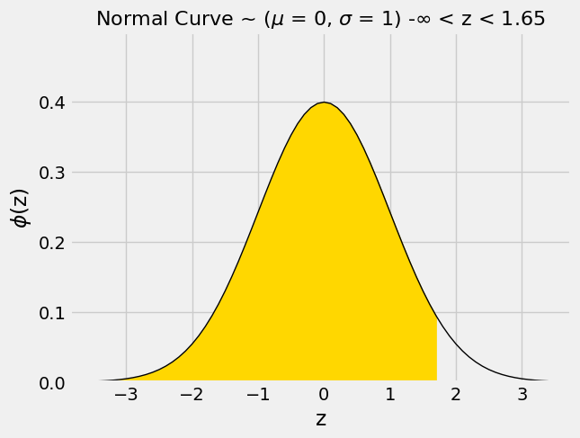

To run the second cell, the professor had to first import a Python library for probability and statistics:

**Code:**

```python
# Just run this cell
from scipy import stats
```

Then he used the `norm.cdf` method in the library to find the gold proportion above.

**Code:**

```python
# Just run this cell
stats.norm.cdf(1.65)
```

*Output:*

```text
0.9505285319663519
```

This means that roughly 95% of our data lies to the left of +1.65 SDs from the mean (the shaded area in yellow above).

*Note*: You do not need to understand how the `scipy` library or how to use the method yourself.

---
**Question 2.4.** The cell above shows that in a normal distribution, about **95%** of the data is less than or equal to **1.65 SDs** above average. Therefore, what can we say about the right number of SDs to use when constructing a **90%** confidence interval? Select all valid statements, and assign your answers to the array `sd_answers`. **(6 Points)**

1.  A **90%** confidence interval should be contained in about **1.65 SDs** above and below the center because this captures the middle **90%** of a normal distribution.

2. A **90%** confidence interval should be contained in about **2 SDs** above and below the center because it is the standard cutoff for normal distributions.

3. A **90%** confidence interval should be contained in about **0.90 SDs** above and below the center because the confidence level is **90%**.

4. A **90%** confidence interval should cover from the left end of the distribution up to **+1.65 SDs** above the center, since **95%** of values are below that point.

5. Because the normal distribution is symmetric, if about **5%** of values are above **+1.65 SDs**, then about 5% are below **−1.65 SDs**, so a **90%** confidence interval uses **±1.65 SDs**.

6. Because the normal distribution is symmetric, if about **5%** of values are above **+2 SDs**, then about 5% are below **−2 SDs**, so a **90%** confidence interval uses **±2 SDs**.

**Student scaffold:**

```python
sd_answers = make_array(...)
```

**Solution:**

```python
"""# BEGIN PROMPT
sd_answers = make_array(...)
"""; # END PROMPT
sd_answers = make_array(1,5) # SOLUTION NO PROMPT
```

**Test — `q2_4` (6 points)**

```python
>>> from hw08_check import correctness_check_2_4
>>> correctness_check_2_4(sd_answers)
True
```

**Code:**

```python
# Just run this cell, do not change it.
stats.norm.cdf(2.33)
```

*Output:*

```text
0.99009692444083575
```

---
**Question 2.5.** The cell above shows that the proportion that is at most 2.33 SDs above average in a normal distribution is 99%. Assign `option` to the right option to fill in the blank: **(6 points)**

If you start at the estimate and go 2.33 SDs on either side, then you will get a _______% confidence interval for the parameter.

1. 99.5
2. 99
3. 98.5
4. 98

_Note:_ `option` should be assigned to one of `1`, `2`, `3`, or `4` depending on which answer is correct.

**Student scaffold:**

```python
option = ...
option
```

**Solution:**

```python
option = 4 # SOLUTION
option
```

*Output:*

```text
4
```

**Test — `q2_5` (6 points)**

```python
>>> type(option) == int
True

>>> from hw08_check import correctness_check_2_5
>>> correctness_check_2_5(option)
True
```

---
## 3. Polling and the Normal Distribution

Marissa and Soumyadeep are a statistical consultants, and they are working for a group that supports Proposition 68 (which would mandate labeling of all horizontal and vertical axes, unrelated to any real California proposition) called Yes on 68.  They want to know how many Californians will vote for the proposition.

Marissa polls a random sample of all California voters, and she finds that 210 of the 400 sampled voters will vote in favor of the proposition. We have provided a table for you below which has 3 columns: the first two columns are identical to `sample`. The third column contains the proportion of total voters that chose each option.

**Code:**

```python
sample = Table().with_columns(
    "Vote",  make_array("Yes", "No"),
    "Count", make_array(210,   190))

sample_size = sum(sample.column("Count"))
sample_with_proportions = sample.with_column("Proportion", sample.column("Count") / sample_size)
sample_with_proportions
```

*Output:*

| Vote | Count | Proportion |
| --- | --- | --- |
| Yes | 210 | 0.525 |
| No | 190 | 0.475 |

---
**Question 3.1.** Marissa wants to use 10,000 bootstrap resamples to compute a confidence interval for the proportion of all California voters who will vote Yes.  

Fill in the next cell to simulate an empirical distribution of Yes proportions. Use bootstrap resampling to simulate 10,000 election outcomes, and assign `resample_yes_proportions` to contain the Yes proportion of each bootstrap resample. Then, visualize `resample_yes_proportions` with a histogram. **You should see a bell shaped histogram centered near the proportion of Yes in the original sample.** **(6 points)**

*Hint:* `sample_proportions` may be useful here!

**Student scaffold:**

```python
resample_yes_proportions = make_array()
for i in np.arange(10000):
    resample = ...
    resample_yes_proportions = ...
Table().with_column("Resample Yes proportion", resample_yes_proportions).hist(bins=np.arange(.2, .8, .01))
```

**Solution:**

```python
resample_yes_proportions = make_array()
for i in np.arange(10000):
    resample = sample_proportions(sample_size, sample_with_proportions.column("Proportion")) #SOLUTION
    resample_yes_proportions = np.append(resample_yes_proportions, resample.item(0)) #SOLUTION
Table().with_column("Resample Yes proportion", resample_yes_proportions).hist(bins=np.arange(.2, .8, .01))
```

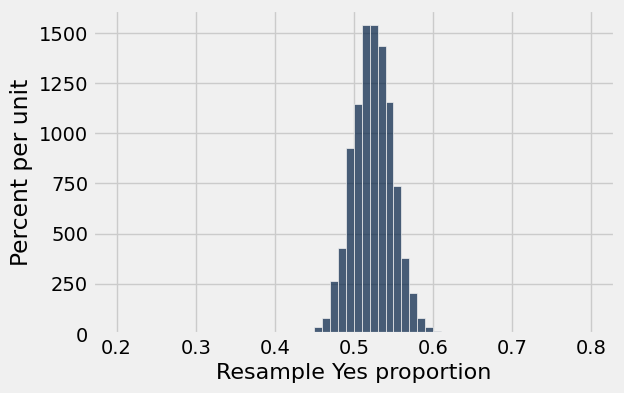

**Test — `q3_1` (6 points)**

```python
>>> len(resample_yes_proportions) == 10000
True

>>> abs(np.mean(resample_yes_proportions) - 0.525) < 0.025 and np.std(resample_yes_proportions) < 0.08
True
```

---
**Question 3.2.** Consider the histogram of bootstrap resampled Yes proportions above. Which of the following statements about this distribution and the Central Limit Theorem are true? Assign your answers to the array `clt_answers`. We recommend reviewing [14.4](https://inferentialthinking.com/chapters/14/4/Central_Limit_Theorem.html) for a refresher on the CLT. **(6 points)**

1. If we think of Yes votes as 1s and No votes as 0s, each resampled Yes proportion is the mean of a bootstrap resample of 1s and 0s taken with replacement from the original sample, so the Central Limit Theorem applies when the sample size is large. 

2. Because the sample size of 400 voters is large, the Central Limit Theorem tells us that the bootstrap distribution of the sample Yes proportions will be approximately normal, meaning it's bell-shaped and symmetric.

3. The Central Limit Theorem applies only when the population itself follows a normal distribution.

4. The bootstrap distribution is centered around the proportion of Yes votes in the original sample (210/400).

5. The boostrap distribution should be centered at 0.5, since there are only two possible outcomes (Yes or No).

**Student scaffold:**

```python
clt_answers = make_array(...)
```

**Solution:**

```python
"""# BEGIN PROMPT
clt_answers = make_array(...)
"""; # END PROMPT
clt_answers = make_array(1,2,4) # SOLUTION NO PROMPT
```

**Test — `q3_2` (6 points)**

```python
>>> from hw08_check import correctness_check_3_2
>>> correctness_check_3_2(clt_answers)
True
```

---
In a population whose members are represented as either a 0 or 1, there is a simple formula for the **standard deviation of that population**:

$$\text{standard deviation of population} = \sqrt{(\text{proportion of 0s}) \times (\text{proportion of 1s})}$$

(Figuring out this formula, starting from the definition of the standard deviation, is a fun exercise for those who enjoy algebra.)

**Question 3.3.** Using only the Central Limit Theorem and the numbers of Yes and No voters in our sample of 400, *algebraically* compute the predicted standard deviation of the `resample_yes_proportions` array. Assign this number to `approximate_sd`. **Do not access the data in `resample_yes_proportions` in any way.** **(6 points)**

Remember that the standard deviation of the sample means can be computed from the population SD and the size of the sample (the formula above might be helpful). If we do not know the population SD, we can use the sample SD as a reasonable approximation in its place. 

_Note:_ Section [14.5.1](https://inferentialthinking.com/chapters/14/5/Variability_of_the_Sample_Mean.html#the-sd-of-all-the-sample-means) of the textbook may be helpful.

**Student scaffold:**

```python
approx_pop_sd = ...
approximate_sd = ...
approximate_sd
```

**Solution:**

```python
approx_pop_sd = (190/400 * 210/400) ** 0.5 # SOLUTION
approximate_sd = approx_pop_sd / (400 ** 0.5) # SOLUTION
approximate_sd
```

*Output:*

```text
0.024968730444297725
```

**Test — `q3_3` (6 points)**

```python
>>> approximate_sd < 0.025
True

>>> from hw08_check import correctness_check_3_3
>>> correctness_check_3_3(approximate_sd)
True
```

**Question 3.4.** Compute the standard deviation of the array `resample_yes_proportions`, which will act as an approximation to the true SD of the possible sample proportions. This will help verify whether your answer to question 3.3 is approximately correct. **(6 points)**

**Student scaffold:**

```python
exact_sd = ...
exact_sd
```

**Solution:**

```python
exact_sd = np.std(resample_yes_proportions) #SOLUTION
exact_sd
```

*Output:*

```text
0.024678560572640784
```

**Test — `q3_4` (6 points)**

```python
>>> exact_sd < 0.05
True

>>> from hw08_check import correctness_check_3_4
>>> correctness_check_3_4(exact_sd)
True
```

---
**Question 3.5.** **Again, without accessing `resample_yes_proportions` in any way**, compute an approximate 95% confidence interval for the proportion of Yes voters in California. **(6 points)**

The cell below draws your interval as a red bar below the histogram of `resample_yes_proportions`; use that to verify that your answer looks right.

*Hint:* How many SDs corresponds to 95% of the distribution promised by the CLT? Recall the discussion in the textbook [here](https://inferentialthinking.com/chapters/14/3/SD_and_the_Normal_Curve.html).

*Hint:* The `approximate_sd` variable you previously defined may be helpful!

**Student scaffold:**

```python
lower_limit = ...
upper_limit = ...
print('lower:', lower_limit, 'upper:', upper_limit)
```

**Solution:**

```python
lower_limit = 210/400 - 2*approximate_sd #SOLUTION
upper_limit = 210/400 + 2*approximate_sd #SOLUTION
print('lower:', lower_limit, 'upper:', upper_limit)
```

*Output (stdout):*

```text
lower: 0.47506253911140456 upper: 0.5749374608885954
```

**Test — `q3_5` (6 points)**

```python
>>> 0.4 <= lower_limit < upper_limit <= 0.7
True

>>> from hw08_check import correctness_check_3_5_lower
>>> correctness_check_3_5_lower(lower_limit)
True

>>> from hw08_check import correctness_check_3_5_upper
>>> correctness_check_3_5_upper(upper_limit)
True
```

**Code:**

```python
# Run this cell to plot your confidence interval.
Table().with_column("Resample Yes proportion", resample_yes_proportions).hist(bins=np.arange(.2, .8, .01))
plt.plot(make_array(lower_limit, upper_limit), make_array(0, 0), c='r', lw=10);
```

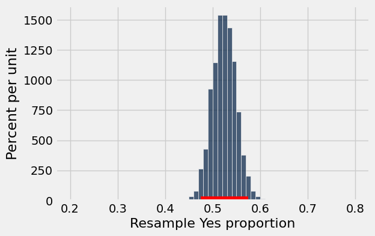

Your confidence interval should overlap the number 0.5.  That means we can't be very sure whether Proposition 68 is winning, even though the sample Yes proportion is a bit above 0.5.

The Yes on 68 campaign really needs to know whether they're winning.  It's impossible to be absolutely sure without polling the whole population, but they'd be okay if the standard deviation of the sample mean were only 0.005.  They ask Marissa to run a new poll with a sample size that's large enough to achieve that.  (Polling is expensive, so the sample also shouldn't be bigger than necessary.)

Marissa consults Chapter 14 of the textbook.  Instead of making the conservative assumption that the population standard deviation is 0.5 (coding Yes voters as 1 and No voters as 0), she decides to assume that it's equal to the standard deviation of the sample,

$$\sqrt{(\text{Yes proportion in the sample}) \times (\text{No proportion in the sample})}.$$

**Under that assumption, Marissa decides that a sample size of 9,975 would suffice.**

Does Marissa's sample size achieve the desired standard deviation of sample means? What SD would you achieve with a smaller sample size? A higher sample size?
---
**Question 3.6.** To explore this, first compute the SD of sample means obtained by using Marissa's sample size and assign it to `marissa_sample_mean_sd`. **(6 points)**

**Student scaffold:**

```python
estimated_population_sd = ...
marissa_sample_size = ...
marissa_sample_mean_sd = ...
print("With Marissa's sample size, you would predict a sample mean SD of %f." % marissa_sample_mean_sd)
```

**Solution:**

```python
estimated_population_sd = np.sqrt((210/400)*(1 - 210/400)) #SOLUTION
marissa_sample_size = 9975 #SOLUTION
marissa_sample_mean_sd = estimated_population_sd/(marissa_sample_size**.5) #SOLUTION
print("With Marissa's sample size, you would predict a sample mean SD of %f." % marissa_sample_mean_sd)
```

*Output (stdout):*

```text
With Marissa's sample size, you would predict a sample mean SD of 0.005000.
```

**Test — `q3_6` (6 points)**

```python
>>> -3 < marissa_sample_mean_sd <= 3
True

>>> from hw08_check import correctness_check_3_6
>>> correctness_check_3_6(marissa_sample_mean_sd)
True
```

---
**Question 3.7.** Next, compute the SD of sample means that you would get from a smaller sample size. Ideally, you should pick a number that is significantly smaller, but any sample size smaller than Marissa's will do. **(5 points)**

**Student scaffold:**

```python
smaller_sample_size = ...
smaller_sample_mean_sd = ...
print("With this smaller sample size, you would predict a sample mean SD of %f" % smaller_sample_mean_sd)
```

**Solution:**

```python
smaller_sample_size = 5000 #SOLUTION
smaller_sample_mean_sd = estimated_population_sd/(smaller_sample_size**.5) #SOLUTION
print("With this smaller sample size, you would predict a sample mean SD of %f" % smaller_sample_mean_sd)
```

*Output (stdout):*

```text
With this smaller sample size, you would predict a sample mean SD of 0.007062
```

**Test — `q3_7` (5 points)**

```python
>>> smaller_sample_size < marissa_sample_size
True

>>> from hw08_check import correctness_check_3_7
>>> correctness_check_3_7(smaller_sample_mean_sd)
True
```

---
**Question 3.8.** Finally, compute the SD of sample means that you would get from a larger sample size. Here, a number that is significantly larger would make any difference more obvious, but any sample size larger than Marissa's will do. **(5 points)**

**Student scaffold:**

```python
larger_sample_size = ...
larger_sample_mean_sd = ...
print("With this larger sample size, you would predict a sample mean SD of %f" % larger_sample_mean_sd)
```

**Solution:**

```python
larger_sample_size = 15000 #SOLUTION
larger_sample_mean_sd = estimated_population_sd/(larger_sample_size**.5) #SOLUTION
print("With this larger sample size, you would predict a sample mean SD of %f" % larger_sample_mean_sd)
```

*Output (stdout):*

```text
With this larger sample size, you would predict a sample mean SD of 0.004077
```

**Test — `q3_8` (5 points)**

```python
>>> larger_sample_size > marissa_sample_size
True

>>> from hw08_check import correctness_check_3_8
>>> correctness_check_3_8(larger_sample_mean_sd)
True
```

---
**Question 3.9.** Based off of this, was Marissa's sample size approximately the minimum sufficient sample, given her assumption that the sample SD is the same as the population SD? Assign `min_sufficient` to `True` if 9,975 was indeed approximately the minimum sufficient sample, and `False` if it wasn't. **(6 points)**

**Student scaffold:**

```python
min_sufficient = ...
min_sufficient
```

**Solution:**

```python
min_sufficient = True #SOLUTION
min_sufficient
```

*Output:*

```text
True
```

**Test — `q3_9` (6 points)**

```python
>>> min_sufficient or not min_sufficient
True

>>> min_sufficient
True
```

You're done with Homework 8!  

**Important submission steps:** 
1. Run the tests and verify that they all pass.
2. Choose **Save Notebook** from the **File** menu, then **run the final cell**. 
3. Click the link to download the zip file.
4. Go to [Pensive](https://www.pensieve.co) and submit the zip file to the corresponding assignment. The name of this assignment is "HW 08 Autograder". 

**It is your responsibility to make sure your work is saved before running the last cell.**

---

To double-check your work, the cell below will rerun all of the autograder tests.

## Submission

Make sure you have run all cells in your notebook in order before running the cell below, so that all images/graphs appear in the output. The cell below will generate a zip file for you to submit. **Please save before exporting!**


---

# hw09

---
title: "Homework 9: Linear Regression"
assignment: hw09
semester: sp26
source: semester_assignments/sp26/hw/hw09/autograder/hw09.ipynb
version: solution (autograder) with student scaffolds
student_source: semester_assignments/sp26/hw/hw09/student/hw09.ipynb
total_points: 71
language: python
---


# Homework 9: Linear Regression

**Helpful Resource:**

- [Python Reference](http://data8.org/su26/reference/): Cheat sheet of helpful array & table methods used in Data 8!

**Recommended Readings**: 

* [Correlation](https://inferentialthinking.com/chapters/15/1/Correlation.html)
* [The Regression Line](https://www.inferentialthinking.com/chapters/15/2/Regression_Line.html)
* [Method of Least Squares](https://www.inferentialthinking.com/chapters/15/3/Method_of_Least_Squares.html)
* [Least Squares Regression](https://www.inferentialthinking.com/chapters/15/4/Least_Squares_Regression.html)

Please complete this notebook by filling in the cells provided. **Before you begin, execute the cell below to setup the notebook by importing some helpful libraries.** Each time you start your server, you will need to execute this cell again.

Throughout this homework and all future ones, **please be sure to not re-assign variables throughout the notebook!** For example, if you use `max_temperature` in your answer to one question, do not reassign it later on. Otherwise, you will fail tests that you thought you were passing previously!

**Deadline:**

This assignment is **due Wednesday, 4/15 at 11:00am PT**. Submissions after this time will be accepted for 24 hours and will incur a 20% penalty. Any submissions later than this 24 hour period will not be accepted unless an extension has been granted as per the [syllabus](https://www.data8.org/su26/syllabus/) page. Turn it in by Tuesday, 4/14 at 11:00am PT for 5 extra credit points.

Directly sharing answers is not okay, but discussing problems with the course staff or with other students is encouraged. Refer to the [syllabus](https://www.data8.org/su26/syllabus/) page to learn more about how to learn cooperatively.

You should start early so that you have time to get help if you're stuck. Office hours are held Monday through Friday in [Warren Hall](https://www.berkeley.edu/map/warren-hall/) 101B or online. The office hours schedule appears [here](https://www.data8.org/su26/calendar/).

---

The point breakdown for this assignment is given in the table below:
| Category | Points |
| --- | --- |
| Autograder (Coding questions) | 71 |
| Written (Visualization questions) | 29 |
| **Total** | 100 |

**Code:**

```python
# Run this cell to set up the notebook, but please don't change it.

import numpy as np
from datascience import * 

# These lines do some fancy plotting magic.
import matplotlib
%matplotlib inline
import matplotlib.pyplot as plt
plt.style.use('fivethirtyeight')
import warnings
warnings.simplefilter('ignore', FutureWarning)
from datetime import datetime
```

---
## 1. Linear Regression Setup

When performing linear regression, we need to compute several important quantities which will be used throughout our analysis. **Throughout this assignment, when asked to make a prediction, please assume we are predicting y from x, unless otherwise specified.** To help with our later analysis, we will begin by writing some of these functions and understanding what they can do for us.

---

**Question 1.1.** Define a function `standard_units` that converts a given array to standard units. **(3 points)**

*Hint:* You may find the `np.mean` and `np.std` functions helpful.

**Student scaffold:**

```python
def standard_units(data):
    ...
```

**Solution:**

```python
def standard_units(data):
    return (data - np.mean(data)) / np.std(data) # SOLUTION
```

**Test — `q1_1` (3 points)**

```python
>>> standard_units([1, 2, 3, 4, 5])
array([-1.41421356, -0.70710678,  0.        ,  0.70710678,  1.41421356])

>>> np.isclose(np.mean(standard_units([1, 2, 3, 4, 5])), 0)
True

>>> bool(np.isclose(np.std(standard_units([1, 2, 3, 4, 5])), 0.9999999999999999))
True

>>> from hw09_check import correctness_check_1_1
>>> correctness_check_1_1(standard_units)
array([-1.65988202, -1.15470054,  0.36084392, -0.14433757,  0.36084392,
        0.8660254 ,  1.37120689])
```

---

**Question 1.2.** Which of the following are true about standard units? Assume we have converted an array of data into standard units using the function above. **(5 points)**

1. The values of the data after being converted to standard units retain the same units as the original data.
2. The sum of all our data after being converted into standard units is 0.
3. The standard deviation of all our data after being converted into standard units is 1.
4. Adding a constant, C, to every value in our original data has no impact on the resultant data when converted to standard units.
5. Multiplying every value in our original data by a positive constant, C (>0), has no impact on the resultant data when converted to standard units.

Assign `standard_array` to an array of your selections, in increasing numerical order. For example, if you wanted to select options 1, 3, and 5,
you would assign `standard_array` to `make_array(1, 3, 5)`.

**Student scaffold:**

```python
standard_array = ...
```

**Solution:**

```python
standard_array = make_array(2, 3, 4, 5) # SOLUTION
```

**Test — `q1_2` (5 points)**

```python
>>> import numpy as np
>>> bool(type(standard_array) == np.ndarray)
True

>>> bool(all(standard_array == np.sort(standard_array)))
True

>>> bool(1 <= standard_array.item(0) <= 5)
True

>>> from hw09_check import correctness_check_1_2
>>> correctness_check_1_2(standard_array)
True
```

---

**Question 1.3.** Define a function `correlation` that computes the correlation between `x` and `y`, which are 2 arrays of data in their original units. **(3 points)**

*Hint:* Feel free to use functions you have defined previously.

**Student scaffold:**

```python
def correlation(x, y):
    ...
```

**Solution:**

```python
def correlation(x, y):
    return np.mean(standard_units(x) * standard_units(y)) # SOLUTION
```

**Test — `q1_3` (3 points)**

```python
>>> bool(np.isclose(correlation([1, 2, 3], [4, 5, 6]), 0.9999999999999999))
True

>>> from hw09_check import correctness_check_1_3
>>> correctness_check_1_3(correlation)
True
```

---

**Question 1.4.** Which of the following are true about the correlation coefficient $r$? **(5 points)**

1. The correlation coefficient measures the strength of a linear relationship between two variables.
2. When looking at existing data, a correlation coefficient of 1.0 means that as one variable increases, the other variable always increases too.
3. The correlation coefficient is the slope of the regression line in standard units.
4. The correlation coefficient stays the same if we swap our x-axis and y-axis.
5. If we add a constant, C, to every value in our original data, our correlation coefficient will increase by the same C.

Assign `r_array` to an array of your selections, in increasing numerical order. For example, if you wanted to select options 1, 3, and 5,
you would assign `r_array` to `make_array(1, 3, 5)`.

Hint: Review [Section 15.1](https://inferentialthinking.com/chapters/15/1/Correlation.html#correlation) if you get stuck.

**Student scaffold:**

```python
r_array = ...
```

**Solution:**

```python
r_array = make_array(1, 2, 3, 4) # SOLUTION
```

**Test — `q1_4` (5 points)**

```python
>>> import numpy as np
>>> bool(type(r_array) == np.ndarray)
True

>>> bool(all(r_array == np.sort(r_array)))
True

>>> bool(1 <= r_array.item(0) <= 5)
True

>>> from hw09_check import correctness_check_1_4
>>> correctness_check_1_4(r_array)
True
```

---

**Question 1.5.** Define a function `slope` that computes the slope of our line of best fit (to predict y given x). The function takes in x and y, which are two arrays of data in their original units. Assume we want to create a line of best fit in original units. **(3 points)**

*Hint:* Feel free to use functions you have defined previously.

**Student scaffold:**

```python
def slope(x, y):
    r = ...
    ...
```

**Solution:**

```python
def slope(x, y):
    r = correlation(x, y) # SOLUTION
    return r * np.std(y) / np.std(x) # SOLUTION
```

**Test — `q1_5` (3 points)**

```python
>>> bool(np.isclose(slope([1, 2], [1, 2]), 1.0))
True

>>> from hw09_check import correctness_check_1_5
>>> correctness_check_1_5(slope)
True
```

---

**Question 1.6.** Which of the following are true about the slope of our line of best fit? Assume `x` refers to the value of one variable that we use to predict the value of `y`. **(5 points)**

1. In original units, the slope has the unit: unit of x / unit of y.
2. In standard units, the slope is unitless.
3. In original units, the slope is unchanged by swapping x and y.
4. In standard units, a slope of 1 means our data is perfectly linearly correlated.
5. In original units and standard units, the slope always has the same positive or negative sign.

Assign `slope_array` to an array of your selections, in increasing numerical order. For example, if you wanted to select options 1, 3, and 5,
you would assign `slope_array` to `make_array(1, 3, 5)`.

**Student scaffold:**

```python
slope_array = ...
```

**Solution:**

```python
slope_array = make_array(2, 4, 5) # SOLUTION
```

**Test — `q1_6` (5 points)**

```python
>>> import numpy as np
>>> bool(type(slope_array) == np.ndarray)
True

>>> bool(all(slope_array == np.sort(slope_array)))
True

>>> bool(1 <= slope_array.item(0) <= 5)
True

>>> from hw09_check import correctness_check_1_6
>>> correctness_check_1_6(slope_array)
True
```

---

**Question 1.7.** Define a function `intercept` that computes the intercept of our line of best fit (to predict y given x), given 2 arrays of data in original units. Assume we want to create a line of best fit in original units. **(3 points)**

*Hint:* Feel free to use functions you have defined previously.

**Student scaffold:**

```python
def intercept(x, y):
    ...
```

**Solution:**

```python
def intercept(x, y):
    return np.mean(y) - slope(x, y) * np.mean(x) # SOLUTION
```

**Test — `q1_7` (3 points)**

```python
>>> bool(np.isclose(intercept([1, 2], [1, 2]), 0.0))
True

>>> from hw09_check import correctness_check_1_7
>>> correctness_check_1_7(intercept)
True
```

---

**Question 1.8.** Which of the following are true about the intercept of our line of best fit? Assume `x` refers to the value of one variable that we use to predict the value of `y`. **(5 points)**

1. In original units, the intercept has the same unit as the y values.
2. In original units, the intercept has the same unit as the x values.
3. In original units, the slope and intercept have the same unit.
4. In standard units, the intercept for the regression line is 0.
5. In original units and standard units, the intercept always has the same numerical value.

Assign `intercept_array` to an array of your selections, in increasing numerical order. For example, if you wanted to select options 1, 3, and 5,
you would assign `intercept_array` to `make_array(1, 3, 5)`.

**Student scaffold:**

```python
intercept_array = ...
```

**Solution:**

```python
intercept_array = make_array(1, 4) # SOLUTION
```

**Test — `q1_8` (5 points)**

```python
>>> import numpy as np
>>> bool(type(intercept_array) == np.ndarray)
True

>>> bool(all(intercept_array == np.sort(intercept_array)))
True

>>> bool(1 <= intercept_array.item(0) <= 5)
True

>>> from hw09_check import correctness_check_1_8
>>> correctness_check_1_8(intercept_array)
True
```

---

**Question 1.9.** Define a function `predict` that takes in a table and 2 column names as strings, and returns an array of predictions. The predictions should be created using a fitted **regression line**. We are predicting `col2` from `col1`, both in original units. **(5 points)**

*Hint 1:* Feel free to use functions you have defined previously.

*Hint 2:* Re-reading [15.2](https://inferentialthinking.com/chapters/15/2/Regression_Line.html#the-regression-line) might be helpful here.

**Student scaffold:**

```python
def predict(tbl, col1, col2):
    x = ...
    y = ...
    ...
```

**Solution:**

```python
def predict(tbl, col1, col2):
    x = tbl.column(col1) # SOLUTION
    y = tbl.column(col2) # SOLUTION
    return slope(x, y) * x + intercept(x, y) # SOLUTION
```

**Test — `q1_9` (5 points)**

```python
>>> test_table = Table().with_columns('x', make_array(1, 2, 4), 'y', make_array(4, 5, 6))
>>> bool(np.all(np.isclose(predict(test_table, 'x', 'y'), make_array(4.14285714, 4.78571429, 6.07142857))))
True

>>> test_table_2 = Table().with_columns('x', make_array(-1, -3, -5), 'y', make_array(0, 3, 4))
>>> bool(np.all(np.isclose(predict(test_table_2, 'x', 'y'), make_array(0.33333333, 2.33333333, 4.33333333))))
True
```

---
## 2. FIFA Predictions

The following data was scraped from [sofifa.com](https://sofifa.com/), a website dedicated to collecting information from FIFA video games. The dataset consists of all players in FIFA 22 and their corresponding attributes. We have truncated the dataset to a limited number of rows (100) to ease with our visualizations and analysis. Since we’re learning about linear regression, we will look specifically for a linear association between various player attributes. **To help with understanding where the line of best fit generated in linear regression comes from please do not use the `.fit_line` argument in `.scatter` at any point on question 2 unless the code was provided for you.**

Feel free to read more about the video game on [Wikipedia](https://en.wikipedia.org/wiki/FIFA_22).

**Code:**

```python
# Run this cell to load the data
fifa = Table.read_table('fifa22.csv')

# Select a subset of columns to analyze (there are 110 columns in the original dataset)
fifa = fifa.select("short_name", "overall", "value_eur", "wage_eur", "age", "pace", "shooting", "passing", "attacking_finishing")
fifa.show(5)
```

*Output:*

| short_name | overall | value_eur | wage_eur | age | pace | shooting | passing | attacking_finishing |
| --- | --- | --- | --- | --- | --- | --- | --- | --- |
| L. Messi | 93 | 78000000 | 320000 | 34 | 85 | 92 | 91 | 95 |
| R. Lewandowski | 92 | 119500000 | 270000 | 32 | 78 | 92 | 79 | 95 |
| Cristiano Ronaldo | 91 | 45000000 | 270000 | 36 | 87 | 94 | 80 | 95 |
| Neymar Jr | 91 | 129000000 | 270000 | 29 | 91 | 83 | 86 | 83 |
| K. De Bruyne | 91 | 125500000 | 350000 | 30 | 76 | 86 | 93 | 82 |

---

**Question 2.1.** Before jumping into any statistical techniques, it’s important to see what the data looks like, because data visualizations allow us to uncover patterns in our data that would have otherwise been much more difficult to see. **(3 points)**

Create a scatter plot with age on the x-axis (“age”), and the player’s value in Euros (“value_eur”) on the y-axis.

**Student scaffold:**

```python
...
```

**Solution:**

```python
fifa.scatter('age', 'value_eur') # SOLUTION
```

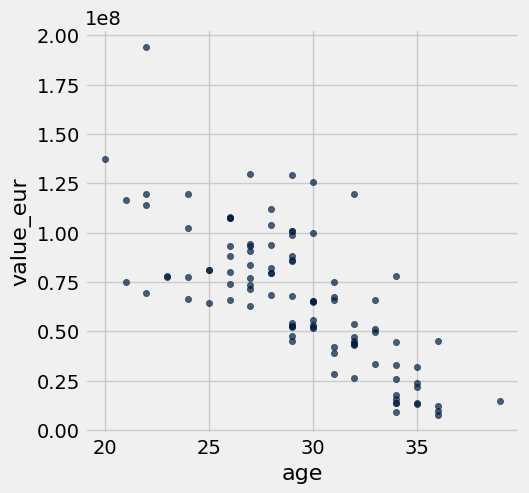

---

**Question 2.2.** Does the correlation coefficient `r` for the data in our scatter plot in 2.1 look closest to 0, 0.75, or -0.75? **(3 points)**

Assign `r_guess` to one of 0, 0.75, or -0.75.

**Student scaffold:**

```python
r_guess = ...
```

**Solution:**

```python
r_guess = -0.75 # SOLUTION
```

**Test — `q2_2` (3 points)**

```python
>>> bool(r_guess == 0 or r_guess == 0.75 or r_guess == -0.75)
True

>>> from hw09_check import correctness_check_2_2
>>> correctness_check_2_2(r_guess)
True
```

---

**Question 2.3.** Create a scatter plot with player age ("age") along the x-axis and both real player value ("value_eur") and predicted player value along the y-axis. The predictions should be created using a fitted **regression line**. The color of the dots for the real player values should be different from the color for the predicted player values. **(8 points)**

*Hint 1:* Feel free to use functions you have defined previously.

*Hint 2:* [15.2](https://inferentialthinking.com/chapters/15/2/Regression_Line.html#) and [7.3](https://inferentialthinking.com/chapters/07/3/Overlaid_Graphs.html#overlaid-scatter-plots) have examples of creating such scatter plots.

**Student scaffold:**

```python
predictions = ...
fifa_with_predictions = ...
...
```

**Solution:**

```python
predictions = predict(fifa, 'age', 'value_eur') # SOLUTION
fifa_with_predictions = fifa.with_column('Predicted value_eur', predictions) # SOLUTION
fifa_with_predictions.select('age', 'value_eur', 'Predicted value_eur').scatter('age') # SOLUTION
```


---

**Question 2.4.** Looking at the scatter plot you produced above, is linear regression a good model to use? What features or characteristics make this model reasonable or unreasonable?

Select all correct statements about the scatter plot above and assign them to an array called `regression_answers` (e.g. `regression_answers = make_array(2,3)`). **(5 points)**

1. Yes, linear regression is a good model to use here.

2. No, linear regression is not a good model to use here.

3. As age increases, our original data shows a roughly linear decrease in player value.

4. Our original data shows a non-linear relationship.

5. Our original data has too many outliers to show any relationship.

6. The line of best fit (predicted player value) matches the relationship observed in the data well.

**Student scaffold:**

```python
regression_answers = make_array(...)
```

**Solution:**

```python
"""# BEGIN PROMPT
regression_answers = make_array(...)
"""; # END PROMPT
regression_answers = make_array(1,3,6) # SOLUTION NO PROMPT
```

**Test — `q2_4` (5 points)**

```python
>>> from hw09_check import correctness_check_2_4
>>> correctness_check_2_4(regression_answers)
True
```

---

**Question 2.5.** In 2.3, we created a scatter plot **in original units**. Now, create a scatter plot with player age **in standard units** along the x-axis and both real and predicted player value **in standard units** along the y-axis. The color of the dots of the real and predicted values should be different. **(8 points)**

*Hint 1:* Feel free to use functions you have defined previously.

*Hint 2:* Check out [Chapter 15.2.5](http://inferentialthinking.com/chapters/15/2/Regression_Line.html#the-equation-of-the-regression-line) if you’re stuck!

**Student scaffold:**

```python
predictions_su = ...
fifa_su = ...
...
```

**Solution:**

```python
predictions_su = correlation(fifa.column('age'), fifa.column('value_eur')) * standard_units(fifa.column('age')) # SOLUTION
fifa_su = Table().with_columns('age standardized', standard_units(fifa.column('age')), 'value_eur standardized', standard_units(fifa.column('value_eur')), 'Predicted value_eur standardized', predictions_su) # SOLUTION
fifa_su.scatter('age standardized') # SOLUTION
```

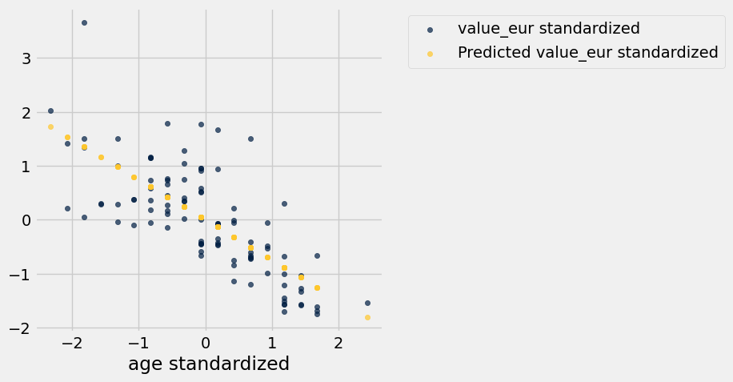

---

**Question 2.6.** Compare your plots in 2.3 and 2.5. What similarities do they share? What differences do they have?

Select all correct statements that correctly compare the two scatter plots and assign them to an array called `plot_comparison` (e.g. `plot_comparison = make_array(2,3)`). **(5 points)**

1. The produced line of best fit is the same in both plots, **relative to the data**.

2. The axes are on the same scale in both plots.

3. Regardless of whether to data is in original or standard units, it has the same general appearance in both plots.

4. The data in each plot have the same mean and standard deviation on the x-axis. 

5. The data in each plot have the same mean and standard deviation on the y-axis.

**Student scaffold:**

```python
plot_comparison = make_array(...)
```

**Solution:**

```python
"""# BEGIN PROMPT
plot_comparison = make_array(...)
"""; # END PROMPT
plot_comparison = make_array(1,3) # SOLUTION NO PROMPT
```

**Test — `q2_6` (5 points)**

```python
>>> from hw09_check import correctness_check_2_6
>>> correctness_check_2_6(plot_comparison)
True
```

---

**Question 2.7.** Define a function `rmse` that takes in two arguments: a slope and an intercept for a potential regression line. The function should return the root mean squared error between the player values predicted by a regression line with the given slope and intercept and the actual player values. **(6 points)**

Assume we are still predicting “value_eur” from “age” in original units from the `fifa` table.

**Student scaffold:**

```python
def rmse(slope, intercept):
    predictions = ...
    errors = ...
    ...
```

**Solution:**

```python
def rmse(slope, intercept):
    predictions = slope * fifa.column('age') + intercept # SOLUTION
    errors = fifa.column('value_eur') - predictions # SOLUTION
    return np.mean(errors ** 2) ** 0.5 # SOLUTION
```

**Test — `q2_7` (6 points)**

```python
>>> import numpy as np
>>> bool(type(rmse(1, 2)) == np.float64 or type(rmse(1, 2)) == float)
True

>>> from hw09_check import correctness_check_2_7
>>> correctness_check_2_7(rmse)
True
```

---

**Question 2.8.** Use the `rmse` function you defined along with `minimize` to find the least-squares regression parameters predicting player value from player age. Here's an [example](https://inferentialthinking.com/chapters/15/3/Method_of_Least_Squares.html#numerical-optimization) of using the `minimize` function from the textbook. **(10 points)**

Then set `lsq_slope` and `lsq_intercept` to be the least-squares regression line slope and intercept, respectively.

Finally, create a scatter plot like you did in 2.3 with player age ("age") along the x-axis and both real player value ("value_eur") and predicted player value along the y-axis. **Be sure to use your least-squares regression line to compute the predicted values.** The color of the dots for the real player values should be different from the color for the predicted player values.

> **Note:** Your solution should not make any calls to the slope or intercept functions defined earlier.

*Hint:* Your call to `minimize` will return an array of argument values that minimize the return value of the function passed to `minimize`.

*Hint:* Check out [Section 15.3.3.1](https://inferentialthinking.com/chapters/15/3/Method_of_Least_Squares.html#numerical-optimization) to learn more about `minimize`.

**Student scaffold:**

```python
minimized_parameters = ...
lsq_slope = ...
lsq_intercept = ...

# This just prints your slope and intercept
print("Slope: {:g} | Intercept: {:g}".format(lsq_slope, lsq_intercept))

fifa_with_lsq_predictions = ...
...
```

**Solution:**

```python
minimized_parameters = minimize(rmse) # SOLUTION
lsq_slope = minimized_parameters.item(0) # SOLUTION
lsq_intercept = minimized_parameters.item(1) # SOLUTION

# This just prints your slope and intercept
print("Slope: {:g} | Intercept: {:g}".format(lsq_slope, lsq_intercept))

fifa_with_lsq_predictions = fifa.with_column('Predicted value_eur', lsq_slope * fifa.column('age') + lsq_intercept) # SOLUTION
fifa_with_lsq_predictions.select('age', 'value_eur', 'Predicted value_eur').scatter('age') # SOLUTION
```

*Output (stdout):*

```text
Slope: -6.41462e+06 | Intercept: 2.55525e+08
```

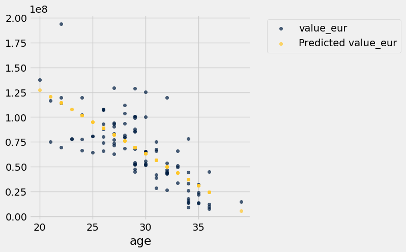

---

**Question 2.9.** The resulting line you found in 2.8 should appear very similar to the line you found in 2.3. Why were we able to find nearly the same slope and intercept as the previous formulas by minimizing the RMSE?

Assign `rmse_reasoning` to the correct justification (e.g. `rmse_reasoning = 1`). **(5 points)**

*Hint:* Re-reading [15.3](https://inferentialthinking.com/chapters/15/3/Method_of_Least_Squares.html#the-least-squares-line) might be helpful here.

1. Because minimizing RMSE eliminates all error in our predictions, the resulting slope and intercept will correspond to our unique regression line.

2. By definition, the regression line is the unique straight line that minimizes RMSE. Therefore, by finding the slope and intercept values that minimize RMSE, we can find the regression line.

3. The regression line found through minimizing RMSE is a rough approximation of the regression line found through the previous formulas, so the two methods give very similar results.

4. The law of large numbers guarantees that the method of minimizing the RMSE converges to using the regression formulas, given that we have many datapoints.

**Student scaffold:**

```python
rmse_reasoning = ...
```

**Solution:**

```python
rmse_reasoning = 2 # SOLUTION
```

**Test — `q2_9` (5 points)**

```python
>>> from hw09_check import correctness_check_2_9
>>> correctness_check_2_9(rmse_reasoning)
True
```

---

**Question 2.10** Which of the following error functions would have produced the same slope and intercept values in 2.8 instead of using RMSE? Assume `error` is assigned to the actual values minus the predicted values. **(5 points)**

1. `np.sum(error) ** 0.5`
2. `np.sum(error ** 2)`
3. `np.mean(error) ** 0.5`
4. `np.mean(error ** 2)`

Assign `error_array` to an array of your selections, in increasing numerical order. For example, if you wanted to select options 1, 3, and 5,
you would assign `error_array` to `make_array(1, 3, 5)`.

Hint: What was the purpose of RMSE? Are there any alternatives, and if so, does minimizing them yield the same results as minimizing the RMSE?

**Student scaffold:**

```python
error_array = ...
```

**Solution:**

```python
error_array = make_array(2, 4) # SOLUTION
```

**Test — `q2_10` (5 points)**

```python
>>> import numpy as np
>>> bool(type(error_array) == np.ndarray)
True

>>> bool(all(error_array == np.sort(error_array)))
True

>>> bool(1 <= error_array.item(0) <= 5)
True

>>> from hw09_check import correctness_check_2_10
>>> correctness_check_2_10(error_array)
True
```

**Code:**

```python
# goalies don't have shooting in our dataset so we removed them before looking at the pace stat
no_goalies = fifa.where("shooting", are.above(0))
no_goalies
```

*Output:*

| short_name | overall | value_eur | wage_eur | age | pace | shooting | passing | attacking_finishing |
| --- | --- | --- | --- | --- | --- | --- | --- | --- |
| L. Messi | 93 | 78000000 | 320000 | 34 | 85 | 92 | 91 | 95 |
| R. Lewandowski | 92 | 119500000 | 270000 | 32 | 78 | 92 | 79 | 95 |
| Cristiano Ronaldo | 91 | 45000000 | 270000 | 36 | 87 | 94 | 80 | 95 |
| Neymar Jr | 91 | 129000000 | 270000 | 29 | 91 | 83 | 86 | 83 |
| K. De Bruyne | 91 | 125500000 | 350000 | 30 | 76 | 86 | 93 | 82 |
| K. Mbappé | 91 | 194000000 | 230000 | 22 | 97 | 88 | 80 | 93 |
| H. Kane | 90 | 129500000 | 240000 | 27 | 70 | 91 | 83 | 94 |
| N. Kanté | 90 | 100000000 | 230000 | 30 | 78 | 66 | 75 | 65 |
| K. Benzema | 89 | 66000000 | 350000 | 33 | 76 | 86 | 81 | 90 |
| H. Son | 89 | 104000000 | 220000 | 28 | 88 | 87 | 82 | 88 |

**Code:**

```python
# Run this cell to generate a scatter plot for the next part.
no_goalies.scatter('shooting', 'attacking_finishing', fit_line=True)
plt.xticks(np.arange(20, 101, 10));
```

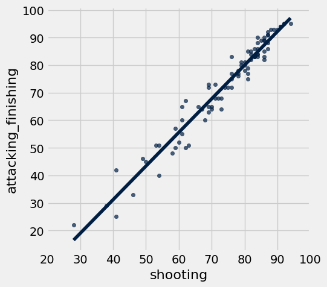

---

**Question 2.11.** Above is a scatter plot showing the relationship between a player’s shooting ability (“shooting”) and their scoring ability (“attacking_finishing”). 

There is clearly a strong positive correlation between the 2 variables, and we’d like to predict a player’s scoring ability from their shooting ability. Which of the following are true, assuming linear regression is a reasonable model? **(5 points)**

*Hint:* Re-reading [15.2](https://inferentialthinking.com/chapters/15/2/Regression_Line.html#) might be helpful here.

1. For a majority of players with a `shooting` attribute above 80, our model predicts they have a better scoring ability than shooting ability.
2. A randomly selected player's predicted scoring ability in standard units will always be less than their shooting ability in standard units.
3. If we select a player whose shooting ability is 1.0 in standard units, their scoring ability, on average, will be less than 1.0 in standard units.
4. Goalies have attacking_finishing scores in our dataset but do not have shooting scores. We can still use our model to predict their attacking_finishing scores.

Assign `scoring_array` to an array of your selections, in increasing numerical order. For example, if you wanted to select options 1, 3, and 5,
you would assign `scoring_array` to `make_array(1, 3, 5)`.

**Student scaffold:**

```python
scoring_array = ...
```

**Solution:**

```python
scoring_array = make_array(1, 3) # SOLUTION
```

**Test — `q2_11` (5 points)**

```python
>>> import numpy as np
>>> bool(type(scoring_array) == np.ndarray)
True

>>> bool(all(scoring_array == np.sort(scoring_array)))
True

>>> bool(1 <= scoring_array.item(0) <= 4)
True

>>> from hw09_check import correctness_check_2_11
>>> correctness_check_2_11(scoring_array)
True
```

You're done with Homework 9!  

**Important submission steps:** 
1. Run the tests and verify that they all pass.
2. Choose **Save Notebook** from the **File** menu, then **run the final cell**. 
3. Click the link to download the zip file.
4. Go to [Pensive](https://www.pensieve.co/) and submit the zip file to the corresponding assignment. The name of this assignment is "HW 09 Autograder". 

**It is your responsibility to make sure your work is saved before running the last cell.**

---

To double-check your work, the cell below will rerun all of the autograder tests.

## Submission

Make sure you have run all cells in your notebook in order before running the cell below, so that all images/graphs appear in the output. The cell below will generate a zip file for you to submit. **Please save before exporting!**

---

## Datasets

Datasets this notebook loads with `Table.read_table`. Column names are exact, including spaces and capitalization. Only the schema is recorded here — the data itself is not in this document, so any question about its values must be answered by running code, not by reasoning over the rows shown elsewhere in this file.

### `fifa22.csv`

100 rows, 110 columns.

| Column | Type |
| --- | --- |
| `sofifa_id` | int |
| `player_url` | str |
| `short_name` | str |
| `long_name` | str |
| `player_positions` | str |
| `overall` | int |
| `potential` | int |
| `value_eur` | int |
| `wage_eur` | int |
| `age` | int |
| `dob` | str |
| `height_cm` | int |
| `weight_kg` | int |
| `club_team_id` | int |
| `club_name` | str |
| `league_name` | str |
| `league_level` | int |
| `club_position` | str |
| `club_jersey_number` | int |
| `club_loaned_from` | str |
| `club_joined` | str |
| `club_contract_valid_until` | int |
| `nationality_id` | int |
| `nationality_name` | str |
| `nation_team_id` | float |
| `nation_position` | str |
| `nation_jersey_number` | float |
| `preferred_foot` | str |
| `weak_foot` | int |
| `skill_moves` | int |
| `international_reputation` | int |
| `work_rate` | str |
| `body_type` | str |
| `real_face` | str |
| `release_clause_eur` | float |
| `player_tags` | str |
| `player_traits` | str |
| `pace` | float |
| `shooting` | float |
| `passing` | float |

_... 70 more columns, all mixed_


---

# hw10

---
title: "Homework 10: Regression Inference"
assignment: hw10
semester: sp26
source: semester_assignments/sp26/hw/hw10/autograder/hw10.ipynb
version: solution (autograder) with student scaffolds
student_source: semester_assignments/sp26/hw/hw10/student/hw10.ipynb
total_points: 84
language: python
---


# Homework 10: Regression Inference

**Helpful Resource:**

- [Python Reference](http://data8.org/su26/reference/): Cheat sheet of helpful array & table methods used in Data 8!

**Recommended Reading**: 

* [Using Confidence Intervals](https://inferentialthinking.com/chapters/13/4/Using_Confidence_Intervals.html)
* [The Regression Line](https://inferentialthinking.com/chapters/15/2/Regression_Line.html#the-regression-line-in-standard-units)
* [Inference for Regression](https://www.inferentialthinking.com/chapters/16/Inference_for_Regression.html)

Please complete this notebook by filling in the cells provided. **Before you begin, execute the cell below to setup the notebook by importing some helpful libraries.** Each time you start your server, you will need to execute this cell again.

Throughout this homework and all future ones, **please be sure to not re-assign variables throughout the notebook!** For example, if you use `max_temperature` in your answer to one question, do not reassign it later on. Otherwise, you will fail tests that you thought you were passing previously!

**Deadline:**

This assignment is **due Wednesday, 4/22 at 11:00am PT**. Submissions after this time will be accepted for 24 hours and will incur a 20% penalty. Any submissions later than this 24 hour period will not be accepted unless an extension has been granted as per the [syllabus](http://data8.org/su26/syllabus/) page. Turn it in by Tuesday, 4/21 at 11:00am PT for 5 extra credit points.

Directly sharing answers is not okay, but discussing problems with the course staff or with other students is encouraged. Refer to the [syllabus](http://www.data8.org/su26/syllabus/) page to learn more about how to learn cooperatively.

You should start early so that you have time to get help if you're stuck. Office hours are held Monday through Friday in [Warren Hall](https://www.berkeley.edu/map/warren-hall/) 101B or online. The office hours schedule appears [here](https://www.data8.org/su26/calendar/).

---

The point breakdown for this assignment is given in the table below:
| Category | Points |
| --- | --- |
| Autograder (Coding questions) | 84 |
| Written (1.4, 2.4) | 16 |
| **Total** | 100 |

**Code:**

```python
# Don't change this cell; just run it. 

import numpy as np
from datascience import *

# These lines do some fancy plotting magic
import matplotlib
%matplotlib inline
import matplotlib.pyplot as plt
plt.style.use('fivethirtyeight')
import warnings
warnings.simplefilter('ignore')
from datetime import datetime
```

---
## 0. Data 8 Final Exam Accomodations Form

You can find the final exam accomodations form [here](https://docs.google.com/forms/d/e/1FAIpQLSeBCZBUNBMpS0uqS7TdsWpnrMX2rXhlILlGUw_ChKu0BXW7xw/viewform?usp=dialog). All students must fill out the form so we can better accomodate everyone for the final exam.

---

**Question 0.1.** Fill out the final exam accomodations form linked above. Once you have submitted, a secret word will be displayed. Set `secret_word` to the secret string at the end of the form. **(6 points)**

**Student scaffold:**

```python
secret_word = ...
```

**Solution:**

```python
secret_word = 'artemis'  # SOLUTION
```

**Test — `q0_1` (6 points)**

```python
>>> len(secret_word) > 0
True

>>> from hw10_check import correctness_check_0
>>> correctness_check_0(secret_word)
True
```

---
<a id="intro"></a>
## An Introduction to Regression Inference

Previously in this class, we've used confidence intervals to quantify uncertainty about estimates. We can also run hypothesis tests using a confidence interval under the following procedure:

1. Define a null and alternative hypothesis (they must be of the form "The parameter is X" and "The parameter is not X").
2. Choose a p-value cutoff, and call it $q$, where $q$ is a percentage.
3. Construct a $(100\%-q)\%$ confidence interval using bootstrap sampling (for example, if your p-value cutoff is 1%, or 0.01, then construct a 99% confidence interval).
4. Using the confidence interval, determine if your data are more consistent with your null or alternative hypothesis, at your $q\%$ p-value cutoff:
   * If the null hypothesis parameter X is in your confidence interval, the data are more consistent with the null hypothesis.
   * If the null hypothesis parameter X is *not* in your confidence interval, the data are more consistent with the alternative hypothesis.

More recently, we've discussed the use of linear regression to make predictions based on correlated variables. For example, we can predict the height of children based on the heights of their parents.

We can combine these two topics to make powerful statements about our population by using the following techniques:

- Bootstrapped interval for the true slope
- Bootstrapped prediction interval for y (given a particular value of x)

This homework explores these two methods.

---

## The Data
The [Snowy Plover](https://www.audubon.org/field-guide/bird/snowy-plover) is a tiny bird that lives on the coast in parts of California and elsewhere. It is so small that it is vulnerable to many predators, including people and dogs that don't look where they are stepping when they go to the beach. It is considered endangered in many parts of the U.S.

The data are about the eggs and newly-hatched chicks of the Snowy Plover. Here's a picture of a parent bird incubating its eggs.


The data were collected at the Point Reyes National Seashore by a former [student at Berkeley](https://openlibrary.org/books/OL2038693M/BLSS_the_Berkeley_interactive_statistical_system). The goal was to see how the size of an egg could be used to predict the weight of the resulting chick. The bigger the newly-hatched chick, the more likely it is to survive.


Each row of the table below corresponds to one Snowy Plover egg and the resulting chick. Note how tiny the bird is:

- `Egg Length` and `Egg Breadth` (widest diameter) are measured in millimeters
- `Egg Weight` and `Bird Weight` are measured in grams; for comparison, a standard paper clip weighs about one gram

**Code:**

```python
birds = Table.read_table('snowy_plover.csv')
birds
```

*Output:*

| Egg Length | Egg Breadth | Egg Weight | Bird Weight |
| --- | --- | --- | --- |
| 28.8 | 21.84 | 7.4 | 5.2 |
| 29.04 | 22.45 | 7.7 | 5.4 |
| 29.36 | 22.48 | 7.9 | 5.6 |
| 30.1 | 21.71 | 7.5 | 5.3 |
| 30.17 | 22.75 | 8.3 | 5.9 |
| 30.34 | 22.84 | 8.5 | 5.8 |
| 30.36 | 22.5 | 8.2 | 5.8 |
| 30.46 | 22.72 | 8.3 | 6 |
| 30.54 | 23.31 | 9 | 6.1 |
| 30.62 | 22.94 | 8.5 | 6.2 |

In this investigation, we will be using the egg weight to predict bird weight. Run the cell below to create a scatter plot of the egg weights and bird weights, along with their line of best fit.

**Code:**

```python
# Just run this cell and examine the scatter plot.
birds.scatter('Egg Weight', "Bird Weight", fit_line=True)
```

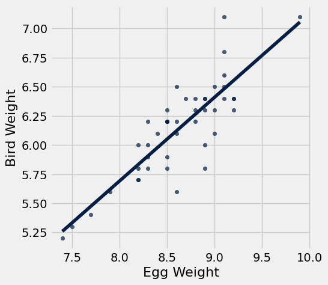

---
## 1. Finding the Bootstrap Confidence Interval for the True Slope

Looking at the scatter plot of our sample, we observe a linear relationship between egg weight and bird weight. However, relationships that we have identified in the sample might not be representative of the true relationship in the population.

We want to know if there truly exists a linear relationship between egg weight and bird weight for Snowy Plovers. If there is no linear relationship between the two variables, then we'd expect a correlation of 0. Consequently, the slope of the regression line would also be 0. 

We highly recommend reviewing section [16.2](https://inferentialthinking.com/chapters/16/2/Inference_for_the_True_Slope.html) before attempting this part of the homework

---

**Question 1.1.** Let's run a hypothesis test using confidence intervals to see if there is a linear relationship between egg weight and bird weight.
Choose the appropriate null and alternative hypotheses that will allow you to conduct this test. Assign the numbers corresponding to the correct null and alternative hypotheses to `null_hypothesis` and `alt_hypothesis`. **(12 points)**

1. The true slope of the regression line, computed using our sample of Snowy Plovers, is 0.

2. The true slope of the regression line, computed using our sample of Snowy Plovers, is not 0.

2. The true slope of the regression line, computed using our sample of Snowy Plovers, is greater than 0.

3. The true slope of the regression line, computed using the population of all Snowy Plovers, is 0.

4. The true slope of the regression line, computed using the population of all Snowy Plovers, is not 0.

2. The true slope of the regression line, computed using the population of Snowy Plovers, is greater than 0.

*Hint:* Our regression line predicts bird weight from egg weight!

**Student scaffold:**

```python
null_hypothesis = ...
alt_hypothesis =  ...
```

**Solution:**

```python
"""# BEGIN PROMPT
null_hypothesis = ...
alt_hypothesis =  ...
"""; # END PROMPT
null_hypothesis = 4 # SOLUTION NO PROMPT
alt_hypothesis =  5 # SOLUTION NO PROMPT
```

**Test — `q1_1` (12 points)**

```python
>>> from hw10_check import correctness_check_1_1
>>> correctness_check_1_1(null_hypothesis, alt_hypothesis)
True
```

---

**Question 1.2.** Define the following two functions:

1. `standard_units`: This function takes in an array of numbers and returns an array containing those numbers converted to standard units.
2. `correlation`: This function takes in a table and two column names (one for *x* and one for *y*) and returns the correlation between these columns. 

**(4 points)**

**Student scaffold:**

```python
def standard_units(arr):
    ...

def correlation(tbl, x_col, y_col):
    ...
```

**Solution:**

```python
def standard_units(arr):
    return (arr - np.mean(arr))/np.std(arr) # SOLUTION

def correlation(tbl, x_col, y_col):
    return np.mean(standard_units(tbl.column(x_col)) * standard_units(tbl.column(y_col))) # SOLUTION
```

**Test — `q1_2` (4 points)**

```python
>>> abs(correlation(Table().with_columns('a', np.random.normal(0, 1, 10), 'b', np.random.normal(0, 1, 10)), 'a', 'b')) <= 1
True

>>> np.allclose(standard_units(np.arange(5)), np.sqrt(2) / 2 * np.arange(-2, 3))
True

>>> from hw10_check import correctness_check_1_2
>>> correctness_check_1_2(correlation, birds)
True
```

---

**Question 1.3.** Using the functions you just implemented, create a function called `fit_line`.  It should take a table (e.g. `birds`) and the column names associated to *x* and *y* as its arguments and return an *array* containing the slope and intercept of the regression line (in that order) that predicts the *y* column in the table using the *x* column. **(8 points)**

**Student scaffold:**

```python
def fit_line(tbl, x_col, y_col):
    ...

fit_line(birds, "Egg Weight", "Bird Weight")
```

**Solution:**

```python
def fit_line(tbl, x_col, y_col):
    # BEGIN SOLUTION
    x = tbl.column(x_col) 
    y = tbl.column(y_col) 
    r = correlation(tbl, x_col, y_col) 
    slope = r * (np.std(y)/np.std(x)) 
    intercept = np.mean(y) - slope*np.mean(x) 
    return make_array(slope, intercept) 
    # END SOLUTION

fit_line(birds, "Egg Weight", "Bird Weight")
```

*Output:*

```text
array([ 0.71851534, -0.05827226])
```

**Test — `q1_3` (8 points)**

```python
>>> type(fit_line(Table().with_columns('x', make_array(0, 1), 'y', make_array(1, 3)), 'x', 'y')) == np.ndarray
True

>>> len(fit_line(Table().with_columns('x', make_array(0, 1), 'y', make_array(1, 3)), 'x', 'y')) == 2
True

>>> np.allclose(np.round(fit_line(Table().with_columns('x', make_array(0, 1), 'y', make_array(1, 3)), 'x', 'y'), 5), np.array([2, 1]))
True

>>> from hw10_check import correctness_check_1_3
>>> correctness_check_1_3(fit_line, birds)
True
```

**Run** this cell to plot the line produced by calling `fit_line` on the `birds` table.  

**Note:** You are not responsible for the code in the cell below, but make sure that your `fit_line` function generated a reasonable line for the data.

**Code:**

```python
# Ensure your fit_line function fits a reasonable line 
# to the data in birds, using the plot below.

# Just run this cell
sample_slope, sample_intercept = fit_line(birds, "Egg Weight", "Bird Weight")
birds.scatter("Egg Weight", "Bird Weight")
plt.plot([min(birds.column("Egg Weight")), max(birds.column("Egg Weight"))], 
         [sample_slope*min(birds.column("Egg Weight"))+sample_intercept, sample_slope*max(birds.column("Egg Weight"))+sample_intercept])
plt.show()
```

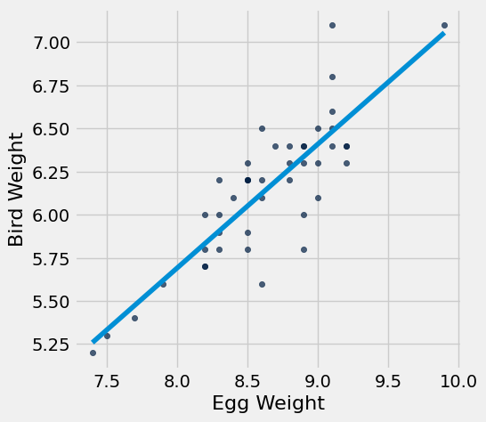

Now we have all the tools we need to create a confidence interval that quantifies our uncertainty about the true relationship between egg weight and bird weight.

---

**Question 1.4.** Create an array called `resampled_slopes` that contains the slope of the best fit line for 1000 bootstrap resamples of `birds`. Plot the distribution of these slopes. **(8 points)**

*Hint:* Use the `fit_line` function you defined in 1.3.

**Student scaffold:**

```python
resampled_slopes = ...

for i in np.arange(1000): 
    birds_bootstrap = ...
    bootstrap_line = ...
    bootstrap_slope = ...
    resampled_slopes = ...
    
# DO NOT CHANGE THIS LINE
Table().with_column("Slope estimate", resampled_slopes).hist()
```

**Solution:**

```python
resampled_slopes = make_array() # SOLUTION

for i in np.arange(1000): 
    birds_bootstrap = birds.sample(with_replacement=True) # SOLUTION
    bootstrap_line = fit_line(birds_bootstrap, "Egg Weight", "Bird Weight") # SOLUTION
    bootstrap_slope = bootstrap_line.item(0) # SOLUTION
    resampled_slopes = np.append(resampled_slopes, bootstrap_slope) # SOLUTION
    
# DO NOT CHANGE THIS LINE
Table().with_column("Slope estimate", resampled_slopes).hist()
```

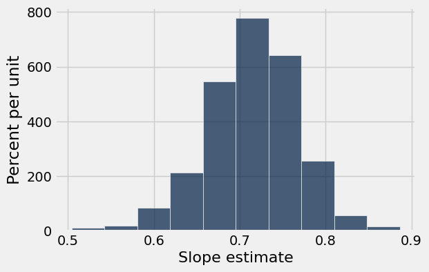

**Test — `q1_4` (0 points)**

```python
>>> len(resampled_slopes) == 1000
True
```

---

**Question 1.5.** Use your resampled slopes to construct an 95% confidence interval for the true value of the slope. **(8 points)**

**Student scaffold:**

```python
lower_end = ...
upper_end = ...
print("95% confidence interval for slope: [{:g}, {:g}]".format(lower_end, upper_end))
```

**Solution:**

```python
lower_end = percentile(2.5, resampled_slopes) # SOLUTION
upper_end = percentile(97.5, resampled_slopes) # SOLUTION
print("95% confidence interval for slope: [{:g}, {:g}]".format(lower_end, upper_end))
```

*Output (stdout):*

```text
95% confidence interval for slope: [0.602811, 0.811143]
```

**Test — `q1_5` (8 points)**

```python
>>> lower_end > 0
True

>>> upper_end < 4
True
```

---

**Question 1.6.** Based on your confidence interval, would you reject or fail to reject the null hypothesis that the true slope is 0?  Why?  What p-value cutoff are you using?

Select all statements that are correct given your 95% confidence interval from the previous question, and assign your answers to the array `ci_conclusion`. **(10 points)**

1. Because 0 is outside of our 95% confidence interval, there is evidence that the true slope is non-zero.

2. Because 0 is outside of our 95% confidence interval, there is evidence the true slope is zero.

3. We are using a p-value cutoff of 0.05.

4. We are using a p-value cutoff of 0.95.

5. Based on our confidence interval and p-value cutoff, we would fail to reject the null hypothesis.

6. Based on our confidence interval and p-value cutoff, we would reject the null hypothesis.

*Hint*: Read the introduction of this homework!

**Student scaffold:**

```python
ci_conclusion = make_array(...)
```

**Solution:**

```python
"""# BEGIN PROMPT
ci_conclusion = make_array(...)
"""; # END PROMPT
ci_conclusion = make_array(1,3,6) # SOLUTION NO PROMPT
```

**Test — `q1_6` (10 points)**

```python
>>> from hw10_check import correctness_check_1_6
>>> correctness_check_1_6(ci_conclusion)
True
```

---

**Question 1.7.** Assume that the 95% confidence interval you generated in Question 1.5 was $[0.6, 0.8]$.

Select all statements that are correct interpretations of this interval, and assign your answers to the array `confidence_interval_uses`. **(8 points)**

1. This interval allows us to make a conclusion about whether the true slope is 0, at a 5% p-value cutoff.

2. There is a 95% chance that the true slope falls between $[0.6, 0.8]$.

3. We are 95% confident that the true slope is somewhere between $[0.6, 0.8]$.

**Student scaffold:**

```python
confidence_interval_uses = make_array(...)
```

**Solution:**

```python
"""# BEGIN PROMPT
confidence_interval_uses = make_array(...)
"""; # END PROMPT
confidence_interval_uses = make_array(1,3) # SOLUTION NO PROMPT
```

**Test — `q1_7` (8 points)**

```python
>>> from hw10_check import correctness_check_1_7
>>> correctness_check_1_7(confidence_interval_uses)
True
```

---
## 2. Finding the Bootstrap Prediction Interval

Suppose we're visiting Point Reyes and stumble upon some Snowy Plover eggs; we'd like to know how heavy they'll be once they hatch. In other words, we want to use our regression line to make predictions about a bird's weight based on the weight of the corresponding egg.

However, just as we're uncertain about the slope of the true regression line, we're also uncertain about the predictions made based on the true regression line.

---

**Question 2.1.** Define the function `fitted_value`.  It should take in four arguments:

1. `table`: a table like `birds`.  We'll be predicting the values in the second column using the first.
2. `x_col`: the name of our x-column within the input `table`
3. `y_col`: the name of our y-column within the input `table`
2. `given_x`: a number, the value of the predictor variable for which we'd like to make a prediction.
  
The function should return the line’s prediction for the given x. **(6 points)**

*Hint:* Make sure to use the `fit_line` function you defined in Question 1.3.

**Student scaffold:**

```python
def fitted_value(table, x_col, y_col, given_x):
    line = ...
    slope = ...
    intercept = ...
    ...

# Here's an example of how fitted_value is used. The code below
# computes the prediction for the bird weight, in grams, based on
# an egg weight of 8 grams.
egg_weight_eight = fitted_value(birds, "Egg Weight", "Bird Weight", 8)
egg_weight_eight
```

**Solution:**

```python
def fitted_value(table, x_col, y_col, given_x):
    line = fit_line(table, x_col, y_col) # SOLUTION
    slope = line.item(0) # SOLUTION
    intercept = line.item(1) # SOLUTION
    return slope * given_x  + intercept #SOLUTION

# Here's an example of how fitted_value is used. The code below
# computes the prediction for the bird weight, in grams, based on
# an egg weight of 8 grams.
egg_weight_eight = fitted_value(birds, "Egg Weight", "Bird Weight", 8)
egg_weight_eight
```

*Output:*

```text
5.689850497215146
```

**Test — `q2_1` (6 points)**

```python
>>> type(egg_weight_eight) in set([float, np.float32, np.float64])
True

>>> from hw10_check import correctness_check_2_1
>>> correctness_check_2_1(egg_weight_eight)
True
```

---

**Question 2.2.** Raymond, the resident Snowy Plover expert at Point Reyes, tells us that the egg he has been carefully observing has a weight of 9 grams. Using `fitted_value` above, assign the variable `experts_egg` as the predicted bird weight for Raymond's egg. **(4 points)**

**Student scaffold:**

```python
experts_egg = ...
experts_egg
```

**Solution:**

```python
experts_egg = fitted_value(birds, "Egg Weight", "Bird Weight", 9) # SOLUTION
experts_egg
```

*Output:*

```text
6.408365842108825
```

**Test — `q2_2` (4 points)**

```python
>>> type(experts_egg) in set([float, np.float32, np.float64])
True

>>> from hw10_check import correctness_check_2_2
>>> correctness_check_2_2(experts_egg)
True
```

**Code:**

```python
# Let's look at the number of rows in the birds table.
birds.num_rows
```

*Output:*

```text
44
```

A fellow parkgoer raises the following objection to your prediction:

> "Your prediction depends on your sample of 44 birds.  Wouldn't your prediction change if you had a different sample of 44 birds?"

Having read section [16.3](https://inferentialthinking.com/chapters/16/3/Prediction_Intervals.html) of the textbook, you know just the response! Had the sample been different, the regression line would have been different too. This would ultimately result in a different prediction. To see how good our prediction is, we must get a sense of how variable the prediction can be.

---

**Question 2.3.** Define a function `compute_resampled_line` that takes in a table `tbl`and two column names, `x_col` and `y_col`, and returns an array containing the parameters of the best fit line (slope and intercept) for one bootstrapped resample of the table. **(6 points)**

**Student scaffold:**

```python
def compute_resampled_line(tbl, x_col, y_col):
    resample = ...
    resampled_line = ...
    ...
```

**Solution:**

```python
def compute_resampled_line(tbl, x_col, y_col):
    resample = tbl.sample() # SOLUTION
    resampled_line = fit_line(resample, x_col, y_col) # SOLUTION
    return resampled_line # SOLUTION
```

**Test — `q2_3` (6 points)**

```python
>>> len(compute_resampled_line(Table().with_columns('x', make_array(0, 1), 'y', make_array(1, 3)), 'x', 'y')) == 2
True

>>> from hw10_check import correctness_check_2_3
>>> correctness_check_2_3(compute_resampled_line, birds)
True
```

**Run** the following cell below in order to define the function `bootstrap_lines`.  It takes in four arguments:
1. `tbl`: a table like `birds`
2. `x_col`: the name of our x-column within the input `tbl`
3. `y_col`: the name of our y-column within the input `tbl`
4. `num_bootstraps`: an integer, a number of bootstraps to run.

It returns a *table* with one row for each bootstrap resample and the following two columns:
1. `Slope`: the bootstrapped slopes 
2. `Intercept`: the corresponding bootstrapped intercepts

**Code:**

```python
# Just run this cell
def bootstrap_lines(tbl, x_col, y_col, num_bootstraps):
    resampled_slopes = make_array()
    resampled_intercepts = make_array() 
    for i in np.arange(num_bootstraps): 
        resampled_line = compute_resampled_line(tbl, x_col, y_col) 
        resampled_slope = resampled_line.item(0) 
        resampled_intercept = resampled_line.item(1) 
        resampled_slopes = np.append(resampled_slopes,resampled_slope)
        resampled_intercepts = np.append(resampled_intercepts,resampled_intercept)
    tbl_lines = Table().with_columns('Slope', resampled_slopes, 'Intercept', resampled_intercepts)
    return tbl_lines

regression_lines = bootstrap_lines(birds, "Egg Weight", "Bird Weight", 1000)
regression_lines
```

*Output:*

| Slope | Intercept |
| --- | --- |
| 0.730301 | -0.193024 |
| 0.795006 | -0.689385 |
| 0.697291 | 0.100338 |
| 0.728826 | -0.17946 |
| 0.720929 | -0.0855102 |
| 0.756456 | -0.374169 |
| 0.645878 | 0.509795 |
| 0.747265 | -0.284245 |
| 0.740005 | -0.256814 |
| 0.71303 | -0.0632081 |

---

**Question 2.4.** Create an array called `predictions_for_eight` that contains the predicted bird weights based on an egg of weight 8 grams for each regression line in `regression_lines`. **(8 points)**

**Student scaffold:**

```python
predictions_for_eight = ...

# This will make a histogram of your predictions:
table_of_predictions = Table().with_column('Predictions at Egg Weight=8', predictions_for_eight)
table_of_predictions.hist('Predictions at Egg Weight=8', bins=20)
```

**Solution:**

```python
predictions_for_eight = regression_lines.column('Slope') * 8 + regression_lines.column('Intercept') # SOLUTION

# This will make a histogram of your predictions:
table_of_predictions = Table().with_column('Predictions at Egg Weight=8', predictions_for_eight)
table_of_predictions.hist('Predictions at Egg Weight=8', bins=20)
```

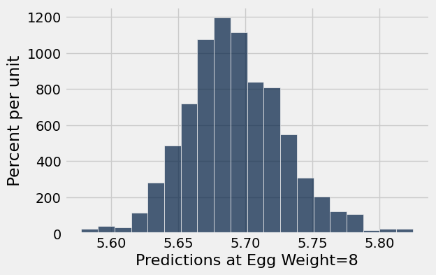

**Test — `q2_4` (0 points)**

```python
>>> len(predictions_for_eight) == regression_lines.num_rows
True
```

---

**Question 2.5.** Create an approximate 95% confidence interval for these predictions. **(6 points)**

**Student scaffold:**

```python
lower_bound = ...
upper_bound = ...

print('95% Confidence interval for predictions for x=8: (', lower_bound,",", upper_bound, ')')
```

**Solution:**

```python
lower_bound = percentile(2.5, predictions_for_eight) # SOLUTION
upper_bound = percentile(97.5, predictions_for_eight) # SOLUTION

print('95% Confidence interval for predictions for x=8: (', lower_bound,",", upper_bound, ')')
```

*Output (stdout):*

```text
95% Confidence interval for predictions for x=8: ( 5.62614784137 , 5.76819126819 )
```

**Test — `q2_5` (6 points)**

```python
>>> lower_bound > 5
True

>>> upper_bound < 6.5
True
```

---

**Question 2.6.** Set `plover_statements` to an array of integer(s) that correspond to statement(s) that are true. **(6 points)**

1. The 95% confidence interval covers 95% of the bird weights for eggs that had a weight of eight grams in `birds`.

2. The 95% confidence interval gives a sense of how much actual weights differ from your prediction.

3. The 95% confidence interval quantifies the uncertainty in our estimate of what the true line would predict.

**Student scaffold:**

```python
plover_statements = ...
```

**Solution:**

```python
plover_statements = make_array(3) # SOLUTION
```

**Test — `q2_6` (6 points)**

```python
>>> type(plover_statements) == np.ndarray
True

>>> from hw10_check import correctness_check_2_6
>>> correctness_check_2_6(plover_statements)
True
```

You're all done with Homework 10!

**Important submission steps:** 
1. Run the tests and verify that they all pass.
2. Choose **Save Notebook** from the **File** menu, then **run the final cell**. 
3. Click the link to download the zip file.
4. Go to [Pensive](https://www.pensieve.co/) and submit the zip file to the corresponding assignment. The name of this assignment is "HW 10 Autograder". 

**It is your responsibility to make sure your work is saved before running the last cell.**

---

To double-check your work, the cell below will rerun all of the autograder tests.

## Submission

Make sure you have run all cells in your notebook in order before running the cell below, so that all images/graphs appear in the output. The cell below will generate a zip file for you to submit. **Please save before exporting!**

---

## Datasets

Datasets this notebook loads with `Table.read_table`. Column names are exact, including spaces and capitalization. Only the schema is recorded here — the data itself is not in this document, so any question about its values must be answered by running code, not by reasoning over the rows shown elsewhere in this file.

### `snowy_plover.csv`

44 rows, 4 columns.

| Column | Type |
| --- | --- |
| `Egg Length` | float |
| `Egg Breadth` | float |
| `Egg Weight` | float |
| `Bird Weight` | float |


---

# hw11

---
title: "Homework 11: Classification"
assignment: hw11
semester: sp26
source: semester_assignments/sp26/hw/hw11/autograder/hw11.ipynb
version: solution (autograder) with student scaffolds
student_source: semester_assignments/sp26/hw/hw11/student/hw11.ipynb
total_points: 100
language: python
---


# Homework 11: Classification

**Helpful Resource:**

- [Python Reference](http://data8.org/su26/reference/): Cheat sheet of helpful array & table methods used in Data 8!

**Recommended Reading**: 

* [Classification](https://www.inferentialthinking.com/chapters/17/Classification.html)
* [Updating Predictions](https://inferentialthinking.com/chapters/18/Updating_Predictions.html)

Please complete this notebook by filling in the cells provided. **Before you begin, execute the cell below to setup the notebook by importing some helpful libraries.** Each time you start your server, you will need to execute this cell again.

For all problems that you must write explanations and sentences for, you **must** provide your answer in the designated space. Moreover, throughout this homework and all future ones, **please be sure to not re-assign variables throughout the notebook!** For example, if you use `max_temperature` in your answer to one question, do not reassign it later on. Otherwise, you will fail tests that you thought you were passing previously!

**Deadline:**

This assignment is **due Wednesday, 4/29 at 11:00am PT**. Submissions after this time will be accepted for 24 hours and will incur a 20% penalty. Any submissions later than this 24 hour period will not be accepted unless an extension has been granted as per the [syllabus](http://data8.org/su26/syllabus/) page. Turn it in by Tuesday, 4/28 at 11:00am PT for 5 extra credit points.

Directly sharing answers is not okay, but discussing problems with the course staff or with other students is encouraged. Refer to the [syllabus](https://www.data8.org/su26/syllabus/) page to learn more about how to learn cooperatively.

You should start early so that you have time to get help if you're stuck. Office hours are held Monday through Friday in [Warren Hall](https://www.berkeley.edu/map/warren-hall/) 101B or online. The office hours schedule appears [here](https://www.data8.org/su26/calendar/).

**Code:**

```python
# Don't change this cell; just run it. 

import numpy as np
from datascience import * 

# These lines do some fancy plotting magic
import matplotlib
%matplotlib inline
import matplotlib.pyplot as plt
plt.style.use('fivethirtyeight')
import warnings
warnings.simplefilter('ignore')
from datetime import datetime
```

---
### Classifier Primer

Though it is ungraded, we **highly recommend** you complete this quick [classifier primer](https://docs.google.com/forms/d/e/1FAIpQLSeTrGYhdp-CPemw-T20eMMVEGkEaYampKndi8qKMlHjBwR0yQ/viewform?usp=sf_link) before completing this homework assignment.

---
## 1. Bay Area School Coordinates with Classification

Welcome to Homework 11! This homework is about k-Nearest Neighbors classification (k-NN). Since this topic is covered in depth in Project 3, the purpose of this homework is to reinforce the basics of this method. You can and should reuse a lot of code that you wrote for Project 3 for this homework, or use code from this homework on Project 3!

### Our Dearest Neighbors

Richard is trying to classify students as either attendees of UC Berkeley or as attendees of Stanford University. To classify the students, Richard has access to the coordinates of the location they live during the school year. First, load in the `coordinates` table.

**Code:**

```python
# Just run this cell!
coordinates = Table.read_table('coordinates.csv')
coordinates.show(5)
```

*Output:*

| latitude | longitude | school |
| --- | --- | --- |
| 37.8693 | -122.255 | Berkeley |
| 37.8651 | -122.256 | Berkeley |
| 37.8661 | -122.254 | Berkeley |
| 37.868 | -122.26 | Berkeley |
| 37.8683 | -122.257 | Berkeley |

As usual, let's investigate our data visually before performing any kind of numerical analysis.

**Code:**

```python
# Just run this cell!
coordinates.scatter("longitude", "latitude", group="school")
```

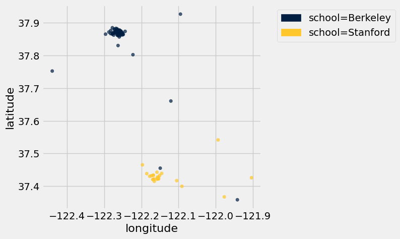

The locations of the points on this scatter plot might be familiar - run the following cell to see what they correspond to.

**Code:**

```python
# Just run this cell!
colors = {"Berkeley":"blue", "Stanford":"red"}
t = Table().with_columns("lat", coordinates.column(0), 
                                      "lon", coordinates.column(1), 
                                      "color", coordinates.apply(colors.get, 2)
                        )
Circle.map_table(t, radius=5, fill_opacity=1)
```

*Output:*

Make this Notebook Trusted to load map: File -> Trust Notebook

---

**Question 1.1.1** Let's begin implementing the k-Nearest Neighbors algorithm. Define the `distance` function, which takes in two arguments: an array of numerical features (`arr1`), and a different array of numerical features (`arr2`). The function should return the [Euclidean distance](https://en.wikipedia.org/wiki/Euclidean_distance) between the two arrays (take a look at [Section 17.3.2](https://inferentialthinking.com/chapters/17/3/rows-of-tables/index.html#distance-between-points-when-there-are-two-attributes)). Euclidean distance is often referred to as the straight-line distance formula. **(6 points)**

*Note:* Features refer to the characteristics of data used for machine learning models to predict with. In table format, these are the columns.

**Student scaffold:**

```python
def distance(arr1, arr2):
    ...

# Don't change/delete the code below in this cell
distance_example = distance(make_array(1, 2, 3), make_array(4, 5, 6))
distance_example
```

**Solution:**

```python
def distance(arr1, arr2):
    # BEGIN SOLUTION
    return np.sqrt(sum((arr1-arr2)**2))
    # END SOLUTION

# Don't change/delete the code below in this cell
distance_example = distance(make_array(1, 2, 3), make_array(4, 5, 6))
distance_example
```

*Output:*

```text
5.196152422706632
```

**Test — `q1_1_1` (6 points)**

```python
>>> type(distance_example) in set([float, np.float32, np.float64])
True

>>> from hw11_check import correctness_check_1_1_1
>>> correctness_check_1_1_1(distance_example)
True
```

---

**Question 1.1.2** While Euclidean distance is a more commonly known method to measure distance, it’s not the only one! Another method is the [Manhattan distance](https://simple.wikipedia.org/wiki/Manhattan_distance). To calculate the Manhattan distance between two points $(x_1, y_1)$ and $(x_2, y_2)$, the formula is as follows: $$\text{Manhattan Distance} = |x_1 - x_2| + |y_1 - y_2|$$

Identify all correct statements about the tradeoffs between Manhattan distance and Euclidean distance, and assign your answers to the array `tradeoffs`. **(4 points)**

*Hint:* Consider why it’s named _Manhattan_ distance—think of how you would measure travel distance in a city!

*Note:* In this homework, we will be using Euclidean distance to measure distance between two points. However, Manhattan distance and other distance functions exist and can be more appropriate depending on the structure of the data.

1. Manhattan distance measures the sum of absolute differences along each axis, while Euclidean distance measures the straight-line distance between two points.

2. Manhattan distance assumes you can't move diagonally from one point to another.

3. Euclidean distance assumes you can't move diagonally from one point to another.

4. Manhattan distance is often preferred over Euclidean distance when working with grid-like data, such as city maps.

**Student scaffold:**

```python
tradeoff = make_array(...)
```

**Solution:**

```python
""" # BEGIN PROMPT
tradeoff = make_array(...)
"""; # END PROMPT
tradeoff = make_array(1,2,4) # SOLUTION NO PROMPT
```

**Test — `q1_1_2` (4 points)**

```python
>>> from hw11_check import correctness_check_1_1_2
>>> correctness_check_1_1_2(tradeoff)
True
```

---

### Splitting the Dataset
We'll do two different kinds of things with the `coordinates` dataset:

1. We'll build a classifier using coordinates for which we know the associated label; this will teach it to recognize labels of similar coordinate values. This process is known as *training*.
2. We'll evaluate, or *test*, the accuracy of our classifier on data we haven't seen before.

As discussed in [Section 17.2](https://inferentialthinking.com/chapters/17/2/Training_and_Testing.html#training-and-testing), we want to use separate datasets for training and testing. As such, we split up our one dataset into two.

---

**Question 1.2.** Next, let's split our dataset into a training set and a test set. Assignment to each set should be random, so we should shuffle the table first. Then, since `coordinates`has 100 rows, let's create a training set with the first 75 rows of the shuffled table and a test set with the remaining 25 rows. **(10 points)**

*Hint:* As a first step we can shuffle all the rows, then use the `tbl.take` function to split up the rows for each table.

**Student scaffold:**

```python
shuffled_table = ...
train = ...
test = ...

print("Training set:\t",   train.num_rows, "examples")
print("Test set:\t",       test.num_rows, "examples")
train.show(5), test.show(5);
```

**Solution:**

```python
shuffled_table = coordinates.sample(with_replacement=False) # SOLUTION
train = shuffled_table.take(np.arange(0, 75)) # SOLUTION
test = shuffled_table.take(np.arange(75, 100)) # SOLUTION

print("Training set:\t",   train.num_rows, "examples")
print("Test set:\t",       test.num_rows, "examples")
train.show(5), test.show(5);
```

*Output (stdout):*

```text
Training set:	 75 examples
Test set:	 25 examples
```

*Output:*

| latitude | longitude | school |
| --- | --- | --- |
| 37.8668 | -122.254 | Berkeley |
| 37.8813 | -122.265 | Berkeley |
| 37.4429 | -122.158 | Stanford |
| 37.865 | -122.278 | Berkeley |
| 37.8774 | -122.258 | Berkeley |

*Output:*

| latitude | longitude | school |
| --- | --- | --- |
| 37.8761 | -122.282 | Berkeley |
| 37.8753 | -122.263 | Berkeley |
| 37.4331 | -122.169 | Stanford |
| 37.4654 | -122.197 | Stanford |
| 37.5416 | -121.994 | Stanford |

**Test — `q1_2` (10 points)**

```python
>>> train.num_rows == 75
True

>>> test.num_rows == 25
True

>>> from hw11_check import correctness_check_1_2
>>> correctness_check_1_2(train, test, coordinates)
True
```

---

**Question 1.3.** Assign `features` to an array of column names (strings) of the features from the `coordinates` table. **(10 points)**

*Hint:* Which of the column names in the `coordinates` table are the features, and which of the column names correspond to the class we're trying to predict? Run the cell below to see the list of column names in `coordinates`.

*Hint*: No need to modify any tables, just manually create an array of the feature names!

**Code:**

```python
print(coordinates.labels)
```

*Output (stdout):*

```text
('latitude', 'longitude', 'school')
```

**Student scaffold:**

```python
features = ...

# Don't change this line of code
print("Features:", features)
```

**Solution:**

```python
features = make_array("latitude", "longitude") # SOLUTION

# Don't change this line of code
print("Features:", features)
```

*Output (stdout):*

```text
Features: ['latitude' 'longitude']
```

**Test — `q1_3` (10 points)**

```python
>>> type(features) == np.ndarray
True

>>> all(np.isin(features, coordinates.labels))
True

>>> from hw11_check import correctness_check_1_3
>>> correctness_check_1_3(features)
True
```

---

**Question 1.4.** Now define the `classify` function. This function should take in a `test_row` from a table with the same columns as `test` and classify it using the k-Nearest Neighbors based on the correct `features` and the data in `train`. A refresher on k-Nearest Neighbors can be found [here](https://www.inferentialthinking.com/chapters/17/4/Implementing_the_Classifier.html). **(10 points)**


*Hint 1:* The `distance` function we defined earlier takes in arrays as input, so use the `row_to_array` function we defined for you to convert rows to arrays of features.

*Hint 2:* The skeleton code we provided iterates through each row in the training set. `train.rows` is an iterable sequence of all the row objects in the `train` table, so each `train_row` is a row object.

**Student scaffold:**

```python
def row_to_array(row, features):
    """Converts a row to an array of its features."""
    arr = make_array()
    for feature in features:
        arr = np.append(arr, row.item(feature))
    return arr

def classify(test_row, k, train):
    test_row_features_array = row_to_array(test_row, features)
    distances = make_array()
    for train_row in train.rows:
        train_row_features_array = ...
        row_distance = ...
        distances = ...
    train_with_distances = ...
    nearest_neighbors = ...
    most_common_label = ...
    ...

# Don't modify/delete the code below
first_test = classify(test.row(0), 5, train)
first_test
```

**Solution:**

```python
def row_to_array(row, features):
    """Converts a row to an array of its features."""
    arr = make_array()
    for feature in features:
        arr = np.append(arr, row.item(feature))
    return arr

def classify(test_row, k, train):
    test_row_features_array = row_to_array(test_row, features)
    distances = make_array()
    for train_row in train.rows:
        train_row_features_array = row_to_array(train_row, features) # SOLUTION       
        row_distance = distance(test_row_features_array, train_row_features_array) # SOLUTION
        distances = np.append(distances, row_distance) # SOLUTION
    train_with_distances = train.with_column("Distances", distances) # SOLUTION
    nearest_neighbors = train_with_distances.sort("Distances").take(np.arange(k)) # SOLUTION
    most_common_label = nearest_neighbors.group("school").sort("count", descending=True).column("school").item(0) # SOLUTION
    return most_common_label # SOLUTION

# Don't modify/delete the code below
first_test = classify(test.row(0), 5, train)
first_test
```

*Output:*

```text
'Berkeley'
```

**Test — `q1_4` (10 points)**

```python
>>> type(first_test) == str or type(first_test) == np.str_
True

>>> from hw11_check import correctness_check_1_4
>>> correctness_check_1_4(classify, coordinates)
True
```

---

**Question 1.5.** Define the function `three_classify` that takes a `row` from `test` as an argument and classifies the row based on using 3-Nearest Neighbors. Use this function to find the `accuracy` of a 3-NN classifier on the `test` set. `accuracy` should be a proportion (not a percentage) of the schools that were correctly predicted. **(10 points)**


*Hint:* You should be using a function you just created!

*Note:* Usually before using a classifier on a test set, we'd classify first on a "validation" set, which we then can modify our training set again if need be, before actually testing on the test set. This is out of scope for Data 8, but you will learn about this more in Data 100.

**Student scaffold:**

```python
def three_classify(row):
    ...

test_with_prediction = ...
labels_correct = ...
accuracy = ...
accuracy
```

**Solution:**

```python
def three_classify(row):
    # BEGIN SOLUTION
    return classify(row, 3, train)
    # END SOLUTION

test_with_prediction = test.with_column("prediction", test.apply(three_classify)) # SOLUTION
labels_correct = test_with_prediction.column("school") == test_with_prediction.column("prediction") # SOLUTION
accuracy = np.count_nonzero(labels_correct) / len(labels_correct) # SOLUTION
accuracy
```

*Output:*

```text
1.0
```

**Test — `q1_5` (10 points)**

```python
>>> sorted_coordinates = coordinates.sort('school')
>>> classify(sorted_coordinates.row(29), 3, train) == three_classify(sorted_coordinates.row(29))
True

>>> from hw11_check import correctness_check_1_5
>>> correctness_check_1_5(accuracy)
True
```

---

**Question 1.6.** There are 77 rows of Berkeley students and 23 rows of Stanford students in the `coordinates` table. If we used the entire `coordinates` table as the training set, what is the smallest value of k that would ensure that a k-Nearest Neighbor classifier would *always* predict Berkeley as the class? Assign the value to `k`. **(10 points)**

> **Note:** Section [17.2](https://inferentialthinking.com/chapters/17/2/Training_and_Testing.html) from the textbook may be useful here!

**Student scaffold:**

```python
k = ...
k
```

**Solution:**

```python
k = 47 # SOLUTION
k
```

*Output:*

```text
47
```

**Test — `q1_6` (10 points)**

```python
>>> type(k) == int
True

>>> from hw11_check import correctness_check_1_6
>>> correctness_check_1_6(k)
True
```

---

**Question 1.7.1** When doing k-NN classification we split our data into training and test sets.

Why do we divide our data into training and test sets? In other words, what is the point of the training set? What is the point of the test set? Assign all correct statements to the array `train_test_split`. **(7 points)**

> *Hint:* Check out this [section](https://inferentialthinking.com/chapters/17/2/Training_and_Testing.html) in the textbook.

1. We use the training set in order to build our classifier.

2. The test set is used to improve our classifier based on its performance on unseen data.

3. If our classifier performs well on the training set, it is guaranteed to also perform well on unseen data.

4. We use the test set to evaluate whether our model generalizes to data it has never seen before.

**Student scaffold:**

```python
train_test_split = make_array(...)
```

**Solution:**

```python
""" # BEGIN PROMPT
train_test_split = make_array(...)
"""; # END PROMPT
train_test_split = make_array(1,4) # SOLUTION NO PROMPT
```

**Test — `q1_7_1` (7 points)**

```python
>>> from hw11_check import correctness_check_1_7_1
>>> correctness_check_1_7_1(train_test_split)
True
```

---

**Question 1.7.2** Why do we only want to use the test set once? Assign all reasonable statements to the array `test_set_reasoning`. **(3 points)**

1. We only use the test set once because it is smaller and gives less reliable results than the training set

2. If we use the test set more than once, we risk biasing our classifier to perform well on the test set specifically, rather than on truly unseen data.

3. We use the test set once at the very end to get an unbiased measure of how our classifier performs on never before seen data.

4. The more we use our test set, the more our classifier will generalize to data it has never seen before.

**Student scaffold:**

```python
test_set_reasoning = make_array(...)
```

**Solution:**

```python
""" # BEGIN PROMPT
test_set_reasoning = make_array(...)
"""; # END PROMPT
test_set_reasoning = make_array(2,3) # SOLUTION NO PROMPT
```

**Test — `q1_7_2` (3 points)**

```python
>>> from hw11_check import correctness_check_1_7_2
>>> correctness_check_1_7_2(test_set_reasoning)
True
```

---

**Question 1.8.** Why do we choose `k` to be an odd number in k-NN? Assign all correct statements to the array `k_reasoning`. **(10 points)**

1. It guarantees our classifications will be as accurate as possible on the training set.

2. Using an odd-numbered k guarantees a majority class when taking a vote among the k nearest neighbors.

3. The k-NN algorithm has higher accuracy with an odd k as opposed to an even k.

4. With an even k, two classes could receive the same number of votes, making it impossible to determine a winner, unless you have a way to break ties.

**Student scaffold:**

```python
k_reasoning = make_array(...)
```

**Solution:**

```python
""" # BEGIN PROMPT
k_reasoning = make_array(...)
"""; # END PROMPT
k_reasoning = make_array(2,4) # SOLUTION NO PROMPT
```

**Test — `q1_8` (10 points)**

```python
>>> from hw11_check import correctness_check_1_8
>>> correctness_check_1_8(k_reasoning)
True
```

---

#### **Question 1.9 Intro**

Richard has devised a scheme for splitting up the test and training set. For each row from `coordinates`:
- Rows for Stanford students have a 50% chance of being placed in the training set and 50% chance of being placed in the test set.  
- Rows for Berkeley students have a 80% chance of being placed in the training set and 20% chance of being placed in the test set.  


*Hint 1:* Remember that there are 77 Berkeley students and 23 Stanford students in coordinates.  

*Hint 2:* [18.1](https://inferentialthinking.com/chapters/18/1/More_Likely_than_Not_Binary_Classifier.html#bayes-rule) from the textbook may be helpful here!

---

**Question 1.9.1.** Given that a row is in the test set, what is the probability that it corresponds to a Stanford student? Assign that probability to `prob_furd`. **(10 points)**

Hint: If you’re stuck, try to draw out a visual diagram - like a tree!

> ***Note:*** **Do not round this value; calculate it exactly.**

**Student scaffold:**

```python
prob_furd = ...
prob_furd
```

**Solution:**

```python
prob_furd = (.23 * .5) / ((.23 * .5) + (.77 * .2)) # SOLUTION
prob_furd
```

*Output:*

```text
0.4275092936802974
```

**Test — `q1_9_1` (10 points)**

```python
>>> type(prob_furd) in set([float, np.float32, np.float64])
True

>>> 0 <= prob_furd <= 1
True

>>> from hw11_check import correctness_check_1_9_1
>>> correctness_check_1_9_1(prob_furd)
True
```

---

**Question 1.9.2.** Given that a row is Stanford, what is the probability that the student is in the test set? Assign that probability to `prob_test`. **(10 points)**

**Student scaffold:**

```python
prob_test = ...
prob_test
```

**Solution:**

```python
prob_test = 0.5 # SOLUTION
prob_test
```

*Output:*

```text
0.5
```

**Test — `q1_9_2` (10 points)**

```python
>>> type(prob_test) in set([float, np.float32, np.float64])
True

>>> 0 <= prob_test <= 1
True

>>> from hw11_check import correctness_check_1_9_2
>>> correctness_check_1_9_2(prob_test)
True
```

---
## (OPTIONAL, NOT IN SCOPE): k-NN for Non-Binary Classification

**THIS IS NOT IN SCOPE**. There are no autograder tests for this or code for you to write. It just relies on the function `classify` in Question 1.4. Go ahead and read through this section and run the following cells!

In this class, we have taught you how to use the k-NN algorithm to classify data as one of two classes. However, much of the data you will encounter in the real world will not fall nicely into one of two categories. 

**How can we classify data with non-binary classes?** It turns out we can still use k-NN! That is, we find the distance between a point and all its neighbors, find the nearest neighbors, and take a majority vote among the neighbors to determine this point's class. 

The only difference is that now the neighboring points have more than two possible classes. This does introduce difficulty because now we have no way of guaranteeing that we will not encounter ties between classes. In the case that we do encounter a tie, we can just arbitrarily choose one of the classes.

In fact, you don't even have to modify the code you wrote before at all to enable multi-class classification!

Let's add some more data to our train table, this time for another class of students, students at San Jose Community College (SJCC).

**Code:**

```python
coordinates_multi = coordinates.with_rows([
                              [37.304346, -121.915401, "SJCC"],
                              [37.316275, -121.913879, "SJCC"],
                              [37.409435, -121.951379, "SJCC"],
                              [37.349387, -121.960771, "SJCC"],
                              [37.329083, -121.928479, "SJCC"],
                              [37.313017, -121.866730, "SJCC"],
                              [37.346525, -121.894767, "SJCC"],
                              [37.364157, -121.955717, "SJCC"],
                              [37.383362, -121.925776, "SJCC"],
                              [37.329545, -121.880639, "SJCC"]                             
])
```

**Code:**

```python
classify(coordinates_multi.row(0), 5, coordinates_multi)
```

*Output:*

```text
'Berkeley'
```

**Code:**

```python
classify(coordinates_multi.row(91), 5, coordinates_multi)
```

*Output:*

```text
'Stanford'
```

**Code:**

```python
classify(coordinates_multi.row(105), 5, coordinates_multi)
```

*Output:*

```text
'SJCC'
```

Our classifier can classify rows as belonging to one of three classes!

Classification is one of the most important fields in statistics, data science, and machine learning. There are thousands of different classification algorithms and modifications of algorithms! There are many that you'll learn if you continue down the path of becoming a data scientist!

You're all done with Homework 11!

**Important submission steps:** 
1. Run the tests and verify that they all pass.
2. Choose **Save Notebook** from the **File** menu, then **run the final cell**. 
3. Click the link to download the zip file.
4. Go to [Pensive](https://www.pensieve.co/) and submit the zip file to the corresponding assignment. The name of this assignment is "HW 11 Autograder". 

**It is your responsibility to make sure your work is saved before running the last cell.**

---

To double-check your work, the cell below will rerun all of the autograder tests.

## Submission

Make sure you have run all cells in your notebook in order before running the cell below, so that all images/graphs appear in the output. The cell below will generate a zip file for you to submit. **Please save before exporting!**

---

## Datasets

Datasets this notebook loads with `Table.read_table`. Column names are exact, including spaces and capitalization. Only the schema is recorded here — the data itself is not in this document, so any question about its values must be answered by running code, not by reasoning over the rows shown elsewhere in this file.

### `coordinates.csv`

100 rows, 3 columns.

| Column | Type |
| --- | --- |
| `latitude` | float |
| `longitude` | float |
| `school` | str |
