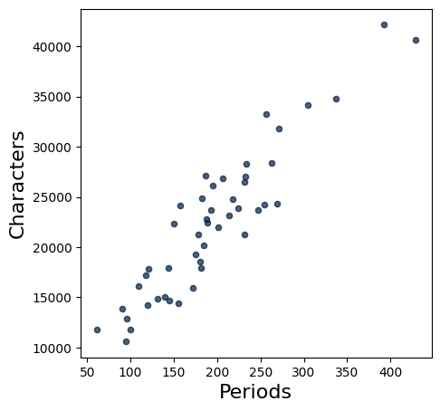
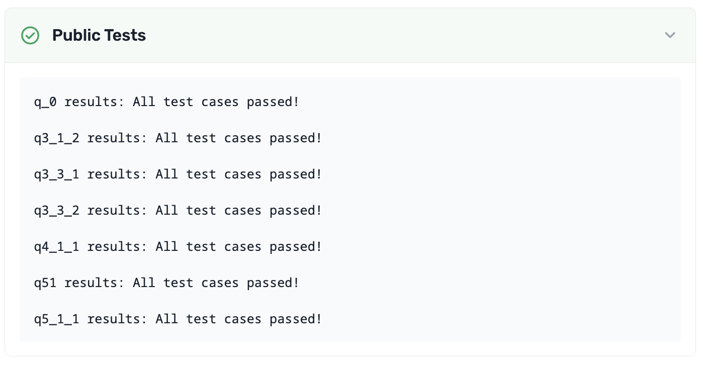

# Homework 1: Causality and Expressions

Please complete this notebook by filling in the cells provided. Before you begin, run the previous cell to load the provided tests.

**Recommended Readings:**

- [What is Data Science?](http://www.inferentialthinking.com/chapters/01/what-is-data-science.html)
- [Causality and Experiments](http://www.inferentialthinking.com/chapters/02/causality-and-experiments.html) 
- [Programming in Python](http://www.inferentialthinking.com/chapters/03/programming-in-python.html)

For all problems that you must write explanations and sentences for, you **must** provide your answer in the designated space. Moreover, throughout this homework and all future ones, please be sure to not re-assign variables throughout the notebook! For example, if you use `max_temperature` in your answer to one question, do not reassign it later on. Otherwise, you will fail tests that you thought you were passing previously!

**Deadline:**

This assignment is **due Thursday, 1/28 at 11:00am PT**. Submissions after this time will be accepted for 24 hours and will incur a 20% penalty. Any submissions later than Friday, 1/29 at 11:00am PT will not be accepted unless an extension has been granted. Turn it in by Wednesday, 1/27 at 11:00am PT for 5 extra credit points. For more information check our [syllabus](http://data8.org/su26/syllabus/) page.

Directly sharing answers is not okay, but discussing problems with the course staff or with other students is encouraged. Refer to the [syllabus](http://data8.org/su26/syllabus/#do-not-cheat) page to learn more about how to learn cooperatively.

You should start early so that you have time to get help if you're stuck. Office hours are held Monday-Friday. The schedule appears on [our website](https://www.data8.org/su26/calendar/).

---
## 1. Scary Arithmetic

---

**Question 1.1** An ad for ADT Security Systems says,

> "When you go on vacation, burglars go to work [...] According to FBI
statistics, over 25% of home burglaries occur between Memorial Day to Labor
Day."

Do the data in the ad support the claim that burglars are more likely to go to
work during the time between Memorial Day to Labor Day? Answer the
question by filling in the blanks below. For each blank, choose one of the
listed options. **(6 Points)**

`__(a)__`. Since `__(b)__`, we can conclude that `__(c)__`.

**Note:** You can assume that "over 25%" means only slightly over. Had it
been much over, say closer to 30%, then the marketers would have said so.

**Note:** Memorial Day is observed on the last Monday of May and Labor Day
is observed on the first Monday of September.

**Note:** If you run into a `NameError: name 'grader' is not defined` error in the autograder cell below (and in any assignment), please re-run the first cell at the very top of this notebook!

**Blank (a)** 
1. Yes 
2. No 
3. Not enough information

**Blank (b)** 

1. over 25% of home burglaries happen between Memorial Day and Labor Day, which is a large percentage
2. there is no controlled experiment in this observational analysis
3. the exact percentage of burglaries between Memorial Day and Labor Day is unknown
4. there is more than one plausible explanation for the high percentage of burglaries between Memorial Day and Labor Day
5. Labor Day is around 14 weeks after Memorial Day, which is slightly more than 25% of a year
6. the number of burglaries between Memorial Day and Labor Day varies from year to year

**Blank (c)** 

1. the number of burglaries is clearly elevated between Memorial Day and Labor Day
2. the rate of burglaries is clearly elevated between Memorial Day and Labor Day
3. the proportion of burglaries would be expected if burglars went to work at the same rate all year
4. the high rate of burgarlies in one year does not guarantee a high rate in future years
5. the evidence can neither support or deny this claim
6. the evidence is in favor of the claim

**Student scaffold:**

```python
a = ...
b = ...
c = ...
```

**Solution:**

```python
a = 2 # SOLUTION
b = 5 # SOLUTION
c = 3 # SOLUTION
```

**Test — `q1` (6 points)**

```python
>>> import hashlib
>>> hashlib.sha256(str([a, b, c]).encode('utf-8')).hexdigest() == 'c78bbe24fcc51f8900f2d50ff4894a2136c6fbcf2ce321fd0d94c78e5f234c68'
True
```

---
## 2. Characters in Little Women

In lecture, we counted the number of times that the literary characters were named in each chapter of the classic book, [*Little Women*](https://inferentialthinking.com/chapters/01/3/1/Literary_Characters.html?highlight=little%20women). In computer science, the word "character" also refers to a letter, digit, space, or punctuation mark; any single element of a text. The following code generates a scatter plot in which each dot corresponds to a chapter of *Little Women*. The horizontal position of a dot measures the number of periods in the chapter. The vertical position measures the total number of characters.

**Code:**

```python
# Just run this cell.

# This cell contains code that hasn't yet been covered in the course,
# but you should be able to interpret the scatter plot it generates.

from datascience import *
from urllib.request import urlopen
import numpy as np
%matplotlib inline

little_women_url = 'https://www.inferentialthinking.com/data/little_women.txt'
chapters = urlopen(little_women_url).read().decode().split('CHAPTER ')[1:]
text = Table().with_column('Chapters', chapters)
Table().with_columns(
    'Periods',    np.char.count(chapters, '.'),
    'Characters', text.apply(len, 0)
    ).scatter(0)
```



---

**Question 2.1.** Around how many periods are there in the chapter with the most characters? Assign either 1, 2, 3, 4, or 5 to the name `characters_q1` below. **(4 Points)**

1. 250
2. 390
3. 440
4. 32,000
5. 40,000

**Student scaffold:**

```python
characters_q1 = ...
```

**Solution:**

```python
characters_q1 = 2 # SOLUTION
```

**Test — `q2_1` (4 points)**

```python
>>> 1 <= characters_q1 <= 5
True

>>> import hashlib
>>> correctness_check_2_1 = hashlib.sha256(str(characters_q1).encode('utf-8')).hexdigest() == 'd4735e3a265e16eee03f59718b9b5d03019c07d8b6c51f90da3a666eec13ab35'
>>> correctness_check_2_1
True
```

---

**Question 2.2.** Which of the following chapters has the most characters *per* period? Assign either 1, 2, or 3 to the name `characters_q2` below. **(4 Points)**

1. The chapter with about 60 periods
2. The chapter with about 350 periods
3. The chapter with about 440 periods

**Student scaffold:**

```python
characters_q2 = ...
```

**Solution:**

```python
characters_q2 = 1 # SOLUTION
```

**Test — `q2_2` (4 points)**

```python
>>> 1 <= characters_q2 <= 3
True

>>> import hashlib
>>> correctness_check_2_2 = hashlib.sha256(str(characters_q2).encode('utf-8')).hexdigest() == '6b86b273ff34fce19d6b804eff5a3f5747ada4eaa22f1d49c01e52ddb7875b4b'
>>> correctness_check_2_2
True
```

To discover more interesting facts from this plot, check out [Section 1.3.2](https://inferentialthinking.com/chapters/01/3/2/Another_Kind_Of_Character.html) in the textbook.

---
## 3. Names and Assignment Statements

---

**Question 3.1.** When you run the following cell, Python produces a cryptic error message.

**Code:**

```python
4 = 2 + 2
```

*Error:*

```text
  Cell In[11], line 1
    4 = 2 + 2
    ^
SyntaxError: cannot assign to literal here. Maybe you meant '==' instead of '='?
```

Choose the best explanation of what's wrong with the code, and then assign 1, 2, 3, or 4 to `names_q1` below to indicate your answer. **(4 Points)**

1. Python is smart and already knows `4 = 2 + 2`.

2. In Python, it's a rule that the `=` sign must have a variable name to its left, and `4` isn't a variable name.

3. It should be `2 + 2 = 4`.

4. I don't get an error message. This is a trick question.

**Student scaffold:**

```python
names_q1 = ...
```

**Solution:**

```python
names_q1 = 2 # SOLUTION
```

**Test — `q3_1` (4 points)**

```python
>>> 1 <= names_q1 <= 4
True

>>> import hashlib
>>> correctness_check_3_1 = hashlib.sha256(str(names_q1).encode('utf-8')).hexdigest() == 'd4735e3a265e16eee03f59718b9b5d03019c07d8b6c51f90da3a666eec13ab35'
>>> correctness_check_3_1
True
```

---

**Question 3.2.** When you run the following cell, Python will produce another cryptic error message.

**Code:**

```python
two = 3
six = two plus two
```

*Error:*

```text
  Cell In[15], line 2
    six = two plus two
              ^
SyntaxError: invalid syntax
```

Choose the best explanation of what's wrong with the code and assign 1, 2, 3, or 4 to `names_q2` below to indicate your answer. **(4 Points)**

1. The `plus` operation only applies to numbers, not the word "two".

2. The name "two" cannot be assigned to the number 3.

3. Two plus two is four, not six.

4. The name `plus` isn't a built-in operator; instead, addition uses `+`.

**Student scaffold:**

```python
names_q2 = ...
```

**Solution:**

```python
names_q2 = 4 # SOLUTION
```

**Test — `q3_2` (4 points)**

```python
>>> 1 <= names_q2 <= 4
True

>>> import hashlib
>>> correctness_check_3_2 = hashlib.sha256(str(names_q2).encode('utf-8')).hexdigest() == '4b227777d4dd1fc61c6f884f48641d02b4d121d3fd328cb08b5531fcacdabf8a'
>>> correctness_check_3_2
True
```

---

**Question 3.3.** Run the following cell.

**Code:**

```python
x = 2
y = 3 * x
x = 4
```

What is `y` after running this cell, and why? Choose the best explanation and assign 1, 2, 3, or 4 to `names_q3` below to indicate your answer. **(4 Points)**

1. `y` is equal to 6, because the second `x = 4` has no effect since `x` was already defined.

2. `y` is equal to 6, because `x` was 2 when `y` was assigned, and 3 * 2 is 6.

3. `y` is equal to 12, because `x` is 4 and 3 * 4 is 12.

4. `y` is equal to 12, because assigning `x` to 4 will update `y` to 12 since `y` was defined in terms of `x`.

**Student scaffold:**

```python
names_q3 = ...
```

**Solution:**

```python
names_q3 = 2 # SOLUTION
```

**Test — `q3_3` (4 points)**

```python
>>> 1 <= names_q3 <= 4
True

>>> import hashlib
>>> correctness_check_3_3 = hashlib.sha256(str(names_q3).encode('utf-8')).hexdigest() == 'd4735e3a265e16eee03f59718b9b5d03019c07d8b6c51f90da3a666eec13ab35'
>>> correctness_check_3_3
True
```

---
## 4. Differences Between Majors

Berkeley’s Office of Planning and Analysis (OPA) provides data on numerous aspects of the campus. Adapted from the OPA website, the table below displays the number of degree recipients in three majors in the 2008-2009 and 2017-2018 academic years.

| Major                              | 2008-2009    | 2017-2018   |
|------------------------------------|--------------|-------------|
| Gender and Women's Studies         |      17      |    28       |
| Linguistics                        |      49      |    67       |
| Rhetoric                           |      113     |    56       |

---

**Question 4.1.** Suppose you want to find the **biggest** absolute difference between the number of degree recipients in the two years, among the three majors.

In the cell below, compute this value and call it `biggest_change`. Use a single expression (a single line of code) to compute the answer. Let Python perform all the arithmetic (like subtracting 49 from 67) rather than simplifying the expression yourself. The built-in `abs` function takes a numerical input and returns the absolute value. The built-in `max` function can take in 3 arguments and returns the maximum of the three numbers. **(5 Points)**

**Student scaffold:**

```python
biggest_change = ...
biggest_change
```

**Solution:**

```python
biggest_change = max(abs(17 - 28), abs(49 - 67), abs(113 - 56)) # SOLUTION
biggest_change
```

*Output:*

```text
57
```

**Test — `q4_1` (5 points)**

```python
>>> isinstance(biggest_change, (int, float))
True

>>> import hashlib
>>> correctness_check_4_1 = hashlib.sha256(str(biggest_change).encode('utf-8')).hexdigest() == 'c837649cce43f2729138e72cc315207057ac82599a59be72765a477f22d14a54'
>>> correctness_check_4_1
True
```

---

**Question 4.2.** Which of the three majors had the **smallest** absolute difference? Assign `smallest_change_major` to 1, 2, or 3 where each number corresponds to the following major:

1. Gender and Women's Studies  
2. Linguistics  
3. Rhetoric

Choose the number that corresponds to the major with the smallest absolute difference. **(4 Points)** 

_Hint:_ You should be able to answer by rough mental arithmetic, without having to calculate the exact value for each major.

**Student scaffold:**

```python
smallest_change_major = ...
smallest_change_major
```

**Solution:**

```python
smallest_change_major = 1 # SOLUTION
smallest_change_major
```

*Output:*

```text
1
```

**Test — `q4_2` (4 points)**

```python
>>> isinstance(smallest_change_major, (int, float))
True

>>> 1 <= smallest_change_major <= 3
True

>>> import hashlib
>>> correctness_check_4_2 = hashlib.sha256(str(smallest_change_major).encode('utf-8')).hexdigest() == '6b86b273ff34fce19d6b804eff5a3f5747ada4eaa22f1d49c01e52ddb7875b4b'
>>> correctness_check_4_2
True
```

---

**Question 4.3.**  For each major, define the “relative change” to be the following: $\large{\frac{\text{absolute difference}}{\text{value in 2008-2009}} * 100}$ 

Fill in the code below such that `gws_relative_change`, `linguistics_relative_change` and `rhetoric_relative_change` are assigned to the relative changes for their respective majors. **(5 Points)**

**Student scaffold:**

```python
gws_relative_change = (abs(...) / 17) * 100
linguistics_relative_change = ...
rhetoric_relative_change = ...
gws_relative_change, linguistics_relative_change, rhetoric_relative_change
```

**Solution:**

```python
"""# BEGIN PROMPT
gws_relative_change = (abs(...) / 17) * 100
"""; # END PROMPT
gws_relative_change = (abs(17 - 28) / 17) * 100 # SOLUTION NO PROMPT
linguistics_relative_change = (abs(49 - 67) / 49) * 100 # SOLUTION
rhetoric_relative_change = (abs(113 - 56) / 113) * 100 # SOLUTION
gws_relative_change, linguistics_relative_change, rhetoric_relative_change
```

*Output:*

```text
(64.70588235294117, 36.734693877551024, 50.442477876106196)
```

**Test — `q4_3` (5 points)**

```python
>>> isinstance(gws_relative_change, (int, float))
True

>>> isinstance(linguistics_relative_change, (int, float))
True

>>> isinstance(rhetoric_relative_change, (int, float))
True

>>> gws_relative_change >= 64 and gws_relative_change <= 66
True

>>> linguistics_relative_change >= 36 and linguistics_relative_change <= 38
True

>>> rhetoric_relative_change >= 50 and rhetoric_relative_change <= 52
True
```

---

**Question 4.4.** Assign `biggest_rel_change_major` to 1, 2, or 3 where each number corresponds to to the following: 

1. Gender and Women's Studies  
2. Linguistics  
3. Rhetoric

Choose the number that corresponds to the major with the biggest relative change. **(4 Points)**

**Student scaffold:**

```python
biggest_rel_change_major = ...
biggest_rel_change_major
```

**Solution:**

```python
biggest_rel_change_major = 1 # SOLUTION
biggest_rel_change_major
```

*Output:*

```text
1
```

**Test — `q4_4` (4 points)**

```python
>>> isinstance(biggest_rel_change_major, (int, float))
True

>>> 1 <= biggest_rel_change_major <= 3
True

>>> import hashlib
>>> correctness_check_4_4 = hashlib.sha256(str(biggest_rel_change_major).encode('utf-8')).hexdigest() == '6b86b273ff34fce19d6b804eff5a3f5747ada4eaa22f1d49c01e52ddb7875b4b'
>>> correctness_check_4_4
True
```

---
## 5. Nearsightedness Study

[Myopia](https://en.wikipedia.org/wiki/Myopia), or nearsightedness, results from a number of genetic and environmental factors. In 1999, Quinn et al studied the relation between myopia and ambient lighting at night (for example, from nightlights or room lights) during childhood.

---

**Question 5.1.** The data were gathered by the following procedure, reported in
the study. "Between January and June 1998, parents of children aged 2-16 years
[...] that were seen as outpatients in a university pediatric ophthalmology clinic
completed a questionnaire on the child's light exposure both at present and before
the age of 2 years."

Was this study observational, or was it a controlled experiment? Assign either 1 or
2 to the name `study_type` below. **(5 Points)**

1. The study was observational because the researchers didn't perform any
intervention.

2. The study was a controlled experiment because the researchers decided which
treatments the participants received.

**Student scaffold:**

```python
study_type = ...
```

**Solution:**

```python
study_type = 1 # SOLUTION
```

**Test — `q5_1` (5 points)**

```python
>>> import hashlib
>>> correctness_check_5_1 = hashlib.sha256(str(study_type).encode('utf-8')).hexdigest() == '6b86b273ff34fce19d6b804eff5a3f5747ada4eaa22f1d49c01e52ddb7875b4b'
>>> correctness_check_5_1
True
```

---

**Question 5.2.** The study found that of the children who slept with a room light on before the age of 2, 55% were myopic. Of the children who slept with a night light on before the age of 2, 34% were myopic. Of the children who slept in the dark before the age of 2, 10% were myopic. The study concluded the following: "The prevalence of myopia [...] during childhood was strongly associated with ambient light exposure during sleep at night in the first two years after birth."

Do the data support this statement? Assign either 1, 2, 3, or 4 to the name
`myopia_statement` below. **(5 Points)**

1. Yes, because sleeping with a room light on caused children in the study to
develop myopia.  
2. Yes, because there is a big difference in myopia rates between the groups.  
3. No, because only controlled experiments can show association.  
4. No, because there is no noticeable difference between the groups.

**Student scaffold:**

```python
myopia_statement = ...
```

**Solution:**

```python
myopia_statement = 2 # SOLUTION
```

**Test — `q5_2` (5 points)**

```python
>>> import hashlib
>>> correctness_check_5_2 = hashlib.sha256(str(myopia_statement).encode('utf-8')).hexdigest() == 'd4735e3a265e16eee03f59718b9b5d03019c07d8b6c51f90da3a666eec13ab35'
>>> correctness_check_5_2
True
```

---

**Question 5.3.** On May 13, 1999, CNN reported the results of this study under the headline, "Night light may lead to nearsightedness." Does the original study claim that night light causes nearsightedness? Assign either 1 or 2 to the name `causation_answer` below. **(5 Points)**

1. Yes. We can infer causation from the study because the difference in groups is so large.
2. No. We cannot infer causation from the study because it was observational.
1. Yes. We can infer causation from the study because the fact that night lights may lead to nearsightedness is consistent with the data.
2. No. We cannot infer causation from the study because the difference in groups could be due to chance.

**Student scaffold:**

```python
causation_answer = ...
```

**Solution:**

```python
causation_answer = 2 # SOLUTION
```

**Test — `q5_3` (5 points)**

```python
>>> import hashlib
>>> correctness_check_5_3 = hashlib.sha256(str(causation_answer).encode('utf-8')).hexdigest() == 'd4735e3a265e16eee03f59718b9b5d03019c07d8b6c51f90da3a666eec13ab35'
>>> correctness_check_5_3
True
```

---

**Question 5.4.** The final paragraph of the CNN report said that "several eye specialists" had pointed out that the study should have accounted for heredity.

Myopia is passed down from parents to children. Myopic parents are more likely to have myopic children, and may also be more likely to leave lights on habitually (since the parents have poor vision). In what ways does the knowledge of this possible genetic link affect how we interpret the data from the study?

Select all statements that are valid consequences of the possible genetic link between parents and children by assigning `myopia_factors` to a comma-separated sequence of numbers (e.g. `myopia_factors = 1, 3`). **(5 Points)**

1. If myopic parents are more likely to have myopic kids *and* leave the lights on at night, then myopic kids are more likely to have lights on at night.  
2. It is reasonable to assume that having myopic parents is a potential confounding factor that the original study did not account for.  
3. We are still able to find the observed association between night light exposure and myopia, even if night lights do not cause child myopia.

**Student scaffold:**

```python
myopia_factors = ...
```

**Solution:**

```python
myopia_factors = 1, 2, 3 # SOLUTION
```

**Test — `q5_4` (5 points)**

```python
>>> import hashlib
>>> correctness_check_5_4 = hashlib.sha256(str(myopia_factors).encode('utf-8')).hexdigest() == 'dfd5726d86ed2c8b202855bbea88990ec37a26ab1d2217b55a61b4b6719ff6fd'
>>> correctness_check_5_4
True
```

---
## 6. Studying the Survivors

---

**Question 6.1.** The Reverend Henry Whitehead was skeptical of John Snow’s conclusion about the Broad Street pump. After the Broad Street cholera epidemic ended, Whitehead set about trying to prove Snow wrong.  (The history of the event is detailed [here](http://www.ncbi.nlm.nih.gov/pmc/articles/PMC1034367/pdf/medhist00183-0026.pdf).)

He realized that Snow had focused his analysis almost entirely on those who had died. Whitehead, therefore, investigated the drinking habits of people in the Broad Street area who had not died in the outbreak.

What is the main reason it was important to study this group? Assign either 1, 2, or 3 to the name `survivor_answer` below. **(4 Points)**

1. If Whitehead had found that many people had drunk water from the Broad Street pump and not caught cholera, that would have been evidence against Snow's hypothesis.

2. Survivors could provide additional information about what else could have caused the cholera, potentially unearthing another cause.

3. Through considering the survivors, Whitehead could have identified a cure for cholera.

**Student scaffold:**

```python
survivor_answer = ...
```

**Solution:**

```python
survivor_answer = 1 # SOLUTION
```

**Test — `q6_1` (4 points)**

```python
>>> 1 <= survivor_answer <= 3
True

>>> import hashlib
>>> correctness_check_6_1 = hashlib.sha256(str(survivor_answer).encode('utf-8')).hexdigest() == '6b86b273ff34fce19d6b804eff5a3f5747ada4eaa22f1d49c01e52ddb7875b4b'
>>> correctness_check_6_1
True
```

**Note:** Whitehead ended up finding further proof that the Broad Street pump played a central role in spreading the disease to the people who lived near it. Eventually, he became one of Snow’s greatest defenders.

---
## 7. Policies and Administrivia

This section of the homework is to ensure that you have read over the policies and frequently asked questions for the course. 

**It's important that you read through this section of the homework very carefully**. If you can get through all of this section and are sure you have all of the correct resources set up, you will be able to focus on the actual material this semester!

Reading through the [syllabus](http://data8.org/su26/syllabus/) and the [FAQ](http://data8.org/su26/faq/) will help you get through this section very easily. It is recommended you do this before proceeding.

---

**Question 7.1.** You have a question regarding the grading of your assignments that has not been previously answered on Ed or the FAQ. Who do you contact? Assign `contact` to the number corresponding to the best choice below. **(4 Points)**

1. The Instructors
2. Post on Ed
3. Contact your Lab TA

**Student scaffold:**

```python
contact = ...
```

**Solution:**

```python
contact = 3 # SOLUTION
```

**Test — `q7_1` (4 points)**

```python
>>> import hashlib
>>> correctness_check_7_1 = hashlib.sha256(str(contact).encode('utf-8')).hexdigest() == '4637e99b28a1ce112e8f4009dbf144f3a75a04d3e4b0c30b084aef21c5e3cfe6'
>>> correctness_check_7_1
False
```

---

**Question 7.2.** What is true about our extension policy? Assign `extension` to the number corresponding to the best choice below. **(4 Points)**

1. I should post on Ed if I want an extension.
2. Extension requests need to be submitted on the Extensions form at least 24 hours before the deadline to be considered.
3. My extension will automatically be approved, regardless of the reason.

**Student scaffold:**

```python
extension = ...
```

**Solution:**

```python
extension = 2 # SOLUTION
```

**Test — `q7_2` (4 points)**

```python
>>> import hashlib
>>> correctness_check_7_2 = hashlib.sha256(str(extension).encode('utf-8')).hexdigest() == 'd4735e3a265e16eee03f59718b9b5d03019c07d8b6c51f90da3a666eec13ab35'
>>> correctness_check_7_2
True
```

---

**Question 7.3.** Regrade deadline dates will always be posted on the same Ed post that releases the assignment grades, common mistakes, and solutions. Can you ask for parts of your assignment regraded after the regrade request window has passed? Assign `regrade` to the number corresponding to the best choice below. **(4 Points)**

1. Yes
2. No

**Student scaffold:**

```python
regrade = ...
```

**Solution:**

```python
regrade = 2 # SOLUTION
```

**Test — `q7_3` (4 points)**

```python
>>> import hashlib
>>> correctness_check_7_3 = hashlib.sha256(str(regrade).encode('utf-8')).hexdigest() == 'd4735e3a265e16eee03f59718b9b5d03019c07d8b6c51f90da3a666eec13ab35'
>>> correctness_check_7_3
True
```

---

**Question 7.4.** Do you have an Pensieve account? Head to [pensieve.co](https://www.pensieve.co/) and check if you see Data 8. If you do not, please send your Lab TA an email with your email and student ID number. Assign `pensieve` to True if you have access.

**Student scaffold:**

```python
pensieve = ...
```

**Solution:**

```python
pensieve = True #SOLUTION
```

**Test — `q7_4` (4 points)**

```python
>>> pensieve == True
True
```

---

**Question 7.5.** Given the following scenarios, assign `acceptable` to the corresponding number of the scenario that is permissible given the guidelines on the [syllabus](http://data8.org/su26/syllabus/) page. **(4 Points)**

1. Dagny gets stuck on a homework assignment, so she googles a fix. She stumbles across a pdf of the solutions for the homework assignment from a previous semester's offering of Data 8. After inspecting the solution, Dagny writes her own solution and submits the assignment.

2. After getting confused by a project, Brandon asks his friend for help. His friend Isaac helps by walking Brandon through his own logic, without showing his code, pointing out areas that are important given the context of the question. Upon hearing his friend's logic, Brandon writes his own code and completes the project.

3. Marissa (who is in a regular lab) has an extremely busy schedule, so she really wants to leave lab early by finishing it and getting checked off. Her neighbor, Wesley, simply turns his computer so Marissa can see how he completed some questions. After looking at his code, Marissa finishes the lab and gets checked off.

**Student scaffold:**

```python
acceptable = ...
```

**Solution:**

```python
acceptable = 2 # SOLUTION
```

**Test — `q7_5` (4 points)**

```python
>>> import hashlib
>>> correctness_check_7_5 = hashlib.sha256(str(acceptable).encode('utf-8')).hexdigest() == 'd4735e3a265e16eee03f59718b9b5d03019c07d8b6c51f90da3a666eec13ab35'
>>> correctness_check_7_5
True
```

---

**Question 7.6.** To make sure you have read through the [syllabus](http://data8.org/su26/syllabus/) and the [FAQ](http://data8.org/su26/faq/) carefully, how many HW and lab drops are there? Assign `drops` to the number corresponding to the best choice below. **(4 Points)**

1. Two homework drops and three lab drops
2. Two homework drops and two lab drops
3. Only two homework drops
4. One homework drop and two lab drops

*Note:* You should reserve drops for extenuating circumstances.

**Student scaffold:**

```python
drops = ...
```

**Solution:**

```python
drops = 2 # SOLUTION
```

**Test — `q7_6` (4 points)**

```python
>>> import hashlib
>>> correctness_check_7_6 = hashlib.sha256(str(drops).encode('utf-8')).hexdigest() == 'd4735e3a265e16eee03f59718b9b5d03019c07d8b6c51f90da3a666eec13ab35'
>>> correctness_check_7_6
True
```

---

**Question 7.7.** Does Data 8 offer alternate midterm exam to those with class conflicts? Assign `exams` to the number corresponding to the best choice below. **(3 Points)**

1. Yes
2. No

**Student scaffold:**

```python
exams = ...
```

**Solution:**

```python
exams = 1 # SOLUTION
```

**Test — `q7_7` (3 points)**

```python
>>> import hashlib
>>> correctness_check_7_7 = hashlib.sha256(str(exams).encode('utf-8')).hexdigest() == '6b86b273ff34fce19d6b804eff5a3f5747ada4eaa22f1d49c01e52ddb7875b4b'
>>> correctness_check_7_7
True
```

---

**Question 7.8:** Are you actually checking Ed? Go to this semester's [Data 8 Ed](https://edstem.org/us/courses/91618/discussion) and find a lead posted thread with a certain secret phrase. Assign `secret` to this secret phrase in quotes (i.e. as a string). **(4 Points)**

**Student scaffold:**

```python
secret = ...
```

**Solution:**

```python
secret = "d8 is great" # SOLUTION
```

**Test — `q7_8` (4 points)**

```python
>>> type(secret) == str
True

>>> len(secret)
11

>>> import hashlib
>>> correctness_check_7_8 = hashlib.sha256(str(secret).encode('utf-8')).hexdigest() == '92c67a4cae5a49695b277c31d6ac7a4028f27308850f3ed447d17c20b71d49b2'
>>> correctness_check_7_8
True
```

---
## 8. Welcome Survey

---

**Question 8.1.** Please complete the welcome survey below in order to receive credit for Homework 1. Keep an eye out for the secret phrase once you submit! **(1 Point)**

- [Spring 2026 Welcome Survey](https://docs.google.com/forms/d/e/1FAIpQLScgv9isIwnFkmEQE-CZDyfmF5wPpctQxQsHneuy6xA9YYi_Dg/viewform?usp=dialog)

Assign `survey` to the secret phrase given at the end of the welcome survey. Make sure the phrase is in quotes (i.e. is a string)!

**Student scaffold:**

```python
survey = ...
```

**Solution:**

```python
survey = "data8 is data gr8" # SOLUTION
```

**Test — `q8_1` (1 point)**

```python
>>> import hashlib
>>> correctness_check_8_1 = hashlib.sha256(str(survey).encode('utf-8')).hexdigest() == '78c04327888d3d29903d44b3c9d42906e9ae35df6d5c68ff9e396a02500eb1df'
>>> correctness_check_8_1
True
```

---

##  Submitting Your Work
All assignments in the course will be distributed as notebooks like this one, and you will submit your work from the notebook. We will use a system called Otter Grader and Pensieve to check your work and help you submit. If you haven’t already, make sure you have run the cell at the top of this notebook to initialize OtterGrader.

Watch this [video](https://drive.google.com/file/d/1H9UwEb7uQrc1eK0PKGxtu95woP4IcyGI/view?usp=sharing) to see how to submit an assignment!

---

You're done with Homework 1! 

Once you have submitted to the autograder, your Pensieve assignment should look something like the following image if you have passed all public tests.

**Note:** *This is a photo of a generic Pensieve submission result, and it does not included the same test numbers as this assignment. Please check that all test cases have passed for each question.*



---

To double-check your work, the cell below will rerun all of the autograder tests.

## Submission

Make sure you have run all cells in your notebook in order before running the cell below, so that all images/graphs appear in the output. The cell below will generate a zip file for you to submit. **Please save before exporting!**
