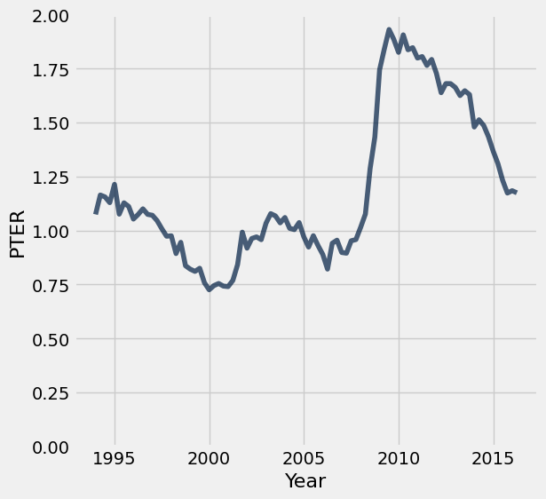

# Homework 2: Arrays and Tables

Please complete this notebook by filling in the cells provided. Before you begin, execute the previous cell to load the provided tests.

**Helpful Resource:**
- [Python Reference](http://data8.org/su26/reference/): Cheat sheet of helpful array & table methods used in Data 8!

**Recommended Readings:**
- [Arrays](https://inferentialthinking.com/chapters/05/1/Arrays.html)
- [Data 8 Arrays Guide](https://drive.google.com/file/d/1vTduvivHyEX7cdpMCq9B2jC4iy6A3Tru/view?usp=sharing)
- [What is Data Science?](http://www.inferentialthinking.com/chapters/01/what-is-data-science.html)
- [Causality and Experiments](http://www.inferentialthinking.com/chapters/02/causality-and-experiments.html) 
- [Programming in Python](http://www.inferentialthinking.com/chapters/03/programming-in-python.html)

For all problems that you must write explanations and sentences for, you **must** provide your answer in the designated space. Moreover, throughout this homework and all future ones, **please be sure to not re-assign variables throughout the notebook!** For example, if you use `max_temperature` in your answer to one question, do not reassign it later on. Otherwise, you will fail tests that you thought you were passing previously!

**Deadline:**

This assignment is **due Wednesday, 2/4 at 11:00am PT**. Submissions after this time will be accepted for 24 hours and will incur a 20% penalty. Any submissions later than this 24 hour period will not be accepted unless an extension has been granted as per the [syllabus](http://data8.org/su26/syllabus/) page. Turn it in by Tuesday, 2/3 at 11:00am PT for 5 extra credit points.

Directly sharing answers is not okay, but discussing problems with the course staff or with other students is encouraged. Refer to the syllabus page to learn more about how to learn cooperatively.

You should start early so that you have time to get help if you're stuck. Office hours are held Monday through Friday in [Warren Hall](https://www.berkeley.edu/map/warren-hall/) 101B. The office hours schedule appears on [https://www.data8.org/su26/calendar/](https://www.data8.org/su26/calendar/).

**Code:**

```python
# Run this cell and ignore the output. It is checking to see if you ran the first cell! 
# If you get a NameError, please run the cell at the very TOP of this notebook!

grader
```

*Output (stdout):*

```text
Unexpected exception formatting exception. Falling back to standard exception
```

*Output (stderr):*

```text
Traceback (most recent call last):
  File "/Users/marissalumpkin/Desktop/data8/assignments_new/env/lib/python3.13/site-packages/IPython/core/interactiveshell.py", line 3577, in run_code
    exec(code_obj, self.user_global_ns, self.user_ns)
    ~~~~^^^^^^^^^^^^^^^^^^^^^^^^^^^^^^^^^^^^^^^^^^^^^
  File "/var/folders/xv/tl5mnl5s0mz_ykhsrhdyb_rm0000gn/T/ipykernel_72709/2928856654.py", line 4, in <module>
    grader
NameError: name 'grader' is not defined

During handling of the above exception, another exception occurred:

Traceback (most recent call last):
  File "/Users/marissalumpkin/Desktop/data8/assignments_new/env/lib/python3.13/site-packages/IPython/core/interactiveshell.py", line 2168, in showtraceback
    stb = self.InteractiveTB.structured_traceback(
        etype, value, tb, tb_offset=tb_offset
    )
  File "/Users/marissalumpkin/Desktop/data8/assignments_new/env/lib/python3.13/site-packages/IPython/core/ultratb.py", line 1454, in structured_traceback
    return FormattedTB.structured_traceback(
           ~~~~~~~~~~~~~~~~~~~~~~~~~~~~~~~~^
        self, etype, evalue, etb, tb_offset, number_of_lines_of_context
        ^^^^^^^^^^^^^^^^^^^^^^^^^^^^^^^^^^^^^^^^^^^^^^^^^^^^^^^^^^^^^^^
    )
    ^
  File "/Users/marissalumpkin/Desktop/data8/assignments_new/env/lib/python3.13/site-packages/IPython/core/ultratb.py", line 1345, in structured_traceback
    return VerboseTB.structured_traceback(
           ~~~~~~~~~~~~~~~~~~~~~~~~~~~~~~^
        self, etype, value, tb, tb_offset, number_of_lines_of_context
        ^^^^^^^^^^^^^^^^^^^^^^^^^^^^^^^^^^^^^^^^^^^^^^^^^^^^^^^^^^^^^
    )
    ^
  File "/Users/marissalumpkin/Desktop/data8/assignments_new/env/lib/python3.13/site-packages/IPython/core/ultratb.py", line 1192, in structured_traceback
    formatted_exception = self.format_exception_as_a_whole(etype, evalue, etb, number_of_lines_of_context,
                                                           tb_offset)
  File "/Users/marissalumpkin/Desktop/data8/assignments_new/env/lib/python3.13/site-packages/IPython/core/ultratb.py", line 1082, in format_exception_as_a_whole
    self.get_records(etb, number_of_lines_of_context, tb_offset) if etb else []
    ~~~~~~~~~~~~~~~~^^^^^^^^^^^^^^^^^^^^^^^^^^^^^^^^^^^^^^^^^^^^
  File "/Users/marissalumpkin/Desktop/data8/assignments_new/env/lib/python3.13/site-packages/IPython/core/ultratb.py", line 1179, in get_records
    res = list(stack_data.FrameInfo.stack_data(etb, options=options))[tb_offset:]
          ~~~~^^^^^^^^^^^^^^^^^^^^^^^^^^^^^^^^^^^^^^^^^^^^^^^^^^^^^^^
  File "/Users/marissalumpkin/Desktop/data8/assignments_new/env/lib/python3.13/site-packages/stack_data/core.py", line 597, in stack_data
    yield from collapse_repeated(
    ...<4 lines>...
    )
  File "/Users/marissalumpkin/Desktop/data8/assignments_new/env/lib/python3.13/site-packages/stack_data/utils.py", line 83, in collapse_repeated
    yield from map(mapper, original_group)
  File "/Users/marissalumpkin/Desktop/data8/assignments_new/env/lib/python3.13/site-packages/stack_data/core.py", line 587, in mapper
    return cls(f, options)
  File "/Users/marissalumpkin/Desktop/data8/assignments_new/env/lib/python3.13/site-packages/stack_data/core.py", line 551, in __init__
    self.executing = Source.executing(frame_or_tb)
                     ~~~~~~~~~~~~~~~~^^^^^^^^^^^^^
  File "/Users/marissalumpkin/Desktop/data8/assignments_new/env/lib/python3.13/site-packages/executing/executing.py", line 283, in executing
    assert_(new_stmts <= stmts)
    ~~~~~~~^^^^^^^^^^^^^^^^^^^^
  File "/Users/marissalumpkin/Desktop/data8/assignments_new/env/lib/python3.13/site-packages/executing/executing.py", line 80, in assert_
    raise AssertionError(str(message))
AssertionError
```

---
## 1. Indexing Arrays

These exercises give you practice on accessing individual elements of arrays. In Python, each element is accessed by its index. An index indicates the position of an element within an array. For example, the first element is the element at index 0. Indices must be **integers**.

***Note:* If you have previous coding experience, you may be familiar with bracket notation. DO NOT use bracket notation when indexing (i.e. `arr[0]`).**

Be sure to refer to the [Python Reference](http://data8.org/su26/reference/) on the website if you feel stuck!

---

**Question 1.1.** The cell below creates an array of some numbers.  Set `third_element` to the third element of `some_numbers` using `item`. **(3 Points)**

_**Hint:** Remember that the first element is at index 0, the second element is at index 1, and so on!_

**Student scaffold:**

```python
some_numbers = make_array(-1, -3, -6, -10, -15)

third_element = ...
third_element
```

**Solution:**

```python
some_numbers = make_array(-1, -3, -6, -10, -15)

third_element = some_numbers.item(2) # SOLUTION 
third_element
```

*Output:*

```text
-6
```

**Test — `q1_1` (3 points)**

```python
>>> third_element != -10
True

>>> third_element == -6
True

>>> type(third_element) == int
True
```

---

**Question 1.2.** The next cell creates a table that displays some information about the elements of `some_numbers` and their order.  Run the cell to see the partially-completed table, then fill in the missing information (the cells that say "Ellipsis") by assigning `blank_a`, `blank_b`, `blank_c`, and `blank_d` to the correct elements in the table. **(4 Points)**

*Note:* Replace the `...` with strings or numbers. As a reminder, indices should be **integers**.

*Hint:* If you're confused about which location corresponds to each blank, try filling in one blank and seeing how the table changes!

**Student scaffold:**

```python
blank_a = ...
blank_b = ...
blank_c = ...
blank_d = ...
elements_of_some_numbers = Table().with_columns(
    "English name for position", make_array("first", "second", blank_a, blank_b, "fifth"),
    "Index",                     make_array(blank_c, 1, 2, blank_d, 4),
    "Element",                   some_numbers)
elements_of_some_numbers
```

**Solution:**

```python
blank_a = "third" #SOLUTION
blank_b = "fourth" #SOLUTION
blank_c = 0 #SOLUTION
blank_d = 3 #SOLUTION
elements_of_some_numbers = Table().with_columns(
    "English name for position", make_array("first", "second", blank_a, blank_b, "fifth"),
    "Index",                     make_array(blank_c, 1, 2, blank_d, 4),
    "Element",                   some_numbers)
elements_of_some_numbers
```

*Output:*

| English name for position | Index | Element |
| --- | --- | --- |
| first | 0 | -1 |
| second | 1 | -3 |
| third | 2 | -6 |
| fourth | 3 | -10 |
| fifth | 4 | -15 |

**Test — `q1_2` (4 points)**

```python
>>> elements_of_some_numbers.column(0).item(2) == 'third'
True

>>> elements_of_some_numbers.column(0).item(3) == 'fourth'
True

>>> elements_of_some_numbers.column(1).item(0) == 0
True

>>> elements_of_some_numbers.column(1).item(3) == 3
True
```

---

**Question 1.3.** You'll sometimes want to find the **last** element of an array.  Suppose an array has 142 elements.  What is the index of its last element? **(3 Points)**

*Note:* Your answer must be a positive integer. An integer is a whole number that does not include fractions or decimals.

**Student scaffold:**

```python
index_of_last_element = ...
```

**Solution:**

```python
index_of_last_element = 142 - 1 # (or just 141) #SOLUTION
```

**Test — `q1_3` (3 points)**

```python
>>> type(index_of_last_element) == int
True

>>> import hashlib
>>> correctness_check_1_3 = hashlib.sha256(str(index_of_last_element).encode('utf-8')).hexdigest() == '2c7d5490e6050836f8f2f0d496b1c8d6a38d4ffac2b898e6e77751bdcd20ebf5'
>>> correctness_check_1_3
True
```

More often, you don't know the number of elements in an array, which is its *length*.  (For example, it might be a large dataset you found on the Internet.)  The function `len` takes a single argument, an array, and returns an integer that represents the `len`gth of that array. You can see an example of `len` here:

**Code:**

```python
#Creating an array with five elements
five_element_array = make_array(1, 2, 3, 4, 5)

#Finding the length of the array, which is 5!
len(five_element_array)
```

*Output:*

```text
5
```

**Question 1.4.** The cell below loads an array called `president_birth_years`.  Calling `tbl.column(...)` on a table returns an array of the column specified, in this case the `Birth Year` column of the `president_births` table. The last element in that array is the most recent among the birth years of all the deceased Presidents. Assign that year to `most_recent_birth_year`. **(4 Points)**

**Note:** Do not Google the answer. You should be able to answer this question only using array methods.

**Student scaffold:**

```python
president_birth_years = Table.read_table("president_births.csv").column('Birth Year')

most_recent_birth_year = ...
most_recent_birth_year
```

**Solution:**

```python
president_birth_years = Table.read_table("president_births.csv").column('Birth Year')

most_recent_birth_year = president_birth_years.item(len(president_birth_years)-1) #SOLUTION
most_recent_birth_year
```

*Output:*

```text
1917
```

**Test — `q1_4` (4 points)**

```python
>>> most_recent_birth_year == 1917
True
```

---

**Question 1.5.** Finally, assign `min_of_birth_years` to the minimum of the first, sixteenth, and last birth years listed in `president_birth_years`. **(4 Points)**

**Note:** Use the Python `min` function and table methods to find the answer. Do not manually calculate the result yourself!

**Student scaffold:**

```python
min_of_birth_years = ...
min_of_birth_years
```

**Solution:**

```python
min_of_birth_years = min(make_array(president_birth_years.item(0), president_birth_years.item(15), president_birth_years.item(len(president_birth_years) - 1))) #SOLUTION
min_of_birth_years
```

*Output:*

```text
1732
```

**Test — `q1_5` (4 points)**

```python
>>> min_of_birth_years > 0
True

>>> import hashlib
>>> correctness_check_1_5 = hashlib.sha256(str(min_of_birth_years).encode('utf-8')).hexdigest() == 'bfea46db09aa46da5a6628ecd5d5fba31d9d50417f5178db9727d3676427e2df'
>>> correctness_check_1_5
True
```

---
## 2. Basic Array Arithmetic

---

**Question 2.1.** Multiply the numbers 42, -4224, 424224242, and 250 by 157. Assign each variable below such that `first_product` is assigned to the result of $42 * 157$, `second_product` is assigned to the result of $-4224 * 157$, and so on. **(3 Points)**

*Note*: For this question, **don't** use arrays.

**Student scaffold:**

```python
first_product = ...
second_product = ...
third_product = ...
fourth_product = ...
print("First Product:", first_product)
print("Second Product:", second_product)
print("Third Product:", third_product)
print("Fourth Product:", fourth_product)
```

**Solution:**

```python
first_product = 42 * 157 #SOLUTION
second_product = -4224 * 157 #SOLUTION
third_product = 424224242 * 157 #SOLUTION
fourth_product = 250 * 157 #SOLUTION
print("First Product:", first_product)
print("Second Product:", second_product)
print("Third Product:", third_product)
print("Fourth Product:", fourth_product)
```

*Output (stdout):*

```text
First Product: 6594
Second Product: -663168
Third Product: 66603205994
Fourth Product: 39250
```

**Test — `q2_1` (3 points)**

```python
>>> (first_product > 0, second_product < 0, third_product > 0, fourth_product > 0)
(True, True, True, True)

>>> import hashlib
>>> correctness_check_2_1 = hashlib.sha256(str(np.array([first_product, second_product, third_product, fourth_product])).encode('utf-8')).hexdigest() == '607e9f168887b39b1cc9b966c10023bc51ab49a63cddf7fa552389db1526c5b6'
>>> correctness_check_2_1
True
```

---

**Question 2.2.** Now, do the same calculation, but using an array called `numbers` and only a single multiplication (`*`) operator.  Store the 4 results in an array named `products`. **(3 Points)**

**Student scaffold:**

```python
numbers = ...
products = ...
products
```

**Solution:**

```python
numbers = make_array(42, -4224, 424224242, 250) #SOLUTION
products = numbers * 157 #SOLUTION
products
```

*Output:*

```text
array([       6594,     -663168, 66603205994,       39250])
```

**Test — `q2_2` (3 points)**

```python
>>> len(products) == 4
True

>>> import hashlib
>>> correctness_check_2_2 = hashlib.sha256(str(products).encode('utf-8')).hexdigest() == '607e9f168887b39b1cc9b966c10023bc51ab49a63cddf7fa552389db1526c5b6'
>>> correctness_check_2_2
True
```

---

**Question 2.3.** Oops, we made a typo!  Instead of 157, we wanted to multiply each number by 1577.  Compute the correct products in the cell below using array arithmetic.  Notice that your job is really easy if you previously defined an array containing the 4 numbers. **(3 Points)**

**Student scaffold:**

```python
correct_products = ...
correct_products
```

**Solution:**

```python
correct_products = numbers * 1577 # SOLUTION
correct_products
```

*Output:*

```text
array([       66234,     -6661248, 669001629634,       394250])
```

**Test — `q2_3` (3 points)**

```python
>>> len(correct_products) == 4
True

>>> import hashlib
>>> correctness_check_2_3 = hashlib.sha256(str(np.round(correct_products, decimals=0).astype(int).tolist()).encode('utf-8')).hexdigest() == '3ada446754f8b85db899e60987991c15e950c4deeb45093d5fab466f84758878'
>>> correctness_check_2_3
True
```

---

**Question 2.4.** We've loaded an array of temperatures in the next cell.  Each number is the highest temperature observed on a day at a climate observation station, mostly from the US.  Since they're from the US government agency [NOAA](https://www.noaa.gov/), all the temperatures are in Fahrenheit.

Convert all the temperatures to Celsius by first subtracting 32 from them, then multiplying the results by $\frac{5}{9}$, i.e. $C = (F - 32) * \frac{5}{9}$. After converting the temperatures to Celsius, make sure to **ROUND** the final result  to the nearest integer using the `np.round` function. **(4 Points)**

**Student scaffold:**

```python
max_temperatures = Table.read_table("temperatures.csv").column("Daily Max Temperature")

max_temperatures_celsius = ...
celsius_temps_rounded = ...
celsius_temps_rounded
```

**Solution:**

```python
max_temperatures = Table.read_table("temperatures.csv").column("Daily Max Temperature")

max_temperatures_celsius = (max_temperatures - 32) * 5/9 #SOLUTION
celsius_temps_rounded = np.round(max_temperatures_celsius) #SOLUTION
celsius_temps_rounded
```

*Output:*

```text
array([ -4.,  31.,  32., ...,  17.,  23.,  16.])
```

**Test — `q2_4` (4 points)**

```python
>>> sum(celsius_temps_rounded) != 356705.0
True

>>> celsius_temps_rounded.item(1) == 31.0
True

>>> sum(celsius_temps_rounded)
1280677.0

>>> len(celsius_temps_rounded)
65000
```

---

**Question 2.5.** The cell below loads all the *lowest* temperatures from each day (in Fahrenheit).  Compute the daily temperature range for each day. That is, compute the difference between each daily maximum temperature and the corresponding daily minimum temperature.  **Pay attention to the units and give your answer in Celsius!** <span style="color:red">Make sure **NOT** to round your answer for this question!</span> **(3 Points)**

*Hint:* Use `min_temperatures` and/or `max_temperatures`, and be careful with when you perform your unit conversions. Write out the mathematical computation by hand if you're stuck!

**Student scaffold:**

```python
min_temperatures = Table.read_table("temperatures.csv").column("Daily Min Temperature")

celsius_temperature_ranges = ...
celsius_temperature_ranges
```

**Solution:**

```python
min_temperatures = Table.read_table("temperatures.csv").column("Daily Min Temperature")

celsius_temperature_ranges = (5/9) * (max_temperatures - min_temperatures) #SOLUTION
celsius_temperature_ranges
```

*Output:*

```text
array([  6.66666667,  10.        ,  12.22222222, ...,  17.22222222,
        11.66666667,  11.11111111])
```

**Test — `q2_5` (3 points)**

```python
>>> type(celsius_temperature_ranges) is np.ndarray
True

>>> np.isclose(celsius_temperature_ranges.item(0), 7.222)
False

>>> np.isclose(round(sum(celsius_temperature_ranges)), 768487)
True

>>> len(celsius_temperature_ranges) == len(max_temperatures)
True
```

---
## 3. Old Faithful

Old Faithful is a geyser in Yellowstone that erupts every 44 to 125 minutes (according to [Wikipedia](https://en.wikipedia.org/wiki/Old_Faithful)). People are often told that the geyser erupts every hour, but in fact the waiting time between eruptions is more variable. Let's take a look.

---

**Question 3.1.** The first line below assigns `waiting_times` to an array of 272 consecutive waiting times between eruptions, taken from a classic 1938 dataset. Assign the names `shortest`, `longest`, and `average` so that the `print` statement is correct. **(4 Points)**

**Student scaffold:**

```python
waiting_times = Table.read_table('old_faithful.csv').column('waiting')

shortest = ...
longest = ...
average = ...

print("Old Faithful erupts every", shortest, "to", longest, "minutes and every", average, "minutes on average.")
```

**Solution:**

```python
waiting_times = Table.read_table('old_faithful.csv').column('waiting')

shortest = min(waiting_times) # SOLUTION
longest = max(waiting_times) # SOLUTION
average = np.mean(waiting_times) # SOLUTION

print("Old Faithful erupts every", shortest, "to", longest, "minutes and every", average, "minutes on average.")
```

*Output (stdout):*

```text
Old Faithful erupts every 43 to 96 minutes and every 70.8970588235 minutes on average.
```

**Test — `q3_1` (4 points)**

```python
>>> shortest <= average <= longest
True

>>> shortest == 43 and longest == 96
True

>>> import hashlib
>>> correctness_check_3_1 = hashlib.sha256(str(float(np.round(average, decimals=6))).encode('utf-8')).hexdigest() == 'e156244f5d51243e7794804bcf28d8b041581b44a59c1ce7944e5ff51dcf33c5'
>>> correctness_check_3_1
True
```

---

**Question 3.2.** Assign `biggest_decrease` to the biggest decrease in waiting time between two consecutive eruptions. For example, the third eruption occurred after 74 minutes and the fourth after 62 minutes, so the decrease in waiting time was 74 - 62 = 12 minutes. **(4 Points)**

*Hint*: We want to return the absolute value of the biggest decrease.

*Note*: `np.diff()` calculates the difference between subsequent values in an array. For example, calling `np.diff()` on the array `make_array(1, 8, 3, 5)` evaluates to `array([8 - 1, 3 - 8, 5 - 3])`, or `array([7, -5, 2])`. In this array, the biggest decrease would be from the second eruption to the third eruption.

**Student scaffold:**

```python
# np.diff() calculates the difference between subsequent values in a NumPy array
# where the first value is subtracted from the second value

differences = np.diff(waiting_times)
biggest_decrease = ...
biggest_decrease
```

**Solution:**

```python
# np.diff() calculates the difference between subsequent values in a NumPy array
# where the first value is subtracted from the second value

differences = np.diff(waiting_times)
biggest_decrease = abs(min((differences))) # SOLUTION
biggest_decrease
```

*Output:*

```text
45
```

**Test — `q3_2` (4 points)**

```python
>>> biggest_decrease == 47
False

>>> 30 <= biggest_decrease < 47
True

>>> import hashlib
>>> correctness_check_3_2 = hashlib.sha256(str(biggest_decrease).encode('utf-8')).hexdigest() == '811786ad1ae74adfdd20dd0372abaaebc6246e343aebd01da0bfc4c02bf0106c'
>>> correctness_check_3_2
True
```

---

**Question 3.3.** The `faithful_with_eruption_nums` table contains two columns: `eruption_number`, which represents the number of that eruption, and `waiting`, which represents the time spent waiting after that eruption. For example, take the first two rows of the table:

| eruption number | waiting |
|-----------------|---------|
| 1               | 79      |
| 2               | 54      |

We can read this as follows: after the first eruption, we waited 79 minutes for the second eruption. Then, after the second eruption, we waited 54 minutes for the third eruption.

Suppose Dylan and Tim started watching Old Faithful at the start of the first eruption. Assume that they watch until the end of the tenth eruption. For some of that time they will be watching eruptions, and for the rest of the time they will be waiting for Old Faithful to erupt. How many minutes will they spend waiting for eruptions? **(4 Points)**

*Hint #1:* You can start by using the `take` method on the table `faithful_with_eruption_nums`. 

*Hint #2:* `first_nine_waiting_times` must be an array.

**Student scaffold:**

```python
# The following two lines load in our faithful_with_eruption_nums table
faithful = Table.read_table('old_faithful.csv').drop("eruptions")
faithful_with_eruption_nums = faithful.with_column("eruption number", np.arange(faithful.num_rows) + 1).select(1, 0)

first_nine_waiting_times = ...
total_waiting_time_until_tenth = ...
total_waiting_time_until_tenth
```

**Solution:**

```python
# The following two lines load in our faithful_with_eruption_nums table
faithful = Table.read_table('old_faithful.csv').drop("eruptions")
faithful_with_eruption_nums = faithful.with_column("eruption number", np.arange(faithful.num_rows) + 1).select(1, 0)

first_nine_waiting_times = faithful_with_eruption_nums.where("eruption number", are.below(10)).column("waiting") # SOLUTION
total_waiting_time_until_tenth = sum(first_nine_waiting_times) # SOLUTION
total_waiting_time_until_tenth
```

*Output:*

```text
633
```

**Test — `q3_3` (4 points)**

```python
>>> len(first_nine_waiting_times)
9

>>> total_waiting_time_until_tenth
633
```

---

**Question 3.4.** Let’s imagine your guess for the next waiting time was always just the length of the previous waiting time. If you always guessed the previous waiting time, how big would your error in guessing the waiting times be, on average? **(4 Points)**

For example, since the first four waiting times are 79, 54, 74, and 62, the average difference between your guess and the actual time for just the second, third, and fourth eruptions would be $\frac{|79-54|+ |54-74|+ |74-62|}{3} = 19$.

**Student scaffold:**

```python
differences = np.diff(waiting_times)
average_error = ...
average_error
```

**Solution:**

```python
differences = np.diff(waiting_times)
average_error = np.average(abs(differences)) # SOLUTION
average_error
```

*Output:*

```text
20.520295202952031
```

**Test — `q3_4` (4 points)**

```python
>>> 15 <= average_error <= 25
True

>>> import hashlib
>>> correctness_check_3_4 = hashlib.sha256(str(float(np.round(average_error, decimals=6))).encode('utf-8')).hexdigest() == '59ba7bfb9138201c361b5b1e8c20778d44355d54cd559b6d75f1c2251e693aaf'
>>> correctness_check_3_4
True
```

---
## 4. Tables

---

**Question 4.1.** Suppose you have 4 apples, 3 oranges, and 3 pineapples.  (Perhaps you're using Python to solve a high school Algebra problem.)  Create a table that contains this information.  It should have two columns: `fruit name` and `amount`.  Assign the new table to the variable `fruits`. **(4 Points)**

*Note:* Use lower-case and singular words for the name of each fruit, like `"apple"`.

*Note:* Review [Chapter 6](https://inferentialthinking.com/chapters/06/Tables.html) if you get stuck!

**Student scaffold:**

```python
# Our solution uses 1 statement split over 3 lines.
fruits = ...
        ...
        ...
fruits
```

**Solution:**

```python
# Our solution uses 1 statement split over 3 lines.
fruits = Table().with_columns( #SOLUTION
        "fruit name", make_array("apple", "orange", "pineapple"), #SOLUTION
        "amount",     make_array(4,       3,        3)) #SOLUTION
fruits
```

*Output:*

| fruit name | amount |
| --- | --- |
| apple | 4 |
| orange | 3 |
| pineapple | 3 |

**Test — `q4_1` (4 points)**

```python
>>> fruits.sort(0)
fruit name | amount
apple      | 4
orange     | 3
pineapple  | 3
```

---

**Question 4.2.** The file `inventory.csv` contains information about the inventory at a fruit stand.  Each row represents the contents of one box of fruit. Load it as a table named `inventory` using the `Table.read_table()` function. `Table.read_table(...)` takes one argument (data file name in string format) and returns a table. **(4 Points)**

**Student scaffold:**

```python
inventory = ...
inventory
```

**Solution:**

```python
inventory = Table.read_table("inventory.csv") #SOLUTION
inventory
```

*Output:*

| box ID | fruit name | count |
| --- | --- | --- |
| 53686 | kiwi | 45 |
| 57181 | strawberry | 123 |
| 25274 | apple | 20 |
| 48800 | orange | 35 |
| 26187 | strawberry | 255 |
| 57930 | grape | 517 |
| 52357 | strawberry | 102 |
| 43566 | peach | 40 |

**Test — `q4_2` (4 points)**

```python
>>> inventory.sort(0).column(0).item(0)
25274
```

---

**Question 4.3.** Does each box at the fruit stand contain a different fruit? Set `all_different` to `True` if each box contains a different fruit or to `False` if multiple boxes contain the same fruit. **(4 Points)**

*Hint:* You don't have to write code to calculate the True/False value for `all_different`. Just look at the `inventory` table and assign `all_different` to either `True` or `False` according to what you can see from the table in answering the question.

*Note:* Make sure to capitalize `True` and `False`!

**Student scaffold:**

```python
all_different = ...
all_different
```

**Solution:**

```python
all_different = False # SOLUTION
all_different
```

*Output:*

```text
False
```

**Test — `q4_3` (4 points)**

```python
>>> all_different in {True, False}
True

>>> all_different == False
True
```

---

**Question 4.4.** The file `sales.csv` contains the number of fruit sold from each box last Saturday.  It has an extra column called `price per fruit ($)` that's the price *per item of fruit* for fruit in that box.  The rows are in the same order as the `inventory` table.  Load these data into a table called `sales`. **(5 Points)**

**Student scaffold:**

```python
sales = ...
sales
```

**Solution:**

```python
sales = Table.read_table("sales.csv") # SOLUTION
sales
```

*Output:*

| box ID | fruit name | count sold | price per fruit ($) |
| --- | --- | --- | --- |
| 53686 | kiwi | 3 | 0.5 |
| 57181 | strawberry | 101 | 0.2 |
| 25274 | apple | 0 | 0.8 |
| 48800 | orange | 35 | 0.6 |
| 26187 | strawberry | 25 | 0.15 |
| 57930 | grape | 355 | 0.06 |
| 52357 | strawberry | 102 | 0.25 |
| 43566 | peach | 17 | 0.8 |

**Test — `q4_4` (5 points)**

```python
>>> sales.sort(0)
box ID | fruit name | count sold | price per fruit ($)
25274  | apple      | 0          | 0.8
26187  | strawberry | 25         | 0.15
43566  | peach      | 17         | 0.8
48800  | orange     | 35         | 0.6
52357  | strawberry | 102        | 0.25
53686  | kiwi       | 3          | 0.5
57181  | strawberry | 101        | 0.2
57930  | grape      | 355        | 0.06
```

---

**Question 4.5.** How many fruits did the store sell in total on that day? **(5 Points)**

**Student scaffold:**

```python
total_fruits_sold = ...
total_fruits_sold
```

**Solution:**

```python
total_fruits_sold = sum(sales.column("count sold")) # SOLUTION
total_fruits_sold
```

*Output:*

```text
638
```

**Test — `q4_5` (5 points)**

```python
>>> total_fruits_sold > 10
True

>>> import hashlib
>>> correctness_check_4_5 = hashlib.sha256(str(total_fruits_sold).encode('utf-8')).hexdigest() == 'f4dd301311d96b70a2ee62a6bccfe21bb0d94a89ca2805333cf352c1a2381c13'
>>> correctness_check_4_5
True
```

---

**Question 4.6.** What was the store's total revenue (the total price of all fruits sold) on that day? **(5 Points)**

*Hint:* If you're stuck, think first about how you would compute the total revenue from just the grape sales.

**Student scaffold:**

```python
total_revenue = ...
total_revenue
```

**Solution:**

```python
total_revenue = sum(sales.column("count sold") * sales.column("price per fruit ($)")) # SOLUTION
total_revenue
```

*Output:*

```text
106.84999999999999
```

**Test — `q4_6` (5 points)**

```python
>>> 50 <= total_revenue <= 150
True

>>> import hashlib
>>> correctness_check_4_6 = hashlib.sha256(str(float(np.round(total_revenue, decimals=6))).encode('utf-8')).hexdigest() == 'aef26a24197c9822548845b35bd2e51e166af51419e757019f1f89055b54b3d7'
>>> correctness_check_4_6
True
```

---

**Question 4.7.** Make a new table called `remaining_inventory`.  It should have the same rows and columns as `inventory`, except that the amount of fruit sold from each box should be subtracted from that box's **original** count, so that the `count` column is **updated to be** the amount of fruit remaining after Saturday. **(5 Points)**

**Student scaffold:**

```python
remaining_inventory = ...
    ...
    ...
    ...
remaining_inventory
```

**Solution:**

```python
remaining_inventory = Table().with_columns( # SOLUTION
    "box ID", inventory.column("box ID"), # SOLUTION
    "fruit name", inventory.column("fruit name"), # SOLUTION
    "count", inventory.column("count") - sales.column("count sold")) # SOLUTION
remaining_inventory
```

*Output:*

| box ID | fruit name | count |
| --- | --- | --- |
| 53686 | kiwi | 42 |
| 57181 | strawberry | 22 |
| 25274 | apple | 20 |
| 48800 | orange | 0 |
| 26187 | strawberry | 230 |
| 57930 | grape | 162 |
| 52357 | strawberry | 0 |
| 43566 | peach | 23 |

**Test — `q4_7` (5 points)**

```python
>>> remaining_inventory.num_columns
3

>>> remaining_inventory.column('count').item(0) != 45
True

>>> remaining_inventory.where(1, 'grape')
box ID | fruit name | count
57930  | grape      | 162
```

---
## 5. Unemployment

The Great Recession of 2008-2009 was a period of economic decline observed globally, with scale and timing varying from country to country. In the United States, it resulted in a rapid rise in unemployment that affected industries and population groups to different extents.

The Federal Reserve Bank of St. Louis publishes data about jobs in the US.  Below, we've loaded data on unemployment in the United States. There are many ways of defining unemployment, and our dataset includes two notions of the unemployment rate:

1. *Non-Employment Index (or NEI)*: Among people who are able to work and are looking for a full-time job, the percentage who can't find a job.
2. *NEI-PTER*: Among people who are able to work and are looking for a full-time job, the percentage who can't find any job *or* are only working at a part-time job.  The latter group is called "Part-Time for Economic Reasons", so the acronym for this index is NEI-PTER.  (Economists are great at marketing.)

The source of the data is [here](https://fred.stlouisfed.org/categories/33509).

---

**Question 5.1.** The data are in a CSV file called `unemployment.csv`.  Load that file into a table called `unemployment`. **(1 Point)**

_Hint:_ After loading in the CSV file, the `unemployment` table should look like this:


**Student scaffold:**

```python
unemployment = ...
unemployment
```

**Solution:**

```python
unemployment = Table().read_table("unemployment.csv") # SOLUTION
unemployment
```

*Output:*

| Date | NEI | NEI-PTER |
| --- | --- | --- |
| 1994-01-01 | 10.0974 | 11.172 |
| 1994-04-01 | 9.6239 | 10.7883 |
| 1994-07-01 | 9.3276 | 10.4831 |
| 1994-10-01 | 9.1071 | 10.2361 |
| 1995-01-01 | 8.9693 | 10.1832 |
| 1995-04-01 | 9.0314 | 10.1071 |
| 1995-07-01 | 8.9802 | 10.1084 |
| 1995-10-01 | 8.9932 | 10.1046 |
| 1996-01-01 | 9.0002 | 10.0531 |
| 1996-04-01 | 8.9038 | 9.9782 |

**Test — `q5_1` (1 point)**

```python
>>> unemployment.select('Date', 'NEI', 'NEI-PTER').take(0)
Date       | NEI     | NEI-PTER
1994-01-01 | 10.0974 | 11.172
```

---

**Question 5.2.** Sort the data in descending order by NEI, naming the sorted table `by_nei`.  Create another table called `by_nei_pter` that's sorted in descending order by NEI-PTER instead. **(4 Points)**

**Student scaffold:**

```python
by_nei = ...
by_nei_pter = ...
```

**Solution:**

```python
by_nei = unemployment.sort("NEI", descending=True) # SOLUTION
by_nei_pter = unemployment.sort("NEI-PTER", descending=True) # SOLUTION
```

**Test — `q5_2` (4 points)**

```python
>>> by_nei.take(0)
Date       | NEI     | NEI-PTER
2009-10-01 | 10.9698 | 12.8557

>>> by_nei_pter.take(0)
Date       | NEI     | NEI-PTER
2009-10-01 | 10.9698 | 12.8557
```

**Code:**

```python
# Run this cell to check your by_nei table. You do not need to change the code.
by_nei.show(5)
```

*Output:*

| Date | NEI | NEI-PTER |
| --- | --- | --- |
| 2009-10-01 | 10.9698 | 12.8557 |
| 2010-01-01 | 10.9054 | 12.7311 |
| 2009-07-01 | 10.8089 | 12.7404 |
| 2009-04-01 | 10.7082 | 12.5497 |
| 2010-04-01 | 10.6597 | 12.5664 |

**Code:**

```python
# Run this cell to check your by_nei_pter table. You do not need to change the code.
by_nei_pter.show(5)
```

*Output:*

| Date | NEI | NEI-PTER |
| --- | --- | --- |
| 2009-10-01 | 10.9698 | 12.8557 |
| 2009-07-01 | 10.8089 | 12.7404 |
| 2010-01-01 | 10.9054 | 12.7311 |
| 2010-04-01 | 10.6597 | 12.5664 |
| 2009-04-01 | 10.7082 | 12.5497 |

---

**Question 5.3.** Using `take`, assign `greatest_nei` to a table containing the data for the 11 quarters when NEI was greatest.

`greatest_nei` should be sorted in descending order of `NEI`. Note that each row of `unemployment` represents a quarter. **(2 Points)**

**Student scaffold:**

```python
greatest_nei = ...
greatest_nei
```

**Solution:**

```python
greatest_nei = by_nei.take(np.arange(11)) # SOLUTION
greatest_nei
```

*Output:*

| Date | NEI | NEI-PTER |
| --- | --- | --- |
| 2009-10-01 | 10.9698 | 12.8557 |
| 2010-01-01 | 10.9054 | 12.7311 |
| 2009-07-01 | 10.8089 | 12.7404 |
| 2009-04-01 | 10.7082 | 12.5497 |
| 2010-04-01 | 10.6597 | 12.5664 |
| 2010-10-01 | 10.5856 | 12.4329 |
| 2010-07-01 | 10.5521 | 12.3897 |
| 2011-01-01 | 10.5024 | 12.3017 |
| 2011-07-01 | 10.4856 | 12.2507 |
| 2011-04-01 | 10.4409 | 12.247 |

**Test — `q5_3` (2 points)**

```python
>>> greatest_nei.take(0)
Date       | NEI     | NEI-PTER
2009-10-01 | 10.9698 | 12.8557

>>> import hashlib
>>> num_rows_check_5_3 = hashlib.sha256(str(greatest_nei.num_rows).encode('utf-8')).hexdigest() == '4fc82b26aecb47d2868c4efbe3581732a3e7cbcc6c2efb32062c08170a05eeb8'
>>> num_rows_check_5_3
True
```

---

**Question 5.4.** It's believed that many people became PTER (recall: "Part-Time for Economic Reasons") in the "Great Recession" of 2008-2009.  NEI-PTER is the percentage of people who are unemployed (included in the NEI) plus the percentage of people who are PTER.

Compute an array containing the percentage of people who were PTER in each quarter.  (The first element of the array should correspond to the first row of `unemployment`, and so on.) **(3 Points)**

*Note:* Use the original `unemployment` table for this.

**Student scaffold:**

```python
pter = ...
pter
```

**Solution:**

```python
pter = unemployment.column("NEI-PTER") - unemployment.column("NEI") # SOLUTION
pter
```

*Output:*

```text
array([ 1.0746,  1.1644,  1.1555,  1.129 ,  1.2139,  1.0757,  1.1282,
        1.1114,  1.0529,  1.0744,  1.1004,  1.0747,  1.0705,  1.0455,
        1.008 ,  0.9734,  0.9753,  0.8931,  0.9451,  0.8367,  0.8208,
        0.8105,  0.8248,  0.7578,  0.7251,  0.7445,  0.7543,  0.7423,
        0.7399,  0.7687,  0.8418,  0.9923,  0.9181,  0.9629,  0.9703,
        0.9575,  1.0333,  1.0781,  1.0675,  1.0354,  1.0601,  1.01  ,
        1.0042,  1.0368,  0.9704,  0.923 ,  0.9759,  0.93  ,  0.889 ,
        0.821 ,  0.9409,  0.955 ,  0.898 ,  0.8948,  0.9523,  0.9579,
        1.0149,  1.0762,  1.2873,  1.4335,  1.7446,  1.8415,  1.9315,
        1.8859,  1.8257,  1.9067,  1.8376,  1.8473,  1.7993,  1.8061,
        1.7651,  1.7927,  1.7286,  1.6387,  1.6808,  1.6805,  1.6629,
        1.6253,  1.6477,  1.6298,  1.4796,  1.5131,  1.4866,  1.4345,
        1.3675,  1.3097,  1.2319,  1.1735,  1.1844,  1.1746])
```

**Test — `q5_4` (3 points)**

```python
>>> round(pter.item(6), 4) != -1.1282
True

>>> round(pter.item(6), 4)
1.1282
```

---

**Question 5.5.** Add `pter` as a column to `unemployment` (name the column `PTER`) and sort the resulting table by that column in descending order.  Call the resulting table `by_pter`.

Try to do this with a single line of code, if you can. **(3 Points)**

**Student scaffold:**

```python
by_pter = ...
by_pter
```

**Solution:**

```python
by_pter = unemployment.with_column("PTER", pter).sort("PTER", descending=True) # SOLUTION
by_pter
```

*Output:*

| Date | NEI | NEI-PTER | PTER |
| --- | --- | --- | --- |
| 2009-07-01 | 10.8089 | 12.7404 | 1.9315 |
| 2010-04-01 | 10.6597 | 12.5664 | 1.9067 |
| 2009-10-01 | 10.9698 | 12.8557 | 1.8859 |
| 2010-10-01 | 10.5856 | 12.4329 | 1.8473 |
| 2009-04-01 | 10.7082 | 12.5497 | 1.8415 |
| 2010-07-01 | 10.5521 | 12.3897 | 1.8376 |
| 2010-01-01 | 10.9054 | 12.7311 | 1.8257 |
| 2011-04-01 | 10.4409 | 12.247 | 1.8061 |
| 2011-01-01 | 10.5024 | 12.3017 | 1.7993 |
| 2011-10-01 | 10.3287 | 12.1214 | 1.7927 |

**Test — `q5_5` (3 points)**

```python
>>> by_pter.take(0)
Date       | NEI     | NEI-PTER | PTER
2009-07-01 | 10.8089 | 12.7404  | 1.9315
```

---

**Question 5.6.** Create a line plot of PTER over time. To do this, create a new table called `pter_over_time` with the same columns as the `unemployment` table with the addition of two new columns: `Year` and `PTER` using the `year` array and the `pter` array, respectively. Then, generate a line plot using one of the table methods you've learned in class.

The order of the columns matter for our correctness tests, so be sure `Year` comes before `PTER`. **(4 Points)**

*Note:* When constructing `pter_over_time`, do not just add the `year` column to the `by_pter` table. Please follow the directions in the question above.

**Student scaffold:**

```python
year = 1994 + np.arange(by_pter.num_rows)/4
pter_over_time = ...
...
plt.ylim(0,2); # Do not change this line
```

**Solution:**

```python
year = 1994 + np.arange(by_pter.num_rows)/4
pter_over_time = unemployment.with_columns("Year", year, 'PTER', pter) # SOLUTION
pter_over_time.plot("Year", "PTER") # SOLUTION
plt.ylim(0,2); # Do not change this line
```



**Test — `q5_6` (4 points)**

```python
>>> pter_over_time.take(0)
Date       | NEI     | NEI-PTER | Year | PTER
1994-01-01 | 10.0974 | 11.172   | 1994 | 1.0746

>>> np.all(pter_over_time.column('PTER') == pter)
True

>>> import hashlib
>>> labels_check_5_6 = hashlib.sha256(str(pter_over_time.labels).encode('utf-8')).hexdigest() == 'db3c11c4ced5ec4dc6ed29e58450f5e070e56fb1835582c719d0c0f0c11c9c57'
>>> labels_check_5_6
True
```

---

**Question 5.7.** Were PTER rates high during the Great Recession (that is to say, were PTER rates particularly high in the years 2008 through 2011)? Assign `highPTER` to `True` if you think PTER rates were high in this period, or `False` if you think they weren't. **(1 Points)**

**Student scaffold:**

```python
highPTER = ...
```

**Solution:**

```python
highPTER = True # SOLUTION
```

**Test — `q5_7` (1 point)**

```python
>>> highPTER == True or highPTER == False
True

>>> highPTER == True
True
```

You're done with Homework 2!  

**Important submission information:** Be sure to run the tests and verify that they all pass, then choose **Save Notebook** from the **File** menu, then **run the final cell** and click the link to download the zip file. Then, go to [Pensieve](https://www.pensieve.co/) and submit the zip file to the corresponding assignment. The name of this assignment is "Homework 02 Autograder". **It is your responsibility to make sure your work is saved before running the last cell.**

Once you have submitted, your Pensieve assignment should show you passing all the tests you passed in your assignment notebook.

---

To double-check your work, the cell below will rerun all of the autograder tests.

## Submission

Make sure you have run all cells in your notebook in order before running the cell below, so that all images/graphs appear in the output. The cell below will generate a zip file for you to submit. **Please save before exporting!**

---

## Datasets

Datasets this notebook loads with `Table.read_table`. Column names are exact, including spaces and capitalization. Only the schema is recorded here — the data itself is not in this document, so any question about its values must be answered by running code, not by reasoning over the rows shown elsewhere in this file.

### `president_births.csv`

38 rows, 11 columns.

| Column | Type |
| --- | --- |
| `Name` | str |
| `Birth` | str |
| `Death` | str |
| `Birth Year` | int |
| `Birth Days (since 1 CE)` | int |
| `Days since January 1 at Birth` | int |
| `Death Year` | int |
| `Death Days (since 1 CE)` | int |
| `Days since January 1 at Death` | int |
| `Life Years` | int |
| `Life Days` | int |

### `temperatures.csv`

65,000 rows, 2 columns.

| Column | Type |
| --- | --- |
| `Daily Max Temperature` | int |
| `Daily Min Temperature` | int |

### `old_faithful.csv`

272 rows, 2 columns.

| Column | Type |
| --- | --- |
| `eruptions` | float |
| `waiting` | int |

### `inventory.csv`

8 rows, 3 columns.

| Column | Type |
| --- | --- |
| `box ID` | int |
| `fruit name` | str |
| `count` | int |

### `sales.csv`

8 rows, 4 columns.

| Column | Type |
| --- | --- |
| `box ID` | int |
| `fruit name` | str |
| `count sold` | int |
| `price per fruit ($)` | float |

### `unemployment.csv`

90 rows, 3 columns.

| Column | Type |
| --- | --- |
| `Date` | str |
| `NEI` | float |
| `NEI-PTER` | float |
