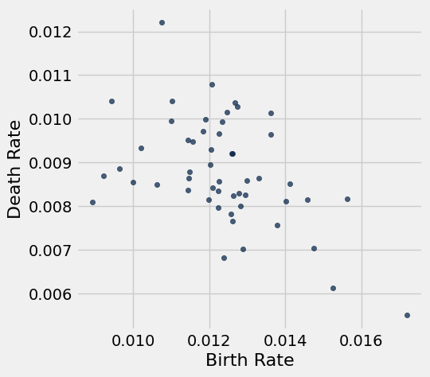
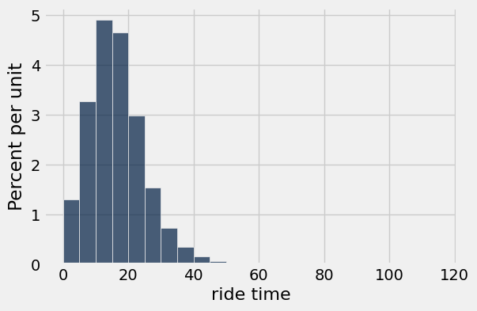
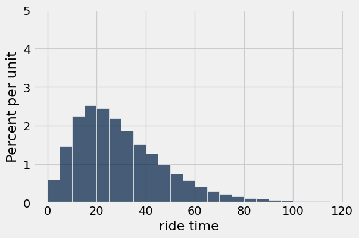
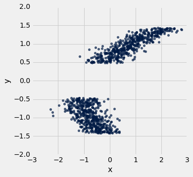
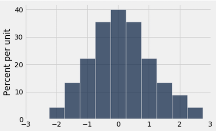
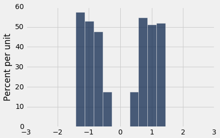
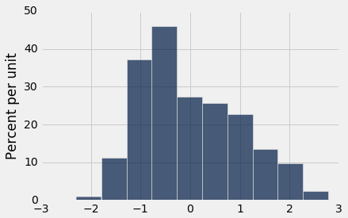

# Homework 3: Table Manipulation and Visualization

Please complete this notebook by filling in the cells provided. Before you begin, execute the previous cell to load the provided tests.

**Helpful Resource:**
- [Python Reference](http://data8.org/su26/reference/): Cheat sheet of helpful array & table methods used in Data 8!

**Recommended Reading**: 
* [Visualization](https://inferentialthinking.com/chapters/07/Visualization.html)

For all problems that you must write explanations and sentences for, you **must** provide your answer in the designated space. Moreover, throughout this homework and all future ones, **please be sure to not re-assign variables throughout the notebook!** For example, if you use `max_temperature` in your answer to one question, do not reassign it later on. Otherwise, you will fail tests that you thought you were passing previously!

**Deadline:**

This assignment is **due Wednesday, 2/11 at 11:00am PT**. Submissions after this time will be accepted for 24 hours and will incur a 20% penalty. Any submissions later than this 24 hour period will not be accepted unless an extension has been granted as per the [syllabus](http://data8.org/su26/syllabus/) page. Turn it in by Tuesday, 2/10 at 11:00am PT for 5 extra credit points.

Directly sharing answers is not okay, but discussing problems with the course staff or with other students is encouraged. Refer to the [syllabus](https://www.data8.org/su26/syllabus) page to learn more about how to learn cooperatively.

You should start early so that you have time to get help if you're stuck. Office hours are held Monday through Friday in [Warren Hall](https://www.berkeley.edu/map/warren-hall/) and online. The office hours schedule appears on our [office hours page](https://www.data8.org/su26/calendar/).

---

The point breakdown for this assignment is given in the table below:
| Category | Points |
| --- | --- |
| Autograder (Coding questions) | 87 |
| Manual (Visualization questions) | 13 |
| **Total** | 100 |

**Code:**

```python
# Don't change this cell; just run it. 

import numpy as np
from datascience import *
import warnings
warnings.simplefilter('ignore', FutureWarning)

# These lines do some fancy plotting magic.\n",
import matplotlib
%matplotlib inline
import matplotlib.pyplot as plt
plt.style.use('fivethirtyeight')
```

---
## 1. Birth Rates

The following table gives Census-based population estimates for each US state on both July 1, 2015 and July 1, 2016. The last four columns describe the components of the estimated change in population during this time interval. **For all questions below, assume that the word "states" refers to all 52 rows including Puerto Rico and the District of Columbia.**

The data was taken from [here](http://www2.census.gov/programs-surveys/popest/datasets/2010-2016/national/totals/nst-est2016-alldata.csv). (Note: If the file doesn't download for you when you click the link, you can copy and paste the link address it into your address bar!) If you want to read more about the different column descriptions, click [here](http://www2.census.gov/programs-surveys/popest/datasets/2010-2015/national/totals/nst-est2015-alldata.pdf).

The raw data is a bit messy—run the cell below to clean the table and make it easier to work with.

**Code:**

```python
# Don't change this cell; just run it.
pop = Table.read_table('nst-est2016-alldata.csv').where('SUMLEV', 40).select([1, 4, 12, 13, 27, 34, 62, 69])
pop = pop.relabeled('POPESTIMATE2015', 'START_POP').relabeled('POPESTIMATE2016', 'END_POP')
pop = pop.relabeled('BIRTHS2016', 'BIRTHS').relabeled('DEATHS2016', 'DEATHS')
pop = pop.relabeled('NETMIG2016', 'MIGRATION').relabeled('RESIDUAL2016', 'OTHER')
pop = pop.with_columns("REGION", np.array([int(region) if region != "X" else 0 for region in pop.column("REGION")]))
pop.set_format([2, 3, 4, 5, 6, 7], NumberFormatter(decimals=0)).show(5)
```

*Output:*

| REGION | NAME | START_POP | END_POP | BIRTHS | DEATHS | MIGRATION | OTHER |
| --- | --- | --- | --- | --- | --- | --- | --- |
| 3 | Alabama | 4,853,875 | 4,863,300 | 58,556 | 52,405 | 3,874 | -600 |
| 4 | Alaska | 737,709 | 741,894 | 11,255 | 4,511 | -2,557 | -2 |
| 4 | Arizona | 6,817,565 | 6,931,071 | 87,204 | 56,564 | 76,405 | 6,461 |
| 3 | Arkansas | 2,977,853 | 2,988,248 | 37,936 | 30,581 | 3,530 | -490 |
| 4 | California | 38,993,940 | 39,250,017 | 502,848 | 273,850 | 33,530 | -6,451 |

---

**Question 1.1.** Assign `us_birth_rate` to the total US annual birth rate during this time interval. The annual birth rate for a year-long period is the total number of births in that period as a proportion of the total population size at the start of the time period. **(7 Points)**

_Hint:_ What does each row in the `pop` table represent? How can we use this to find the total US population?

**Student scaffold:**

```python
us_birth_rate = ...
us_birth_rate
```

**Solution:**

```python
us_birth_rate = sum(pop.column('BIRTHS'))/sum(pop.column('START_POP')) # SOLUTION
us_birth_rate
```

*Output:*

```text
0.012358536498646102
```

**Test — `q1_1` (7 points)**

```python
>>> 0 < us_birth_rate < 1
True

>>> from hw03_check import correctness_check_1_1
>>> correctness_check_1_1(us_birth_rate, pop)
True
```

---

**Question 1.2.** Assign `movers` to the number of states for which the **absolute value** of the **annual rate of migration** was higher than 1%. The annual rate of migration for a year-long period is the net number of migrations (in minus out) as a proportion of the population size at the start of the period. The `MIGRATION` column contains estimated annual net migration counts by state. **(7 Points)**

*Hint*: `migration_rates` should be a table and `movers` should be a number.

**Student scaffold:**

```python
migration_rates = ...
movers = ...
movers
```

**Solution:**

```python
migration_rates = pop.with_column('Migration Rate', np.abs(pop.column('MIGRATION')/pop.column('START_POP'))) # SOLUTION
movers = migration_rates.where('Migration Rate', are.above(0.01)).num_rows # SOLUTION
movers
```

*Output:*

```text
9
```

**Test — `q1_2` (7 points)**

```python
>>> 0 < movers <= 52
True

>>> from hw03_check import correctness_check_1_2
>>> correctness_check_1_2(movers)
True
```

---

**Question 1.3.** Assign `west_births` to the total number of births that occurred in region 4 (the Western US). **(7 Points)**

*Hint:* Make sure you double check the type of the values in the `REGION` column and appropriately filter (i.e. the types must match!).

**Student scaffold:**

```python
west_births = ...
west_births
```

**Solution:**

```python
west_births = sum(pop.where('REGION', are.equal_to(4)).column('BIRTHS')) # SOLUTION
west_births
```

*Output:*

```text
979657
```

**Test — `q1_3` (7 points)**

```python
>>> 500000.0 < west_births < 1000000.0
True

>>> from hw03_check import correctness_check_1_3
>>> correctness_check_1_3(west_births)
True
```

---

**Question 1.4.** In the next question, you will be creating a visualization to understand the relationship between birth and death rates. The annual death rate for a year-long period is the total number of deaths in that period as a proportion of the population size at the start of the time period.

What visualization is most appropriate to see if there is an association between annual birth and death rates across multiple states in the United States?

1. Line Graph
2. Bar Chart
3. Scatter Plot

Assign `visualization` below to the number corresponding to the correct visualization. **(6 Points)**

**Student scaffold:**

```python
visualization = ...
```

**Solution:**

```python
visualization = 3 # SOLUTION
```

**Test — `q1_4` (6 points)**

```python
>>> type(visualization) == int
True

>>> 1 <= visualization <= 3
True

>>> from hw03_check import correctness_check_1_4
>>> correctness_check_1_4(visualization)
True
```

--- 

**Question 1.5.** In the code cell below, create a visualization that will help us determine if there is an association between birth rate and death rate during this time interval. It may be helpful to create an intermediate table containing the birth and death rates for each state. **(5 Points)**

Things to consider:

- What type of chart will help us illustrate an association between 2 variables?
- How can you manipulate a certain table to help generate your chart?
- Check out the [Recommended Reading](https://inferentialthinking.com/chapters/07/Visualization.html) for this homework!

**Note: All plotting and visualization questions in this homework will be manually graded on correctness. Even though these questions do not have a grader check cell, they will still count towards your score!**

**Student scaffold:**

```python
# In this cell, use birth_rates and death_rates to generate your visualization
birth_rates = pop.column('BIRTHS') / pop.column('START_POP')
death_rates = pop.column('DEATHS') / pop.column('START_POP')
...
```

**Solution:**

```python
# In this cell, use birth_rates and death_rates to generate your visualization
birth_rates = pop.column('BIRTHS') / pop.column('START_POP')
death_rates = pop.column('DEATHS') / pop.column('START_POP')
pop.with_columns("Birth Rate", birth_rates, "Death Rate", death_rates).scatter(8, 9) # SOLUTION
```



---

**Question 1.6.** True or False: There is an association between birth rate and death rate during this time interval. 

Assign `assoc` to `True` or `False` in the cell below. **(7 Points)**

**Student scaffold:**

```python
assoc = ...
```

**Solution:**

```python
assoc = True # SOLUTION
```

**Test — `q1_6` (7 points)**

```python
>>> type(assoc) is bool
True

>>> assoc == True
True
```

---
## 2. Uber

**Note:** We recommend reading [Chapter 7.2](https://inferentialthinking.com/chapters/07/2/Visualizing_Numerical_Distributions.html) of the textbook before starting on Question 3.

Below we load tables containing 200,000 weekday Uber rides in the Manila, Philippines, and Boston, Massachusetts metropolitan areas from the [Uber Movement](https://www.uber.com/newsroom/introducing-uber-movement-2/) project. The `sourceid` and `dstid` columns contain codes corresponding to start and end locations of each ride. The `hod` column contains codes corresponding to the hour of the day the ride took place. The `ride time` column contains the length of the ride in minutes.

**Code:**

```python
boston = Table.read_table("boston.csv")
manila = Table.read_table("manila.csv")
print("Boston Table")
boston.show(4)
print("Manila Table")
manila.show(4)
```

*Output (stdout):*

```text
Boston Table
```

*Output:*

| sourceid | dstid | hod | ride time |
| --- | --- | --- | --- |
| 584 | 33 | 7 | 11.866 |
| 1013 | 1116 | 13 | 17.7993 |
| 884 | 1190 | 22 | 19.3488 |
| 211 | 364 | 1 | 1.7235 |

*Output (stdout):*

```text
Manila Table
```

*Output:*

| sourceid | dstid | hod | ride time |
| --- | --- | --- | --- |
| 544 | 5 | 22 | 22.8115 |
| 302 | 240 | 21 | 7.02267 |
| 278 | 99 | 16 | 21.6437 |
| 720 | 775 | 18 | 13.0597 |

--- 

**Question 2.1.** Produce a histogram that visualizes the distributions of all ride times in Boston using the given bins in `equal_bins`. **(4 Points)**

*Hint:* See [Chapter 7.2](https://inferentialthinking.com/chapters/07/2/Visualizing_Numerical_Distributions.html) if you're stuck on how to specify bins.

**Note: All plotting and visualization questions in this homework will be manually graded on correctness. Even though these questions do not have a grader check cell, they will still count towards your score!**

**Student scaffold:**

```python
equal_bins = np.arange(0, 120, 5)
...
```

**Solution:**

```python
equal_bins = np.arange(0, 120, 5)
boston.select("ride time").hist(bins = equal_bins) # SOLUTION
```



---

**Question 2.2.** Now, produce a histogram that visualizes the distribution of all ride times in Manila using the given bins. **(4 Points)**

**Student scaffold:**

```python
equal_bins = np.arange(0, 120, 5)
...

# Don't delete the following line!
plt.ylim(0, 0.05);
```

**Solution:**

```python
equal_bins = np.arange(0, 120, 5)
manila.select("ride time").hist(bins = equal_bins) # SOLUTION

# Don't delete the following line!
plt.ylim(0, 0.05);
```



---

**Question 2.3.** Let's take a closer look at the y-axis label. Assign `unit_meaning` to an integer (1, 2, 3) that corresponds to the "unit" in "Percent per unit". **(7 Points)**

1. minute  
2. ride time  
3. second

**Student scaffold:**

```python
unit_meaning = ...
unit_meaning
```

**Solution:**

```python
unit_meaning = 1 # SOLUTION
unit_meaning
```

*Output:*

```text
1
```

**Test — `q2_3` (7 points)**

```python
>>> 1 <= unit_meaning <= 3
True

>>> from hw03_check import correctness_check_2_3
>>> correctness_check_2_3(unit_meaning)
True
```

---

**Question 2.4.** Assign `boston_under_15` and `manila_under_15` to the percentage of rides that are less than 15 minutes in their respective metropolitan areas. Use the height variables provided below in order to compute the percentages. Your solution should only use height variables, numbers, and mathematical operations. You should **not** access the tables `boston` and `manila` in any way. **(8 Points)**

> ***Note:*** that the height variables (i.e. `boston_under_5`) represent the height of the bin it describes.

**Student scaffold:**

```python
boston_under_5_bin_height = 1.2
manila_under_5_bin_height = 0.6
boston_5_to_under_10_bin_height = 3.2
manila_5_to_under_10_bin_height = 1.4
boston_10_to_under_15_bin_height = 4.9
manila_10_to_under_15_bin_height = 2.2

boston_under_15 = ...
manila_under_15 = ...

boston_under_15, manila_under_15
```

**Solution:**

```python
boston_under_5_bin_height = 1.2
manila_under_5_bin_height = 0.6
boston_5_to_under_10_bin_height = 3.2
manila_5_to_under_10_bin_height = 1.4
boston_10_to_under_15_bin_height = 4.9
manila_10_to_under_15_bin_height = 2.2

boston_under_15 = 5*boston_under_5_bin_height + 5*boston_5_to_under_10_bin_height + 5*boston_10_to_under_15_bin_height # SOLUTION
manila_under_15 = 5*manila_under_5_bin_height + 5*manila_5_to_under_10_bin_height + 5*manila_10_to_under_15_bin_height # SOLUTION

boston_under_15, manila_under_15
```

*Output:*

```text
(46.5, 21.0)
```

**Test — `q2_4` (8 points)**

```python
>>> boston_under_15 >= 0 and boston_under_15 <= 100
True

>>> manila_under_15 >= 0 and manila_under_15 <= 100
True

>>> from hw03_check import boston_check
>>> boston_check(boston_under_15)
True

>>> from hw03_check import manila_check
>>> manila_check(manila_under_15)
True
```

---

**Question 2.5.** Let's take a closer look at the distribution of ride times in Boston. Assign `boston_median_bin` to an integer (1, 2, 3, or 4) that corresponds to the bin that contains the median time. **(6 Points)**

1. 0-8 minutes  
2. 8-14 minutes  
3. 14-20 minutes  
4. 20-40 minutes  

*Hint:* The median of a sorted list has half of the list elements to its left, and half to its right.

**Student scaffold:**

```python
boston_median_bin = ...
boston_median_bin
```

**Solution:**

```python
boston_median_bin = 3 # SOLUTION
boston_median_bin
```

*Output:*

```text
3
```

**Test — `q2_5` (6 points)**

```python
>>> 1 <= boston_median_bin <= 4
True

>>> from hw03_check import correctness_check_2_5
>>> correctness_check_2_5(boston_median_bin)
True
```

---

**Question 2.6.** Identify the main differences between the two histograms, in terms of the statistical properties.

Assign all correct statements to the array `histogram_answer` (e.g. `histogram_answer = make_array(1,2,3)`).
> *Hint*: Without performing any calculations, what can you observe about the average or skew of each histogram? A distribution has a right skew if it has a long right “tail” of values. **(4 Points)**

1. Manila had a higher average ride time than Boston.
2. Boston had a higher average ride time than Manila.
3. The Manila histogram was more right skewed than the Boston histogram.
3. The Boston histogram was more right skewed than the Manila histogram.

**Student scaffold:**

```python
histogram_answer = ...
```

**Solution:**

```python
histogram_answer = make_array(1,3) # SOLUTION
```

**Test — `q2_6` (4 points)**

```python
>>> from hw03_check import correctness_check_2_6
>>> correctness_check_2_6(histogram_answer)
True
```

--- 

**Question 2.7.** Boston is known to have very cold winters, while Manila is known for having heavy traffic. These factors might help to explain the differences you observed in Question 2.6. 

Assign all statements that would support our observations about Boston and Manila ride times to the array `difference_factors`. **(4 Points)**

1. Boston’s colder weather encourages people to substitute walking with short rides, leading to shorter ride times on average.
2. Boston’s colder weather results in weather-related delays, leading to longer ride times on average.
3. Manila's heavy traffic encourages people to avoid traveling long distances, leading to shorter ride times on average.
4. Manila's heavy traffic causes frequent delays, leading to longer ride times on average.

**Student scaffold:**

```python
difference_factors = ...
```

**Solution:**

```python
difference_factors = make_array(1,4) # SOLUTION
```

**Test — `q2_7` (4 points)**

```python
>>> from hw03_check import correctness_check_2_7
>>> correctness_check_2_7(difference_factors)
True
```

---
## 3. Histograms

Consider the following scatter plot: 



The axes of the plot represent values of two variables: $x$ and $y$.

Suppose we have a table called `t` that has two columns in it:

- `x`: a column containing the x-values of the points in the scatter plot
- `y`: a column containing the y-values of the points in the scatter plot

Below, you are given three histograms—one corresponds to column `x`, one corresponds to column `y`, and one does not correspond to either column.

**Histogram A:**
 


**Histogram B:**



**Histogram C:**



---

**Question 3.1.** Suppose we run `t.hist('x')`. Which histogram does this code produce? Assign `histogram_column_x` to either 1, 2, or 3. **(7 Points)**

1. Histogram A
2. Histogram B
3. Histogram C

**Student scaffold:**

```python
histogram_column_x = ...
```

**Solution:**

```python
histogram_column_x = 3 # SOLUTION
```

**Test — `q3_1` (7 points)**

```python
>>> histogram_column_x == 1 or histogram_column_x == 2 or histogram_column_x == 3
True

>>> from hw03_check import correctness_check_3_1
>>> correctness_check_3_1(histogram_column_x)
True
```

---

**Question 3.2.** Select all valid reasons why you chose the histogram from Question 1, and assign your answers to the array `histogram_reasoning_x`. **(5 Points)**

1. Since the scatter plot shows two roughly symmetric clusters to the left and right of 0 (on the $x$-axis), the histogram for $x$ should be approximately symmetric around 0.
2. Because there are no signficiant gaps in the values of the $x$-variable, we would expect the histogram for $x$ to have no gaps in it.
3. Since the scatter plot shows two distinct clusters, the histogram of $x$ should have two peaks with an empty gap between them.
4. The values of the $x$-variable range from approximately -2 to 3, so the histogram must also have a range of values from approximately -2 to 3.
5. Because the two clusters on the scatter plot overlap in the area between -1 and 0, we would expect the bins to be taller around the -1 to 0 area of the histogram, since each vertical slice in this range contains more points.

**Student scaffold:**

```python
histogram_reasoning_x = ...
```

**Solution:**

```python
histogram_reasoning_x = make_array(2,4,5) # SOLUTION
```

**Test — `q3_2` (5 points)**

```python
>>> from hw03_check import correctness_check_3_2
>>> correctness_check_3_2(histogram_reasoning_x)
True
```

---

**Question 3.3.** Suppose we run `t.hist('y')`. Which histogram does this code produce? Assign `histogram_column_y` to either 1, 2, or 3. **(7 Points)**

1. Histogram A
2. Histogram B
3. Histogram C

**Student scaffold:**

```python
histogram_column_y = ...
```

**Solution:**

```python
histogram_column_y = 2 # SOLUTION
```

**Test — `q3_3` (7 points)**

```python
>>> histogram_column_y == 1 or histogram_column_y == 2 or histogram_column_y == 3
True

>>> from hw03_check import correctness_check_3_3
>>> correctness_check_3_3(histogram_column_y)
True
```

---

**Question 3.4.** Select all valid reasons why you chose the histogram from Question 3, and assign your answers to the array `histogram_reasoning_y` **(5 Points)**

1. Since the scatter plot shows two roughly symmetric clusters to the left and right of 0 (on the $y$-axis), the histogram for $y$ should be approximately symmetric around 0.
2. The values of the $y$-variable range from approximately -1.5 to 1.5, so the histogram must also have a range of values from approximately -1.5 to 1.5.
3. Since the scatter plot shows two distinct clusters, the histogram of $y$ should have two peaks with an empty gap between them.
4. There is a are no gaps in the points in the $y$-direction, so we would not expect a gap in the histogram of those values.
5. Because the two masses on the scatter plot overlap in the area between -1 and 0, we would expect the bins to be taller around the -1 to 0 area of the histogram, since each vertical slice in this range contains more points.

**Student scaffold:**

```python
histogram_reasoning_y = ...
```

**Solution:**

```python
histogram_reasoning_y = make_array(1,2,3) # SOLUTION
```

**Test — `q3_4` (5 points)**

```python
>>> from hw03_check import correctness_check_3_4
>>> correctness_check_3_4(histogram_reasoning_y)
True
```

---

You're done with Homework 3!  

**Important submission steps:** 
1. Run the tests and verify that they all pass.
2. Choose **Save Notebook** from the **File** menu, then **run the final cell**. 
3. Click the link to download the zip file.
4. Go to [Pensieve](https://www.pensieve.co/) and submit the zip file to the corresponding assignment. The name of this assignment is "Homework 03 Autograder". 

**It is your responsibility to make sure your work is saved before running the last cell.**

---

To double-check your work, the cell below will rerun all of the autograder tests.

## Submission

Make sure you have run all cells in your notebook in order before running the cell below, so that all images/graphs appear in the output. The cell below will generate a zip file for you to submit. **Please save before exporting!**

---

## Datasets

Datasets this notebook loads with `Table.read_table`. Column names are exact, including spaces and capitalization. Only the schema is recorded here — the data itself is not in this document, so any question about its values must be answered by running code, not by reasoning over the rows shown elsewhere in this file.

### `nst-est2016-alldata.csv`

57 rows, 106 columns.

| Column | Type |
| --- | --- |
| `SUMLEV` | int |
| `REGION` | str |
| `DIVISION` | str |
| `STATE` | int |
| `NAME` | str |
| `CENSUS2010POP` | int |
| `ESTIMATESBASE2010` | int |
| `POPESTIMATE2010` | int |
| `POPESTIMATE2011` | int |
| `POPESTIMATE2012` | int |
| `POPESTIMATE2013` | int |
| `POPESTIMATE2014` | int |
| `POPESTIMATE2015` | int |
| `POPESTIMATE2016` | int |
| `NPOPCHG_2010` | int |
| `NPOPCHG_2011` | int |
| `NPOPCHG_2012` | int |
| `NPOPCHG_2013` | int |
| `NPOPCHG_2014` | int |
| `NPOPCHG_2015` | int |
| `NPOPCHG_2016` | int |
| `BIRTHS2010` | int |
| `BIRTHS2011` | int |
| `BIRTHS2012` | int |
| `BIRTHS2013` | int |
| `BIRTHS2014` | int |
| `BIRTHS2015` | int |
| `BIRTHS2016` | int |
| `DEATHS2010` | int |
| `DEATHS2011` | int |
| `DEATHS2012` | int |
| `DEATHS2013` | int |
| `DEATHS2014` | int |
| `DEATHS2015` | int |
| `DEATHS2016` | int |
| `NATURALINC2010` | int |
| `NATURALINC2011` | int |
| `NATURALINC2012` | int |
| `NATURALINC2013` | int |
| `NATURALINC2014` | int |

_... 66 more columns, all mixed_

### `boston.csv`

200,000 rows, 4 columns.

| Column | Type |
| --- | --- |
| `sourceid` | int |
| `dstid` | int |
| `hod` | int |
| `ride time` | float |

### `manila.csv`

200,000 rows, 4 columns.

| Column | Type |
| --- | --- |
| `sourceid` | int |
| `dstid` | int |
| `hod` | int |
| `ride time` | float |
