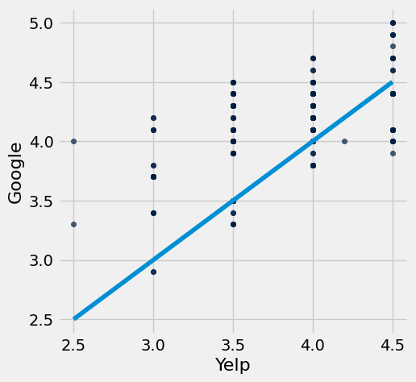
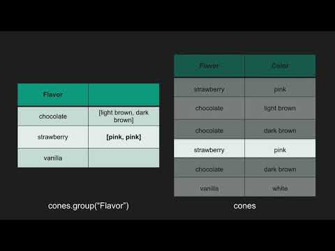
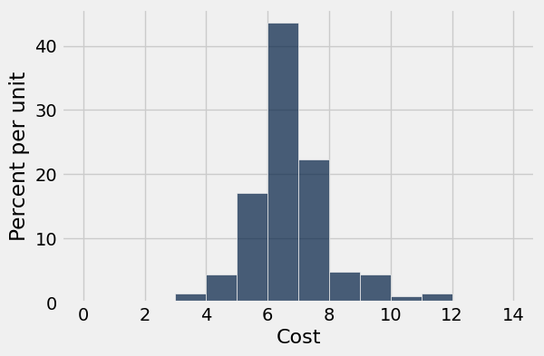
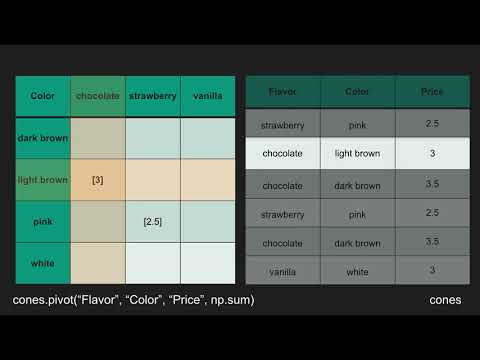

# Homework 4: Functions, Tables, and Groups

Please complete this notebook by filling in the cells provided. Before you begin, execute the previous cell to load the provided tests.

**Helpful Resource:**
- [Python Reference](http://data8.org/su26/reference/): Cheat sheet of helpful array & table methods used in Data 8!

**Recommended Readings**: 

* [Visualizing Numerical Distributions](https://www.inferentialthinking.com/chapters/07/2/Visualizing_Numerical_Distributions.html)
* [Functions and Tables](https://www.inferentialthinking.com/chapters/08/Functions_and_Tables.html)

Please complete this notebook by filling in the cells provided. **Before you begin, execute the cell below to setup the notebook by importing some helpful libraries.** Each time you start your server, you will need to execute this cell again.

For all problems that you must write explanations and sentences for, you **must** provide your answer in the designated space. Moreover, throughout this homework and all future ones, **please be sure to not re-assign variables throughout the notebook!** For example, if you use `max_temperature` in your answer to one question, do not reassign it later on. Otherwise, you will fail tests that you thought you were passing previously!

**Deadline:**

This assignment is **due Wednesday, 2/18 at 11:00am PT**. Submissions after this time will be accepted for 24 hours and will incur a 20% penalty. Any submissions later than this 24 hour period will not be accepted unless an extension has been granted as per the [syllabus](http://data8.org/su26/syllabus/) page. Turn it in by Tuesday, 2/17 at 11:00am PT for 5 extra credit points.

Directly sharing answers is not okay, but discussing problems with the course staff or with other students is encouraged. Refer to the [syllabus](https://www.data8.org/su26/syllabus) page to learn more about how to learn cooperatively.

You should start early so that you have time to get help if you're stuck. Office hours are held Monday through Friday in [Warren Hall](https://www.berkeley.edu/map/warren-hall/) and online. The office hours schedule appears on our [OH page](https://www.data8.org/su26/calendar/).

---

The point breakdown for this assignment is given in the table below:
| Category | Points |
| --- | --- |
| Autograder (Coding questions) | 88 |
| Written | 12 |
| **Total** | 100 |

---
## 0. Midterm Accommodations Form

---

**Question 1.** The DATA C8 Spring 2026 Midterm Exam will take place on **Tuesday, March 10th from 8:00 PM to 10:00 PM PT**. Please complete this form so that we can best accommodate you for the midterm.
_**All students are required to fill out this form**_. The deadline to submit this form is **Friday, February 20th by 11:59PM.** The link can be found below. **(1 Point)**

- [Spring 2026 Midterm Accommodations Survey](https://docs.google.com/forms/d/e/1FAIpQLSd4ZbnAQjE9bULhBMMuij4vcgtS9ehtYSO7RgGOZc4dymGKZA/viewform?usp=dialog)

Assign `secret_phrase` to the secret phrase given at the end of the accommodations survey. Make sure the phrase is in quotes (i.e. is a string)!

**Student scaffold:**

```python
secret_phrase = ...
```

**Solution:**

```python
secret_phrase = "valentine" #SOLUTION
```

**Test — `q0_1`**

```python
>>> type(secret_phrase) == str
True

>>> from hw04_check import correctness_check_0
>>> correctness_check_0(secret_phrase)
True
```

---
## 1. 2023 Cal Football Season

**Code:**

```python
# Run this cell to set up the notebook, but please don't change it.

# These lines import the Numpy and Datascience modules.
import numpy as np
from datascience import *

# These lines do some fancy plotting magic.
import matplotlib
%matplotlib inline
import matplotlib.pyplot as plt
plt.style.use('fivethirtyeight')

import warnings
warnings.simplefilter('ignore', FutureWarning)
warnings.filterwarnings("ignore")
```

Marissa and Tiffany are trying to analyze how well the Cal football team performed in the 2023 season. A football game is divided into four periods, called quarters. The number of points Cal scored in each quarter and the number of points their opponent scored in each quarter are stored in a table called `cal_fb.csv`.

**Code:**

```python
# Just run this cell
# Read in the cal_fb csv file
games = Table().read_table("cal_fb.csv")
games.show()
```

*Output:*

| Opponent | Cal 1Q | Cal 2Q | Cal 3Q | Cal 4Q | Opp 1Q | Opp 2Q | Opp 3Q | Opp 4Q |
| --- | --- | --- | --- | --- | --- | --- | --- | --- |
| North Texas | 14 | 19 | 15 | 10 | 7 | 14 | 0 | 0 |
| Auburn | 3 | 7 | 0 | 0 | 0 | 7 | 0 | 7 |
| Idaho | 0 | 14 | 14 | 3 | 10 | 7 | 0 | 0 |
| Washington | 6 | 6 | 7 | 13 | 24 | 21 | 7 | 7 |
| Arizona State | 7 | 3 | 7 | 7 | 7 | 0 | 6 | 8 |
| Oregon State | 0 | 17 | 15 | 8 | 7 | 14 | 14 | 17 |
| Utah | 7 | 0 | 7 | 0 | 0 | 14 | 10 | 10 |
| USC | 14 | 14 | 8 | 13 | 17 | 0 | 12 | 21 |
| Oregon | 10 | 3 | 6 | 0 | 14 | 21 | 7 | 21 |
| Washington State | 14 | 14 | 0 | 14 | 7 | 14 | 3 | 15 |
| Stanford | 7 | 7 | 7 | 6 | 3 | 3 | 9 | 0 |
| UCLA | 6 | 14 | 0 | 13 | 0 | 7 | 0 | 0 |
| Texas Tech | 14 | 0 | 0 | 0 | 7 | 17 | 7 | 3 |

Let's start by finding the total points each team scored in a game.

---

**Question 1.1.** Write a function called `sum_scores`.  It should take in four arguments, where each argument represents an integer corresponding to the team's score for each quarter. It should return the team's total score for that game as an integer. **(2 Points)**

*Hint:* Don't overthink this question!

**Student scaffold:**

```python
def sum_scores(..., ..., ..., ...):
    '''Returns the total score calculated by adding up the score of each quarter'''
    ...

sum_scores(14, 7, 3, 0) #DO NOT CHANGE THIS LINE
```

**Solution:**

```python
""" # BEGIN PROMPT  
def sum_scores(..., ..., ..., ...):
    '''Returns the total score calculated by adding up the score of each quarter'''
    ...
"""; # END PROMPT
# BEGIN SOLUTION NO PROMPT
def sum_scores(q1, q2, q3, q4):
    return q1 + q2 + q3 + q4
# END SOLUTION

sum_scores(14, 7, 3, 0) #DO NOT CHANGE THIS LINE
```

*Output:*

```text
24
```

**Test — `q1_1` (2 points)**

```python
>>> sum_scores(2, 3, 6, 1)
12

>>> sum_scores(-2, 3, 5, -10)
-4
```

---

**Question 1.2.** Create a new table `final_scores` with three columns in this *specific* order: `Opponent`, `Cal Score`, `Opponent Score`. You will have to create the `Cal Score` and `Opponent Score` columns. Use the function `sum_scores` you just defined in the previous question for this problem. **(4 Points)**

*Hint:* If you want to apply a function that takes in multiple arguments, you can pass multiple column names as arguments in `tbl.apply()`. The column values will be passed into the corresponding arguments of the function. Take a look at the [Python Reference](https://www.data8.org/su26/reference/)  and Lecture 9's demo for syntax.

*Note:* If you’re running into issues creating `final_scores`, check that `cal_scores` and `opp_scores` output what you want. If you're encountering `TypeError`s, check the [Python Reference](https://www.data8.org/su26/reference/) to see if the inputs/outputs of the function are what you expect.

**Student scaffold:**

```python
cal_scores = ...
opp_scores = ...
final_scores = ...
final_scores
```

**Solution:**

```python
cal_scores = games.apply(sum_scores, "Cal 1Q","Cal 2Q", "Cal 3Q", "Cal 4Q") # SOLUTION
opp_scores = games.apply(sum_scores, "Opp 1Q", "Opp 2Q", "Opp 3Q", "Opp 4Q") # SOLUTION
final_scores = games.with_columns("Cal Score", cal_scores, "Opponent Score", opp_scores).select("Opponent", "Cal Score", "Opponent Score") # SOLUTION
final_scores
```

*Output:*

| Opponent | Cal Score | Opponent Score |
| --- | --- | --- |
| North Texas | 58 | 21 |
| Auburn | 10 | 14 |
| Idaho | 31 | 17 |
| Washington | 32 | 59 |
| Arizona State | 24 | 21 |
| Oregon State | 40 | 52 |
| Utah | 14 | 34 |
| USC | 49 | 50 |
| Oregon | 19 | 63 |
| Washington State | 42 | 39 |

**Test — `q1_2` (4 points)**

```python
>>> final_scores.num_columns
3

>>> final_scores.num_rows
13

>>> set(['Opponent', 'Cal Score', 'Opponent Score']) == set(final_scores.labels)
True

>>> isinstance(final_scores.column(0).item(0), str)
True

>>> isinstance(final_scores.column(1).item(0), int)
True

>>> from hw04_check import correctness_check_1_2
>>> correctness_check_1_2(final_scores, games, sum_scores)
True
```

We can get specific row objects from a table. You can use `tbl.row(n)` to get the `n`th row of a table. `row.item("column_name")` will allow you to select the element that corresponds to `column_name` in a particular row. Here's an example:

**Code:**

```python
# Just run this cell
# We got the Axe!
games.row(10) # <-- this will return a row object
```

*Output:*

```text
Row(Opponent='Stanford', Cal 1Q=7, Cal 2Q=7, Cal 3Q=7, Cal 4Q=6, Opp 1Q=3, Opp 2Q=3, Opp 3Q=9, Opp 4Q=0)
```

**Code:**

```python
# Just run this cell
games.row(10).item("Cal 4Q") # <-- this will return a item (e.g. an int) from a row object
```

*Output:*

```text
6
```

---

**Question 1.3.** We want to see whether or not Cal lost for a particular game. Write a function called `did_cal_lose`.  It should take one argument: a **row object** from the `final_scores` table. It should return either `True` if Cal's score was less than the Opponent's score, and `False` otherwise. **(4 Points)**

*Note 1*: "Row object" means a row from the table extracted (behind the scenes) using `tbl.row(index)` that contains all the data for that specific row. It is **not** the index of a row. Do not try and call `final_scores.row(game_row)` inside of the function.

*Note 2*: If you're still confused by row objects, try printing out `final_scores.row(1)` in a new cell to visually see what it looks like! This piece of code is pulling out the row object located at index 1 of the `final_scores` table and returning it. When you display it in a cell, you'll see that it is not located within a table, but is instead a standalone row object! How can you access the relevant information within this row object?

Hint: You can use comparators like <, >, <=, >=, ==, and != to compare items from a row object

**Student scaffold:**

```python
def did_cal_lose(game_row):
    ...

did_cal_lose(final_scores.row(1)) #DO NOT CHANGE THIS LINE
```

**Solution:**

```python
""" # BEGIN PROMPT
def did_cal_lose(game_row):
    ...
"""; # END PROMPT
# BEGIN SOLUTION NO PROMPT
def did_cal_lose(game_row):
    return game_row.item("Cal Score") < game_row.item("Opponent Score")
# END SOLUTION

did_cal_lose(final_scores.row(1)) #DO NOT CHANGE THIS LINE
```

*Output:*

```text
True
```

**Test — `q1_3` (4 points)**

```python
>>> 'did_cal_lose' in globals()
True

>>> did_cal_lose(final_scores.row(1))
True

>>> from hw04_check import correctness_check_1_3
>>> correctness_check_1_3(did_cal_lose, final_scores)
True

>>> from hw04_check import same_score_check_1_3
>>> same_score_check_1_3(did_cal_lose)
True
```

---

**Question 1.4.** Marissa and Tiffany want to see how Cal did against every opponent during the 2023 season. Using the `final_scores` table:

1. Assign `results_array` to an array of `True` and `False` boolean values that correspond to whether or not Cal lost.
2. Add `results_array` to the `final_scores` table in a column named `Results`, and assign this to `final_scores_with_results`.
3. Then, respectively assign the number of wins and losses Cal had to `cal_wins` and `cal_losses`.

**(7 Points)**

*Hint*: `tbl.apply()` might be helpful. Refer to the [Python Reference](https://www.data8.org/su26/reference/) if you're unsure how it works!

**Student scaffold:**

```python
results_array = ...
final_scores_with_results = ...
cal_losses = ...
cal_wins = ...

# Don't delete or edit the following line:
print(f"In the 2023 Season, Cal Football won {cal_wins} games and lost {cal_losses} games. Go Bears! 🐻")
```

**Solution:**

```python
results_array = final_scores.apply(did_cal_lose) # SOLUTION
final_scores_with_results = final_scores.with_columns("Results", results_array) # SOLUTION
cal_losses = final_scores_with_results.where("Results", True).num_rows # SOLUTION
cal_wins = final_scores_with_results.num_rows - cal_losses # SOLUTION

# Don't delete or edit the following line:
print(f"In the 2023 Season, Cal Football won {cal_wins} games and lost {cal_losses} games. Go Bears! 🐻")
```

*Output (stdout):*

```text
In the 2023 Season, Cal Football won 6 games and lost 7 games. Go Bears! 🐻
```

**Test — `q1_4` (7 points)**

```python
>>> 0 <= cal_wins <= 13
True

>>> 0 <= cal_losses <= 13
True

>>> 'Results' in final_scores_with_results.labels
True

>>> from hw04_check import correctness_check_1_4
>>> correctness_check_1_4(cal_wins, cal_losses)
True

>>> from hw04_check import results_array_check_1_4
>>> results_array_check_1_4(results_array)
True
```

---
## 2. Burrito-ful San Diego

Brandon, Carisma and Dagny are trying to use Data Science to find the best burritos in San Diego! Their friends Dylan, Isaac, and Mariel provided them with two comprehensive datasets on burrito establishments in the San Diego area, taken and cleaned from [here](https://www.kaggle.com/srcole/burritos-in-san-diego/data).

The following cell reads in a table called `ratings` which contains names of burrito restaurants, along with their Yelp rating, Google rating, and overall rating. The `Overall` rating is not an average of the `Yelp` and `Google` ratings, but rather it is the overall rating of the customers that were surveyed in the study above.


It also reads in a table called `burritos_types` which contains names of burrito restaurants, their menu items, and the cost of the respective menu item at the restaurant.

**Code:**

```python
# Just run this cell
ratings = Table.read_table("ratings.csv")
ratings.show(5)
burritos_types = Table.read_table("burritos_types.csv").drop(0)
burritos_types.show(5)
```

*Output:*

| Name | Yelp | Google | Overall |
| --- | --- | --- | --- |
| Albertacos | 3.5 | 3.9 | 3.45 |
| Burrito Factory | 4.5 | 4.8 | 3.5 |
| Burros and Fries | 3.5 | 4.1 | 3.575 |
| Caliente Mexican Food | 3.5 | 4.4 | 3.25 |
| California Burrito Company | 3.5 | 4.4 | 3.2 |

*Output:*

| Name | Menu_Item | Cost |
| --- | --- | --- |
| Albertacos | California | 5.7 |
| Albertacos | Carne Asada | 5.25 |
| Alberto's 623 N Escondido Blvd, Escondido, CA 92025 | Carne Asada | 4.59 |
| Burrito Box | Steak With Guacamole | 11.5 |
| Burrito Factory | Steak Everything | 7.35 |

---

**Question 2.1.** It would be easier if we could combine the information in both tables. Assign `burritos` to the result of joining the two tables together, so that we have a table with the ratings for every corresponding menu item from every restaurant. Each menu item has the same rating as the restaurant from which it is from. **(7 Points)**

*Note:* It doesn't matter which table you put in as the argument to the table method, either order will work for the autograder tests.

*Hint:* Which function lets us combine information from two tables? Refer to the [Python Reference Sheet](http://data8.org/su26/reference/) if you're unsure!

**Student scaffold:**

```python
burritos = ...
burritos.show(10)
```

**Solution:**

```python
burritos = burritos_types.join("Name", ratings) # SOLUTION
burritos.show(10)
```

*Output:*

| Name | Menu_Item | Cost | Yelp | Google | Overall |
| --- | --- | --- | --- | --- | --- |
| Albertacos | California | 5.7 | 3.5 | 3.9 | 3.45 |
| Albertacos | Carne Asada | 5.25 | 3.5 | 3.9 | 3.45 |
| Burrito Factory | Steak Everything | 7.35 | 4.5 | 4.8 | 3.5 |
| Burros and Fries | California | 7.19 | 3.5 | 4.1 | 3.575 |
| Burros and Fries | Carne Asada | 6.89 | 3.5 | 4.1 | 3.575 |
| Burros and Fries | Shrimp California | 6.99 | 3.5 | 4.1 | 3.575 |
| Caliente Mexican Food | California | 6.47 | 3.5 | 4.4 | 3.25 |
| Caliente Mexican Food | Carne Asada | 5.56 | 3.5 | 4.4 | 3.25 |
| Caliente Mexican Food | Fried Fish | 5.56 | 3.5 | 4.4 | 3.25 |
| California Burrito Company | California | 5.5 | 3.5 | 4.4 | 3.2 |

**Test — `q2_1` (7 points)**

```python
>>> set(['Name', 'Menu_Item', 'Yelp', 'Google', 'Overall', 'Cost']) == set(burritos.labels)
True

>>> burritos.num_rows == 212
True

>>> from hw04_check import correctness_check_2_1
>>> correctness_check_2_1(burritos)
True
```

---

**Question 2.2.** Let's look at how the Yelp scores compare to the Google scores in the `burritos` table. First, assign `yelp_google_tbl` to a table only containing the columns `Yelp` and `Google`. Then, make a scatter plot with Yelp scores on the x-axis and the Google scores on the y-axis. **(6 Points)**

**Student scaffold:**

```python
yelp_google_tbl = ...
...

# Don't change/edit/remove the following line.
# To help you make conclusions, we have plotted a straight line on the graph (y=x).
plt.plot(np.arange(2.5,5,.5), np.arange(2.5,5,.5));
```

**Solution:**

```python
yelp_google_tbl = burritos.select("Yelp", "Google") # SOLUTION
yelp_google_tbl.scatter("Yelp", "Google") # SOLUTION

# Don't change/edit/remove the following line.
# To help you make conclusions, we have plotted a straight line on the graph (y=x).
plt.plot(np.arange(2.5,5,.5), np.arange(2.5,5,.5));
```



---

**Question 2.3.** Looking at the scatter plot you just made in Question 2.2, what patterns and relationships do you observe between Yelp and Google ratings? Assign your answers to the array `ratings_observations`. **(7 Points)**

1. The Google ratings are consistently lower than the Yelp ratings.

2. The Google ratings are consistently higher than the Yelp ratings.

3. The Google ratings and Yelp ratings are about the same on average.

4. There is a positive association between Google and Yelp ratings.

5. There is a negative association between Google and Yelp ratings.

6. There is no association between Google and Yelp ratings.

**Student scaffold:**

```python
ratings_observations = make_array(...)
```

**Solution:**

```python
"""# BEGIN PROMPT
ratings_observations = make_array(...)
"""; # END PROMPT
ratings_observations = make_array(2,4) # SOLUTION NO PROMPT
```

**Test — `q2_3` (7 points)**

```python
>>> from hw04_check import correctness_check_2_3
>>> correctness_check_2_3(ratings_observations)
True
```

Here's a refresher on how `.group` works! You can read how `.group` works in the [textbook](https://www.inferentialthinking.com/chapters/08/2/Classifying_by_One_Variable.html), or you can view the video below. The video resource was made by a past staff member, Divyesh Chotai!

You can also use the [Table Functions Visualizer](http://data8.org/interactive_table_functions/) to get some more hands-on experience with the `.group` function.

**Code:**

```python
# Don't worry about what this code does! It simply embeds a YouTube video into a code cell.
from IPython.display import YouTubeVideo
YouTubeVideo("HLoYTCUP0fc")
```



---

**Question 2.4.** There are so many types of California burritos in the `burritos` table! Carisma wants to consider her options for burritos based on rankings. For the sake of these questions, we are treating each menu item's rating the same as its respective restaurant's, as we do not have the rating of every single item at these restaurants. You do not need to worry about this fact, but we thought to mention it!

Create a table with two columns: the first column includes the **names of the burritos** and the second column should contain the **average overall rating** of that burrito across restaurants. **In your calculations, you should only compare burritos that contain the word "California".** For example, there are "California" burritos, "California Breakfast" burritos, "California Surf And Turf" burritos, etc. **(7 Points)**

*Hint:* “California” is case sensitive (“California” is not the same as “california”), so we only want burrito names containing “California” not “california”! 

*Note:* For reference, the staff solution only used one line. However, feel free to break up the solution into multiple lines and steps; just make sure you assign the final output table to `california_burritos`!

**Student scaffold:**

```python
california_burritos = ...
california_burritos
```

**Solution:**

```python
california_burritos = burritos.where("Menu_Item", are.containing("California")).select("Menu_Item", "Overall").group("Menu_Item", np.average) # SOLUTION
california_burritos
```

*Output:*

| Menu_Item | Overall average |
| --- | --- |
| California | 3.5242 |
| California (Only Cheese) | 4.1 |
| California + Guac + Sour Cream | 3.4 |
| California - Chicken | 3.45839 |
| California - Pork Adobada | 3.26429 |
| California - Steak | 3.26429 |
| California Breakfast | 2.75833 |
| California Chicken | 3.54815 |
| California Chipotle | 4.36667 |
| California Everything | 4.1 |

**Test — `q2_4` (7 points)**

```python
>>> california_burritos.num_columns == 2
True

>>> california_burritos.num_rows == 19
True

>>> from hw04_check import results_array_check_2_4
>>> results_array_check_2_4(california_burritos)
True
```

---

**Question 2.5.** Given this new table `california_burritos`, Dagny can figure out the name of the California burrito with the highest overall average rating! Assign `best_california_burrito` to a line of code that outputs the string that represents the name of the California burrito with the highest overall average rating. If multiple burritos satisfy this criteria, you can output any one of them. **(7 Points)**

**Student scaffold:**

```python
best_california_burrito = ...
best_california_burrito
```

**Solution:**

```python
best_california_burrito = california_burritos.sort("Overall average", descending=True).column("Menu_Item").item(0) # SOLUTION
best_california_burrito
```

*Output:*

```text
'California Chipotle'
```

**Test — `q2_5` (7 points)**

```python
>>> isinstance(best_california_burrito, (str, np.str_))
True

>>> from hw04_check import correctness_check_2_5
>>> correctness_check_2_5(best_california_burrito)
True
```

---

**Question 2.6.** Brandon thinks that burritos in San Diego are very affordable. Plot a histogram that visualizes the distribution of the costs of the burritos in the `burritos` table. Also use the provided `cost_bins` variable when making your histogram, so that the histogram is more visually informative. **(6 Points)**

**Student scaffold:**

```python
cost_bins = np.arange(0, 15, 1) # Do not change this line
# Please also use the provided bins
...
```

**Solution:**

```python
cost_bins = np.arange(0, 15, 1) # Do not change this line
# Please also use the provided bins
burritos.hist("Cost", bins = cost_bins) # SOLUTION
```



---

**Question 2.7.** What percentage of burritos in San Diego are less than $6? Assign `burritos_less_than_six` to your answer, **which should be between 0 and 100**. You should only use the histogram above to answer the question. Do not use code on the table to to find the answer, just eyeball the heights and use Python to evaluate your arithmetic! **(7 Points)**

*Note*: Your answer does not have to be exact, but it should be within a couple percentages of the staff answer.

*Hint:* It might be helpful to review [Section 7.2](https://inferentialthinking.com/chapters/07/2/Visualizing_Numerical_Distributions.html) of the textbook about calculating percentages from histograms.

**Student scaffold:**

```python
burritos_less_than_six = ...
```

**Solution:**

```python
burritos_less_than_six = 1 + 4 + 17.5 # SOLUTION
```

**Test — `q2_7` (7 points)**

```python
>>> 0 <= burritos_less_than_six <= 100
True

>>> from hw04_check import correctness_check_2_7
>>> correctness_check_2_7(burritos_less_than_six)
True
```

---
## 3. San Francisco City Employee Salaries

This exercise is designed to give you practice with using the Table methods `.pivot` and `.group`. Here is a link to the [Python Reference](http://data8.org/su26/reference/) in case you need a quick refresher. The [Table Function Visualizer](http://data8.org/interactive_table_functions/) may also be a helpful tool.

Run the cell below to view a demo on how you can use pivot on a table. (Thank you to past staff Divyesh Chotai!)

**Code:**

```python
# Don't worry about what this code does! It simply embeds a YouTube video into a code cell.
from IPython.display import YouTubeVideo
YouTubeVideo("4WzXo8eKLAg")
```



The data source we will use within this portion of the homework is [publicly provided](https://data.sfgov.org/City-Management-and-Ethics/Employee-Compensation/88g8-5mnd/data) by the City of San Francisco. We have filtered it to retain just the relevant columns and restricted the data to the calendar year 2019. Run the following cell to load our data into a table called `full_sf`.

**Code:**

```python
full_sf = Table.read_table("sf2019.csv")
full_sf.show(5)
```

*Output:*

| Organization Group | Department | Job Family | Job | Salary | Overtime | Benefits | Total Compensation |
| --- | --- | --- | --- | --- | --- | --- | --- |
| Public Protection | Adult Probation | Information Systems | IS Trainer-Journey | 91332 | 0 | 40059 | 131391 |
| Public Protection | Adult Probation | Information Systems | IS Engineer-Assistant | 123241 | 0 | 49279 | 172520 |
| Public Protection | Adult Probation | Information Systems | IS Business Analyst-Senior | 115715 | 0 | 46752 | 162468 |
| Public Protection | Adult Probation | Information Systems | IS Business Analyst-Principal | 159394 | 0 | 57312 | 216706 |
| Public Protection | Adult Probation | Information Systems | IS Programmer Analyst | 70035 | 0 | 28671 | 98706 |

The table has one row for each of the 44,525 San Francisco government employees in 2019.

The first four columns describe the employee's job. For example, the employee in the third row of the table had a job called "IS Business Analyst-Senior". We will call this the employee's *position* or *job title*. The job was in a Job Family called Information Systems (hence the IS in the job title), and was in the Adult Probation Department that is part of the Public Protection Organization Group of the government. You will mostly be working with the `Job` column.

The next three columns contain the dollar amounts paid to the employee in the calendar year 2019 for salary, overtime, and benefits. Note that an employee’s salary does not include their overtime earnings.

The last column contains the total compensation paid to the employee. It is the sum of the previous three columns:

$$\text{Total Compensation} = \text{Salary} + \text{Overtime} + \text{Benefits}$$

For this homework, we will be using the following columns:
1. `Organization Group`: A group of departments. For example, the Public Protection Org. Group includes departments such as the Police, Fire, Adult Protection, District Attorney, etc.
2. `Department`: The primary organizational unit used by the City and County of San Francisco.
3. `Job`: The specific position that a given worker fills.
4. `Total Compensation`: The sum of a worker's salary, overtime, and benefits in 2019.


Run the following cell to select the relevant columns and create a new table named `sf`.

**Code:**

```python
sf = full_sf.select("Job", "Department", "Organization Group",  "Total Compensation")
sf.show(5)
```

*Output:*

| Job | Department | Organization Group | Total Compensation |
| --- | --- | --- | --- |
| IS Trainer-Journey | Adult Probation | Public Protection | 131391 |
| IS Engineer-Assistant | Adult Probation | Public Protection | 172520 |
| IS Business Analyst-Senior | Adult Probation | Public Protection | 162468 |
| IS Business Analyst-Principal | Adult Probation | Public Protection | 216706 |
| IS Programmer Analyst | Adult Probation | Public Protection | 98706 |

We want to use this table to generate arrays with the job titles of the members of each **Organization Group**.

---

**Question 3.1.** Set `job_titles` to a table with two columns. The first column should be called `Organization Group` and have the name of every "Organization Group" each listed only once in this column, and the second column should be called `Jobs`, with each row in that second column containing an *array* of the names of all the job titles within that "Organization Group". Don't worry if there are multiple of the same job titles. **(7 Points)**

*Hint 1:* Think about how `group` works: it collects values into an array and then applies a function to that array. We have defined two functions below for you, and you will need to use one of them in your call to `group`. 

*Hint 2:* You might need to rename one of the columns.

**Student scaffold:**

```python
# Pick one of the two functions defined below in your call to group.
def first_item(array):
    '''Returns the first item'''
    return array.item(0)

def full_array(array):
    '''Returns the array that is passed through'''
    return array 

# Make a call to group using one of the functions above when you define job_titles
job_titles = ...
job_titles
```

**Solution:**

```python
# Pick one of the two functions defined below in your call to group.
def first_item(array):
    '''Returns the first item'''
    return array.item(0)

def full_array(array):
    '''Returns the array that is passed through'''
    return array 

# Make a call to group using one of the functions above when you define job_titles
job_titles = sf.drop("Department", "Total Compensation").group("Organization Group", full_array).relabeled("Job full_array", 'Jobs') # SOLUTION
job_titles
```

*Output:*

| Organization Group | Jobs |
| --- | --- |
| Community Health | ['Painter Supervisor 1' 'Painter' 'Painter' ..., 'Nursin ... |
| Culture & Recreation | ['Electrician' 'Executive Secretary 2' 'Bldgs & Grounds ... |
| General Administration & Finance | ['Painter' 'Painter' 'Electrician' ..., 'Investigator, T ... |
| Human Welfare & Neighborhood Development | ['Dept Head I' 'Administrative Analyst' 'Community Devel ... |
| Public Protection | ['IS Trainer-Journey' 'IS Engineer-Assistant' 'IS Busine ... |
| Public Works, Transportation & Commerce | ['Heavy Equip Ops Asst Sprv' 'Heavy Equipment Ops Sprv' ... |

**Test — `q3_1` (7 points)**

```python
>>> job_titles.num_columns
2

>>> job_titles.num_rows
6

>>> np.asarray(job_titles.labels).item(1) != 'Job full_array'
True

>>> np.asarray(job_titles.labels).item(1) == 'Jobs'
True

>>> len(job_titles.where('Organization Group', 'Culture & Recreation').column('Jobs').item(0))
3938

>>> len(job_titles.where('Organization Group', 'Public Protection').column('Jobs').item(0))
8361
```

---

**Question 3.2.** At the moment, the `Job` column of the `sf` table is not sorted (i.e, the rows are in no particular order). Select all true options below, and assign your answers to the array `sort_then_group`.  **(7 Points)**

1. If we first sorted the `sf` table alphabetically by the `Job` column before calling `.group`, then the arrays generated in the `Jobs` column of the previous question would be **different**.

2. If we first sorted the `sf` table alphabetically by the `Job` column before calling `.group`, then the arrays generated in the `Jobs` column of the previous question would be the **same**.

3. If we first sorted the `sf` table alphabetically by the `Organization Group` column before calling `.group`, then the arrays generated in the `Jobs` column of the previous question would be **different**.

4. If we first sorted the `sf` table alphabetically by the `Organization Group` column before calling `.group`, then the arrays generated in the `Jobs` column of the previous question would be the **same**.

5. When we call `.group`, it does a sequential search of the table (from top to bottom) and collects the values array in the order in which they appear. Once it has passed through all of the rows, the function in the second argument of `.group` is applied to the sequential array of values. 

6. When we call `.group`, it does a sequential search of the table (from top to bottom) and collects the values array in the order in which they appear. Once it has passsed through all of the rows, it sorts the values in the array in alphabetical or ascending order. Next, the function in the second argument of `.group` is applied to the alphabetical array of values. 

*Note:* Two arrays are the **same** if they contain the same number of elements and the elements located at corresponding indexes in the two arrays are identical. An example of arrays that are NOT the same: `array([1,2]) != array([2,1])`.

**Student scaffold:**

```python
sort_then_group = make_array(...)
```

**Solution:**

```python
"""# BEGIN PROMPT
sort_then_group = make_array(...)
"""; # END PROMPT
sort_then_group = make_array(1, 4, 5) # SOLUTION NO PROMPT
```

**Test — `q3_2` (7 points)**

```python
>>> from hw04_check import correctness_check_3_2
>>> correctness_check_3_2(sort_then_group)
True
```

---

**Question 3.3.** Set `department_ranges` to a table containing departments as the rows, and the organization groups as the columns. The values in the rows should correspond to a total compensation range, where range is defined as the **difference between the highest total compensation and the lowest total compensation in the department for that organization group**. **(7 Points)**

*Hint:* First you'll need to define a new function `compensation_range` which takes in an array of compensations and returns the range of compensations in that array.

*Hint:* It’s okay if your table contains some "weird" values.

**Student scaffold:**

```python
# Define compensation_range first
...
    ...

department_ranges = ...
department_ranges
```

**Solution:**

```python
# Define compensation_range first
def compensation_range(compensation): # SOLUTION
    return max(compensation) - min(compensation) # SOLUTION

department_ranges = sf.pivot("Organization Group", "Department", "Total Compensation", compensation_range) # SOLUTION
department_ranges
```

*Output:*

| Department | Community Health | Culture & Recreation | General Administration & Finance | Human Welfare & Neighborhood Development | Public Protection | Public Works, Transportation & Commerce |
| --- | --- | --- | --- | --- | --- | --- |
| Academy Of Sciences | 0 | 199121 | 0 | 0 | 0 | 0 |
| Administrative Services | 0 | 0 | 478784 | 0 | 0 | 0 |
| Adult Probation | 0 | 0 | 0 | 0 | 303419 | 0 |
| Airport Commission | 0 | 0 | 0 | 0 | 0 | 445092 |
| Art Commission | 0 | 251823 | 0 | 0 | 0 | 0 |
| Asian Art Museum | 0 | 298230 | 0 | 0 | 0 | 0 |
| Assessor | 0 | 0 | 277385 | 0 | 0 | 0 |
| Board Of Appeals | 0 | 0 | 0 | 0 | 0 | 243582 |
| Board Of Supervisors | 0 | 0 | 293773 | 0 | 0 | 0 |
| Building Inspection | 0 | 0 | 0 | 0 | 0 | 340852 |

**Test — `q3_3` (7 points)**

```python
>>> compensation_range(make_array(5, 1, 20, 1000)) == 999
True

>>> set(['Department', 'Community Health', 'Culture & Recreation', 'General Administration & Finance', 'Human Welfare & Neighborhood Development', 'Public Protection', 'Public Works, Transportation & Commerce']) == set(department_ranges.labels)
True

>>> sum(department_ranges.column(1))
554179.0

>>> from hw04_check import correctness_check_3_3
>>> correctness_check_3_3(department_ranges, sf)
True
```

--- 

**Question 3.4.** You may noticed that some of the cell values are `0` in the `department_ranges` table from the previous question. Select all statements that correctly explain why a cell in `department_ranges` might be `0`. **(7 Points)**

1. A department could have employees in an organization group, but their compensation values may have been filtered out during the pivot, resulting in a salary range of 0.

2. A department could have exactly one employee in a given organization group, so the maximum and minimum compensation are the same, meaning the true salary range is 0.

3. All employees in a given department and organization group could have the same salary, so the maximum and minimum compensation are the same, meaning the true salary range is 0.

4. There could be missing data for a department/organization group pair.

**Student scaffold:**

```python
zero_values = make_array(...)
```

**Solution:**

```python
"""# BEGIN PROMPT
zero_values = make_array(...)
"""; # END PROMPT
zero_values = make_array(2,3,4) # SOLUTION NO PROMPT
```

**Test — `q3_4` (7 points)**

```python
>>> from hw04_check import correctness_check_3_4
>>> correctness_check_3_4(zero_values)
True
```

---

**Question 3.5.** Find the number of departments appearing in the `sf` table that have an average total compensation of greater than 125,000 dollars; assign this value to the variable `num_over_125k`. **(7 Points)**

*Note:* The variable names provided are meant to help guide the intermediate steps and general thought process. Feel free to delete them if you'd prefer to start from scratch, but make sure your final answer is assigned to `num_over_125k`!

**Student scaffold:**

```python
depts_and_comp = ...
department_avgs = ...
num_over_125k = ...
num_over_125k
```

**Solution:**

```python
depts_and_comp = sf.select("Department", "Total Compensation") #SOLUTION
department_avgs = depts_and_comp.group("Department", np.average) #SOLUTION
num_over_125k = department_avgs.where("Total Compensation average", are.above(125000)).num_rows #SOLUTION
num_over_125k
```

*Output:*

```text
23
```

**Test — `q3_5` (7 points)**

```python
>>> isinstance(num_over_125k, (int, np.integer))
True

>>> 0 <= num_over_125k <= 51
True

>>> from hw04_check import correctness_check_3_5
>>> correctness_check_3_5(num_over_125k)
True
```

---

You're done with Homework 4!  

**Important submission steps:** 
1. Run the tests and verify that they all pass.
2. Choose **Save Notebook** from the **File** menu, then **run the final cell**. 
3. Click the link to download the zip file.
4. Go to [Pensieve](https://www.pensieve.co/) and submit the zip file to the corresponding assignment. The name of this assignment is "Homework 04 Autograder". 

**It is your responsibility to make sure your work is saved before running the last cell.**

---

To double-check your work, the cell below will rerun all of the autograder tests.

## Submission

Make sure you have run all cells in your notebook in order before running the cell below, so that all images/graphs appear in the output. The cell below will generate a zip file for you to submit. **Please save before exporting!**

---

## Datasets

Datasets this notebook loads with `Table.read_table`. Column names are exact, including spaces and capitalization. Only the schema is recorded here — the data itself is not in this document, so any question about its values must be answered by running code, not by reasoning over the rows shown elsewhere in this file.

### `cal_fb.csv`

13 rows, 9 columns.

| Column | Type |
| --- | --- |
| `Opponent` | str |
| `Cal 1Q` | int |
| `Cal 2Q` | int |
| `Cal 3Q` | int |
| `Cal 4Q` | int |
| `Opp 1Q` | int |
| `Opp 2Q` | int |
| `Opp 3Q` | int |
| `Opp 4Q` | int |

### `ratings.csv`

82 rows, 4 columns.

| Column | Type |
| --- | --- |
| `Name` | str |
| `Yelp` | float |
| `Google` | float |
| `Overall` | float |

### `burritos_types.csv`

249 rows, 4 columns.

| Column | Type |
| --- | --- |
| `Unnamed: 0` | int |
| `Name` | str |
| `Menu_Item` | str |
| `Cost` | float |

### `sf2019.csv`

44,525 rows, 8 columns.

| Column | Type |
| --- | --- |
| `Organization Group` | str |
| `Department` | str |
| `Job Family` | str |
| `Job` | str |
| `Salary` | float |
| `Overtime` | float |
| `Benefits` | float |
| `Total Compensation` | float |
