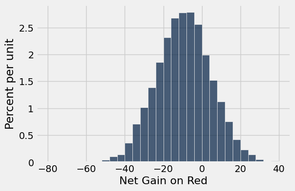
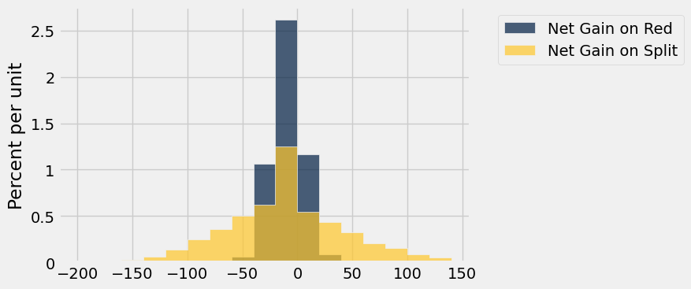

# Homework 5: Chance, Empirical Probability Distribution.

Please complete this notebook by filling in the cells provided. Before you begin, execute the previous cell to load the provided tests.

**Helpful Resource:**
- [Python Reference](http://data8.org/su26/reference/): Cheat sheet of helpful array & table methods used in Data 8!
- [Sampling Methods Guide](https://drive.google.com/file/d/1k8uNN0Bg7J0BTgK-0Z5glDNtd_5FTJQl/view?usp=sharing): Guide for the randomization methods.

**Recommended Readings**: 
* [Randomness](https://www.inferentialthinking.com/chapters/09/Randomness.html)
* [Sampling and Empirical Distributions](https://www.inferentialthinking.com/chapters/10/Sampling_and_Empirical_Distributions.html)
* [Testing Hypotheses](https://www.inferentialthinking.com/chapters/11/Testing_Hypotheses.html)

Please complete this notebook by filling in the cells provided. **Before you begin, execute the cell below to setup the notebook by importing some helpful libraries.** Each time you start your server, you will need to execute this cell again.

For all problems that you must write explanations and sentences for, you **must** provide your answer in the designated space. Moreover, throughout this homework and all future ones, **please be sure to not re-assign variables throughout the notebook!** For example, if you use `max_temperature` in your answer to one question, do not reassign it later on. Otherwise, you will fail tests that you thought you were passing previously!

**Deadline:**

This assignment is **due Thursday, 2/26 at 11:00am PT** (note that this is one day later than the usual due date of Wednesdays at 11am). Submissions after this time will be accepted for 24 hours and will incur a 20% penalty. Any submissions later than this 24 hour period will not be accepted unless an extension has been granted as per the [syllabus](http://data8.org/su26/syllabus/) page. Turn it in by Wednesday, 2/25 at 11:00am PT for 5 extra credit points.

Directly sharing answers is not okay, but discussing problems with the course staff or with other students is encouraged. Refer to the [syllabus](http://data8.org/su26/syllabus) page to learn more about how to learn cooperatively.

You should start early so that you have time to get help if you're stuck. Office hours are held Monday through Friday in [Warren Hall](https://www.berkeley.edu/map/warren-hall/) 101B or online. The office hours schedule appears [here](https://data8.org/su26/calendar/).

---
## 1. Roulette

**Code:**

```python
# Run this cell to set up the notebook, but please don't change it.

# These lines import the Numpy and Datascience modules.
import numpy as np
from datascience import *

# These lines do some fancy plotting magic.
import matplotlib
%matplotlib inline
import matplotlib.pyplot as plt
plt.style.use('fivethirtyeight')
import warnings
warnings.simplefilter('ignore', FutureWarning)
```

A Nevada roulette wheel has 38 pockets and a small ball that rests on the wheel. When the wheel is spun, the ball comes to rest in one of the 38 pockets. That pocket is declared the winner. 

The pockets are labeled 0, 00, 1, 2, 3, 4, ... , 36. Pockets 0 and 00 are green, and the other pockets are alternately red and black. The table `wheel` is a representation of a Nevada roulette wheel. **Note that *both* columns consist of strings.** Below is an example of a roulette wheel!


Run the cell below to load the `wheel` table.

**Code:**

```python
wheel = Table.read_table('roulette_wheel.csv', dtype=str)
wheel
```

*Output:*

| Pocket | Color |
| --- | --- |
| 00 | green |
| 0 | green |
| 1 | red |
| 2 | black |
| 3 | red |
| 4 | black |
| 5 | red |
| 6 | black |
| 7 | red |
| 8 | black |

### Betting on Red ###
If you bet on *red*, you are betting that the winning pocket will be red. This bet *pays 1 to 1*. That means if you place a one-dollar bet on red, then:

- If the winning pocket is red, you gain 1 dollar. That is, you get your original dollar back, plus one more dollar.
- If the winning pocket is not red, you lose your dollar. In other words, you gain -1 dollars.

Let's see if you can make money by betting on red at roulette.

---

**Question 1.1.** Define a function `dollar_bet_on_red` that takes the name of a color, and returns your gain in dollars if that color won and you had placed a one-dollar bet on red. Remember that the gain can be negative. Make sure your function returns an integer. **(5 points)**

*Note:* You can assume that the only colors that will be passed as arguments are red, black, and green. Your function doesn't have to check that.

**Student scaffold:**

```python
def dollar_bet_on_red(...):
    ...
```

**Solution:**

```python
""" # BEGIN PROMPT
def dollar_bet_on_red(...):
    ...
"""; # END PROMPT
# BEGIN SOLUTION NO PROMPT
def dollar_bet_on_red(color):
    if color == 'red':
        return 1
    else:
        return -1
# END SOLUTION
```

**Test — `q1_1` (5 points)**

```python
>>> from hw05_check import correctness_check_1_11
>>> correctness_check_1_11(dollar_bet_on_red)
True

>>> from hw05_check import correctness_check_1_12
>>> correctness_check_1_12(dollar_bet_on_red)
True
```

Run the cell below to make sure your function is working.

**Code:**

```python
print(dollar_bet_on_red('green'))
print(dollar_bet_on_red('black'))
print(dollar_bet_on_red('red'))
```

*Output (stdout):*

```text
-1
-1
1
```

---

**Question 1.2.** Add a column labeled `Winnings: Red` to the table `wheel`. For each pocket, the column should contain your gain in dollars if that pocket won and you had bet one dollar on red. Your code should use the function `dollar_bet_on_red`. **(5 points)**

> *Hint:* You should not need a `for` loop for this question, instead try using a table method!

> *Note:* If you see the error `'ellipsis' object has no attribute 'apply'`, re-run the cell at the top of this question to load the `wheel` table again.

**Student scaffold:**

```python
red_winnings = ...
wheel = ...
wheel
```

**Solution:**

```python
red_winnings = wheel.apply(dollar_bet_on_red, 'Color') # SOLUTION
wheel = wheel.with_columns('Winnings: Red', red_winnings) # SOLUTION
wheel
```

*Output:*

| Pocket | Color | Winnings: Red |
| --- | --- | --- |
| 00 | green | -1 |
| 0 | green | -1 |
| 1 | red | 1 |
| 2 | black | -1 |
| 3 | red | 1 |
| 4 | black | -1 |
| 5 | red | 1 |
| 6 | black | -1 |
| 7 | red | 1 |
| 8 | black | -1 |

**Test — `q1_2` (5 points)**

```python
>>> wheel.labels[2] == 'Winnings: Red'
True

>>> from hw05_check import correctness_check_1_2
>>> correctness_check_1_2(wheel)
True
```

### Simulating 10 Bets on Red
Roulette wheels are set up so that each time they are spun, the winning pocket is equally likely to be any of the 38 pockets regardless of the results of all other spins. Let's see what would happen if we decided to bet one dollar on red each round.

--- 

**Question 1.3.** Create a table `ten_bets` by sampling the table `wheel` to simulate 10 spins of the roulette wheel. Your table should have the same three column labels as in `wheel`. Once you've created that table, set `sum_bets` to your net gain in all 10 bets, assuming that you bet one dollar on red each time. **(5 points)**

*Note:* The [Sampling Methods Guide](https://drive.google.com/file/d/1k8uNN0Bg7J0BTgK-0Z5glDNtd_5FTJQl/view?usp=sharing) may be helpful!

*Hint:* It may be helpful to print out `ten_bets` after you create it!

**Student scaffold:**

```python
ten_bets = ...
sum_bets = ...(ten_bets.column('Winnings: Red'))
sum_bets
```

**Solution:**

```python
ten_bets = wheel.sample(10) # SOLUTION
""" # BEGIN PROMPT
sum_bets = ...(ten_bets.column('Winnings: Red'))
"""; # END PROMPT
# BEGIN SOLUTION NO PROMPT
sum_bets = sum(ten_bets.column('Winnings: Red'))
# END SOLUTION
sum_bets
```

*Output:*

```text
2
```

**Test — `q1_3` (5 points)**

```python
>>> set(['Pocket', 'Color', 'Winnings: Red']) == set(ten_bets.labels)
True

>>> ten_bets.num_rows != wheel.num_rows
True

>>> from hw05_check import correctness_check_1_3
>>> correctness_check_1_3(ten_bets)
True
```

Run the cells above a few times to see how much money you would make if you made 10 one-dollar bets on red. Making a negative amount of money doesn't feel good, but it is a reality in gambling. Casinos are a business, and they make money when gamblers lose.

--- 

**Question 1.4.** Let's see what would happen if you made more bets. Define a function `net_gain_red` that takes in a number of bets and returns the net gain (a single integer representing the total amount won from betting on red that many times). **(5 points)**

*Hint:* You should use your `wheel` table within your function.

**Student scaffold:**

```python
def net_gain_red(...):
    ...
```

**Solution:**

```python
""" # BEGIN PROMPT
def net_gain_red(...):
    ...
"""; # END PROMPT
# BEGIN SOLUTION NO PROMPT
def net_gain_red(num_bets):
    all_bets = wheel.sample(num_bets)
    return sum(all_bets.column('Winnings: Red'))
# END SOLUTION
```

**Test — `q1_4` (5 points)**

```python
>>> net_gain_red(10000) != net_gain_red(10000)
True

>>> from hw05_check import correctness_check_1_4
>>> correctness_check_1_4(net_gain_red)
True
```

Run the cell below a few times to make sure that the results are similar to those you observed in the previous exercise.

**Code:**

```python
net_gain_red(10)
```

*Output:*

```text
2
```

---

**Question 1.5.** Complete the cell below to simulate the net gain in 200 one-dollar bets on red, repeating the process 10,000 times. After the cell is run, `simulated_gains_red` should be an array with 10,000 entries, each of which is the net gain in 200 one-dollar bets on red. **(5 points)**

*Hint:* Think about which computational tool might be helpful for simulating a process multiple times. [Section 9.3](https://inferentialthinking.com/chapters/09/3/Simulation.html) might be helpful!

*Note:* This cell might take a few seconds to run.

**Student scaffold:**

```python
num_bets = ...
repetitions = ...

simulated_gains_red = ...
...

len(simulated_gains_red) # Do not change this line! Check that simulated_gains_red is length 10000.
```

**Solution:**

```python
num_bets = 200 # SOLUTION
repetitions = 10000 # SOLUTION

simulated_gains_red = make_array() # SOLUTION
# BEGIN SOLUTION
for i in np.arange(repetitions):
    new_net_gain = net_gain_red(num_bets)
    simulated_gains_red = np.append(simulated_gains_red, new_net_gain)
# END SOLUTION

len(simulated_gains_red) # Do not change this line! Check that simulated_gains_red is length 10000.
```

*Output:*

```text
10000
```

**Test — `q1_5` (5 points)**

```python
>>> import numpy as np
>>> type(simulated_gains_red) == np.ndarray
True

>>> from hw05_check import correctness_check_1_51
>>> correctness_check_1_51(simulated_gains_red)
True

>>> from hw05_check import correctness_check_1_52
>>> correctness_check_1_52(simulated_gains_red)
True
```

Run the cell below to visualize the results of your simulation.

**Code:**

```python
gains = Table().with_columns('Net Gain on Red', simulated_gains_red)
gains.hist(bins = np.arange(-80, 41, 4))
```



---

**Question 1.6:** Using the histogram above, decide whether the following statement is true or false:

>If you make 200 one-dollar bets on red, your chance of losing money is more than 50%.

Assign `loss_more_than_50` to either `True` or `False` depending on your answer to the question. **(5 points)**

**Student scaffold:**

```python
loss_more_than_50 = ...
```

**Solution:**

```python
loss_more_than_50 = True # SOLUTION
```

**Test — `q1_6` (5 points)**

```python
>>> type(loss_more_than_50) == bool
True

>>> loss_more_than_50 == True
True
```

### Betting on a Split ###
If betting on red doesn't seem like a good idea, maybe a gambler might want to try a different bet. A bet on a *split* is a bet on two consecutive numbers such as 5 and 6. This bet pays 17 to 1. That means if you place a one-dollar bet on the split 5 and 6, then:

- If the winning pocket is either 5 or 6, your gain is 17 dollars.
- If any other pocket wins, you lose your dollar, so your gain is -1 dollars.

---

**Question 1.7.** Define a function `dollar_bet_on_split` that takes a pocket number, and returns your gain in dollars if that pocket won and you had bet one dollar on the 5-6 split. **(5 points)**

*Hint:* Remember that the pockets are represented as strings.

*Hint:* Reference [Section 9.1](https://inferentialthinking.com/chapters/09/1/Conditional_Statements.html?highlight=conditionals)!

**Student scaffold:**

```python
def dollar_bet_on_split(...):
    ...
```

**Solution:**

```python
""" # BEGIN PROMPT
def dollar_bet_on_split(...):
    ...
"""; # END PROMPT
# BEGIN SOLUTION NO PROMPT
def dollar_bet_on_split(x): 
    if x == '5':
        return 17
    elif x == '6':
        return 17
    else:
        return -1
# END SOLUTION
```

**Test — `q1_7` (5 points)**

```python
>>> dollar_bet_on_split('5') == 17
True

>>> from hw05_check import correctness_check_1_71
>>> correctness_check_1_71(dollar_bet_on_split)
True

>>> from hw05_check import correctness_check_1_72
>>> correctness_check_1_72(dollar_bet_on_split)
True
```

Run the cell below to check that your function is doing what it should.

**Code:**

```python
print(dollar_bet_on_split('5'))
print(dollar_bet_on_split('6'))
print(dollar_bet_on_split('00'))
print(dollar_bet_on_split('23'))
```

*Output (stdout):*

```text
17
17
-1
-1
```

---

**Question 1.8.** Add a column `Winnings: Split` to the `wheel` table. For each pocket, the column should contain your gain in dollars if that pocket won and you had bet one dollar on the 5-6 split. **(5 points)**

**Student scaffold:**

```python
split_winnings = ...
wheel = ...
wheel.show(5) # Do not change this line.
```

**Solution:**

```python
split_winnings = wheel.apply(dollar_bet_on_split, 'Pocket') # SOLUTION
wheel = wheel.with_columns('Winnings: Split', split_winnings) # SOLUTION
wheel.show(5) # Do not change this line.
```

*Output:*

| Pocket | Color | Winnings: Red | Winnings: Split |
| --- | --- | --- | --- |
| 00 | green | -1 | -1 |
| 0 | green | -1 | -1 |
| 1 | red | 1 | -1 |
| 2 | black | -1 | -1 |
| 3 | red | 1 | -1 |

**Test — `q1_8` (5 points)**

```python
>>> wheel.labels[3] == 'Winnings: Split'
True

>>> from hw05_check import correctness_check_1_8
>>> correctness_check_1_8(wheel)
True
```

---

**Question 1.9.** Simulate the net gain in 200 one-dollar bets on the 5-6 split, repeating the process 10,000 times and saving your gains in the array `simulated_gains_split`. **(5 points)**

*Hint:* Your code in Questions 1.4 and 1.5 may be helpful here!

**Student scaffold:**

```python
simulated_gains_split = ...

...

# Do not change the two lines below
gains = gains.with_columns('Net Gain on Split', simulated_gains_split)
gains.hist(bins = np.arange(-200, 150, 20))
```

**Solution:**

```python
simulated_gains_split = make_array() # SOLUTION

# BEGIN SOLUTION
def net_gain_split(n):
    n_bets = wheel.sample(n)
    return sum(n_bets.column('Winnings: Split'))
    
for i in np.arange(repetitions):
    new_net_gain = net_gain_split(num_bets)
    simulated_gains_split = np.append(simulated_gains_split, new_net_gain) 
# END SOLUTION

# Do not change the two lines below
gains = gains.with_columns('Net Gain on Split', simulated_gains_split)
gains.hist(bins = np.arange(-200, 150, 20))
```



**Test — `q1_9` (5 points)**

```python
>>> import numpy as np
>>> type(simulated_gains_split) == np.ndarray
True

>>> from hw05_check import correctness_check_1_91
>>> correctness_check_1_91(simulated_gains_split)
True

>>> from hw05_check import correctness_check_1_92
>>> correctness_check_1_92(simulated_gains_split)
True
```

---

**Question 1.10.** Look carefully at the visualization above, and assign `histogram_statements` to an array containing the numbers of each statement below that can be correctly inferred from the overlaid histogram. **(5 points)**

1. If you bet one dollar 200 times on a split, your chance of losing money is more than 50%.
2. If you bet one dollar 200 times in roulette, your chance of making more than 50 dollars is greater if you bet on a split each time than if you bet on red each time.
3. If you bet one dollar 200 times in roulette, your chance of losing more than 50 dollars is greater if you bet on a split each time than if you bet on red each time.

*Hint:* We've already seen one of these statements in a prior question.

**Student scaffold:**

```python
histogram_statements = ...
```

**Solution:**

```python
histogram_statements = make_array(1, 2, 3) # SOLUTION
```

**Test — `q1_10` (5 points)**

```python
>>> import numpy as np
>>> type(histogram_statements) == np.ndarray
True

>>> 1 <= histogram_statements.item(0) <= 3
True

>>> all(histogram_statements <= 3) and all(histogram_statements >= 1)
True

>>> from hw05_check import correctness_check_1_10
>>> correctness_check_1_10(histogram_statements)
True
```

If this exercise has put you off playing roulette, it has done its job. If you are still curious about other bets, [here](https://en.wikipedia.org/wiki/Roulette#Bet_odds_table) they all are, and [here](https://en.wikipedia.org/wiki/Roulette#House_edge) is the bad news. The house – that is, the casino – always has an edge over the gambler.

---
## 2. Chances

Before you do this exercise, make sure you understand the logic behind all the examples in [Section 9.5](https://inferentialthinking.com/chapters/09/5/Finding_Probabilities.html). 

Good ways to approach probability calculations include:

- Thinking one trial at a time: What does the first one have to be? Then what does the next one have to be?
- Breaking up the event into distinct ways in which it can happen.
- Seeing if it is easier to find the chance that the event does not happen.

### Finding Chances

On each spin of a roulette wheel, all 38 pockets are equally likely to be the winner regardless of the results of other spins. Among the 38 pockets, 18 are red, 18 black, and 2 green. In each part below, write an expression that evaluates to the chance of the event described.

--- 

**Question 2.1.** The winning pocket is black on all of the first three spins. **(5 points)**

**Student scaffold:**

```python
first_three_black = ...
```

**Solution:**

```python
first_three_black = (18/38)**3 # SOLUTION
```

**Test — `q2_1` (5 points)**

```python
>>> 0 < first_three_black < 1
True

>>> from hw05_check import correctness_check_2_1
>>> correctness_check_2_1(first_three_black)
True
```

---

**Question 2.2.** The color green never wins in the first 10 spins. **(5 points)**

**Student scaffold:**

```python
no_green = ...
```

**Solution:**

```python
no_green = (36/38)**10 # SOLUTION
```

**Test — `q2_2` (5 points)**

```python
>>> 0 < no_green < 1
True

>>> from hw05_check import correctness_check_2_2
>>> correctness_check_2_2(no_green)
True
```

---

**Question 2.3.** The color green wins **at least once** on the first 10 spins. **(5 points)**

**Student scaffold:**

```python
at_least_one_green = ...
```

**Solution:**

```python
at_least_one_green = 1 - (36/38)**10 # SOLUTION
```

**Test — `q2_3` (5 points)**

```python
>>> 0 < at_least_one_green < 1
True

>>> from hw05_check import correctness_check_2_3
>>> correctness_check_2_3(at_least_one_green)
True
```

--- 

**Question 2.4.** Two of the three colors **never** win in the first 10 spins. **(6 points)**

*Hint:* What situation(s) lead to two of the three colors never winning in the first 10 spins?

**Student scaffold:**

```python
lone_winners = ...
```

**Solution:**

```python
lone_winners = (18/38)**10 + (18/38)**10 + (2/38)**10 # SOLUTION
```

**Test — `q2_4` (6 points)**

```python
>>> 0 < lone_winners < 1
True

>>> from hw05_check import correctness_check_2_4
>>> correctness_check_2_4(lone_winners)
True
```

### Comparing Chances
In each of Questions 2.5-2.7, two events A and B are described. Choose from one of the following three options and set each answer variable to a single integer:

1. Event A is more likely than Event B
2. Event B is more likely than Event A
3. The two events have the same chance.

You should be able to make the choices **without calculation**. Good ways to approach this exercise include imagining carrying out the chance experiments yourself, one trial at a time, and by thinking about the [law of averages](https://inferentialthinking.com/chapters/10/1/Empirical_Distributions.html#the-law-of-averages).

---

**Question 2.5.** A child picks four times at random from a box that has four toy animals: a bear, an elephant, a giraffe, and a kangaroo. **(5 points)**

- Event A: all four different animals are picked (assuming the child picks without replacement)
- Event B: all four different animals are picked (assuming the child picks with replacement)

**Student scaffold:**

```python
toys_option = ...
```

**Solution:**

```python
toys_option = 1 # SOLUTION
```

**Test — `q2_5` (5 points)**

```python
>>> type(toys_option) == int
True

>>> 1 <= toys_option <= 3
True

>>> toys_option == 1
True
```

---

**Question 2.6.** In a lottery, two numbers are drawn at random with replacement from the integers 1 through 1000. **(5 points)**

- Event A: The number 8 is picked on both draws
- Event B: The same number is picked on both draws

**Student scaffold:**

```python
lottery_option = ...
```

**Solution:**

```python
lottery_option = 2 # SOLUTION
```

**Test — `q2_6` (5 points)**

```python
>>> type(lottery_option) == int
True

>>> 1 <= lottery_option <= 3
True

>>> lottery_option == 2
True
```

---

**Question 2.7.** A fair coin is tossed repeatedly. **(5 points)**

- Event A: There are 60 or more heads in 100 tosses
- Event B: There are 600 or more heads in 1000 tosses

*Hint*: Think about the law of averages!

**Student scaffold:**

```python
coin_option = ...
```

**Solution:**

```python
coin_option = 1 # SOLUTION
```

**Test — `q2_7` (5 points)**

```python
>>> type(coin_option) == int
True

>>> 1 <= coin_option <= 3
True

>>> coin_option == 1
True
```

---
## 3. Three Ways Python Draws Random Samples

You have learned three ways to draw random samples using Python:

- `tbl.sample` draws a random sample of rows from the table `tbl`. The output is a table consisting of the sampled rows. 

- `np.random.choice` draws a random sample from a population whose elements are in an array. The output is an array consisting of the sampled elements.

- `sample_proportions` draws from a categorical distribution whose proportions are in an array. The output is an array consisting of the sampled proportions in all the categories.

**Code:**

```python
# Look through this code and run this cell for questions 1 and 2
top_movies = Table.read_table('top_movies_2017.csv').select(0, 1)
top_movies.show(3)
```

*Output:*

| Title | Studio |
| --- | --- |
| Gone with the Wind | MGM |
| Star Wars | Fox |
| The Sound of Music | Fox |

**Code:**

```python
# Look through this code and run this cell for questions 1 and 2
studios_with_counts = top_movies.group('Studio').sort('count', descending=True)
studios_with_counts.show(3)
```

*Output:*

| Studio | count |
| --- | --- |
| Buena Vista | 35 |
| Warner Brothers | 29 |
| Paramount | 25 |

**Code:**

```python
# Look through this code and run this cell for questions 1 and 2
studios_of_all_movies = top_movies.column('Studio')
distinct_studios = studios_with_counts.column('Studio')

print("studios_of_all_movies:", studios_of_all_movies[:10], "...")
print("\n distinct_studios:", distinct_studios)
```

*Output (stdout):*

```text
studios_of_all_movies: ['MGM' 'Fox' 'Fox' 'Universal' 'Paramount' 'Paramount' 'Universal' 'MGM'
 'Warner Brothers' 'Disney'] ...

 distinct_studios: ['Buena Vista' 'Warner Brothers' 'Paramount' 'Fox' 'Universal' 'Disney'
 'Columbia' 'MGM' 'United Artists' 'Newline' 'Paramount/Dreamworks' 'Sony'
 'Dreamworks' 'Lionsgate' 'RKO' 'Tristar' 'AVCO' 'IFC' 'Metro' 'NM' 'Orion'
 'Selz.' 'Sum.']
```

**Code:**

```python
# Look through this code and run this cell for questions 1 and 2
studio_counts_only = studios_with_counts.column('count')
studio_proportions_only = studio_counts_only / sum(studio_counts_only)

print("studio_counts_only:", studio_counts_only)
print("\n studio_proportions_only:", studio_proportions_only)
```

*Output (stdout):*

```text
studio_counts_only: [35 29 25 24 23 11  9  7  6  5  4  4  3  3  3  2  1  1  1  1  1  1  1]

 studio_proportions_only: [ 0.175  0.145  0.125  0.12   0.115  0.055  0.045  0.035  0.03   0.025
  0.02   0.02   0.015  0.015  0.015  0.01   0.005  0.005  0.005  0.005
  0.005  0.005  0.005]
```

In Questions 3.1 and 3.2, we will present a scenario. For each scenario, we will ask whether the desired result can be achieved by using a given function and the following tables/arrays: `top_movies`, `studios_with_counts`, `studios_of_all_movies`, `distinct_studios`, `studio_counts_only` and `studio_proportions_only`. For `studio_counts_only` and `studio_proportions_only`, you can assume that we know which index corresponds with the studio containing that count/proportion.

---

**Question 3.1.** Simulate a sample of 10 movies drawn at random with replacement from the 200 movies. Using just this sample, do we have enough information to output `True` if Paramount appears more often than Warner Brothers among studios that released the sampled movies, and `False` otherwise?

Select all possible solutions and assign them to the array `movie_frequency_answer`. **(7 points)**

1. Yes, by using `.sample` with `top_movies`.

2. Yes, by using `.sample` with `studios_with_counts`.

3. Yes, by using `np.random.choice` with `distinct_studios`.

4. Yes, by using `np.random.choice` with `studios_of_all_movies`.

5. Yes, by using `sample_proportions` with `studio_proportions_only`.

6. Yes, by using `sample_proportions` with `studio_counts_only`.

7. This is not possible with the provided tables/arrays.

*Hint*: Instead of just looking at the table/array, try and think about what the result would be after calling the sampling function on it!

**Student scaffold:**

```python
movie_frequency_answer = make_array(...)
```

**Solution:**

```python
"""# BEGIN PROMPT
movie_frequency_answer = make_array(...)
"""; # END PROMPT
movie_frequency_answer = make_array(1,4,5) # SOLUTION NO PROMPT
```

**Test — `q3_1` (7 points)**

```python
>>> from hw05_check import correctness_check_3_1
>>> correctness_check_3_1(movie_frequency_answer)
True
```

---

**Question 3.2.** Simulate a sample of 10 movies drawn at random with replacement from the 200 movies. Using just this sample, do we have enough information to output `True` if the first sampled movie was released by the same studio as the last sampled movie?

Select all possible solutions and assign them to the array `same_studio_answer`. **(7 points)**

1. Yes, by using `.sample` with `top_movies`.

2. Yes, by using `.sample` with `studios_with_counts`.

3. Yes, by using `np.random.choice` with `distinct_studios`.

4. Yes, by using `np.random.choice` with `studios_of_all_movies`.

5. Yes, by using `sample_proportions` with `studio_proportions_only`.

6. Yes, by using `sample_proportions` with `studio_counts_only`.

7. This is not possible with the provided tables/arrays.

**Student scaffold:**

```python
same_studio_answer = make_array(...)
```

**Solution:**

```python
"""# BEGIN PROMPT
same_studio_answer = make_array(...)
"""; # END PROMPT
same_studio_answer = make_array(1,4) # SOLUTION NO PROMPT
```

**Test — `q3_2` (7 points)**

```python
>>> from hw05_check import correctness_check_3_2
>>> correctness_check_3_2(same_studio_answer)
True
```

---

To double-check your work, the cell below will rerun all of the autograder tests.

## Submission

Make sure you have run all cells in your notebook in order before running the cell below, so that all images/graphs appear in the output. The cell below will generate a zip file for you to submit. **Please save before exporting!**

---

## Datasets

Datasets this notebook loads with `Table.read_table`. Column names are exact, including spaces and capitalization. Only the schema is recorded here — the data itself is not in this document, so any question about its values must be answered by running code, not by reasoning over the rows shown elsewhere in this file.

### `roulette_wheel.csv`

38 rows, 2 columns.

| Column | Type |
| --- | --- |
| `Pocket` | int |
| `Color` | str |

### `top_movies_2017.csv`

200 rows, 5 columns.

| Column | Type |
| --- | --- |
| `Title` | str |
| `Studio` | str |
| `Gross` | int |
| `Gross (Adjusted)` | int |
| `Year` | int |
