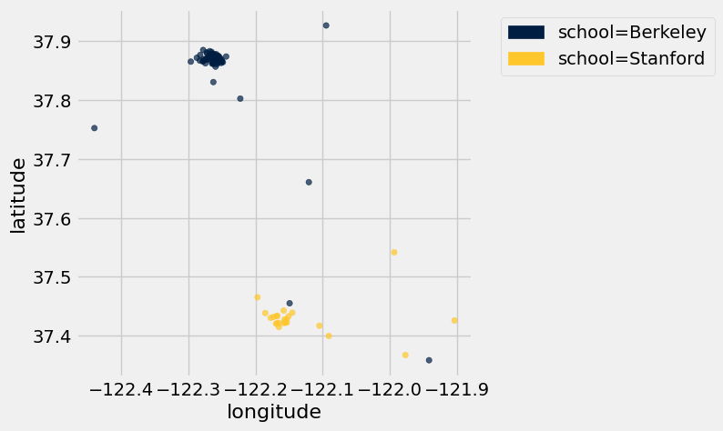

# Homework 11: Classification

**Helpful Resource:**

- [Python Reference](http://data8.org/su26/reference/): Cheat sheet of helpful array & table methods used in Data 8!

**Recommended Reading**: 

* [Classification](https://www.inferentialthinking.com/chapters/17/Classification.html)
* [Updating Predictions](https://inferentialthinking.com/chapters/18/Updating_Predictions.html)

Please complete this notebook by filling in the cells provided. **Before you begin, execute the cell below to setup the notebook by importing some helpful libraries.** Each time you start your server, you will need to execute this cell again.

For all problems that you must write explanations and sentences for, you **must** provide your answer in the designated space. Moreover, throughout this homework and all future ones, **please be sure to not re-assign variables throughout the notebook!** For example, if you use `max_temperature` in your answer to one question, do not reassign it later on. Otherwise, you will fail tests that you thought you were passing previously!

**Deadline:**

This assignment is **due Wednesday, 4/29 at 11:00am PT**. Submissions after this time will be accepted for 24 hours and will incur a 20% penalty. Any submissions later than this 24 hour period will not be accepted unless an extension has been granted as per the [syllabus](http://data8.org/su26/syllabus/) page. Turn it in by Tuesday, 4/28 at 11:00am PT for 5 extra credit points.

Directly sharing answers is not okay, but discussing problems with the course staff or with other students is encouraged. Refer to the [syllabus](https://www.data8.org/su26/syllabus/) page to learn more about how to learn cooperatively.

You should start early so that you have time to get help if you're stuck. Office hours are held Monday through Friday in [Warren Hall](https://www.berkeley.edu/map/warren-hall/) 101B or online. The office hours schedule appears [here](https://www.data8.org/su26/calendar/).

**Code:**

```python
# Don't change this cell; just run it. 

import numpy as np
from datascience import * 

# These lines do some fancy plotting magic
import matplotlib
%matplotlib inline
import matplotlib.pyplot as plt
plt.style.use('fivethirtyeight')
import warnings
warnings.simplefilter('ignore')
from datetime import datetime
```

---
### Classifier Primer

Though it is ungraded, we **highly recommend** you complete this quick [classifier primer](https://docs.google.com/forms/d/e/1FAIpQLSeTrGYhdp-CPemw-T20eMMVEGkEaYampKndi8qKMlHjBwR0yQ/viewform?usp=sf_link) before completing this homework assignment.

---
## 1. Bay Area School Coordinates with Classification

Welcome to Homework 11! This homework is about k-Nearest Neighbors classification (k-NN). Since this topic is covered in depth in Project 3, the purpose of this homework is to reinforce the basics of this method. You can and should reuse a lot of code that you wrote for Project 3 for this homework, or use code from this homework on Project 3!

### Our Dearest Neighbors

Richard is trying to classify students as either attendees of UC Berkeley or as attendees of Stanford University. To classify the students, Richard has access to the coordinates of the location they live during the school year. First, load in the `coordinates` table.

**Code:**

```python
# Just run this cell!
coordinates = Table.read_table('coordinates.csv')
coordinates.show(5)
```

*Output:*

| latitude | longitude | school |
| --- | --- | --- |
| 37.8693 | -122.255 | Berkeley |
| 37.8651 | -122.256 | Berkeley |
| 37.8661 | -122.254 | Berkeley |
| 37.868 | -122.26 | Berkeley |
| 37.8683 | -122.257 | Berkeley |

As usual, let's investigate our data visually before performing any kind of numerical analysis.

**Code:**

```python
# Just run this cell!
coordinates.scatter("longitude", "latitude", group="school")
```



The locations of the points on this scatter plot might be familiar - run the following cell to see what they correspond to.

**Code:**

```python
# Just run this cell!
colors = {"Berkeley":"blue", "Stanford":"red"}
t = Table().with_columns("lat", coordinates.column(0), 
                                      "lon", coordinates.column(1), 
                                      "color", coordinates.apply(colors.get, 2)
                        )
Circle.map_table(t, radius=5, fill_opacity=1)
```

*Output:*

Make this Notebook Trusted to load map: File -> Trust Notebook

---

**Question 1.1.1** Let's begin implementing the k-Nearest Neighbors algorithm. Define the `distance` function, which takes in two arguments: an array of numerical features (`arr1`), and a different array of numerical features (`arr2`). The function should return the [Euclidean distance](https://en.wikipedia.org/wiki/Euclidean_distance) between the two arrays (take a look at [Section 17.3.2](https://inferentialthinking.com/chapters/17/3/rows-of-tables/index.html#distance-between-points-when-there-are-two-attributes)). Euclidean distance is often referred to as the straight-line distance formula. **(6 points)**

*Note:* Features refer to the characteristics of data used for machine learning models to predict with. In table format, these are the columns.

**Student scaffold:**

```python
def distance(arr1, arr2):
    ...

# Don't change/delete the code below in this cell
distance_example = distance(make_array(1, 2, 3), make_array(4, 5, 6))
distance_example
```

**Solution:**

```python
def distance(arr1, arr2):
    # BEGIN SOLUTION
    return np.sqrt(sum((arr1-arr2)**2))
    # END SOLUTION

# Don't change/delete the code below in this cell
distance_example = distance(make_array(1, 2, 3), make_array(4, 5, 6))
distance_example
```

*Output:*

```text
5.196152422706632
```

**Test — `q1_1_1` (6 points)**

```python
>>> type(distance_example) in set([float, np.float32, np.float64])
True

>>> from hw11_check import correctness_check_1_1_1
>>> correctness_check_1_1_1(distance_example)
True
```

---

**Question 1.1.2** While Euclidean distance is a more commonly known method to measure distance, it’s not the only one! Another method is the [Manhattan distance](https://simple.wikipedia.org/wiki/Manhattan_distance). To calculate the Manhattan distance between two points $(x_1, y_1)$ and $(x_2, y_2)$, the formula is as follows: $$\text{Manhattan Distance} = |x_1 - x_2| + |y_1 - y_2|$$

Identify all correct statements about the tradeoffs between Manhattan distance and Euclidean distance, and assign your answers to the array `tradeoffs`. **(4 points)**

*Hint:* Consider why it’s named _Manhattan_ distance—think of how you would measure travel distance in a city!

*Note:* In this homework, we will be using Euclidean distance to measure distance between two points. However, Manhattan distance and other distance functions exist and can be more appropriate depending on the structure of the data.

1. Manhattan distance measures the sum of absolute differences along each axis, while Euclidean distance measures the straight-line distance between two points.

2. Manhattan distance assumes you can't move diagonally from one point to another.

3. Euclidean distance assumes you can't move diagonally from one point to another.

4. Manhattan distance is often preferred over Euclidean distance when working with grid-like data, such as city maps.

**Student scaffold:**

```python
tradeoff = make_array(...)
```

**Solution:**

```python
""" # BEGIN PROMPT
tradeoff = make_array(...)
"""; # END PROMPT
tradeoff = make_array(1,2,4) # SOLUTION NO PROMPT
```

**Test — `q1_1_2` (4 points)**

```python
>>> from hw11_check import correctness_check_1_1_2
>>> correctness_check_1_1_2(tradeoff)
True
```

---

### Splitting the Dataset
We'll do two different kinds of things with the `coordinates` dataset:

1. We'll build a classifier using coordinates for which we know the associated label; this will teach it to recognize labels of similar coordinate values. This process is known as *training*.
2. We'll evaluate, or *test*, the accuracy of our classifier on data we haven't seen before.

As discussed in [Section 17.2](https://inferentialthinking.com/chapters/17/2/Training_and_Testing.html#training-and-testing), we want to use separate datasets for training and testing. As such, we split up our one dataset into two.

---

**Question 1.2.** Next, let's split our dataset into a training set and a test set. Assignment to each set should be random, so we should shuffle the table first. Then, since `coordinates`has 100 rows, let's create a training set with the first 75 rows of the shuffled table and a test set with the remaining 25 rows. **(10 points)**

*Hint:* As a first step we can shuffle all the rows, then use the `tbl.take` function to split up the rows for each table.

**Student scaffold:**

```python
shuffled_table = ...
train = ...
test = ...

print("Training set:\t",   train.num_rows, "examples")
print("Test set:\t",       test.num_rows, "examples")
train.show(5), test.show(5);
```

**Solution:**

```python
shuffled_table = coordinates.sample(with_replacement=False) # SOLUTION
train = shuffled_table.take(np.arange(0, 75)) # SOLUTION
test = shuffled_table.take(np.arange(75, 100)) # SOLUTION

print("Training set:\t",   train.num_rows, "examples")
print("Test set:\t",       test.num_rows, "examples")
train.show(5), test.show(5);
```

*Output (stdout):*

```text
Training set:	 75 examples
Test set:	 25 examples
```

*Output:*

| latitude | longitude | school |
| --- | --- | --- |
| 37.8668 | -122.254 | Berkeley |
| 37.8813 | -122.265 | Berkeley |
| 37.4429 | -122.158 | Stanford |
| 37.865 | -122.278 | Berkeley |
| 37.8774 | -122.258 | Berkeley |

*Output:*

| latitude | longitude | school |
| --- | --- | --- |
| 37.8761 | -122.282 | Berkeley |
| 37.8753 | -122.263 | Berkeley |
| 37.4331 | -122.169 | Stanford |
| 37.4654 | -122.197 | Stanford |
| 37.5416 | -121.994 | Stanford |

**Test — `q1_2` (10 points)**

```python
>>> train.num_rows == 75
True

>>> test.num_rows == 25
True

>>> from hw11_check import correctness_check_1_2
>>> correctness_check_1_2(train, test, coordinates)
True
```

---

**Question 1.3.** Assign `features` to an array of column names (strings) of the features from the `coordinates` table. **(10 points)**

*Hint:* Which of the column names in the `coordinates` table are the features, and which of the column names correspond to the class we're trying to predict? Run the cell below to see the list of column names in `coordinates`.

*Hint*: No need to modify any tables, just manually create an array of the feature names!

**Code:**

```python
print(coordinates.labels)
```

*Output (stdout):*

```text
('latitude', 'longitude', 'school')
```

**Student scaffold:**

```python
features = ...

# Don't change this line of code
print("Features:", features)
```

**Solution:**

```python
features = make_array("latitude", "longitude") # SOLUTION

# Don't change this line of code
print("Features:", features)
```

*Output (stdout):*

```text
Features: ['latitude' 'longitude']
```

**Test — `q1_3` (10 points)**

```python
>>> type(features) == np.ndarray
True

>>> all(np.isin(features, coordinates.labels))
True

>>> from hw11_check import correctness_check_1_3
>>> correctness_check_1_3(features)
True
```

---

**Question 1.4.** Now define the `classify` function. This function should take in a `test_row` from a table with the same columns as `test` and classify it using the k-Nearest Neighbors based on the correct `features` and the data in `train`. A refresher on k-Nearest Neighbors can be found [here](https://www.inferentialthinking.com/chapters/17/4/Implementing_the_Classifier.html). **(10 points)**


*Hint 1:* The `distance` function we defined earlier takes in arrays as input, so use the `row_to_array` function we defined for you to convert rows to arrays of features.

*Hint 2:* The skeleton code we provided iterates through each row in the training set. `train.rows` is an iterable sequence of all the row objects in the `train` table, so each `train_row` is a row object.

**Student scaffold:**

```python
def row_to_array(row, features):
    """Converts a row to an array of its features."""
    arr = make_array()
    for feature in features:
        arr = np.append(arr, row.item(feature))
    return arr

def classify(test_row, k, train):
    test_row_features_array = row_to_array(test_row, features)
    distances = make_array()
    for train_row in train.rows:
        train_row_features_array = ...
        row_distance = ...
        distances = ...
    train_with_distances = ...
    nearest_neighbors = ...
    most_common_label = ...
    ...

# Don't modify/delete the code below
first_test = classify(test.row(0), 5, train)
first_test
```

**Solution:**

```python
def row_to_array(row, features):
    """Converts a row to an array of its features."""
    arr = make_array()
    for feature in features:
        arr = np.append(arr, row.item(feature))
    return arr

def classify(test_row, k, train):
    test_row_features_array = row_to_array(test_row, features)
    distances = make_array()
    for train_row in train.rows:
        train_row_features_array = row_to_array(train_row, features) # SOLUTION       
        row_distance = distance(test_row_features_array, train_row_features_array) # SOLUTION
        distances = np.append(distances, row_distance) # SOLUTION
    train_with_distances = train.with_column("Distances", distances) # SOLUTION
    nearest_neighbors = train_with_distances.sort("Distances").take(np.arange(k)) # SOLUTION
    most_common_label = nearest_neighbors.group("school").sort("count", descending=True).column("school").item(0) # SOLUTION
    return most_common_label # SOLUTION

# Don't modify/delete the code below
first_test = classify(test.row(0), 5, train)
first_test
```

*Output:*

```text
'Berkeley'
```

**Test — `q1_4` (10 points)**

```python
>>> type(first_test) == str or type(first_test) == np.str_
True

>>> from hw11_check import correctness_check_1_4
>>> correctness_check_1_4(classify, coordinates)
True
```

---

**Question 1.5.** Define the function `three_classify` that takes a `row` from `test` as an argument and classifies the row based on using 3-Nearest Neighbors. Use this function to find the `accuracy` of a 3-NN classifier on the `test` set. `accuracy` should be a proportion (not a percentage) of the schools that were correctly predicted. **(10 points)**


*Hint:* You should be using a function you just created!

*Note:* Usually before using a classifier on a test set, we'd classify first on a "validation" set, which we then can modify our training set again if need be, before actually testing on the test set. This is out of scope for Data 8, but you will learn about this more in Data 100.

**Student scaffold:**

```python
def three_classify(row):
    ...

test_with_prediction = ...
labels_correct = ...
accuracy = ...
accuracy
```

**Solution:**

```python
def three_classify(row):
    # BEGIN SOLUTION
    return classify(row, 3, train)
    # END SOLUTION

test_with_prediction = test.with_column("prediction", test.apply(three_classify)) # SOLUTION
labels_correct = test_with_prediction.column("school") == test_with_prediction.column("prediction") # SOLUTION
accuracy = np.count_nonzero(labels_correct) / len(labels_correct) # SOLUTION
accuracy
```

*Output:*

```text
1.0
```

**Test — `q1_5` (10 points)**

```python
>>> sorted_coordinates = coordinates.sort('school')
>>> classify(sorted_coordinates.row(29), 3, train) == three_classify(sorted_coordinates.row(29))
True

>>> from hw11_check import correctness_check_1_5
>>> correctness_check_1_5(accuracy)
True
```

---

**Question 1.6.** There are 77 rows of Berkeley students and 23 rows of Stanford students in the `coordinates` table. If we used the entire `coordinates` table as the training set, what is the smallest value of k that would ensure that a k-Nearest Neighbor classifier would *always* predict Berkeley as the class? Assign the value to `k`. **(10 points)**

> **Note:** Section [17.2](https://inferentialthinking.com/chapters/17/2/Training_and_Testing.html) from the textbook may be useful here!

**Student scaffold:**

```python
k = ...
k
```

**Solution:**

```python
k = 47 # SOLUTION
k
```

*Output:*

```text
47
```

**Test — `q1_6` (10 points)**

```python
>>> type(k) == int
True

>>> from hw11_check import correctness_check_1_6
>>> correctness_check_1_6(k)
True
```

---

**Question 1.7.1** When doing k-NN classification we split our data into training and test sets.

Why do we divide our data into training and test sets? In other words, what is the point of the training set? What is the point of the test set? Assign all correct statements to the array `train_test_split`. **(7 points)**

> *Hint:* Check out this [section](https://inferentialthinking.com/chapters/17/2/Training_and_Testing.html) in the textbook.

1. We use the training set in order to build our classifier.

2. The test set is used to improve our classifier based on its performance on unseen data.

3. If our classifier performs well on the training set, it is guaranteed to also perform well on unseen data.

4. We use the test set to evaluate whether our model generalizes to data it has never seen before.

**Student scaffold:**

```python
train_test_split = make_array(...)
```

**Solution:**

```python
""" # BEGIN PROMPT
train_test_split = make_array(...)
"""; # END PROMPT
train_test_split = make_array(1,4) # SOLUTION NO PROMPT
```

**Test — `q1_7_1` (7 points)**

```python
>>> from hw11_check import correctness_check_1_7_1
>>> correctness_check_1_7_1(train_test_split)
True
```

---

**Question 1.7.2** Why do we only want to use the test set once? Assign all reasonable statements to the array `test_set_reasoning`. **(3 points)**

1. We only use the test set once because it is smaller and gives less reliable results than the training set

2. If we use the test set more than once, we risk biasing our classifier to perform well on the test set specifically, rather than on truly unseen data.

3. We use the test set once at the very end to get an unbiased measure of how our classifier performs on never before seen data.

4. The more we use our test set, the more our classifier will generalize to data it has never seen before.

**Student scaffold:**

```python
test_set_reasoning = make_array(...)
```

**Solution:**

```python
""" # BEGIN PROMPT
test_set_reasoning = make_array(...)
"""; # END PROMPT
test_set_reasoning = make_array(2,3) # SOLUTION NO PROMPT
```

**Test — `q1_7_2` (3 points)**

```python
>>> from hw11_check import correctness_check_1_7_2
>>> correctness_check_1_7_2(test_set_reasoning)
True
```

---

**Question 1.8.** Why do we choose `k` to be an odd number in k-NN? Assign all correct statements to the array `k_reasoning`. **(10 points)**

1. It guarantees our classifications will be as accurate as possible on the training set.

2. Using an odd-numbered k guarantees a majority class when taking a vote among the k nearest neighbors.

3. The k-NN algorithm has higher accuracy with an odd k as opposed to an even k.

4. With an even k, two classes could receive the same number of votes, making it impossible to determine a winner, unless you have a way to break ties.

**Student scaffold:**

```python
k_reasoning = make_array(...)
```

**Solution:**

```python
""" # BEGIN PROMPT
k_reasoning = make_array(...)
"""; # END PROMPT
k_reasoning = make_array(2,4) # SOLUTION NO PROMPT
```

**Test — `q1_8` (10 points)**

```python
>>> from hw11_check import correctness_check_1_8
>>> correctness_check_1_8(k_reasoning)
True
```

---

#### **Question 1.9 Intro**

Richard has devised a scheme for splitting up the test and training set. For each row from `coordinates`:
- Rows for Stanford students have a 50% chance of being placed in the training set and 50% chance of being placed in the test set.  
- Rows for Berkeley students have a 80% chance of being placed in the training set and 20% chance of being placed in the test set.  


*Hint 1:* Remember that there are 77 Berkeley students and 23 Stanford students in coordinates.  

*Hint 2:* [18.1](https://inferentialthinking.com/chapters/18/1/More_Likely_than_Not_Binary_Classifier.html#bayes-rule) from the textbook may be helpful here!

---

**Question 1.9.1.** Given that a row is in the test set, what is the probability that it corresponds to a Stanford student? Assign that probability to `prob_furd`. **(10 points)**

Hint: If you’re stuck, try to draw out a visual diagram - like a tree!

> ***Note:*** **Do not round this value; calculate it exactly.**

**Student scaffold:**

```python
prob_furd = ...
prob_furd
```

**Solution:**

```python
prob_furd = (.23 * .5) / ((.23 * .5) + (.77 * .2)) # SOLUTION
prob_furd
```

*Output:*

```text
0.4275092936802974
```

**Test — `q1_9_1` (10 points)**

```python
>>> type(prob_furd) in set([float, np.float32, np.float64])
True

>>> 0 <= prob_furd <= 1
True

>>> from hw11_check import correctness_check_1_9_1
>>> correctness_check_1_9_1(prob_furd)
True
```

---

**Question 1.9.2.** Given that a row is Stanford, what is the probability that the student is in the test set? Assign that probability to `prob_test`. **(10 points)**

**Student scaffold:**

```python
prob_test = ...
prob_test
```

**Solution:**

```python
prob_test = 0.5 # SOLUTION
prob_test
```

*Output:*

```text
0.5
```

**Test — `q1_9_2` (10 points)**

```python
>>> type(prob_test) in set([float, np.float32, np.float64])
True

>>> 0 <= prob_test <= 1
True

>>> from hw11_check import correctness_check_1_9_2
>>> correctness_check_1_9_2(prob_test)
True
```

---
## (OPTIONAL, NOT IN SCOPE): k-NN for Non-Binary Classification

**THIS IS NOT IN SCOPE**. There are no autograder tests for this or code for you to write. It just relies on the function `classify` in Question 1.4. Go ahead and read through this section and run the following cells!

In this class, we have taught you how to use the k-NN algorithm to classify data as one of two classes. However, much of the data you will encounter in the real world will not fall nicely into one of two categories. 

**How can we classify data with non-binary classes?** It turns out we can still use k-NN! That is, we find the distance between a point and all its neighbors, find the nearest neighbors, and take a majority vote among the neighbors to determine this point's class. 

The only difference is that now the neighboring points have more than two possible classes. This does introduce difficulty because now we have no way of guaranteeing that we will not encounter ties between classes. In the case that we do encounter a tie, we can just arbitrarily choose one of the classes.

In fact, you don't even have to modify the code you wrote before at all to enable multi-class classification!

Let's add some more data to our train table, this time for another class of students, students at San Jose Community College (SJCC).

**Code:**

```python
coordinates_multi = coordinates.with_rows([
                              [37.304346, -121.915401, "SJCC"],
                              [37.316275, -121.913879, "SJCC"],
                              [37.409435, -121.951379, "SJCC"],
                              [37.349387, -121.960771, "SJCC"],
                              [37.329083, -121.928479, "SJCC"],
                              [37.313017, -121.866730, "SJCC"],
                              [37.346525, -121.894767, "SJCC"],
                              [37.364157, -121.955717, "SJCC"],
                              [37.383362, -121.925776, "SJCC"],
                              [37.329545, -121.880639, "SJCC"]                             
])
```

**Code:**

```python
classify(coordinates_multi.row(0), 5, coordinates_multi)
```

*Output:*

```text
'Berkeley'
```

**Code:**

```python
classify(coordinates_multi.row(91), 5, coordinates_multi)
```

*Output:*

```text
'Stanford'
```

**Code:**

```python
classify(coordinates_multi.row(105), 5, coordinates_multi)
```

*Output:*

```text
'SJCC'
```

Our classifier can classify rows as belonging to one of three classes!

Classification is one of the most important fields in statistics, data science, and machine learning. There are thousands of different classification algorithms and modifications of algorithms! There are many that you'll learn if you continue down the path of becoming a data scientist!

You're all done with Homework 11!

**Important submission steps:** 
1. Run the tests and verify that they all pass.
2. Choose **Save Notebook** from the **File** menu, then **run the final cell**. 
3. Click the link to download the zip file.
4. Go to [Pensive](https://www.pensieve.co/) and submit the zip file to the corresponding assignment. The name of this assignment is "HW 11 Autograder". 

**It is your responsibility to make sure your work is saved before running the last cell.**

---

To double-check your work, the cell below will rerun all of the autograder tests.

## Submission

Make sure you have run all cells in your notebook in order before running the cell below, so that all images/graphs appear in the output. The cell below will generate a zip file for you to submit. **Please save before exporting!**

---

## Datasets

Datasets this notebook loads with `Table.read_table`. Column names are exact, including spaces and capitalization. Only the schema is recorded here — the data itself is not in this document, so any question about its values must be answered by running code, not by reasoning over the rows shown elsewhere in this file.

### `coordinates.csv`

100 rows, 3 columns.

| Column | Type |
| --- | --- |
| `latitude` | float |
| `longitude` | float |
| `school` | str |
