# Data 8 lab solutions

Assignments included:

- lab01
- lab02
- lab03
- lab04
- lab05
- lab06
- lab07
- lab08
- lab09
- lab10


---

# lab01

---
title: "Welcome!"
assignment: lab01
semester: sp26
source: semester_assignments/sp26/lab/lab01/autograder/lab01.ipynb
version: solution (autograder) with student scaffolds
student_source: semester_assignments/sp26/lab/lab01/student/lab01.ipynb
language: python
---


# Welcome!

Welcome to Data 8: *Foundations of Data Science*! Each week you will complete a lab assignment like this one. You can't learn technical subjects without hands-on practice, so labs are an important part of the course.

Before we get started, there are some administrative details.

The weekly lab sessions are designed to develop your skills with computational and inferential concepts. These lab assignments are a required part of the course and will be released Mondays at 5 PM, and due **Fridays at 5 PM**. This lab (Lab 01) will be due on **Friday, 1/23 at 5 PM**.

Lab sessions are not a webcast! Here are the [course policies](https://www.data8.org/su26/syllabus/#labs) for getting full credit (Lab is worth 20% of your overall grade in the class):

1. If you are within regular lab, 80% of lab credit will be for attending the full discussion portion (first hour) at which point the TA will take attendance. The remaining 20% of credit will be awarded for submitting the lab by the deadline having passed all public test cases.

2. If you are within the self-service lab, your lab score will be solely based on your test cases (i.e. if you pass 80% of test cases you will receive a score of 80% on that lab).

Collaborating on labs is more than okay -- it's encouraged! You should rarely remain stuck for more than a few minutes on questions in labs, so ask an instructor or classmate for help. (Explaining things is beneficial, too -- the best way to solidify your knowledge of a subject is to explain it.) Please don't just share answers, though.

You can read more of the [course policies](http://data8.org/su26/syllabus) on the [course website](http://data8.org/su26/).

#### Today's lab

In today's lab, you'll learn how to:

1. navigate Jupyter notebooks (like this one);
2. write and evaluate some basic *expressions* in Python, the computer language of the course;
3. call *functions* to use code other people have written; and
4. break down Python code into smaller parts to understand it.

This lab covers parts of [Chapter 3](http://www.inferentialthinking.com/chapters/03/programming-in-python.html) of the online textbook. You should read the examples in the book, but not right now. Instead, let's get started!

---
# 0. Mandatory Policies Form

<br/><br/>
---
Reading the text above this will save you time!

Fill out [this form](https://docs.google.com/forms/d/e/1FAIpQLSfZ81u8S52cM8gDe1VvggbnJNmYeM5wjlUGAV8PIyzjtuL1og/viewform?usp=dialog) before moving on. Please use your Berkeley email to access the form. At the end of the form, there will be a secret word that you should input into the box below. Remember to put the secret word in quotes when inputting it (i.e."hello"). The quotation marks indicate that it is a String type!

**Student scaffold:**

```python
secret_word = ...
```

**Solution:**

```python
secret_word = "welcome" # SOLUTION
```

**Test — `q_0`**

```python
>>> secret_word == 'welcome'
True
```

<br/><br/>
---
# Part 1: Jupyter Notebooks

This webpage is called a Jupyter Notebook. A notebook is a place to write programs and view their results, and also to write text.

---

## 1.1. Text cells
In a notebook, each rectangle containing text or code is called a *cell*.

Text cells (like this one) can be edited by double-clicking on them. They're written in a simple format called [Markdown](https://www.markdownguide.org/basic-syntax/) to add formatting and section headings.  You don't need to learn Markdown, but you might want to.

After you edit a text cell, click the "run cell" button at the top that looks like ▶ or hold down `shift` + `return` to confirm any changes. (Try not to delete the instructions of the lab.)

**Question 1.1.1.** This paragraph is in its own text cell.  Try editing it so that this sentence is the last sentence in the paragraph, and then click the "run cell" ▶ button or hold down `shift` + `return`.  This sentence, for example, should be deleted.  So should this one.

---

## 1.2. Code cells
Other cells contain code in the Python 3 language. Running a code cell will execute all of the code it contains.

To run the code in a code cell, first click on that cell to activate it.  It'll be highlighted with a little green or blue rectangle.  Next, either press ▶ or hold down `shift` + `return`.

Try running this cell:

**Code:**

```python
print("Hello, World!")
```

*Output (stdout):*

```text
Hello, World!
```

And this one:

**Code:**

```python
print("\N{WAVING HAND SIGN}, \N{EARTH GLOBE ASIA-AUSTRALIA}!")
```

*Output (stdout):*

```text
👋, 🌏!
```

The fundamental building block of Python code is an expression. Cells can contain multiple lines with multiple expressions. When you run a cell, the lines of code are executed in the order in which they appear. Every `print` expression prints a line. Run the next cell and notice the order of the output.

**Code:**

```python
print("First this line is printed,")
print("and then this one.")
```

*Output (stdout):*

```text
First this line is printed,
and then this one.
```

**Question 1.2.1.** Change the cell above so that it prints out:

    First this line,
    then the whole 🌏,
    and then this one.

*Hint:* If you're stuck on the Earth symbol for more than a few minutes, try talking to a neighbor or a staff member. That's a good idea for any lab problem.

---

## 1.3. Converting Cells
To convert a cell from Markdown to code (or vice versa), you should use the dropdown in the menu bar. For instance, to convert the following cell from Markdown to code, you should:
1. Click the cell.
2. Click "Markdown" in the menu bar, and change it to "Code."

Your menu bar should then look like this:


**Change the following cell from a Markdown cell to a code cell** and run the cell. You should get `6` as an output.

1 + 2 + 3  # Change this to a code cell

---

## 1.4. Writing Jupyter notebooks
You can use Jupyter notebooks for your own projects or documents.  When you make your own notebook, you'll need to create your own cells for text and code.

To add a cell, click the `+` button in the menu bar. You can also use keyboard shortcuts and press `a` (adds a cell **a**bove the current cell) or `b` (adds a cell **b**elow the current cell) to add cells.

**Question 1.4.1.** Add a code cell below this one.  Write code in it that prints out:
   
    A whole new cell! ♪🌏♪

(That musical note symbol is like the Earth symbol.  Its long-form name is `\N{EIGHTH NOTE}`.)

Run your cell to verify that it works.

---
You can also delete cells by clicking the scissors ✄ button in the menu bar, or pressing `x` on the highlighted cell. **BE CAREFUL**: There's no undo button when you delete a cell, so use this command wisely!

**Question 1.4.2.** Delete the cell below this one.

**Code:**

```python
# This cell should be deleted!!!
```

Here's a summary of some useful keyboard shortcuts:

| Action | Keyboard shortcut |
| :--- | :--- |
| Run cell + jump to next cell | `shift` + `return` |
| Save notebook | `ctrl/cmd` + `s` |
| Create new cell above/below |  `a/b` |
| Delete cell | `x` |
| Switch to command mode | `escape` |
| Switch to edit mode | `return` | 
| Comment out the current line | `ctrl/cmd` + `/` |

---

## 1.5. Errors
Python is a language, and like natural human languages, it has rules.  It differs from natural language in two important ways:
1. The rules are *simple*.  You can learn most of them in a few weeks and gain reasonable proficiency with the language in a semester.
2. The rules are *rigid*.  If you're proficient in a natural language, you can understand a non-proficient speaker, glossing over small mistakes.  A computer running Python code is not smart enough to do that.

Whenever you write code, you'll make mistakes.  When you run a code cell that has errors, Python will sometimes produce error messages to tell you what you did wrong.

Errors are okay; even experienced programmers make many errors.  When you make an error, you just have to find the source of the problem, fix it, and move on.

We have made an error in the next cell.  Run it and see what happens.

**Code:**

```python
print("This line is missing something."
```

*Error:*

```text
  Cell In[8], line 1
    print("This line is missing something."
                                           ^
SyntaxError: incomplete input
```

**Note:** In the toolbar, there is the option to click `Run > Run All Cells`, which will run all the code cells in this notebook in order. However, the notebook stops running code cells if it hits an error, like the one in the cell above.

You should see something like this (minus our annotations and the D8 error output):

![Annotated screenshot of a Jupyter cell error. The cell contains print("This line is missing something." with no closing parenthesis; below it a red traceback reads 'Cell In[1], line 1' and 'SyntaxError: incomplete input'. Callouts point out the missing parenthesis as the actual error, the caret ^ marking where Python thinks something is wrong, and the final line as the detailed description of the error.](lab01_assets/error.png)

The last line of the error output attempts to tell you what went wrong.  The *syntax* of a language is its structure, and this `SyntaxError` tells you that you have created an illegal structure.

There's a lot of terminology in programming languages, but you don't need to know it all in order to program effectively. If you see a cryptic message like `EOF`, you can often get by without deciphering it.  (Of course, if you're frustrated, ask a neighbor or a staff member for help.) However, our D8 error package helps explain any python errors and exceptions and their common causes, as well as resources to reference for additional help. In the example above, we see that one source of a `SyntaxError` has to do with parentheses. 


Try to fix the code above so that you can run the cell and see the intended message instead of an error.

---

## 1.6. The Kernel
The kernel is a program that executes the code inside your notebook and outputs the results. In the top right of your window, you can see a circle that indicates the status of your kernel. If the circle is empty (⚪), the kernel is idle and ready to execute code. If the circle is filled in (⚫), the kernel is busy running some code. 

Next to every code cell, you'll see some text that says `[ ]`. Before you run the cell, you'll see `[ ]`. When the cell is running, you'll see `[*]`. If you see an asterisk (\*) next to a cell that doesn't go away, it's likely that the code inside the cell is taking too long to run, and it might be a good time to interrupt the kernel (discussed below). When a cell is finished running, you'll see a number inside the brackets, like so: `[1]`. The number corresponds to the order in which you run the cells; so, the first cell you run will show a 1 when it's finished running, the second will show a 2, and so on. 

You may run into problems where your kernel is stuck for an excessive amount of time, your notebook is very slow and unresponsive, or your kernel loses its connection. If this happens, try the following steps:
1. At the top of your screen, click **Kernel**, then **Interrupt Kernel**.
2. If that doesn't help, click **Kernel**, then **Restart Kernel**. If you do this, you will have to run your code cells from the start of your notebook up until where you paused your work.

---

## 1.7. Submitting Your Work
All assignments in the course will be distributed as notebooks like this one, and you will submit your work from the notebook. We will use a system called Otter Grader and Pensieve to check your work and help you submit. If you haven’t already, make sure you have run the cell at the top of this notebook to initialize OtterGrader.

Watch this [video](https://drive.google.com/file/d/1H9UwEb7uQrc1eK0PKGxtu95woP4IcyGI/view?usp=sharing) to see how to submit an assignment!

<br/><br/>
---
# 2. Numbers

Quantitative information arises everywhere in data science. In addition to representing commands to print out lines, expressions can represent numbers and methods of combining numbers. The expression `3.2500` evaluates to the number 3.25. (Run the cell and see.)

**Code:**

```python
3.2500
```

*Output:*

```text
3.25
```

Notice that we didn't have to `print`. When you run a notebook cell, if the last line has a value, then Jupyter helpfully prints out that value for you. However, it won't print out prior lines automatically.

**Code:**

```python
print(2)
3
4
```

*Output (stdout):*

```text
2
```

*Output:*

```text
4
```

Above, you should see that 4 is the value of the last expression, 2 is printed, but 3 is lost forever because it was neither printed nor last.

You don't want to print everything all the time anyway.  But if you feel sorry for 3, change the cell above to print it.

---

## 2.1. Arithmetic
The line in the next cell subtracts.  Its value is what you'd expect.  Run it.

**Code:**

```python
3.25 - 1.5
```

*Output:*

```text
1.75
```

Many basic arithmetic operations are built into Python.  The textbook section on [Expressions](http://www.inferentialthinking.com/chapters/03/1/Expressions.html) describes all the arithmetic operators used in the course.  The common operator that differs from typical math notation is `**`, which raises one number to the power of the other. So, `2**3` stands for $2^3$ and evaluates to 8. 

The order of operations is the same as what you learned in elementary school, and Python also has parentheses.  For example, compare the outputs of the cells below. The second cell uses parentheses for a happy new year!

**Code:**

```python
9+6*5-6*3**2*2**3/4*7
```

*Output:*

```text
-717.0
```

**Code:**

```python
9+(6*5-(6*3))**2*((2**3)/4*7)
```

*Output:*

```text
2025.0
```

In standard math notation, the first expression is

$$9 + 6 \times 5 - 6 \times 3^2 \times \frac{2^3}{4} \times 7,$$

while the second expression is

$$9 + (6 \times 5 - (6 \times 3))^2 \times \left(\frac{\left(2^3\right)}{4} \times 7\right).$$

**Question 2.1.1.** Write a Python expression in this next cell that's equal to $\displaystyle 5 \times \left(3 \frac{10}{11}\right) - 50 \frac{1}{3} + 2^{0.5 \times 22} - \frac{7}{33} + 9$.  That's five times three and ten elevenths, minus fifty and a third, plus two to the power of half twenty-two, minus seven thirty-thirds plus nine. 

Replace the ellipses (`...`) with your expression.  Try to use parentheses only when necessary.

**Note:** By "$\displaystyle 3 \frac{10}{11}$", we mean $\displaystyle 3+\frac{10}{11}$, not $\displaystyle 3 \times \frac{10}{11}$.

*Hint:* The correct output should start with a familiar number.

**Student scaffold:**

```python
...
```

**Solution:**

```python
5*(3+10/11)-(50+1/3)+2**(.5*22)-7/33 + 9 #SOLUTION
```

*Output:*

```text
2026.0
```

<br/><br/>
---
# 3. Names
In natural language, we have terminology that lets us quickly reference very complicated concepts.  We don't say, "That's a large mammal with brown fur and sharp teeth!"  Instead, we just say, "Bear!"

In Python, we do this with *assignment statements*. An assignment statement has a name on the left side of an `=` sign and an expression to be evaluated on the right.

**Code:**

```python
ten = 3 * 2 + 4
```

When you run that cell, Python first computes the value of the expression on the right-hand side, `3 * 2 + 4`, which is the number 10.  Then it assigns that value to the name `ten`.  At that point, the code in the cell is done running.

After you run that cell, the value 10 is bound to the name `ten`:

**Code:**

```python
ten
```

*Output:*

```text
10
```

The statement `ten = 3 * 2 + 4` is not asserting that `ten` is already equal to `3 * 2 + 4`, as we might expect by analogy with math notation.  Rather, that line of code changes what `ten` means; it now refers to the value 10, whereas before it meant nothing at all.

If the designers of Python had been ruthlessly pedantic, they might have made us write

    define the name ten to hereafter have the value of 3 * 2 + 4 

instead.  You will probably appreciate the brevity of "`=`"!  But keep in mind that this is the real meaning.

**Question 3.1.** Run the following cell which uses a variable name `eleven` that hasn't been assigned to anything. You'll see an error!

**Code:**

```python
eleven + 8
```

*Error:*

```text
---------------------------------------------------------------------------
NameError                                 Traceback (most recent call last)
Cell In[17], line 1
----> 1 eleven + 8

NameError: name 'eleven' is not defined
```

A common pattern in Jupyter notebooks is to assign a value to a name and then immediately evaluate the name in the last line in the cell so that the value is displayed as output.

**Code:**

```python
close_to_pi = 355/113
close_to_pi
```

*Output:*

```text
3.1415929203539825
```

Another common pattern is that a series of lines in a single cell will build up a complex computation in stages, naming the intermediate results.

**Code:**

```python
semimonthly_salary = 843 + 3/4 # 843.75
monthly_salary = 2 * semimonthly_salary
number_of_months_in_a_year = 12
yearly_salary = number_of_months_in_a_year * monthly_salary
yearly_salary
```

*Output:*

```text
20250.0
```

Names in Python can have letters (upper- and lower-case letters are both okay and count as different letters), underscores, and numbers.  The first character can't be a number (otherwise a name might look like a number).  And names can't contain spaces, since spaces are used to separate pieces of code from each other.

Other than those rules, what you name something doesn't matter *to Python*.  For example, this cell does the same thing as the above cell, except everything has a different name:

**Code:**

```python
a = 842.75
b = 2 * a
c = 12
d = c * b
d
```

*Output:*

```text
20226.0
```

**However**, names are very important for making your code *readable* to yourself and others.  The cell above is shorter, but it's totally useless without an explanation of what it does.

---

## 3.1. Checking Your Code
Now that you know how to name things, you can start using the built-in *tests* to check whether your work is correct. Sometimes, there are multiple tests for a single question, and passing all of them is required to receive credit for the question. Please don't change the contents of the test cells. 

Go ahead and attempt Question 3.1.2. Running the cell directly after it will test whether you have assigned `seconds_in_a_decade` correctly in Question 3.1.2. If you haven't, this test will tell you the correct answer. Resist the urge to just copy it, and instead try to adjust your expression. (Sometimes the tests will give hints about what went wrong...)

**Question 3.1.2.** Assign the name `seconds_in_a_decade` to the number of seconds between midnight January 1, 2010 and midnight January 1, 2020. Note that there are two leap years in this span of a decade. A non-leap year has 365 days and a leap year has 366 days.

*Hint:* If you're stuck, the next section shows you how to get hints.

**Student scaffold:**

```python
# Change the next line 
# so that it computes the number of seconds in a decade 
# and assigns that number the name, seconds_in_a_decade.

seconds_in_a_decade = ...

# We've put this line in this cell 
# so that it will print the value you've given to seconds_in_a_decade when you run it.  
# You don't need to change this.
seconds_in_a_decade
```

**Solution:**

```python
# Change the next line 
# so that it computes the number of seconds in a decade 
# and assigns that number the name, seconds_in_a_decade.

seconds_in_a_decade = (365*8 + 366*2) * 24 * 60 * 60 # SOLUTION

# We've put this line in this cell 
# so that it will print the value you've given to seconds_in_a_decade when you run it.  
# You don't need to change this.
seconds_in_a_decade
```

*Output:*

```text
315532800
```

**Test — `q3_1_2`**

```python
>>> 'seconds_in_a_decade' in vars()
True

>>> seconds_in_a_decade != ...
True

>>> seconds_in_a_decade != 315360000
True

>>> seconds_in_a_decade == 315532800
True
```

---

# 3.2. Comments
You may have noticed these lines in the cell in which you answered Question 3.2:

    # Change the next line 
    # so that it computes the number of seconds in a decade 
    # and assigns that number the name, seconds_in_a_decade.
    
This is called a *comment*. It doesn't make anything happen in Python; Python ignores anything on a line after a `#`.  Instead, it's there to communicate something about the code to you, the human reader. Comments are extremely useful. 


Source: [XKCD](http://imgs.xkcd.com/comics/future_self.png)

---

## 3.3. Application: A Physics Experiment

On the Apollo 15 mission to the Moon, astronaut David Scott famously replicated Galileo's physics experiment in which he showed that gravity accelerates objects of different mass at the same rate. Because there is no air resistance for a falling object on the surface of the Moon, even two objects with very different masses and densities should fall at the same rate. David Scott compared a feather and a hammer.

You can run the following cell to watch a video of the experiment.

**Code:**

```python
from IPython.display import YouTubeVideo
# The original URL is: 
# https://www.youtube.com/watch?v=U7db6ZeLR5s

YouTubeVideo("U7db6ZeLR5s")
```


Here's the transcript of the video:

**167:22:06 Scott**: Well, in my left hand, I have a feather; in my right hand, a hammer. And I guess one of the reasons we got here today was because of a gentleman named Galileo, a long time ago, who made a rather significant discovery about falling objects in gravity fields. And we thought where would be a better place to confirm his findings than on the Moon. And so we thought we'd try it here for you. The feather happens to be, appropriately, a falcon feather for our Falcon. And I'll drop the two of them here and, hopefully, they'll hit the ground at the same time. 

**167:22:43 Scott**: How about that!

**167:22:45 Allen**: How about that! (Applause in Houston)

**167:22:46 Scott**: Which proves that Mr. Galileo was correct in his findings.

**Newton's Law.** Using this footage, we can also attempt to confirm another famous bit of physics: Newton's law of universal gravitation. Newton's laws predict that any object dropped near the surface of the Moon should fall

$$\frac{1}{2} G \frac{M}{R^2} t^2 \text{ meters}$$

after $t$ seconds, where $G$ is a universal constant, $M$ is the moon's mass in kilograms, and $R$ is the moon's radius in meters.  So if we know $G$, $M$, and $R$, then Newton's laws let us predict how far an object will fall over any amount of time.

To verify the accuracy of this law, we will calculate the difference between the predicted distance the hammer drops and the actual distance.  (If they are different, it might be because Newton's laws are wrong, or because our measurements are imprecise, or because there are other factors affecting the hammer for which we haven't accounted.)

Someone studied the video and estimated that the hammer was dropped 113 cm from the surface. Counting frames in the video, the hammer falls for 1.2 seconds (36 frames).

**Question 3.3.1.** Complete the code in the next cell to fill in the data from the experiment.

*Hint:* No computation required; just fill in data from the paragraph above.

**Student scaffold:**

```python
# t, or time: the duration of the fall in the experiment, in seconds.
# Fill this in.
time = ...

# The estimated distance the hammer actually fell, in meters.
# Fill this in.
estimated_distance_m = ...
```

**Solution:**

```python
# t, or time: the duration of the fall in the experiment, in seconds.
# Fill this in.
time = 1.2 #SOLUTION

# The estimated distance the hammer actually fell, in meters.
# Fill this in.
estimated_distance_m = 1.13 # SOLUTION
```

**Test — `q3_3_1`**

```python
>>> time != ...
True

>>> round(time, 5)
1.2

>>> estimated_distance_m != ...
True

>>> estimated_distance_m != 113
True

>>> round(estimated_distance_m, 5)
1.13
```

**Question 3.3.2.** Now, complete the code in the next cell to compute the difference between the predicted and estimated distances (in meters) that the hammer fell in this experiment.

This just means translating the formula above ($\frac{1}{2}G\frac{M}{R^2}t^2$) into Python code.  You'll have to replace each variable in the math formula with the name we gave that number in Python code.

*Hint:* Try to use variables you've already defined in question 3.3.1

**Student scaffold:**

```python
# First, we've written down the values of the 3 universal constants 
# that show up in Newton's formula.

# G, the universal constant measuring the strength of gravity.
gravity_constant = 6.674 * 10**-11

# M, the moon's mass, in kilograms.
moon_mass_kg = 7.34767309 * 10**22

# R, the radius of the moon, in meters.
moon_radius_m = 1.737 * 10**6

# The distance the hammer should have fallen 
# over the duration of the fall, in meters, 
# according to Newton's law of gravity.  
# The text above describes the formula
# for this distance given by Newton's law.
# **YOU FILL THIS PART IN.**
predicted_distance_m = ...

# Here we've computed the difference 
# between the predicted fall distance and the distance we actually measured.
# If you've filled in the above code, this should just work.
difference = predicted_distance_m - estimated_distance_m
difference
```

**Solution:**

```python
# First, we've written down the values of the 3 universal constants 
# that show up in Newton's formula.

# G, the universal constant measuring the strength of gravity.
gravity_constant = 6.674 * 10**-11

# M, the moon's mass, in kilograms.
moon_mass_kg = 7.34767309 * 10**22

# R, the radius of the moon, in meters.
moon_radius_m = 1.737 * 10**6

# The distance the hammer should have fallen 
# over the duration of the fall, in meters, 
# according to Newton's law of gravity.  
# The text above describes the formula
# for this distance given by Newton's law.
# **YOU FILL THIS PART IN.**
predicted_distance_m = (1/2) * gravity_constant * (moon_mass_kg / moon_radius_m**2) * time**2 # SOLUTION

# Here we've computed the difference 
# between the predicted fall distance and the distance we actually measured.
# If you've filled in the above code, this should just work.
difference = predicted_distance_m - estimated_distance_m
difference
```

*Output:*

```text
0.040223694659304865
```

**Test — `q3_3_2`**

```python
>>> predicted_distance_m != ...
True

>>> round(predicted_distance_m, 5)
1.17022

>>> round(difference, 5)
0.04022
```

<br/><br/>
---
## 4. Calling Functions

The most common way to combine or manipulate values in Python is by calling functions. Python comes with many built-in functions that perform common operations.

For example, the `abs` function takes a single number as its argument and returns the absolute value of that number. Run the next two cells and see if you understand the output.

**Code:**

```python
abs(5)
```

*Output:*

```text
5
```

**Code:**

```python
abs(-5)
```

*Output:*

```text
5
```

---

## 4.1. Application: Computing Walking Distances
Chunhua is on the corner of 7th Avenue and 42nd Street in Midtown Manhattan, and she wants to know far she'd have to walk to get to Gramercy School on the corner of 10th Avenue and 34th Street.

She can't cut across blocks diagonally, since there are buildings in the way.  She has to walk along the sidewalks.  Using the map below, she sees she'd have to walk 3 avenues (long blocks) and 8 streets (short blocks).  In terms of the given numbers, she computed 3 as the difference between 7 and 10, *in absolute value*, and 8 similarly.  

Chunhua also knows that blocks in Manhattan are all about 80m by 274m (avenues are farther apart than streets).  So in total, she'd have to walk $(80 \times |42 - 34| + 274 \times |7 - 10|)$ meters to get to the park.


**Question 4.1.1.** Fill in the line `num_avenues_away = ...` in the next cell so that the cell calculates the distance Chunhua must walk and gives it the name `manhattan_distance`.  Everything else has been filled in for you.  **Use the `abs` function.** Also, be sure to run the test cell afterward to test your code.

**Student scaffold:**

```python
# Here's the number of streets away:
num_streets_away = abs(42-34)

# Compute the number of avenues away in a similar way:
num_avenues_away = ...

street_length_m = 80
avenue_length_m = 274

# Now we compute the total distance Chunhua must walk. We've completed this code for you!
manhattan_distance = street_length_m*num_streets_away + avenue_length_m*num_avenues_away

# We've included this line so that you see the distance you've computed 
# when you run this cell.  
# You don't need to change it, but you can if you want.
manhattan_distance
```

**Solution:**

```python
# Here's the number of streets away:
num_streets_away = abs(42-34)

# Compute the number of avenues away in a similar way:
num_avenues_away = abs(7-10) # SOLUTION

street_length_m = 80
avenue_length_m = 274

# Now we compute the total distance Chunhua must walk. We've completed this code for you!
manhattan_distance = street_length_m*num_streets_away + avenue_length_m*num_avenues_away

# We've included this line so that you see the distance you've computed 
# when you run this cell.  
# You don't need to change it, but you can if you want.
manhattan_distance
```

*Output:*

```text
1462
```

**Test — `q4_1_1`**

```python
>>> num_avenues_away != ...
True

>>> num_avenues_away != -3
True

>>> num_avenues_away
3

>>> manhattan_distance
1462
```

##### Multiple arguments
Some functions take multiple arguments, separated by commas. For example, the built-in `max` function returns the maximum argument passed to it.

**Code:**

```python
max(2, -3, 4, -5)
```

*Output:*

```text
4
```

<br/><br/>
---
# 5. Understanding Nested Expressions
Function calls and arithmetic expressions can themselves contain expressions.  You saw an example in the last question:

    abs(42-34)

has 2 number expressions in a subtraction expression in a function call expression.  And you probably wrote something like `abs(7-10)` to compute `num_avenues_away`.

Nested expressions can turn into complicated-looking code. However, the way in which complicated expressions break down is very regular.

Suppose we are interested in lengths of cats that are very unusual.  We'll say that a length is unusual to the extent that it's far away on the number line from the average cat length. An estimate of the average cat length (averaging, we hope, over all cats on Earth today) is **18.2** inches.

So if Ravioli is 21.7 inches long, then her length is $|21.7 - 18.2|$, or $3.5$, inches away from the average.  Here's a picture of that:

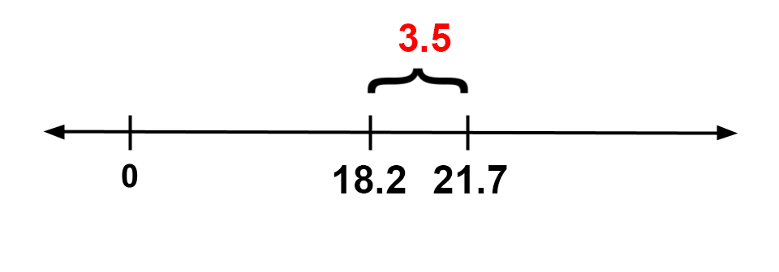

The source for average cat length is [Wikipedia](https://en.wikipedia.org/wiki/Cat#:~:text=The%20domestic%20cat%20has%20a,(9%20and%2011%20lb).). The listed lengths for cats are not real and may not be plausible (but the names are of real cats!)

And here's how we'd write that expression in one line of Python code:

**Code:**

```python
abs(21.7 - 18.2)
```

*Output:*

```text
3.5
```

What's going on here?  `abs` takes just one argument, so the stuff inside the parentheses is all part of that *single argument*.  Specifically, the argument is the value of the expression `21.7 - 18.2`.  The value of that expression is `3.5`.  That value is the argument to `abs`.  The absolute value of that is `3.5`, so `3.5` is the value of the full expression `abs(21.7 - 18.2)`.

Picture simplifying the expression in several steps:

1. `abs(21.7 - 18.2)`
2. `abs(3.5)`
3. `3.5`

In fact, that's basically what Python does to compute the value of the expression.

**Question 5.1.** Say that Genghis's length is 16.7 inches.  In the next cell, use `abs` to compute the absolute value of the difference between Genghis's length and the average cat length (given in the paragraph above).  Give that value the name `genghis_distance_from_average_in`.

**Student scaffold:**

```python
# Replace the ... with an expression 
# to compute the absolute value 
# of the difference between Genghis's length (16.7 in) and the average cat length.
genghis_distance_from_average_in = ...

# Again, we've written this here 
# so that the distance you compute will get printed 
# when you run this cell.
genghis_distance_from_average_in
```

**Solution:**

```python
# Replace the ... with an expression 
# to compute the absolute value 
# of the difference between Genghis's length (16.7 in) and the average cat length.
genghis_distance_from_average_in = abs(16.7 - 18.2) # SOLUTION

# Again, we've written this here 
# so that the distance you compute will get printed 
# when you run this cell.
genghis_distance_from_average_in
```

*Output:*

```text
1.5
```

**Test — `q51`**

```python
>>> round(genghis_distance_from_average_in, 3)
1.5
```

---

## 5.1. More Nesting
Now say that we want to compute the more unusual of the two cat lengths.  We'll use the function `max`, which (again) takes two numbers as arguments and returns the larger of the two arguments.  Combining that with the `abs` function, we can compute the larger distance from average among the two length:

**Code:**

```python
# Just read and run this cell.

ravioli_length_in = 21.7
genghis_length_in = 16.7
average_cat_length = 18.2

# The larger distance from the average cat length, among the two length:
larger_distance_in = max(abs(ravioli_length_in - average_cat_length), abs(genghis_length_in - average_cat_length))

# Print out our results in a nice readable format:
print("The larger distance from the average length among these two cats is", larger_distance_in, "inches.")
```

*Output (stdout):*

```text
The larger distance from the average length among these two cats is 3.5 inches.
```

The line where `larger_distance_in` is computed looks complicated, but we can break it down into simpler components just like we did before.

The basic recipe is to repeatedly simplify small parts of the expression:
* **Basic expressions:** Start with expressions whose values we know, like names or numbers.
    - Examples: `genghis_length_in` or `16.7`.
* **Find the next simplest group of expressions:** Look for basic expressions that are directly connected to each other. This can be by arithmetic or as arguments to a function call. 
    - Example: `genghis_length_in - average_cat_length`.
* **Evaluate that group:** Evaluate the arithmetic expression or function call. Use the value computed to replace the group of expressions.  
    - Example: `genghis_length_in - average_cat_length` becomes `-1.3`.
* **Repeat:** Continue this process, using the value of the previously-evaluated expression as a new basic expression. Stop when we've evaluated the entire expression.
    - Example: `abs(-1.3)` becomes `1.3`, and `max(3.5, 1.3)` becomes `3.5`.

You can run the next cell to see a slideshow of that process.

**Code:**

```python
from IPython.display import IFrame
IFrame('https://docs.google.com/presentation/d/14EKhQjGe0bUpLwKGo6BrPCtjsORSkY8h4BzAqvXoLTM/embed?start=false&loop=false&delayms=3000', 800, 600)
```

*Output:*

```text
<IPython.lib.display.IFrame at 0x107d88730>
```

Ok, your turn. 

**Question 5.1.1.** Given the lengths of Yanay's cats Hummus, Gatkes, and Zeepty, write an expression that computes the **smallest pairwise difference** between any of the three cats' lenghts. Note that unlike the previous question, this doesn't involve the average.

Your expression shouldn't have any numbers in it, only function calls and the names `hummus`, `gatkes`, and `zeepty`. Give the value of your expression the name `min_length_difference`.

**Student scaffold:**

```python
# The three cats' lengths, in inches:
hummus =  24.5 # Hummus is 24.5 inches long
gatkes = 19.7 # Gatkes is 19.7 inches long
zeepty = 15.8 # Zeepty is 15.8 inches long
             
# We'd like to look at all 3 pairs of lengths, 
# compute the absolute difference between each pair, 
# and then find the smallest of those 3 absolute differences.  
# This is left to you!  
# If you're stuck, try computing the value for each step of the process 
# (like the difference between Hummus's length and Gatkes's length) 
# on a separate line and giving it a name (like hummus_gatkes_length_diff)
min_length_difference = ...
```

**Solution:**

```python
# The three cats' lengths, in inches:
hummus =  24.5 # Hummus is 24.5 inches long
gatkes = 19.7 # Gatkes is 19.7 inches long
zeepty = 15.8 # Zeepty is 15.8 inches long
             
# We'd like to look at all 3 pairs of lengths, 
# compute the absolute difference between each pair, 
# and then find the smallest of those 3 absolute differences.  
# This is left to you!  
# If you're stuck, try computing the value for each step of the process 
# (like the difference between Hummus's length and Gatkes's length) 
# on a separate line and giving it a name (like hummus_gatkes_length_diff)
min_length_difference = min(abs(hummus-gatkes), abs(hummus-zeepty), abs(gatkes-zeepty)) # SOLUTION
```

**Test — `q5_1_1`**

```python
>>> round(min_length_difference, 5)
3.9
```

<br/><br/>
---
# 6. Using JupyTutor!
This semester, we are trying something new with JupyTutor! JupyTutor is an LLM assistant developed by Kevin Gillespie and Timothy J. Aveni that responds to errors and questions in your assignment, specifically based on Data 8 content. [Here](https://drive.google.com/file/d/1PEsP6pJYnDdThRMA7BVnzXposRn6shZv/view?usp=sharing) is a demo video showcasing some of its features.

- Throughout the semeter, JupyTutor will be activated for most assignments. Some questions may not have JupyTutor enabled if we think it wouldn’t be helpful for that particular problem.
- Using JupyTutor is optional - you are not required to use it.
- Please make sure to refrain from using other external AI / LLM tools for assignments in Data 8. Jupytutor has been designed and tuned specifically for Data 8.

Like all LLMs, JupyTutor can make mistakes, so please fill out this [feedback form](https://docs.google.com/forms/d/e/1FAIpQLSed1Bq166rNDRTTws31O1Y4sSulFu8zY_y5jaM1K_3DBt7Plw/viewform?usp=publish-editor) (also linked on the website) if you notice any mistakes or have any suggestions.

Try out Jupytutor for this question!

**Question 6.1.** Given the number of times each of our lead TAs have met Oski, find the **absolute difference** between the **maximum** value of the TAs with names that start with the letter "D" and the **minimum** value of the TAs that start with the letter "T".

Your expression shouldn't have any numbers in it, only function calls and the correct TA names. Assing this value to `absolute_difference`.

**Student scaffold:**

```python
# The amount of times each of our lead TAs have met Oski:
andrew_t = 3 # For example, Andrew has met Oski 3 times...
brandon_s = 1 # And Brandon has only met Oski once!
carisma_d = 4
dagny_s = 2
dylan_t = 2
marissa_l = 4
max_a = 5
sangjun_l = 2
tiffany_l = 4
timothy_a = 7 # Wow! That's a lot!
tracy_l = 2

# Assign absolute_difference to the desired value
absolute_difference = ...
absolute_difference
```

**Solution:**

```python
# The amount of times each of our lead TAs have met Oski:
andrew_t = 3 # For example, Andrew has met Oski 3 times...
brandon_s = 1 # And Brandon has only met Oski once!
carisma_d = 4
dagny_s = 2
dylan_t = 2
marissa_l = 4
max_a = 5
sangjun_l = 2
tiffany_l = 4
timothy_a = 7 # Wow! That's a lot!
tracy_l = 2

# Assign absolute_difference to the desired value
absolute_difference = abs(max(dagny_s, dylan_t) - min(tiffany_l, timothy_a, tracy_l)) # SOLUTION
absolute_difference
```

*Output:*

```text
0
```

**Test — `q6_1`**

```python
>>> absolute_difference == 0
True
```

<br/><br/>
---
You're done with Lab 1!

**Important submission information:** Be sure to run the tests and verify that they all pass, then choose **Save Notebook** from the **File** menu, then **run the final cell** and click the link to download the zip file. Then, go to [Pensieve](https://www.pensieve.co/) and submit the zip file to the corresponding assignment. The name of this assignment is "Lab 01 Autograder". 

**Once you have submitted, your submitted assignment should look like the following image if you have passed all tests.** <span style="color: red">**Make sure that you see "All test cases passed" to ensure your assignment was submitted correctly.**</span> If your submission does not look like this, then you likely did not upload your notebook correctly.

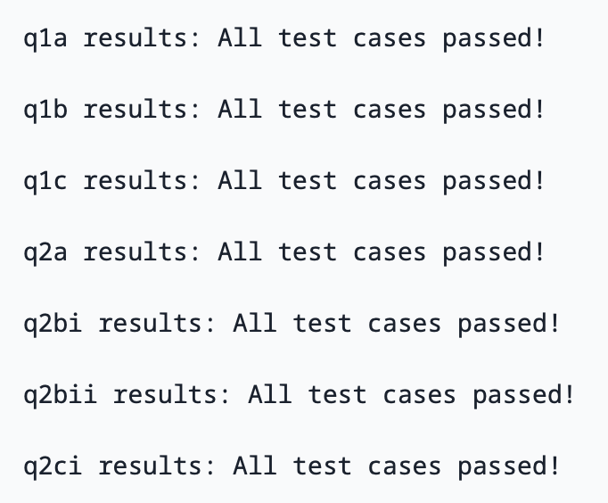

---

To double-check your work, the cell below will rerun all of the autograder tests.

## Submission

Make sure you have run all cells in your notebook in order before running the cell below, so that all images/graphs appear in the output. The cell below will generate a zip file for you to submit. **Please save before exporting!**


---

# lab02

---
title: "Lab 2: Table Operations"
assignment: lab02
semester: sp26
source: semester_assignments/sp26/lab/lab02/autograder/lab02.ipynb
version: solution (autograder) with student scaffolds
student_source: semester_assignments/sp26/lab/lab02/student/lab02.ipynb
language: python
---


# Lab 2: Table Operations

Welcome to Lab 2!  This week, we'll learn how to import a module and practice table operations. The [Python Reference](https://www.data8.org/su26/reference/) has information that will be useful for this lab.

**Recommended Reading**:
 * [Introduction to Tables](https://www.inferentialthinking.com/chapters/03/4/Introduction_to_Tables)

As a reminder, here are the policies for getting full credit:

1. For students enrolled in in-person <span style="color: #BC412B">**Regular Labs**</span>, you will receive 80% lab credit by **attending** lab discussion, 20% lab credit for passing all test cases, and submitting it to Pensieve by **5pm on the Friday the same week it was released**.

2. For students enrolled in <span style="color: #04888B">**Self Service**</span>, you will receive full lab credit by **completing** the notebook, passing all test cases, and **submitting** it to Pensieve by **5pm on the Friday the same week it was released**.

**Submission**: Once you’re finished, run all cells besides the last one, select File > Save Notebook, and then execute the final cell. The result will contain a zip file that you can use to submit on Pensieve.

Let's begin by setting up the tests and imports by running the cell below.

# 1. Review: The Building Blocks of Python Code

The two building blocks of Python code are *expressions* and *statements*.  An **expression** is a piece of code that

* is self-contained, meaning it would make sense to write it on a line by itself, and
* usually evaluates to a value.


Here are two expressions that both evaluate to 3:

    3
    5 - 2
    
One important type of expression is the **call expression**. A call expression begins with the name of a function and is followed by the argument(s) of that function in parentheses. The function returns some value, based on its arguments. Some important mathematical functions are listed below.

| Function | Description                                                   |
|----------|---------------------------------------------------------------|
| `abs`      | Returns the absolute value of its argument                    |
| `max`      | Returns the maximum of all its arguments                      |
| `min`      | Returns the minimum of all its arguments                      |
| `pow`      | Raises its first argument to the power of its second argument |
| `round`    | Rounds its argument to the nearest integer                     |

Here are two call expressions that both evaluate to 3:

    abs(2 - 5)
    max(round(2.8), min(pow(2, 10), -1 * pow(2, 10)))

The expression `2 - 5` and the two call expressions given above are examples of **compound expressions**, meaning that they are actually combinations of several smaller expressions.  `2 - 5` combines the expressions `2` and `5` by subtraction.  In this case, `2` and `5` are called **subexpressions** because they're expressions that are part of a larger expression.

A **statement** is a whole line of code.  Some statements are just expressions.  The expressions listed above are examples.

Other statements *make something happen* rather than *having a value*. For example, an **assignment statement** assigns a value to a name. 

A good way to think about this is that we're **evaluating the right-hand side** of the equals sign and **assigning it to the left-hand side**. Here are some assignment statements:
    
    height = 1.3
    the_number_five = abs(-5)
    absolute_height_difference = abs(height - 1.688)

An important idea in programming is that large, interesting things can be built by combining many simple, uninteresting things.  The key to understanding a complicated piece of code is breaking it down into its simple components.

For example, a lot is going on in the last statement above, but it's really just a combination of a few things.  This picture describes what's going on.

![Annotated breakdown of the statement absolute_height_difference = abs(height - 1.688). 'abs' is a name expression whose value is the absolute value function; 'height' is a name expression with value 1.3 assigned earlier; 1.688 is a number expression. 'height - 1.688' is an arithmetic compound expression with value -.388; abs(height - 1.688) is a function call compound expression with value .388; the whole line is an assignment statement, which has no value and binds absolute_height_difference to .388.](lab02_assets/statement.png)

**Question 1.1.** In the next cell, assign the name `new_year` to the **larger number** among the following two numbers:

* the **absolute value** of $2^{6}-2^{11}-2^{5} - 7$, and 
* $5 \times 13 \times 31 + 11$.

Try to use just one line of code. Be sure to check your work by executing the test cell afterward.

**Student scaffold:**

```python
new_year = ...
new_year
```

**Solution:**

```python
new_year = max(abs(2**6 - 2**11 - 2 ** 5 - 7), 5*13*31 + 11) # SOLUTION
new_year
```

*Output:*

```text
2026
```

**Test — `q11`**

```python
>>> new_year
2026
```

We've asked you to use one line of code in the question above because it only involves mathematical operations. However, more complicated programming questions will require more steps. It isn’t always a good idea to jam these steps into a single line because it can make the code harder to read and harder to debug.

Good programming practice involves splitting up your code into smaller steps and using appropriate names. You'll have plenty of practice in the rest of this course!

# 1.2 Programing Practices in Data 8: Variable Renaming

As a note, it is important not to use variable names that are the same as an existing function name. Take the `max` function for example.

Currently, it works as expected.

**Code:**

```python
print(max) #  just shows us that this is currently a function
max(5, 6, 7) #  returns 7, as expected
```

*Output (stdout):*

```text
<built-in function max>
```

*Output:*

```text
7
```

If we use `max` as a variable name, we will no longer be able to use the max function (thus, don’t do this!)

**Code:**

```python
max = 8 #  you should not do this!
print(max) #  it now prints the number 8, since that was what was stored in it
max(5, 6, 7) #  it no longer works!
```

*Output (stdout):*

```text
8
Unexpected exception formatting exception. Falling back to standard exception
```

*Output (stderr):*

```text
Traceback (most recent call last):
  File "/Users/marissalumpkin/Desktop/data8/assignments_new/env/lib/python3.13/site-packages/IPython/core/interactiveshell.py", line 3577, in run_code
    exec(code_obj, self.user_global_ns, self.user_ns)
    ~~~~^^^^^^^^^^^^^^^^^^^^^^^^^^^^^^^^^^^^^^^^^^^^^
  File "/var/folders/xv/tl5mnl5s0mz_ykhsrhdyb_rm0000gn/T/ipykernel_44404/4066630218.py", line 3, in <module>
    max(5, 6, 7) #  it no longer works!
    ~~~^^^^^^^^^
TypeError: 'int' object is not callable

During handling of the above exception, another exception occurred:

Traceback (most recent call last):
  File "/Users/marissalumpkin/Desktop/data8/assignments_new/env/lib/python3.13/site-packages/IPython/core/interactiveshell.py", line 2168, in showtraceback
    stb = self.InteractiveTB.structured_traceback(
        etype, value, tb, tb_offset=tb_offset
    )
  File "/Users/marissalumpkin/Desktop/data8/assignments_new/env/lib/python3.13/site-packages/IPython/core/ultratb.py", line 1454, in structured_traceback
    return FormattedTB.structured_traceback(
           ~~~~~~~~~~~~~~~~~~~~~~~~~~~~~~~~^
        self, etype, evalue, etb, tb_offset, number_of_lines_of_context
        ^^^^^^^^^^^^^^^^^^^^^^^^^^^^^^^^^^^^^^^^^^^^^^^^^^^^^^^^^^^^^^^
    )
    ^
  File "/Users/marissalumpkin/Desktop/data8/assignments_new/env/lib/python3.13/site-packages/IPython/core/ultratb.py", line 1345, in structured_traceback
    return VerboseTB.structured_traceback(
           ~~~~~~~~~~~~~~~~~~~~~~~~~~~~~~^
        self, etype, value, tb, tb_offset, number_of_lines_of_context
        ^^^^^^^^^^^^^^^^^^^^^^^^^^^^^^^^^^^^^^^^^^^^^^^^^^^^^^^^^^^^^
    )
    ^
  File "/Users/marissalumpkin/Desktop/data8/assignments_new/env/lib/python3.13/site-packages/IPython/core/ultratb.py", line 1192, in structured_traceback
    formatted_exception = self.format_exception_as_a_whole(etype, evalue, etb, number_of_lines_of_context,
                                                           tb_offset)
  File "/Users/marissalumpkin/Desktop/data8/assignments_new/env/lib/python3.13/site-packages/IPython/core/ultratb.py", line 1082, in format_exception_as_a_whole
    self.get_records(etb, number_of_lines_of_context, tb_offset) if etb else []
    ~~~~~~~~~~~~~~~~^^^^^^^^^^^^^^^^^^^^^^^^^^^^^^^^^^^^^^^^^^^^
  File "/Users/marissalumpkin/Desktop/data8/assignments_new/env/lib/python3.13/site-packages/IPython/core/ultratb.py", line 1179, in get_records
    res = list(stack_data.FrameInfo.stack_data(etb, options=options))[tb_offset:]
          ~~~~^^^^^^^^^^^^^^^^^^^^^^^^^^^^^^^^^^^^^^^^^^^^^^^^^^^^^^^
  File "/Users/marissalumpkin/Desktop/data8/assignments_new/env/lib/python3.13/site-packages/stack_data/core.py", line 597, in stack_data
    yield from collapse_repeated(
    ...<4 lines>...
    )
  File "/Users/marissalumpkin/Desktop/data8/assignments_new/env/lib/python3.13/site-packages/stack_data/utils.py", line 83, in collapse_repeated
    yield from map(mapper, original_group)
  File "/Users/marissalumpkin/Desktop/data8/assignments_new/env/lib/python3.13/site-packages/stack_data/core.py", line 587, in mapper
    return cls(f, options)
  File "/Users/marissalumpkin/Desktop/data8/assignments_new/env/lib/python3.13/site-packages/stack_data/core.py", line 551, in __init__
    self.executing = Source.executing(frame_or_tb)
                     ~~~~~~~~~~~~~~~~^^^^^^^^^^^^^
  File "/Users/marissalumpkin/Desktop/data8/assignments_new/env/lib/python3.13/site-packages/executing/executing.py", line 283, in executing
    assert_(new_stmts <= stmts)
    ~~~~~~~^^^^^^^^^^^^^^^^^^^^
  File "/Users/marissalumpkin/Desktop/data8/assignments_new/env/lib/python3.13/site-packages/executing/executing.py", line 80, in assert_
    raise AssertionError(str(message))
AssertionError
```

Run this cell below to revert the max function back to normal for later use:

**Code:**

```python
del max
```

# 2. Importing Code

Most programming involves work that is very similar to work that has been done before.  Since writing code is time-consuming, it's good to rely on others' published code when you can.  Rather than copy-pasting, Python allows us to **import modules**. A module is a file with Python code that has defined variables and functions. By importing a module, we are able to use its code in our own notebook.

Python includes many useful modules that are just an `import` away.  We'll look at the `math` module as a first example. The `math` module is extremely useful in computing mathematical expressions in Python. 

Suppose we want to very accurately compute the area of a circle with a radius of 5 meters.  For that, we need the constant $\pi$, which is roughly 3.14.  Conveniently, the `math` module has `pi` defined for us. Run the following cell to import the math module:

**Code:**

```python
import math
radius = 5
area_of_circle = radius**2 * math.pi
area_of_circle
```

*Output:*

```text
78.53981633974483
```

In the code above, the line `import math` imports the `math` module. We are now able to access any variables or functions defined within `math` by typing `math` followed by a dot, then followed by the name of the variable or function we want.

    <module name>.<name>

**Question 2.1.** The module `math` also provides the name `e` for the base of the natural logarithm, which is roughly 2.71. Compute $e^{\pi}-\pi$, giving it the name `near_twenty`.

*Remember: You can access `pi` from the `math` module as well!*

**Student scaffold:**

```python
near_twenty = ...
near_twenty
```

**Solution:**

```python
near_twenty = math.e ** math.pi - math.pi # SOLUTION
near_twenty
```

*Output:*

```text
19.99909997918947
```

**Test — `q21`**

```python
>>> round(near_twenty, 8)
19.99909998
```

## 2.1. Accessing Functions

In the question above, you accessed variables within the `math` module. 

**Modules** also define **functions**.  For example, `math` provides the name `floor` for the floor function.  Having imported `math` already, we can write `math.floor(7.5)` to compute the floor of 7.5.  (Note that the floor function returns the largest integer less than or equal to a given number.)

**Question 2.1.1.** Compute the floor of pi using `floor` and `pi` from the `math` module.  Give the result the name `floor_of_pi`.

**Student scaffold:**

```python
floor_of_pi = ...
floor_of_pi
```

**Solution:**

```python
floor_of_pi = math.floor(math.pi) # SOLUTION
floor_of_pi
```

*Output:*

```text
3
```

**Test — `q211`**

```python
>>> import math
>>> floor_of_pi == 3
True
```

For your reference, below are some more examples of functions from the `math` module.

Notice how different functions take in different numbers of arguments. Often, the [documentation](https://docs.python.org/3/library/math.html) of the module will provide information on how many arguments are required for each function.

*Hint: If you press `shift+tab` while next to the function call, the documentation for that function will appear.*

**Code:**

```python
# Calculating logarithms (the logarithm of 8 in base 2).
# The result is 3 because 2 to the power of 3 is 8.
math.log(8, 2)
```

*Output:*

```text
3.0
```

**Code:**

```python
# Calculating square roots.
math.sqrt(5)
```

*Output:*

```text
2.23606797749979
```

There are various ways to import and access code from outside sources. The method we used above — `import <module_name>` — imports the entire module and requires that we use `<module_name>.<variable_or_function_name>` to access its code. 

We can also import a specific constant or function instead of the entire module. Notice that you don't have to use the module name beforehand to reference that particular value. However, you do have to be careful about reassigning the names of the constants or functions to other values!

**Code:**

```python
# Importing just cos and pi from math.
# We don't have to use `math.` in front of cos or pi
from math import cos, pi
print(cos(pi))

# We do have to use it in front of other functions from math, though
math.log(pi)
```

*Output (stdout):*

```text
-1.0
```

*Output:*

```text
1.1447298858494002
```

Or we can import every function and value from the entire module. Now, we do not have to use `math` in front of any functions or values from the `math` module.

**Code:**

```python
# Lastly, we can import everything from math using the *
# Once again, we don't have to use 'math.' beforehand 
from math import *
log(pi)
```

*Output:*

```text
1.1447298858494002
```

Don't worry too much about which type of import to use. It's often a coding style choice left up to each programmer. In this course, you'll always import the necessary modules when you run the setup cell (like the first code cell in this lab).

Let's move on to practicing some of the table operations you've learned in lecture!

# 3. Table Operations

The table `farmers_markets.csv` contains data on farmers' markets in the United States  (data associated with [the USDA](https://www.ams.usda.gov/)).  Each row represents one such market.

Run the next cell to load the `farmers_markets` table. There will be no output -- no output is expected as the cell contains an assignment statement. An assignment statement does not produce any output (it does not yield any value).

**Code:**

```python
# Just run this cell

farmers_markets = Table.read_table('farmers_markets.csv')
```

Let's examine our table to see what data it contains.

**Question 3.1.** Use the method `show` to display the first 5 rows of `farmers_markets`. 

*Note:* The terms "method" and "function" are technically not the same thing, but for the purposes of this course, we will use them interchangeably.

**Hint:** `tbl.show(3)` will show the first 3 rows of the table named `tbl`. Additionally, make sure not to call `.show()` without an argument, as this will crash your kernel!

**Student scaffold:**

```python
...
```

**Solution:**

```python
farmers_markets.show(5) # SOLUTION
```

*Output:*

| FMID | MarketName | street | city | County | State | zip | x | y | Website | Facebook | Twitter | Youtube | OtherMedia | Organic | ... |
| --- | --- | --- | --- | --- | --- | --- | --- | --- | --- | --- | --- | --- | --- | --- | --- |
| 1012063 | Caledonia Farmers Market Association - Danville | nan | Danville | Caledonia | Vermont | 05828 | -72.1403 | 44.411 | https://sites.google.com/site/caledoniafarmersmarket/ | https://www.facebook.com/Danville.VT.Farmers.Market/ | nan | nan | nan | Y | ... |
| 1011871 | Stearns Homestead Farmers' Market | 6975 Ridge Road | Parma | Cuyahoga | Ohio | 44130 | -81.7286 | 41.3751 | http://Stearnshomestead.com | nan | nan | nan | nan | - | ... |
| 1011878 | 100 Mile Market | 507 Harrison St | Kalamazoo | Kalamazoo | Michigan | 49007 | -85.5749 | 42.296 | http://www.pfcmarkets.com | https://www.facebook.com/100MileMarket/?fref=ts | nan | nan | https://www.instagram.com/100milemarket/ | N | ... |
| 1009364 | 106 S. Main Street Farmers Market | 106 S. Main Street | Six Mile | nan | South Carolina | 29682 | -82.8187 | 34.8042 | http://thetownofsixmile.wordpress.com/ | nan | nan | nan | nan | - | ... |
| 1010691 | 10th Steet Community Farmers Market | 10th Street and Poplar | Lamar | Barton | Missouri | 64759 | -94.2746 | 37.4956 | nan | nan | nan | nan | http://agrimissouri.com/mo-grown/grodetail.php?type=mo-g ... | - | ... |

_... 44 more columns_

Notice that some of the values in this table are missing, as denoted by "nan." This means either that the value is not available (e.g. if we don’t know the market’s street address) or not applicable (e.g. if the market doesn’t have a street address). You'll also notice that the table has a large number of columns in it!

### `num_columns`

The table property `num_columns` returns the number of columns in a table. (A "property" is just a method that doesn't need to be called by adding parentheses.)

Example call: `tbl.num_columns` will return the number of columns in a table called `tbl`

**Question 3.2.** Use `num_columns` to find the number of columns in our farmers' markets dataset.

Assign the number of columns to `num_farmers_markets_columns`.

**Student scaffold:**

```python
num_farmers_markets_columns = ...
print("The table has", num_farmers_markets_columns, "columns in it!")
```

**Solution:**

```python
num_farmers_markets_columns = farmers_markets.num_columns # SOLUTION 
print("The table has", num_farmers_markets_columns, "columns in it!")
```

*Output (stdout):*

```text
The table has 59 columns in it!
```

**Test — `q32`**

```python
>>> num_farmers_markets_columns == 59
True
```

### `num_rows`

Similarly, the property `num_rows` tells you how many rows are in a table.

**Code:**

```python
# Just run this cell

num_farmers_markets_rows = farmers_markets.num_rows
print("The table has", num_farmers_markets_rows, "rows in it!")
```

*Output (stdout):*

```text
The table has 8546 rows in it!
```

### `select`

Most of the columns are about particular products -- whether the market sells tofu, pet food, etc.  If we're not interested in that information, it just makes the table difficult to read.  This comes up more than you might think, because people who collect and publish data may not know ahead of time what people will want to do with it.

In such situations, we can use the table method `select` to choose only the columns that we want in a particular table. It takes any number of arguments. Each should be the name of a column in the table. It returns a new table with only those columns in it. The columns are in the order *in which they were listed as arguments*.

For example, the value of `farmers_markets.select("MarketName", "State")` is a table with only the name and the state of each farmers' market in `farmers_markets`.


**Question 3.3.** Use `select` to create a table with only the name, city, state, latitude (`y`), and longitude (`x`) of each market.  Call that new table `farmers_markets_locations`.

*Hint:* Make sure to be exact when using column names with `select`; double-check capitalization!

**Code:**

```python
# Run this cell to see the first row of the farmers_markets table!
farmers_markets.show(1)
```

*Output:*

| FMID | MarketName | street | city | County | State | zip | x | y | Website | Facebook | Twitter | Youtube | OtherMedia | Organic | ... |
| --- | --- | --- | --- | --- | --- | --- | --- | --- | --- | --- | --- | --- | --- | --- | --- |
| 1012063 | Caledonia Farmers Market Association - Danville | nan | Danville | Caledonia | Vermont | 05828 | -72.1403 | 44.411 | https://sites.google.com/site/caledoniafarmersmarket/ | https://www.facebook.com/Danville.VT.Farmers.Market/ | nan | nan | nan | Y | ... |

_... 44 more columns_

**Student scaffold:**

```python
farmers_markets_locations = ...
farmers_markets_locations
```

**Solution:**

```python
farmers_markets_locations = farmers_markets.select("MarketName", "city", "State", "y", "x") # SOLUTION
farmers_markets_locations
```

*Output:*

| MarketName | city | State | y | x |
| --- | --- | --- | --- | --- |
| Caledonia Farmers Market Association - Danville | Danville | Vermont | 44.411 | -72.1403 |
| Stearns Homestead Farmers' Market | Parma | Ohio | 41.3751 | -81.7286 |
| 100 Mile Market | Kalamazoo | Michigan | 42.296 | -85.5749 |
| 106 S. Main Street Farmers Market | Six Mile | South Carolina | 34.8042 | -82.8187 |
| 10th Steet Community Farmers Market | Lamar | Missouri | 37.4956 | -94.2746 |
| 112st Madison Avenue | New York | New York | 40.7939 | -73.9493 |
| 12 South Farmers Market | Nashville | Tennessee | 36.1184 | -86.7907 |
| 125th Street Fresh Connect Farmers' Market | New York | New York | 40.809 | -73.9482 |
| 12th & Brandywine Urban Farm Market | Wilmington | Delaware | 39.7421 | -75.5345 |
| 14&U Farmers' Market | Washington | District of Columbia | 38.917 | -77.0321 |

**Test — `q33`**

```python
>>> sorted(farmers_markets_locations.labels)
['MarketName', 'State', 'city', 'x', 'y']

>>> farmers_markets_locations.num_rows == 8546
True
```

### `drop`

`drop` serves the same purpose as `select`, but it takes away the columns that you provide rather than the ones that you don't provide. Like `select`, `drop` returns a new table.

**Question 3.4.** Suppose you just didn't want the `FMID` and `updateTime` columns in `farmers_markets`.  Create a table that's a copy of `farmers_markets` but doesn't include those columns.  Call that table `farmers_markets_without_fmid`.

**Student scaffold:**

```python
farmers_markets_without_fmid = ...
farmers_markets_without_fmid
```

**Solution:**

```python
farmers_markets_without_fmid = farmers_markets.drop("FMID", "updateTime") # SOLUTION
farmers_markets_without_fmid
```

*Output:*

| MarketName | street | city | County | State | zip | x | y | Website | Facebook | Twitter | Youtube | OtherMedia | Organic | Tofu | ... |
| --- | --- | --- | --- | --- | --- | --- | --- | --- | --- | --- | --- | --- | --- | --- | --- |
| Caledonia Farmers Market Association - Danville | nan | Danville | Caledonia | Vermont | 05828 | -72.1403 | 44.411 | https://sites.google.com/site/caledoniafarmersmarket/ | https://www.facebook.com/Danville.VT.Farmers.Market/ | nan | nan | nan | Y | N | ... |
| Stearns Homestead Farmers' Market | 6975 Ridge Road | Parma | Cuyahoga | Ohio | 44130 | -81.7286 | 41.3751 | http://Stearnshomestead.com | nan | nan | nan | nan | - | N | ... |
| 100 Mile Market | 507 Harrison St | Kalamazoo | Kalamazoo | Michigan | 49007 | -85.5749 | 42.296 | http://www.pfcmarkets.com | https://www.facebook.com/100MileMarket/?fref=ts | nan | nan | https://www.instagram.com/100milemarket/ | N | N | ... |
| 106 S. Main Street Farmers Market | 106 S. Main Street | Six Mile | nan | South Carolina | 29682 | -82.8187 | 34.8042 | http://thetownofsixmile.wordpress.com/ | nan | nan | nan | nan | - | N | ... |
| 10th Steet Community Farmers Market | 10th Street and Poplar | Lamar | Barton | Missouri | 64759 | -94.2746 | 37.4956 | nan | nan | nan | nan | http://agrimissouri.com/mo-grown/grodetail.php?type=mo-g ... | - | N | ... |
| 112st Madison Avenue | 112th Madison Avenue | New York | New York | New York | 10029 | -73.9493 | 40.7939 | nan | nan | nan | nan | nan | - | N | ... |
| 12 South Farmers Market | 3000 Granny White Pike | Nashville | Davidson | Tennessee | 37204 | -86.7907 | 36.1184 | http://www.12southfarmersmarket.com | 12_South_Farmers_Market | @12southfrmsmkt | nan | @12southfrmsmkt | Y | N | ... |
| 125th Street Fresh Connect Farmers' Market | 163 West 125th Street and Adam Clayton Powell, Jr. Blvd. | New York | New York | New York | 10027 | -73.9482 | 40.809 | http://www.125thStreetFarmersMarket.com | https://www.facebook.com/125thStreetFarmersMarket | https://twitter.com/FarmMarket125th | nan | Instagram--> 125thStreetFarmersMarket | Y | N | ... |
| 12th & Brandywine Urban Farm Market | 12th & Brandywine Streets | Wilmington | New Castle | Delaware | 19801 | -75.5345 | 39.7421 | nan | https://www.facebook.com/pages/12th-Brandywine-Urban-Far ... | nan | nan | https://www.facebook.com/delawareurbanfarmcoalition | N | N | ... |
| 14&U Farmers' Market | 1400 U Street NW | Washington | District of Columbia | District of Columbia | 20009 | -77.0321 | 38.917 | nan | https://www.facebook.com/14UFarmersMarket | https://twitter.com/14UFarmersMkt | nan | nan | Y | N | ... |

_... 42 more columns_

**Test — `q34`**

```python
>>> farmers_markets_without_fmid.num_columns
57

>>> print(sorted(farmers_markets_without_fmid.labels))
['Bakedgoods', 'Beans', 'Cheese', 'Coffee', 'County', 'Crafts', 'Credit', 'Eggs', 'Facebook', 'Flowers', 'Fruits', 'Grains', 'Herbs', 'Honey', 'Jams', 'Juices', 'Location', 'Maple', 'MarketName', 'Meat', 'Mushrooms', 'Nursery', 'Nuts', 'Organic', 'OtherMedia', 'PetFood', 'Plants', 'Poultry', 'Prepared', 'SFMNP', 'SNAP', 'Seafood', 'Season1Date', 'Season1Time', 'Season2Date', 'Season2Time', 'Season3Date', 'Season3Time', 'Season4Date', 'Season4Time', 'Soap', 'State', 'Tofu', 'Trees', 'Twitter', 'Vegetables', 'WIC', 'WICcash', 'Website', 'WildHarvested', 'Wine', 'Youtube', 'city', 'street', 'x', 'y', 'zip']
```

Now, suppose we want to answer some questions about farmers' markets in the US. For example, which market(s) have the largest longitude (given by the `x` column)? 

To answer this, we'll sort `farmers_markets_locations` by longitude.

**Code:**

```python
farmers_markets_locations.sort('x')
```

*Output:*

| MarketName | city | State | y | x |
| --- | --- | --- | --- | --- |
| Trapper Creek Farmers Market | Trapper Creek | Alaska | 53.8748 | -166.54 |
| Kekaha Neighborhood Center (Sunshine Markets) | Kekaha | Hawaii | 21.9704 | -159.718 |
| Hanapepe Park (Sunshine Markets) | Hanapepe | Hawaii | 21.9101 | -159.588 |
| Kalaheo Neighborhood Center (Sunshine Markets) | Kalaheo | Hawaii | 21.9251 | -159.527 |
| Hawaiian Farmers of Hanalei | Hanalei | Hawaii | 22.2033 | -159.514 |
| Hanalei Saturday Farmers Market | Hanalei | Hawaii | 22.2042 | -159.492 |
| Kauai Culinary Market | Koloa | Hawaii | 21.9067 | -159.469 |
| Koloa Ball Park (Knudsen) (Sunshine Markets) | Koloa | Hawaii | 21.9081 | -159.465 |
| West Kauai Agricultural Association | Poipu | Hawaii | 21.8815 | -159.435 |
| Kilauea Neighborhood Center (Sunshine Markets) | Kilauea | Hawaii | 22.2112 | -159.406 |

Oops, that didn't answer our question because we sorted from smallest to largest longitude. To look at the largest longitudes, we'll have to sort in reverse order by adding `descending = True` as the second argument.

**Code:**

```python
farmers_markets_locations.sort('x', descending=True)
```

*Output:*

| MarketName | city | State | y | x |
| --- | --- | --- | --- | --- |
| Christian "Shan" Hendricks Vegetable Market | Saint Croix | Virgin Islands | 17.7449 | -64.7043 |
| La Reine Farmers Market | Saint Croix | Virgin Islands | 17.7322 | -64.7789 |
| Anne Heyliger Vegetable Market | Saint Croix | Virgin Islands | 17.7099 | -64.8799 |
| Rothschild Francis Vegetable Market | St. Thomas | Virgin Islands | 18.3428 | -64.9326 |
| Feria Agrícola de Luquillo | Luquillo | Puerto Rico | 18.3782 | -65.7207 |
| El Mercado Familiar | San Lorenzo | Puerto Rico | 18.1871 | -65.9674 |
| El Mercado Familiar | Gurabo | Puerto Rico | 18.2526 | -65.9786 |
| El Mercado Familiar | Patillas | Puerto Rico | 18.0069 | -66.0135 |
| El Mercado Familiar | Caguas zona urbana | Puerto Rico | 18.2324 | -66.039 |
| El Maercado Familiar | Arroyo zona urbana | Puerto Rico | 17.9686 | -66.0617 |

(The `descending=True` bit is called an *optional argument*. It has a default value of `False`, so when you explicitly tell the function `descending=True`, then the function will sort in descending order.)

### `sort`

Some details about sort:

1. The first argument to `sort` is the name of a column to sort by.
2. If the column has text in it, `sort` will sort alphabetically; if the column has numbers, it will sort numerically - both in ascending order by default. For letters, ascending order is from A to Z and descending order is from Z to A.
3. The value of `farmers_markets_locations.sort("x")` is a *copy* of `farmers_markets_locations`; the `farmers_markets_locations` table doesn't get modified. For example, if we called `farmers_markets_locations.sort("x")`, then running `farmers_markets_locations` by itself would still return the unsorted table.
4. Rows always stick together when a table is sorted.  It wouldn't make sense to sort just one column and leave the other columns alone.  For example, in this case, if we sorted just the `x` column, the farmers' markets would all end up with the wrong longitudes.

**Question 3.5.** Create a version of `farmers_markets_locations` that's sorted by **latitude (`y`)**, with the largest latitudes first.  Call it `farmers_markets_locations_by_latitude`.

**Student scaffold:**

```python
farmers_markets_locations_by_latitude = ...
farmers_markets_locations_by_latitude
```

**Solution:**

```python
farmers_markets_locations_by_latitude = farmers_markets_locations.sort('y', descending=True) # SOLUTION
farmers_markets_locations_by_latitude
```

*Output:*

| MarketName | city | State | y | x |
| --- | --- | --- | --- | --- |
| Tanana Valley Farmers Market | Fairbanks | Alaska | 64.8628 | -147.781 |
| Ester Community Market | Ester | Alaska | 64.8459 | -148.01 |
| Fairbanks Downtown Market | Fairbanks | Alaska | 64.8444 | -147.72 |
| Nenana Open Air Market | Nenana | Alaska | 64.5566 | -149.096 |
| Highway's End Farmers' Market | Delta Junction | Alaska | 64.0385 | -145.733 |
| MountainTraders | Talkeetna | Alaska | 62.3231 | -150.118 |
| Talkeetna Farmers Market | Talkeetna | Alaska | 62.3228 | -150.118 |
| Denali Farmers Market | Anchorage | Alaska | 62.3163 | -150.234 |
| Kenny Lake Harvest II | Valdez | Alaska | 62.1079 | -145.476 |
| Copper Valley Community Market | Copper Valley | Alaska | 62.0879 | -145.444 |

**Test — `q35`**

```python
>>> type(farmers_markets_locations_by_latitude) == tables.Table
True

>>> np.isclose(round(farmers_markets_locations_by_latitude.column('y').item(1), 4), round(64.8459, 4))
True
```

Now let's say we want a table of all farmers' markets in California. Sorting won't help us much here because California  is closer to the middle of the dataset.

Instead, we use the table method `where`.

**Code:**

```python
california_farmers_markets = farmers_markets_locations.where('State', are.equal_to('California'))
california_farmers_markets
```

*Output:*

| MarketName | city | State | y | x |
| --- | --- | --- | --- | --- |
| Adelanto Stadium Farmers Market | Victorville | California | 34.5593 | -117.405 |
| Alameda Farmers' Market | Alameda | California | 37.7742 | -122.277 |
| Alisal Certified Farmers' Market | Salinas | California | 36.6733 | -121.634 |
| Altadena Farmers' Market | Altadena | California | 34.2004 | -118.158 |
| Alum Rock Village Farmers' Market | San Jose | California | 37.3678 | -121.833 |
| Amador Farmers' Market-- Jackson | Jackson | California | 38.3488 | -120.774 |
| Amador Farmers' Market-- Pine Grove | Pine Grove | California | 38.3488 | -120.774 |
| Amador Farmers' Market-- Sutter Creek | Sutter Creek | California | 38.3488 | -120.774 |
| Anderson Happy Valley Farmers Market | Anderson | California | 40.4487 | -122.408 |
| Angels Camp Farmers Market-Fresh Fridays | Angels Camp | California | 38.0722 | -120.543 |

Ignore the syntax for the moment.  Instead, try to read that line like this:

> Assign the name **`california_farmers_markets`** to a table whose rows are the rows in the **`farmers_markets_locations`** table **`where`** the **`"State"`** **`are equal to` `"California"`**.

### `where`

Now let's dive into the details a bit more.  `where` takes 2 arguments:

1. The name of a column.  `where` finds rows where that column's values meet some criterion.
2. A predicate that describes the criterion that the column needs to meet.

The predicate in the example above called the function `are.equal_to` with the value we wanted, 'California'.  We'll see other predicates soon.

`where` returns a table that's a copy of the original table, but **with only the rows that meet the given predicate**.

**Question 3.6.** Use `california_farmers_markets` to create a table called `berkeley_markets` containing farmers' markets in Berkeley, California.

**Student scaffold:**

```python
berkeley_markets = ...
berkeley_markets
```

**Solution:**

```python
berkeley_markets = california_farmers_markets.where('city', are.equal_to("Berkeley")) # SOLUTION
berkeley_markets
```

*Output:*

| MarketName | city | State | y | x |
| --- | --- | --- | --- | --- |
| Downtown Berkeley Farmers' Market | Berkeley | California | 37.8697 | -122.273 |
| North Berkeley Farmers' Market | Berkeley | California | 37.8802 | -122.269 |
| South Berkeley Farmers' Market | Berkeley | California | 37.8478 | -122.272 |

**Test — `q36`**

```python
>>> berkeley_markets.num_rows == 3
True

>>> list(berkeley_markets.column('city')) == ['Berkeley', 'Berkeley', 'Berkeley']
True
```

So far we've only been using `where` with the predicate that requires finding the values in a column to be *exactly* equal to a certain value. However, there are many other predicates. We've listed a few common ones below but if you want a more complete list check out the predicates section on the [python reference sheet](https://www.data8.org/fa25/reference/#table-filtering-predicates).

|Predicate|Example|Result|
|-|-|-|
|`are.equal_to`|`are.equal_to(50)`|Find rows with values equal to 50|
|`are.not_equal_to`|`are.not_equal_to(50)`|Find rows with values not equal to 50|
|`are.above`|`are.above(50)`|Find rows with values above (and not equal to) 50|
|`are.above_or_equal_to`|`are.above_or_equal_to(50)`|Find rows with values above 50 or equal to 50|
|`are.below`|`are.below(50)`|Find rows with values below 50|
|`are.between`|`are.between(2, 10)`|Find rows with values above or equal to 2 and below 10|
|`are.between_or_equal_to`|`are.between_or_equal_to(2, 10)`|Find rows with values above or equal to 2 and below or equal to 10|

## 4. Analyzing a dataset

Now that you're familiar with table operations, let’s answer an interesting question about a dataset!

Run the cell below to load the `imdb` table. It contains information about the 250 highest-rated movies on IMDb.

**Code:**

```python
# Just run this cell

imdb = Table.read_table('imdb.csv')
imdb
```

*Output:*

| Votes | Rating | Title | Year | Decade |
| --- | --- | --- | --- | --- |
| 88355 | 8.4 | M | 1931 | 1930 |
| 132823 | 8.3 | Singin' in the Rain | 1952 | 1950 |
| 74178 | 8.3 | All About Eve | 1950 | 1950 |
| 635139 | 8.6 | Léon | 1994 | 1990 |
| 145514 | 8.2 | The Elephant Man | 1980 | 1980 |
| 425461 | 8.3 | Full Metal Jacket | 1987 | 1980 |
| 441174 | 8.1 | Gone Girl | 2014 | 2010 |
| 850601 | 8.3 | Batman Begins | 2005 | 2000 |
| 37664 | 8.2 | Judgment at Nuremberg | 1961 | 1960 |
| 46987 | 8 | Relatos salvajes | 2014 | 2010 |

Often, we want to perform multiple operations - sorting, filtering, or others - in order to turn a table we have into something more useful. You can do these operations one by one. For example, let's say we have a table called `original_tbl` with columns named "col1" and "col2":

```
first_step = original_tbl.where(“col1”, are.equal_to(12))
second_step = first_step.sort(‘col2’, descending=True)
```

However, since the value of the expression `original_tbl.where(“col1”, are.equal_to(12))` is itself a table, you can just call a table method on it:

```
original_tbl.where(“col1”, are.equal_to(12)).sort(‘col2’, descending=True)
```
You should organize your work in the way that makes the most sense to you, using informative names for any intermediate tables you create.

**Question 4.1.** Create a table of movies released between 2010 and 2015 (**both inclusive**) with ratings above 8. The table should only contain the columns `Title` and `Rating`, **in that order**.

Assign the table to the name `above_eight`.

*Hint:* Think about the steps you need to take, and try to put them in an order that make sense. Feel free to create intermediate tables for each step, but please make sure you assign your final table the name `above_eight`!

**Student scaffold:**

```python
above_eight = ...
above_eight
```

**Solution:**

```python
above_eight = imdb.where('Year', are.between(2010, 2016)).where('Rating', are.above(8)).select('Title', 'Rating') # SOLUTION
above_eight
```

*Output:*

| Title | Rating |
| --- | --- |
| Gone Girl | 8.1 |
| Warrior | 8.2 |
| Intouchables | 8.5 |
| Shutter Island | 8.1 |
| 12 Years a Slave | 8.1 |
| Inside Out (2015/I) | 8.5 |
| Jagten | 8.2 |
| Toy Story 3 | 8.3 |
| How to Train Your Dragon | 8.1 |
| Interstellar | 8.6 |

**Test — `q41`**

```python
>>> type(above_eight) == tables.Table
True

>>> above_eight.num_rows == 20
True

>>> print(above_eight.sort(0).take([17]))
Title       | Rating
Toy Story 3 | 8.3
```

**Question 4.2.** Use `num_rows` (and arithmetic) to find the *proportion* of movies in the dataset that were released 1900-1999, and the *proportion* of movies in the dataset that were released in the year 2000 or later.

Assign `proportion_in_20th_century` to the proportion of movies in the dataset that were released 1900-1999, and `proportion_in_21st_century` to the proportion of movies in the dataset that were released in the year 2000 or later.

*Hint:* The *proportion* of movies released in the 1900's is the *number* of movies released in the 1900's, divided by the *total number* of movies.

**Student scaffold:**

```python
num_movies_in_dataset = ...

num_in_20th_century = ...
num_in_21st_century = ...

proportion_in_20th_century = ...
proportion_in_21st_century = ...

print("Proportion in 20th century:", proportion_in_20th_century)
print("Proportion in 21st century:", proportion_in_21st_century)
```

**Solution:**

```python
num_movies_in_dataset = imdb.num_rows #SOLUTION

num_in_20th_century = imdb.where('Year', are.below(2000)).num_rows #SOLUTION
num_in_21st_century = imdb.where('Year', are.above_or_equal_to(2000)).num_rows #SOLUTION

proportion_in_20th_century = num_in_20th_century / num_movies_in_dataset #SOLUTION
proportion_in_21st_century =  num_in_21st_century / num_movies_in_dataset #SOLUTION

print("Proportion in 20th century:", proportion_in_20th_century)
print("Proportion in 21st century:", proportion_in_21st_century)
```

*Output (stdout):*

```text
Proportion in 20th century: 0.684
Proportion in 21st century: 0.316
```

**Test — `q42`**

```python
>>> proportion_in_20th_century == 0.684
True

>>> proportion_in_21st_century == 0.316
True
```

## 5. Summary

For your reference, here's a table of all the functions and methods we saw in this lab. We'll learn more methods to add to this table in the coming week!

|Name|Example|Purpose|
|-|-|-|
|`sort`|`tbl.sort("N")`|Create a copy of a table sorted by the values in a column|
|`where`|`tbl.where("N", are.above(2))`|Create a copy of a table with only the rows that match some *predicate*|
|`num_rows`|`tbl.num_rows`|Compute the number of rows in a table|
|`num_columns`|`tbl.num_columns`|Compute the number of columns in a table|
|`select`|`tbl.select("N")`|Create a copy of a table with only some of the columns|
|`drop`|`tbl.drop("N")`|Create a copy of a table without some of the columns|

**Lincoln** the corgi wants to congratulate you on finishing Lab 2! 


---

You're done with lab!

**Important submission information:**
- **Run all the tests** and verify that they all pass
- **Save** from the **File** menu
- **Run the final cell to generate the zip file**
- **Click the link to download the zip file**
- Then, go to [Pensieve](https://www.pensieve.co/student/classes/data8_fa25/my-assignments) and submit the zip file to the corresponding assignment. The name of this assignment is "Lab XX Autograder", where XX is the lab number -- 01, 02, 03, etc.

- If you finish early in Regular Lab, **ask one of the staff members to check you off**.

**It is your responsibility to make sure your work is saved before running the last cell.**

---

To double-check your work, the cell below will rerun all of the autograder tests.

## Submission

Make sure you have run all cells in your notebook in order before running the cell below, so that all images/graphs appear in the output. The cell below will generate a zip file for you to submit. **Please save before exporting!**

---

## Datasets

Datasets this notebook loads with `Table.read_table`. Column names are exact, including spaces and capitalization. Only the schema is recorded here — the data itself is not in this document, so any question about its values must be answered by running code, not by reasoning over the rows shown elsewhere in this file.

### `farmers_markets.csv`

8,546 rows, 59 columns.

| Column | Type |
| --- | --- |
| `FMID` | int |
| `MarketName` | str |
| `street` | str |
| `city` | str |
| `County` | str |
| `State` | str |
| `zip` | str |
| `x` | float |
| `y` | float |
| `Website` | str |
| `Facebook` | str |
| `Twitter` | str |
| `Youtube` | str |
| `OtherMedia` | str |
| `Organic` | str |
| `Tofu` | str |
| `Bakedgoods` | str |
| `Cheese` | str |
| `Crafts` | str |
| `Flowers` | str |
| `Eggs` | str |
| `Seafood` | str |
| `Herbs` | str |
| `Vegetables` | str |
| `Honey` | str |
| `Jams` | str |
| `Maple` | str |
| `Meat` | str |
| `Nursery` | str |
| `Nuts` | str |
| `Plants` | str |
| `Poultry` | str |
| `Prepared` | str |
| `Soap` | str |
| `Trees` | str |
| `Wine` | str |
| `Coffee` | str |
| `Beans` | str |
| `Fruits` | str |
| `Grains` | str |

_... 19 more columns, all str_

### `imdb.csv`

250 rows, 5 columns.

| Column | Type |
| --- | --- |
| `Votes` | int |
| `Rating` | float |
| `Title` | str |
| `Year` | int |
| `Decade` | int |


---

# lab03

---
title: "Lab 3: Data Types and Arrays"
assignment: lab03
semester: sp26
source: semester_assignments/sp26/lab/lab03/autograder/lab03.ipynb
version: solution (autograder) with student scaffolds
student_source: semester_assignments/sp26/lab/lab03/student/lab03.ipynb
language: python
---


# Lab 3: Data Types and Arrays

Welcome to Lab 3!

So far, we've used Python to manipulate numbers and work with tables. But we need to discuss data types to deepen our understanding of how to work with data in Python.

In this lab, you'll first see how to represent and manipulate another fundamental type of data: text.  A piece of text is called a *string* in Python. You'll also see how to work with *arrays* of data. An array could contain all the numbers between 0 and 100 or all the words in the chapter of a book. Lastly, you'll create tables and practice analyzing them with your knowledge of table operations. The [Python Reference](https://www.data8.org/su26/reference/) has information that will be useful for this lab.

**Lab Submission Deadline: Friday February 6th at 5pm**

**Getting help on lab**: Whenever you feel stuck or need some further clarification, find a GSI or tutor, and they'll be happy to help!

As a reminder, here are the policies for getting full credit (Lab is worth 20% of your final grade):
- 80% of lab credit will be attendance-based. To receive attendance credit for lab, you must attend the full discussion portion (first hour) at which point the GSI will take attendance. 
- The remaining 20% of credit will be awarded for submitting the programming-based assignment to Pensieve by the deadline (5pm on Friday) with all test cases passing.

**Submission**: Once you’re finished, run all cells besides the last one, select File > Save Notebook, and then execute the final cell. The result will contain a zip file that you can use to submit on Pensieve.

Let's begin by setting up the tests and imports by running the cell below.

---
# 1. Text
Programming doesn't just concern numbers. Text is one of the most common data types used in programs. 

Text is represented by a **string value** in Python. The word "string" is a programming term for a sequence of characters. A string might contain a single character, a word, a sentence, or a whole book.

To distinguish text data from actual code, we demarcate strings by putting quotation marks around them. Single quotes (`'`) and double quotes (`"`) are both valid, but the types of opening and closing quotation marks must match. The contents can be any sequence of characters, including numbers and symbols. 

We've seen strings before in `print` statements.  Below, two different strings are passed as arguments to the `print` function. Notice that the `print` function automatically inserts a space between its two input string arguments (comma separated) in the output of this cell.

**Code:**

```python
print("I <3", 'Data Science')
```

*Output (stdout):*

```text
I <3 Data Science
```

Just as names can be given to numbers, names can be given to string values.  The names and strings aren't required to be similar in any way. Any name can be assigned to any string.

**Code:**

```python
one = 'two'
plus = '*'
print(one, plus, one)
```

*Output (stdout):*

```text
two * two
```

---
**Question 1.1.** Yuri Gagarin was the first person to travel through outer space.  When he emerged from his capsule upon landing on Earth, he [reportedly](https://en.wikiquote.org/wiki/Yuri_Gagarin) had the following conversation with a woman and girl who saw the landing:

    The woman asked: "Can it be that you have come from outer space?"
    Gagarin replied: "As a matter of fact, I have!"

The cell below contains unfinished code.  Fill in the `...`s so that it prints out this conversation *exactly* as it appears above.

Hint: Examine how `woman_quote` is defined to include the double quotes.

**Student scaffold:**

```python
woman_asking = ...
woman_quote = '"Can it be that you have come from outer space?"'
gagarin_reply = 'Gagarin replied:'
gagarin_quote = ...

print(woman_asking, woman_quote)
print(gagarin_reply, gagarin_quote)
```

**Solution:**

```python
woman_asking = 'The woman asked:' # SOLUTION
woman_quote = '"Can it be that you have come from outer space?"'
gagarin_reply = 'Gagarin replied:'
gagarin_quote = '"As a matter of fact, I have!"' # SOLUTION

print(woman_asking, woman_quote)
print(gagarin_reply, gagarin_quote)
```

*Output (stdout):*

```text
The woman asked: "Can it be that you have come from outer space?"
Gagarin replied: "As a matter of fact, I have!"
```

**Test — `q11`**

```python
>>> woman_asking
'The woman asked:'

>>> gagarin_quote
'"As a matter of fact, I have!"'
```

---
## 1.1. String Methods

Strings can be transformed using **methods**. Recall that methods and functions are not the same thing. Here is the textbook section on string methods: [4.2.1 String Methods](https://inferentialthinking.com/chapters/04/2/1/String_Methods.html). 

Here's a sketch of how to call methods on a string:

    <expression that evaluates to a string>.<method name>(<argument>, <argument>, ...)
    
One example of a string method is `replace`, which replaces all instances of some part of the original string (or a *substring*) with a new string. 

    <original string>.replace(<old substring>, <new substring>)
    
`replace` returns (evaluates to) a new string, leaving the original string unchanged.
    
Try to predict the output of this example, then run the cell!

**Code:**

```python
# Replace one letter
bag = 'bag'
print(bag.replace('g', 't'), bag)
```

*Output (stdout):*

```text
bat bag
```

You can call functions on the results of other functions.  For example, `max(abs(-5), abs(3))` evaluates to 5.  Similarly, you can call methods on the results of other method or function calls.

You may have already noticed one difference between functions and methods - a function like `max` does not require a `.` before it's called, but a string method like `replace` does. The Python reference referred to in the opening paragraph might be useful in cases where you are unsure how to call a function or a method.

**Code:**

```python
# Calling replace on the output of another call to replace
'train'.replace('t', 'ing').replace('in', 'de')
```

*Output:*

```text
'degrade'
```

Here's a picture of how Python evaluates a "chained" method call like that:

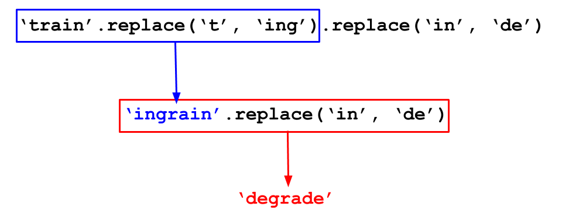

---
**Question 1.1.1.** Use `replace` to transform the string `'hitchhiker'` into `'matchmaker'`. Assign your result to `new_word`.

**Student scaffold:**

```python
new_word = ...
new_word
```

**Solution:**

```python
new_word = 'hitchhiker'.replace('hi', 'ma') # SOLUTION
new_word
```

*Output:*

```text
'matchmaker'
```

**Test — `q111`**

```python
>>> new_word
'matchmaker'
```

There are many more string methods in Python, but most programmers don't memorize their names or how to use them.  In the "real world," people usually just search the internet for documentation and examples. A complete [list of string methods](https://docs.python.org/3/library/stdtypes.html#string-methods) appears in the Python language documentation. [Stack Overflow](http://stackoverflow.com) has a huge database of answered questions that often demonstrate how to use these methods to achieve various ends. Material covered in these resources that haven't already been introduced in this class will be out of scope.

---
## 1.2. Converting to and from Strings

Strings and numbers are different *types* of values, even when a string contains the digits of a number. For example, evaluating the following cell causes an error because an integer cannot be added to a string.

_Note:_ An integer cannot be added to a string, and a float cannot be added to a string. However, we **can** add integers and floats!

**Code:**

```python
8 + "8"
```

*Output (stdout):*

```text
Unexpected exception formatting exception. Falling back to standard exception
```

*Output (stderr):*

```text
Traceback (most recent call last):
  File "/Users/marissalumpkin/Desktop/data8/assignments_new/env/lib/python3.13/site-packages/IPython/core/interactiveshell.py", line 3577, in run_code
    exec(code_obj, self.user_global_ns, self.user_ns)
    ~~~~^^^^^^^^^^^^^^^^^^^^^^^^^^^^^^^^^^^^^^^^^^^^^
  File "/var/folders/xv/tl5mnl5s0mz_ykhsrhdyb_rm0000gn/T/ipykernel_16459/451511607.py", line 1, in <module>
    8 + "8"
    ~~^~~~~
TypeError: unsupported operand type(s) for +: 'int' and 'str'

During handling of the above exception, another exception occurred:

Traceback (most recent call last):
  File "/Users/marissalumpkin/Desktop/data8/assignments_new/env/lib/python3.13/site-packages/IPython/core/interactiveshell.py", line 2168, in showtraceback
    stb = self.InteractiveTB.structured_traceback(
        etype, value, tb, tb_offset=tb_offset
    )
  File "/Users/marissalumpkin/Desktop/data8/assignments_new/env/lib/python3.13/site-packages/IPython/core/ultratb.py", line 1454, in structured_traceback
    return FormattedTB.structured_traceback(
           ~~~~~~~~~~~~~~~~~~~~~~~~~~~~~~~~^
        self, etype, evalue, etb, tb_offset, number_of_lines_of_context
        ^^^^^^^^^^^^^^^^^^^^^^^^^^^^^^^^^^^^^^^^^^^^^^^^^^^^^^^^^^^^^^^
    )
    ^
  File "/Users/marissalumpkin/Desktop/data8/assignments_new/env/lib/python3.13/site-packages/IPython/core/ultratb.py", line 1345, in structured_traceback
    return VerboseTB.structured_traceback(
           ~~~~~~~~~~~~~~~~~~~~~~~~~~~~~~^
        self, etype, value, tb, tb_offset, number_of_lines_of_context
        ^^^^^^^^^^^^^^^^^^^^^^^^^^^^^^^^^^^^^^^^^^^^^^^^^^^^^^^^^^^^^
    )
    ^
  File "/Users/marissalumpkin/Desktop/data8/assignments_new/env/lib/python3.13/site-packages/IPython/core/ultratb.py", line 1192, in structured_traceback
    formatted_exception = self.format_exception_as_a_whole(etype, evalue, etb, number_of_lines_of_context,
                                                           tb_offset)
  File "/Users/marissalumpkin/Desktop/data8/assignments_new/env/lib/python3.13/site-packages/IPython/core/ultratb.py", line 1082, in format_exception_as_a_whole
    self.get_records(etb, number_of_lines_of_context, tb_offset) if etb else []
    ~~~~~~~~~~~~~~~~^^^^^^^^^^^^^^^^^^^^^^^^^^^^^^^^^^^^^^^^^^^^
  File "/Users/marissalumpkin/Desktop/data8/assignments_new/env/lib/python3.13/site-packages/IPython/core/ultratb.py", line 1179, in get_records
    res = list(stack_data.FrameInfo.stack_data(etb, options=options))[tb_offset:]
          ~~~~^^^^^^^^^^^^^^^^^^^^^^^^^^^^^^^^^^^^^^^^^^^^^^^^^^^^^^^
  File "/Users/marissalumpkin/Desktop/data8/assignments_new/env/lib/python3.13/site-packages/stack_data/core.py", line 597, in stack_data
    yield from collapse_repeated(
    ...<4 lines>...
    )
  File "/Users/marissalumpkin/Desktop/data8/assignments_new/env/lib/python3.13/site-packages/stack_data/utils.py", line 83, in collapse_repeated
    yield from map(mapper, original_group)
  File "/Users/marissalumpkin/Desktop/data8/assignments_new/env/lib/python3.13/site-packages/stack_data/core.py", line 587, in mapper
    return cls(f, options)
  File "/Users/marissalumpkin/Desktop/data8/assignments_new/env/lib/python3.13/site-packages/stack_data/core.py", line 551, in __init__
    self.executing = Source.executing(frame_or_tb)
                     ~~~~~~~~~~~~~~~~^^^^^^^^^^^^^
  File "/Users/marissalumpkin/Desktop/data8/assignments_new/env/lib/python3.13/site-packages/executing/executing.py", line 283, in executing
    assert_(new_stmts <= stmts)
    ~~~~~~~^^^^^^^^^^^^^^^^^^^^
  File "/Users/marissalumpkin/Desktop/data8/assignments_new/env/lib/python3.13/site-packages/executing/executing.py", line 80, in assert_
    raise AssertionError(str(message))
AssertionError
```

However, there are built-in functions to convert numbers to strings and strings to numbers. Some of these built-in functions have restrictions on the type of argument they take:

|Function |Description|
|-|-|
|`int`|Converts a string of digits or a float to an integer ("int") value|
|`float`|Converts a string of digits (perhaps with a decimal point) or an int to a decimal ("float") value|
|`str`|Converts any value to a string|

Try to predict what data type and value `example` evaluates to, then run the cell.

**Code:**

```python
example = 8 + int("10") + float("8")

print(example)
print("This example returned a " + str(type(example)) + "!")
```

*Output (stdout):*

```text
26.0
This example returned a <class 'float'>!
```

Suppose you're writing a program that looks for dates in a text, and you want your program to find the amount of time that elapsed between two years it has identified.  It doesn't make sense to subtract two texts, but you can first convert the text containing the years into numbers.

---

**Question 1.2.1.** Finish the code below to compute the number of years that elapsed between `one_year` and `another_year`.  Don't just write the numbers `1618` and `1648` (or `30`); use a conversion function to turn the given text data into numbers.

**Student scaffold:**

```python
# Some text data:
one_year = "1618"
another_year = "1648"

# Complete the next line.  Note that we can't just write:
#   another_year - one_year
# If you don't see why, try seeing what happens when you
# write that here.
difference = ...
difference
```

**Solution:**

```python
# Some text data:
one_year = "1618"
another_year = "1648"

# Complete the next line.  Note that we can't just write:
#   another_year - one_year
# If you don't see why, try seeing what happens when you
# write that here.
difference = int(another_year) - int(one_year) # SOLUTION
difference
```

*Output:*

```text
30
```

**Test — `q121`**

```python
>>> abs(difference) == 30 or abs(difference) == 30.0
True
```

---
## 1.3. Passing strings to functions

String values, like numbers, can be arguments to functions and can be returned by functions. 

The function `len` (derived from the word "length") takes a single string as its argument and returns the number of characters (including spaces and punctuation) in the string.

Note that it doesn't count *words*. `len("one small step for man")` evaluates to 22 characters, not 5 words.

**Question 1.3.1.**  Use `len` to find the number of characters in the long string in the next cell.  Characters include things like spaces and punctuation. Assign `sentence_length` to that number.

(The string is the first sentence of the English translation of the French [Declaration of the Rights of Man](http://avalon.law.yale.edu/18th_century/rightsof.asp).)

**Student scaffold:**

```python
a_very_long_sentence = "The representatives of the French people, organized as a National Assembly, believing that the ignorance, neglect, or contempt of the rights of man are the sole cause of public calamities and of the corruption of governments, have determined to set forth in a solemn declaration the natural, unalienable, and sacred rights of man, in order that this declaration, being constantly before all the members of the Social body, shall remind them continually of their rights and duties; in order that the acts of the legislative power, as well as those of the executive power, may be compared at any moment with the objects and purposes of all political institutions and may thus be more respected, and, lastly, in order that the grievances of the citizens, based hereafter upon simple and incontestable principles, shall tend to the maintenance of the constitution and redound to the happiness of all."
sentence_length = ...
sentence_length
```

**Solution:**

```python
a_very_long_sentence = "The representatives of the French people, organized as a National Assembly, believing that the ignorance, neglect, or contempt of the rights of man are the sole cause of public calamities and of the corruption of governments, have determined to set forth in a solemn declaration the natural, unalienable, and sacred rights of man, in order that this declaration, being constantly before all the members of the Social body, shall remind them continually of their rights and duties; in order that the acts of the legislative power, as well as those of the executive power, may be compared at any moment with the objects and purposes of all political institutions and may thus be more respected, and, lastly, in order that the grievances of the citizens, based hereafter upon simple and incontestable principles, shall tend to the maintenance of the constitution and redound to the happiness of all."
sentence_length = len(a_very_long_sentence) # SOLUTION
sentence_length
```

*Output:*

```text
896
```

**Test — `q131`**

```python
>>> sentence_length
896
```

---
# 2. Arrays

Computers are most useful when you can use a small amount of code to *do the same action* to *many different things*.

For example, in the time it takes you to calculate the 18% tip on a restaurant bill, a laptop can calculate 18% tips for every restaurant bill paid by every human on Earth that day.  (That's if you're pretty fast at doing arithmetic in your head!)

**Arrays** are how we put many values in one place so that we can operate on them as a group. For example, if `billions_of_numbers` is an array of numbers, the expression

    .18 * billions_of_numbers

gives a new array of numbers that contains the result of multiplying **each number** in `billions_of_numbers` by .18.  Arrays are not limited to numbers; we can also put all the words in a book into an array of strings.

Concretely, an array is a **collection of values of the same type**.

---
## 2.1. Making arrays

First, let's learn how to manually input values into an array. This typically isn't how programs work. Normally, we create arrays by loading them from an external source, like a data file.

To create an array by hand, call the function `make_array`.  Each argument you pass to `make_array` will be in the array it returns.  Run this cell to see an example:

**Code:**

```python
make_array(0.125, 4.75, -1.3)
```

*Output:*

```text
array([ 0.125,  4.75 , -1.3  ])
```

Each value in an array (in the above case, the numbers 0.125, 4.75, and -1.3) is called an *element* of that array.

Arrays themselves are also values, just like numbers and strings.  That means you can assign them to names or use them as arguments to functions. For example, `len(<some_array>)` returns the number of elements in `some_array`.

**Question 2.1.1.** Make an array containing the numbers 0, 1, -1, and $\pi$, in that order.  Name it `interesting_numbers`.  

*Hint:* How did you get the value $\pi$ in lab 2?  You can refer to it the same way here. The `math` module has been imported at the top of this notebook.

**Student scaffold:**

```python
interesting_numbers = ...
interesting_numbers
```

**Solution:**

```python
interesting_numbers = make_array(0, 1, -1, math.pi) # SOLUTION
interesting_numbers
```

*Output:*

```text
array([ 0.        ,  1.        , -1.        ,  3.14159265])
```

**Test — `q211`**

```python
>>> import numpy as np
>>> type(interesting_numbers) == np.ndarray
True

>>> len(interesting_numbers)
4

>>> import numpy as np
>>> all(interesting_numbers == np.array([0, 1, -1, math.pi]))
True
```

--- 
**Question 2.1.2.** Make an array containing the five strings `"Hello"`, `","`, `" "`, `"world"`, and `"!"`.  (The third one is a single space inside quotes.)  Name it `hello_world_components`.

*Note:* If you evaluate `hello_world_components`, you'll notice some extra information in addition to its contents: `dtype='<U5'`.  That's just NumPy's extremely cryptic way of saying that the data types in the array are strings.

**Student scaffold:**

```python
hello_world_components = ...
hello_world_components
```

**Solution:**

```python
hello_world_components = make_array("Hello", ",", " ", "world", "!") # SOLUTION
hello_world_components
```

*Output:*

```text
array(['Hello', ',', ' ', 'world', '!'],
      dtype='<U5')
```

**Test — `q212`**

```python
>>> import numpy as np
>>> type(hello_world_components) == np.ndarray
True

>>> len(hello_world_components)
5

>>> import numpy as np
>>> all(hello_world_components == np.array(['Hello', ',', ' ', 'world', '!']))
True
```

###  `np.arange`
Arrays are provided by a package called [NumPy](http://www.numpy.org/) (pronounced "NUM-pie"). The package is called `numpy`, but it's standard to rename it `np` for brevity.  You can do that with:

    import numpy as np

Very often in data science, we want to work with many numbers that are evenly spaced within some range.  NumPy provides a special function for this called `arange`.  The line of code `np.arange(start, stop, step)` evaluates to an array with all the numbers starting at `start` and counting up by `step`, stopping **before** `stop` is reached.

Run the following cells to see some examples!

**Code:**

```python
# This array starts at 1 and counts up by 2
# and then stops before 6
np.arange(1, 6, 2)
```

*Output:*

```text
array([1, 3, 5])
```

**Code:**

```python
# This array doesn't contain 9
# because np.arange stops *before* the stop value is reached
np.arange(4, 9, 1)
```

*Output:*

```text
array([4, 5, 6, 7, 8])
```

**Code:**

```python
# The default start value of np.arange is 0
# The default step value of np.arange is 1
# This array defaults to start at 0 and count up by 1, but then stops before 5
# since np.arange was given one argument, start and step have the above defaults. 
np.arange(5)
```

*Output:*

```text
array([0, 1, 2, 3, 4])
```

---
**Question 2.1.3.** Import `numpy` as `np` and then use `np.arange` to create an array with the multiples of 99 from 0 up to (**and including**) 9999.  (So its elements are 0, 99, 198, 297, etc.)

**Student scaffold:**

```python
...
multiples_of_99 = ...
multiples_of_99
```

**Solution:**

```python
import numpy as np # SOLUTION
multiples_of_99 = np.arange(0, 9999+99, 99) # SOLUTION
multiples_of_99
```

*Output:*

```text
array([   0,   99,  198,  297,  396,  495,  594,  693,  792,  891,  990,
       1089, 1188, 1287, 1386, 1485, 1584, 1683, 1782, 1881, 1980, 2079,
       2178, 2277, 2376, 2475, 2574, 2673, 2772, 2871, 2970, 3069, 3168,
       3267, 3366, 3465, 3564, 3663, 3762, 3861, 3960, 4059, 4158, 4257,
       4356, 4455, 4554, 4653, 4752, 4851, 4950, 5049, 5148, 5247, 5346,
       5445, 5544, 5643, 5742, 5841, 5940, 6039, 6138, 6237, 6336, 6435,
       6534, 6633, 6732, 6831, 6930, 7029, 7128, 7227, 7326, 7425, 7524,
       7623, 7722, 7821, 7920, 8019, 8118, 8217, 8316, 8415, 8514, 8613,
       8712, 8811, 8910, 9009, 9108, 9207, 9306, 9405, 9504, 9603, 9702,
       9801, 9900, 9999])
```

**Test — `q213`**

```python
>>> type(multiples_of_99) == np.ndarray
True

>>> len(multiples_of_99)
102

>>> all(multiples_of_99 == np.arange(0, 9999 + 99, 99))
True
```

---
## 2.2. Working with single elements of arrays ("indexing")
Let's work with a more interesting dataset.  The next cell creates an array called `population_amounts` that includes estimated world populations of every year from **1950** to roughly the present.  (The estimates come from the US Census Bureau website.)

Rather than type in the data manually, we've loaded them from a file on your computer called `world_population.csv`.  You'll learn how to do that later in this lab!

**Code:**

```python
population_amounts = Table.read_table("world_population.csv").column("Population")
population_amounts
```

*Output:*

```text
array([2557628654, 2594939877, 2636772306, 2682053389, 2730228104,
       2782098943, 2835299673, 2891349717, 2948137248, 3000716593,
       3043001508, 3083966929, 3140093217, 3209827882, 3281201306,
       3350425793, 3420677923, 3490333715, 3562313822, 3637159050,
       3712697742, 3790326948, 3866568653, 3942096442, 4016608813,
       4089083233, 4160185010, 4232084578, 4304105753, 4379013942,
       4451362735, 4534410125, 4614566561, 4695736743, 4774569391,
       4856462699, 4940571232, 5027200492, 5114557167, 5201440110,
       5288955934, 5371585922, 5456136278, 5538268316, 5618682132,
       5699202985, 5779440593, 5857972543, 5935213248, 6012074922,
       6088571383, 6165219247, 6242016348, 6318590956, 6395699509,
       6473044732, 6551263534, 6629913759, 6709049780, 6788214394,
       6866332358, 6944055583, 7022349283, 7101027895, 7178722893,
       7256490011])
```

Here's how we get the first element of `population_amounts`, which is the world population in the first year in the dataset, 1950.

**Code:**

```python
population_amounts.item(0)
```

*Output:*

```text
2557628654
```

The value of that expression is the number 2,557,628,654 (around 2.5 billion), because that's the first thing in the array `population_amounts`.

Notice that we wrote `.item(0)`, not `.item(1)`, to get the first element.  This is a weird convention in computer science.  **0 is called the *index* of the first item.**  It's the number of elements that appear *before* that item.  So 3 is the index of the 4th item.

Here are some more examples.  In the examples, we've given names to the things we get out of `population_amounts`.  Read and run each cell.

**Code:**

```python
# The population in 1962 is the 13th element in the array
# because it is 12 indices after 1950, which is at index 0. (1950 + 12 = 1962)

population_1962 = population_amounts.item(12)
population_1962
```

*Output:*

```text
3140093217
```

**Code:**

```python
# The 66th element is the population in 2015.
population_2015 = population_amounts.item(65)
population_2015
```

*Output:*

```text
7256490011
```

**Code:**

```python
# The array has only 66 elements, so this doesn't work.
# (There's no element with 66 other elements before it.)
population_2016 = population_amounts.item(66)
population_2016
```

*Output (stdout):*

```text
Unexpected exception formatting exception. Falling back to standard exception
```

*Output (stderr):*

```text
Traceback (most recent call last):
  File "/Users/marissalumpkin/Desktop/data8/assignments_new/env/lib/python3.13/site-packages/IPython/core/interactiveshell.py", line 3577, in run_code
    exec(code_obj, self.user_global_ns, self.user_ns)
    ~~~~^^^^^^^^^^^^^^^^^^^^^^^^^^^^^^^^^^^^^^^^^^^^^
  File "/var/folders/xv/tl5mnl5s0mz_ykhsrhdyb_rm0000gn/T/ipykernel_16459/4056345982.py", line 3, in <module>
    population_2016 = population_amounts.item(66)
IndexError: index 66 is out of bounds for axis 0 with size 66

During handling of the above exception, another exception occurred:

Traceback (most recent call last):
  File "/Users/marissalumpkin/Desktop/data8/assignments_new/env/lib/python3.13/site-packages/IPython/core/interactiveshell.py", line 2168, in showtraceback
    stb = self.InteractiveTB.structured_traceback(
        etype, value, tb, tb_offset=tb_offset
    )
  File "/Users/marissalumpkin/Desktop/data8/assignments_new/env/lib/python3.13/site-packages/IPython/core/ultratb.py", line 1454, in structured_traceback
    return FormattedTB.structured_traceback(
           ~~~~~~~~~~~~~~~~~~~~~~~~~~~~~~~~^
        self, etype, evalue, etb, tb_offset, number_of_lines_of_context
        ^^^^^^^^^^^^^^^^^^^^^^^^^^^^^^^^^^^^^^^^^^^^^^^^^^^^^^^^^^^^^^^
    )
    ^
  File "/Users/marissalumpkin/Desktop/data8/assignments_new/env/lib/python3.13/site-packages/IPython/core/ultratb.py", line 1345, in structured_traceback
    return VerboseTB.structured_traceback(
           ~~~~~~~~~~~~~~~~~~~~~~~~~~~~~~^
        self, etype, value, tb, tb_offset, number_of_lines_of_context
        ^^^^^^^^^^^^^^^^^^^^^^^^^^^^^^^^^^^^^^^^^^^^^^^^^^^^^^^^^^^^^
    )
    ^
  File "/Users/marissalumpkin/Desktop/data8/assignments_new/env/lib/python3.13/site-packages/IPython/core/ultratb.py", line 1192, in structured_traceback
    formatted_exception = self.format_exception_as_a_whole(etype, evalue, etb, number_of_lines_of_context,
                                                           tb_offset)
  File "/Users/marissalumpkin/Desktop/data8/assignments_new/env/lib/python3.13/site-packages/IPython/core/ultratb.py", line 1082, in format_exception_as_a_whole
    self.get_records(etb, number_of_lines_of_context, tb_offset) if etb else []
    ~~~~~~~~~~~~~~~~^^^^^^^^^^^^^^^^^^^^^^^^^^^^^^^^^^^^^^^^^^^^
  File "/Users/marissalumpkin/Desktop/data8/assignments_new/env/lib/python3.13/site-packages/IPython/core/ultratb.py", line 1179, in get_records
    res = list(stack_data.FrameInfo.stack_data(etb, options=options))[tb_offset:]
          ~~~~^^^^^^^^^^^^^^^^^^^^^^^^^^^^^^^^^^^^^^^^^^^^^^^^^^^^^^^
  File "/Users/marissalumpkin/Desktop/data8/assignments_new/env/lib/python3.13/site-packages/stack_data/core.py", line 597, in stack_data
    yield from collapse_repeated(
    ...<4 lines>...
    )
  File "/Users/marissalumpkin/Desktop/data8/assignments_new/env/lib/python3.13/site-packages/stack_data/utils.py", line 83, in collapse_repeated
    yield from map(mapper, original_group)
  File "/Users/marissalumpkin/Desktop/data8/assignments_new/env/lib/python3.13/site-packages/stack_data/core.py", line 587, in mapper
    return cls(f, options)
  File "/Users/marissalumpkin/Desktop/data8/assignments_new/env/lib/python3.13/site-packages/stack_data/core.py", line 551, in __init__
    self.executing = Source.executing(frame_or_tb)
                     ~~~~~~~~~~~~~~~~^^^^^^^^^^^^^
  File "/Users/marissalumpkin/Desktop/data8/assignments_new/env/lib/python3.13/site-packages/executing/executing.py", line 283, in executing
    assert_(new_stmts <= stmts)
    ~~~~~~~^^^^^^^^^^^^^^^^^^^^
  File "/Users/marissalumpkin/Desktop/data8/assignments_new/env/lib/python3.13/site-packages/executing/executing.py", line 80, in assert_
    raise AssertionError(str(message))
AssertionError
```

Since `make_array` returns an array, we can call `.item(3)` on its output to get its 4th element, just like we "chained" together calls to the method `replace` earlier.

**Code:**

```python
make_array(-1, -3, 4, -2).item(3)
```

*Output:*

```text
-2
```

---
**Question 2.2.1.** Set `population_1973` to the world population in 1973, by getting the appropriate element from `population_amounts` using `item`.

**Student scaffold:**

```python
population_1973 = ...
population_1973
```

**Solution:**

```python
population_1973 = population_amounts.item(23) # SOLUTION
population_1973
```

*Output:*

```text
3942096442
```

**Test — `q221`**

```python
>>> population_1973
3942096442
```

---
## 2.3. Doing something to every element of an array
Arrays are primarily useful for doing the same operation many times, so we don't often have to use `.item` and work with single elements.

### Rounding
Here is one simple question we might ask about world population:

> How big was the population in each year, rounded to the nearest million?

Rounding is often used with large numbers when we don't need as much precision in our numbers. One example of this is when we present data in tables and visualizations. 

We could try to answer our question using the `round` function that is built into Python and the `item` method you just saw. 

**Note:** the `round` function takes in two arguments: the number to be rounded, and the number of decimal places to round to. The second argument can be thought of as how many steps right or left you move from the decimal point. Negative numbers tell us to move left, and positive numbers tell us to move right. So, if we have `round(1234.5, -2)`, it means that we should move two places left, and then make all numbers to the right of this place zeroes. This would output the number 1200.0. On the other hand, if we have `round(6.789, 1)`, we should move one place right, and then make all numbers to the right of this place zeroes. This would output the number 6.8.


**Code:**

```python
population_1950_magnitude = round(population_amounts.item(0), -6)
population_1951_magnitude = round(population_amounts.item(1), -6)
population_1952_magnitude = round(population_amounts.item(2), -6)
population_1953_magnitude = round(population_amounts.item(3), -6)
print(population_1950_magnitude, population_1951_magnitude, population_1952_magnitude, population_1953_magnitude)
```

*Output (stdout):*

```text
2558000000 2595000000 2637000000 2682000000
```

But this is tedious and doesn't really take advantage of the fact that we are using a computer.

Instead, NumPy provides its own version of `round` that rounds each element of an array.  It takes in two arguments: a single array of numbers, and the number of decimal places to round to.  It returns an array of the same length, where the first element of the result is the first element of the argument rounded, and so on.

---

**Question 2.3.1.** Use `np.round` to compute the world population in every year, rounded to the nearest million (6 zeroes).  Give the result (an array of 66 numbers) the name `population_rounded`.  Your code should be very short.

**Student scaffold:**

```python
population_rounded = ...
population_rounded
```

**Solution:**

```python
population_rounded = np.round(population_amounts, -6) # SOLUTION
population_rounded
```

*Output:*

```text
array([2558000000, 2595000000, 2637000000, 2682000000, 2730000000,
       2782000000, 2835000000, 2891000000, 2948000000, 3001000000,
       3043000000, 3084000000, 3140000000, 3210000000, 3281000000,
       3350000000, 3421000000, 3490000000, 3562000000, 3637000000,
       3713000000, 3790000000, 3867000000, 3942000000, 4017000000,
       4089000000, 4160000000, 4232000000, 4304000000, 4379000000,
       4451000000, 4534000000, 4615000000, 4696000000, 4775000000,
       4856000000, 4941000000, 5027000000, 5115000000, 5201000000,
       5289000000, 5372000000, 5456000000, 5538000000, 5619000000,
       5699000000, 5779000000, 5858000000, 5935000000, 6012000000,
       6089000000, 6165000000, 6242000000, 6319000000, 6396000000,
       6473000000, 6551000000, 6630000000, 6709000000, 6788000000,
       6866000000, 6944000000, 7022000000, 7101000000, 7179000000,
       7256000000])
```

**Test — `q231`**

```python
>>> import numpy as np
>>> type(population_rounded) == np.ndarray
True

>>> import numpy as np
>>> sum(population_rounded) == 312868000000
True
```

What you just did is called **elementwise** application of `np.round`, since `np.round` operates separately on each element of the array that it's called on. Here's a picture of what's going on:

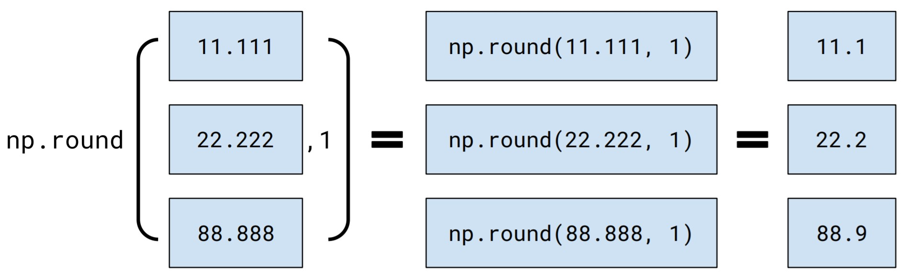

The textbook's [section](https://www.inferentialthinking.com/chapters/05/1/Arrays)  on arrays has a useful list of NumPy functions that are designed to work elementwise, like `np.round`.

### Arithmetic
Arithmetic also works elementwise on arrays, meaning that if you perform an arithmetic operation (like subtraction, division, etc) on an array, Python will do the operation to every element of the array individually and return an array of all of the results. For example, you can divide all the population numbers by 1 billion to get numbers in billions:

**Code:**

```python
population_in_billions = population_amounts / 1000000000
population_in_billions
```

*Output:*

```text
array([ 2.55762865,  2.59493988,  2.63677231,  2.68205339,  2.7302281 ,
        2.78209894,  2.83529967,  2.89134972,  2.94813725,  3.00071659,
        3.04300151,  3.08396693,  3.14009322,  3.20982788,  3.28120131,
        3.35042579,  3.42067792,  3.49033371,  3.56231382,  3.63715905,
        3.71269774,  3.79032695,  3.86656865,  3.94209644,  4.01660881,
        4.08908323,  4.16018501,  4.23208458,  4.30410575,  4.37901394,
        4.45136274,  4.53441012,  4.61456656,  4.69573674,  4.77456939,
        4.8564627 ,  4.94057123,  5.02720049,  5.11455717,  5.20144011,
        5.28895593,  5.37158592,  5.45613628,  5.53826832,  5.61868213,
        5.69920299,  5.77944059,  5.85797254,  5.93521325,  6.01207492,
        6.08857138,  6.16521925,  6.24201635,  6.31859096,  6.39569951,
        6.47304473,  6.55126353,  6.62991376,  6.70904978,  6.78821439,
        6.86633236,  6.94405558,  7.02234928,  7.10102789,  7.17872289,
        7.25649001])
```

You can do the same with addition, subtraction, multiplication, and exponentiation (`**`).

---
## 3. Creating Tables

An array is useful for describing a single attribute of each element in a collection. For example, let's say our collection is all US States. Then an array could describe the land area of each state. 

Tables extend this idea by containing multiple columns stored and represented as arrays, each one describing a different attribute for every element of a collection. In this way, tables allow us to not only store data about many entities but to also contain several kinds of data about each entity. 

For example, in the cell below we have two arrays. The first one, `population_amounts`, was defined above in section 2.2 and contains the world population in each year (estimated by the US Census Bureau). The second array, `years`, contains the years themselves. These elements are in order, so the year and the world population for that year have the same index in their corresponding arrays.

**Code:**

```python
# Just run this cell

years = np.arange(1950, 2015+1)
print("Population column:", population_amounts)
print("Years column:", years)
```

*Output (stdout):*

```text
Population column: [2557628654 2594939877 2636772306 2682053389 2730228104 2782098943
 2835299673 2891349717 2948137248 3000716593 3043001508 3083966929
 3140093217 3209827882 3281201306 3350425793 3420677923 3490333715
 3562313822 3637159050 3712697742 3790326948 3866568653 3942096442
 4016608813 4089083233 4160185010 4232084578 4304105753 4379013942
 4451362735 4534410125 4614566561 4695736743 4774569391 4856462699
 4940571232 5027200492 5114557167 5201440110 5288955934 5371585922
 5456136278 5538268316 5618682132 5699202985 5779440593 5857972543
 5935213248 6012074922 6088571383 6165219247 6242016348 6318590956
 6395699509 6473044732 6551263534 6629913759 6709049780 6788214394
 6866332358 6944055583 7022349283 7101027895 7178722893 7256490011]
Years column: [1950 1951 1952 1953 1954 1955 1956 1957 1958 1959 1960 1961 1962 1963 1964
 1965 1966 1967 1968 1969 1970 1971 1972 1973 1974 1975 1976 1977 1978 1979
 1980 1981 1982 1983 1984 1985 1986 1987 1988 1989 1990 1991 1992 1993 1994
 1995 1996 1997 1998 1999 2000 2001 2002 2003 2004 2005 2006 2007 2008 2009
 2010 2011 2012 2013 2014 2015]
```

Suppose we want to answer this question:

> In which year did the world's population cross 6 billion?

You could technically answer this question just from staring at the arrays, but it's a bit convoluted, since you would have to count the position where the population first crossed 6 billion, then find the corresponding element in the years array. In cases like these, it might be easier to put the data into a *`Table`*, a 2-dimensional type of dataset. 

The expression below:

- creates an empty table using the expression `Table()`,
- adds two columns by calling `with_columns` with four arguments (corresponding to the name of the column, the values for that column, the name of the second column, and the values for that column),
- assigns the result to the name `population`, and finally
- evaluates `population` so that we can see the table.

The strings `"Year"` and `"Population"` are column labels that we have chosen. The names `population_amounts` and `years` were assigned above to two arrays of the **same length**. The function `with_columns` (you can find the documentation [here](http://data8.org/su26/reference)) takes in alternating strings (to represent column labels) and arrays (representing the data in those columns). The strings and arrays are separated by commas. 

_Note:_ When you want to add one column to a table, you can either use `with_columns` or `with_column` with two arguments (the column name and the array). However, if you want to add more than one column to a table, you must use `with_columns` with alternating arguments of strings and arrays.

**Code:**

```python
population = Table().with_columns(
    "Population", population_amounts,
    "Year", years
)
population
```

*Output:*

| Population | Year |
| --- | --- |
| 2557628654 | 1950 |
| 2594939877 | 1951 |
| 2636772306 | 1952 |
| 2682053389 | 1953 |
| 2730228104 | 1954 |
| 2782098943 | 1955 |
| 2835299673 | 1956 |
| 2891349717 | 1957 |
| 2948137248 | 1958 |
| 3000716593 | 1959 |

Now the data is combined into a single table! It's much easier to parse this data. If you need to know what the population was in 1959, for example, you can tell from a single glance.

---
**Question 3.1.** In the cell below, we've created 2 arrays. Using the steps above, assign `top_10_movies` to a table that has two columns called "Name" and "Rating", which hold `top_10_movie_names` and `top_10_movie_ratings` respectively.

**Student scaffold:**

```python
top_10_movie_names = make_array(
        'The Shawshank Redemption (1994)',
        'The Godfather (1972)',
        'The Godfather: Part II (1974)',
        'Pulp Fiction (1994)',
        "Schindler's List (1993)",
        'The Lord of the Rings: The Return of the King (2003)',
        '12 Angry Men (1957)',
        'The Dark Knight (2008)',
        'Il buono, il brutto, il cattivo (1966)',
        'The Lord of the Rings: The Fellowship of the Ring (2001)')
top_10_movie_ratings = make_array(9.2, 9.2, 9., 8.9, 8.9, 8.9, 8.9, 8.9, 8.9, 8.8)

top_10_movies = ...

# We've put this next line here 
# so your table will get printed out 
# when you run this cell.
top_10_movies
```

**Solution:**

```python
top_10_movie_names = make_array(
        'The Shawshank Redemption (1994)',
        'The Godfather (1972)',
        'The Godfather: Part II (1974)',
        'Pulp Fiction (1994)',
        "Schindler's List (1993)",
        'The Lord of the Rings: The Return of the King (2003)',
        '12 Angry Men (1957)',
        'The Dark Knight (2008)',
        'Il buono, il brutto, il cattivo (1966)',
        'The Lord of the Rings: The Fellowship of the Ring (2001)')
top_10_movie_ratings = make_array(9.2, 9.2, 9., 8.9, 8.9, 8.9, 8.9, 8.9, 8.9, 8.8)

top_10_movies = Table().with_columns("Name", top_10_movie_names, "Rating", top_10_movie_ratings) # SOLUTION

# We've put this next line here 
# so your table will get printed out 
# when you run this cell.
top_10_movies
```

*Output:*

| Name | Rating |
| --- | --- |
| The Shawshank Redemption (1994) | 9.2 |
| The Godfather (1972) | 9.2 |
| The Godfather: Part II (1974) | 9 |
| Pulp Fiction (1994) | 8.9 |
| Schindler's List (1993) | 8.9 |
| The Lord of the Rings: The Return of the King (2003) | 8.9 |
| 12 Angry Men (1957) | 8.9 |
| The Dark Knight (2008) | 8.9 |
| Il buono, il brutto, il cattivo (1966) | 8.9 |
| The Lord of the Rings: The Fellowship of the Ring (2001) | 8.8 |

**Test — `q31`**

```python
>>> type(top_10_movies) == tables.Table
True

>>> top_10_movies.select('Name', 'Rating')
Name                                                     | Rating
The Shawshank Redemption (1994)                          | 9.2
The Godfather (1972)                                     | 9.2
The Godfather: Part II (1974)                            | 9
Pulp Fiction (1994)                                      | 8.9
Schindler's List (1993)                                  | 8.9
The Lord of the Rings: The Return of the King (2003)     | 8.9
12 Angry Men (1957)                                      | 8.9
The Dark Knight (2008)                                   | 8.9
Il buono, il brutto, il cattivo (1966)                   | 8.9
The Lord of the Rings: The Fellowship of the Ring (2001) | 8.8
```

#### Loading a table from a file

In most cases, we aren't going to go through the trouble of typing in all the data manually. Instead, we load them in from an external source, like a data file. There are many formats for data files, but CSV ("comma-separated values") is the most common.

`Table.read_table(...)` takes one argument (a path to a data file in **string** format) and returns a table.  

**Question 3.2.** `imdb.csv` contains a table of information about the 250 highest-rated movies on IMDb.  Load it as a table called `imdb`.

(You may remember working with this table in Lab 2!)

**Student scaffold:**

```python
imdb = ...
imdb
```

**Solution:**

```python
imdb = Table.read_table('imdb.csv') # SOLUTION
imdb
```

*Output:*

| Votes | Rating | Title | Year | Decade |
| --- | --- | --- | --- | --- |
| 88355 | 8.4 | M | 1931 | 1930 |
| 132823 | 8.3 | Singin' in the Rain | 1952 | 1950 |
| 74178 | 8.3 | All About Eve | 1950 | 1950 |
| 635139 | 8.6 | Léon | 1994 | 1990 |
| 145514 | 8.2 | The Elephant Man | 1980 | 1980 |
| 425461 | 8.3 | Full Metal Jacket | 1987 | 1980 |
| 441174 | 8.1 | Gone Girl | 2014 | 2010 |
| 850601 | 8.3 | Batman Begins | 2005 | 2000 |
| 37664 | 8.2 | Judgment at Nuremberg | 1961 | 1960 |
| 46987 | 8 | Relatos salvajes | 2014 | 2010 |

**Test — `q32`**

```python
>>> type(imdb) == tables.Table
True

>>> imdb.num_rows == 250
True

>>> imdb.select('Votes', 'Rating', 'Title', 'Year', 'Decade').sort(0).take(range(2, 5))
Votes | Rating | Title                       | Year | Decade
31003 | 8.1    | Le salaire de la peur       | 1953 | 1950
32385 | 8      | La battaglia di Algeri      | 1966 | 1960
35983 | 8.1    | The Best Years of Our Lives | 1946 | 1940
```

Where did `imdb.csv` come from? Take a look at [this lab's folder](./). You should see a file called `imdb.csv`.

Open up the `imdb.csv` file in that folder and look at the format. What do you notice? The `.csv` filename ending says that this file is in the [CSV (comma-separated value) format](http://edoceo.com/utilitas/csv-file-format).

---
## 4. More Table Operations!

Now that you've worked with arrays, let's add a few more methods to the list of table operations that you saw in Lab 2.

### `tbl.column`

`tbl.column` takes the column name of a table (in string format) as its argument and returns the values in that column as an **array**.

**Code:**

```python
# Returns an array of movie names
top_10_movies.column('Name')
```

*Output:*

```text
array(['The Shawshank Redemption (1994)', 'The Godfather (1972)',
       'The Godfather: Part II (1974)', 'Pulp Fiction (1994)',
       "Schindler's List (1993)",
       'The Lord of the Rings: The Return of the King (2003)',
       '12 Angry Men (1957)', 'The Dark Knight (2008)',
       'Il buono, il brutto, il cattivo (1966)',
       'The Lord of the Rings: The Fellowship of the Ring (2001)'],
      dtype='<U56')
```

### `take`
The table method `take` takes as its argument an array of numbers.  Each number should be the index of a row in the table.  It returns a **new table** with only those rows. 

You'll usually want to use `take` in conjunction with `np.arange` to take the first few rows of a table.

**Code:**

```python
# Take first 5 movies of top_10_movies
top_10_movies.take(np.arange(0, 5, 1))
```

*Output:*

| Name | Rating |
| --- | --- |
| The Shawshank Redemption (1994) | 9.2 |
| The Godfather (1972) | 9.2 |
| The Godfather: Part II (1974) | 9 |
| Pulp Fiction (1994) | 8.9 |
| Schindler's List (1993) | 8.9 |

The next three questions will give you practice with combining the operations you've learned in this lab and the previous one to answer questions about the `population` and `imdb` tables. First, check out the `population` table from section 2.

**Code:**

```python
# Run this cell to display the population table.
population
```

*Output:*

| Population | Year |
| --- | --- |
| 2557628654 | 1950 |
| 2594939877 | 1951 |
| 2636772306 | 1952 |
| 2682053389 | 1953 |
| 2730228104 | 1954 |
| 2782098943 | 1955 |
| 2835299673 | 1956 |
| 2891349717 | 1957 |
| 2948137248 | 1958 |
| 3000716593 | 1959 |

---
**Question 4.1.** Check out the `population` table from section 2 of this lab.  Compute the year when the world population first went above 6 billion. Assign the year to `year_population_crossed_6_billion`.

_Hint:_ How can we filter the table to only rows with population values over 6 billion? How can we find the first year of this filtered table? Review some of the table methods in the [Python Reference Sheet](https://www.data8.org/su26/reference/)!

**Student scaffold:**

```python
year_population_crossed_6_billion = ...
year_population_crossed_6_billion
```

**Solution:**

```python
year_population_crossed_6_billion = population.where('Population', are.above_or_equal_to(6*10**9)).column('Year').item(0) # SOLUTION
year_population_crossed_6_billion
```

*Output:*

```text
1999
```

**Test — `q41`**

```python
>>> import numpy as np
>>> type(year_population_crossed_6_billion) == int or type(year_population_crossed_6_billion) == np.int64
True

>>> year_population_crossed_6_billion == 1999
True
```

---
**Question 4.2.** Find the average rating for movies released before the year 2000 and the average rating for movies released in the year 2000 or after for the movies in `imdb`.

*Hint*: Think of the steps you need to do (take the average, find the ratings, find movies released in 20th/21st centuries), and try to put them in an order that makes sense.

**Student scaffold:**

```python
before_2000 = ...
after_or_in_2000 = ...
before_2000_avg = ...
after_or_in_2000_avg = ...
print("Average before 2000 rating:", before_2000_avg)
print("Average after or in 2000 rating:", after_or_in_2000_avg)
```

**Solution:**

```python
before_2000 = imdb.where('Year', are.below(2000)) # SOLUTION
after_or_in_2000 = imdb.where('Year', are.above_or_equal_to(2000)) # SOLUTION
before_2000_avg = np.mean(before_2000.column('Rating')) # SOLUTION
after_or_in_2000_avg = np.mean(after_or_in_2000.column('Rating')) # SOLUTION
print("Average before 2000 rating:", before_2000_avg)
print("Average after or in 2000 rating:", after_or_in_2000_avg)
```

*Output (stdout):*

```text
Average before 2000 rating: 8.2783625731
Average after or in 2000 rating: 8.23797468354
```

**Test — `q42`**

```python
>>> abs(before_2000_avg - 8.278362573099415) < 1e-05
True

>>> abs(after_or_in_2000_avg - 8.237974683544303) < 1e-05
True
```

---
**Question 4.3.** Here's a challenge: Find the number of movies that came out in *even* years.

*Hint:* The operator `%` computes the remainder when dividing by a number.  So `5 % 2` is 1 and `6 % 2` is 0.  A number is even if the remainder is 0 when you divide by 2.

*Hint 2:* `%` can be used on arrays, operating elementwise like `+` or `*`.  So `make_array(5, 6, 7) % 2` is `array([1, 0, 1])`.

*Hint 3:* Add a new column called "Year Remainder" that's the remainder when each movie's release year is divided by 2. To do this, you can use `tbl.with_column(col_name, col_values)`: a table method that takes in the name of the new column and an array of values and returns a copy of the original `tbl` with the new column.  Then, use `where` to find rows where that new column is equal to 0.  Finally, use `num_rows` to count the number of such rows.

*Note:* These steps can be chained in one single statement, or broken up across several lines with intermediate names assigned. You’re always welcome to break down problems however you wish!

**Student scaffold:**

```python
num_even_year_movies = ...
num_even_year_movies
```

**Solution:**

```python
# BEGIN SOLUTION NO PROMPT
# You could first create a new table with the "Year Remainder" column and then reduce its size and find its number of rows on a new line.
# You could also use the "Year" column as an array and apply the % operator on it, and then compare the array with 0 and finally count the number of Trues that result from the comparison.
# END SOLUTION
num_even_year_movies = imdb.with_column("Year Remainder", imdb.column("Year") % 2).where("Year Remainder", are.equal_to(0)).num_rows # SOLUTION
num_even_year_movies
```

*Output:*

```text
127
```

**Test — `q43`**

```python
>>> num_even_year_movies == 127
True
```

---
## 5. More Array Practice

The following questions will be great practice for learning how to generate arrays in different ways, as well as executing different methods of array arithmetic!

###  5.1 `np.arange` (cont.)

##### Temperature readings
NOAA (the US National Oceanic and Atmospheric Administration) operates weather stations that measure surface temperatures at different sites around the United States.  The hourly readings are [publicly available](http://www.ncdc.noaa.gov/qclcd/QCLCD?prior=N) if you are curious.

Suppose we download all the hourly data from the Oakland, California site for the month of December 2015.  To analyze the data, we want to know when each reading was taken, but we find that the data don't include the timestamps of the readings (the time at which each one was taken).

However, we know the first reading was taken at the first instant of December 2015 (midnight on December 1st) and each subsequent reading was taken exactly 1 hour after the last.

--- 
**Question 5.1.1.** Create an array of the *time, in seconds, since the start of the month* at which **each hourly reading** was taken.  Name it `collection_times`.

*Hint 1:* There were 31 days in December, which is equivalent to ($31 \times 24$) hours or ($31 \times 24 \times 60 \times 60$) seconds.  So your array should have $31 \times 24$ elements in it.

*Hint 2:* The `len` function works on arrays, too!  If your `collection_times` isn't passing the tests, check its length and make sure it has $31 \times 24$ elements.

**Student scaffold:**

```python
collection_times = ...
collection_times
```

**Solution:**

```python
collection_times = np.arange(0, 31*24*60*60, 60*60) # SOLUTION
collection_times
```

*Output:*

```text
array([      0,    3600,    7200,   10800,   14400,   18000,   21600,
         25200,   28800,   32400,   36000,   39600,   43200,   46800,
         50400,   54000,   57600,   61200,   64800,   68400,   72000,
         75600,   79200,   82800,   86400,   90000,   93600,   97200,
        100800,  104400,  108000,  111600,  115200,  118800,  122400,
        126000,  129600,  133200,  136800,  140400,  144000,  147600,
        151200,  154800,  158400,  162000,  165600,  169200,  172800,
        176400,  180000,  183600,  187200,  190800,  194400,  198000,
        201600,  205200,  208800,  212400,  216000,  219600,  223200,
        226800,  230400,  234000,  237600,  241200,  244800,  248400,
        252000,  255600,  259200,  262800,  266400,  270000,  273600,
        277200,  280800,  284400,  288000,  291600,  295200,  298800,
        302400,  306000,  309600,  313200,  316800,  320400,  324000,
        327600,  331200,  334800,  338400,  342000,  345600,  349200,
        352800,  356400,  360000,  363600,  367200,  370800,  374400,
        378000,  381600,  385200,  388800,  392400,  396000,  399600,
        403200,  406800,  410400,  414000,  417600,  421200,  424800,
        428400,  432000,  435600,  439200,  442800,  446400,  450000,
        453600,  457200,  460800,  464400,  468000,  471600,  475200,
        478800,  482400,  486000,  489600,  493200,  496800,  500400,
        504000,  507600,  511200,  514800,  518400,  522000,  525600,
        529200,  532800,  536400,  540000,  543600,  547200,  550800,
        554400,  558000,  561600,  565200,  568800,  572400,  576000,
        579600,  583200,  586800,  590400,  594000,  597600,  601200,
        604800,  608400,  612000,  615600,  619200,  622800,  626400,
        630000,  633600,  637200,  640800,  644400,  648000,  651600,
        655200,  658800,  662400,  666000,  669600,  673200,  676800,
        680400,  684000,  687600,  691200,  694800,  698400,  702000,
        705600,  709200,  712800,  716400,  720000,  723600,  727200,
        730800,  734400,  738000,  741600,  745200,  748800,  752400,
        756000,  759600,  763200,  766800,  770400,  774000,  777600,
        781200,  784800,  788400,  792000,  795600,  799200,  802800,
        806400,  810000,  813600,  817200,  820800,  824400,  828000,
        831600,  835200,  838800,  842400,  846000,  849600,  853200,
        856800,  860400,  864000,  867600,  871200,  874800,  878400,
        882000,  885600,  889200,  892800,  896400,  900000,  903600,
        907200,  910800,  914400,  918000,  921600,  925200,  928800,
        932400,  936000,  939600,  943200,  946800,  950400,  954000,
        957600,  961200,  964800,  968400,  972000,  975600,  979200,
        982800,  986400,  990000,  993600,  997200, 1000800, 1004400,
       1008000, 1011600, 1015200, 1018800, 1022400, 1026000, 1029600,
       1033200, 1036800, 1040400, 1044000, 1047600, 1051200, 1054800,
       1058400, 1062000, 1065600, 1069200, 1072800, 1076400, 1080000,
       1083600, 1087200, 1090800, 1094400, 1098000, 1101600, 1105200,
       1108800, 1112400, 1116000, 1119600, 1123200, 1126800, 1130400,
       1134000, 1137600, 1141200, 1144800, 1148400, 1152000, 1155600,
       1159200, 1162800, 1166400, 1170000, 1173600, 1177200, 1180800,
       1184400, 1188000, 1191600, 1195200, 1198800, 1202400, 1206000,
       1209600, 1213200, 1216800, 1220400, 1224000, 1227600, 1231200,
       1234800, 1238400, 1242000, 1245600, 1249200, 1252800, 1256400,
       1260000, 1263600, 1267200, 1270800, 1274400, 1278000, 1281600,
       1285200, 1288800, 1292400, 1296000, 1299600, 1303200, 1306800,
       1310400, 1314000, 1317600, 1321200, 1324800, 1328400, 1332000,
       1335600, 1339200, 1342800, 1346400, 1350000, 1353600, 1357200,
       1360800, 1364400, 1368000, 1371600, 1375200, 1378800, 1382400,
       1386000, 1389600, 1393200, 1396800, 1400400, 1404000, 1407600,
       1411200, 1414800, 1418400, 1422000, 1425600, 1429200, 1432800,
       143

... [output truncated, 3445 more characters]
```

**Test — `q511`**

```python
>>> type(collection_times) == np.ndarray
True

>>> len(collection_times)
744

>>> collection_times.item(12) == 43200
True

>>> collection_times.item(37) == 133200
True
```

### 5.2 Doing something to every element of an array (cont.)

Calculate a tip on several restaurant bills at once (in this case just 3):

**Code:**

```python
restaurant_bills = make_array(20.12, 39.90, 31.01)
print("Restaurant bills:\t", restaurant_bills)

# Array multiplication
tips = .2 * restaurant_bills
print("Tips:\t\t\t", tips)
```

*Output (stdout):*

```text
Restaurant bills:	 [ 20.12  39.9   31.01]
Tips:			 [ 4.024  7.98   6.202]
```

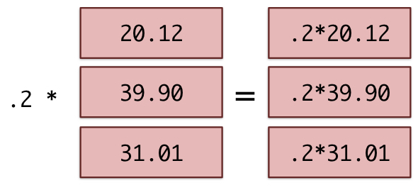

---

**Question 5.2.1** Suppose the total charge at a restaurant is the original bill plus the tip. If the tip is 20%, that means we can multiply the original bill by 1.2 to get the total charge.  Compute the total charge for each bill in `restaurant_bills`, and assign the resulting array to `total_charges`.

**Student scaffold:**

```python
total_charges = ...
total_charges
```

**Solution:**

```python
total_charges = 1.2 * restaurant_bills # SOLUTION
total_charges
```

*Output:*

```text
array([ 24.144,  47.88 ,  37.212])
```

**Test — `q521`**

```python
>>> import numpy as np
>>> type(total_charges) == np.ndarray
True

>>> import numpy as np
>>> sum(abs(total_charges - np.array([24.144, 47.88, 37.212]))) < 1e-06
True
```

---

**Question 5.2.2.** The array `more_restaurant_bills` contains 100,000 bills!  Compute the total charge for each one in `more_restaurant_bills`.  How is your code different?

**Student scaffold:**

```python
more_restaurant_bills = Table.read_table("more_restaurant_bills.csv").column("Bill")
more_total_charges = ...
more_total_charges
```

**Solution:**

```python
more_restaurant_bills = Table.read_table("more_restaurant_bills.csv").column("Bill")
more_total_charges = 1.2 * more_restaurant_bills # SOLUTION
more_total_charges
```

*Output:*

```text
array([ 20.244,  20.892,  12.216, ...,  19.308,  18.336,  35.664])
```

**Test — `q522`**

```python
>>> import numpy as np
>>> type(more_total_charges) == np.ndarray
True

>>> import numpy as np
>>> sum(abs(more_total_charges - 1.2 * more_restaurant_bills)) < 1e-06
True
```

The function `sum` takes a single array of numbers as its argument.  It returns the sum of all the numbers in that array (so it returns a single number, not an array).

---

**Question 5.2.3.** What was the sum of all the bills in `more_restaurant_bills`, *including tips*?

**Student scaffold:**

```python
sum_of_bills = ...
sum_of_bills
```

**Solution:**

```python
sum_of_bills = sum(more_total_charges) # SOLUTION
sum_of_bills
```

*Output:*

```text
1795730.0640000193
```

**Test — `q523`**

```python
>>> round(sum_of_bills, 2) == 1795730.06
True
```

---

**Question 5.2.4.** The powers of 2 ($2^0 = 1$, $2^1 = 2$, $2^2 = 4$, etc) arise frequently in computer science.  (For example, you may have noticed that storage on smartphones or USBs come in powers of 2, like 16 GB, 32 GB, or 64 GB.)  Use `np.arange` and the exponentiation operator `**` to compute the first 30 powers of 2, starting from `2^0`.

*Hint 1:* `np.arange(1, 2**30, 1)` creates an array with $2^{30}$ elements and **will crash your kernel**.

*Hint 2:* Part of your solution will involve `np.arange`, but your array shouldn't have more than 30 elements.

**Student scaffold:**

```python
powers_of_2 = ...
powers_of_2
```

**Solution:**

```python
powers_of_2 = 2 ** np.arange(30) # SOLUTION
powers_of_2
```

*Output:*

```text
array([        1,         2,         4,         8,        16,        32,
              64,       128,       256,       512,      1024,      2048,
            4096,      8192,     16384,     32768,     65536,    131072,
          262144,    524288,   1048576,   2097152,   4194304,   8388608,
        16777216,  33554432,  67108864, 134217728, 268435456, 536870912])
```

**Test — `q524`**

```python
>>> all(powers_of_2 == make_array(1, 2, 4, 8, 16, 32, 64, 128, 256, 512, 1024, 2048, 4096, 8192, 16384, 32768, 65536, 131072, 262144, 524288, 1048576, 2097152, 4194304, 8388608, 16777216, 33554432, 67108864, 134217728, 268435456, 536870912))
True
```

---
## 6. Jupytutor Survey

We hope your experience using Jupytutor has been smooth and helpful for you!

Please fill out the survey below and input the secret phrase that is shown at the end of the form when you submit. Please assign this phrase to `secret` as a string in the cell below!

Find the survey [here](https://docs.google.com/forms/d/e/1FAIpQLSfzCSqSbmq2plpyAQKWa8IbK1GlZvIeIZdxH43F-yeaftz8sQ/viewform?usp=publish-editor).

**Student scaffold:**

```python
secret = ...
```

**Solution:**

```python
secret = "beep boop" # SOLUTION
```

**Test — `q6`**

```python
>>> from lab03_check import correctness_check_6
>>> correctness_check_6(secret)
True
```

---

You're done with lab!

**Important submission information:**
- **Run all the tests** and verify that they all pass
- **Save** from the **File** menu
- **Run the final cell to generate the zip file**
- **Click the link to download the zip file**
- Then, go to [Pensieve](https://www.pensieve.co/) and submit the zip file to the corresponding assignment. The name of this assignment is "Lab XX Autograder", where XX is the lab number -- 01, 02, 03, etc.

- If you finish early in Regular Lab, **ask one of the staff members to check you off**.

**It is your responsibility to make sure your work is saved before running the last cell.**

---

To double-check your work, the cell below will rerun all of the autograder tests.

## Submission

Make sure you have run all cells in your notebook in order before running the cell below, so that all images/graphs appear in the output. The cell below will generate a zip file for you to submit. **Please save before exporting!**

---

## Datasets

Datasets this notebook loads with `Table.read_table`. Column names are exact, including spaces and capitalization. Only the schema is recorded here — the data itself is not in this document, so any question about its values must be answered by running code, not by reasoning over the rows shown elsewhere in this file.

### `world_population.csv`

66 rows, 1 columns.

| Column | Type |
| --- | --- |
| `Population` | int |

### `imdb.csv`

250 rows, 5 columns.

| Column | Type |
| --- | --- |
| `Votes` | int |
| `Rating` | float |
| `Title` | str |
| `Year` | int |
| `Decade` | int |

### `more_restaurant_bills.csv`

100,000 rows, 1 columns.

| Column | Type |
| --- | --- |
| `Bill` | float |


---

# lab04

---
title: "Lab 4: Functions and Visualizations"
assignment: lab04
semester: sp26
source: semester_assignments/sp26/lab/lab04/autograder/lab04.ipynb
version: solution (autograder) with student scaffolds
student_source: semester_assignments/sp26/lab/lab04/student/lab04.ipynb
language: python
---


# Lab 4: Functions and Visualizations

Welcome to Lab 4! This week, we'll learn about functions, table methods such as `apply`, and how to generate visualizations! 

**Recommended Reading**:

* [Applying a Function to a Column](https://inferentialthinking.com/chapters/08/1/Applying_a_Function_to_a_Column.html)
* [Visualizations](https://inferentialthinking.com/chapters/07/Visualization.html)
* [Python Reference](https://www.data8.org/su26/reference/)

**Lab Submission Deadline: Friday, February 13th at 5pm**

**Getting help on lab**: Whenever you feel stuck or need some further clarification, find a GSI or tutor, and they'll be happy to help!

As a reminder, here are the policies for getting full credit (Lab is worth 20% of your final grade):
- 80% of lab credit will be attendance-based. To receive attendance credit for lab, you must attend the full discussion portion (first hour) at which point the GSI will take attendance. 
- The remaining 20% of credit will be awarded for submitting the programming-based assignment to Pensieve by the deadline (5pm on Friday) with all test cases passing.

**Submission**: Once you’re finished, run all cells besides the last one, select File > Save Notebook, and then execute the final cell. The result will contain a zip file that you can use to submit on Pensieve.

Let's begin by setting up the tests and imports by running the cell below.

First, set up the notebook by running the cell below.

**Code:**

```python
import numpy as np
from datascience import *

# These lines set up graphing capabilities.
import matplotlib
%matplotlib inline
import matplotlib.pyplot as plt
plt.style.use('fivethirtyeight')
import warnings
warnings.simplefilter('ignore', FutureWarning)
```

---
## 1. Defining functions

Let's start off by writing a function that converts a proportion to a percentage by multiplying it by 100.  For example, the value of `to_percentage(.5)` should be the number 50 (no percent sign).

A function definition has a few parts.

##### `def`
We create a function with a `def` statement (short for **def**ine):

<br>
<pre style="margin-left: 40px; font-family: 'Courier New';"><code><span style="font-weight: bold; color: green">def</span></code>
</pre>

##### Name
Next comes the name of the function.  Like other names we've defined, it can't start with a number or contain spaces. Let's call our function `to_percentage`:
    
<br>
<pre style="margin-left: 40px; font-family: 'Courier New';"><code><span style="font-weight: bold; color: green">def</span> <span style="color: blue">to_percentage</span></code>
</pre>

##### Signature
Next comes the ___signature___ of the function.  This tells Python the number of **arguments** in the function and the names of those arguments. An argument is a value that is _passed into_ the function when it is used/called. A function can have any number of arguments (including 0!). 

`to_percentage` should take one argument, and we'll call that argument `proportion` since it should be a proportion.

<br>
<pre style="margin-left: 40px; font-family: 'Courier New';"><code><span style="font-weight: bold; color: green">def</span> <span style="color: blue">to_percentage</span>(proportion)</code>
</pre>
    
If we want our function to take more than one argument, we add a comma between each argument name i.e to_percentage(proportion, decimals). Note that if we had zero arguments, we'd still place the parentheses () after that name. 

We put a **colon** after the signature to tell Python that the next indented lines are the body of the function. Make sure you remember the colon!

<br>
<pre style="margin-left: 40px; font-family: 'Courier New';"><code><span style="font-weight: bold; color: green">def</span> <span style="color: blue">to_percentage</span>(proportion):</code>
</pre>

##### Documentation
Functions can do complicated things, so you should write an explanation of what your function does.  For small functions, this is less important, but it's a good habit to learn from the start (although documentation isn't strictly required).  Conventionally, Python functions are documented by writing an **indented** triple-quoted string:

<br>
<pre style="margin-left: 40px; font-family: 'Courier New';"><code><span style="font-weight: bold; color: green">def</span> <span style="color: blue">to_percentage</span>(proportion):<br><span style="padding-left: 40px"><span style="color: red">"""Converts a proportion to a percentage."""</span></span></code>
</pre>

##### Body
Now we start writing code that runs when the function is called.  This is called the *body* of the function and every line **must be indented with a tab**.  Any lines that are *not* indented and left-aligned with the def statement are considered outside the function. 

Some notes about the body of the function:
- We can write code that we would write anywhere else.  
- We use the arguments defined in the function signature. We can do this because values are assigned to those arguments when we call the function.
- We generally avoid referencing variables defined *outside* the function. If you would like to reference variables outside of the function, pass them through as arguments!


Now, let's give a name to the number we multiply a proportion by to get a percentage:

<br>
<pre style="margin-left: 40px; font-family: 'Courier New';"><code><span style="font-weight: bold; color: green">def</span> <span style="color: blue">to_percentage</span>(proportion):<br><span style="padding-left: 40px"><span style="color: red">"""Converts a proportion to a percentage."""</span></span>
<span style="padding-left: 40px">factor <span style="color: purple">=</span> <span style="color: green">100</span></span></code>
</pre>

##### `return`
The special instruction `return` is part of the function's body and tells Python to make the value of the function call equal to whatever comes right after `return`.  We want the value of `to_percentage(.5)` to be the proportion .5 times the factor 100, so we write:

<br>
<pre style="margin-left: 40px; font-family: 'Courier New';"><code><span style="font-weight: bold; color: green">def</span> <span style="color: blue">to_percentage</span>(proportion):<br><span style="padding-left: 40px"><span style="color: red">"""Converts a proportion to a percentage."""</span></span>
<span style="padding-left: 40px">factor <span style="color: purple">=</span> <span style="color: green">100</span></span>
<span style="padding-left: 40px"><span style="font-weight: bold; color: green">return</span> proportion <span style="color: purple">*</span> factor</span>
</code>
</pre>
        
`return` only makes sense in the context of a function, and **can never be used outside of a function**. `return` is always the last line of the function because Python stops executing the body of a function once it hits a `return` statement. Make sure to include a return statement unless you don't expect the function to return anything. 

*Note:*  `return` inside a function tells Python what value the function evaluates to. However, there are other functions, like `print`, that have no `return` value. For example, `print` simply prints a certain value out to the console. 

In short, `return` is used when you want to tell the *computer* what the value of some variable is, while `print` is used to tell you, a *human*, its value.

---

**Question 1.1.** Define `to_percentage` in the cell below.  Call your function to convert the proportion .2 to a percentage.  Name that percentage `twenty_percent`.

**Student scaffold:**

```python
def ...
    ''' (Replace this with your documentation) '''
    ... = ...
    return ...

twenty_percent = ...
twenty_percent
```

**Solution:**

```python
""" # BEGIN PROMPT
def ...
    ''' (Replace this with your documentation) '''
    ... = ...
    return ...
"""; # END PROMPT 

# BEGIN SOLUTION NO PROMPT
def to_percentage(proportion):
    """Converts a proportion to a percentage."""
    factor = 100 
    return proportion * factor
# END SOLUTION
twenty_percent = to_percentage(.2) # SOLUTION
twenty_percent
```

*Output:*

```text
20.0
```

**Test — `q11`**

```python
>>> to_percentage(0.35) == 35.0
True

>>> from lab04_check import correctness_check_1_1
>>> correctness_check_1_1(twenty_percent)
True
```

Here's something important about functions: **the names assigned *within* a function body are only accessible within the function body**. Once the function has returned, those names are gone.  So even if you created a variable called `factor` and defined `factor = 100` inside of the body of the `to_percentage` function and then called `to_percentage`, `factor` would not have a value assigned to it outside of the body of `to_percentage`:

**Note**: Below, you should see a `NameError` error message indicating that the `name 'factor' is not defined`. Python  throws this error because `factor` has not been defined outside of the body of the `to_percentage` function.

**Code:**

```python
# You should get an error when you run this.  (If you don't, 
# you might have defined factor somewhere above.)
factor
```

*Output (stdout):*

```text
Unexpected exception formatting exception. Falling back to standard exception
```

*Output (stderr):*

```text
Traceback (most recent call last):
  File "/Users/marissalumpkin/Desktop/data8/assignments_new/env/lib/python3.13/site-packages/IPython/core/interactiveshell.py", line 3577, in run_code
    exec(code_obj, self.user_global_ns, self.user_ns)
    ~~~~^^^^^^^^^^^^^^^^^^^^^^^^^^^^^^^^^^^^^^^^^^^^^
  File "/var/folders/xv/tl5mnl5s0mz_ykhsrhdyb_rm0000gn/T/ipykernel_52829/3742982240.py", line 3, in <module>
    factor
NameError: name 'factor' is not defined

During handling of the above exception, another exception occurred:

Traceback (most recent call last):
  File "/Users/marissalumpkin/Desktop/data8/assignments_new/env/lib/python3.13/site-packages/IPython/core/interactiveshell.py", line 2168, in showtraceback
    stb = self.InteractiveTB.structured_traceback(
        etype, value, tb, tb_offset=tb_offset
    )
  File "/Users/marissalumpkin/Desktop/data8/assignments_new/env/lib/python3.13/site-packages/IPython/core/ultratb.py", line 1454, in structured_traceback
    return FormattedTB.structured_traceback(
           ~~~~~~~~~~~~~~~~~~~~~~~~~~~~~~~~^
        self, etype, evalue, etb, tb_offset, number_of_lines_of_context
        ^^^^^^^^^^^^^^^^^^^^^^^^^^^^^^^^^^^^^^^^^^^^^^^^^^^^^^^^^^^^^^^
    )
    ^
  File "/Users/marissalumpkin/Desktop/data8/assignments_new/env/lib/python3.13/site-packages/IPython/core/ultratb.py", line 1345, in structured_traceback
    return VerboseTB.structured_traceback(
           ~~~~~~~~~~~~~~~~~~~~~~~~~~~~~~^
        self, etype, value, tb, tb_offset, number_of_lines_of_context
        ^^^^^^^^^^^^^^^^^^^^^^^^^^^^^^^^^^^^^^^^^^^^^^^^^^^^^^^^^^^^^
    )
    ^
  File "/Users/marissalumpkin/Desktop/data8/assignments_new/env/lib/python3.13/site-packages/IPython/core/ultratb.py", line 1192, in structured_traceback
    formatted_exception = self.format_exception_as_a_whole(etype, evalue, etb, number_of_lines_of_context,
                                                           tb_offset)
  File "/Users/marissalumpkin/Desktop/data8/assignments_new/env/lib/python3.13/site-packages/IPython/core/ultratb.py", line 1082, in format_exception_as_a_whole
    self.get_records(etb, number_of_lines_of_context, tb_offset) if etb else []
    ~~~~~~~~~~~~~~~~^^^^^^^^^^^^^^^^^^^^^^^^^^^^^^^^^^^^^^^^^^^^
  File "/Users/marissalumpkin/Desktop/data8/assignments_new/env/lib/python3.13/site-packages/IPython/core/ultratb.py", line 1179, in get_records
    res = list(stack_data.FrameInfo.stack_data(etb, options=options))[tb_offset:]
          ~~~~^^^^^^^^^^^^^^^^^^^^^^^^^^^^^^^^^^^^^^^^^^^^^^^^^^^^^^^
  File "/Users/marissalumpkin/Desktop/data8/assignments_new/env/lib/python3.13/site-packages/stack_data/core.py", line 597, in stack_data
    yield from collapse_repeated(
    ...<4 lines>...
    )
  File "/Users/marissalumpkin/Desktop/data8/assignments_new/env/lib/python3.13/site-packages/stack_data/utils.py", line 83, in collapse_repeated
    yield from map(mapper, original_group)
  File "/Users/marissalumpkin/Desktop/data8/assignments_new/env/lib/python3.13/site-packages/stack_data/core.py", line 587, in mapper
    return cls(f, options)
  File "/Users/marissalumpkin/Desktop/data8/assignments_new/env/lib/python3.13/site-packages/stack_data/core.py", line 551, in __init__
    self.executing = Source.executing(frame_or_tb)
                     ~~~~~~~~~~~~~~~~^^^^^^^^^^^^^
  File "/Users/marissalumpkin/Desktop/data8/assignments_new/env/lib/python3.13/site-packages/executing/executing.py", line 283, in executing
    assert_(new_stmts <= stmts)
    ~~~~~~~^^^^^^^^^^^^^^^^^^^^
  File "/Users/marissalumpkin/Desktop/data8/assignments_new/env/lib/python3.13/site-packages/executing/executing.py", line 80, in assert_
    raise AssertionError(str(message))
AssertionError
```

Like you’ve done with built-in functions in previous labs (`max`, `abs`, etc.), you can pass in named values as arguments to your function.

---

**Question 1.2.** Use `to_percentage` again to convert the proportion named `a_proportion` (defined below) to a percentage called `a_percentage`.

*Note:* You don't need to define `to_percentage` again!  Like other named values, functions stick around after you define them.

**Student scaffold:**

```python
a_proportion = 2**(0.5) / 2
a_percentage = ...
a_percentage
```

**Solution:**

```python
a_proportion = 2**(0.5) / 2
a_percentage = to_percentage(a_proportion) # SOLUTION
a_percentage
```

*Output:*

```text
70.71067811865476
```

**Test — `q12`**

```python
>>> from lab04_check import correctness_check_1_2
>>> correctness_check_1_2(a_percentage)
True
```

In the following cell, we will define a function called `disemvowel`.  It takes in a single string as its argument. It returns a copy of that string, but with all the characters that are vowels removed.  (In English, the vowels are the characters "a", "e", "i", "o", and "u".) 

To remove all the "a"s from a string, we used `a_string.replace("a", "")`.  The `.replace` method for strings returns a new string, so we can call `replace` multiple times, one after the other.

**Code:**

```python
def disemvowel(a_string):
    """Removes all vowels from a string."""
    return a_string.replace("a", "").replace("e", "").replace("i", "").replace("o", "").replace("u", "")

# An example call to the function.  (It's often helpful to run
# an example call from time to time while we're writing a function,
# to see how it currently works.)
disemvowel("Can you read this without vowels?")
```

*Output:*

```text
'Cn y rd ths wtht vwls?'
```

##### Calls on calls on calls
Just as you write a series of lines to build up a complex computation, it's useful to define a series of small functions that build on each other.  Since you can write any code inside a function's body, you can call other functions you've written.

If a function is like a recipe, defining a function in terms of other functions is like having a recipe for cake telling you to follow another recipe to make the frosting, and another to make the jam filling.  This makes the cake recipe shorter and clearer, and it avoids having a bunch of duplicated frosting recipes.  It's a foundation of productive programming.

For example, suppose you want to count the number of characters *that aren't vowels* in a piece of text.  One way to do this is to remove all the vowels and count the size of the remaining string.

---

**Question 1.3.** Write a function called `num_non_vowels`.  It should take a string as its argument and return a number.  That number should be the number of characters in the argument string that aren't vowels. You should use the `disemvowel` function we provided above inside of the `num_non_vowels` function.

*Hint:* The function `len` takes a string as its argument and returns the number of characters in it.

**Student scaffold:**

```python
def num_non_vowels(a_string):
    """The number of characters in a string, minus the vowels."""
    ...

# Try calling your function yourself to make sure the output is what
# you expect.
```

**Solution:**

```python
def num_non_vowels(a_string):
    """The number of characters in a string, minus the vowels."""
    return len(disemvowel(a_string)) # SOLUTION

# Try calling your function yourself to make sure the output is what
# you expect.
```

**Test — `q13`**

```python
>>> num_non_vowels('Go bears!') == 6
True
```

Functions can also encapsulate code that *displays output* instead of computing a value. For example, if you call `print` inside a function, and then call that function, something will get printed.

The `movies_by_year` dataset in the textbook has information about movie sales in recent years.  Suppose you'd like to display the year with the 5th-highest total gross movie sales, printed within a sentence.  You might do this:

**Code:**

```python
movies_by_year = Table.read_table("movies_by_year.csv")
rank = 5
fifth_from_top_movie_year = movies_by_year.sort("Total Gross", descending=True).column("Year").item(rank-1)
print("Year number", rank, "for total gross movie sales was:", fifth_from_top_movie_year)
```

*Output (stdout):*

```text
Year number 5 for total gross movie sales was: 2010
```

After writing this, you realize you also wanted to print out the 2nd and 3rd-highest years.  Instead of copying your code, you decide to put it in a function.  Since the rank varies, you make that an argument to your function.

---

**Question 1.4.** Write a function called `print_kth_top_movie_year`.  It should take a single argument - the rank of the year (like 2, 3, or 5 in the above examples) as an integer - and should use the table `movies_by_year`. It should print out a message like the one above.  

*Note:* Your function shouldn't have a `return` statement.

**Student scaffold:**

```python
def print_kth_top_movie_year(k):
    ...
    print(...)


# Example calls to your function:
print_kth_top_movie_year(2)
print_kth_top_movie_year(3)
```

**Solution:**

```python
def print_kth_top_movie_year(k):
    ...
    print(...)


# BEGIN SOLUTION NO PROMPT
def print_kth_top_movie_year(k):
    year = movies_by_year.sort("Total Gross", descending=True).column("Year").item(k-1) 
    print("Year number", k, "for total gross movie sales was:", year)
# END SOLUTION

# Example calls to your function:
print_kth_top_movie_year(2)
print_kth_top_movie_year(3)
```

*Output (stdout):*

```text
Year number 2 for total gross movie sales was: 2013
Year number 3 for total gross movie sales was: 2012
```

**Test — `q14`**

```python
>>> print_kth_top_movie_year(4)
Year number 4 for total gross movie sales was: 2009
```

### `print` is not the same as `return`
The `print_kth_top_movie_year(k)` function prints the total gross movie sales for the year that was provided! However, since we did not return any value in this function, we can not use it after we call it. Let's look at an example of another function that prints a value but does not return it.

**Code:**

```python
def print_number_five():
    print(5)
```

**Code:**

```python
print_number_five()
```

*Output (stdout):*

```text
5
```

However, if we try to use the output of `print_number_five()`, we see that the value `5` is printed but we get a TypeError when we try to add the number 2 to it!

**Code:**

```python
print_number_five_output = print_number_five()
print_number_five_output + 2
```

*Output (stdout):*

```text
5
Unexpected exception formatting exception. Falling back to standard exception
```

*Output (stderr):*

```text
Traceback (most recent call last):
  File "/Users/marissalumpkin/Desktop/data8/assignments_new/env/lib/python3.13/site-packages/IPython/core/interactiveshell.py", line 3577, in run_code
    exec(code_obj, self.user_global_ns, self.user_ns)
    ~~~~^^^^^^^^^^^^^^^^^^^^^^^^^^^^^^^^^^^^^^^^^^^^^
  File "/var/folders/xv/tl5mnl5s0mz_ykhsrhdyb_rm0000gn/T/ipykernel_52829/55797484.py", line 2, in <module>
    print_number_five_output + 2
    ~~~~~~~~~~~~~~~~~~~~~~~~~^~~
TypeError: unsupported operand type(s) for +: 'NoneType' and 'int'

During handling of the above exception, another exception occurred:

Traceback (most recent call last):
  File "/Users/marissalumpkin/Desktop/data8/assignments_new/env/lib/python3.13/site-packages/IPython/core/interactiveshell.py", line 2168, in showtraceback
    stb = self.InteractiveTB.structured_traceback(
        etype, value, tb, tb_offset=tb_offset
    )
  File "/Users/marissalumpkin/Desktop/data8/assignments_new/env/lib/python3.13/site-packages/IPython/core/ultratb.py", line 1454, in structured_traceback
    return FormattedTB.structured_traceback(
           ~~~~~~~~~~~~~~~~~~~~~~~~~~~~~~~~^
        self, etype, evalue, etb, tb_offset, number_of_lines_of_context
        ^^^^^^^^^^^^^^^^^^^^^^^^^^^^^^^^^^^^^^^^^^^^^^^^^^^^^^^^^^^^^^^
    )
    ^
  File "/Users/marissalumpkin/Desktop/data8/assignments_new/env/lib/python3.13/site-packages/IPython/core/ultratb.py", line 1345, in structured_traceback
    return VerboseTB.structured_traceback(
           ~~~~~~~~~~~~~~~~~~~~~~~~~~~~~~^
        self, etype, value, tb, tb_offset, number_of_lines_of_context
        ^^^^^^^^^^^^^^^^^^^^^^^^^^^^^^^^^^^^^^^^^^^^^^^^^^^^^^^^^^^^^
    )
    ^
  File "/Users/marissalumpkin/Desktop/data8/assignments_new/env/lib/python3.13/site-packages/IPython/core/ultratb.py", line 1192, in structured_traceback
    formatted_exception = self.format_exception_as_a_whole(etype, evalue, etb, number_of_lines_of_context,
                                                           tb_offset)
  File "/Users/marissalumpkin/Desktop/data8/assignments_new/env/lib/python3.13/site-packages/IPython/core/ultratb.py", line 1082, in format_exception_as_a_whole
    self.get_records(etb, number_of_lines_of_context, tb_offset) if etb else []
    ~~~~~~~~~~~~~~~~^^^^^^^^^^^^^^^^^^^^^^^^^^^^^^^^^^^^^^^^^^^^
  File "/Users/marissalumpkin/Desktop/data8/assignments_new/env/lib/python3.13/site-packages/IPython/core/ultratb.py", line 1179, in get_records
    res = list(stack_data.FrameInfo.stack_data(etb, options=options))[tb_offset:]
          ~~~~^^^^^^^^^^^^^^^^^^^^^^^^^^^^^^^^^^^^^^^^^^^^^^^^^^^^^^^
  File "/Users/marissalumpkin/Desktop/data8/assignments_new/env/lib/python3.13/site-packages/stack_data/core.py", line 597, in stack_data
    yield from collapse_repeated(
    ...<4 lines>...
    )
  File "/Users/marissalumpkin/Desktop/data8/assignments_new/env/lib/python3.13/site-packages/stack_data/utils.py", line 83, in collapse_repeated
    yield from map(mapper, original_group)
  File "/Users/marissalumpkin/Desktop/data8/assignments_new/env/lib/python3.13/site-packages/stack_data/core.py", line 587, in mapper
    return cls(f, options)
  File "/Users/marissalumpkin/Desktop/data8/assignments_new/env/lib/python3.13/site-packages/stack_data/core.py", line 551, in __init__
    self.executing = Source.executing(frame_or_tb)
                     ~~~~~~~~~~~~~~~~^^^^^^^^^^^^^
  File "/Users/marissalumpkin/Desktop/data8/assignments_new/env/lib/python3.13/site-packages/executing/executing.py", line 283, in executing
    assert_(new_stmts <= stmts)
    ~~~~~~~^^^^^^^^^^^^^^^^^^^^
  File "/Users/marissalumpkin/Desktop/data8/assignments_new/env/lib/python3.13/site-packages/executing/executing.py", line 80, in assert_
    raise AssertionError(str(message))
AssertionError
```

It may seem that `print_number_five()` is returning a value, 5. In reality, it just displays the number 5 to you without giving you the actual value! If your function prints out a value **without returning it** and you try to use that value, you will run into errors, so be careful!

Think about how you might add a line of code to the `print_number_five` function (after `print(5)`) so that the code `print_number_five_output + 5` would result in the value `10`, rather than an error.

---
## 2. Functions and CEO Incomes

In this question, we'll look at the 2015 compensation of CEOs at the 100 largest companies in California. The data was compiled from a [Los Angeles Times analysis](http://spreadsheets.latimes.com/california-ceo-compensation/), and ultimately came from [filings](https://www.sec.gov/answers/proxyhtf.htm) mandated by the SEC from all publicly-traded companies. Two companies have two CEOs, so there are 101 CEOs in the dataset.

We've copied the raw data from the LA Times page into a file called `raw_compensation.csv`. (The page notes that all dollar amounts are in **millions of dollars**.)

**Code:**

```python
raw_compensation = Table.read_table('raw_compensation.csv')
raw_compensation
```

*Output:*

| Rank | Name | Company (Headquarters) | Total Pay | % Change | Cash Pay | Equity Pay | Other Pay | Ratio of CEO pay to average industry worker pay |
| --- | --- | --- | --- | --- | --- | --- | --- | --- |
| 1 | Mark V. Hurd* | Oracle (Redwood City) | $53.25 | (No previous year) | $0.95 | $52.27 | $0.02 | 362 |
| 2 | Safra A. Catz* | Oracle (Redwood City) | $53.24 | (No previous year) | $0.95 | $52.27 | $0.02 | 362 |
| 3 | Robert A. Iger | Walt Disney (Burbank) | $44.91 | -3% | $24.89 | $17.28 | $2.74 | 477 |
| 4 | Marissa A. Mayer | Yahoo! (Sunnyvale) | $35.98 | -15% | $1.00 | $34.43 | $0.55 | 342 |
| 5 | Marc Benioff | salesforce.com (San Francisco) | $33.36 | -16% | $4.65 | $27.26 | $1.45 | 338 |
| 6 | John H. Hammergren | McKesson (San Francisco) | $24.84 | -4% | $12.10 | $12.37 | $0.37 | 222 |
| 7 | John S. Watson | Chevron (San Ramon) | $22.04 | -15% | $4.31 | $14.68 | $3.05 | 183 |
| 8 | Jeffrey Weiner | LinkedIn (Mountain View) | $19.86 | 27% | $2.47 | $17.26 | $0.13 | 182 |
| 9 | John T. Chambers** | Cisco Systems (San Jose) | $19.62 | 19% | $5.10 | $14.51 | $0.01 | 170 |
| 10 | John G. Stumpf | Wells Fargo (San Francisco) | $19.32 | -10% | $6.80 | $12.50 | $0.02 | 256 |

We want to compute the average of the CEOs' pay. Try running the cell below.

**Code:**

```python
np.average(raw_compensation.column("Total Pay"))
```

*Output (stdout):*

```text
Unexpected exception formatting exception. Falling back to standard exception
```

*Output (stderr):*

```text
Traceback (most recent call last):
  File "/Users/marissalumpkin/Desktop/data8/assignments_new/env/lib/python3.13/site-packages/IPython/core/interactiveshell.py", line 3577, in run_code
    exec(code_obj, self.user_global_ns, self.user_ns)
    ~~~~^^^^^^^^^^^^^^^^^^^^^^^^^^^^^^^^^^^^^^^^^^^^^
  File "/var/folders/xv/tl5mnl5s0mz_ykhsrhdyb_rm0000gn/T/ipykernel_52829/1172901112.py", line 1, in <module>
    np.average(raw_compensation.column("Total Pay"))
    ~~~~~~~~~~^^^^^^^^^^^^^^^^^^^^^^^^^^^^^^^^^^^^^^
  File "/Users/marissalumpkin/Desktop/data8/assignments_new/env/lib/python3.13/site-packages/numpy/lib/_function_base_impl.py", line 562, in average
    avg = a.mean(axis, **keepdims_kw)
  File "/Users/marissalumpkin/Desktop/data8/assignments_new/env/lib/python3.13/site-packages/numpy/_core/_methods.py", line 136, in _mean
    ret = umr_sum(arr, axis, dtype, out, keepdims, where=where)
TypeError: the resolved dtypes are not compatible with add.reduce. Resolved (dtype('<U7'), dtype('<U7'), dtype('<U14'))

During handling of the above exception, another exception occurred:

Traceback (most recent call last):
  File "/Users/marissalumpkin/Desktop/data8/assignments_new/env/lib/python3.13/site-packages/IPython/core/interactiveshell.py", line 2168, in showtraceback
    stb = self.InteractiveTB.structured_traceback(
        etype, value, tb, tb_offset=tb_offset
    )
  File "/Users/marissalumpkin/Desktop/data8/assignments_new/env/lib/python3.13/site-packages/IPython/core/ultratb.py", line 1454, in structured_traceback
    return FormattedTB.structured_traceback(
           ~~~~~~~~~~~~~~~~~~~~~~~~~~~~~~~~^
        self, etype, evalue, etb, tb_offset, number_of_lines_of_context
        ^^^^^^^^^^^^^^^^^^^^^^^^^^^^^^^^^^^^^^^^^^^^^^^^^^^^^^^^^^^^^^^
    )
    ^
  File "/Users/marissalumpkin/Desktop/data8/assignments_new/env/lib/python3.13/site-packages/IPython/core/ultratb.py", line 1345, in structured_traceback
    return VerboseTB.structured_traceback(
           ~~~~~~~~~~~~~~~~~~~~~~~~~~~~~~^
        self, etype, value, tb, tb_offset, number_of_lines_of_context
        ^^^^^^^^^^^^^^^^^^^^^^^^^^^^^^^^^^^^^^^^^^^^^^^^^^^^^^^^^^^^^
    )
    ^
  File "/Users/marissalumpkin/Desktop/data8/assignments_new/env/lib/python3.13/site-packages/IPython/core/ultratb.py", line 1192, in structured_traceback
    formatted_exception = self.format_exception_as_a_whole(etype, evalue, etb, number_of_lines_of_context,
                                                           tb_offset)
  File "/Users/marissalumpkin/Desktop/data8/assignments_new/env/lib/python3.13/site-packages/IPython/core/ultratb.py", line 1082, in format_exception_as_a_whole
    self.get_records(etb, number_of_lines_of_context, tb_offset) if etb else []
    ~~~~~~~~~~~~~~~~^^^^^^^^^^^^^^^^^^^^^^^^^^^^^^^^^^^^^^^^^^^^
  File "/Users/marissalumpkin/Desktop/data8/assignments_new/env/lib/python3.13/site-packages/IPython/core/ultratb.py", line 1179, in get_records
    res = list(stack_data.FrameInfo.stack_data(etb, options=options))[tb_offset:]
          ~~~~^^^^^^^^^^^^^^^^^^^^^^^^^^^^^^^^^^^^^^^^^^^^^^^^^^^^^^^
  File "/Users/marissalumpkin/Desktop/data8/assignments_new/env/lib/python3.13/site-packages/stack_data/core.py", line 597, in stack_data
    yield from collapse_repeated(
    ...<4 lines>...
    )
  File "/Users/marissalumpkin/Desktop/data8/assignments_new/env/lib/python3.13/site-packages/stack_data/utils.py", line 83, in collapse_repeated
    yield from map(mapper, original_group)
  File "/Users/marissalumpkin/Desktop/data8/assignments_new/env/lib/python3.13/site-packages/stack_data/core.py", line 587, in mapper
    return cls(f, options)
  File "/Users/marissalumpkin/Desktop/data8/assignments_new/env/lib/python3.13/site-packages/stack_data/core.py", line 551, in __init__
    self.executing = Source.executing(frame_or_tb)
                     ~~~~~~~~~~~~~~~~^^^^^^^^^^^^^
  File "/Users/marissalumpkin/Desktop/data8/assignments_new/env/lib/python3.13/site-packages/executing/exec

... [output truncated, 289 more characters]
```

You should see a `TypeError`. Let's examine why this error occurred by looking at the values in the `Total Pay` column. To do so, we can use the `type` function. This function tells us the data type of the object that we pass into it. Run the following cells to see what happens when we pass in `23`, `3.5`, and `"Hello"` to the `type` function. Do their outputs make sense?

**Code:**

```python
type(23)
```

*Output:*

```text
int
```

**Code:**

```python
type(3.5)
```

*Output:*

```text
float
```

**Code:**

```python
type("Hello")
```

*Output:*

```text
str
```

---

**Question 2.1.** Use the `type` function and set `total_pay_type` to the type of the first value in the "Total Pay" column.

**Student scaffold:**

```python
total_pay_type = ...
total_pay_type
```

**Solution:**

```python
total_pay_type = type(raw_compensation.column("Total Pay").item(0)) # SOLUTION
total_pay_type
```

*Output:*

```text
str
```

**Test — `q21`**

```python
>>> import numpy
>>> total_pay_type != numpy.ndarray
True

>>> 'str' in str(total_pay_type)
True

>>> isinstance(total_pay_type, type)
True

>>> total_pay_type != int
True
```

---

**Question 2.2.** You should have found that the values in the `Total Pay` column are strings. It doesn't make sense to take the average of string values, so we need to convert them to numbers. Extract the first value in `Total Pay`.  It's Mark Hurd's pay in 2015, in *millions* of dollars.  Call it `mark_hurd_pay_string`.

**Student scaffold:**

```python
mark_hurd_pay_string = ...
mark_hurd_pay_string
```

**Solution:**

```python
mark_hurd_pay_string = raw_compensation.column("Total Pay").item(0) # SOLUTION
mark_hurd_pay_string
```

*Output:*

```text
'$53.25 '
```

**Test — `q22`**

```python
>>> from lab04_check import correctness_check_2_2
>>> correctness_check_2_2(mark_hurd_pay_string)
True
```

---

**Question 2.3.** Convert `mark_hurd_pay_string` to a number of *dollars*. 

Some hints, as this question requires multiple steps:
- The string method `strip` will be useful for removing the dollar sign; it removes a specified character from the start or end of a string.  For example, the value of `"100%".strip("%")` is the string `"100"`.  
- You'll also need the function `float`, which converts a string that looks like a number to an actual number. Don't worry about the whitespace at the end of the string; the `float` function will ignore this.

Finally, remember that the answer should be in **dollars**, not millions of dollars. For example:
- If the table says a CEO was paid `$9`, we know this is in **millions of dollars.**
- Converting this to `$9000000` changes it to be in **dollars.**

**Student scaffold:**

```python
mark_hurd_pay = ...
mark_hurd_pay
```

**Solution:**

```python
mark_hurd_pay = 10**6 * float(mark_hurd_pay_string.strip("$")) # SOLUTION
mark_hurd_pay
```

*Output:*

```text
53250000.0
```

**Test — `q23`**

```python
>>> type(mark_hurd_pay) != str
True

>>> mark_hurd_pay != 5325
True

>>> from lab04_check import correctness_check_2_3
>>> correctness_check_2_3(mark_hurd_pay)
True
```

To compute the average pay, we need to do this for every CEO.  But that looks like it would involve copying this code 101 times.

We'll instead use functions to perform this computation. Later in this lab, we'll see the payoff: we can call that function on every pay string in the dataset at once.

---

**Question 2.4.** Copy the expression you used to compute `mark_hurd_pay`, and use it as the return expression of the function below. But make sure you replace the specific `mark_hurd_pay_string` with the generic `pay_string` name specified in the first line in the `def` statement.

*Hint*: When dealing with functions, you should generally not be referencing any variable outside of the function. Usually, you want to be working with the arguments that are passed into it, such as `pay_string` for this function. If you're using `mark_hurd_pay_string` within your function, you're referencing an outside variable!

**Student scaffold:**

```python
def convert_pay_string_to_number(pay_string):
    """Converts a pay string like '$100' (in millions) to a number of dollars."""
    ...
```

**Solution:**

```python
def convert_pay_string_to_number(pay_string):
    """Converts a pay string like '$100' (in millions) to a number of dollars."""
    return 10**6 * float(pay_string.strip("$")) # SOLUTION
```

**Test — `q24`**

```python
>>> convert_pay_string_to_number('$100 ') == 100000000.0
True

>>> convert_pay_string_to_number('$23 ') == 23000000.0
True
```

Running that cell doesn't convert any particular pay string. Instead, it creates a function called `convert_pay_string_to_number` that can convert *any* string with the right format to a number representing millions of dollars.

We can call our function just like we call the built-in functions we've seen. It takes one argument, *a string*, and it returns a float.

**Code:**

```python
convert_pay_string_to_number('$42')
```

*Output:*

```text
42000000.0
```

**Code:**

```python
convert_pay_string_to_number(mark_hurd_pay_string)
```

*Output:*

```text
53250000.0
```

**Code:**

```python
# We can also compute Safra Catz's pay in the same way:
convert_pay_string_to_number(raw_compensation.where("Name", are.containing("Safra")).column("Total Pay").item(0))
```

*Output:*

```text
53240000.0
```

With this function, we don't have to copy the code that converts a pay string to a number each time we wanted to convert a pay string.  Now we just call a function whose name says exactly what it's doing.

---
## 3. `apply`ing functions

Defining a function is a lot like giving a name to a value with `=`.  In fact, a function is a value just like the number 1 or the text "data"!

For example, we can make a new name for the built-in function `max` if we want:

**Code:**

```python
our_name_for_max = max
our_name_for_max(2, 6)
```

*Output:*

```text
6
```

The old name for `max` is still around:

**Code:**

```python
max(2, 6)
```

*Output:*

```text
6
```

Try just writing `max` or `our_name_for_max` (or the name of any other function) in a cell, and run that cell.  Python will print out a (very brief) description of the function.

**Code:**

```python
max
```

*Output:*

```text
<function max>
```

Now try writing `max?` or `our_name_for_max?` (or the name of any other function) in a cell, and run that cell.  A information box should show up at the bottom of your screen a longer description of the function

*Note: You can also press Shift+Tab after clicking on a name to see similar information!*

**Code:**

```python
our_name_for_max?
```

Let's look at what happens when we set `max`to a non-function value. Python now thinks you're trying to use a number like a function, which causes an error. Look out for any functions that might have been renamed when you encounter this type of error.

**Code:**

```python
max = 6
max(2, 6)
```

*Output (stdout):*

```text
Unexpected exception formatting exception. Falling back to standard exception
```

*Output (stderr):*

```text
Traceback (most recent call last):
  File "/Users/marissalumpkin/Desktop/data8/assignments_new/env/lib/python3.13/site-packages/IPython/core/interactiveshell.py", line 3577, in run_code
    exec(code_obj, self.user_global_ns, self.user_ns)
    ~~~~^^^^^^^^^^^^^^^^^^^^^^^^^^^^^^^^^^^^^^^^^^^^^
  File "/var/folders/xv/tl5mnl5s0mz_ykhsrhdyb_rm0000gn/T/ipykernel_52829/2218400260.py", line 2, in <module>
    max(2, 6)
    ~~~^^^^^^
TypeError: 'int' object is not callable

During handling of the above exception, another exception occurred:

Traceback (most recent call last):
  File "/Users/marissalumpkin/Desktop/data8/assignments_new/env/lib/python3.13/site-packages/IPython/core/interactiveshell.py", line 2168, in showtraceback
    stb = self.InteractiveTB.structured_traceback(
        etype, value, tb, tb_offset=tb_offset
    )
  File "/Users/marissalumpkin/Desktop/data8/assignments_new/env/lib/python3.13/site-packages/IPython/core/ultratb.py", line 1454, in structured_traceback
    return FormattedTB.structured_traceback(
           ~~~~~~~~~~~~~~~~~~~~~~~~~~~~~~~~^
        self, etype, evalue, etb, tb_offset, number_of_lines_of_context
        ^^^^^^^^^^^^^^^^^^^^^^^^^^^^^^^^^^^^^^^^^^^^^^^^^^^^^^^^^^^^^^^
    )
    ^
  File "/Users/marissalumpkin/Desktop/data8/assignments_new/env/lib/python3.13/site-packages/IPython/core/ultratb.py", line 1345, in structured_traceback
    return VerboseTB.structured_traceback(
           ~~~~~~~~~~~~~~~~~~~~~~~~~~~~~~^
        self, etype, value, tb, tb_offset, number_of_lines_of_context
        ^^^^^^^^^^^^^^^^^^^^^^^^^^^^^^^^^^^^^^^^^^^^^^^^^^^^^^^^^^^^^
    )
    ^
  File "/Users/marissalumpkin/Desktop/data8/assignments_new/env/lib/python3.13/site-packages/IPython/core/ultratb.py", line 1192, in structured_traceback
    formatted_exception = self.format_exception_as_a_whole(etype, evalue, etb, number_of_lines_of_context,
                                                           tb_offset)
  File "/Users/marissalumpkin/Desktop/data8/assignments_new/env/lib/python3.13/site-packages/IPython/core/ultratb.py", line 1082, in format_exception_as_a_whole
    self.get_records(etb, number_of_lines_of_context, tb_offset) if etb else []
    ~~~~~~~~~~~~~~~~^^^^^^^^^^^^^^^^^^^^^^^^^^^^^^^^^^^^^^^^^^^^
  File "/Users/marissalumpkin/Desktop/data8/assignments_new/env/lib/python3.13/site-packages/IPython/core/ultratb.py", line 1179, in get_records
    res = list(stack_data.FrameInfo.stack_data(etb, options=options))[tb_offset:]
          ~~~~^^^^^^^^^^^^^^^^^^^^^^^^^^^^^^^^^^^^^^^^^^^^^^^^^^^^^^^
  File "/Users/marissalumpkin/Desktop/data8/assignments_new/env/lib/python3.13/site-packages/stack_data/core.py", line 597, in stack_data
    yield from collapse_repeated(
    ...<4 lines>...
    )
  File "/Users/marissalumpkin/Desktop/data8/assignments_new/env/lib/python3.13/site-packages/stack_data/utils.py", line 83, in collapse_repeated
    yield from map(mapper, original_group)
  File "/Users/marissalumpkin/Desktop/data8/assignments_new/env/lib/python3.13/site-packages/stack_data/core.py", line 587, in mapper
    return cls(f, options)
  File "/Users/marissalumpkin/Desktop/data8/assignments_new/env/lib/python3.13/site-packages/stack_data/core.py", line 551, in __init__
    self.executing = Source.executing(frame_or_tb)
                     ~~~~~~~~~~~~~~~~^^^^^^^^^^^^^
  File "/Users/marissalumpkin/Desktop/data8/assignments_new/env/lib/python3.13/site-packages/executing/executing.py", line 283, in executing
    assert_(new_stmts <= stmts)
    ~~~~~~~^^^^^^^^^^^^^^^^^^^^
  File "/Users/marissalumpkin/Desktop/data8/assignments_new/env/lib/python3.13/site-packages/executing/executing.py", line 80, in assert_
    raise AssertionError(str(message))
AssertionError
```

**Code:**

```python
# This cell resets max to the built-in function. Just run this cell, don't change its contents
import builtins
max = builtins.max
```

Why is this useful?  Since functions are just values, it's possible to pass them as arguments to other functions.  Here's a simple but not-so-practical example: we can make an array of functions.

**Code:**

```python
make_array(max, np.average, are.equal_to)
```

*Output:*

```text
array([<built-in function max>, <function average at 0x10d685a70>,
       <function are.equal_to at 0x141db8fe0>], dtype=object)
```

---

**Question 3.1.** Make an array containing any 3 other functions you've seen.  Call it `some_functions`.

**Student scaffold:**

```python
some_functions = ...
some_functions
```

**Solution:**

```python
some_functions = make_array(min, np.arange, print) # SOLUTION
some_functions
```

*Output:*

```text
array([<built-in function min>, <built-in function arange>,
       <built-in function print>], dtype=object)
```

**Test — `q31`**

```python
>>> len(some_functions)
3

>>> callable(some_functions.item(0))
True

>>> callable(some_functions.item(1))
True

>>> callable(some_functions.item(2))
True
```

Working with functions as values can lead to some funny-looking code. For example, see if you can figure out why the following code works.

**Code:**

```python
make_array(max, np.average, are.equal_to).item(0)(4, -2, 7)
```

*Output:*

```text
7
```

A more useful example of passing functions to other functions as arguments is the table method `apply`.

`apply` calls a function many times, once on *each* element in a column of a table.  It produces an *array* of the results.  Here we use `apply` to convert every CEO's pay to a number, using the function you defined:

*Note:* You'll see an array of numbers like `5.325e+07`. This is Python's way of representing **scientific notation**. We interpret `5.325e+07` as `5.325 * 10**7`, or `53,250,000`.

**Code:**

```python
raw_compensation.apply(convert_pay_string_to_number, "Total Pay")
```

*Output:*

```text
array([  5.32500000e+07,   5.32400000e+07,   4.49100000e+07,
         3.59800000e+07,   3.33600000e+07,   2.48400000e+07,
         2.20400000e+07,   1.98600000e+07,   1.96200000e+07,
         1.93200000e+07,   1.87600000e+07,   1.86100000e+07,
         1.83600000e+07,   1.80900000e+07,   1.71000000e+07,
         1.66300000e+07,   1.63300000e+07,   1.61400000e+07,
         1.61000000e+07,   1.60200000e+07,   1.51000000e+07,
         1.49800000e+07,   1.46300000e+07,   1.45100000e+07,
         1.44400000e+07,   1.43600000e+07,   1.43100000e+07,
         1.40900000e+07,   1.40000000e+07,   1.36700000e+07,
         1.23400000e+07,   1.22000000e+07,   1.21800000e+07,
         1.21300000e+07,   1.20500000e+07,   1.18400000e+07,
         1.17100000e+07,   1.16300000e+07,   1.11600000e+07,
         1.11100000e+07,   1.11100000e+07,   1.07300000e+07,
         1.05000000e+07,   1.04300000e+07,   1.03700000e+07,
         1.02800000e+07,   1.02700000e+07,   1.01800000e+07,
         1.01600000e+07,   9.97000000e+06,   9.96000000e+06,
         9.86000000e+06,   9.74000000e+06,   9.42000000e+06,
         9.39000000e+06,   9.22000000e+06,   9.06000000e+06,
         9.03000000e+06,   8.86000000e+06,   8.76000000e+06,
         8.57000000e+06,   8.38000000e+06,   8.36000000e+06,
         8.35000000e+06,   8.23000000e+06,   7.86000000e+06,
         7.70000000e+06,   7.58000000e+06,   7.51000000e+06,
         7.23000000e+06,   7.21000000e+06,   7.12000000e+06,
         6.88000000e+06,   6.77000000e+06,   6.64000000e+06,
         6.56000000e+06,   6.14000000e+06,   5.92000000e+06,
         5.90000000e+06,   5.89000000e+06,   5.73000000e+06,
         5.42000000e+06,   5.04000000e+06,   4.92000000e+06,
         4.92000000e+06,   4.47000000e+06,   4.25000000e+06,
         4.08000000e+06,   3.93000000e+06,   3.72000000e+06,
         2.88000000e+06,   2.83000000e+06,   2.82000000e+06,
         2.45000000e+06,   1.79000000e+06,   1.68000000e+06,
         1.53000000e+06,   9.40000000e+05,   8.10000000e+05,
         7.00000000e+04,   4.00000000e+04])
```

Here's an illustration of what that did:


Note that we didn’t write `raw_compensation.apply(convert_pay_string_to_number(), “Total Pay”)` or `raw_compensation.apply(convert_pay_string_to_number(“Total Pay”))`. We just passed the name of the function, with no parentheses, to `apply`, because all we want to do is let `apply` know the name of the function we’d like to use and the name of the column we’d like to use it on. `apply` will then call the function `convert_pay_string_to_number` on each value in the column for us! Also note that calling `tbl.apply` ___does not___ alter the original table in any way.

---

**Question 3.2.** Using `apply`, make a table that's a copy of `raw_compensation` with one additional column called `Total Pay ($)`.  That column should contain the result of applying `convert_pay_string_to_number` to the `Total Pay` column (as we did above).  Call the new table `compensation`.

**Student scaffold:**

```python
compensation = raw_compensation.with_column(
    "Total Pay ($)",
    ...
    )
compensation
```

**Solution:**

```python
compensation = raw_compensation.with_column(
    "Total Pay ($)",
    raw_compensation.apply(convert_pay_string_to_number, "Total Pay") # SOLUTION
    )
compensation
```

*Output:*

| Rank | Name | Company (Headquarters) | Total Pay | % Change | Cash Pay | Equity Pay | Other Pay | Ratio of CEO pay to average industry worker pay | Total Pay ($) |
| --- | --- | --- | --- | --- | --- | --- | --- | --- | --- |
| 1 | Mark V. Hurd* | Oracle (Redwood City) | $53.25 | (No previous year) | $0.95 | $52.27 | $0.02 | 362 | 5.325e+07 |
| 2 | Safra A. Catz* | Oracle (Redwood City) | $53.24 | (No previous year) | $0.95 | $52.27 | $0.02 | 362 | 5.324e+07 |
| 3 | Robert A. Iger | Walt Disney (Burbank) | $44.91 | -3% | $24.89 | $17.28 | $2.74 | 477 | 4.491e+07 |
| 4 | Marissa A. Mayer | Yahoo! (Sunnyvale) | $35.98 | -15% | $1.00 | $34.43 | $0.55 | 342 | 3.598e+07 |
| 5 | Marc Benioff | salesforce.com (San Francisco) | $33.36 | -16% | $4.65 | $27.26 | $1.45 | 338 | 3.336e+07 |
| 6 | John H. Hammergren | McKesson (San Francisco) | $24.84 | -4% | $12.10 | $12.37 | $0.37 | 222 | 2.484e+07 |
| 7 | John S. Watson | Chevron (San Ramon) | $22.04 | -15% | $4.31 | $14.68 | $3.05 | 183 | 2.204e+07 |
| 8 | Jeffrey Weiner | LinkedIn (Mountain View) | $19.86 | 27% | $2.47 | $17.26 | $0.13 | 182 | 1.986e+07 |
| 9 | John T. Chambers** | Cisco Systems (San Jose) | $19.62 | 19% | $5.10 | $14.51 | $0.01 | 170 | 1.962e+07 |
| 10 | John G. Stumpf | Wells Fargo (San Francisco) | $19.32 | -10% | $6.80 | $12.50 | $0.02 | 256 | 1.932e+07 |

**Test — `q32`**

```python
>>> 'Total Pay ($)' in compensation.labels
True

>>> t = compensation.sort('Total Pay ($)', descending=True)
>>> np.isclose(t.column('Total Pay ($)').item(0), 53250000.0)
True
```

Now that we have all the pays as numbers, we can learn more about them through computation.

---

**Question 3.3.** Compute the average total pay of the CEOs in the dataset.

**Student scaffold:**

```python
average_total_pay = ...
average_total_pay
```

**Solution:**

```python
average_total_pay = np.average(compensation.column("Total Pay ($)")) # SOLUTION
average_total_pay
```

*Output:*

```text
11558613.861386139
```

**Test — `q33`**

```python
>>> from lab04_check import correctness_check_3_3
>>> correctness_check_3_3(average_total_pay)
True
```

---

**Question 3.4** Companies pay executives in a variety of ways: in cash, by granting stock or other equity in the company, or with ancillary benefits (like private jets).  Compute the proportion of each CEO's pay that was cash.  (Your answer should be an array of numbers, one for each CEO in the dataset.)

*Hint:* What function have you defined that can convert a string to a number?

**Student scaffold:**

```python
cash_proportion = ...
cash_proportion
```

**Solution:**

```python
cash_proportion = compensation.apply(convert_pay_string_to_number, "Cash Pay") / compensation.column("Total Pay ($)") # SOLUTION
cash_proportion
```

*Output:*

```text
array([ 0.01784038,  0.01784373,  0.55421955,  0.02779322,  0.13938849,
        0.48711755,  0.19555354,  0.12437059,  0.25993884,  0.35196687,
        0.3075693 ,  0.22138635,  0.13126362,  0.1708126 ,  0.23099415,
        0.06734817,  0.13043478,  0.28004957,  0.33229814,  0.15355805,
        0.29337748,  0.21829105,  0.31100478,  0.25086147,  0.2299169 ,
        0.16991643,  0.31795947,  0.26188786,  0.28357143,  0.15654718,
        0.38168558,  0.28934426,  0.20361248,  0.47650453,  0.45643154,
        0.36402027,  0.2177626 ,  0.24763543,  0.42562724,  0.2610261 ,
        0.18361836,  0.1444548 ,  0.33333333,  0.10834132,  0.20925747,
        0.97276265,  0.22979552,  0.22789784,  0.37893701,  0.25175527,
        0.73895582,  0.37018256,  0.2412731 ,  0.2133758 ,  0.20553781,
        0.23318872,  0.33664459,  0.3875969 ,  0.56094808,  0.11757991,
        0.35239207,  0.24463007,  0.25      ,  0.23712575,  0.43377886,
        0.31424936,  0.46363636,  0.32585752,  0.24766977,  0.98755187,
        0.27184466,  0.96207865,  0.31831395,  0.81979321,  0.23795181,
        0.17530488,  0.21172638,  0.37162162,  0.27288136,  0.26994907,
        0.55148342,  0.3597786 ,  0.        ,  0.47154472,  0.47154472,
        0.29753915,  0.16235294,  0.48529412,  0.46819338,  0.32526882,
        0.98958333,  0.61130742,  0.67021277,  0.75510204,  0.50837989,
        0.98809524,  0.98039216,  0.9893617 ,  0.87654321,  0.        ,
        1.        ])
```

**Test — `q34`**

```python
>>> len(cash_proportion) == 101
True

>>> import math
>>> math.isclose(cash_proportion.item(0), 0.01784038, rel_tol=0.001)
True
```

**Why is `apply` useful?**

For operations like arithmetic, or the functions in the NumPy library, you don't need to use `apply`, because they automatically work on each element of an array.  But there are many things that don't.  The string manipulation we did in today's lab is one example.  Since you can write any code you want in a function, `apply` gives you greater control over how you operate on data.

Check out the `% Change` column in `compensation`.  It shows the percentage increase in the CEO's pay from the previous year.  For CEOs with no previous year on record, it instead says "(No previous year)".  The values in this column are *strings*, not numbers, so like the `Total Pay` column, it's not usable without a bit of extra work.

Given your current pay and the percentage increase from the previous year, you can compute your previous year's pay.  For example, if your pay is $\$120$ this year, and that's an increase of 50% from the previous year, then your previous year's pay was $\frac{\$120}{1 + \frac{50}{100}}$, or \$80.

---

**Question 3.5** Create a new table called `with_previous_compensation`.  It should be a copy of `compensation`, but with the "(No previous year)" CEOs filtered out, and with an extra column called `2014 Total Pay ($)`.  That column should have each CEO's pay in 2014.

*Hint 1:* You can print out your results after each step to make sure you're on the right track.

*Hint 2:* We've provided a structure that you can use to get to the answer. However, if it's confusing, feel free to delete the current structure and approach the problem your own way!

**Student scaffold:**

```python
# Definition to turn percent to number
def percent_string_to_num(percent_string):
    """Converts a percentage string to a number."""
    return ...

# Compensation table where there is a previous year
having_previous_year = ...

# Get the percent changes as numbers instead of strings
# We're still working off the table having_previous_year
percent_changes = ...

# Calculate the previous year's pay
# We're still working off the table having_previous_year
previous_pay = ...

# Put the previous pay column into the having_previous_year table
with_previous_compensation = ...

with_previous_compensation
```

**Solution:**

```python
# Definition to turn percent to number
def percent_string_to_num(percent_string):
    """Converts a percentage string to a number."""
    """ # BEGIN PROMPT
    return ...
    """; # END PROMPT
    return float(percent_string.strip("%")) # SOLUTION NO PROMPT

# Compensation table where there is a previous year
having_previous_year = compensation.where("% Change", are.not_equal_to("(No previous year)")) # SOLUTION

# Get the percent changes as numbers instead of strings
# We're still working off the table having_previous_year
percent_changes = having_previous_year.apply(percent_string_to_num, "% Change") # SOLUTION

# Calculate the previous year's pay
# We're still working off the table having_previous_year
previous_pay = having_previous_year.column("Total Pay ($)") / (1 + percent_changes / 100) # SOLUTION

# Put the previous pay column into the having_previous_year table
with_previous_compensation = having_previous_year.with_column("2014 Total Pay ($)", previous_pay) # SOLUTION

with_previous_compensation
```

*Output:*

| Rank | Name | Company (Headquarters) | Total Pay | % Change | Cash Pay | Equity Pay | Other Pay | Ratio of CEO pay to average industry worker pay | Total Pay ($) | 2014 Total Pay ($) |
| --- | --- | --- | --- | --- | --- | --- | --- | --- | --- | --- |
| 3 | Robert A. Iger | Walt Disney (Burbank) | $44.91 | -3% | $24.89 | $17.28 | $2.74 | 477 | 4.491e+07 | 4.6299e+07 |
| 4 | Marissa A. Mayer | Yahoo! (Sunnyvale) | $35.98 | -15% | $1.00 | $34.43 | $0.55 | 342 | 3.598e+07 | 4.23294e+07 |
| 5 | Marc Benioff | salesforce.com (San Francisco) | $33.36 | -16% | $4.65 | $27.26 | $1.45 | 338 | 3.336e+07 | 3.97143e+07 |
| 6 | John H. Hammergren | McKesson (San Francisco) | $24.84 | -4% | $12.10 | $12.37 | $0.37 | 222 | 2.484e+07 | 2.5875e+07 |
| 7 | John S. Watson | Chevron (San Ramon) | $22.04 | -15% | $4.31 | $14.68 | $3.05 | 183 | 2.204e+07 | 2.59294e+07 |
| 8 | Jeffrey Weiner | LinkedIn (Mountain View) | $19.86 | 27% | $2.47 | $17.26 | $0.13 | 182 | 1.986e+07 | 1.56378e+07 |
| 9 | John T. Chambers** | Cisco Systems (San Jose) | $19.62 | 19% | $5.10 | $14.51 | $0.01 | 170 | 1.962e+07 | 1.64874e+07 |
| 10 | John G. Stumpf | Wells Fargo (San Francisco) | $19.32 | -10% | $6.80 | $12.50 | $0.02 | 256 | 1.932e+07 | 2.14667e+07 |
| 11 | John C. Martin** | Gilead Sciences (Foster City) | $18.76 | -1% | $5.77 | $12.98 | $0.01 | 117 | 1.876e+07 | 1.89495e+07 |
| 13 | Shantanu Narayen | Adobe Systems (San Jose) | $18.36 | 3% | $2.41 | $15.85 | $0.09 | 125 | 1.836e+07 | 1.78252e+07 |

**Test — `q35`**

```python
>>> '(No previous year)' not in with_previous_compensation.column('% Change')
True

>>> import math
>>> t = with_previous_compensation.sort('2014 Total Pay ($)', descending=True)
>>> value = t.column('2014 Total Pay ($)').item(0)
>>> math.isclose(value, 67700000.0, rel_tol=0.01)
True

>>> with_previous_compensation.num_rows == 80
True
```

---

**Question 3.6** Determine the average pay in 2014 of the CEOs that appear in the `with_previous_compensation` table. Assign this value to the variable `average_pay_2014`.

**Student scaffold:**

```python
average_pay_2014 = ...
average_pay_2014
```

**Solution:**

```python
average_pay_2014 = np.average(with_previous_compensation.column("2014 Total Pay ($)")) # SOLUTION
average_pay_2014
```

*Output:*

```text
11794790.817048479
```

**Test — `q36`**

```python
>>> from lab04_check import correctness_check_3_6
>>> correctness_check_3_6(average_pay_2014)
True
```

---
## 4. Histograms
Earlier, we computed the average pay among the 101 CEOs in our dataset.  The average doesn't tell us everything about the amounts CEOs are paid, though.  Maybe just a few CEOs make the bulk of the money, even among these 101.

We can use a *histogram* method to display the *distribution* of a set of numbers.  The table method `hist` takes a single argument, the name of a column of numbers.  It produces a histogram of the numbers in that column.

---

**Question 4.1.** Make a histogram of the total pay of the CEOs in `compensation`. Check with a peer or instructor to make sure you have the right plot. *If you get a warning, ignore it.*

*Hint:* If you aren't sure how to create a histogram, refer to the [Python Reference sheet](https://www.data8.org/su26/reference/).

**Student scaffold:**

```python
...
```

**Solution:**

```python
compensation.hist("Total Pay ($)") # SOLUTION
```

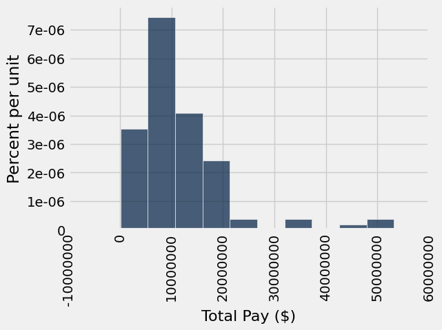

--- 

**Question 4.2.** How many CEOs made more than $30 million in total pay? Find the value using code, then check that the value you found is consistent with what you see in the histogram.

**Student scaffold:**

```python
num_ceos_more_than_30_million_2 = ...
num_ceos_more_than_30_million_2
```

**Solution:**

```python
num_ceos_more_than_30_million_2 = compensation.where("Total Pay ($)", are.above(30*10**6)).num_rows # SOLUTION
num_ceos_more_than_30_million_2
```

*Output:*

```text
5
```

**Test — `q42`**

```python
>>> from lab04_check import correctness_check_4_2
>>> correctness_check_4_2(num_ceos_more_than_30_million_2)
True
```

---
## 5. Project 1 Partner Form

Project 1 will be released on Friday, 2/13 at 5PM!

You have the option of working with a partner that is enrolled in your lab. Your GSI should have sent out a form to match you up with a partner for this project. Set `submitted` to `True` to confirm that you've submitted the form.

If you are in **Self-Service** lab, you may assign `submitted` to `True` without submitting anything.

**Student scaffold:**

```python
submitted = ...
```

**Solution:**

```python
submitted = True # SOLUTION
```

**Test — `q5`**

```python
>>> submitted
True
```

---

You're done with lab!

**Important submission information:**
- **Run all the tests** and verify that they all pass
- **Save** from the **File** menu
- **Run the final cell to generate the zip file**
- **Click the link to download the zip file**
- Then, go to [Pensieve](https://www.pensieve.co/) and submit the zip file to the corresponding assignment. The name of this assignment is "Lab XX Autograder", where XX is the lab number -- 01, 02, 03, etc.

- If you finish early in Regular Lab, **ask one of the staff members to check you off**.

**It is your responsibility to make sure your work is saved before running the last cell.**

---

To double-check your work, the cell below will rerun all of the autograder tests.

## Submission

Make sure you have run all cells in your notebook in order before running the cell below, so that all images/graphs appear in the output. The cell below will generate a zip file for you to submit. **Please save before exporting!**

---

## Datasets

Datasets this notebook loads with `Table.read_table`. Column names are exact, including spaces and capitalization. Only the schema is recorded here — the data itself is not in this document, so any question about its values must be answered by running code, not by reasoning over the rows shown elsewhere in this file.

### `movies_by_year.csv`

36 rows, 4 columns.

| Column | Type |
| --- | --- |
| `Year` | int |
| `Total Gross` | float |
| `Number of Movies` | int |
| `#1 Movie` | str |

### `raw_compensation.csv`

101 rows, 9 columns.

| Column | Type |
| --- | --- |
| `Rank` | int |
| `Name` | str |
| `Company (Headquarters)` | str |
| `Total Pay` | str |
| `% Change` | str |
| `Cash Pay` | str |
| `Equity Pay` | str |
| `Other Pay` | str |
| `Ratio of CEO pay to average industry worker pay` | float |


---

# lab05

---
title: "Lab 5: Simulations"
assignment: lab05
semester: sp26
source: semester_assignments/sp26/lab/lab05/autograder/lab05.ipynb
version: solution (autograder) with student scaffolds
student_source: semester_assignments/sp26/lab/lab05/student/lab05.ipynb
language: python
---


# Lab 5: Simulations

Welcome to Lab 5! The data used in this lab will contain salary data and other statistics for basketball players from the 2023-2024 NBA season. This data was collected from the following sports analytic sites: [Basketball Reference](https://www.basketball-reference.com/leagues/NBA_2024_per_game.html) and [Hoops Hype](https://www.hoopshype.com/salaries/players/).

**Recommended Reading**:

* [Iteration](https://www.inferentialthinking.com/chapters/09/2/Iteration.html)
* [Simulations](https://www.inferentialthinking.com/chapters/09/3/Simulation.html)
* [Randomness](https://www.inferentialthinking.com/chapters/09/Randomness.html)
* [Python Reference](https://www.data8.org/su26/reference/)

**Getting help on lab**: Whenever you feel stuck or need some further clarification, find a GSI or tutor, and they'll be happy to help!

As a reminder, here are the policies for getting full credit if you are in regular lab (Lab is worth 20% of your final grade):
- 80% of lab credit will be attendance-based. To receive attendance credit for lab, you must attend the full discussion portion (first hour) at which point the GSI will take attendance. 
- The remaining 20% of credit will be awarded for submitting the programming-based assignment to Pensive by the deadline (5pm on Friday) with all test cases passing.

If you are in self-service lab, 100% of credit will be awarded for submitting the programming-based assignment to Pensive by the deadline (5pm on Friday) with all test cases passing.

**Submission**: Once you’re finished, run all cells besides the last one, select File > Save Notebook, and then execute the final cell. The result will contain a zip file that you can use to submit on Pensive.

Let's begin by setting up the tests and imports by running the cell below.

**Code:**

```python
# Run this cell, but please don't change it.

# These lines import the Numpy and Datascience modules.
import numpy as np
from datascience import *

# These lines do some fancy plotting magic
import matplotlib
%matplotlib inline
import matplotlib.pyplot as plt
plt.style.use('fivethirtyeight')
```

---
## 1. Nachos and Conditionals

In Python, the boolean is a data type with only two possible values:  `True` and `False`. Expressions containing comparison operators such as `<` (less than), `>` (greater than), and `==` (equal to) evaluate to Boolean values. A list of common comparison operators can be found below!

| Comparison         | Operator | True Example | False Example |
|--------------------|----------|--------------|---------------|
| Less than          | `<`      | 2 < 3        | 2 < 2         |
| Greater than       | `>`      | 3 > 2        | 3 > 3         |
| Less than or equal | `<=`     | 2 <= 2       | 3 <= 2        |
| Greater or equal   | `>=`     | 3 >= 3       | 2 >= 3        |
| Equal              | `==`     | 3 == 3       | 3 == 2        |
| Not equal          | `!=`     | 3 != 2       | 2 != 2        |

Run the cell below to see an example of a comparison operator in action.

**Code:**

```python
3 > (1 + 1)
```

*Output:*

```text
True
```

We can even assign the result of a comparison operation to a variable. Note that `==` and `=` are **not** the same!

**Code:**

```python
result = 10 / 2 == 5
result
```

*Output:*

```text
True
```

Just like arithmetic operators can be applied on every item of an array, comparison operators can also be used on arrays to compare an entire array with some value. The output of this comparison is an array of boolean values.

**Code:**

```python
make_array(1, 5, 7, 8, 3, -1) > 3
```

*Output:*

```text
array([False,  True,  True,  True, False, False], dtype=bool)
```

One day, when you come home after a long week, you see a hot bowl of nachos waiting on the dining table! Let's say that whenever you take a nacho from the bowl, it will either have only **cheese**, only **salsa**, **both** cheese and salsa, or **neither** cheese nor salsa (a sad tortilla chip indeed). 

Let's try and simulate taking nachos from the bowl at random using the function, `np.random.choice(...)`.

### `np.random.choice`

`np.random.choice` picks one item at random from the given array. It is equally likely to pick any of the items. Run the cell below several times, and observe how the results change. _Tip:_ To keep running a cell multiple times you can use the keyboard shortcut `ctrl` + `return`.

**Code:**

```python
nachos = make_array('cheese', 'salsa', 'both', 'neither')
np.random.choice(nachos)
```

*Output:*

```text
'cheese'
```

To repeat this process multiple times, pass in an int `n` as the second argument to return `n` different random choices. By default, `np.random.choice` samples **with replacement**. If you pass in an int `n`, it will return an *array* of items. Sampling **with replacement** means that after an element is drawn, it is replaced back to where you are sampling from and can be drawn again in the future. If we sample `n` times with replacement, each time, every element has an equal chance of being selected.

Run the next cell to see an example of sampling with replacement 10 times from the `nachos` array.

**Code:**

```python
np.random.choice(nachos, 10)
```

*Output:*

```text
array(['cheese', 'cheese', 'cheese', 'neither', 'cheese', 'both', 'salsa',
       'salsa', 'salsa', 'salsa'],
      dtype='<U7')
```

To count the number of times a certain type of nacho is randomly chosen, we can use `np.count_nonzero`.

### `np.count_nonzero`

`np.count_nonzero` counts the number of non-zero values that appear in an array. When an array of boolean values are passed through the function, it will count the number of `True` values (remember that in Python, **`True` is coded as 1 and `False` is coded as 0.**)

Run the next cell to see an example that uses `np.count_nonzero`.

**Code:**

```python
np.count_nonzero(make_array(True, False, False, True, True))
```

*Output:*

```text
3
```

---

**Question 1.1** Assume we took ten nachos at random, and stored the results in an array called `ten_nachos` as done below. **Find the number of nachos with only cheese using code** (do not manually enter the final answer).  

*Hint:* Our solution involves a comparison operator (e.g. `==`, `<`, ...) and the `np.count_nonzero` method.

**Student scaffold:**

```python
ten_nachos = make_array('neither', 'cheese', 'both', 'both', 'cheese', 'salsa', 'both', 'neither', 'cheese', 'both')
number_cheese = ...
number_cheese
```

**Solution:**

```python
ten_nachos = make_array('neither', 'cheese', 'both', 'both', 'cheese', 'salsa', 'both', 'neither', 'cheese', 'both')
number_cheese = np.count_nonzero(ten_nachos == 'cheese') # SOLUTION
number_cheese
```

*Output:*

```text
3
```

**Test — `q11`**

```python
>>> from lab05_check import correctness_check_1_1
>>> correctness_check_1_1(number_cheese)
True
```

**Conditional Statements**

A conditional statement is a multi-line statement that allows Python to choose among different alternatives based on the truth value of an expression.

Here is a basic example.

```python
def sign(x):
    if x > 0:
        return 'Positive'
    else:
        return 'Negative'
```

If the input `x` is greater than `0`, we return the string `'Positive'`. Otherwise, we return `'Negative'`.

If we want to test multiple conditions at once, we use the following general format.

```python
if <if expression>:
    <if body>
elif <elif expression 0>:
    <elif body 0>
elif <elif expression 1>:
    <elif body 1>
...
else:
    <else body>
```

Only the body for the first conditional expression that is true will be evaluated. Each `if` and `elif` expression is evaluated and considered in order, starting at the top. `elif` can only be used if an `if` clause precedes it. As soon as a true value is found, the corresponding body is executed, and the rest of the conditional statement is skipped. If none of the `if` or `elif` expressions are true, then the `else body` is executed. 

For more examples and explanation, refer to the section on conditional statements [here](https://inferentialthinking.com/chapters/09/1/Conditional_Statements.html).

---

**Question 1.2** Complete the following conditional statement so that the string `'More please'` is assigned to the variable `say_please` if the number of nachos with cheese in `ten_nachos` is less than `5`. Use the if statement to do this (do not directly reassign the variable `say_please`). 

*Hint*: You should be using `number_cheese` from Question 1.

**Student scaffold:**

```python
say_please = '?'

if ...:
    say_please = ...
say_please
```

**Solution:**

```python
""" # BEGIN PROMPT
say_please = '?'

if ...:
    say_please = ...
"""; # END PROMPT
# BEGIN SOLUTION NO PROMPT
say_please = '?'

if number_cheese < 5:
    say_please = 'More please'
# END SOLUTION
say_please
```

*Output:*

```text
'More please'
```

**Test — `q12`**

```python
>>> from lab05_check import correctness_check_1_2
>>> correctness_check_1_2(say_please)
True
```

---

**Question 1.3** Write a function called `nacho_reaction` that returns a reaction (as a string) based on the type of nacho passed in as an argument. Use the table below to match the nacho type to the appropriate reaction.

|Nacho Type|Reaction|
|---|---|
|cheese|Cheesy!|
|salsa|Spicy!|
|both|Wow!|
|neither|Meh.|

*Hint:* If you're failing the test, double check the spelling of your reactions.

**Student scaffold:**

```python
def nacho_reaction(nacho):
    if nacho == "cheese":
        return ...
    ... :
        ...
    ... :
        ...
    ... :
        ...

spicy_nacho = nacho_reaction('salsa')
spicy_nacho
```

**Solution:**

```python
""" # BEGIN PROMPT
def nacho_reaction(nacho):
    if nacho == "cheese":
        return ...
    ... :
        ...
    ... :
        ...
    ... :
        ...
"""; # END PROMPT

# BEGIN SOLUTION NO PROMPT
def nacho_reaction(nacho):
    if nacho == 'cheese':
        return 'Cheesy!'
    elif nacho == 'salsa':
        return 'Spicy!'
    elif nacho == 'both':
        return 'Wow!'
    else:
        return 'Meh.'
# END SOLUTION
spicy_nacho = nacho_reaction('salsa')
spicy_nacho
```

*Output:*

```text
'Spicy!'
```

**Test — `q13`**

```python
>>> nacho_reaction('salsa')
'Spicy!'

>>> nacho_reaction('cheese')
'Cheesy!'

>>> nacho_reaction('both')
'Wow!'

>>> nacho_reaction('neither')
'Meh.'
```

---

**Question 1.4** Create a table `ten_nachos_reactions` that consists of the nachos in `ten_nachos` as well as the reactions for each of those nachos. The columns should be called `Nachos` and `Reactions`.

*Hint:* Consider using the `apply` method, which returns an array.

**Student scaffold:**

```python
ten_nachos_tbl = Table().with_column('Nachos', ten_nachos)
ten_nachos_reactions = ...
ten_nachos_reactions
```

**Solution:**

```python
ten_nachos_tbl = Table().with_column('Nachos', ten_nachos)
ten_nachos_reactions = ten_nachos_tbl.with_column('Reactions', ten_nachos_tbl.apply(nacho_reaction, 'Nachos')) #SOLUTION
ten_nachos_reactions
```

*Output:*

| Nachos | Reactions |
| --- | --- |
| neither | Meh. |
| cheese | Cheesy! |
| both | Wow! |
| both | Wow! |
| cheese | Cheesy! |
| salsa | Spicy! |
| both | Wow! |
| neither | Meh. |
| cheese | Cheesy! |
| both | Wow! |

**Test — `q14`**

```python
>>> np.count_nonzero(ten_nachos_reactions.column('Reactions') == make_array('Meh.', 'Cheesy!', 'Wow!', 'Wow!', 'Cheesy!', 'Spicy!', 'Wow!', 'Meh.', 'Cheesy!', 'Wow!')) == 10
True
```

---

**Question 1.5** Using code, find the number of 'Wow!' reactions for the nachos in `ten_nachos_reactions`.

**Student scaffold:**

```python
number_wow_reactions = ...
number_wow_reactions
```

**Solution:**

```python
number_wow_reactions = np.count_nonzero(ten_nachos_reactions.column('Reactions') == 'Wow!') #SOLUTION
number_wow_reactions
```

*Output:*

```text
4
```

**Test — `q15`**

```python
>>> 2 < number_wow_reactions < 6
True

>>> from lab05_check import correctness_check_1_5
>>> correctness_check_1_5(number_wow_reactions)
True
```

---
## 2. Simulations and For Loops
Using a `for` statement, we can perform a task multiple times. This is known as iteration. The general structure of a for loop is:

`for <placeholder> in <array>:` followed by indented lines of code that are repeated for each element of the `array` being iterated over. You can read more about for loops [here](https://www.inferentialthinking.com/chapters/09/2/Iteration.html). 

**NOTE:** We often use `i` as the `placeholder` in our class examples, but you could name it anything! Some examples can be found below.

One use of iteration is to loop through a set of values. For instance, we can print out all of the colors of the rainbow.

**Code:**

```python
rainbow = make_array("red", "orange", "yellow", "green", "blue", "indigo", "violet")

for color in rainbow:
    print(color)
```

*Output (stdout):*

```text
red
orange
yellow
green
blue
indigo
violet
```

We can see that the indented part of the `for` loop, known as the body, is executed once for each item in `rainbow`. The name `color` is assigned to the next value in `rainbow` at the start of each iteration. Note that the name `color` is arbitrary; we could easily have named it something else. Whichever name we pick, we need to use it consistently throughout the `for` loop.

**Code:**

```python
for another_name in rainbow:
    print(another_name)
```

*Output (stdout):*

```text
red
orange
yellow
green
blue
indigo
violet
```

In general, however, we would like the variable name to be somewhat informative.

Furthermore, we can count how many colors are in the rainbow by using a variable that is incremented by 1 with every iteration of the loop!

```python
num_colors = 0
for color in rainbow:
    num_colors = num_colors + 1
```

Because there are 7 items in the rainbow array, the loop will run 7 times, adding  1 to ```num_colors``` each time. After our for loop, ```num_colors``` will be assigned to 7

---

**Question 2.1** In the following cell, we've loaded the text of _Pride and Prejudice_ by Jane Austen, split it into individual words, and stored these words in an array `p_and_p_words`. Using a `for` loop, assign `longer_than_five` to the number of words in the novel that are more than 5 letters long.

*Hint*: You can find the number of letters in a word with the `len` function.

*Hint*: How can you use `longer_than_five` to keep track of the number of words that are more than five letters long?

**Student scaffold:**

```python
austen_string = open('Austen_PrideAndPrejudice.txt', encoding='utf-8').read()
p_and_p_words = np.array(austen_string.split())

longer_than_five = ...

for ... in ...:
    ...
longer_than_five
```

**Solution:**

```python
austen_string = open('Austen_PrideAndPrejudice.txt', encoding='utf-8').read()
p_and_p_words = np.array(austen_string.split())

""" # BEGIN PROMPT
longer_than_five = ...

for ... in ...:
    ...
"""; # END PROMPT
# BEGIN SOLUTION NO PROMPT
longer_than_five = 0

for word in p_and_p_words:
    if len(word) > 5:
        longer_than_five = longer_than_five + 1
# END SOLUTION
longer_than_five
```

*Output:*

```text
35453
```

**Test — `q21`**

```python
>>> from lab05_check import correctness_check_2_1
>>> correctness_check_2_1(longer_than_five)
True
```

Another way we can use `for` loops is to repeat lines of code many times. Recall the structure of a `for` loop: 

`for <placeholder> in <array>:` followed by indented lines of code that are repeated for each element of the array being iterated over. 

Sometimes, we don't care about what the value of the placeholder is. We instead take advantage of the fact that the `for` loop will repeat as many times as the length of our array. In the following cell, we iterate through an array of length 5 and print out "Hello, world!" in each iteration, but we don't need to use the placeholder `i` in the body of our `for` loop.

**Code:**

```python
for i in np.arange(5):
    print("Hello, world!")
```

*Output (stdout):*

```text
Hello, world!
Hello, world!
Hello, world!
Hello, world!
Hello, world!
```

---

**Question 2.2** Using a simulation with 10,000 trials, assign `num_different` to the **number** of times, in 10,000 trials, that two words picked uniformly at random (with replacement) from Pride and Prejudice have different lengths. 

*Hint 1*: How did we use [this](https://inferentialthinking.com/chapters/10/4/Random_Sampling_in_Python.html#review-sampling-from-a-population-in-an-array) function in section 1 to sample at random (with replacement) from an array? 

*Hint 2*: Remember that `!=` checks for non-equality between two items.

**Student scaffold:**

```python
trials = 10000
num_different = ...

for ... in ...:
    ...
num_different
```

**Solution:**

```python
""" # BEGIN PROMPT
trials = 10000
num_different = ...

for ... in ...:
    ...
"""; # END PROMPT
# BEGIN SOLUTION NO PROMPT
trials = 10000
num_different = 0

for i in np.arange(trials):
    words = np.random.choice(p_and_p_words, 2)
    if len(words.item(0)) != len(words.item(1)):
        num_different = num_different + 1
# END SOLUTION
num_different
```

*Output:*

```text
8627
```

**Test — `q22`**

```python
>>> 8100 <= num_different <= 9100
True
```

---
## 3. Sampling Basketball Data

We will now introduce the topic of sampling, which we’ll be discussing in more depth in this week’s lectures. We’ll guide you through this code, but if you wish to read more about different kinds of samples before attempting this question, you can check out [section 10 of the textbook](https://www.inferentialthinking.com/chapters/10/Sampling_and_Empirical_Distributions.html).

Run the cell below to load `full_data` which contains NBA player and salary data that we will use for our sampling.

**Code:**

```python
full_data = Table.read_table("nba.csv")

# The show method immediately displays the contents of a table.
# Think of it like the `print()` function
full_data.show(10)
```

*Output:*

| Player | Salary Rank | Salary | Player Rank | Age | Team | Position | Games | Rebounds | Assists | Steals | Blocks | Turnovers | Points |
| --- | --- | --- | --- | --- | --- | --- | --- | --- | --- | --- | --- | --- | --- |
| Stephen Curry | 1 | 51915615 | 11 | 35 | GSW | PG | 74 | 4.5 | 5.1 | 0.7 | 0.4 | 2.8 | 26.4 |
| Kevin Durant | 2 | 47649433 | 7 | 35 | PHO | PF | 75 | 6.6 | 5 | 0.9 | 1.2 | 3.3 | 27.1 |
| Joel Embiid | 3 | 47607350 | 1 | 29 | PHI | C | 39 | 11 | 5.6 | 1.2 | 1.7 | 3.8 | 34.7 |
| LeBron James | 3 | 47607350 | 15 | 39 | LAL | PF | 71 | 7.3 | 8.3 | 1.3 | 0.5 | 3.5 | 25.7 |
| Bradley Beal | 6 | 46741590 | 63 | 30 | PHO | SG | 53 | 4.4 | 5 | 1 | 0.5 | 2.5 | 18.2 |
| Damian Lillard | 7 | 45640084 | 20 | 33 | MIL | PG | 73 | 4.4 | 7 | 1 | 0.2 | 2.6 | 24.3 |
| Giannis Antetokounmpo | 7 | 45640084 | 3 | 29 | MIL | PF | 73 | 11.5 | 6.5 | 1.2 | 1.1 | 3.4 | 30.4 |
| Kawhi Leonard | 7 | 45640084 | 25 | 32 | LAC | SF | 68 | 6.1 | 3.6 | 1.6 | 0.9 | 1.8 | 23.7 |
| Paul George | 7 | 45640084 | 31 | 33 | LAC | PF | 74 | 5.2 | 3.5 | 1.5 | 0.5 | 2.1 | 22.6 |
| Jimmy Butler | 11 | 45183960 | 44 | 34 | MIA | PF | 60 | 5.3 | 5 | 1.3 | 0.3 | 1.7 | 20.8 |

Imagine that we had gotten data on only a smaller subset of the players. For 525 players, it's not so unreasonable to expect to see all the data, but usually we aren't so lucky. 

If we want to make estimates about a certain numerical property of the population, we may have to come up with these estimates based only on a smaller sample. The numerical property of the population is known as a **parameter**, and the estimate is known as a **statistic** (e.g. the mean or median). Whether these estimates are useful or not often depends on how the sample was gathered. We have prepared some example sample datasets to see how they compare to the full NBA dataset. Later we'll ask you to create your own samples to see how they behave.

To save typing and increase the clarity of your code, we will package the analysis code into a few functions. This will be useful in the rest of the lab as we will repeatedly need to create histograms and collect summary statistics from that data.

We've defined the `histograms` function below, which takes a table with columns `Age` and `Salary` and draws a histogram for each one. It uses bin widths of 1 year for `Age` and $1,000,000 for `Salary`.

**Code:**

```python
def histograms(t):
    ages = t.column('Age')
    salaries = t.column('Salary')/1000000
    t1 = t.drop('Salary').with_column('Salary', salaries)
    age_bins = np.arange(min(ages), max(ages) + 2, 1) 
    salary_bins = np.arange(min(salaries), max(salaries) + 1, 1)
    t1.hist('Age', bins=age_bins, unit='year')
    plt.title('Age distribution')
    t1.hist('Salary', bins=salary_bins, unit='million dollars')
    plt.title('Salary distribution') 
    
histograms(full_data)
print('Two histograms should be displayed below')
```

*Output (stdout):*

```text
Two histograms should be displayed below
```

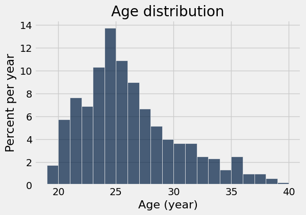


---

**Question 3.1**. Create a function called `compute_statistics` that takes a table containing an "Age" column and a "Salary" column and:
- Draws histograms of ages and salaries
- Returns a two-element array containing the average age and average salary (in that order)

You can call the `histograms` function to draw both histograms at once!

**Student scaffold:**

```python
def compute_statistics(age_and_salary_data):
    ...
    age = ...
    salary = ...
    ...
    

# This code calls the function on our actual table, full_data 
full_stats = compute_statistics(full_data)
full_stats
```

**Solution:**

```python
def compute_statistics(age_and_salary_data):
    histograms(age_and_salary_data) #SOLUTION
    age = age_and_salary_data.column("Age") #SOLUTION
    salary = age_and_salary_data.column("Salary") #SOLUTION
    return make_array(np.mean(age), np.mean(salary)) #SOLUTION
    

# This code calls the function on our actual table, full_data 
full_stats = compute_statistics(full_data)
full_stats
```

*Output:*

```text
array([  2.57371429e+01,   8.45035460e+06])
```


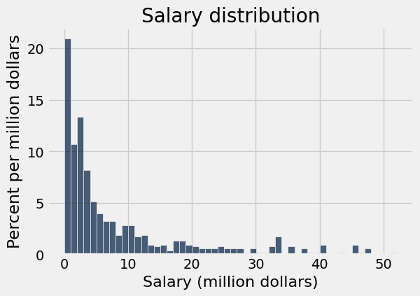

**Test — `q31`**

```python
>>> stats = compute_statistics(full_data)
>>> plt.close()
>>> plt.close()
>>> round(float(stats[0]), 2) == 25.74
True

>>> stats = compute_statistics(full_data)
>>> plt.close()
>>> plt.close()
>>> round(float(stats[1]), 2) == 8450354.6
True
```

### Simple random sampling
A more justifiable approach is to sample uniformly at random from the players.  In a **simple random sample (SRS) without replacement**, we ensure that each player is selected at most once. Imagine writing down each player's name on a card, putting the cards in an box, and shuffling the box.  Then, pull out cards one by one and set them aside, stopping when the specified sample size is reached.

### Producing simple random samples
Sometimes, it’s useful to take random samples even when we have the data for the whole population. It helps us understand sampling accuracy.

### `sample`

The table method `sample` produces a random sample from the table. By default, it draws at random **with replacement** from the rows of a table. Sampling with replacement means for any row selected randomly, there is a chance it can be selected again if we sample multiple times. `Sample` takes in the sample size as its argument and returns a **table** with only the rows that were selected. This differs from `np.random.choice`, which takes an array and outputs a random value from the array.

Run the cell below to see an example call to `sample()` with a sample size of 5, with replacement.

**Code:**

```python
# Just run this cell

full_data.sample(5)
```

*Output:*

| Player | Salary Rank | Salary | Player Rank | Age | Team | Position | Games | Rebounds | Assists | Steals | Blocks | Turnovers | Points |
| --- | --- | --- | --- | --- | --- | --- | --- | --- | --- | --- | --- | --- | --- |
| Jake LaRavia | 299 | 3199920 | 165 | 22 | MEM | PF | 35 | 3.7 | 1.7 | 0.8 | 0.3 | 1.3 | 10.8 |
| Richaun Holmes | 131 | 12046020 | 341 | 30 | WAS | PF | 17 | 6.1 | 0.6 | 0.5 | 0.6 | 0.7 | 7.1 |
| Naji Marshall | 418 | 1930681 | 252 | 26 | NOP | SF | 66 | 3.6 | 1.9 | 0.7 | 0.2 | 1 | 7.1 |
| Isaiah Thomas | 537 | 477630 | 535 | 34 | PHO | PG | 6 | 0 | 0.5 | 0 | 0 | 0 | 1.3 |
| Mo Bamba | 375 | 2346614 | 370 | 25 | PHI | C | 57 | 4.2 | 0.7 | 0.4 | 1.1 | 0.7 | 4.4 |

The optional argument `with_replacement=False` can be passed through `sample()` to specify that the sample should be drawn without replacement.

Run the cell below to see an example call to `sample()` with a sample size of 5, without replacement.

**Code:**

```python
# Just run this cell

full_data.sample(5, with_replacement=False)
```

*Output:*

| Player | Salary Rank | Salary | Player Rank | Age | Team | Position | Games | Rebounds | Assists | Steals | Blocks | Turnovers | Points |
| --- | --- | --- | --- | --- | --- | --- | --- | --- | --- | --- | --- | --- | --- |
| Marcus Morris | 92 | 17612280 | 286 | 34 | CLE | PF | 12 | 2.1 | 0.8 | 0.2 | 0.2 | 0.9 | 5.8 |
| Luguentz Dort | 108 | 15277778 | 160 | 24 | OKC | SF | 79 | 3.6 | 1.4 | 0.9 | 0.6 | 0.9 | 10.9 |
| Isaiah Thomas | 537 | 477630 | 535 | 34 | PHO | PG | 6 | 0 | 0.5 | 0 | 0 | 0 | 1.3 |
| Taylor Hendricks | 231 | 5569872 | 245 | 20 | UTA | PF | 40 | 4.6 | 0.8 | 0.7 | 0.8 | 0.7 | 7.3 |
| Garrett Temple | 301 | 3196448 | 439 | 37 | TOR | SG | 27 | 1.7 | 1 | 0.4 | 0.1 | 0.5 | 3.3 |

---

**Question 3.2** Produce a simple random sample **without** replacement of size **44** from `full_data` , and assign it to `my_small_srswor_data` in the cell below.  Then, run your analysis on it again by using the `compute_statistics` function you defined above.  Run the cell a few times to see how the histograms and statistics change across different samples.

- How much does the average age change across samples? 
- What about average salary?

(FYI: srs = simple random sample, wor = without replacement)

**Student scaffold:**

```python
my_small_srswor_data = ...
my_small_stats = ...
my_small_stats
```

**Solution:**

```python
my_small_srswor_data = full_data.sample(44, with_replacement = False) #SOLUTION
my_small_stats = compute_statistics(my_small_srswor_data) #SOLUTION
my_small_stats
```

*Output:*

```text
array([  2.60000000e+01,   9.52110320e+06])
```

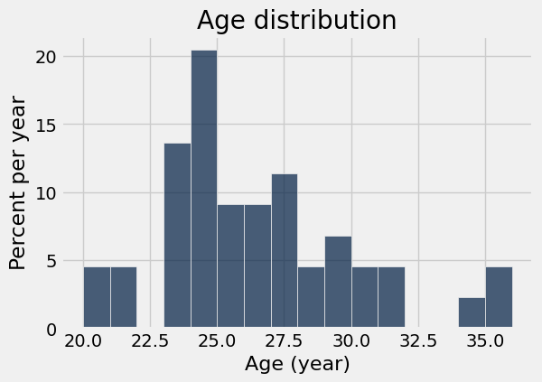

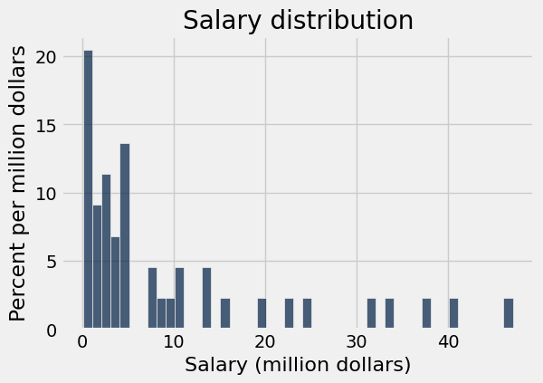

**SOLUTION:** The average age tends to stay around the same value as there is a limited range of ages for NBA players, but the salary changes by a sizeable factor due to larger variability in salary.

---
## 4. More Random Sampling Practice

More practice for random sampling using `np.random.choice`.

###  Simulations and For Loops (cont.)

---

**Question 4.1** We can use `np.random.choice` to simulate multiple trials.

Bing and Mia decide to play a game together rolling a standard six-sided die. Their score on each roll is determined by the face that is rolled. They want to know what their **total score** would be if they rolled the die 1000 times. Write code that simulates their total score after 1000 rolls.

*Hint:* First decide the possible values you can take in the experiment (point values in this case). Then use `np.random.choice` to simulate Bing and Mia's rolls. Finally, sum up the rolls to get the total score.

**Student scaffold:**

```python
possible_point_values = ...
num_tosses = 1000
simulated_tosses = ...
total_score = ...
total_score
```

**Solution:**

```python
""" # BEGIN PROMPT
possible_point_values = ...
num_tosses = 1000
simulated_tosses = ...
total_score = ...
"""; # END PROMPT
# BEGIN SOLUTION NO PROMPT
possible_point_values = np.arange(1, 7)
num_rolls = 1000
simulated_rolls = np.random.choice(possible_point_values, num_rolls)
total_score = sum(simulated_rolls)
# END SOLUTION
total_score
```

*Output:*

```text
3584
```

**Test — `q41`**

```python
>>> 3000 <= total_score <= 4000
True
```

### Simple random sampling (cont.)

---

**Question 4.2** As in the previous question, analyze several simple random samples of size 100 from `full_data` by using the `compute_statistics` function.  
- Do the histogram shapes seem to change more or less across samples of 100 than across samples of size 44?  
- Are the sample averages and histograms closer to their true values/shape for age or for salary?  What did you expect to see?

**Student scaffold:**

```python
my_large_srswor_data = ...
my_large_stats = ...
my_large_stats
```

**Solution:**

```python
my_large_srswor_data = full_data.sample(100, with_replacement = False) #SOLUTION
my_large_stats = compute_statistics(my_large_srswor_data) #SOLUTION
my_large_stats
```

*Output:*

```text
array([  2.58600000e+01,   9.44005617e+06])
```

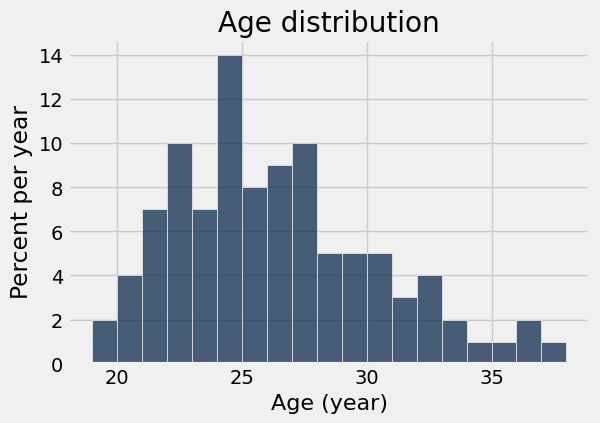

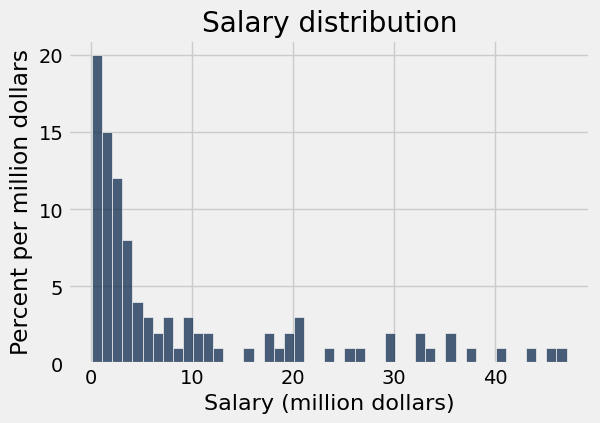

**SOLUTION:** The average and histogram statistics seem to change less across samples of 100. They are closer to their true values, which is what we'd expect to see because we are sampling a larger subset of the population. The histogram and sample average for age seem closer to their true value or shape. We'd expect this because players' ages are less variable than their salaries.

---


**Fubo, Perry, and Dino** are very happy that you finished the lab! Congratulations!

---

You're done with lab!

**Important submission information:**
- **Run all the tests** and verify that they all pass
- **Save** from the **File** menu
- **Run the final cell to generate the zip file**
- **Click the link to download the zip file**
- Then, go to [Pensive](https://www.pensieve.co/) and submit the zip file to the corresponding assignment. The name of this assignment is "Lab XX Autograder", where XX is the lab number -- 01, 02, 03, etc.

- If you finish early in Regular Lab, **ask one of the staff members to check you off**.

**It is your responsibility to make sure your work is saved before running the last cell.**

---

To double-check your work, the cell below will rerun all of the autograder tests.

## Submission

Make sure you have run all cells in your notebook in order before running the cell below, so that all images/graphs appear in the output. The cell below will generate a zip file for you to submit. **Please save before exporting!**

---

## Datasets

Datasets this notebook loads with `Table.read_table`. Column names are exact, including spaces and capitalization. Only the schema is recorded here — the data itself is not in this document, so any question about its values must be answered by running code, not by reasoning over the rows shown elsewhere in this file.

### `nba.csv`

525 rows, 14 columns.

| Column | Type |
| --- | --- |
| `Player` | str |
| `Salary Rank` | int |
| `Salary` | int |
| `Player Rank` | int |
| `Age` | int |
| `Team` | str |
| `Position` | str |
| `Games` | int |
| `Rebounds` | float |
| `Assists` | float |
| `Steals` | float |
| `Blocks` | float |
| `Turnovers` | float |
| `Points` | float |


---

# lab06

---
title: "Lab 6: Examining the Therapeutic Touch"
assignment: lab06
semester: sp26
source: semester_assignments/sp26/lab/lab06/autograder/lab06.ipynb
version: solution (autograder) with student scaffolds
student_source: semester_assignments/sp26/lab/lab06/student/lab06.ipynb
total_points: 1
language: python
---


# Lab 6: Examining the Therapeutic Touch

Welcome to Lab 6! This assignment involves using statistical modeling, hypothesis testing, and simulation to analyze data and draw conclusions

**Recommended Reading**:

* [Assessing a Model](https://inferentialthinking.com/chapters/11/1/Assessing_a_Model.html)
* [Empirical Distribution of a Statistic](https://inferentialthinking.com/chapters/10/3/Empirical_Distribution_of_a_Statistic.html)
* [Random Sampling in Python](https://inferentialthinking.com/chapters/10/4/Random_Sampling_in_Python.html)
* [Python Reference](https://www.data8.org/su26/reference/)

**Getting help on lab**: Whenever you feel stuck or need some further clarification, find a GSI or tutor, and they'll be happy to help!

As a reminder, here are the policies for getting full credit if you are in regular lab (Lab is worth 20% of your final grade):
- 80% of lab credit will be attendance-based. To receive attendance credit for lab, you must attend the full discussion portion (first hour) at which point the GSI will take attendance. 
- The remaining 20% of credit will be awarded for submitting the programming-based assignment to Pensive by the deadline (5pm on Friday) with all test cases passing.

If you are in self-service lab, 100% of credit will be awarded for submitting the programming-based assignment to Pensive by the deadline (5pm on Friday) with all test cases passing.

**Submission**: Once you’re finished, run all cells besides the last one, select File > Save Notebook, and then execute the final cell. The result will contain a zip file that you can use to submit on Pensive.

Let's begin by setting up the tests and imports by running the cell below.

After such an extensive introduction to programming for data science, we are finally moving into the section of the course where we can apply our new skills to answer real questions.  

In this lab, we'll use testing techniques that were introduced in lecture to test the idea of the therapeutic touch, the idea that some practitioner can feel and massage your human energy field.

**Code:**

```python
# Run this cell, but please don't change it.
 
# These lines import the Numpy and Datascience modules.
import numpy as np
from datascience import *
def sample_proportions(sample_size, probabilities):
    return np.random.multinomial(sample_size, probabilities) / sample_size

# These lines do some fancy plotting magic
import matplotlib
%matplotlib inline
import matplotlib.pyplot as plt
plt.style.use('fivethirtyeight')
import warnings
warnings.simplefilter('ignore', FutureWarning)
from matplotlib import patches
from ipywidgets import interact, interactive, fixed
import ipywidgets as widgets
```

---
## 1. What is the Therapeutic Touch

The Therapeutic Touch (TT) is the idea that everyone can feel the Human Energy Field (HEF) around individuals.  Those who practice TT have described different people's HEFs as "warm as Jell-O" and "tactile as taffy." 

TT was a popular technique used throughout the 20th century that was touted as a great way to bring balance to a person's health. Certain practitioners claim they have the ability to feel the HEF and can massage it in order to promote health and relaxation in individuals.

### Emily Rosa

[Emily Rosa](https://en.wikipedia.org/wiki/Emily_Rosa) was a 4th grade student who was very familiar with the world of TT, thanks to her parents, who were both medical practitioners and skeptics of TT.

For her 4th grade science fair project, Emily decided to test whether or not TT practitioners could truly interact with a person's HEF. She later went on to publish her work in TT, becoming the youngest person to have a research paper published in a peer reviewed medical journal.

### Emily's Experiment

Emily's experiment was clean, simple, and effective. Due to her parents' occupations in the medical field, she had wide access to people who claimed to be TT practitioners. 

Emily recruited 21 Therapeutic Touch (TT) practitioners to participate in her science experiment. She would take a TT practitioner and ask them to extend their hands through a screen (which they can't see through). Emily would be on the other side and would flip a fair coin. Depending on how the coin landed, she would put out either her left hand or her right hand. The TT practitioner would then have to answer which hand Emily put out. If a practitioner could truly interact with a person's HEF, it would be expected that they answered correctly.

Overall, through 210 samples, the practitioner picked the correct hand 44% of the time. 

Emily's main goal here was to test whether or not the TT practitioners' guesses were random, like the flip of a coin. In most medical experiments, this is the norm. **We want to test whether or not the treatment has an effect, *not* whether or not the treatment actually works.**

We will now begin to formulate this experiment in terms of the terminology we learned in this course.

---

**Question 1.1**: Describe Emily’s [model](https://inferentialthinking.com/chapters/11/1/Assessing_a_Model.html) for how likely the TT practitioners are to choose the correct hand. What alternative model is her model meant to discredit?

If you are able, check in with fellow peers, the discussion forum, or your lab TA/tutors, to come to a conclusion.

**SOLUTION:** Emily’s model is that the TT practitioners have a 50% chance of choosing the correct hand, like flipping a fair coin. She is trying to debunk the alternative model that the TT practitioners have some chance other than 50% of choosing the correct hand.

--- 

**Question 1.2:** Remember that the practitioner got the correct answer 44% (0.44) of the time. According to Emily's model, on average, what proportion of times do we expect the practitioner to guess the correct hand? Make sure your answer is a number between 0 and 1.

**Student scaffold:**

```python
expected_proportion_correct = ...
expected_proportion_correct
```

**Solution:**

```python
expected_proportion_correct = 0.5 # SOLUTION
expected_proportion_correct
```

*Output:*

```text
0.5
```

**Test — `q1_2`**

```python
>>> 0 <= expected_proportion_correct <= 1
True

>>> from lab06_check import correctness_check_1_2
>>> correctness_check_1_2(expected_proportion_correct)
True
```

The goal now is to see if our deviation from this expected proportion of correct answers is due to something other than chance. 

--- 

**Question 1.3:** We usually use a statistic to help determine which model the evidence points towards. What is a statistic that we can use to compare outcomes under Emily’s model to what was observed? Assign `valid_stat` to an array of integer(s) representing test statistics that Emily can use: 

1. The difference between the expected percent correct and the actual percent correct
2. The absolute difference between the expected percent correct and the actual percent correct
3. The sum of the expected percent correct and the actual percent correct

**NOTE:** Make sure to use `make_array` to create your array of integer(s)!

> *Hint*: What should the domain (possible x values) be for the distribution of our test statistics?

**Student scaffold:**

```python
valid_stat = ...
valid_stat
```

**Solution:**

```python
valid_stat = make_array(2) # SOLUTION
valid_stat
```

*Output:*

```text
array([2])
```

**Test — `q1_3`**

```python
>>> type(valid_stat) == np.ndarray
True

>>> from lab06_check import correctness_check_1_3
>>> correctness_check_1_3(valid_stat)
True
```

--- 

**Question 1.4:** Why is the statistic from Question 1.3 the appropriate choice for comparing outcomes in Emily's experiment? How does it relate to the models you defined in Question 1.1? 

If you are able, check in with fellow peers, the discussion forum, or your lab TA/Tutors.

**SOLUTION:** We want to take the absolute difference between the expected percent correct and actual perfect correct because we are interested in exploring whether or not the treatment has an effect, not whether or not the treatment actually works. This is because the alternate model states that practioners are not answering randomly, but not whether their accuracy is better or worse than if they were guessing at random.

--- 

**Question 1.5:** Define the function `statistic` which takes in an expected proportion and an actual proportion, and returns the value of the statistic chosen in Question 1.3. Assume that the argument takes in proportions, but  return your answer as a percentage. 

*Hint:* Remember we are asking for a **percentage**, not a proportion.

**Student scaffold:**

```python
def statistic(expected_prop, actual_prop):
    ...
```

**Solution:**

```python
def statistic(expected_prop, actual_prop):
    return abs(expected_prop - actual_prop) * 100 # SOLUTION
```

**Test — `q1_5`**

```python
>>> int(round(statistic(0.5, 0.5) + statistic(0.4, 0.1), 1))
30

>>> int(statistic(0.4, 0.1) - statistic(0.1, 0.4))
0
```

--- 

**Question 1.6:** Use your newly defined function to calculate the observed statistic from Emily's experiment.

**Student scaffold:**

```python
observed_statistic = ...
observed_statistic
```

**Solution:**

```python
observed_statistic = statistic(expected_proportion_correct, .44) # SOLUTION
observed_statistic
```

*Output:*

```text
6.0
```

**Test — `q1_6`**

```python
>>> from lab06_check import correctness_check_1_6
>>> correctness_check_1_6(observed_statistic)
True
```

**Is this observed statistic consistent with what we expect to see under Emily’s model?**

In order to answer this question, we must simulate the experiment as though Emily's model was correct, and calculate our statistic for every simulation.

### `sample_proportions`

`sample_proportions` can be used to randomly sample from multiple categories when you know the proportion of data points that are expected to fall in each category. `sample_proportions` takes two arguments: the sample size and an array of proportions corresponding to each category in the population (should sum to 1).

*Note:* A detailed comparison of the three main sampling methods used in Data 8 can be found on this [Sampling Notes Document](https://drive.google.com/file/d/16fIxluoOgr-BfKq_YdUFd3z3zEmwtsRk/view)

Consider flipping a fair coin, where the two outcomes (coin lands heads and coin lands tails) occur with an equal chance. We expect that half of all coin flips will land heads, and half of all coin flips will land tails.

Run the following cell to see the simulation of 10 flips of a fair coin. Let the first item of `coin_proportions` be the proportion of heads and the second item of `coin_proportions` be the proportion of tails.

*Observe what happens when you run this cell multiple times—the proportion of coin flips that land heads and tails appears to change, as you are simulating flipping 10 coins each time!*

**Code:**

```python
coin_proportions = make_array(0.5, 0.5) 
ten_flips = sample_proportions(10, coin_proportions)
ten_flips
```

*Output:*

```text
array([ 0.8,  0.2])
```

`sample_proportions` returns an array that is the same length as the proportion array that is passed through. It contains the proportion of each category that appears in the sample. 

In our example, the first item of `ten_flips` is the simulated proportion of heads and the second item of `ten_flips` is the simulated proportion of tails.

**Code:**

```python
simulated_proportion_heads = ten_flips.item(0)
simulated_proportion_tails = ten_flips.item(1)

print("In our simulation, " + str(simulated_proportion_heads) + " of flips were heads and " \
      + str(simulated_proportion_tails) + " of flips were tails.")
```

*Output (stdout):*

```text
In our simulation, 0.8 of flips were heads and 0.2 of flips were tails.
```

---

**Question 1.7:** To begin simulating, we should start by creating a representation of Emily's model to use for our simulation. This will be an array with two items in it. The first item should be the proportion of times a TT practitioner picks the correct hand, assuming that Emily’s model was correct. The second item should be the proportion of times, under the same assumption, that the TT practitioner picks the incorrect hand. Assign `model_proportions` to this array. 

After this, we can simulate 210 hand choices, as Emily evaluated in real life, and find a single statistic to summarize this instance of the simulation. Use the `sample_proportions` function and **assign the simulated proportion of correct hand choices to** `simulation_proportion_correct`. Lastly, use your `statistic` function to assign `one_statistic`  to the value of the statistic for this one simulation.

*Hint:* `sample_proportions` usage can be found on the [Python Reference](https://www.data8.org/su26/reference/).

*Note:* Once you are done, you can observe how `one_statistic` randomly changes by commenting out `np.random.seed(16)`. Just make sure to uncomment it before running the grader check.

**Student scaffold:**

```python
# This saves the random state of our code so that we can 
# generate the same numbers each time we run the code.
# Please do not change this line. 
np.random.seed(16)

model_proportions = ...
simulation_proportion_correct = ...
one_statistic = ...
one_statistic
```

**Solution:**

```python
# This saves the random state of our code so that we can 
# generate the same numbers each time we run the code.
# Please do not change this line. 
np.random.seed(16)

model_proportions = make_array(.5,.5) #SOLUTION
simulation_proportion_correct = sample_proportions(210, model_proportions).item(0) #SOLUTION
one_statistic = statistic(expected_proportion_correct, simulation_proportion_correct) #SOLUTION
one_statistic
```

*Output:*

```text
0.9523809523809545
```

**Test — `q1_7`**

```python
>>> len(model_proportions) % 2 == 0
True

>>> len(np.unique(model_proportions))
1

>>> sum(model_proportions) == 1
True

>>> type(simulation_proportion_correct) == float
True

>>> round(simulation_proportion_correct, 2)
0.49

>>> round(one_statistic, 2) - 0.95 < 0.05
True
```

---

**Question 1.8:** Let's now see what the distribution of statistics is actually like under Emily's model. 

Define the function `simulation_and_statistic` to take in the `model_proportions` array and the expected proportion of times a TT practitioner would guess a hand correctly under Emily's model. The function should simulate Emily running through the experiment 210 times and return the statistic of this one simulation.

*Hint:* This should follow the same pattern as the code you did in the previous problem.

**Student scaffold:**

```python
def simulation_and_statistic(model_proportions, expected_proportion_correct):
    '''Simulates 210 TT hand choices under Emily’s model. 
    Returns one statistic from the simulation.'''
    ...
```

**Solution:**

```python
def simulation_and_statistic(model_proportions, expected_proportion_correct):
    '''Simulates 210 TT hand choices under Emily’s model. 
    Returns one statistic from the simulation.'''
    # BEGIN SOLUTION
    simulated_proportion = sample_proportions(210, model_proportions).item(0)
    simulated_statistic = statistic(expected_proportion_correct, simulated_proportion)
    return simulated_statistic
    # END SOLUTION
```

Using this function, assign `simulated_statistics` to an array of 1000 statistics that you calculated under the assumption that Emily's model was true.

**Student scaffold:**

```python
num_repetitions = 1000

simulated_statistics = ...

for ... in ...:
    ...
```

**Solution:**

```python
num_repetitions = 1000

simulated_statistics = make_array() # SOLUTION
# BEGIN SOLUTION NO PROMPT
for i in np.arange(num_repetitions):
    a_statistic = simulation_and_statistic(model_proportions, expected_proportion_correct)
    simulated_statistics = np.append(simulated_statistics, a_statistic)
# END SOLUTION

""" # BEGIN PROMPT
for ... in ...:
    ...
"""; # END PROMPT
```

**Test — `q1_8` (1 point)**

```python
>>> len(simulated_statistics) == 1000
True

>>> np.all(simulated_statistics <= 30)
True

>>> np.all(simulated_statistics >= 0)
True

>>> 0 <= simulation_and_statistic(model_proportions, expected_proportion_correct) <= 25
True
```

Let's view the distribution of the simulated statistics under Emily's model, and visually compare where the observed statistic lies relative to the simulated statistics.

**Code:**

```python
t = Table().with_column('Simulated Statistics', simulated_statistics)
t.hist()
plt.scatter(observed_statistic, 0, color='red', s=100, zorder=2);
```

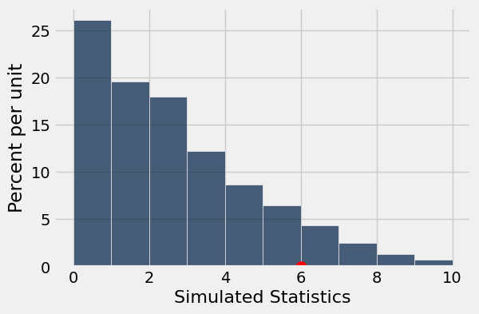

We can make a visual argument as to whether we believe the observed statistic is consistent with Emily’s model. Here, since larger values of the test statistic suggest the alternative model (where the chance of guessing the correct hand is something other than 50%), we can formalize our analysis by finding what proportion of simulated statistics were as large or larger than our observed test statistic (the area at or to the right of the observed test statistic). If this area is small enough, we’ll declare that the observed data are inconsistent with our simulated model. Here is the [link](https://inferentialthinking.com/chapters/11/1/Assessing_a_Model.html#comparing-the-prediction-and-the-data) to the section in the textbook.

--- 

**Question 1.9:** Calculate the proportion of simulated statistics in Question 1.8 greater than or equal to the observed statistic. 

*Hint:* `np.count_nonzero` usage can be found [here](https://inferentialthinking.com/chapters/09/Randomness.html).

**Student scaffold:**

```python
proportion_greater_or_equal = ...
proportion_greater_or_equal
```

**Solution:**

```python
proportion_greater_or_equal = np.count_nonzero(simulated_statistics>=observed_statistic)/len(simulated_statistics) # SOLUTION
proportion_greater_or_equal
```

*Output:*

```text
0.089
```

**Test — `q1_9`**

```python
>>> 0 <= proportion_greater_or_equal <= 1
True

>>> proportion_greater_or_equal * 1000 == np.count_nonzero(simulated_statistics >= observed_statistic)
True
```

By convention, we often compare the proportion we just calculated to 0.05. If the proportion of simulated statistics greater than or equal to the observed statistic is sufficiently small (less than or equal to 0.05), then this is evidence **against** Emily's model. Conceptually, you may think of this as the case where less than 5% of simulated values are as far or farther away from what we had expected. This would mean that seeing a result **as extreme as our observed value** would be very **unlikely** under Emily’s model, given how rarely that occurred in our simulations.

This should help you make your own conclusions about Emily Rosa's experiment. 

Therapeutic touch fell out of use after this experiment, which was eventually accepted into one of the premier medical journals. TT practitioners hit back and accused Emily and her family of tampering with the results, while some claimed that Emily's bad spiritual mood towards therapeutic touch made it difficult to read her HEF. Whatever it may be, Emily's experiment is a classic example about how anyone, with the right resources, can test anything they want!

---

**Question 1.10:** Now, take some time to reflect on the questions below and then, discuss with your peers or take a look at the discussions on the Ed post for this lab.

1. Is the data more consistent with Emily' model (practitioners were randomly guessing)?
2. What does this mean in terms of Emily's experiment? Do the TT practitioners' answers follow an even chance model or is there something else at play? 

Did you talk to your peers or look at the discussion forum? (True/False)

**Student scaffold:**

```python
peer_talk = ...
peer_talk
```

**Solution:**

```python
peer_talk = True # SOLUTION
peer_talk
```

*Output:*

```text
True
```

**Test — `q1_10`**

```python
>>> peer_talk == True
True
```

---

You're done with lab!

**Important submission information:**
- **Run all the tests** and verify that they all pass
- **Save** from the **File** menu
- **Run the final cell to generate the zip file**
- **Click the link to download the zip file**
- Then, go to [Pensive](https://www.pensieve.co/) and submit the zip file to the corresponding assignment. The name of this assignment is "Lab XX Autograder", where XX is the lab number -- 01, 02, 03, etc.

- If you finish early in Regular Lab, **ask one of the staff members to check you off**.

**It is your responsibility to make sure your work is saved before running the last cell.**

---

To double-check your work, the cell below will rerun all of the autograder tests.

## Submission

Make sure you have run all cells in your notebook in order before running the cell below, so that all images/graphs appear in the output. The cell below will generate a zip file for you to submit. **Please save before exporting!**


---

# lab07

---
title: "Lab 7: Great British Bake Off (A/B Test)"
assignment: lab07
semester: sp26
source: semester_assignments/sp26/lab/lab07/autograder/lab07.ipynb
version: solution (autograder) with student scaffolds
student_source: semester_assignments/sp26/lab/lab07/student/lab07.ipynb
language: python
---


# Lab 7: Great British Bake Off (A/B Test)

Welcome to Lab 7! This week's lab will focus on A/B Testing using data from the popular British television show, [*The Great British Bake Off*](https://en.wikipedia.org/wiki/The_Great_British_Bake_Off).

#### **Helpful Resource:**
- [Python Reference](http://data8.org/su26/reference/)

**Recommended Readings:**

* [Error Probabilities](https://inferentialthinking.com/chapters/11/4/Error_Probabilities.html)
* [A/B Testing](https://inferentialthinking.com/chapters/12/1/AB_Testing.html)

**Lab Submission Deadline: Friday, March 20th at 5pm**

**Getting help on lab**: Whenever you feel stuck or need some further clarification, find a GSI or tutor, and they'll be happy to help!

As a reminder, here are the policies for getting full credit if you are in regular lab (Lab is worth 20% of your final grade):
- 80% of lab credit will be attendance-based. To receive attendance credit for lab, you must attend the full discussion portion (first hour) at which point the GSI will take attendance. 
- The remaining 20% of credit will be awarded for submitting the programming-based assignment to Pensive by the deadline (5pm on Friday) with all test cases passing.

If you are in self-service lab, 100% of credit will be awarded for submitting the programming-based assignment to Pensive by the deadline (5pm on Friday) with all test cases passing.

**Submission**: Once you’re finished, run all cells besides the last one, select File > Save Notebook, and then execute the final cell. The result will contain a zip file that you can use to submit on Pensive.

Let's begin by setting up the tests and imports by running the cell below.

**Code:**

```python
# Run this cell to set up the notebook, but please don't change it.

# These lines import the Numpy and Datascience modules.
import numpy as np
from datascience import *

# These lines do some fancy plotting magic.
import matplotlib
%matplotlib inline
import matplotlib.pyplot as plots
plots.style.use('fivethirtyeight')
import warnings
warnings.simplefilter('ignore', FutureWarning)
```

---
## 0. Mid-Semester Survey

We would like you to fill out the mid-semester survey before proceeding any further in this assignment.

Please fill out the survey below and input the secret phrase that is shown at the end of the form when you submit. Please assign this phrase to `mid_secret` as a string in the cell below!

Find the survey [here](https://docs.google.com/forms/d/e/1FAIpQLScpcSK2MHTeZK8DtBmapfPezTp6JoKjeQvcDZIOzpYN-wdV-A/viewform?usp=dialog).

**Student scaffold:**

```python
mid_secret = ...
```

**Solution:**

```python
mid_secret = "cherryblossom" # SOLUTION
```

**Test — `q0`**

```python
>>> from lab07_check import correctness_check_0
>>> correctness_check_0(mid_secret)
True
```

---
## 1. A/B Testing

A/B testing is a form of hypothesis testing that allows you to make comparisons between two distributions — distribution of group “A” and distribution of group “B”. We may also refer to an A/B test as a permutation test.

You'll almost never be explicitly asked to perform an A/B test. Make sure you can identify situations where the test is appropriate and know how to correctly implement each step. Oftentimes, we use an A/B test to determine whether or not two samples came from the same underlying distribution.

---
**Question 1.1.** The following statements are the steps of an A/B hypothesis test presented in a *random order*:

1. Choose a test statistic (typically the difference in means between two categories)

2. Shuffle the labels of the original sample, find your simulated test statistic, and repeat many times

3. Find the value of the observed test statistic

4. Calculate the p-value based off your observed and simulated test statistics

5. Define a null and alternate hypothesis

6. Use the p-value and p-value cutoff to draw a conclusion about the null hypothesis

Assign `ab_test_order` to an array of integers that contains the correct order of an A/B test, where the first item of the array is the first step of an A/B test and the last item of the array is the last step of an A/B test.

**Student scaffold:**

```python
ab_test_order = ...
```

**Solution:**

```python
ab_test_order = make_array(5, 1, 3, 2, 4, 6) # SOLUTION
```

**Test — `q1_1`**

```python
>>> len(ab_test_order) == 6
True

>>> np.allclose(np.array(ab_test_order)[:3] % 2 == 1, True)
True

>>> np.allclose(np.array(ab_test_order)[3:] % 2 == 0, True)
True

>>> import hashlib
>>> def get_hash(num):
...     """Helper function for assessing correctness."""
...     return hashlib.md5(str(num).encode()).hexdigest()
>>> get_hash(np.array(ab_test_order).astype(int))
'a7196ed0f271c873d9750cb92422d911'
```

---
**Question 1.2.** If the null hypothesis of an A/B test is correct, should the order of labels affect the differences in means between each group? Why do we shuffle labels in an A/B test? If you are in a lab section, confirm your answer with a neighbor or staff member before moving on.

**SOLUTION:** Under the null model, there should be no statistically significant difference between the grouped means. We shuffle labels as a way to resample the original data, and understand the baseline differences between groups in the data.

---
## 2. The Great British Bake Off

>"The Great British Bake Off (often abbreviated to Bake Off or GBBO) is a British television baking competition, produced by Love Productions, in which a group of amateur bakers compete against each other in a series of rounds, attempting to impress a group of judges with their baking skills" [Wikipedia](https://en.wikipedia.org/wiki/The_Great_British_Bake_Off)

For every week of the competition, the judges assign one contestant the title "Star Baker". Ultimately, one winner is crowned every season. Using this information, we would like to investigate how winning Star Baker awards affects the odds of winning a season of the show.

---
**Question 2.1.** We want to know whether winning more Star Baker awards ___causes___ an increase in likelihood of winning a season.  Why is it not sufficient to compare star baker rates for winners and losers?

**SOLUTION:** We didn't run a randomized controlled experiment, so we may be misled by confounding factors or reverse causation.

---
### Running an Experiment

We are going to run the following hypothesis test to determine the association between winning and number of Star Baker awards. The population we are examining is every contestant from seasons 2 through 11 of GBBO. We are going to use the following null and alternative hypotheses:

**Null hypothesis:** The distribution of Star Baker awards between contestants who won their season and contestants who did not win their season is the same.

**Alternative hypothesis:** Contestants who win their season of the show will win more Star Baker awards on average.

Our alternative hypothesis is related to our suspicion that contestants who win more Star Baker awards are more skilled, so they are more likely to win the season.

---

**Question 2.2.** Why is it appropriate to use an A/B test to test this hypothesis? What is the “A” group and what is the “B” group?

**SOLUTION:** We should be using an A/B test to check if the groups come from the same underlying distribution. The "A" group consists of non winners. The "B" group consists of the winners of the show.

Check your answers with your neighbors or a staff member before you move on to the next section.

The `bakers` table below describes the number of star baker awards each contest won and whether or not they won their season (`1` if they won, `0` if they did not win). The data was manually aggregated from Wikipedia for seasons 2-11 of the show. We randomized the order of rows as to not spoil the outcome of the show.

**Code:**

```python
bakers = Table.read_table("star_bakers.csv")
bakers.show(3)
```

*Output:*

| star baker awards | won |
| --- | --- |
| 3 | 1 |
| 0 | 0 |
| 1 | 0 |

---
**Question 2.3.** Visualize the distribution of Star Baker awards for winners and non-winners as overlaid histograms. You should use the bins we provided.

Hint: You will want to use the group argument of `tbl.hist`. In order to produce several overlayed histograms based on unique values in a given column, we can do something like `tbl.hist(..., group=<col_name>, bins=...)`. This will graph one histogram for each unique value in the specified column all on a single plot.

**Code:**

```python
useful_bins = np.arange(0, 7) # Do not delete!
```

**Student scaffold:**

```python
...
```

**Solution:**

```python
bakers.hist('star baker awards', group='won', bins=useful_bins) # SOLUTION
```

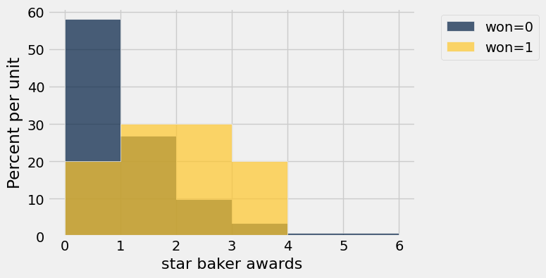

---
**Question 2.4.** We want to figure out if there is a difference between the distribution of Star Baker awards between winners and non winners. 

What should the test statistic be? Which values of this test statistic support the null, and which values support the alternative? **Assign `test_option` to the number corresponding to the correct test statistic.**

1. Absolute value of the difference between the means between both groups; high values support the null
2. Absolute value of the difference between the means between both groups; low values support the null
3. Average Star Baker awards for winners - average Star Baker awards for non-winners; high values support the null
4. Average Star Baker awards for winners - average Star Baker awards for non-winners; low values support the null

Before moving on, confirm your answer with a peer or in the discussion forums.

_Hint:_ You should think about what measures we use to describe a distribution.

**Student scaffold:**

```python
test_option = ...
```

**Solution:**

```python
test_option = 4 # SOLUTION
```

**Test — `q2_4`**

```python
>>> from lab07_check import correctness_check_2_4
>>> correctness_check_2_4(test_option)
True
```

---
**Question 2.5.** Create a new table called `means` that contains the mean number of star baker awards for bakers who did not win (`won==0`) and bakers that did win (`won==1`). The table should have the column names `won` and `star baker awards mean`.

**Student scaffold:**

```python
means = ...
means
```

**Solution:**

```python
means = bakers.group('won', np.mean) # SOLUTION
means
```

*Output:*

| won | star baker awards mean |
| --- | --- |
| 0 | 0.651786 |
| 1 | 1.5 |

**Test — `q2_5`**

```python
>>> means.num_rows
2

>>> bool(np.round(min(means.column('star baker awards mean')), 2) == 0.65)
True

>>> bool(np.round(max(means.column('star baker awards mean')), 2) == 1.5)
True
```

---
**Question 2.6.** Set `observed_difference` to the observed test statistic using the `means` table.

**Student scaffold:**

```python
observed_difference = ...
observed_difference
```

**Solution:**

```python
observed_difference = means.column(1).item(1) - means.column(1).item(0) # SOLUTION
observed_difference
```

*Output:*

```text
0.8482142857142857
```

**Test — `q2_6`**

```python
>>> bool(isinstance(observed_difference, float))
True

>>> from lab07_check import correctness_check_2_6
>>> correctness_check_2_6(observed_difference)
True
```

---
**Question 2.7.** Given a table `tbl` (like `bakers`), a label column `label_col`, and a values column `val_col`, write a function that calculates the appropriate test statistic.

*Hint:* Inside the function, you will most likely want to make a **new** `means` table based on the function's arguments. **However, avoid using the original `means` table itself,** since this assumes you will always use the same `bakers` table.

*Hint:* Make sure that you are taking the directionality of our alternative hypothesis into account.

**Student scaffold:**

```python
def find_test_stat(tbl, label_col, val_col):
    ...

find_test_stat(bakers, "won", "star baker awards")
```

**Solution:**

```python
def find_test_stat(tbl, label_col, val_col):
    # BEGIN SOLUTION
    reduced = tbl.select(label_col, val_col)
    means_tbl = reduced.group(label_col, np.average)
    means = means_tbl.column(1)
    return means.item(1) - means.item(0)
    # END SOLUTION

find_test_stat(bakers, "won", "star baker awards")
```

*Output:*

```text
0.8482142857142857
```

**Test — `q2_7`**

```python
>>> bool(np.isclose(round(find_test_stat(bakers, 'won', 'star baker awards'), 3) - 0.848, 0))
True

>>> np.random.seed(1)
>>> test_stat = find_test_stat(bakers.sample(), 'won', 'star baker awards')
>>> bool(np.isclose(round(test_stat, 3) - 1.232, 0))
True
```

When we run a simulation for A/B testing, we resample by **shuffling the labels** of the original sample. If the null hypothesis is true and the star baker award distributions are the same, we expect that the difference in mean star baker awards to not change when `"won"` labels are changed.

---
**Question 2.8.** Write a function `simulate_and_test_statistic` to compute one trial of our A/B test. Your function should run a simulation and return a test statistic.

*Hint:* Textbook chapter [12.1.4](https://inferentialthinking.com/chapters/12/1/AB_Testing.html#predicting-the-statistic-under-the-null-hypothesis) can help!

**Student scaffold:**

```python
def simulate_and_test_statistic(tbl, labels_col, values_col):
    ...

simulate_and_test_statistic(bakers, "won", "star baker awards")
```

**Solution:**

```python
def simulate_and_test_statistic(tbl, labels_col, values_col):
    # BEGIN SOLUTION
    shuffled_labels = tbl.sample(with_replacement = False).column(labels_col)
    original_and_shuffled = tbl.with_column(labels_col, shuffled_labels)
    return find_test_stat(original_and_shuffled, labels_col, values_col)
    # END SOLUTION

simulate_and_test_statistic(bakers, "won", "star baker awards")
```

*Output:*

```text
0.4125000000000001
```

**Test — `q2_8`**

```python
>>> test_stat = round(simulate_and_test_statistic(bakers, 'won', 'star baker awards'), 3)
>>> bool(-2 < test_stat < 2)
True

>>> np.random.seed(1)
>>> test_stat2 = simulate_and_test_statistic(bakers, 'won', 'star baker awards')
>>> bool(np.round(test_stat2, 3) == -0.023) or bool(np.round(test_stat2, 3) == -0.132)
True
```

---
**Question 2.9.** Simulate 5000 trials of our A/B test and store the test statistics in an array called `differences`.

**Student scaffold:**

```python
# This cell might take a couple seconds to run
differences = make_array()

...
                                                 
differences
```

**Solution:**

```python
# This cell might take a couple seconds to run
differences = make_array()

# BEGIN SOLUTION 
repetitions = 5000
for i in np.arange(repetitions):
    new_difference = simulate_and_test_statistic(bakers, "won", "star baker awards")
    differences = np.append(differences, new_difference)
# END SOLUTION
                                                 
differences
```

*Output:*

```text
array([ 0.08571429, -0.24107143,  0.19464286, ..., -0.45892857,
        0.08571429, -0.24107143])
```

**Test — `q2_9`**

```python
>>> len(differences)
5000

>>> bool(abs(np.average(differences)) < 0.05)
True

>>> bool(all(differences == differences.item(0)) == False)
True
```

Run the cell below to view a histogram of your simulated test statistics plotted with your observed test statistic as a red dot.

**Code:**

```python
Table().with_column('Difference Between Group Means', differences).hist(bins=20)
plots.scatter(observed_difference, 0, color='red', s=30, zorder=2)
plots.ylim(-0.1, 1.35);
```

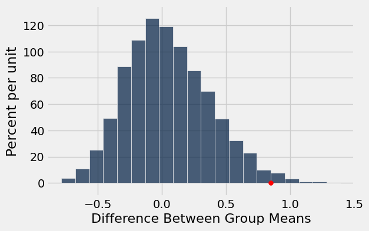

---
**Question 2.10.** Find the p-value for your test and assign it to `empirical_p`.

**Student scaffold:**

```python
empirical_p = ...
empirical_p
```

**Solution:**

```python
empirical_p = np.count_nonzero(differences >= observed_difference) / repetitions # SOLUTION
empirical_p
```

*Output:*

```text
0.0144
```

**Test — `q2_10`**

```python
>>> bool(0 <= empirical_p < 0.05)
True
```

---
**Question 2.11.** Using a 5% p-value cutoff, draw a conclusion about the null and alternative hypotheses. Describe your findings using simple, non-technical language. What does your analysis tell you about the association between star baker awards and winning? What can you claim about causation from your statistical analysis? Confirm your answer with a peer, instructor or in the discussion forums. 

*Hint:* See section [12.1.6](https://inferentialthinking.com/chapters/12/1/AB_Testing.html#conclusion-of-the-test)

**SOLUTION:** Our p-value (staff solutions had a p-value of 0.014) is less than the cutoff of 0.05. Our data supports the alternative hypothesis that star baker award rates do significantly change between winners and non-winners. Any observed different was due to something besides just chance.

---
---

---

You're done with lab!

**Important submission information:**
- **Run all the tests** and verify that they all pass
- **Save** from the **File** menu
- **Run the final cell to generate the zip file**
- **Click the link to download the zip file**
- Then, go to [Pensive](https://www.pensieve.co/) and submit the zip file to the corresponding assignment. The name of this assignment is "Lab XX Autograder", where XX is the lab number -- 01, 02, 03, etc.

- If you finish early in Regular Lab, **ask one of the staff members to check you off**.

**It is your responsibility to make sure your work is saved before running the last cell.**

---

To double-check your work, the cell below will rerun all of the autograder tests.

## Submission

Make sure you have run all cells in your notebook in order before running the cell below, so that all images/graphs appear in the output. The cell below will generate a zip file for you to submit. **Please save before exporting!**

---

## Datasets

Datasets this notebook loads with `Table.read_table`. Column names are exact, including spaces and capitalization. Only the schema is recorded here — the data itself is not in this document, so any question about its values must be answered by running code, not by reasoning over the rows shown elsewhere in this file.

### `star_bakers.csv`

122 rows, 2 columns.

| Column | Type |
| --- | --- |
| `star baker awards` | int |
| `won` | int |


---

# lab08

---
title: "Lab 8: Normal Distribution and Variability of Sample Means"
assignment: lab08
semester: sp26
source: semester_assignments/sp26/lab/lab08/autograder/lab08.ipynb
version: solution (autograder) with student scaffolds
student_source: semester_assignments/sp26/lab/lab08/student/lab08.ipynb
language: python
---


# Lab 8: Normal Distribution and Variability of Sample Means

Welcome to Lab 8! This week's lab will look into the normal distribution and variability of sample means through data on births and San Francisco salaries.

#### **Helpful Resource:**
- [Python Reference](http://data8.org/su26/reference/)

**Recommended Readings:**
- [Variability of the Sample Mean](https://inferentialthinking.com/chapters/14/5/Variability_of_the_Sample_Mean.html)
- [Normal Distribution](https://www.inferentialthinking.com/chapters/14/3/SD_and_the_Normal_Curve.html)

**Getting help on lab**: Whenever you feel stuck or need some further clarification, find a GSI or tutor, and they'll be happy to help!

As a reminder, here are the policies for getting full credit if you are in regular lab (Lab is worth 20% of your final grade):
- 80% of lab credit will be attendance-based. To receive attendance credit for lab, you must attend the full discussion portion (first hour) at which point the GSI will take attendance. 
- The remaining 20% of credit will be awarded for submitting the programming-based assignment to Pensive by the deadline (5pm on Friday) with all test cases passing.

If you are in self-service lab, 100% of credit will be awarded for submitting the programming-based assignment to Pensive by the deadline (5pm on Friday) with all test cases passing.

**Submission**: Once you’re finished, run all cells besides the last one, select File > Save Notebook, and then execute the final cell. The result will contain a zip file that you can use to submit on Pensive.

Let's begin by setting up the tests and imports by running the cell below.

**Code:**

```python
# Run this cell, but please don't change it.
 
# These lines import the Numpy and Datascience modules.
import numpy as np
from datascience import *

# These lines do some fancy plotting magic.
import matplotlib
%matplotlib inline
import matplotlib.pyplot as plots
plots.style.use('fivethirtyeight')
import warnings
warnings.simplefilter('ignore')
```

---
# 1. Normal Distributions

When we visualize the distribution of a sample, we are often interested in the mean and the standard deviation of the sample (for the rest of this lab, we will abbreviate “standard deviation” as “SD”). These two sample statistics can give us a bird’s eye view of the distribution -- by letting us know where the distribution sits on the number line and how spread out it is, respectively.

We want to check if the data is linearly related, so we should look at the data.

First, let's load in the `births` table from lecture, which is a large random sample of US births and includes information about mother-child pairs.

**Code:**

```python
births = Table.read_table('baby.csv')
births
```

*Output:*

| Birth Weight | Gestational Days | Maternal Age | Maternal Height | Maternal Pregnancy Weight | Maternal Smoker |
| --- | --- | --- | --- | --- | --- |
| 120 | 284 | 27 | 62 | 100 | False |
| 113 | 282 | 33 | 64 | 135 | False |
| 128 | 279 | 28 | 64 | 115 | True |
| 108 | 282 | 23 | 67 | 125 | True |
| 136 | 286 | 25 | 62 | 93 | False |
| 138 | 244 | 33 | 62 | 178 | False |
| 132 | 245 | 23 | 65 | 140 | False |
| 120 | 289 | 25 | 62 | 125 | False |
| 143 | 299 | 30 | 66 | 136 | True |
| 140 | 351 | 27 | 68 | 120 | False |

---
**Question 1.1.** **Now, write a line of code to plot the distribution of mother’s ages from the `births` table.** Don’t change the last line, which will plot the mean of the sample on the distribution itself.

**Student scaffold:**

```python
...

# Do not change anything below this line
plots.scatter(np.mean(births.column("Maternal Age")), 0, color='red', zorder=2, s=50);
plots.ylim(-0.005, 0.07);
```

**Solution:**

```python
births.hist("Maternal Age") # SOLUTION

# Do not change anything below this line
plots.scatter(np.mean(births.column("Maternal Age")), 0, color='red', zorder=2, s=50);
plots.ylim(-0.005, 0.07);
```


From the plot above, we can see that the mean is the center of gravity or balance point of the distribution. If you cut the distribution out of cardboard, and then placed your finger at the mean, the distribution would perfectly balance on your finger. Since the distribution above is right skewed (which means it has a long right tail), we know that the mean of the distribution is larger than the median, which is the “halfway” point of the data. Conversely, if the distribution had been left skewed, we know the mean would be smaller than the median.

---
Run the following cell to compare the mean (red) and median (blue) of the distribution of mothers ages.

**Code:**

```python
births.hist("Maternal Age")
plots.scatter(np.mean(births.column("Maternal Age")), 0, color='red', zorder=2, s=50, label="Mean")
plots.scatter(np.median(births.column("Maternal Age")), 0, color='blue', zorder=2, s=50, label="Median")
plots.legend()
plots.ylim(-0.005, 0.07);
```

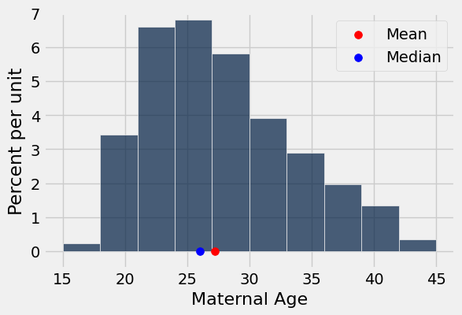

We are also interested in the standard deviation of mothers' ages. The SD gives us a sense of how variable mothers' ages are around the average mothers' age. If the SD is large, then the mothers' ages should spread over a large range from the average mothers' age. If the SD is small, then the mothers' ages should be tightly clustered around the average mothers' age. 

**The SD of an array is defined as the "root mean square of the deviations" where the deviations are the difference between the original elements and their average.**

You can read more about Variability and SD in [Chapter 14.2](https://inferentialthinking.com/chapters/14/2/Variability.html). This chapter also goes a bit more into detail about how "root mean square of the deviations" is calculated. Fun fact! $\sigma$ (Greek letter sigma) is used to represent the SD and $\mu$ (Greek letter mu) is used for the mean.

---
**Question 1.2.** Assign `age_mean` to the mean of the maternal ages and `age_sd` to the SD of the maternal ages. Then run the cell below to see the width of one SD (blue) from the sample mean (red) plotted on the histogram of maternal ages.

*Hint*: `np.std` might be useful here.

**Student scaffold:**

```python
age_mean = ...
age_sd = ...
births.hist("Maternal Age")

plots.scatter(age_mean, 0, color='red', zorder=2, s=50);
plots.scatter(age_mean+age_sd, 0, marker='^', color='blue', zorder=2, s=50);
plots.scatter(age_mean-age_sd, 0, marker='^', color='blue', zorder=2, s=50);
plots.ylim(-0.005, 0.07);
```

**Solution:**

```python
age_mean = np.mean(births.column("Maternal Age")) # SOLUTION
age_sd = np.std(births.column("Maternal Age")) # SOLUTION
births.hist("Maternal Age")

plots.scatter(age_mean, 0, color='red', zorder=2, s=50);
plots.scatter(age_mean+age_sd, 0, marker='^', color='blue', zorder=2, s=50);
plots.scatter(age_mean-age_sd, 0, marker='^', color='blue', zorder=2, s=50);
plots.ylim(-0.005, 0.07);
```

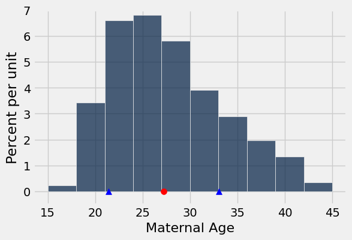

**Test — `q1_2`**

```python
>>> from lab08_check import correctness_check_1_2_1
>>> correctness_check_1_2_1(age_mean)
True

>>> from lab08_check import correctness_check_1_2_2
>>> correctness_check_1_2_2(age_sd)
True
```

In this histogram, the standard deviation is not easy to identify just by looking at the graph.

However, the distributions of some variables allow us to easily spot the standard deviation on the plot. For example, if a sample follows a **[normal distribution](https://inferentialthinking.com/chapters/14/3/SD_and_the_Normal_Curve.html)**, the standard deviation is easily spotted at the point of inflection (the point where the curve begins to change the direction of its curvature, from curving upwards near the tails to curving downwards near the peak) of the distribution.

---
**Question 1.3.** Fill in the following code to examine the distribution of maternal heights, which is roughly normally distributed. We’ll plot the standard deviation on the histogram, as before - notice where one standard deviation (blue) away from the mean (red) falls on the plot.

**Student scaffold:**

```python
height_mean = ...
height_sd = ...
births.hist("Maternal Height", bins=np.arange(55,75,1))

plots.scatter((height_mean), 0, color='red', zorder=2, s=50);
plots.scatter(height_mean+height_sd, 0, marker='^', color='blue', zorder=2, s=50);
plots.scatter(height_mean-height_sd, 0, marker='^', color='blue', zorder=2, s=50);
plots.ylim(-0.01, 0.16);
```

**Solution:**

```python
height_mean = np.mean(births.column("Maternal Height")) # SOLUTION
height_sd = np.std(births.column("Maternal Height")) # SOLUTION
births.hist("Maternal Height", bins=np.arange(55,75,1))

plots.scatter((height_mean), 0, color='red', zorder=2, s=50);
plots.scatter(height_mean+height_sd, 0, marker='^', color='blue', zorder=2, s=50);
plots.scatter(height_mean-height_sd, 0, marker='^', color='blue', zorder=2, s=50);
plots.ylim(-0.01, 0.16);
```

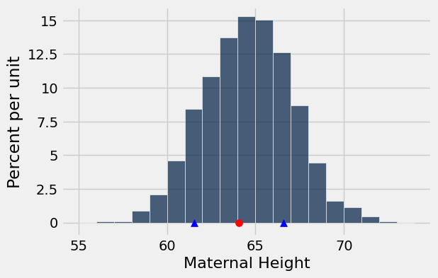

**Test — `q1_3`**

```python
>>> from lab08_check import correctness_check_1_3_1
>>> correctness_check_1_3_1(height_mean)
True

>>> from lab08_check import correctness_check_1_3_2
>>> correctness_check_1_3_2(height_sd)
True
```

We don’t always know how a variable will be distributed, and making assumptions about whether or not a variable will follow a normal distribution is dangerous. However, the **Central Limit Theorem** defines one distribution that always follows a normal distribution. **The distribution of the *sums* or *means* of all large random samples drawn with replacement (and thus independent from one another) from a single distribution (regardless of the distribution’s original shape) will be normally distributed.** Remember that the Central Limit Theorem refers to the distribution of a *statistic* calculated from a distribution, not the distribution of the original sample or population. If this is confusing, ask a staff member!

The next section will explore distributions of sample means, and you will see how the standard deviation of these distributions depends on sample sizes.

---
# 2. Variability of the Sample Mean

By the [Central Limit Theorem](https://www.inferentialthinking.com/chapters/14/4/Central_Limit_Theorem.html), the probability distribution of the mean or sum of a large random sample is roughly normal. The bell curve is centered at the population mean. Some of the sample means are higher and some are lower, but the deviations from the population mean are roughly symmetric on either side, as we have seen repeatedly.

In our simulations, we also noticed that the means of larger samples tend to be more tightly clustered around the mean of the distribution we sample from, compared to if we had smaller samples. Note that in this lab, the data we have access to and sample from is the population (which we rarely have access to), while when we bootstrap, the distribution we sample from is our original sample.

In this section, we will quantify the [variability of the sample mean](https://www.inferentialthinking.com/chapters/14/5/Variability_of_the_Sample_Mean.html) and develop a relation between the variability and the sample size.

Let's take a look at the salaries of employees of the City of San Francisco in 2023. The median salary reported by the city government was about $169,361. **Note that in this lab, this dataset is the population.**

This data was collected by [Transparent California](https://transparentcalifornia.com/salaries/2023/san-francisco/) where the `salary` column is calculated by summing up regular, overtime, and other pay.

_Note: If you get stuck on any part of this lab, please refer to [Chapter 14 of the textbook](https://www.inferentialthinking.com/chapters/14/Why_the_Mean_Matters.html)._

**Code:**

```python
salaries = Table.read_table('sf_salaries_2023.csv')
salaries.show(5)
```

*Output:*

| salary |
| --- |
| 678381 |
| 653854 |
| 580333 |
| 565644 |
| 522043 |

**Code:**

```python
salary_mean = np.mean(salaries.column('salary'))
print('Mean salary of San Francisco city employees in 2023: ', salary_mean.round(2))
```

*Output (stdout):*

```text
Mean salary of San Francisco city employees in 2023:  113394.16
```

**Code:**

```python
max(salaries.column(0))
```

*Output:*

```text
678381.01000000001
```

**Code:**

```python
salaries.hist('salary', bins=np.arange(0, 400000, 10000))
plots.scatter(salary_mean, 0, color='red', zorder=2, s=50)
plots.title('2023 salaries of city of SF employees')
plots.ylim(-0.0000005, 0.000011);
```

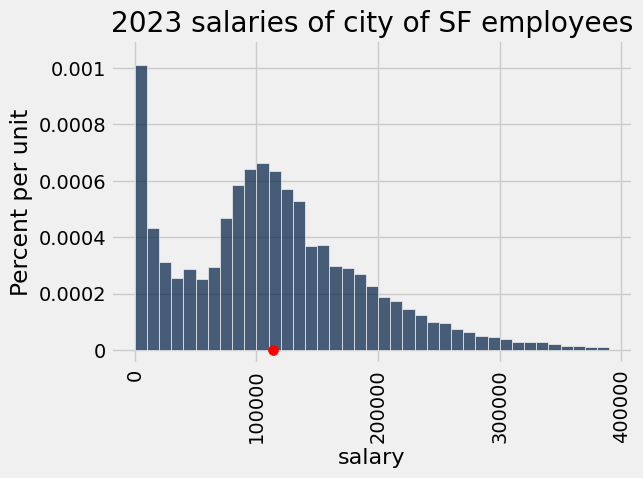

Clearly, the population _does not_ follow a normal distribution. Keep that in mind as we progress through these exercises.

Let's take random samples **with replacement** and look at the probability distribution of the sample mean. As usual, we will use simulation to get an empirical approximation to this distribution.

---
**Question 2.1.** Define a function `one_sample_mean`. Its arguments should be `table` (the name of a table), `label` (the label of the column containing the variable), and `sample_size`(the number of employees in the sample). It should sample with replacement from the table and
return the mean of the `label` column of the sample.

_Note:_ The function should reference the arguments and be able to work with any table.

**Student scaffold:**

```python
def one_sample_mean(table, label, sample_size):
    new_sample = ...
    new_sample_mean = ...
    ...
```

**Solution:**

```python
def one_sample_mean(table, label, sample_size):
    new_sample = table.sample(sample_size, with_replacement=True) # SOLUTION
    new_sample_mean = np.mean(new_sample.column(label)) # SOLUTION
    return new_sample_mean # SOLUTION
```

**Test — `q2_1`**

```python
>>> np.random.seed(8)
>>> bool(np.round(one_sample_mean(salaries, 'salary', 100), 3) == 117803.366)
True
```

---
**Question 2.2.** Use `one_sample_mean` to define a function `simulate_sample_mean`. The arguments are the name of the `table`, the `label` of the column containing the variable, the `sample_size`, and the number of simulations (`repetitions`).

The function should sample with replacement from the table and calculate the mean of each sample. It should save the sample means in an array called `means`. The remaining code in the function displays an empirical histogram of the sample means.

_Note:_ We round all values to 2 decimal places in the provided code because we are working with salaries.

**Student scaffold:**

```python
"""Empirical distribution of random sample means"""

def simulate_sample_mean(table, label, sample_size, repetitions):
    
    means = make_array()

    for i in np.arange(repetitions):
        new_sample_mean = ...
        means = ...

    sample_means = Table().with_column('Sample Means', means)
    
    # Display empirical histogram and print all relevant quantities – don't change this!
    sample_means.hist(bins=20)
    plots.xlabel('Sample Means')
    plots.title('Sample Size {sample_size}; {repetitions} Resamples'.format(sample_size=sample_size, repetitions=repetitions))
    print("Sample size: ", sample_size)
    print("Population mean:", np.mean(table.column(label)).round(2))
    print("Average of sample means: ", np.mean(means).round(2))
    print("Population SD:", np.std(table.column(label)).round(2))
    print("SD of sample means:", np.std(means).round(2))
    return np.std(means)
```

**Solution:**

```python
"""Empirical distribution of random sample means"""

def simulate_sample_mean(table, label, sample_size, repetitions):
    
    means = make_array()

    for i in np.arange(repetitions):
        new_sample_mean = one_sample_mean(table, label, sample_size) #SOLUTION
        means = np.append(means, new_sample_mean) #SOLUTION

    sample_means = Table().with_column('Sample Means', means)
    
    # Display empirical histogram and print all relevant quantities – don't change this!
    sample_means.hist(bins=20)
    plots.xlabel('Sample Means')
    plots.title('Sample Size {sample_size}; {repetitions} Resamples'.format(sample_size=sample_size, repetitions=repetitions))
    print("Sample size: ", sample_size)
    print("Population mean:", np.mean(table.column(label)).round(2))
    print("Average of sample means: ", np.mean(means).round(2))
    print("Population SD:", np.std(table.column(label)).round(2))
    print("SD of sample means:", np.std(means).round(2))
    return np.std(means)
```

Verify with a peer or TA that you've implemented the function above correctly. If you haven't implemented it correctly, the rest of the lab won't work properly, so this step is crucial.

In the following cell, we will create a sample of size 100 from `salaries` and graph it using our new `simulate_sample_mean` function.

_Hint: You should see a distribution similar to something we've been talking about. If not, check your function._

**Code:**

```python
simulate_sample_mean(salaries, 'salary', 100, 10000) 
plots.xlim(80000, 150000);
```

*Output (stdout):*

```text
Sample size:  100
Population mean: 113394.16
Average of sample means:  113389.27
Population SD: 78501.6
SD of sample means: 7788.02
```

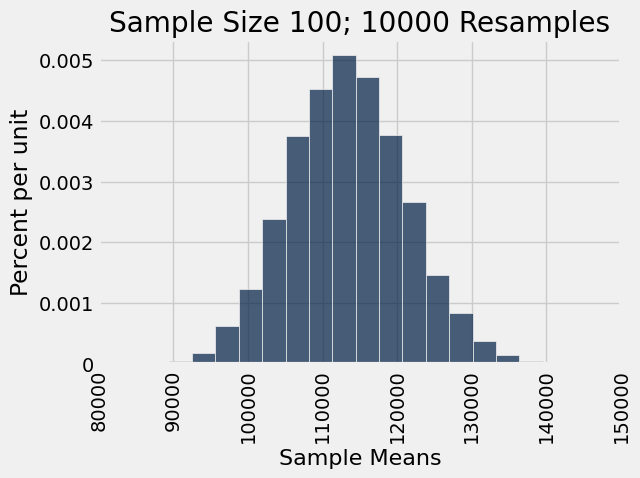

Notice that our distribution of _sample means_ looks approximately normal! Did it matter if our original distribution was normally distributed?

---
**Question 2.3.** Simulate two sample means, one for a sample of 400 salaries and one for a sample of 625 salaries. In each case, perform 10,000 repetitions. Don't worry about the `plots.xlim` or `plots.ylim` lines – they just make sure that all of the plots have the same x-axis and y-axis, respectively.

**Student scaffold:**

```python
simulate_sample_mean(..., ..., ..., ...)
plots.xlim(90000, 140000)
plots.ylim(0, 0.00014)
plots.show();
print('\n')
simulate_sample_mean(..., ..., ..., ...)
plots.xlim(90000, 140000)
plots.ylim(0, 0.00014)
plots.show();
```

**Solution:**

```python
# BEGIN SOLUTION NO PROMPT
simulate_sample_mean(salaries, 'salary', 400, 10000)
plots.xlim(90000, 140000)
plots.ylim(0, 0.00014)
plots.show();
print('\n')
simulate_sample_mean(salaries, 'salary', 625, 10000)
plots.xlim(90000, 140000)
plots.ylim(0, 0.00014)
plots.show();
# END SOLUTION
""" # BEGIN PROMPT
simulate_sample_mean(..., ..., ..., ...)
plots.xlim(90000, 140000)
plots.ylim(0, 0.00014)
plots.show();
print('\n')
simulate_sample_mean(..., ..., ..., ...)
plots.xlim(90000, 140000)
plots.ylim(0, 0.00014)
plots.show();
"""; # END PROMPT
```

*Output (stdout):*

```text
Sample size:  400
Population mean: 113394.16
Average of sample means:  113450.85
Population SD: 78501.6
SD of sample means: 3893.05
```

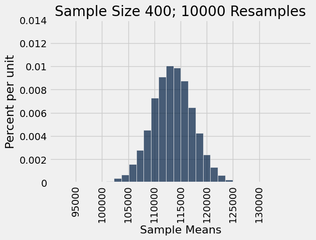

*Output (stdout):*

```text
Sample size:  625
Population mean: 113394.16
Average of sample means:  113448.8
Population SD: 78501.6
SD of sample means: 3140.13
```

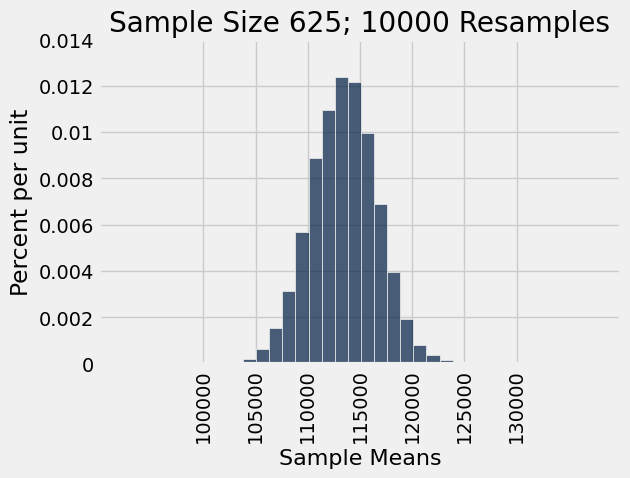

---
**Question 2.4.** Assign `q2_4` to an array of numbers corresponding to true statement(s) about the plots from 2.3.

_Hint_: If a distribution is bell-shaped, what type of curve does it follow?

1. We see the Central Limit Theorem (CLT) in action because the distributions of the sample means are bell-shaped.
2. We see the Law of Averages in action because the distributions of the sample means look like the distribution of the population.
3. One of the conditions for the CLT is that we have to draw a small random sample with replacement from the population.
4. One of the conditions for the CLT is that we have to draw a large random sample with replacement from the population.
5. One of the conditions for the CLT is that the population must be normally distributed.

**Student scaffold:**

```python
q2_4 = ...
```

**Solution:**

```python
q2_4 = make_array(1, 4) # SOLUTION
```

**Test — `q2_4`**

```python
>>> from lab08_check import correctness_check_2_4
>>> correctness_check_2_4(q2_4)
True
```

---
**Question 2.5.** Assign `q2_5` to an array of numbers corresponding to true statement(s) about the plots from 2.3.

1. Both plots in 2.3 are roughly centered around the population mean.
2. Both plots in 2.3 are roughly centered around the mean of a particular sample.
3. The distribution of sample means for sample size 625 has less variability than the distribution of sample means for sample size 400.
4. The distribution of sample means for sample size 625 has more variability than the distribution of sample means for sample size 400.

**Student scaffold:**

```python
q2_5 = ...
```

**Solution:**

```python
q2_5 = make_array(1, 3) # SOLUTION
```

**Test — `q2_5`**

```python
>>> from lab08_check import correctness_check_2_5
>>> correctness_check_2_5(q2_5)
True
```

Below, we'll look at what happens when we take an **increasing number of resamples of a fixed sample size.** Notice what number in the code changes, and what stays the same. How does the distribution of the resampled means change?

**Code:**

```python
simulate_sample_mean(salaries, 'salary', 100, 500)
plots.xlim(80000, 150000)
plots.ylim(0, 0.00006)
```

*Output (stdout):*

```text
Sample size:  100
Population mean: 113394.16
Average of sample means:  113491.3
Population SD: 78501.6
SD of sample means: 7962.7
```

*Output:*

```text
(0.0, 6e-05)
```

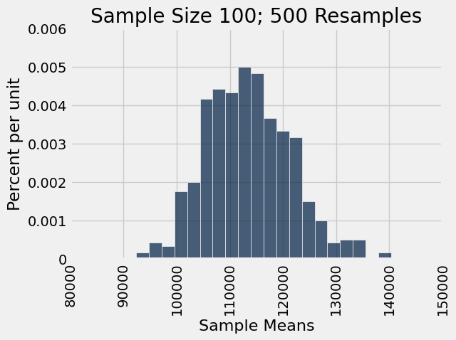

**Code:**

```python
simulate_sample_mean(salaries, 'salary', 100, 1000)
plots.xlim(80000, 150000)
plots.ylim(0, 0.00006)
```

*Output (stdout):*

```text
Sample size:  100
Population mean: 113394.16
Average of sample means:  113637.34
Population SD: 78501.6
SD of sample means: 7899.32
```

*Output:*

```text
(0.0, 6e-05)
```

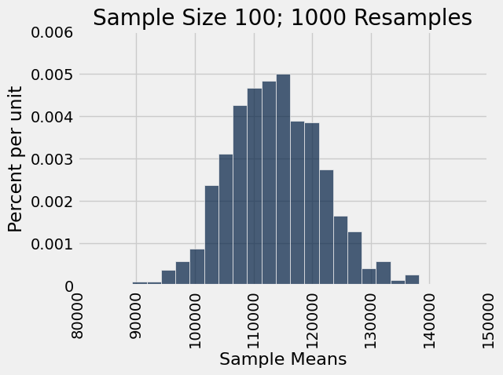

**Code:**

```python
simulate_sample_mean(salaries, 'salary', 100, 5000)
plots.xlim(80000, 150000)
plots.ylim(0, 0.00006)
```

*Output (stdout):*

```text
Sample size:  100
Population mean: 113394.16
Average of sample means:  113375.31
Population SD: 78501.6
SD of sample means: 7962.38
```

*Output:*

```text
(0.0, 6e-05)
```

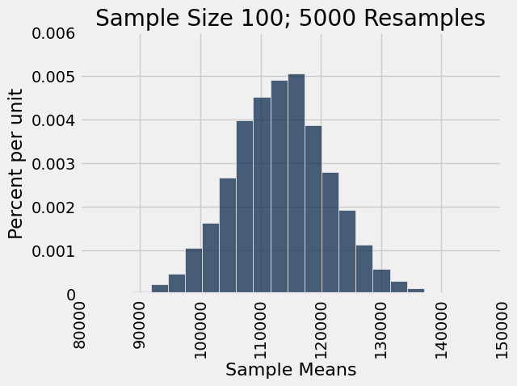

**Code:**

```python
simulate_sample_mean(salaries, 'salary', 100, 10000)
plots.xlim(80000, 150000)
plots.ylim(0, 0.00006)
```

*Output (stdout):*

```text
Sample size:  100
Population mean: 113394.16
Average of sample means:  113478.42
Population SD: 78501.6
SD of sample means: 7832.14
```

*Output:*

```text
(0.0, 6e-05)
```

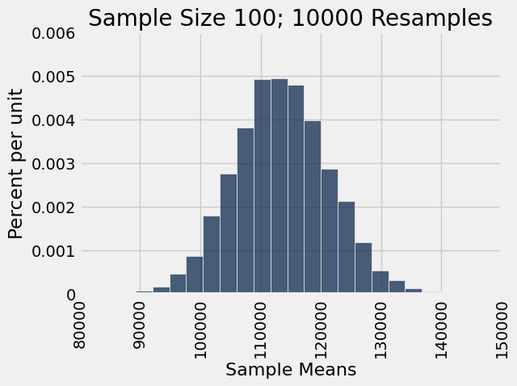

What did you notice about the distributions of sample means in the four histograms above? Discuss with your peers or ask a staff member.

---
**Question 2.6.** Assign the variable `SD_of_sample_means` to the integer corresponding to your answer to the following question:

When I increase the number of _resamples_ that I take, for a _fixed_ sample size, the SD of my sample means will...

1. Increase
2. Decrease
3. Stay about the same
4. Vary widely

**Student scaffold:**

```python
SD_of_sample_means = ...
```

**Solution:**

```python
SD_of_sample_means = 3 #SOLUTION
```

**Test — `q2_6`**

```python
>>> from lab08_check import correctness_check_2_6
>>> correctness_check_2_6(SD_of_sample_means)
True
```

---
**Question 2.7.** Let's think about how the relationships between population SD, sample SD, and SD of sample means change with varying sample size. Which of the following is true? Assign the variable `pop_vs_sample` to an array of integer(s) that correspond to true statement(s).

_Hint 1:_ The sample SD is different from the SD of sample means.

_Hint 2:_ [Chapter 14.5](https://inferentialthinking.com/chapters/14/5/Variability_of_the_Sample_Mean.html) might be helpful for answering this question.

1. Sample SD gets smaller with increasing sample size.
2. Sample SD gets larger with increasing sample size.
3. Sample SD becomes more consistent with population SD as sample size increases.
4. SD of sample means gets smaller with increasing sample size.
5. SD of sample means gets larger with increasing sample size.
6. SD of sample means stays the same with increasing sample size.

**Student scaffold:**

```python
pop_vs_sample = ...
```

**Solution:**

```python
pop_vs_sample = make_array(3, 4) # SOLUTION
```

**Test — `q2_7`**

```python
>>> from lab08_check import correctness_check_2_7
>>> correctness_check_2_7(pop_vs_sample)
True
```

---
**Question 2.8.** Is there a relationship between the sample size and the standard deviation of the sample means? Assign `q2_8` to the number corresponding to the statement that answers this question.

_Hint:_ [Chapter 14.5](https://inferentialthinking.com/chapters/14/5/Variability_of_the_Sample_Mean.html) of the textbook may be helpful.

1. The SD of the sample means is inversely proportional to the square root of the sample size.
2. The SD of the sample means is directly proportional to the square root of the sample size.

**Student scaffold:**

```python
q2_8 = ...
```

**Solution:**

```python
q2_8 = 1 # SOLUTION
```

**Test — `q2_8`**

```python
>>> from lab08_check import correctness_check_2_8
>>> correctness_check_2_8(q2_8)
True
```

**Throughout this lab, we have been taking many random samples from a population** (in contrast to re-sampling from a sample). However, all of these principles hold for bootstrapped resamples from a single sample. The bootstrap works because it’s like drawing from the original population assuming the sample is representative. If your original sample is relatively large, all of your re-samples will also be relatively large, and so the SD of resampled means will be relatively small.

It is also important to keep in mind that when doing the bootstrap, our histogram of resample means will be centered around the **original sample mean**, rather than the population mean (as we don’t have access to the population mean usually)!

**In order to change the variability of your sample mean, you’d have to change the size of the original sample from which you are taking bootstrapped resamples.**

---

You're done with lab!

**Important submission information:**
- **Run all the tests** and verify that they all pass
- **Save** from the **File** menu
- **Run the final cell to generate the zip file**
- **Click the link to download the zip file**
- Then, go to [Pensive](https://www.pensieve.co/) and submit the zip file to the corresponding assignment. The name of this assignment is "Lab XX Autograder", where XX is the lab number -- 01, 02, 03, etc.

- If you finish early in Regular Lab, **ask one of the staff members to check you off**.

**It is your responsibility to make sure your work is saved before running the last cell.**

---

To double-check your work, the cell below will rerun all of the autograder tests.

## Submission

Make sure you have run all cells in your notebook in order before running the cell below, so that all images/graphs appear in the output. The cell below will generate a zip file for you to submit. **Please save before exporting!**

---

## Datasets

Datasets this notebook loads with `Table.read_table`. Column names are exact, including spaces and capitalization. Only the schema is recorded here — the data itself is not in this document, so any question about its values must be answered by running code, not by reasoning over the rows shown elsewhere in this file.

### `baby.csv`

1,174 rows, 6 columns.

| Column | Type |
| --- | --- |
| `Birth Weight` | int |
| `Gestational Days` | int |
| `Maternal Age` | int |
| `Maternal Height` | int |
| `Maternal Pregnancy Weight` | int |
| `Maternal Smoker` | bool |

### `sf_salaries_2023.csv`

41,252 rows, 1 columns.

| Column | Type |
| --- | --- |
| `salary` | float |


---

# lab09

---
title: "Lab 9: Regression"
assignment: lab09
semester: sp26
source: semester_assignments/sp26/lab/lab09/autograder/lab09.ipynb
version: solution (autograder) with student scaffolds
student_source: semester_assignments/sp26/lab/lab09/student/lab09.ipynb
language: python
---


# Lab 9: Regression

Welcome to Lab 9!

Today we will get some hands-on practice with linear regression. 

#### **Helpful Resources:**
- [Python Reference](http://data8.org/su26/reference/)

**Recommended Readings:**

* [Variability](https://inferentialthinking.com/chapters/14/2/Variability.html#)
* [Correlation](https://inferentialthinking.com/chapters/15/1/Correlation.html#)
* [The Regression Line](https://www.inferentialthinking.com/chapters/15/2/Regression_Line.html#the-regression-line)

**Getting help on lab**: Whenever you feel stuck or need some further clarification, find a GSI or tutor, and they'll be happy to help!

As a reminder, here are the policies for getting full credit if you are in regular lab (Lab is worth 20% of your final grade):
- 80% of lab credit will be attendance-based. To receive attendance credit for lab, you must attend the full discussion portion (first hour) at which point the GSI will take attendance. 
- The remaining 20% of credit will be awarded for submitting the programming-based assignment to Pensive by the deadline (5pm on Friday) with all test cases passing.

If you are in self-service lab, 100% of credit will be awarded for submitting the programming-based assignment to Pensive by the deadline (5pm on Friday) with all test cases passing.

**Submission**: Once you’re finished, run all cells besides the last one, select File > Save Notebook, and then execute the final cell. The result will contain a zip file that you can use to submit on Pensive.

Let's begin by setting up the tests and imports by running the cell below.

**Code:**

```python
# Run this cell, but please don't change it.

# These lines import the Numpy and Datascience modules.
import numpy as np
from datascience import *

# These lines do some fancy plotting magic.
import matplotlib
%matplotlib inline
import matplotlib.pyplot as plots
plots.style.use('fivethirtyeight')
import warnings
warnings.simplefilter('ignore', FutureWarning)
```

---
# 1. How Faithful is Old Faithful? 

Old Faithful is a geyser in Yellowstone National Park that is famous for eruption on a fairly regular schedule. Run the cell below to see Old Faithful in action!

**Code:**

```python
# For the curious: this is how to display a YouTube video in a
# Jupyter notebook.  The argument to YouTubeVideo is the part
# of the URL (called a "query parameter") that identifies the
# video.  For example, the full URL for this video is:
#   https://www.youtube.com/watch?v=wE8NDuzt8eg
from IPython.display import YouTubeVideo
YouTubeVideo("wE8NDuzt8eg")
```


Some of Old Faithful's eruptions last longer than others.  Whenever there is a long eruption, it is usually followed by an even longer wait before the next eruption. If you visit Yellowstone, you might want to predict when the next eruption will happen, so that you can see the rest of the park instead of waiting by the geyser.
 
Today, we will use a dataset on eruption durations and waiting times to see if we can make such predictions accurately with linear regression.

The dataset has one row for each observed eruption.  It includes the following columns:
- `duration`: Eruption duration, in minutes
- `wait`: Time between this eruption and the next, also in minutes

Run the next cell to load the dataset.

**Code:**

```python
faithful = Table.read_table("faithful.csv")
faithful
```

*Output:*

| duration | wait |
| --- | --- |
| 3.6 | 79 |
| 1.8 | 54 |
| 3.333 | 74 |
| 2.283 | 62 |
| 4.533 | 85 |
| 2.883 | 55 |
| 4.7 | 88 |
| 3.6 | 85 |
| 1.95 | 51 |
| 4.35 | 85 |

---
**Question 1.0.** The following statements are the unordered steps of linear regression.  

1. Compute the parameters of the regression line: the slope and the intercept. 
2. Evaluate the regression line by computing the line’s RMSE and analyzing the residuals plot. 
3. Use the regression line to generate predictions for each x value. 
4. Determine if linear regression is a reasonable method by visualizing your data and computing the correlation coefficient. 

Make an array called `least_squares_order` that contains the correct order of a linear regression analysis, where the first item of the array is the first step of a linear regression analysis and the last item of the array is the last step of a linear regression analysis.

**Student scaffold:**

```python
least_squares_order = ...
```

**Solution:**

```python
least_squares_order = make_array(4, 1, 3, 2) # SOLUTION
```

**Test — `q1_0`**

```python
>>> len(least_squares_order) == 4
True

>>> from lab09_check import correctness_check_1_0
>>> correctness_check_1_0(least_squares_order)
array([ True,  True,  True,  True], dtype=bool)
```

We would like to use linear regression to make predictions, but that won't work well if the data aren't roughly linearly related.  To check that, we should look at the data.

---
**Question 1.1.** Make a scatter plot of the data.  It's conventional to put the column we want to predict on the vertical axis and the other column on the horizontal axis.

**Student scaffold:**

```python
...
```

**Solution:**

```python
faithful.scatter("duration") #SOLUTION
```

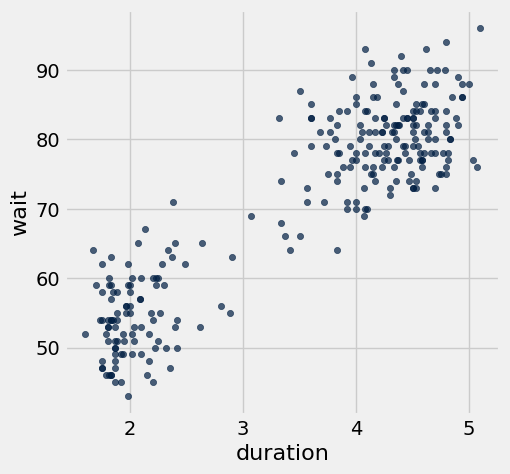

---
**Question 1.2.** Are eruption duration and waiting time roughly linearly related based on the scatter plot above? Is this relationship positive?

**SOLUTION:** Yes, they are roughly linearly related.  The eruption durations seem to cluster; there are a bunch of short eruptions and a bunch of longer ones.  But the data in both clusters fall roughly on a line, and that's what's important when it comes to predicting waiting times with linear regression.  The relationship is positive, meaning that longer eruptions have longer waiting times, as we claimed.

We're going to continue with the assumption that they are linearly related, so it's reasonable to use linear regression to analyze this data.

We'd next like to plot the data in standard units. If you don't remember the definition of standard units, textbook section [14.2](https://www.inferentialthinking.com/chapters/14/2/Variability.html#standard-units) might help!

---
**Question 1.3.** Compute the mean and standard deviation of the eruption durations and waiting times.  **Then** create a table called `faithful_standard` containing the eruption durations and waiting times in standard units.  The columns should be named `duration (standard units)` and `wait (standard units)`.

**Student scaffold:**

```python
duration_mean = ...
duration_std = ...
wait_mean = ...
wait_std = ...

faithful_standard = Table().with_columns(
    "duration (standard units)", ...,
    "wait (standard units)", ...)
faithful_standard
```

**Solution:**

```python
# BEGIN SOLUTION NO PROMPT
duration_mean = np.mean(faithful.column("duration"))
duration_std = np.std(faithful.column("duration"))
wait_mean = np.mean(faithful.column("wait"))
wait_std = np.std(faithful.column("wait"))

faithful_standard = Table().with_columns(
    "duration (standard units)", (faithful.column("duration") - duration_mean) / duration_std,
    "wait (standard units)", (faithful.column("wait") - wait_mean) / wait_std)
faithful_standard
# END SOLUTION
""" # BEGIN PROMPT
duration_mean = ...
duration_std = ...
wait_mean = ...
wait_std = ...

faithful_standard = Table().with_columns(
    "duration (standard units)", ...,
    "wait (standard units)", ...)
faithful_standard
"""; # END PROMPT
```

**Test — `q1_3`**

```python
>>> abs(sum(faithful_standard.column(0))) <= 1e-08
True

>>> from lab09_check import correctness_check_1_3_a
>>> correctness_check_1_3_a(duration_std)
True

>>> from lab09_check import correctness_check_1_3_b
>>> correctness_check_1_3_b(wait_std)
True
```

---
**Question 1.4.** Plot the data again, but this time in standard units.

**Student scaffold:**

```python
...
```

**Solution:**

```python
faithful_standard.scatter(0) #SOLUTION
```

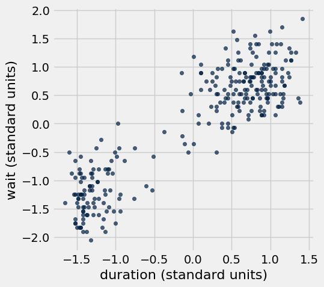

You'll notice that this plot looks the same as the last one!  However, the data and axes are scaled differently.  So it's important to read the ticks on the axes.

---
**Question 1.5.** Among the following numbers, which would you guess is closest to the correlation between eruption duration and waiting time in this dataset? (Hint: Think about which values correlation can take on)

1. -2
2. -1
3. 0
4. 1
5. 2

Assign `correlation` to the number corresponding to your guess (either 1, 2 3, 4, or 5).

**Student scaffold:**

```python
correlation = ...
```

**Solution:**

```python
correlation = 4 # SOLUTION
```

**Test — `q1_5`**

```python
>>> from lab09_check import correctness_check_1_5
>>> correctness_check_1_5(correlation)
True
```

---
**Question 1.6.** Compute the correlation coefficient: `r`.  

*Hint:* Use `faithful_standard`.  Section [15.1](https://www.inferentialthinking.com/chapters/15/1/Correlation.html#calculating-r) explains how to do this.

**Student scaffold:**

```python
r = ...
r
```

**Solution:**

```python
r = np.mean(faithful_standard.column(0) * faithful_standard.column(1)) #SOLUTION
r
```

*Output:*

```text
0.90081116832181318
```

**Test — `q1_6`**

```python
>>> -1 <= r <= 1
True

>>> from lab09_check import correctness_check_1_6
>>> correctness_check_1_6(r)
True
```

---
## 2. The regression line
Recall that the **correlation** is the **slope of the regression line when the data are put in standard units**.

The next cell plots the regression line in standard units:

$$\text{waiting time in standard units} = r \times \text{eruption duration in standard units}$$

Then, it plots the data in standard units again, for comparison.

**Code:**

```python
def plot_data_and_line(dataset, x, y, point_0, point_1):
    """Makes a scatter plot of the dataset, along with a line passing through two points."""
    dataset.scatter(x, y, label="data")
    xs, ys = zip(point_0, point_1)
    plots.plot(xs, ys, label="regression line")
    plots.legend(bbox_to_anchor=(1.5,.8))

plot_data_and_line(faithful_standard, 
                   "duration (standard units)", 
                   "wait (standard units)", 
                   [-2, -2*r], 
                   [2, 2*r])
```

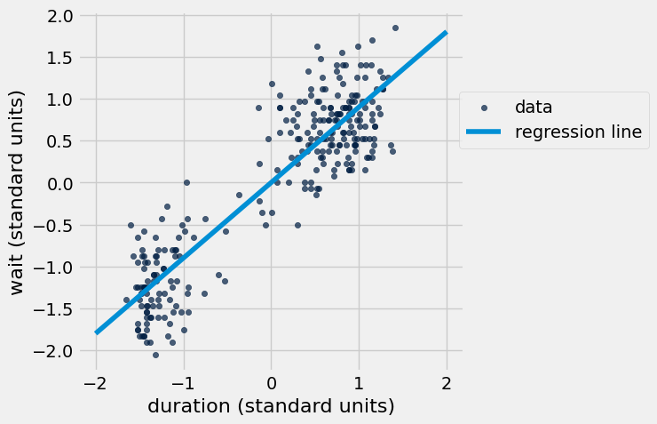

How would you take a point in standard units and convert it back to original units?  We'd have to "stretch" its horizontal position by `duration_std` and its vertical position by `wait_std`. That means the same thing would happen to the slope of the line.

Stretching a line horizontally makes it less steep, so we divide the slope by the horizontal stretching factor. Stretching a line vertically makes it more steep, so we multiply the slope by the vertical stretching factor.
---
**Question 2.1.** Calculate the slope of the regression line in original units, and assign it to `slope`.

(If the "stretching" explanation is unintuitive, consult section [15.2](https://www.inferentialthinking.com/chapters/15/2/Regression_Line.html#the-equation-of-the-regression-line) in the textbook.)

**Student scaffold:**

```python
slope = ...
slope
```

**Solution:**

```python
slope = (wait_std/duration_std) * r #SOLUTION
slope
```

*Output:*

```text
10.729641395133527
```

**Test — `q2_1`**

```python
>>> (slope * 13 - 100) / 98 <= 0.5
True

>>> from lab09_check import correctness_check_2_1
>>> correctness_check_2_1(slope)
True
```

---
We know that the regression line passes through the point `(duration_mean, wait_mean)`. Recall that the general equation of the regression line in original units is:

$$ \text{estimate of y} = \text{slope of the regression line} \cdot \text{x} + \text{intercept of the regression line}$$

For this scenario, that would become:

$$ \text{estimated waiting time} = \text{slope} \cdot \text{eruption duration} + (\text{wait mean} - \text{slope} \cdot \text{duration mean})$$

**Question 2.2.** Calculate the intercept in original units and assign it to `intercept`. [Section 15.2.5](https://inferentialthinking.com/chapters/15/2/Regression_Line.html#the-equation-of-the-regression-line) may be helpful.

**Student scaffold:**

```python
intercept = ...
intercept
```

**Solution:**

```python
intercept = slope*(-duration_mean) + wait_mean #SOLUTION
intercept
```

*Output:*

```text
33.474397022753351
```

**Test — `q2_2`**

```python
>>> 33 < intercept < 34
True

>>> from lab09_check import correctness_check_2_2
>>> correctness_check_2_2(intercept)
True
```

---
## 3. Investigating the regression line

The slope and intercept tell you exactly what the regression line looks like.  To predict the waiting time for an eruption, multiply the eruption's duration by `slope` and then add `intercept`.
---
**Question 3.1.** Compute the predicted waiting time for an eruption that lasts 2 minutes, and for an eruption that lasts 5 minutes.

**Student scaffold:**

```python
two_minute_predicted_waiting_time = ...
five_minute_predicted_waiting_time = ...

# Here is a helper function to print out your predictions.
# Don't modify the code below.
def print_prediction(duration, predicted_waiting_time):
    print("After an eruption lasting", duration,
          "minutes, we predict you'll wait", predicted_waiting_time,
          "minutes until the next eruption.")

print_prediction(2, two_minute_predicted_waiting_time)
print_prediction(5, five_minute_predicted_waiting_time)
```

**Solution:**

```python
two_minute_predicted_waiting_time = slope*2 + intercept #SOLUTION
five_minute_predicted_waiting_time = slope*5 + intercept #SOLUTION

# Here is a helper function to print out your predictions.
# Don't modify the code below.
def print_prediction(duration, predicted_waiting_time):
    print("After an eruption lasting", duration,
          "minutes, we predict you'll wait", predicted_waiting_time,
          "minutes until the next eruption.")

print_prediction(2, two_minute_predicted_waiting_time)
print_prediction(5, five_minute_predicted_waiting_time)
```

*Output (stdout):*

```text
After an eruption lasting 2 minutes, we predict you'll wait 54.933679813 minutes until the next eruption.
After an eruption lasting 5 minutes, we predict you'll wait 87.1226039984 minutes until the next eruption.
```

**Test — `q3_1`**

```python
>>> from lab09_check import correctness_check_3_1_a
>>> correctness_check_3_1_a(two_minute_predicted_waiting_time)
True

>>> from lab09_check import correctness_check_3_1_b
>>> correctness_check_3_1_b(five_minute_predicted_waiting_time)
True
```

The next cell plots the line that goes between those two points, which is (a segment of) the regression line.

**Code:**

```python
plot_data_and_line(faithful, "duration", "wait", 
                   [2, two_minute_predicted_waiting_time], 
                   [5, five_minute_predicted_waiting_time])
```

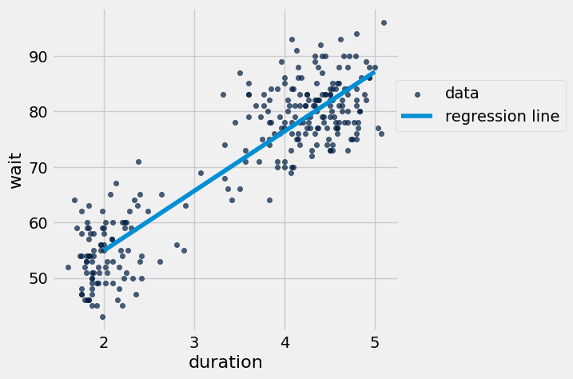

---
**Question 3.2.** Make predictions for the waiting time after each eruption in the `faithful` table.  (Of course, we know exactly what the waiting times were!  We are doing this so we can see how accurate our predictions are.)  Put these numbers into a column in a new table called `faithful_predictions`.  Its first row should look like this:

|duration|wait|predicted wait|
|-|-|-|
|3.6|79|72.1011|

*Hint:* Your answer can be just one line, though you are not limited to one line.  There is no need for a `for` loop; use array arithmetic instead.

**Student scaffold:**

```python
faithful_predictions = ...
faithful_predictions
```

**Solution:**

```python
faithful_predictions = faithful.with_column("predicted wait", slope*faithful.column("duration") + intercept) #SOLUTION
faithful_predictions
```

*Output:*

| duration | wait | predicted wait |
| --- | --- | --- |
| 3.6 | 79 | 72.1011 |
| 1.8 | 54 | 52.7878 |
| 3.333 | 74 | 69.2363 |
| 2.283 | 62 | 57.9702 |
| 4.533 | 85 | 82.1119 |
| 2.883 | 55 | 64.408 |
| 4.7 | 88 | 83.9037 |
| 3.6 | 85 | 72.1011 |
| 1.95 | 51 | 54.3972 |
| 4.35 | 85 | 80.1483 |

**Test — `q3_2`**

```python
>>> set(faithful_predictions.labels) == set(['duration', 'wait', 'predicted wait'])
True

>>> abs(1 - np.mean(faithful_predictions.column(2)) / 100) <= 0.35
True
```

---
**Question 3.3.** How close were we?  Compute the *residual* for each eruption in the dataset.  The residual is the **actual waiting time** minus the **predicted waiting time**.  Add the residuals to `faithful_predictions` as a new column called `residual` and name the resulting table `faithful_residuals`.

As mentioned in [Chapter 15.6](https://inferentialthinking.com/chapters/15/6/Numerical_Diagnostics.html?highlight=residuals#average-of-residuals), a useful property of linear regression is that the sum of the residuals will always be zero. You can always check this to make sure you’ve calculated your residuals correctly. Note it may be slightly off from zero due to rounding errors.

Feel free to copy and paste this line of code, to check your work! Note that the answer may be *very slightly* different from zero due to rounding errors in python.

```python
sum(faithful_residuals.column('residual'))
```

*Hint:* Again, your code will be much simpler if you don't use a `for` loop.

*Hint:* residual = actual_value − predicted_value

**Student scaffold:**

```python
residuals = ...
faithful_residuals = ...
faithful_residuals
```

**Solution:**

```python
residuals = faithful_predictions.column(1) - faithful_predictions.column(2) #SOLUTION
faithful_residuals = faithful_predictions.with_column("residual", residuals) #SOLUTION
faithful_residuals
```

*Output:*

| duration | wait | predicted wait | residual |
| --- | --- | --- | --- |
| 3.6 | 79 | 72.1011 | 6.89889 |
| 1.8 | 54 | 52.7878 | 1.21225 |
| 3.333 | 74 | 69.2363 | 4.76371 |
| 2.283 | 62 | 57.9702 | 4.02983 |
| 4.533 | 85 | 82.1119 | 2.88814 |
| 2.883 | 55 | 64.408 | -9.40795 |
| 4.7 | 88 | 83.9037 | 4.09629 |
| 3.6 | 85 | 72.1011 | 12.8989 |
| 1.95 | 51 | 54.3972 | -3.3972 |
| 4.35 | 85 | 80.1483 | 4.85166 |

**Test — `q3_3`**

```python
>>> set(faithful_residuals.labels) == set(['duration', 'wait', 'predicted wait', 'residual'])
True

>>> abs(sum(faithful_residuals.column('residual'))) <= 1e-08
True
```

Here is a plot of the residuals you computed.  Each point corresponds to one eruption.  It shows how much our prediction over- or under-estimated the waiting time.

**Code:**

```python
faithful_residuals.scatter("duration", "residual", color="r")
```

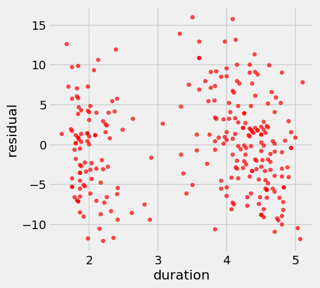

There isn't really a pattern in the residuals, which confirms that it was reasonable to try linear regression.  It's true that there are two separate clouds; the eruption durations seemed to fall into two distinct clusters.  But that's just a pattern in the eruption durations, not a pattern in the relationship between eruption durations and waiting times.

---
## 4. How accurate are different predictions?
Earlier, you should have found that the correlation is fairly close to 1, so the line fits fairly well on the training data.  That means the residuals are overall small (close to 0) in comparison to the waiting times.

We can see that visually by plotting the waiting times and residuals together:

**Code:**

```python
# Just run this cell.
faithful_residuals.scatter("duration", "wait", label="actual waiting time", color="blue")
plots.scatter(faithful_residuals.column("duration"), faithful_residuals.column("residual"), label="residual", color="r")
plots.plot([2, 5], [two_minute_predicted_waiting_time, five_minute_predicted_waiting_time], label="regression line")
plots.legend(bbox_to_anchor=(1.7,.8));
```

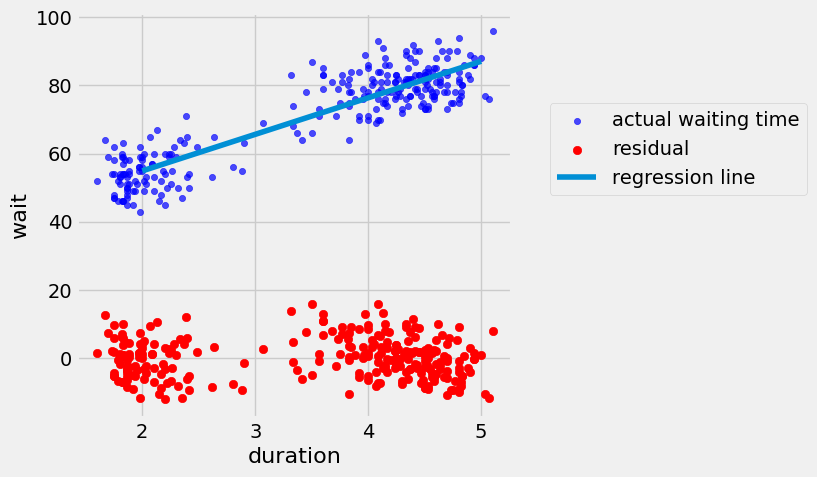

However, unless you have a strong reason to believe that the linear regression model is true, you should be wary of applying your prediction model to data that are very different from the training data.

---
**Question 4.1.** In `faithful`, no eruption lasted exactly 0, 2.5, or 60 minutes.  Using this line, what is the predicted waiting time for an eruption that lasts 0 minutes?  2.5 minutes?  An hour?

**Student scaffold:**

```python
zero_minute_predicted_waiting_time = ...
two_point_five_minute_predicted_waiting_time = ...
hour_predicted_waiting_time = ...

print_prediction(0, zero_minute_predicted_waiting_time)
print_prediction(2.5, two_point_five_minute_predicted_waiting_time)
print_prediction(60, hour_predicted_waiting_time)
```

**Solution:**

```python
zero_minute_predicted_waiting_time = intercept #SOLUTION
two_point_five_minute_predicted_waiting_time = slope * 2.5 + intercept #SOLUTION
hour_predicted_waiting_time = slope * 60 + intercept #SOLUTION

print_prediction(0, zero_minute_predicted_waiting_time)
print_prediction(2.5, two_point_five_minute_predicted_waiting_time)
print_prediction(60, hour_predicted_waiting_time)
```

*Output (stdout):*

```text
After an eruption lasting 0 minutes, we predict you'll wait 33.4743970228 minutes until the next eruption.
After an eruption lasting 2.5 minutes, we predict you'll wait 60.2985005106 minutes until the next eruption.
After an eruption lasting 60 minutes, we predict you'll wait 677.252880731 minutes until the next eruption.
```

**Test — `q4_1`**

```python
>>> 12 - zero_minute_predicted_waiting_time * 1.4 / 4 <= 0.35
True

>>> zero_minute_predicted_waiting_time - intercept <= 100000.0
True

>>> 2 - two_point_five_minute_predicted_waiting_time / 35 <= 0.4
True

>>> (26 - hour_predicted_waiting_time / 30) / 10 <= 0.43
True
```

---
**Question 4.2.** For each prediction, state whether you think it's reliable and explain your reasoning.

**SOLUTION:** The prediction for 2.5 is believable, since the dataset has eruptions that are *around* that long.  A 0 minute eruption is physically impossible, so the predicted waiting time is meaningless.  A 60 minute eruption might be possible, but since we never saw one nearly that long, it would probably be very different in character than the ones in `faithful`.  So we probably shouldn't trust that prediction, either.

---
## 5. Divide and Conquer

The scatter plot below shows the relationship between eruption durations on the x-axis and the wait time to the next eruption on the y-axis.

It appears from the scatter diagram that there are two clusters of points: one for durations around 2 and another for durations between 3.5 and 5. A vertical line at 3 divides these two clusters.

**Code:**

```python
faithful.scatter("duration", "wait", label="actual waiting time", color="blue")
plots.plot([3, 3], [40, 100]);
```

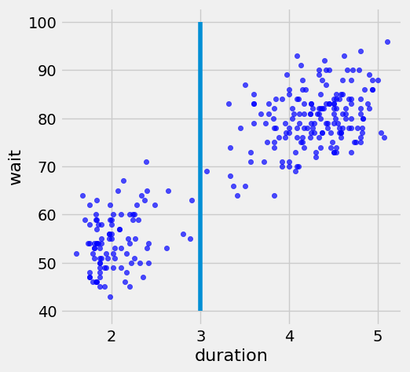

The `standardize` function from lecture appears below, which takes in a table with numerical columns and returns the same table with each column converted into standard units.

**Code:**

```python
# Just run this cell.

def standard_units(any_numbers):
    "Convert any array of numbers to standard units."
    return (any_numbers - np.mean(any_numbers)) / np.std(any_numbers)  

def standardize(table):
    """Return a table in which all columns of t are converted to standard units."""
    t_su = Table()
    for label in table.labels:
        t_su = t_su.with_column(label + ' (su)', standard_units(table.column(label)))
    return t_su
```

---
**Question 5.1.** Separately compute the correlation coefficient *r* for all the points with a duration below 3 **and then** for all the points with a duration above 3. To do so, create a function that computes `r` from a table, and then pass in two different tables of points, called `below_3` and `above_3`.

*Hint:* You can assume that the table does not have any duration values that are exactly 3.

**Student scaffold:**

```python
def corr_coeff(table):
    """Return the regression coefficient for columns 0 & 1."""
    t_su = standardize(table)
    ...

below_3 = ...
above_3 = ...
below_3_r = corr_coeff(below_3)
above_3_r = corr_coeff(above_3)
print("For points below 3, r is", below_3_r, "; for points above 3, r is", above_3_r)
```

**Solution:**

```python
def corr_coeff(table):
    """Return the regression coefficient for columns 0 & 1."""
    t_su = standardize(table)
    return np.mean(t_su.column(0) * t_su.column(1)) # SOLUTION

below_3 = faithful.where('duration', are.below(3)) # SOLUTION
above_3 = faithful.where('duration', are.above(3)) # SOLUTION
below_3_r = corr_coeff(below_3)
above_3_r = corr_coeff(above_3)
print("For points below 3, r is", below_3_r, "; for points above 3, r is", above_3_r)
```

*Output (stdout):*

```text
For points below 3, r is 0.290189526493 ; for points above 3, r is 0.372782225571
```

**Test — `q5_1`**

```python
>>> [below_3.num_rows, above_3.num_rows]
[97, 175]

>>> from lab09_check import correctness_check_5_1
>>> correctness_check_5_1(below_3_r, above_3_r)
True
```

---
**Question 5.2.** Complete the functions `slope_of` and `intercept_of` below. 

When you're done, the functions `wait_below_3` and `wait_above_3` should each use a different regression line to predict a wait time for a duration. The first function should use the regression line for all points with duration below 3. The second function should use the regression line for all points with duration above 3.

**Student scaffold:**

```python
def slope_of(table, r):
    """Return the slope of the regression line for table in original units.
    
    Assume that column 0 contains x values and column 1 contains y values.
    r is the regression coefficient for x and y.
    """
    ...

def intercept_of(table, r):
    """Return the intercept of the regression line for table in original units.
    
    Assume that column 0 contains x values and column 1 contains y values.
    r is the regression coefficient for x and y.
    """
    slope = slope_of(table, r)
    ...
    
below_3_slope = slope_of(below_3, below_3_r)
below_3_intercept = intercept_of(below_3, below_3_r)
above_3_slope = slope_of(above_3, above_3_r)
above_3_intercept = intercept_of(above_3, above_3_r)

def wait_below_3(duration):
    return below_3_slope * duration + below_3_intercept

def wait_above_3(duration):
    return above_3_slope * duration + above_3_intercept
```

**Solution:**

```python
def slope_of(table, r):
    """Return the slope of the regression line for table in original units.
    
    Assume that column 0 contains x values and column 1 contains y values.
    r is the regression coefficient for x and y.
    """
    return r * np.std(table.column(1)) / np.std(table.column(0)) # SOLUTION

def intercept_of(table, r):
    """Return the intercept of the regression line for table in original units.
    
    Assume that column 0 contains x values and column 1 contains y values.
    r is the regression coefficient for x and y.
    """
    slope = slope_of(table, r)
    return slope * (-np.mean(table.column(0))) + np.mean(table.column(1)) # SOLUTION
    
below_3_slope = slope_of(below_3, below_3_r)
below_3_intercept = intercept_of(below_3, below_3_r)
above_3_slope = slope_of(above_3, above_3_r)
above_3_intercept = intercept_of(above_3, above_3_r)

def wait_below_3(duration):
    return below_3_slope * duration + below_3_intercept

def wait_above_3(duration):
    return above_3_slope * duration + above_3_intercept
```

**Test — `q5_2`**

```python
>>> np.allclose([wait_below_3(1), wait_below_3(3), wait_above_3(3), wait_above_3(6)], [47.90215160574252, 60.60319718202381, 72.96541399053837, 89.2818591974495])
True
```

The plot below shows the two different regression lines, one for each cluster, along with the original regression line!

**Code:**

```python
faithful.scatter(0, 1)
plots.plot([2, 5], [two_minute_predicted_waiting_time, five_minute_predicted_waiting_time])
plots.plot([1, 3], [wait_below_3(1), wait_below_3(3)])
plots.plot([3, 6], [wait_above_3(3), wait_above_3(6)]);
```

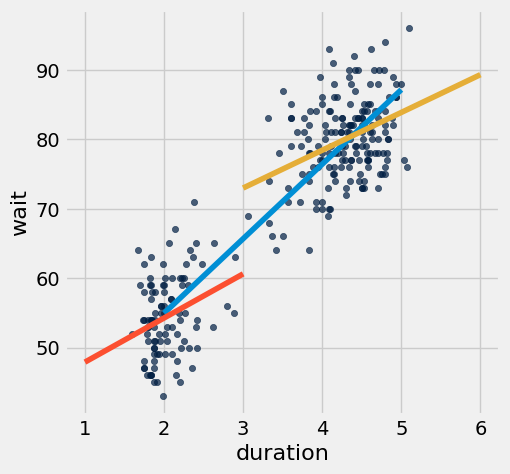

---
**Question 5.3.** Write a function `predict_wait` that takes a `duration` and returns the predicted wait time using the appropriate regression line, depending on whether the duration is below 3 or greater than 3.

*Hint:* Consider using conditional statements.

**Student scaffold:**

```python
def predict_wait(duration):
    ...
```

**Solution:**

```python
# BEGIN SOLUTION NO PROMPT
def predict_wait(duration):
    if duration < 3:
        return wait_below_3(duration)
    else:
        return wait_above_3(duration)
# END SOLUTION
""" # BEGIN PROMPT
def predict_wait(duration):
    ...
"""; # END PROMPT
```

**Test — `q5_3`**

```python
>>> np.allclose([predict_wait(x) for x in [1.5, 2.5]], [51.077412999812836, 57.42793578795349])
True

>>> np.allclose([predict_wait(x) for x in [3.5, 4.5]], [75.68482152502355, 81.12363659399392])
True
```

The predicted wait times for each point appear below.

**Code:**

```python
faithful_pred_split = faithful.with_column('predicted', faithful.apply(predict_wait, 'duration'))
faithful_pred_split.scatter(0)
```

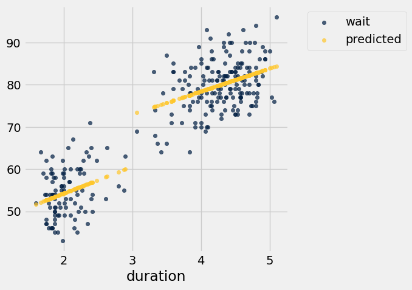

---
**Question 5.4.** Do you think the predictions produced by `predict_wait` would be more or less accurate than the predictions from the regression line you created in section 2? How could you tell?

**SOLUTION:** More accurate, because each line is specific to the values in its cluster. To verify, we could measure the average magnitude of the residual values.

The following cell will plot the residuals for each eruption in the dataset when we have one regression line and two regression lines. We also see the average magnitude of the residual values.

**Code:**

```python
# Just run this cell
faithful_pred_split_residuals = faithful_pred_split.with_column('residual', faithful_pred_split.column(1) - faithful_pred_split.column(2))
plots.scatter(faithful_residuals.column('duration'), faithful_residuals.column('residual'), label='one regression line')
plots.scatter(faithful_pred_split_residuals.column('duration'), faithful_pred_split_residuals.column('residual'), label='two regression lines');
plots.axis([1, 6, -15, 15])
plots.legend(bbox_to_anchor=(1.5,.8));
print("Average Magnitude of Residual Values for One Regression Line: ", np.mean(abs(faithful_residuals.column('residual'))))
print("Average Magnitude of Residual Values for Two Regression Lines: ", np.mean(abs(faithful_pred_split_residuals.column('residual'))))
```

*Output (stdout):*

```text
Average Magnitude of Residual Values for One Regression Line:  4.77872005877
Average Magnitude of Residual Values for Two Regression Lines:  4.57575882719
```

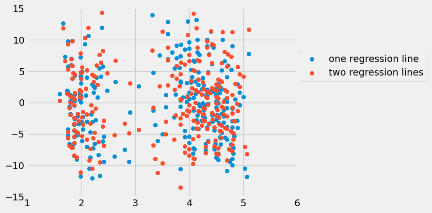

The residual plot for the wait times when they are predicted by two regression lines (red) doesn't really have a pattern, which confirms that it was also appropriate to use linear regression in our "Divide and Conquer" scenario. How do the two residual plots compare?

---
## 6. Jupytutor Survey

We hope your experience using Jupytutor has been smooth and helpful for you!

Please fill out the survey below and input the secret phrase that is shown at the end of the form when you submit. Please assign this phrase to `secret` as a string in the cell below!

Find the survey [here](https://docs.google.com/forms/d/e/1FAIpQLSenRkqnZkCt1ssv98_hajf2Z10I6VeIbCzuVSXGH3pdOjS70Q/viewform?usp=sharing&ouid=115427732962189163058).

**Student scaffold:**

```python
secret = ...
```

**Solution:**

```python
secret = "beep boop" # SOLUTION
```

**Test — `q6`**

```python
>>> from lab09_check import correctness_check_6
>>> correctness_check_6(secret)
True
```

---

You're done with lab!

**Important submission information:**
- **Run all the tests** and verify that they all pass
- **Save** from the **File** menu
- **Run the final cell to generate the zip file**
- **Click the link to download the zip file**
- Then, go to [Pensive](https://www.pensieve.co/) and submit the zip file to the corresponding assignment. The name of this assignment is "Lab XX Autograder", where XX is the lab number -- 01, 02, 03, etc.

- If you finish early in Regular Lab, **ask one of the staff members to check you off**.

**It is your responsibility to make sure your work is saved before running the last cell.**

---

To double-check your work, the cell below will rerun all of the autograder tests.

## Submission

Make sure you have run all cells in your notebook in order before running the cell below, so that all images/graphs appear in the output. The cell below will generate a zip file for you to submit. **Please save before exporting!**

---

## Datasets

Datasets this notebook loads with `Table.read_table`. Column names are exact, including spaces and capitalization. Only the schema is recorded here — the data itself is not in this document, so any question about its values must be answered by running code, not by reasoning over the rows shown elsewhere in this file.

### `faithful.csv`

272 rows, 2 columns.

| Column | Type |
| --- | --- |
| `duration` | float |
| `wait` | float |


---

# lab10

---
title: "Lab 10: Conditional Probability"
assignment: lab10
semester: sp26
source: semester_assignments/sp26/lab/lab10/autograder/lab10.ipynb
version: solution (autograder) with student scaffolds
student_source: semester_assignments/sp26/lab/lab10/student/lab10.ipynb
language: python
---


# Lab 10: Conditional Probability

Welcome to Lab 10! (the last lab of the semester!)

Lab 10 focuses on one of the final topics in the course, conditional probability. 

#### **Helpful Resource:**
- [Python Reference](http://data8.org/su26/reference/)

**Recommended Readings:**

* [Chapter 18](https://inferentialthinking.com/chapters/18/Updating_Predictions.html)

**Code:**

```python
# Run this cell to set up the notebook, but please don't change it.

# These lines import the Numpy and Datascience modules.
import numpy as np
from datascience import *

# These lines do some fancy plotting magic.
import matplotlib
%matplotlib inline
import matplotlib.pyplot as plt
plt.style.use('fivethirtyeight')
import warnings
warnings.simplefilter('ignore')

# This line loads the visualization code for this lab.
import visualizations
```

---
# 1. What is conditional probability good for?

Suppose we have a known population, like all dogs in California.  So far, we've seen two ways of *predicting* something about an individual in that population, given incomplete knowledge about the identity of the individual:

* If we know nothing about the individual dog, we could predict that its speed is the *average* or *median* of all the speeds in the population.
* If we know the dog's height but not its speed, we could use *linear regression* to predict its speed from its height.  The resulting prediction is still imperfect, but it might be more accurate than the population average.

We can also compute conditional probabilities to make predictions about individuals or events. This technique is different from the previous methods we’ve examined because 

1. our prediction for each outcome is described by a probability, and 
2. each probability can be exactly calculated from assumptions, as opposed to estimated from data.

---
# 2. Icon arrays
Parts 3 and 4 of this lab work with a more complex example about disease, but first, let's start with a simple example.

Imagine you and Samantha are playing a game in which you are given a marble and tasked to determine the marble's texture and size. You don't know anything about the marble you're given, but you know that Samantha drew it **uniformly at random** from a bag that contained the following marbles:
* 4 large shiny marbles,
* 1 large dull marble,
* 6 small shiny marbles,
* 2 small dull marbles.

---

**Question 2.0.1.** Knowing only what we've told you so far, what's the probability that the marble you're given was a large shiny marble?

**Student scaffold:**

```python
probability_large_shiny = ...
```

**Solution:**

```python
probability_large_shiny = 4/13 #SOLUTION
```

**Test — `q2_0_1`**

```python
>>> 0 < probability_large_shiny < 1
True

>>> from lab10_check import correctness_check_2_0_1
>>> correctness_check_2_0_1(probability_large_shiny)
True
```

Here's a table with those marbles:

**Code:**

```python
marbles = Table.read_table("marbles.csv")
marbles.show()
```

*Output:*

| surface | size |
| --- | --- |
| shiny | large |
| shiny | large |
| shiny | large |
| shiny | large |
| dull | large |
| shiny | small |
| shiny | small |
| shiny | small |
| shiny | small |
| shiny | small |
| shiny | small |
| dull | small |
| dull | small |

Here are the counts of each type of marble in a pivot table.

**Code:**

```python
marbles.pivot('surface', 'size')
```

*Output:*

| size | dull | shiny |
| --- | --- | --- |
| large | 1 | 4 |
| small | 2 | 6 |

Here are all the different combinations of surface and size, with the count for each surface-size combination. Each type of marble appears in its own row.

**Code:**

```python
marbles.group(['surface', 'size'])
```

*Output:*

| surface | size | count |
| --- | --- | --- |
| dull | large | 1 |
| dull | small | 2 |
| shiny | large | 4 |
| shiny | small | 6 |

We've included some code to display something called an *icon array*.  The functions in the cell below create icon arrays from various kinds of tables. Don't worry about understanding the code; just run this cell.

**NOTE:** You may ignore the the y-axis labels. Just remember that each box represents 1 marble.

**Code:**

```python
# Run this cell.

#######################################################################
# The functions you'll need to actually use are in here.  Each is a
# way of making an icon array from a differently-formatted table.
#######################################################################

def display_icon_array(table, groups, individuals_name):
    """
    Given a table and some columns to group it on, displays an icon array
    of the groups.
    
    groups should be an array of labels of columns in table.
    
    individuals_name is your name for the individual rows of table.
    For example, if we're talking about a population of people,
    individuals_name should be "people".
    
    For example:
    
    display_icon_array(marbles, ["surface", "size"], "marbles")
    """
    display_grouped_icon_array(table.group(groups), individuals_name)

def display_grouped_icon_array(grouped_data, individuals_name):
    """
    Given a table with counts for data grouped by 1 or more categories,
    displays an icon array of the groups represented in the table.
    
    grouped_data should be a table of frequencies or counts, such as
    a table created by calling the groups method on some table.
    
    individuals_name is your name for the individual members of the
    dataset.  For example, if we're talking about a population of
    people, individuals_name should be "people".
    
    For example:
    
    display_grouped_icon_array(marbles.group(["surface", "size"]), "marbles")
    """
    visualizations.display_combinations(grouped_data, individuals_name=individuals_name)

def display_crosstab_icon_array(crosstabulation, x_label, individuals_name):
    """
    Given a crosstabulation table, displays an icon array of the groups
    represented in the table.
    
    crosstabulation should be a table of frequencies or counts created by
    calling pivot on some table.
    
    x_label should be the label of the categories listed as columns (on
    the "x axis" when the crosstabulation table is printed).
    
    individuals_name is your name for the individual members of the
    dataset.  For example, if we're talking about a population of
    people, individuals_name should be "people".
    
    For example:
    
    display_crosstab_icon_array(marbles.pivot("surface", "size"), "surface", "marbles")
    """
    display_grouped_icon_array(visualizations.pivot_table_to_groups(crosstabulation, x_label), individuals_name)
```

Here's an icon array of all the marbles, grouped by surface and size:

**Code:**

```python
# Run this cell.
display_grouped_icon_array(marbles.group(["surface", "size"]), "marble(s)")
```

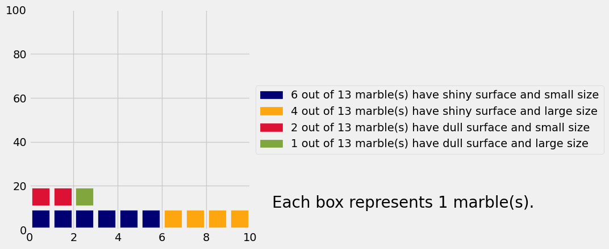

You should imagine that the marble you've been given was selected by a random draw from these 13 icons.

The following is an icon array of the marbles, grouped **only by their surface (shiny/dull)**.

**Code:**

```python
display_grouped_icon_array(marbles.group("surface"), "marble(s)")
```

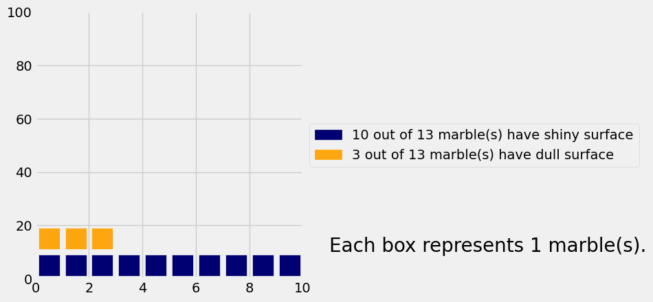

Knowing nothing else about the marble, it's equally likely to be any of the marbles depicted above; this is because we've assumed that the marble is selected **uniformly at random** from the bag.

---

**Question 2.0.2.** What's the probability that you've been given a shiny marble? Answer using mathematical expressions by looking at your icon array.

**Student scaffold:**

```python
probability_shiny = ...
```

**Solution:**

```python
probability_shiny = 10/13 #SOLUTION
```

**Test — `q2_0_2`**

```python
>>> from lab10_check import correctness_check_2_0_2
>>> correctness_check_2_0_2(probability_shiny)
True
```

---
## 2.1. Conditional probability

Suppose you overhear Samantha say that you were given a large marble. Does this somehow change the chance that your marble is shiny?  Let's find out.

Go back to the full icon array, displayed below for convenience.

**Code:**

```python
display_grouped_icon_array(marbles.group(["surface", "size"]), "marble(s)")
```


In question 2.0.2, we assumed that the marble you were given was equally likely to be any of the marbles, simply because we didn't know any better.  That's why we looked at all the marbles to compute the probability that your marble was shiny.

But assuming that you've been given a large marble, we can eliminate some of these possibilities. In particular, you can't have been given a small shiny marble or a small dull marble.

You're still equally likely to have been given any of the remaining marbles, because you don't know any other information.  So here's an icon array of those remaining possibilities:

**Code:**

```python
# Just run this cell.
display_grouped_icon_array(marbles.where("size", "large").group("surface"), "large marble(s)")
```

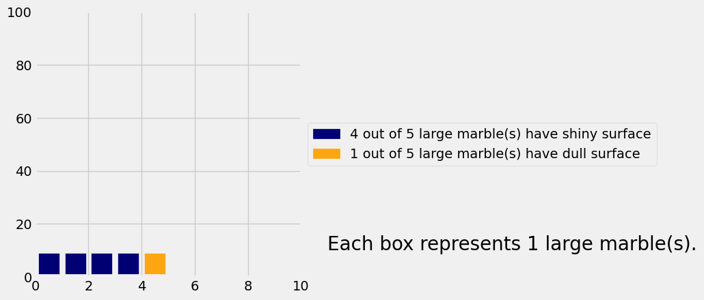

---

**Question 2.1.1.** What's the probability Samantha gave you a shiny marble, knowing that she gave you a large marble? 

*Hint: Take a look at the icon array.*

**Student scaffold:**

```python
probability_shiny_given_large = ...
```

**Solution:**

```python
probability_shiny_given_large = 4/5 # SOLUTION
```

**Test — `q2_1_1`**

```python
>>> from lab10_check import correctness_check_2_1_1
>>> correctness_check_2_1_1(probability_shiny_given_large)
True
```

You should have found that this is different from the probability that Samantha gave you a shiny marble, given no size information, which you computed earlier.  The distribution of surfaces among the large marbles is a little different from the distribution of surfaces among all the marbles. We have calculated a conditional probability with the additional assumption of a given size.

**Code:**

```python
# Run this cell to display the icon array. Then fill answer the next question.
display_grouped_icon_array(marbles.where("surface", "shiny").group("size"), "shiny marble(s)")
```

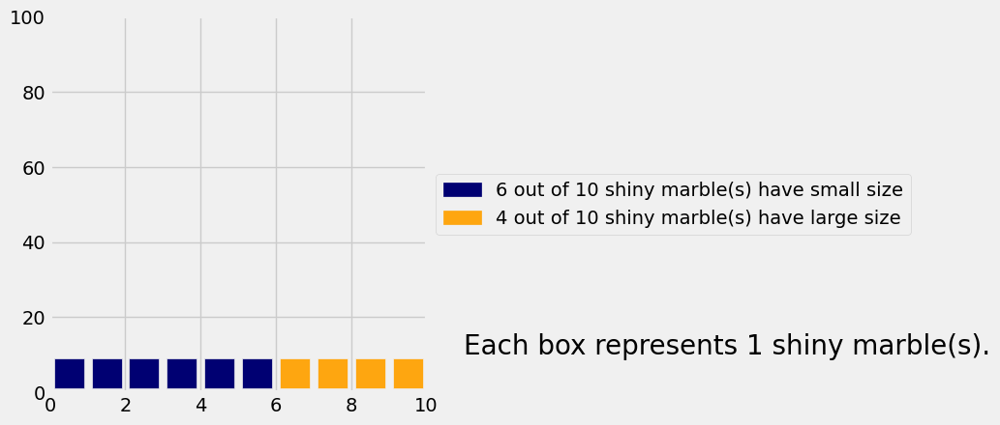

---

**Question 2.1.2.** Suppose instead Samantha had said she gave you a **shiny** marble (hooray!). What's the probability that the marble given to you is large? 

Run the code cell above to display the icon array, then assign `probability_large_given_shiny` to the appropriate value.

**Student scaffold:**

```python
probability_large_given_shiny = ...
```

**Solution:**

```python
probability_large_given_shiny = 4/10 # SOLUTION
```

**Test — `q2_1_2`**

```python
>>> from lab10_check import correctness_check_2_1_2
>>> correctness_check_2_1_2(probability_large_given_shiny)
True
```

---

**Question 2.1.3.** Can you answer the previous two questions just by looking at the full icon array?  (You can run the cell below to see it again.)

*Hint:* Check out [Ch 18.2](https://inferentialthinking.com/chapters/18/2/Making_Decisions.html) for a refresher on how to use Bayes' Rule.

**Code:**

```python
# Just run this cell.  The next cell is where you should write your answer.
display_grouped_icon_array(marbles.group(["surface", "size"]), "marble(s)")
```


If you can, how? If not, why not? Check with your lab peers or a staff member to see if you are on the right track.

**SOLUTION:** To answer question 2.1.2, we can simply look at the shiny marbles. There are 10 total, and 6 of those are large. To answer question 2.1.1, we can simply look only at the large marbles. There are 5 total, and 4 of them are shiny.

---
# 3. Cancer screening
Hopefully the icon arrays from the previous portion helped you build intuition for why conditional probabilities can be helpful. Now, let’s look at a real life application.

### Background
Medical testing is very important, especially for cancer. A basic cancer screening involves looking for cancer before a person has any symptoms. 

Cancer screening is not 100% reliable, and it can have errors. There are cases in which someone without cancer or with a benign tumor sees a positive test result. There are also cases where someone with cancer can receive a negative result. (“Positive” implies an indication of cancer in this context.) The first case, called a false positive, could cause anxiety for a patient and lead to further testing that may be risky and involve unnecessary radiation. In the second case, called a false negative, a person would not receive the necessary information and possible treatment for their condition.

Conditional probability can provide insight into the accuracy of initial cancer tests. For example, you can compute the chance that a person has cancer given the results of a diagnostic test by combining information from different probability distributions. You’ll see that the chance Person X does have cancer even if they receive a positive result is not necessarily 100%.

It is important to note that conditional probabilities offer just one line of insight to understanding a test result and that this statistical approach does not take into account important factors like heredity or environment that come to affect a person’s health and diagnoses. The [Centers for Disease Control and Prevention](https://www.cdc.gov/cancer/prevention/screening.html) (CDC) recommends getting preventative cancer screenings, and one should always consult a doctor if they are concerned about their health.

---
## 3.1. Basic cancer statistics

Note: All of the following statistics are made up and don’t necessarily reflect the actual state of the world.


Suppose that in a representative group of 10,000 people who are tested for cancer ("representative" meaning that the frequencies of different events are the same as the frequencies in the whole population):
1. 100 people have cancer.
2. Among the 100 people that have cancer, 90 have positive results on a cancer test and 10 have negative results. (So 10 people receive “false negative” results.)
3. The other 9,900 people don't have cancer.
4. Among these 9,900 people, 198 have positive results on a cancer test and the other 9,702 have negative results. (So 198 people receive "false positive" results.)

Below we've generated a table with data from these 10,000 hypothetical people.

*Note: These statistics are made up and don’t necessarily reflect the actual state of the world.*

**Code:**

```python
people = Table().with_columns(
    "status", ["cancer", "cancer", "no cancer", "no cancer"],
    "test status", ["positive", "negative", "positive", "negative"],
    "count", [90, 10, 198, 9702])
people
```

*Output:*

| status | test status | count |
| --- | --- | --- |
| cancer | positive | 90 |
| cancer | negative | 10 |
| no cancer | positive | 198 |
| no cancer | negative | 9702 |

One way to visualize this dataset is with a contingency table, which you've seen before.

---

**Question 3.1.1.** Using the `people` table defined above, assign `cancer` to a contingency table that looks like this:

|status|negative|positive|
|-|-|-|
|cancer|||
|no cancer||||

with the **count** of each group filled in, according to what we've told you above.  The counts in the 4 boxes should sum to 10,000.

**Student scaffold:**

```python
cancer = ...
cancer
```

**Solution:**

```python
cancer = people.pivot("test status", "status", "count", sum) # SOLUTION
cancer
```

*Output:*

| status | negative | positive |
| --- | --- | --- |
| cancer | 10 | 90 |
| no cancer | 9702 | 198 |

**Test — `q3_1_1`**

```python
>>> sum(cancer.column(1)) == 9712
True

>>> sum(cancer.column(2)) == 288
True

>>> cancer
status    | negative | positive
cancer    | 10       | 90
no cancer | 9702     | 198
```

Here is the `people` data in an icon array.

**Code:**

```python
display_grouped_icon_array(people, "people who've taken a cancer test")
```

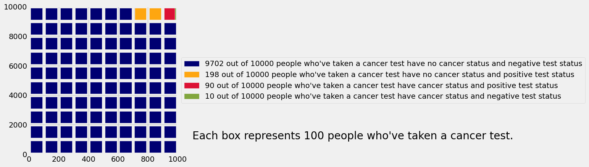

Now let's think about how you can use this kind of information when Person X is tested for cancer.

Before you know any information about Person X, you could imagine Person X as a **uniform random sample** of one of the 10,000 people in this imaginary population of people who have been tested.

What's the chance that Person X has cancer, knowing nothing else about them? If we add together the green and red labeled categories from the visual above, we can find that the chance is $\frac{100}{10000}$, or 1%.  We can see that more directly with this icon array:

**Code:**

```python
by_health = people.select(0, 2).group(0, sum).relabeled(1, 'count')
display_grouped_icon_array(by_health, "people who've taken a cancer test")
```

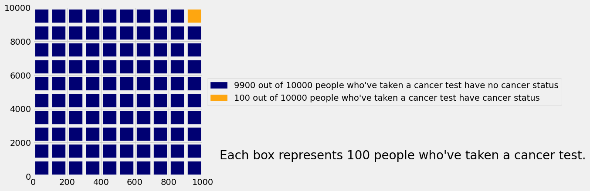

---

**Question 3.1.2.** What's the chance that Person X has a positive test result, knowing nothing else about them?
Run the next code cell to display an icon array, then assign `probability_positive_test` to this value.

**Solution:**

```python
# Run this cell first to display an icon array. Then fill in the probability of a positive test result in the next cell.
by_test = people.select(1, 2).group(0, sum).relabeled(1, 'count')
display_grouped_icon_array(by_test, "people who've taken a cancer test")
```

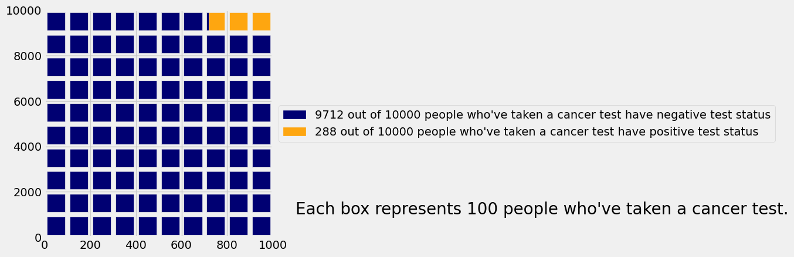

**Student scaffold:**

```python
# Now fill in the probability of a positive test result
probability_positive_test = ...
```

**Solution:**

```python
# Now fill in the probability of a positive test result
probability_positive_test = 288/10000 #SOLUTION
```

**Test — `q3_1_2`**

```python
>>> from lab10_check import correctness_check_3_1_2
>>> correctness_check_3_1_2(probability_positive_test)
True
```

---
## 3.2. Interpreting test results
Suppose Person X has a positive test result.  This means that you can now eliminate the options of people with a negative test result and narrow them down to being part of just one of the two following groups:
1. The people with cancer who have a positive test result.
2. The people without cancer who have a positive test result.

Here's an icon array for those two groups:

**Code:**

```python
# Just run this cell.
display_grouped_icon_array(people.where("test status", are.equal_to("positive")).drop(1), "people who have a positive test result")
```

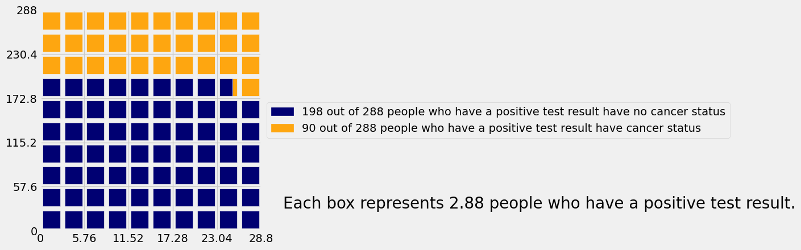

The *conditional probability* that Person X **has cancer given their positive test result** is the chance that they're in the first group (cancer), assuming they have a positive test result.

---

**Question 3.2.1.** Eyeballing the icon array above, is the conditional probability that Person X has cancer **given their positive test result** closest to:

1. $\displaystyle\frac{9}{10}$

2. $\displaystyle\frac{2}{3}$

3. $\displaystyle\frac{1}{2}$

4. $\displaystyle\frac{1}{3}$

5. $\displaystyle\frac{1}{100}$


Assign `rough_prob_cancer_given_positive` to an integer corresponding to your answer.

**Student scaffold:**

```python
# Set this to either 1, 2, 3, 4, or 5 corresponding to the correct probability.
rough_prob_cancer_given_positive = ...
```

**Solution:**

```python
# Set this to either 1, 2, 3, 4, or 5 corresponding to the correct probability.
rough_prob_cancer_given_positive = 4 # SOLUTION
```

**Test — `q3_2_1`**

```python
>>> from lab10_check import correctness_check_3_2_1
>>> correctness_check_3_2_1(rough_prob_cancer_given_positive)
True
```

---

**Question 3.2.2.** Now write code to calculate that probability exactly, using the original contingency table you wrote (the `cancer` table).

Run the next code cell to see the `cancer` table, then fill in `prob_cancer_given_positive` with your code.

**Student scaffold:**

```python
# Run this cell first to see the cancer table. Then fill in the next cell.
cancer.show()

prob_cancer_given_positive = ...

print('Probability of cancer given positive test result: {}'.format(prob_cancer_given_positive))
```

**Solution:**

```python
# Run this cell first to see the cancer table. Then fill in the next cell.
cancer.show()

prob_cancer_given_positive = cancer.where("status", are.equal_to("cancer")).column("positive").item(0) / sum(cancer.column("positive")) # SOLUTION

print('Probability of cancer given positive test result: {}'.format(prob_cancer_given_positive))
```

*Output:*

| status | negative | positive |
| --- | --- | --- |
| cancer | 10 | 90 |
| no cancer | 9702 | 198 |

*Output (stdout):*

```text
Probability of cancer given positive test result: 0.3125
```

**Test — `q3_2_2`**

```python
>>> from lab10_check import correctness_check_3_2_2
>>> correctness_check_3_2_2(prob_cancer_given_positive)
True
```

---

**Question 3.2.3.** Look at the full icon array again.  Using that, how would you compute the conditional probability of cancer given a positive test?

Run the next code cell to see the full icon array.

**SOLUTION:** Look only at the boxes for positive test statuses (yellow and red).  Among those, 90/288, or 31.25%, have cancer.

**Code:**

```python
# The full icon array is given here for your convenience.
# Write your answer in the previous cell.
display_grouped_icon_array(people, "people who've taken a cancer test")
```


---

**Question 3.2.4.** Is your answer to question 3.2.2 larger than the overall proportion of people in the population who have cancer (given as 1% in 3.1.1)?  Does that make sense? Check with your peers or a staff member to see if you have the right idea.

**SOLUTION:** Yes.  A positive test means your chance of having cancer is higher.  Otherwise the test wouldn't really be a cancer test at all!

---
# 4. A Subjective Prior

Being right isn’t always satisfying. Classifying a Positive patient as not having cancer still seems somehow wrong, for such an accurate test. In this section, we'll take a deeper look at the basis of our probability calculation: the assumption of randomness.

Our assumption was that a randomly chosen person was tested from our population of 10,000 individuals. This doesn’t happen in reality. People go in to get tested because they think they might have the disease, or because their doctor thinks they might have the disease. People getting tested are not randomly chosen members of the population.

That is why our intuition about people getting tested was not fitting well with the answer that we got. In **Question 3.2.2**, we calculated that the probability of cancer given a positive test result was **0.3125**, or **31.25%**. This seems unusually low, especially given what we know about the efficacy of cancer screenings. We were imagining a realistic situation of a patient going in to get tested because there was some reason for them to do so, whereas the calculation was based on a randomly chosen person being tested.

So let’s redo our calculation under the more realistic assumption that the patient is getting tested because the doctor thinks there’s a chance the patient has the disease and compare the two probabilities.

**Aside:** For more information about Part 4 of this lab, check out [Section 18.2.2](https://inferentialthinking.com/chapters/18/2/Making_Decisions.html#a-subjective-prior) from the textbook.
---
## 4.1. A New Look at the Population
Suppose now that our population of 10,000 individuals takes into account the fact that choosing to take a medical test is not done at random; there must be some motive for an individual to take one. Thus, our modified population has the following properties:
1. 1,000 people have cancer.
1. Among the 1,000 people that have cancer, 900 have positive results on a cancer test and 100 have negative results. 
3. The other 9,000 people don't have cancer.
4. Among these 9,000 people, 180 have positive results on a cancer test and the other 8,820 have negative results.  (So 180 see "false positive" results.)

Below we've generated a population table called `people_new` and a contingency table with data from these 10,000 hypothetical people called `cancer_new`.

**Code:**

```python
# Just run this cell to load the table
people_new = Table().with_columns(
    "status", ["cancer", "cancer", "no cancer", "no cancer"],
    "test status", ["positive", "negative", "positive", "negative"],
    "count", [900, 100, 180, 8820])
people_new
```

*Output:*

| status | test status | count |
| --- | --- | --- |
| cancer | positive | 900 |
| cancer | negative | 100 |
| no cancer | positive | 180 |
| no cancer | negative | 8820 |

**Code:**

```python
# Just run this cell to load the table
cancer_new = Table().with_columns(
    "status", ["cancer", "no cancer"],
    "negative", [100, 8820],
    "positive", [900, 180])
cancer_new
```

*Output:*

| status | negative | positive |
| --- | --- | --- |
| cancer | 100 | 900 |
| no cancer | 8820 | 180 |

As before, we can present the data above in an icon array. Here is the `people_new` data in such a format.

**Code:**

```python
display_grouped_icon_array(people_new, "people who've taken a cancer test")
```

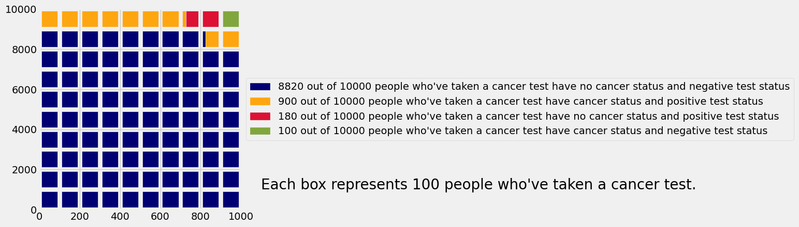

---
## 4.2. Interpretation and Comparison
As in Part 3, let's suppose Person X has a positive test result.  This means that you can now narrow them down to being part of just one of the two following groups:
1. The people with cancer who have a positive test result.
2. The people without cancer who have a positive test result.

Just as we did in Part 3 of this lab, here's an icon array for those two groups:

**Code:**

```python
# Just run this cell.
display_grouped_icon_array(people_new.where("test status", are.equal_to("positive")).drop(1), "people who have a positive test result")
```

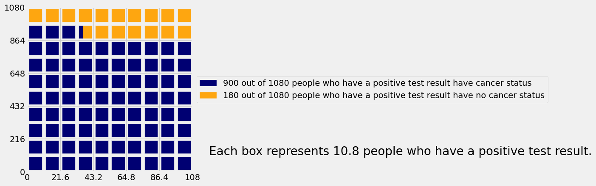

---

**Question 4.2.1.** Using the new contingency table, `cancer_new`, that was provided at the beginning of this section, write code to calculate the exact probability that an individual has cancer given that they've received a positive test result.

Run the next code cell to see the `cancer_new` table, then fill in `prob_cancer_given_positive_new` with your code.

**Student scaffold:**

```python
# Run this cell first to see the cancer_new table. Then fill in the next line of this cell.
cancer_new.show()

prob_cancer_given_positive_new = ...

print(f'Probability of cancer given positive test result: {prob_cancer_given_positive_new}')
```

**Solution:**

```python
# Run this cell first to see the cancer_new table. Then fill in the next line of this cell.
cancer_new.show()

prob_cancer_given_positive_new = cancer_new.where("status", are.equal_to("cancer")).column("positive").item(0) / sum(cancer_new.column("positive")) # SOLUTION

print(f'Probability of cancer given positive test result: {prob_cancer_given_positive_new}')
```

*Output:*

| status | negative | positive |
| --- | --- | --- |
| cancer | 100 | 900 |
| no cancer | 8820 | 180 |

*Output (stdout):*

```text
Probability of cancer given positive test result: 0.8333333333333334
```

**Test — `q4_2_1`**

```python
>>> from lab10_check import correctness_check_4_2_1
>>> correctness_check_4_2_1(prob_cancer_given_positive_new)
True
```

---

**Question 4.2.2.** How does your probability in 3.2.2 compare to your answer from 4.2.1? Does that make sense? Check with your peers or a staff member to see if you have the right idea. 

*Hint:* Check out [Ch 18.2.2](https://inferentialthinking.com/chapters/18/2/Making_Decisions.html#a-subjective-prior) for additional help!

**SOLUTION:** The probability obtained in 3.2.2 is around 31% while 4.2.1. tells us that our probability is nearly 83%. The effect of changing the prior is stunning. Even though the doctor has a pretty low prior probability (10%) that the patient has the disease, once the patient tests Positive the posterior probability of having the disease shoots up to more than 83%.

---

You're done with lab!

**Important submission information:**
- **Run all the tests** and verify that they all pass
- **Save** from the **File** menu
- **Run the final cell to generate the zip file**
- **Click the link to download the zip file**
- Then, go to [Pensive](https://www.pensieve.co/) and submit the zip file to the corresponding assignment. The name of this assignment is "Lab XX Autograder", where XX is the lab number -- 01, 02, 03, etc.

- If you finish early in Regular Lab, **ask one of the staff members to check you off**.

**It is your responsibility to make sure your work is saved before running the last cell.**

---

To double-check your work, the cell below will rerun all of the autograder tests.

## Submission

Make sure you have run all cells in your notebook in order before running the cell below, so that all images/graphs appear in the output. The cell below will generate a zip file for you to submit. **Please save before exporting!**

---

## Datasets

Datasets this notebook loads with `Table.read_table`. Column names are exact, including spaces and capitalization. Only the schema is recorded here — the data itself is not in this document, so any question about its values must be answered by running code, not by reasoning over the rows shown elsewhere in this file.

### `marbles.csv`

13 rows, 2 columns.

| Column | Type |
| --- | --- |
| `surface` | str |
| `size` | str |
