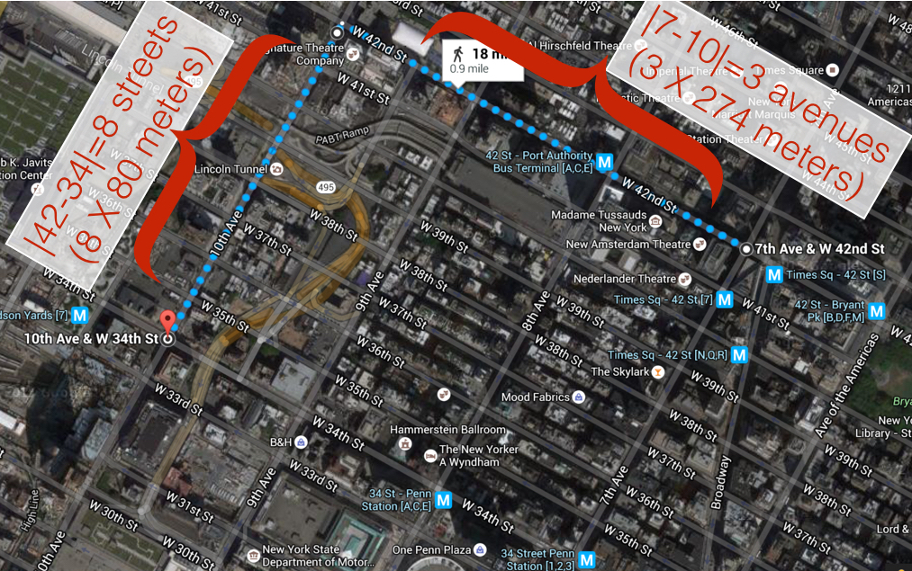
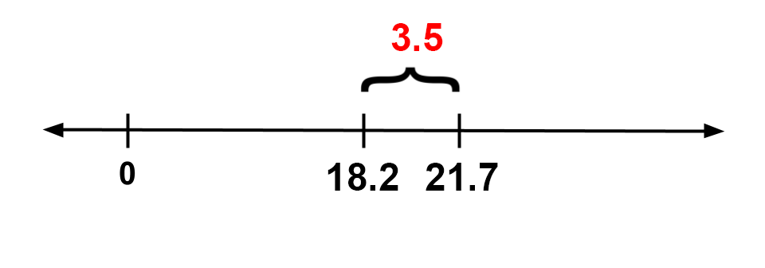
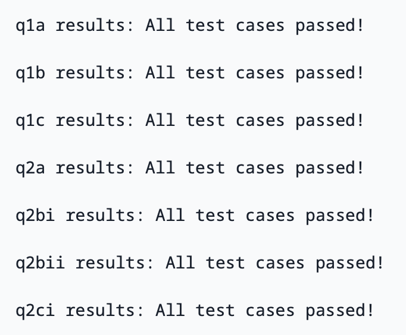

# Welcome!

Welcome to Data 8: *Foundations of Data Science*! Each week you will complete a lab assignment like this one. You can't learn technical subjects without hands-on practice, so labs are an important part of the course.

Before we get started, there are some administrative details.

The weekly lab sessions are designed to develop your skills with computational and inferential concepts. These lab assignments are a required part of the course and will be released Mondays at 5 PM, and due **Fridays at 5 PM**. This lab (Lab 01) will be due on **Friday, 1/23 at 5 PM**.

Lab sessions are not a webcast! Here are the [course policies](https://www.data8.org/su26/syllabus/#labs) for getting full credit (Lab is worth 20% of your overall grade in the class):

1. If you are within regular lab, 80% of lab credit will be for attending the full discussion portion (first hour) at which point the TA will take attendance. The remaining 20% of credit will be awarded for submitting the lab by the deadline having passed all public test cases.

2. If you are within the self-service lab, your lab score will be solely based on your test cases (i.e. if you pass 80% of test cases you will receive a score of 80% on that lab).

Collaborating on labs is more than okay -- it's encouraged! You should rarely remain stuck for more than a few minutes on questions in labs, so ask an instructor or classmate for help. (Explaining things is beneficial, too -- the best way to solidify your knowledge of a subject is to explain it.) Please don't just share answers, though.

You can read more of the [course policies](http://data8.org/su26/syllabus) on the [course website](http://data8.org/su26/).

#### Today's lab

In today's lab, you'll learn how to:

1. navigate Jupyter notebooks (like this one);
2. write and evaluate some basic *expressions* in Python, the computer language of the course;
3. call *functions* to use code other people have written; and
4. break down Python code into smaller parts to understand it.

This lab covers parts of [Chapter 3](http://www.inferentialthinking.com/chapters/03/programming-in-python.html) of the online textbook. You should read the examples in the book, but not right now. Instead, let's get started!

---
# 0. Mandatory Policies Form

<br/><br/>
---
Reading the text above this will save you time!

Fill out [this form](https://docs.google.com/forms/d/e/1FAIpQLSfZ81u8S52cM8gDe1VvggbnJNmYeM5wjlUGAV8PIyzjtuL1og/viewform?usp=dialog) before moving on. Please use your Berkeley email to access the form. At the end of the form, there will be a secret word that you should input into the box below. Remember to put the secret word in quotes when inputting it (i.e."hello"). The quotation marks indicate that it is a String type!

**Student scaffold:**

```python
secret_word = ...
```

**Solution:**

```python
secret_word = "welcome" # SOLUTION
```

**Test — `q_0`**

```python
>>> secret_word == 'welcome'
True
```

<br/><br/>
---
# Part 1: Jupyter Notebooks

This webpage is called a Jupyter Notebook. A notebook is a place to write programs and view their results, and also to write text.

---

## 1.1. Text cells
In a notebook, each rectangle containing text or code is called a *cell*.

Text cells (like this one) can be edited by double-clicking on them. They're written in a simple format called [Markdown](https://www.markdownguide.org/basic-syntax/) to add formatting and section headings.  You don't need to learn Markdown, but you might want to.

After you edit a text cell, click the "run cell" button at the top that looks like ▶ or hold down `shift` + `return` to confirm any changes. (Try not to delete the instructions of the lab.)

**Question 1.1.1.** This paragraph is in its own text cell.  Try editing it so that this sentence is the last sentence in the paragraph, and then click the "run cell" ▶ button or hold down `shift` + `return`.  This sentence, for example, should be deleted.  So should this one.

---

## 1.2. Code cells
Other cells contain code in the Python 3 language. Running a code cell will execute all of the code it contains.

To run the code in a code cell, first click on that cell to activate it.  It'll be highlighted with a little green or blue rectangle.  Next, either press ▶ or hold down `shift` + `return`.

Try running this cell:

**Code:**

```python
print("Hello, World!")
```

*Output (stdout):*

```text
Hello, World!
```

And this one:

**Code:**

```python
print("\N{WAVING HAND SIGN}, \N{EARTH GLOBE ASIA-AUSTRALIA}!")
```

*Output (stdout):*

```text
👋, 🌏!
```

The fundamental building block of Python code is an expression. Cells can contain multiple lines with multiple expressions. When you run a cell, the lines of code are executed in the order in which they appear. Every `print` expression prints a line. Run the next cell and notice the order of the output.

**Code:**

```python
print("First this line is printed,")
print("and then this one.")
```

*Output (stdout):*

```text
First this line is printed,
and then this one.
```

**Question 1.2.1.** Change the cell above so that it prints out:

    First this line,
    then the whole 🌏,
    and then this one.

*Hint:* If you're stuck on the Earth symbol for more than a few minutes, try talking to a neighbor or a staff member. That's a good idea for any lab problem.

---

## 1.3. Converting Cells
To convert a cell from Markdown to code (or vice versa), you should use the dropdown in the menu bar. For instance, to convert the following cell from Markdown to code, you should:
1. Click the cell.
2. Click "Markdown" in the menu bar, and change it to "Code."

Your menu bar should then look like this:


**Change the following cell from a Markdown cell to a code cell** and run the cell. You should get `6` as an output.

1 + 2 + 3  # Change this to a code cell

---

## 1.4. Writing Jupyter notebooks
You can use Jupyter notebooks for your own projects or documents.  When you make your own notebook, you'll need to create your own cells for text and code.

To add a cell, click the `+` button in the menu bar. You can also use keyboard shortcuts and press `a` (adds a cell **a**bove the current cell) or `b` (adds a cell **b**elow the current cell) to add cells.

**Question 1.4.1.** Add a code cell below this one.  Write code in it that prints out:
   
    A whole new cell! ♪🌏♪

(That musical note symbol is like the Earth symbol.  Its long-form name is `\N{EIGHTH NOTE}`.)

Run your cell to verify that it works.

---
You can also delete cells by clicking the scissors ✄ button in the menu bar, or pressing `x` on the highlighted cell. **BE CAREFUL**: There's no undo button when you delete a cell, so use this command wisely!

**Question 1.4.2.** Delete the cell below this one.

**Code:**

```python
# This cell should be deleted!!!
```

Here's a summary of some useful keyboard shortcuts:

| Action | Keyboard shortcut |
| :--- | :--- |
| Run cell + jump to next cell | `shift` + `return` |
| Save notebook | `ctrl/cmd` + `s` |
| Create new cell above/below |  `a/b` |
| Delete cell | `x` |
| Switch to command mode | `escape` |
| Switch to edit mode | `return` | 
| Comment out the current line | `ctrl/cmd` + `/` |

---

## 1.5. Errors
Python is a language, and like natural human languages, it has rules.  It differs from natural language in two important ways:
1. The rules are *simple*.  You can learn most of them in a few weeks and gain reasonable proficiency with the language in a semester.
2. The rules are *rigid*.  If you're proficient in a natural language, you can understand a non-proficient speaker, glossing over small mistakes.  A computer running Python code is not smart enough to do that.

Whenever you write code, you'll make mistakes.  When you run a code cell that has errors, Python will sometimes produce error messages to tell you what you did wrong.

Errors are okay; even experienced programmers make many errors.  When you make an error, you just have to find the source of the problem, fix it, and move on.

We have made an error in the next cell.  Run it and see what happens.

**Code:**

```python
print("This line is missing something."
```

*Error:*

```text
  Cell In[8], line 1
    print("This line is missing something."
                                           ^
SyntaxError: incomplete input
```

**Note:** In the toolbar, there is the option to click `Run > Run All Cells`, which will run all the code cells in this notebook in order. However, the notebook stops running code cells if it hits an error, like the one in the cell above.

You should see something like this (minus our annotations and the D8 error output):

![Annotated screenshot of a Jupyter cell error. The cell contains print("This line is missing something." with no closing parenthesis; below it a red traceback reads 'Cell In[1], line 1' and 'SyntaxError: incomplete input'. Callouts point out the missing parenthesis as the actual error, the caret ^ marking where Python thinks something is wrong, and the final line as the detailed description of the error.](lab01_assets/error.png)

The last line of the error output attempts to tell you what went wrong.  The *syntax* of a language is its structure, and this `SyntaxError` tells you that you have created an illegal structure.

There's a lot of terminology in programming languages, but you don't need to know it all in order to program effectively. If you see a cryptic message like `EOF`, you can often get by without deciphering it.  (Of course, if you're frustrated, ask a neighbor or a staff member for help.) However, our D8 error package helps explain any python errors and exceptions and their common causes, as well as resources to reference for additional help. In the example above, we see that one source of a `SyntaxError` has to do with parentheses. 


Try to fix the code above so that you can run the cell and see the intended message instead of an error.

---

## 1.6. The Kernel
The kernel is a program that executes the code inside your notebook and outputs the results. In the top right of your window, you can see a circle that indicates the status of your kernel. If the circle is empty (⚪), the kernel is idle and ready to execute code. If the circle is filled in (⚫), the kernel is busy running some code. 

Next to every code cell, you'll see some text that says `[ ]`. Before you run the cell, you'll see `[ ]`. When the cell is running, you'll see `[*]`. If you see an asterisk (\*) next to a cell that doesn't go away, it's likely that the code inside the cell is taking too long to run, and it might be a good time to interrupt the kernel (discussed below). When a cell is finished running, you'll see a number inside the brackets, like so: `[1]`. The number corresponds to the order in which you run the cells; so, the first cell you run will show a 1 when it's finished running, the second will show a 2, and so on. 

You may run into problems where your kernel is stuck for an excessive amount of time, your notebook is very slow and unresponsive, or your kernel loses its connection. If this happens, try the following steps:
1. At the top of your screen, click **Kernel**, then **Interrupt Kernel**.
2. If that doesn't help, click **Kernel**, then **Restart Kernel**. If you do this, you will have to run your code cells from the start of your notebook up until where you paused your work.

---

## 1.7. Submitting Your Work
All assignments in the course will be distributed as notebooks like this one, and you will submit your work from the notebook. We will use a system called Otter Grader and Pensieve to check your work and help you submit. If you haven’t already, make sure you have run the cell at the top of this notebook to initialize OtterGrader.

Watch this [video](https://drive.google.com/file/d/1H9UwEb7uQrc1eK0PKGxtu95woP4IcyGI/view?usp=sharing) to see how to submit an assignment!

<br/><br/>
---
# 2. Numbers

Quantitative information arises everywhere in data science. In addition to representing commands to print out lines, expressions can represent numbers and methods of combining numbers. The expression `3.2500` evaluates to the number 3.25. (Run the cell and see.)

**Code:**

```python
3.2500
```

*Output:*

```text
3.25
```

Notice that we didn't have to `print`. When you run a notebook cell, if the last line has a value, then Jupyter helpfully prints out that value for you. However, it won't print out prior lines automatically.

**Code:**

```python
print(2)
3
4
```

*Output (stdout):*

```text
2
```

*Output:*

```text
4
```

Above, you should see that 4 is the value of the last expression, 2 is printed, but 3 is lost forever because it was neither printed nor last.

You don't want to print everything all the time anyway.  But if you feel sorry for 3, change the cell above to print it.

---

## 2.1. Arithmetic
The line in the next cell subtracts.  Its value is what you'd expect.  Run it.

**Code:**

```python
3.25 - 1.5
```

*Output:*

```text
1.75
```

Many basic arithmetic operations are built into Python.  The textbook section on [Expressions](http://www.inferentialthinking.com/chapters/03/1/Expressions.html) describes all the arithmetic operators used in the course.  The common operator that differs from typical math notation is `**`, which raises one number to the power of the other. So, `2**3` stands for $2^3$ and evaluates to 8. 

The order of operations is the same as what you learned in elementary school, and Python also has parentheses.  For example, compare the outputs of the cells below. The second cell uses parentheses for a happy new year!

**Code:**

```python
9+6*5-6*3**2*2**3/4*7
```

*Output:*

```text
-717.0
```

**Code:**

```python
9+(6*5-(6*3))**2*((2**3)/4*7)
```

*Output:*

```text
2025.0
```

In standard math notation, the first expression is

$$9 + 6 \times 5 - 6 \times 3^2 \times \frac{2^3}{4} \times 7,$$

while the second expression is

$$9 + (6 \times 5 - (6 \times 3))^2 \times \left(\frac{\left(2^3\right)}{4} \times 7\right).$$

**Question 2.1.1.** Write a Python expression in this next cell that's equal to $\displaystyle 5 \times \left(3 \frac{10}{11}\right) - 50 \frac{1}{3} + 2^{0.5 \times 22} - \frac{7}{33} + 9$.  That's five times three and ten elevenths, minus fifty and a third, plus two to the power of half twenty-two, minus seven thirty-thirds plus nine. 

Replace the ellipses (`...`) with your expression.  Try to use parentheses only when necessary.

**Note:** By "$\displaystyle 3 \frac{10}{11}$", we mean $\displaystyle 3+\frac{10}{11}$, not $\displaystyle 3 \times \frac{10}{11}$.

*Hint:* The correct output should start with a familiar number.

**Student scaffold:**

```python
...
```

**Solution:**

```python
5*(3+10/11)-(50+1/3)+2**(.5*22)-7/33 + 9 #SOLUTION
```

*Output:*

```text
2026.0
```

<br/><br/>
---
# 3. Names
In natural language, we have terminology that lets us quickly reference very complicated concepts.  We don't say, "That's a large mammal with brown fur and sharp teeth!"  Instead, we just say, "Bear!"

In Python, we do this with *assignment statements*. An assignment statement has a name on the left side of an `=` sign and an expression to be evaluated on the right.

**Code:**

```python
ten = 3 * 2 + 4
```

When you run that cell, Python first computes the value of the expression on the right-hand side, `3 * 2 + 4`, which is the number 10.  Then it assigns that value to the name `ten`.  At that point, the code in the cell is done running.

After you run that cell, the value 10 is bound to the name `ten`:

**Code:**

```python
ten
```

*Output:*

```text
10
```

The statement `ten = 3 * 2 + 4` is not asserting that `ten` is already equal to `3 * 2 + 4`, as we might expect by analogy with math notation.  Rather, that line of code changes what `ten` means; it now refers to the value 10, whereas before it meant nothing at all.

If the designers of Python had been ruthlessly pedantic, they might have made us write

    define the name ten to hereafter have the value of 3 * 2 + 4 

instead.  You will probably appreciate the brevity of "`=`"!  But keep in mind that this is the real meaning.

**Question 3.1.** Run the following cell which uses a variable name `eleven` that hasn't been assigned to anything. You'll see an error!

**Code:**

```python
eleven + 8
```

*Error:*

```text
---------------------------------------------------------------------------
NameError                                 Traceback (most recent call last)
Cell In[17], line 1
----> 1 eleven + 8

NameError: name 'eleven' is not defined
```

A common pattern in Jupyter notebooks is to assign a value to a name and then immediately evaluate the name in the last line in the cell so that the value is displayed as output.

**Code:**

```python
close_to_pi = 355/113
close_to_pi
```

*Output:*

```text
3.1415929203539825
```

Another common pattern is that a series of lines in a single cell will build up a complex computation in stages, naming the intermediate results.

**Code:**

```python
semimonthly_salary = 843 + 3/4 # 843.75
monthly_salary = 2 * semimonthly_salary
number_of_months_in_a_year = 12
yearly_salary = number_of_months_in_a_year * monthly_salary
yearly_salary
```

*Output:*

```text
20250.0
```

Names in Python can have letters (upper- and lower-case letters are both okay and count as different letters), underscores, and numbers.  The first character can't be a number (otherwise a name might look like a number).  And names can't contain spaces, since spaces are used to separate pieces of code from each other.

Other than those rules, what you name something doesn't matter *to Python*.  For example, this cell does the same thing as the above cell, except everything has a different name:

**Code:**

```python
a = 842.75
b = 2 * a
c = 12
d = c * b
d
```

*Output:*

```text
20226.0
```

**However**, names are very important for making your code *readable* to yourself and others.  The cell above is shorter, but it's totally useless without an explanation of what it does.

---

## 3.1. Checking Your Code
Now that you know how to name things, you can start using the built-in *tests* to check whether your work is correct. Sometimes, there are multiple tests for a single question, and passing all of them is required to receive credit for the question. Please don't change the contents of the test cells. 

Go ahead and attempt Question 3.1.2. Running the cell directly after it will test whether you have assigned `seconds_in_a_decade` correctly in Question 3.1.2. If you haven't, this test will tell you the correct answer. Resist the urge to just copy it, and instead try to adjust your expression. (Sometimes the tests will give hints about what went wrong...)

**Question 3.1.2.** Assign the name `seconds_in_a_decade` to the number of seconds between midnight January 1, 2010 and midnight January 1, 2020. Note that there are two leap years in this span of a decade. A non-leap year has 365 days and a leap year has 366 days.

*Hint:* If you're stuck, the next section shows you how to get hints.

**Student scaffold:**

```python
# Change the next line 
# so that it computes the number of seconds in a decade 
# and assigns that number the name, seconds_in_a_decade.

seconds_in_a_decade = ...

# We've put this line in this cell 
# so that it will print the value you've given to seconds_in_a_decade when you run it.  
# You don't need to change this.
seconds_in_a_decade
```

**Solution:**

```python
# Change the next line 
# so that it computes the number of seconds in a decade 
# and assigns that number the name, seconds_in_a_decade.

seconds_in_a_decade = (365*8 + 366*2) * 24 * 60 * 60 # SOLUTION

# We've put this line in this cell 
# so that it will print the value you've given to seconds_in_a_decade when you run it.  
# You don't need to change this.
seconds_in_a_decade
```

*Output:*

```text
315532800
```

**Test — `q3_1_2`**

```python
>>> 'seconds_in_a_decade' in vars()
True

>>> seconds_in_a_decade != ...
True

>>> seconds_in_a_decade != 315360000
True

>>> seconds_in_a_decade == 315532800
True
```

---

# 3.2. Comments
You may have noticed these lines in the cell in which you answered Question 3.2:

    # Change the next line 
    # so that it computes the number of seconds in a decade 
    # and assigns that number the name, seconds_in_a_decade.
    
This is called a *comment*. It doesn't make anything happen in Python; Python ignores anything on a line after a `#`.  Instead, it's there to communicate something about the code to you, the human reader. Comments are extremely useful. 


Source: [XKCD](http://imgs.xkcd.com/comics/future_self.png)

---

## 3.3. Application: A Physics Experiment

On the Apollo 15 mission to the Moon, astronaut David Scott famously replicated Galileo's physics experiment in which he showed that gravity accelerates objects of different mass at the same rate. Because there is no air resistance for a falling object on the surface of the Moon, even two objects with very different masses and densities should fall at the same rate. David Scott compared a feather and a hammer.

You can run the following cell to watch a video of the experiment.

**Code:**

```python
from IPython.display import YouTubeVideo
# The original URL is: 
# https://www.youtube.com/watch?v=U7db6ZeLR5s

YouTubeVideo("U7db6ZeLR5s")
```


Here's the transcript of the video:

**167:22:06 Scott**: Well, in my left hand, I have a feather; in my right hand, a hammer. And I guess one of the reasons we got here today was because of a gentleman named Galileo, a long time ago, who made a rather significant discovery about falling objects in gravity fields. And we thought where would be a better place to confirm his findings than on the Moon. And so we thought we'd try it here for you. The feather happens to be, appropriately, a falcon feather for our Falcon. And I'll drop the two of them here and, hopefully, they'll hit the ground at the same time. 

**167:22:43 Scott**: How about that!

**167:22:45 Allen**: How about that! (Applause in Houston)

**167:22:46 Scott**: Which proves that Mr. Galileo was correct in his findings.

**Newton's Law.** Using this footage, we can also attempt to confirm another famous bit of physics: Newton's law of universal gravitation. Newton's laws predict that any object dropped near the surface of the Moon should fall

$$\frac{1}{2} G \frac{M}{R^2} t^2 \text{ meters}$$

after $t$ seconds, where $G$ is a universal constant, $M$ is the moon's mass in kilograms, and $R$ is the moon's radius in meters.  So if we know $G$, $M$, and $R$, then Newton's laws let us predict how far an object will fall over any amount of time.

To verify the accuracy of this law, we will calculate the difference between the predicted distance the hammer drops and the actual distance.  (If they are different, it might be because Newton's laws are wrong, or because our measurements are imprecise, or because there are other factors affecting the hammer for which we haven't accounted.)

Someone studied the video and estimated that the hammer was dropped 113 cm from the surface. Counting frames in the video, the hammer falls for 1.2 seconds (36 frames).

**Question 3.3.1.** Complete the code in the next cell to fill in the data from the experiment.

*Hint:* No computation required; just fill in data from the paragraph above.

**Student scaffold:**

```python
# t, or time: the duration of the fall in the experiment, in seconds.
# Fill this in.
time = ...

# The estimated distance the hammer actually fell, in meters.
# Fill this in.
estimated_distance_m = ...
```

**Solution:**

```python
# t, or time: the duration of the fall in the experiment, in seconds.
# Fill this in.
time = 1.2 #SOLUTION

# The estimated distance the hammer actually fell, in meters.
# Fill this in.
estimated_distance_m = 1.13 # SOLUTION
```

**Test — `q3_3_1`**

```python
>>> time != ...
True

>>> round(time, 5)
1.2

>>> estimated_distance_m != ...
True

>>> estimated_distance_m != 113
True

>>> round(estimated_distance_m, 5)
1.13
```

**Question 3.3.2.** Now, complete the code in the next cell to compute the difference between the predicted and estimated distances (in meters) that the hammer fell in this experiment.

This just means translating the formula above ($\frac{1}{2}G\frac{M}{R^2}t^2$) into Python code.  You'll have to replace each variable in the math formula with the name we gave that number in Python code.

*Hint:* Try to use variables you've already defined in question 3.3.1

**Student scaffold:**

```python
# First, we've written down the values of the 3 universal constants 
# that show up in Newton's formula.

# G, the universal constant measuring the strength of gravity.
gravity_constant = 6.674 * 10**-11

# M, the moon's mass, in kilograms.
moon_mass_kg = 7.34767309 * 10**22

# R, the radius of the moon, in meters.
moon_radius_m = 1.737 * 10**6

# The distance the hammer should have fallen 
# over the duration of the fall, in meters, 
# according to Newton's law of gravity.  
# The text above describes the formula
# for this distance given by Newton's law.
# **YOU FILL THIS PART IN.**
predicted_distance_m = ...

# Here we've computed the difference 
# between the predicted fall distance and the distance we actually measured.
# If you've filled in the above code, this should just work.
difference = predicted_distance_m - estimated_distance_m
difference
```

**Solution:**

```python
# First, we've written down the values of the 3 universal constants 
# that show up in Newton's formula.

# G, the universal constant measuring the strength of gravity.
gravity_constant = 6.674 * 10**-11

# M, the moon's mass, in kilograms.
moon_mass_kg = 7.34767309 * 10**22

# R, the radius of the moon, in meters.
moon_radius_m = 1.737 * 10**6

# The distance the hammer should have fallen 
# over the duration of the fall, in meters, 
# according to Newton's law of gravity.  
# The text above describes the formula
# for this distance given by Newton's law.
# **YOU FILL THIS PART IN.**
predicted_distance_m = (1/2) * gravity_constant * (moon_mass_kg / moon_radius_m**2) * time**2 # SOLUTION

# Here we've computed the difference 
# between the predicted fall distance and the distance we actually measured.
# If you've filled in the above code, this should just work.
difference = predicted_distance_m - estimated_distance_m
difference
```

*Output:*

```text
0.040223694659304865
```

**Test — `q3_3_2`**

```python
>>> predicted_distance_m != ...
True

>>> round(predicted_distance_m, 5)
1.17022

>>> round(difference, 5)
0.04022
```

<br/><br/>
---
## 4. Calling Functions

The most common way to combine or manipulate values in Python is by calling functions. Python comes with many built-in functions that perform common operations.

For example, the `abs` function takes a single number as its argument and returns the absolute value of that number. Run the next two cells and see if you understand the output.

**Code:**

```python
abs(5)
```

*Output:*

```text
5
```

**Code:**

```python
abs(-5)
```

*Output:*

```text
5
```

---

## 4.1. Application: Computing Walking Distances
Chunhua is on the corner of 7th Avenue and 42nd Street in Midtown Manhattan, and she wants to know far she'd have to walk to get to Gramercy School on the corner of 10th Avenue and 34th Street.

She can't cut across blocks diagonally, since there are buildings in the way.  She has to walk along the sidewalks.  Using the map below, she sees she'd have to walk 3 avenues (long blocks) and 8 streets (short blocks).  In terms of the given numbers, she computed 3 as the difference between 7 and 10, *in absolute value*, and 8 similarly.  

Chunhua also knows that blocks in Manhattan are all about 80m by 274m (avenues are farther apart than streets).  So in total, she'd have to walk $(80 \times |42 - 34| + 274 \times |7 - 10|)$ meters to get to the park.



**Question 4.1.1.** Fill in the line `num_avenues_away = ...` in the next cell so that the cell calculates the distance Chunhua must walk and gives it the name `manhattan_distance`.  Everything else has been filled in for you.  **Use the `abs` function.** Also, be sure to run the test cell afterward to test your code.

**Student scaffold:**

```python
# Here's the number of streets away:
num_streets_away = abs(42-34)

# Compute the number of avenues away in a similar way:
num_avenues_away = ...

street_length_m = 80
avenue_length_m = 274

# Now we compute the total distance Chunhua must walk. We've completed this code for you!
manhattan_distance = street_length_m*num_streets_away + avenue_length_m*num_avenues_away

# We've included this line so that you see the distance you've computed 
# when you run this cell.  
# You don't need to change it, but you can if you want.
manhattan_distance
```

**Solution:**

```python
# Here's the number of streets away:
num_streets_away = abs(42-34)

# Compute the number of avenues away in a similar way:
num_avenues_away = abs(7-10) # SOLUTION

street_length_m = 80
avenue_length_m = 274

# Now we compute the total distance Chunhua must walk. We've completed this code for you!
manhattan_distance = street_length_m*num_streets_away + avenue_length_m*num_avenues_away

# We've included this line so that you see the distance you've computed 
# when you run this cell.  
# You don't need to change it, but you can if you want.
manhattan_distance
```

*Output:*

```text
1462
```

**Test — `q4_1_1`**

```python
>>> num_avenues_away != ...
True

>>> num_avenues_away != -3
True

>>> num_avenues_away
3

>>> manhattan_distance
1462
```

##### Multiple arguments
Some functions take multiple arguments, separated by commas. For example, the built-in `max` function returns the maximum argument passed to it.

**Code:**

```python
max(2, -3, 4, -5)
```

*Output:*

```text
4
```

<br/><br/>
---
# 5. Understanding Nested Expressions
Function calls and arithmetic expressions can themselves contain expressions.  You saw an example in the last question:

    abs(42-34)

has 2 number expressions in a subtraction expression in a function call expression.  And you probably wrote something like `abs(7-10)` to compute `num_avenues_away`.

Nested expressions can turn into complicated-looking code. However, the way in which complicated expressions break down is very regular.

Suppose we are interested in lengths of cats that are very unusual.  We'll say that a length is unusual to the extent that it's far away on the number line from the average cat length. An estimate of the average cat length (averaging, we hope, over all cats on Earth today) is **18.2** inches.

So if Ravioli is 21.7 inches long, then her length is $|21.7 - 18.2|$, or $3.5$, inches away from the average.  Here's a picture of that:



The source for average cat length is [Wikipedia](https://en.wikipedia.org/wiki/Cat#:~:text=The%20domestic%20cat%20has%20a,(9%20and%2011%20lb).). The listed lengths for cats are not real and may not be plausible (but the names are of real cats!)

And here's how we'd write that expression in one line of Python code:

**Code:**

```python
abs(21.7 - 18.2)
```

*Output:*

```text
3.5
```

What's going on here?  `abs` takes just one argument, so the stuff inside the parentheses is all part of that *single argument*.  Specifically, the argument is the value of the expression `21.7 - 18.2`.  The value of that expression is `3.5`.  That value is the argument to `abs`.  The absolute value of that is `3.5`, so `3.5` is the value of the full expression `abs(21.7 - 18.2)`.

Picture simplifying the expression in several steps:

1. `abs(21.7 - 18.2)`
2. `abs(3.5)`
3. `3.5`

In fact, that's basically what Python does to compute the value of the expression.

**Question 5.1.** Say that Genghis's length is 16.7 inches.  In the next cell, use `abs` to compute the absolute value of the difference between Genghis's length and the average cat length (given in the paragraph above).  Give that value the name `genghis_distance_from_average_in`.

**Student scaffold:**

```python
# Replace the ... with an expression 
# to compute the absolute value 
# of the difference between Genghis's length (16.7 in) and the average cat length.
genghis_distance_from_average_in = ...

# Again, we've written this here 
# so that the distance you compute will get printed 
# when you run this cell.
genghis_distance_from_average_in
```

**Solution:**

```python
# Replace the ... with an expression 
# to compute the absolute value 
# of the difference between Genghis's length (16.7 in) and the average cat length.
genghis_distance_from_average_in = abs(16.7 - 18.2) # SOLUTION

# Again, we've written this here 
# so that the distance you compute will get printed 
# when you run this cell.
genghis_distance_from_average_in
```

*Output:*

```text
1.5
```

**Test — `q51`**

```python
>>> round(genghis_distance_from_average_in, 3)
1.5
```

---

## 5.1. More Nesting
Now say that we want to compute the more unusual of the two cat lengths.  We'll use the function `max`, which (again) takes two numbers as arguments and returns the larger of the two arguments.  Combining that with the `abs` function, we can compute the larger distance from average among the two length:

**Code:**

```python
# Just read and run this cell.

ravioli_length_in = 21.7
genghis_length_in = 16.7
average_cat_length = 18.2

# The larger distance from the average cat length, among the two length:
larger_distance_in = max(abs(ravioli_length_in - average_cat_length), abs(genghis_length_in - average_cat_length))

# Print out our results in a nice readable format:
print("The larger distance from the average length among these two cats is", larger_distance_in, "inches.")
```

*Output (stdout):*

```text
The larger distance from the average length among these two cats is 3.5 inches.
```

The line where `larger_distance_in` is computed looks complicated, but we can break it down into simpler components just like we did before.

The basic recipe is to repeatedly simplify small parts of the expression:
* **Basic expressions:** Start with expressions whose values we know, like names or numbers.
    - Examples: `genghis_length_in` or `16.7`.
* **Find the next simplest group of expressions:** Look for basic expressions that are directly connected to each other. This can be by arithmetic or as arguments to a function call. 
    - Example: `genghis_length_in - average_cat_length`.
* **Evaluate that group:** Evaluate the arithmetic expression or function call. Use the value computed to replace the group of expressions.  
    - Example: `genghis_length_in - average_cat_length` becomes `-1.3`.
* **Repeat:** Continue this process, using the value of the previously-evaluated expression as a new basic expression. Stop when we've evaluated the entire expression.
    - Example: `abs(-1.3)` becomes `1.3`, and `max(3.5, 1.3)` becomes `3.5`.

You can run the next cell to see a slideshow of that process.

**Code:**

```python
from IPython.display import IFrame
IFrame('https://docs.google.com/presentation/d/14EKhQjGe0bUpLwKGo6BrPCtjsORSkY8h4BzAqvXoLTM/embed?start=false&loop=false&delayms=3000', 800, 600)
```

*Output:*

```text
<IPython.lib.display.IFrame at 0x107d88730>
```

Ok, your turn. 

**Question 5.1.1.** Given the lengths of Yanay's cats Hummus, Gatkes, and Zeepty, write an expression that computes the **smallest pairwise difference** between any of the three cats' lenghts. Note that unlike the previous question, this doesn't involve the average.

Your expression shouldn't have any numbers in it, only function calls and the names `hummus`, `gatkes`, and `zeepty`. Give the value of your expression the name `min_length_difference`.

**Student scaffold:**

```python
# The three cats' lengths, in inches:
hummus =  24.5 # Hummus is 24.5 inches long
gatkes = 19.7 # Gatkes is 19.7 inches long
zeepty = 15.8 # Zeepty is 15.8 inches long
             
# We'd like to look at all 3 pairs of lengths, 
# compute the absolute difference between each pair, 
# and then find the smallest of those 3 absolute differences.  
# This is left to you!  
# If you're stuck, try computing the value for each step of the process 
# (like the difference between Hummus's length and Gatkes's length) 
# on a separate line and giving it a name (like hummus_gatkes_length_diff)
min_length_difference = ...
```

**Solution:**

```python
# The three cats' lengths, in inches:
hummus =  24.5 # Hummus is 24.5 inches long
gatkes = 19.7 # Gatkes is 19.7 inches long
zeepty = 15.8 # Zeepty is 15.8 inches long
             
# We'd like to look at all 3 pairs of lengths, 
# compute the absolute difference between each pair, 
# and then find the smallest of those 3 absolute differences.  
# This is left to you!  
# If you're stuck, try computing the value for each step of the process 
# (like the difference between Hummus's length and Gatkes's length) 
# on a separate line and giving it a name (like hummus_gatkes_length_diff)
min_length_difference = min(abs(hummus-gatkes), abs(hummus-zeepty), abs(gatkes-zeepty)) # SOLUTION
```

**Test — `q5_1_1`**

```python
>>> round(min_length_difference, 5)
3.9
```

<br/><br/>
---
# 6. Using JupyTutor!
This semester, we are trying something new with JupyTutor! JupyTutor is an LLM assistant developed by Kevin Gillespie and Timothy J. Aveni that responds to errors and questions in your assignment, specifically based on Data 8 content. [Here](https://drive.google.com/file/d/1PEsP6pJYnDdThRMA7BVnzXposRn6shZv/view?usp=sharing) is a demo video showcasing some of its features.

- Throughout the semeter, JupyTutor will be activated for most assignments. Some questions may not have JupyTutor enabled if we think it wouldn’t be helpful for that particular problem.
- Using JupyTutor is optional - you are not required to use it.
- Please make sure to refrain from using other external AI / LLM tools for assignments in Data 8. Jupytutor has been designed and tuned specifically for Data 8.

Like all LLMs, JupyTutor can make mistakes, so please fill out this [feedback form](https://docs.google.com/forms/d/e/1FAIpQLSed1Bq166rNDRTTws31O1Y4sSulFu8zY_y5jaM1K_3DBt7Plw/viewform?usp=publish-editor) (also linked on the website) if you notice any mistakes or have any suggestions.

Try out Jupytutor for this question!

**Question 6.1.** Given the number of times each of our lead TAs have met Oski, find the **absolute difference** between the **maximum** value of the TAs with names that start with the letter "D" and the **minimum** value of the TAs that start with the letter "T".

Your expression shouldn't have any numbers in it, only function calls and the correct TA names. Assing this value to `absolute_difference`.

**Student scaffold:**

```python
# The amount of times each of our lead TAs have met Oski:
andrew_t = 3 # For example, Andrew has met Oski 3 times...
brandon_s = 1 # And Brandon has only met Oski once!
carisma_d = 4
dagny_s = 2
dylan_t = 2
marissa_l = 4
max_a = 5
sangjun_l = 2
tiffany_l = 4
timothy_a = 7 # Wow! That's a lot!
tracy_l = 2

# Assign absolute_difference to the desired value
absolute_difference = ...
absolute_difference
```

**Solution:**

```python
# The amount of times each of our lead TAs have met Oski:
andrew_t = 3 # For example, Andrew has met Oski 3 times...
brandon_s = 1 # And Brandon has only met Oski once!
carisma_d = 4
dagny_s = 2
dylan_t = 2
marissa_l = 4
max_a = 5
sangjun_l = 2
tiffany_l = 4
timothy_a = 7 # Wow! That's a lot!
tracy_l = 2

# Assign absolute_difference to the desired value
absolute_difference = abs(max(dagny_s, dylan_t) - min(tiffany_l, timothy_a, tracy_l)) # SOLUTION
absolute_difference
```

*Output:*

```text
0
```

**Test — `q6_1`**

```python
>>> absolute_difference == 0
True
```

<br/><br/>
---
You're done with Lab 1!

**Important submission information:** Be sure to run the tests and verify that they all pass, then choose **Save Notebook** from the **File** menu, then **run the final cell** and click the link to download the zip file. Then, go to [Pensieve](https://www.pensieve.co/) and submit the zip file to the corresponding assignment. The name of this assignment is "Lab 01 Autograder". 

**Once you have submitted, your submitted assignment should look like the following image if you have passed all tests.** <span style="color: red">**Make sure that you see "All test cases passed" to ensure your assignment was submitted correctly.**</span> If your submission does not look like this, then you likely did not upload your notebook correctly.



---

To double-check your work, the cell below will rerun all of the autograder tests.

## Submission

Make sure you have run all cells in your notebook in order before running the cell below, so that all images/graphs appear in the output. The cell below will generate a zip file for you to submit. **Please save before exporting!**
