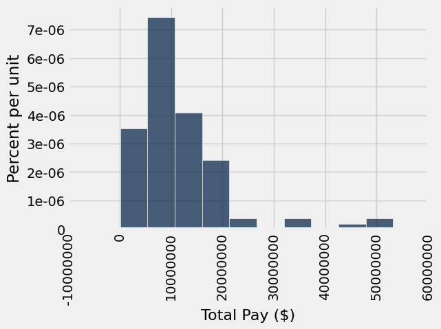

# Lab 4: Functions and Visualizations

Welcome to Lab 4! This week, we'll learn about functions, table methods such as `apply`, and how to generate visualizations! 

**Recommended Reading**:

* [Applying a Function to a Column](https://inferentialthinking.com/chapters/08/1/Applying_a_Function_to_a_Column.html)
* [Visualizations](https://inferentialthinking.com/chapters/07/Visualization.html)
* [Python Reference](https://www.data8.org/su26/reference/)

**Lab Submission Deadline: Friday, February 13th at 5pm**

**Getting help on lab**: Whenever you feel stuck or need some further clarification, find a GSI or tutor, and they'll be happy to help!

As a reminder, here are the policies for getting full credit (Lab is worth 20% of your final grade):
- 80% of lab credit will be attendance-based. To receive attendance credit for lab, you must attend the full discussion portion (first hour) at which point the GSI will take attendance. 
- The remaining 20% of credit will be awarded for submitting the programming-based assignment to Pensieve by the deadline (5pm on Friday) with all test cases passing.

**Submission**: Once you’re finished, run all cells besides the last one, select File > Save Notebook, and then execute the final cell. The result will contain a zip file that you can use to submit on Pensieve.

Let's begin by setting up the tests and imports by running the cell below.

First, set up the notebook by running the cell below.

**Code:**

```python
import numpy as np
from datascience import *

# These lines set up graphing capabilities.
import matplotlib
%matplotlib inline
import matplotlib.pyplot as plt
plt.style.use('fivethirtyeight')
import warnings
warnings.simplefilter('ignore', FutureWarning)
```

---
## 1. Defining functions

Let's start off by writing a function that converts a proportion to a percentage by multiplying it by 100.  For example, the value of `to_percentage(.5)` should be the number 50 (no percent sign).

A function definition has a few parts.

##### `def`
We create a function with a `def` statement (short for **def**ine):

<br>
<pre style="margin-left: 40px; font-family: 'Courier New';"><code><span style="font-weight: bold; color: green">def</span></code>
</pre>

##### Name
Next comes the name of the function.  Like other names we've defined, it can't start with a number or contain spaces. Let's call our function `to_percentage`:
    
<br>
<pre style="margin-left: 40px; font-family: 'Courier New';"><code><span style="font-weight: bold; color: green">def</span> <span style="color: blue">to_percentage</span></code>
</pre>

##### Signature
Next comes the ___signature___ of the function.  This tells Python the number of **arguments** in the function and the names of those arguments. An argument is a value that is _passed into_ the function when it is used/called. A function can have any number of arguments (including 0!). 

`to_percentage` should take one argument, and we'll call that argument `proportion` since it should be a proportion.

<br>
<pre style="margin-left: 40px; font-family: 'Courier New';"><code><span style="font-weight: bold; color: green">def</span> <span style="color: blue">to_percentage</span>(proportion)</code>
</pre>
    
If we want our function to take more than one argument, we add a comma between each argument name i.e to_percentage(proportion, decimals). Note that if we had zero arguments, we'd still place the parentheses () after that name. 

We put a **colon** after the signature to tell Python that the next indented lines are the body of the function. Make sure you remember the colon!

<br>
<pre style="margin-left: 40px; font-family: 'Courier New';"><code><span style="font-weight: bold; color: green">def</span> <span style="color: blue">to_percentage</span>(proportion):</code>
</pre>

##### Documentation
Functions can do complicated things, so you should write an explanation of what your function does.  For small functions, this is less important, but it's a good habit to learn from the start (although documentation isn't strictly required).  Conventionally, Python functions are documented by writing an **indented** triple-quoted string:

<br>
<pre style="margin-left: 40px; font-family: 'Courier New';"><code><span style="font-weight: bold; color: green">def</span> <span style="color: blue">to_percentage</span>(proportion):<br><span style="padding-left: 40px"><span style="color: red">"""Converts a proportion to a percentage."""</span></span></code>
</pre>

##### Body
Now we start writing code that runs when the function is called.  This is called the *body* of the function and every line **must be indented with a tab**.  Any lines that are *not* indented and left-aligned with the def statement are considered outside the function. 

Some notes about the body of the function:
- We can write code that we would write anywhere else.  
- We use the arguments defined in the function signature. We can do this because values are assigned to those arguments when we call the function.
- We generally avoid referencing variables defined *outside* the function. If you would like to reference variables outside of the function, pass them through as arguments!


Now, let's give a name to the number we multiply a proportion by to get a percentage:

<br>
<pre style="margin-left: 40px; font-family: 'Courier New';"><code><span style="font-weight: bold; color: green">def</span> <span style="color: blue">to_percentage</span>(proportion):<br><span style="padding-left: 40px"><span style="color: red">"""Converts a proportion to a percentage."""</span></span>
<span style="padding-left: 40px">factor <span style="color: purple">=</span> <span style="color: green">100</span></span></code>
</pre>

##### `return`
The special instruction `return` is part of the function's body and tells Python to make the value of the function call equal to whatever comes right after `return`.  We want the value of `to_percentage(.5)` to be the proportion .5 times the factor 100, so we write:

<br>
<pre style="margin-left: 40px; font-family: 'Courier New';"><code><span style="font-weight: bold; color: green">def</span> <span style="color: blue">to_percentage</span>(proportion):<br><span style="padding-left: 40px"><span style="color: red">"""Converts a proportion to a percentage."""</span></span>
<span style="padding-left: 40px">factor <span style="color: purple">=</span> <span style="color: green">100</span></span>
<span style="padding-left: 40px"><span style="font-weight: bold; color: green">return</span> proportion <span style="color: purple">*</span> factor</span>
</code>
</pre>
        
`return` only makes sense in the context of a function, and **can never be used outside of a function**. `return` is always the last line of the function because Python stops executing the body of a function once it hits a `return` statement. Make sure to include a return statement unless you don't expect the function to return anything. 

*Note:*  `return` inside a function tells Python what value the function evaluates to. However, there are other functions, like `print`, that have no `return` value. For example, `print` simply prints a certain value out to the console. 

In short, `return` is used when you want to tell the *computer* what the value of some variable is, while `print` is used to tell you, a *human*, its value.

---

**Question 1.1.** Define `to_percentage` in the cell below.  Call your function to convert the proportion .2 to a percentage.  Name that percentage `twenty_percent`.

**Student scaffold:**

```python
def ...
    ''' (Replace this with your documentation) '''
    ... = ...
    return ...

twenty_percent = ...
twenty_percent
```

**Solution:**

```python
""" # BEGIN PROMPT
def ...
    ''' (Replace this with your documentation) '''
    ... = ...
    return ...
"""; # END PROMPT 

# BEGIN SOLUTION NO PROMPT
def to_percentage(proportion):
    """Converts a proportion to a percentage."""
    factor = 100 
    return proportion * factor
# END SOLUTION
twenty_percent = to_percentage(.2) # SOLUTION
twenty_percent
```

*Output:*

```text
20.0
```

**Test — `q11`**

```python
>>> to_percentage(0.35) == 35.0
True

>>> from lab04_check import correctness_check_1_1
>>> correctness_check_1_1(twenty_percent)
True
```

Here's something important about functions: **the names assigned *within* a function body are only accessible within the function body**. Once the function has returned, those names are gone.  So even if you created a variable called `factor` and defined `factor = 100` inside of the body of the `to_percentage` function and then called `to_percentage`, `factor` would not have a value assigned to it outside of the body of `to_percentage`:

**Note**: Below, you should see a `NameError` error message indicating that the `name 'factor' is not defined`. Python  throws this error because `factor` has not been defined outside of the body of the `to_percentage` function.

**Code:**

```python
# You should get an error when you run this.  (If you don't, 
# you might have defined factor somewhere above.)
factor
```

*Output (stdout):*

```text
Unexpected exception formatting exception. Falling back to standard exception
```

*Output (stderr):*

```text
Traceback (most recent call last):
  File "/Users/marissalumpkin/Desktop/data8/assignments_new/env/lib/python3.13/site-packages/IPython/core/interactiveshell.py", line 3577, in run_code
    exec(code_obj, self.user_global_ns, self.user_ns)
    ~~~~^^^^^^^^^^^^^^^^^^^^^^^^^^^^^^^^^^^^^^^^^^^^^
  File "/var/folders/xv/tl5mnl5s0mz_ykhsrhdyb_rm0000gn/T/ipykernel_52829/3742982240.py", line 3, in <module>
    factor
NameError: name 'factor' is not defined

During handling of the above exception, another exception occurred:

Traceback (most recent call last):
  File "/Users/marissalumpkin/Desktop/data8/assignments_new/env/lib/python3.13/site-packages/IPython/core/interactiveshell.py", line 2168, in showtraceback
    stb = self.InteractiveTB.structured_traceback(
        etype, value, tb, tb_offset=tb_offset
    )
  File "/Users/marissalumpkin/Desktop/data8/assignments_new/env/lib/python3.13/site-packages/IPython/core/ultratb.py", line 1454, in structured_traceback
    return FormattedTB.structured_traceback(
           ~~~~~~~~~~~~~~~~~~~~~~~~~~~~~~~~^
        self, etype, evalue, etb, tb_offset, number_of_lines_of_context
        ^^^^^^^^^^^^^^^^^^^^^^^^^^^^^^^^^^^^^^^^^^^^^^^^^^^^^^^^^^^^^^^
    )
    ^
  File "/Users/marissalumpkin/Desktop/data8/assignments_new/env/lib/python3.13/site-packages/IPython/core/ultratb.py", line 1345, in structured_traceback
    return VerboseTB.structured_traceback(
           ~~~~~~~~~~~~~~~~~~~~~~~~~~~~~~^
        self, etype, value, tb, tb_offset, number_of_lines_of_context
        ^^^^^^^^^^^^^^^^^^^^^^^^^^^^^^^^^^^^^^^^^^^^^^^^^^^^^^^^^^^^^
    )
    ^
  File "/Users/marissalumpkin/Desktop/data8/assignments_new/env/lib/python3.13/site-packages/IPython/core/ultratb.py", line 1192, in structured_traceback
    formatted_exception = self.format_exception_as_a_whole(etype, evalue, etb, number_of_lines_of_context,
                                                           tb_offset)
  File "/Users/marissalumpkin/Desktop/data8/assignments_new/env/lib/python3.13/site-packages/IPython/core/ultratb.py", line 1082, in format_exception_as_a_whole
    self.get_records(etb, number_of_lines_of_context, tb_offset) if etb else []
    ~~~~~~~~~~~~~~~~^^^^^^^^^^^^^^^^^^^^^^^^^^^^^^^^^^^^^^^^^^^^
  File "/Users/marissalumpkin/Desktop/data8/assignments_new/env/lib/python3.13/site-packages/IPython/core/ultratb.py", line 1179, in get_records
    res = list(stack_data.FrameInfo.stack_data(etb, options=options))[tb_offset:]
          ~~~~^^^^^^^^^^^^^^^^^^^^^^^^^^^^^^^^^^^^^^^^^^^^^^^^^^^^^^^
  File "/Users/marissalumpkin/Desktop/data8/assignments_new/env/lib/python3.13/site-packages/stack_data/core.py", line 597, in stack_data
    yield from collapse_repeated(
    ...<4 lines>...
    )
  File "/Users/marissalumpkin/Desktop/data8/assignments_new/env/lib/python3.13/site-packages/stack_data/utils.py", line 83, in collapse_repeated
    yield from map(mapper, original_group)
  File "/Users/marissalumpkin/Desktop/data8/assignments_new/env/lib/python3.13/site-packages/stack_data/core.py", line 587, in mapper
    return cls(f, options)
  File "/Users/marissalumpkin/Desktop/data8/assignments_new/env/lib/python3.13/site-packages/stack_data/core.py", line 551, in __init__
    self.executing = Source.executing(frame_or_tb)
                     ~~~~~~~~~~~~~~~~^^^^^^^^^^^^^
  File "/Users/marissalumpkin/Desktop/data8/assignments_new/env/lib/python3.13/site-packages/executing/executing.py", line 283, in executing
    assert_(new_stmts <= stmts)
    ~~~~~~~^^^^^^^^^^^^^^^^^^^^
  File "/Users/marissalumpkin/Desktop/data8/assignments_new/env/lib/python3.13/site-packages/executing/executing.py", line 80, in assert_
    raise AssertionError(str(message))
AssertionError
```

Like you’ve done with built-in functions in previous labs (`max`, `abs`, etc.), you can pass in named values as arguments to your function.

---

**Question 1.2.** Use `to_percentage` again to convert the proportion named `a_proportion` (defined below) to a percentage called `a_percentage`.

*Note:* You don't need to define `to_percentage` again!  Like other named values, functions stick around after you define them.

**Student scaffold:**

```python
a_proportion = 2**(0.5) / 2
a_percentage = ...
a_percentage
```

**Solution:**

```python
a_proportion = 2**(0.5) / 2
a_percentage = to_percentage(a_proportion) # SOLUTION
a_percentage
```

*Output:*

```text
70.71067811865476
```

**Test — `q12`**

```python
>>> from lab04_check import correctness_check_1_2
>>> correctness_check_1_2(a_percentage)
True
```

In the following cell, we will define a function called `disemvowel`.  It takes in a single string as its argument. It returns a copy of that string, but with all the characters that are vowels removed.  (In English, the vowels are the characters "a", "e", "i", "o", and "u".) 

To remove all the "a"s from a string, we used `a_string.replace("a", "")`.  The `.replace` method for strings returns a new string, so we can call `replace` multiple times, one after the other.

**Code:**

```python
def disemvowel(a_string):
    """Removes all vowels from a string."""
    return a_string.replace("a", "").replace("e", "").replace("i", "").replace("o", "").replace("u", "")

# An example call to the function.  (It's often helpful to run
# an example call from time to time while we're writing a function,
# to see how it currently works.)
disemvowel("Can you read this without vowels?")
```

*Output:*

```text
'Cn y rd ths wtht vwls?'
```

##### Calls on calls on calls
Just as you write a series of lines to build up a complex computation, it's useful to define a series of small functions that build on each other.  Since you can write any code inside a function's body, you can call other functions you've written.

If a function is like a recipe, defining a function in terms of other functions is like having a recipe for cake telling you to follow another recipe to make the frosting, and another to make the jam filling.  This makes the cake recipe shorter and clearer, and it avoids having a bunch of duplicated frosting recipes.  It's a foundation of productive programming.

For example, suppose you want to count the number of characters *that aren't vowels* in a piece of text.  One way to do this is to remove all the vowels and count the size of the remaining string.

---

**Question 1.3.** Write a function called `num_non_vowels`.  It should take a string as its argument and return a number.  That number should be the number of characters in the argument string that aren't vowels. You should use the `disemvowel` function we provided above inside of the `num_non_vowels` function.

*Hint:* The function `len` takes a string as its argument and returns the number of characters in it.

**Student scaffold:**

```python
def num_non_vowels(a_string):
    """The number of characters in a string, minus the vowels."""
    ...

# Try calling your function yourself to make sure the output is what
# you expect.
```

**Solution:**

```python
def num_non_vowels(a_string):
    """The number of characters in a string, minus the vowels."""
    return len(disemvowel(a_string)) # SOLUTION

# Try calling your function yourself to make sure the output is what
# you expect.
```

**Test — `q13`**

```python
>>> num_non_vowels('Go bears!') == 6
True
```

Functions can also encapsulate code that *displays output* instead of computing a value. For example, if you call `print` inside a function, and then call that function, something will get printed.

The `movies_by_year` dataset in the textbook has information about movie sales in recent years.  Suppose you'd like to display the year with the 5th-highest total gross movie sales, printed within a sentence.  You might do this:

**Code:**

```python
movies_by_year = Table.read_table("movies_by_year.csv")
rank = 5
fifth_from_top_movie_year = movies_by_year.sort("Total Gross", descending=True).column("Year").item(rank-1)
print("Year number", rank, "for total gross movie sales was:", fifth_from_top_movie_year)
```

*Output (stdout):*

```text
Year number 5 for total gross movie sales was: 2010
```

After writing this, you realize you also wanted to print out the 2nd and 3rd-highest years.  Instead of copying your code, you decide to put it in a function.  Since the rank varies, you make that an argument to your function.

---

**Question 1.4.** Write a function called `print_kth_top_movie_year`.  It should take a single argument - the rank of the year (like 2, 3, or 5 in the above examples) as an integer - and should use the table `movies_by_year`. It should print out a message like the one above.  

*Note:* Your function shouldn't have a `return` statement.

**Student scaffold:**

```python
def print_kth_top_movie_year(k):
    ...
    print(...)


# Example calls to your function:
print_kth_top_movie_year(2)
print_kth_top_movie_year(3)
```

**Solution:**

```python
def print_kth_top_movie_year(k):
    ...
    print(...)


# BEGIN SOLUTION NO PROMPT
def print_kth_top_movie_year(k):
    year = movies_by_year.sort("Total Gross", descending=True).column("Year").item(k-1) 
    print("Year number", k, "for total gross movie sales was:", year)
# END SOLUTION

# Example calls to your function:
print_kth_top_movie_year(2)
print_kth_top_movie_year(3)
```

*Output (stdout):*

```text
Year number 2 for total gross movie sales was: 2013
Year number 3 for total gross movie sales was: 2012
```

**Test — `q14`**

```python
>>> print_kth_top_movie_year(4)
Year number 4 for total gross movie sales was: 2009
```

### `print` is not the same as `return`
The `print_kth_top_movie_year(k)` function prints the total gross movie sales for the year that was provided! However, since we did not return any value in this function, we can not use it after we call it. Let's look at an example of another function that prints a value but does not return it.

**Code:**

```python
def print_number_five():
    print(5)
```

**Code:**

```python
print_number_five()
```

*Output (stdout):*

```text
5
```

However, if we try to use the output of `print_number_five()`, we see that the value `5` is printed but we get a TypeError when we try to add the number 2 to it!

**Code:**

```python
print_number_five_output = print_number_five()
print_number_five_output + 2
```

*Output (stdout):*

```text
5
Unexpected exception formatting exception. Falling back to standard exception
```

*Output (stderr):*

```text
Traceback (most recent call last):
  File "/Users/marissalumpkin/Desktop/data8/assignments_new/env/lib/python3.13/site-packages/IPython/core/interactiveshell.py", line 3577, in run_code
    exec(code_obj, self.user_global_ns, self.user_ns)
    ~~~~^^^^^^^^^^^^^^^^^^^^^^^^^^^^^^^^^^^^^^^^^^^^^
  File "/var/folders/xv/tl5mnl5s0mz_ykhsrhdyb_rm0000gn/T/ipykernel_52829/55797484.py", line 2, in <module>
    print_number_five_output + 2
    ~~~~~~~~~~~~~~~~~~~~~~~~~^~~
TypeError: unsupported operand type(s) for +: 'NoneType' and 'int'

During handling of the above exception, another exception occurred:

Traceback (most recent call last):
  File "/Users/marissalumpkin/Desktop/data8/assignments_new/env/lib/python3.13/site-packages/IPython/core/interactiveshell.py", line 2168, in showtraceback
    stb = self.InteractiveTB.structured_traceback(
        etype, value, tb, tb_offset=tb_offset
    )
  File "/Users/marissalumpkin/Desktop/data8/assignments_new/env/lib/python3.13/site-packages/IPython/core/ultratb.py", line 1454, in structured_traceback
    return FormattedTB.structured_traceback(
           ~~~~~~~~~~~~~~~~~~~~~~~~~~~~~~~~^
        self, etype, evalue, etb, tb_offset, number_of_lines_of_context
        ^^^^^^^^^^^^^^^^^^^^^^^^^^^^^^^^^^^^^^^^^^^^^^^^^^^^^^^^^^^^^^^
    )
    ^
  File "/Users/marissalumpkin/Desktop/data8/assignments_new/env/lib/python3.13/site-packages/IPython/core/ultratb.py", line 1345, in structured_traceback
    return VerboseTB.structured_traceback(
           ~~~~~~~~~~~~~~~~~~~~~~~~~~~~~~^
        self, etype, value, tb, tb_offset, number_of_lines_of_context
        ^^^^^^^^^^^^^^^^^^^^^^^^^^^^^^^^^^^^^^^^^^^^^^^^^^^^^^^^^^^^^
    )
    ^
  File "/Users/marissalumpkin/Desktop/data8/assignments_new/env/lib/python3.13/site-packages/IPython/core/ultratb.py", line 1192, in structured_traceback
    formatted_exception = self.format_exception_as_a_whole(etype, evalue, etb, number_of_lines_of_context,
                                                           tb_offset)
  File "/Users/marissalumpkin/Desktop/data8/assignments_new/env/lib/python3.13/site-packages/IPython/core/ultratb.py", line 1082, in format_exception_as_a_whole
    self.get_records(etb, number_of_lines_of_context, tb_offset) if etb else []
    ~~~~~~~~~~~~~~~~^^^^^^^^^^^^^^^^^^^^^^^^^^^^^^^^^^^^^^^^^^^^
  File "/Users/marissalumpkin/Desktop/data8/assignments_new/env/lib/python3.13/site-packages/IPython/core/ultratb.py", line 1179, in get_records
    res = list(stack_data.FrameInfo.stack_data(etb, options=options))[tb_offset:]
          ~~~~^^^^^^^^^^^^^^^^^^^^^^^^^^^^^^^^^^^^^^^^^^^^^^^^^^^^^^^
  File "/Users/marissalumpkin/Desktop/data8/assignments_new/env/lib/python3.13/site-packages/stack_data/core.py", line 597, in stack_data
    yield from collapse_repeated(
    ...<4 lines>...
    )
  File "/Users/marissalumpkin/Desktop/data8/assignments_new/env/lib/python3.13/site-packages/stack_data/utils.py", line 83, in collapse_repeated
    yield from map(mapper, original_group)
  File "/Users/marissalumpkin/Desktop/data8/assignments_new/env/lib/python3.13/site-packages/stack_data/core.py", line 587, in mapper
    return cls(f, options)
  File "/Users/marissalumpkin/Desktop/data8/assignments_new/env/lib/python3.13/site-packages/stack_data/core.py", line 551, in __init__
    self.executing = Source.executing(frame_or_tb)
                     ~~~~~~~~~~~~~~~~^^^^^^^^^^^^^
  File "/Users/marissalumpkin/Desktop/data8/assignments_new/env/lib/python3.13/site-packages/executing/executing.py", line 283, in executing
    assert_(new_stmts <= stmts)
    ~~~~~~~^^^^^^^^^^^^^^^^^^^^
  File "/Users/marissalumpkin/Desktop/data8/assignments_new/env/lib/python3.13/site-packages/executing/executing.py", line 80, in assert_
    raise AssertionError(str(message))
AssertionError
```

It may seem that `print_number_five()` is returning a value, 5. In reality, it just displays the number 5 to you without giving you the actual value! If your function prints out a value **without returning it** and you try to use that value, you will run into errors, so be careful!

Think about how you might add a line of code to the `print_number_five` function (after `print(5)`) so that the code `print_number_five_output + 5` would result in the value `10`, rather than an error.

---
## 2. Functions and CEO Incomes

In this question, we'll look at the 2015 compensation of CEOs at the 100 largest companies in California. The data was compiled from a [Los Angeles Times analysis](http://spreadsheets.latimes.com/california-ceo-compensation/), and ultimately came from [filings](https://www.sec.gov/answers/proxyhtf.htm) mandated by the SEC from all publicly-traded companies. Two companies have two CEOs, so there are 101 CEOs in the dataset.

We've copied the raw data from the LA Times page into a file called `raw_compensation.csv`. (The page notes that all dollar amounts are in **millions of dollars**.)

**Code:**

```python
raw_compensation = Table.read_table('raw_compensation.csv')
raw_compensation
```

*Output:*

| Rank | Name | Company (Headquarters) | Total Pay | % Change | Cash Pay | Equity Pay | Other Pay | Ratio of CEO pay to average industry worker pay |
| --- | --- | --- | --- | --- | --- | --- | --- | --- |
| 1 | Mark V. Hurd* | Oracle (Redwood City) | $53.25 | (No previous year) | $0.95 | $52.27 | $0.02 | 362 |
| 2 | Safra A. Catz* | Oracle (Redwood City) | $53.24 | (No previous year) | $0.95 | $52.27 | $0.02 | 362 |
| 3 | Robert A. Iger | Walt Disney (Burbank) | $44.91 | -3% | $24.89 | $17.28 | $2.74 | 477 |
| 4 | Marissa A. Mayer | Yahoo! (Sunnyvale) | $35.98 | -15% | $1.00 | $34.43 | $0.55 | 342 |
| 5 | Marc Benioff | salesforce.com (San Francisco) | $33.36 | -16% | $4.65 | $27.26 | $1.45 | 338 |
| 6 | John H. Hammergren | McKesson (San Francisco) | $24.84 | -4% | $12.10 | $12.37 | $0.37 | 222 |
| 7 | John S. Watson | Chevron (San Ramon) | $22.04 | -15% | $4.31 | $14.68 | $3.05 | 183 |
| 8 | Jeffrey Weiner | LinkedIn (Mountain View) | $19.86 | 27% | $2.47 | $17.26 | $0.13 | 182 |
| 9 | John T. Chambers** | Cisco Systems (San Jose) | $19.62 | 19% | $5.10 | $14.51 | $0.01 | 170 |
| 10 | John G. Stumpf | Wells Fargo (San Francisco) | $19.32 | -10% | $6.80 | $12.50 | $0.02 | 256 |

We want to compute the average of the CEOs' pay. Try running the cell below.

**Code:**

```python
np.average(raw_compensation.column("Total Pay"))
```

*Output (stdout):*

```text
Unexpected exception formatting exception. Falling back to standard exception
```

*Output (stderr):*

```text
Traceback (most recent call last):
  File "/Users/marissalumpkin/Desktop/data8/assignments_new/env/lib/python3.13/site-packages/IPython/core/interactiveshell.py", line 3577, in run_code
    exec(code_obj, self.user_global_ns, self.user_ns)
    ~~~~^^^^^^^^^^^^^^^^^^^^^^^^^^^^^^^^^^^^^^^^^^^^^
  File "/var/folders/xv/tl5mnl5s0mz_ykhsrhdyb_rm0000gn/T/ipykernel_52829/1172901112.py", line 1, in <module>
    np.average(raw_compensation.column("Total Pay"))
    ~~~~~~~~~~^^^^^^^^^^^^^^^^^^^^^^^^^^^^^^^^^^^^^^
  File "/Users/marissalumpkin/Desktop/data8/assignments_new/env/lib/python3.13/site-packages/numpy/lib/_function_base_impl.py", line 562, in average
    avg = a.mean(axis, **keepdims_kw)
  File "/Users/marissalumpkin/Desktop/data8/assignments_new/env/lib/python3.13/site-packages/numpy/_core/_methods.py", line 136, in _mean
    ret = umr_sum(arr, axis, dtype, out, keepdims, where=where)
TypeError: the resolved dtypes are not compatible with add.reduce. Resolved (dtype('<U7'), dtype('<U7'), dtype('<U14'))

During handling of the above exception, another exception occurred:

Traceback (most recent call last):
  File "/Users/marissalumpkin/Desktop/data8/assignments_new/env/lib/python3.13/site-packages/IPython/core/interactiveshell.py", line 2168, in showtraceback
    stb = self.InteractiveTB.structured_traceback(
        etype, value, tb, tb_offset=tb_offset
    )
  File "/Users/marissalumpkin/Desktop/data8/assignments_new/env/lib/python3.13/site-packages/IPython/core/ultratb.py", line 1454, in structured_traceback
    return FormattedTB.structured_traceback(
           ~~~~~~~~~~~~~~~~~~~~~~~~~~~~~~~~^
        self, etype, evalue, etb, tb_offset, number_of_lines_of_context
        ^^^^^^^^^^^^^^^^^^^^^^^^^^^^^^^^^^^^^^^^^^^^^^^^^^^^^^^^^^^^^^^
    )
    ^
  File "/Users/marissalumpkin/Desktop/data8/assignments_new/env/lib/python3.13/site-packages/IPython/core/ultratb.py", line 1345, in structured_traceback
    return VerboseTB.structured_traceback(
           ~~~~~~~~~~~~~~~~~~~~~~~~~~~~~~^
        self, etype, value, tb, tb_offset, number_of_lines_of_context
        ^^^^^^^^^^^^^^^^^^^^^^^^^^^^^^^^^^^^^^^^^^^^^^^^^^^^^^^^^^^^^
    )
    ^
  File "/Users/marissalumpkin/Desktop/data8/assignments_new/env/lib/python3.13/site-packages/IPython/core/ultratb.py", line 1192, in structured_traceback
    formatted_exception = self.format_exception_as_a_whole(etype, evalue, etb, number_of_lines_of_context,
                                                           tb_offset)
  File "/Users/marissalumpkin/Desktop/data8/assignments_new/env/lib/python3.13/site-packages/IPython/core/ultratb.py", line 1082, in format_exception_as_a_whole
    self.get_records(etb, number_of_lines_of_context, tb_offset) if etb else []
    ~~~~~~~~~~~~~~~~^^^^^^^^^^^^^^^^^^^^^^^^^^^^^^^^^^^^^^^^^^^^
  File "/Users/marissalumpkin/Desktop/data8/assignments_new/env/lib/python3.13/site-packages/IPython/core/ultratb.py", line 1179, in get_records
    res = list(stack_data.FrameInfo.stack_data(etb, options=options))[tb_offset:]
          ~~~~^^^^^^^^^^^^^^^^^^^^^^^^^^^^^^^^^^^^^^^^^^^^^^^^^^^^^^^
  File "/Users/marissalumpkin/Desktop/data8/assignments_new/env/lib/python3.13/site-packages/stack_data/core.py", line 597, in stack_data
    yield from collapse_repeated(
    ...<4 lines>...
    )
  File "/Users/marissalumpkin/Desktop/data8/assignments_new/env/lib/python3.13/site-packages/stack_data/utils.py", line 83, in collapse_repeated
    yield from map(mapper, original_group)
  File "/Users/marissalumpkin/Desktop/data8/assignments_new/env/lib/python3.13/site-packages/stack_data/core.py", line 587, in mapper
    return cls(f, options)
  File "/Users/marissalumpkin/Desktop/data8/assignments_new/env/lib/python3.13/site-packages/stack_data/core.py", line 551, in __init__
    self.executing = Source.executing(frame_or_tb)
                     ~~~~~~~~~~~~~~~~^^^^^^^^^^^^^
  File "/Users/marissalumpkin/Desktop/data8/assignments_new/env/lib/python3.13/site-packages/executing/exec

... [output truncated, 289 more characters]
```

You should see a `TypeError`. Let's examine why this error occurred by looking at the values in the `Total Pay` column. To do so, we can use the `type` function. This function tells us the data type of the object that we pass into it. Run the following cells to see what happens when we pass in `23`, `3.5`, and `"Hello"` to the `type` function. Do their outputs make sense?

**Code:**

```python
type(23)
```

*Output:*

```text
int
```

**Code:**

```python
type(3.5)
```

*Output:*

```text
float
```

**Code:**

```python
type("Hello")
```

*Output:*

```text
str
```

---

**Question 2.1.** Use the `type` function and set `total_pay_type` to the type of the first value in the "Total Pay" column.

**Student scaffold:**

```python
total_pay_type = ...
total_pay_type
```

**Solution:**

```python
total_pay_type = type(raw_compensation.column("Total Pay").item(0)) # SOLUTION
total_pay_type
```

*Output:*

```text
str
```

**Test — `q21`**

```python
>>> import numpy
>>> total_pay_type != numpy.ndarray
True

>>> 'str' in str(total_pay_type)
True

>>> isinstance(total_pay_type, type)
True

>>> total_pay_type != int
True
```

---

**Question 2.2.** You should have found that the values in the `Total Pay` column are strings. It doesn't make sense to take the average of string values, so we need to convert them to numbers. Extract the first value in `Total Pay`.  It's Mark Hurd's pay in 2015, in *millions* of dollars.  Call it `mark_hurd_pay_string`.

**Student scaffold:**

```python
mark_hurd_pay_string = ...
mark_hurd_pay_string
```

**Solution:**

```python
mark_hurd_pay_string = raw_compensation.column("Total Pay").item(0) # SOLUTION
mark_hurd_pay_string
```

*Output:*

```text
'$53.25 '
```

**Test — `q22`**

```python
>>> from lab04_check import correctness_check_2_2
>>> correctness_check_2_2(mark_hurd_pay_string)
True
```

---

**Question 2.3.** Convert `mark_hurd_pay_string` to a number of *dollars*. 

Some hints, as this question requires multiple steps:
- The string method `strip` will be useful for removing the dollar sign; it removes a specified character from the start or end of a string.  For example, the value of `"100%".strip("%")` is the string `"100"`.  
- You'll also need the function `float`, which converts a string that looks like a number to an actual number. Don't worry about the whitespace at the end of the string; the `float` function will ignore this.

Finally, remember that the answer should be in **dollars**, not millions of dollars. For example:
- If the table says a CEO was paid `$9`, we know this is in **millions of dollars.**
- Converting this to `$9000000` changes it to be in **dollars.**

**Student scaffold:**

```python
mark_hurd_pay = ...
mark_hurd_pay
```

**Solution:**

```python
mark_hurd_pay = 10**6 * float(mark_hurd_pay_string.strip("$")) # SOLUTION
mark_hurd_pay
```

*Output:*

```text
53250000.0
```

**Test — `q23`**

```python
>>> type(mark_hurd_pay) != str
True

>>> mark_hurd_pay != 5325
True

>>> from lab04_check import correctness_check_2_3
>>> correctness_check_2_3(mark_hurd_pay)
True
```

To compute the average pay, we need to do this for every CEO.  But that looks like it would involve copying this code 101 times.

We'll instead use functions to perform this computation. Later in this lab, we'll see the payoff: we can call that function on every pay string in the dataset at once.

---

**Question 2.4.** Copy the expression you used to compute `mark_hurd_pay`, and use it as the return expression of the function below. But make sure you replace the specific `mark_hurd_pay_string` with the generic `pay_string` name specified in the first line in the `def` statement.

*Hint*: When dealing with functions, you should generally not be referencing any variable outside of the function. Usually, you want to be working with the arguments that are passed into it, such as `pay_string` for this function. If you're using `mark_hurd_pay_string` within your function, you're referencing an outside variable!

**Student scaffold:**

```python
def convert_pay_string_to_number(pay_string):
    """Converts a pay string like '$100' (in millions) to a number of dollars."""
    ...
```

**Solution:**

```python
def convert_pay_string_to_number(pay_string):
    """Converts a pay string like '$100' (in millions) to a number of dollars."""
    return 10**6 * float(pay_string.strip("$")) # SOLUTION
```

**Test — `q24`**

```python
>>> convert_pay_string_to_number('$100 ') == 100000000.0
True

>>> convert_pay_string_to_number('$23 ') == 23000000.0
True
```

Running that cell doesn't convert any particular pay string. Instead, it creates a function called `convert_pay_string_to_number` that can convert *any* string with the right format to a number representing millions of dollars.

We can call our function just like we call the built-in functions we've seen. It takes one argument, *a string*, and it returns a float.

**Code:**

```python
convert_pay_string_to_number('$42')
```

*Output:*

```text
42000000.0
```

**Code:**

```python
convert_pay_string_to_number(mark_hurd_pay_string)
```

*Output:*

```text
53250000.0
```

**Code:**

```python
# We can also compute Safra Catz's pay in the same way:
convert_pay_string_to_number(raw_compensation.where("Name", are.containing("Safra")).column("Total Pay").item(0))
```

*Output:*

```text
53240000.0
```

With this function, we don't have to copy the code that converts a pay string to a number each time we wanted to convert a pay string.  Now we just call a function whose name says exactly what it's doing.

---
## 3. `apply`ing functions

Defining a function is a lot like giving a name to a value with `=`.  In fact, a function is a value just like the number 1 or the text "data"!

For example, we can make a new name for the built-in function `max` if we want:

**Code:**

```python
our_name_for_max = max
our_name_for_max(2, 6)
```

*Output:*

```text
6
```

The old name for `max` is still around:

**Code:**

```python
max(2, 6)
```

*Output:*

```text
6
```

Try just writing `max` or `our_name_for_max` (or the name of any other function) in a cell, and run that cell.  Python will print out a (very brief) description of the function.

**Code:**

```python
max
```

*Output:*

```text
<function max>
```

Now try writing `max?` or `our_name_for_max?` (or the name of any other function) in a cell, and run that cell.  A information box should show up at the bottom of your screen a longer description of the function

*Note: You can also press Shift+Tab after clicking on a name to see similar information!*

**Code:**

```python
our_name_for_max?
```

Let's look at what happens when we set `max`to a non-function value. Python now thinks you're trying to use a number like a function, which causes an error. Look out for any functions that might have been renamed when you encounter this type of error.

**Code:**

```python
max = 6
max(2, 6)
```

*Output (stdout):*

```text
Unexpected exception formatting exception. Falling back to standard exception
```

*Output (stderr):*

```text
Traceback (most recent call last):
  File "/Users/marissalumpkin/Desktop/data8/assignments_new/env/lib/python3.13/site-packages/IPython/core/interactiveshell.py", line 3577, in run_code
    exec(code_obj, self.user_global_ns, self.user_ns)
    ~~~~^^^^^^^^^^^^^^^^^^^^^^^^^^^^^^^^^^^^^^^^^^^^^
  File "/var/folders/xv/tl5mnl5s0mz_ykhsrhdyb_rm0000gn/T/ipykernel_52829/2218400260.py", line 2, in <module>
    max(2, 6)
    ~~~^^^^^^
TypeError: 'int' object is not callable

During handling of the above exception, another exception occurred:

Traceback (most recent call last):
  File "/Users/marissalumpkin/Desktop/data8/assignments_new/env/lib/python3.13/site-packages/IPython/core/interactiveshell.py", line 2168, in showtraceback
    stb = self.InteractiveTB.structured_traceback(
        etype, value, tb, tb_offset=tb_offset
    )
  File "/Users/marissalumpkin/Desktop/data8/assignments_new/env/lib/python3.13/site-packages/IPython/core/ultratb.py", line 1454, in structured_traceback
    return FormattedTB.structured_traceback(
           ~~~~~~~~~~~~~~~~~~~~~~~~~~~~~~~~^
        self, etype, evalue, etb, tb_offset, number_of_lines_of_context
        ^^^^^^^^^^^^^^^^^^^^^^^^^^^^^^^^^^^^^^^^^^^^^^^^^^^^^^^^^^^^^^^
    )
    ^
  File "/Users/marissalumpkin/Desktop/data8/assignments_new/env/lib/python3.13/site-packages/IPython/core/ultratb.py", line 1345, in structured_traceback
    return VerboseTB.structured_traceback(
           ~~~~~~~~~~~~~~~~~~~~~~~~~~~~~~^
        self, etype, value, tb, tb_offset, number_of_lines_of_context
        ^^^^^^^^^^^^^^^^^^^^^^^^^^^^^^^^^^^^^^^^^^^^^^^^^^^^^^^^^^^^^
    )
    ^
  File "/Users/marissalumpkin/Desktop/data8/assignments_new/env/lib/python3.13/site-packages/IPython/core/ultratb.py", line 1192, in structured_traceback
    formatted_exception = self.format_exception_as_a_whole(etype, evalue, etb, number_of_lines_of_context,
                                                           tb_offset)
  File "/Users/marissalumpkin/Desktop/data8/assignments_new/env/lib/python3.13/site-packages/IPython/core/ultratb.py", line 1082, in format_exception_as_a_whole
    self.get_records(etb, number_of_lines_of_context, tb_offset) if etb else []
    ~~~~~~~~~~~~~~~~^^^^^^^^^^^^^^^^^^^^^^^^^^^^^^^^^^^^^^^^^^^^
  File "/Users/marissalumpkin/Desktop/data8/assignments_new/env/lib/python3.13/site-packages/IPython/core/ultratb.py", line 1179, in get_records
    res = list(stack_data.FrameInfo.stack_data(etb, options=options))[tb_offset:]
          ~~~~^^^^^^^^^^^^^^^^^^^^^^^^^^^^^^^^^^^^^^^^^^^^^^^^^^^^^^^
  File "/Users/marissalumpkin/Desktop/data8/assignments_new/env/lib/python3.13/site-packages/stack_data/core.py", line 597, in stack_data
    yield from collapse_repeated(
    ...<4 lines>...
    )
  File "/Users/marissalumpkin/Desktop/data8/assignments_new/env/lib/python3.13/site-packages/stack_data/utils.py", line 83, in collapse_repeated
    yield from map(mapper, original_group)
  File "/Users/marissalumpkin/Desktop/data8/assignments_new/env/lib/python3.13/site-packages/stack_data/core.py", line 587, in mapper
    return cls(f, options)
  File "/Users/marissalumpkin/Desktop/data8/assignments_new/env/lib/python3.13/site-packages/stack_data/core.py", line 551, in __init__
    self.executing = Source.executing(frame_or_tb)
                     ~~~~~~~~~~~~~~~~^^^^^^^^^^^^^
  File "/Users/marissalumpkin/Desktop/data8/assignments_new/env/lib/python3.13/site-packages/executing/executing.py", line 283, in executing
    assert_(new_stmts <= stmts)
    ~~~~~~~^^^^^^^^^^^^^^^^^^^^
  File "/Users/marissalumpkin/Desktop/data8/assignments_new/env/lib/python3.13/site-packages/executing/executing.py", line 80, in assert_
    raise AssertionError(str(message))
AssertionError
```

**Code:**

```python
# This cell resets max to the built-in function. Just run this cell, don't change its contents
import builtins
max = builtins.max
```

Why is this useful?  Since functions are just values, it's possible to pass them as arguments to other functions.  Here's a simple but not-so-practical example: we can make an array of functions.

**Code:**

```python
make_array(max, np.average, are.equal_to)
```

*Output:*

```text
array([<built-in function max>, <function average at 0x10d685a70>,
       <function are.equal_to at 0x141db8fe0>], dtype=object)
```

---

**Question 3.1.** Make an array containing any 3 other functions you've seen.  Call it `some_functions`.

**Student scaffold:**

```python
some_functions = ...
some_functions
```

**Solution:**

```python
some_functions = make_array(min, np.arange, print) # SOLUTION
some_functions
```

*Output:*

```text
array([<built-in function min>, <built-in function arange>,
       <built-in function print>], dtype=object)
```

**Test — `q31`**

```python
>>> len(some_functions)
3

>>> callable(some_functions.item(0))
True

>>> callable(some_functions.item(1))
True

>>> callable(some_functions.item(2))
True
```

Working with functions as values can lead to some funny-looking code. For example, see if you can figure out why the following code works.

**Code:**

```python
make_array(max, np.average, are.equal_to).item(0)(4, -2, 7)
```

*Output:*

```text
7
```

A more useful example of passing functions to other functions as arguments is the table method `apply`.

`apply` calls a function many times, once on *each* element in a column of a table.  It produces an *array* of the results.  Here we use `apply` to convert every CEO's pay to a number, using the function you defined:

*Note:* You'll see an array of numbers like `5.325e+07`. This is Python's way of representing **scientific notation**. We interpret `5.325e+07` as `5.325 * 10**7`, or `53,250,000`.

**Code:**

```python
raw_compensation.apply(convert_pay_string_to_number, "Total Pay")
```

*Output:*

```text
array([  5.32500000e+07,   5.32400000e+07,   4.49100000e+07,
         3.59800000e+07,   3.33600000e+07,   2.48400000e+07,
         2.20400000e+07,   1.98600000e+07,   1.96200000e+07,
         1.93200000e+07,   1.87600000e+07,   1.86100000e+07,
         1.83600000e+07,   1.80900000e+07,   1.71000000e+07,
         1.66300000e+07,   1.63300000e+07,   1.61400000e+07,
         1.61000000e+07,   1.60200000e+07,   1.51000000e+07,
         1.49800000e+07,   1.46300000e+07,   1.45100000e+07,
         1.44400000e+07,   1.43600000e+07,   1.43100000e+07,
         1.40900000e+07,   1.40000000e+07,   1.36700000e+07,
         1.23400000e+07,   1.22000000e+07,   1.21800000e+07,
         1.21300000e+07,   1.20500000e+07,   1.18400000e+07,
         1.17100000e+07,   1.16300000e+07,   1.11600000e+07,
         1.11100000e+07,   1.11100000e+07,   1.07300000e+07,
         1.05000000e+07,   1.04300000e+07,   1.03700000e+07,
         1.02800000e+07,   1.02700000e+07,   1.01800000e+07,
         1.01600000e+07,   9.97000000e+06,   9.96000000e+06,
         9.86000000e+06,   9.74000000e+06,   9.42000000e+06,
         9.39000000e+06,   9.22000000e+06,   9.06000000e+06,
         9.03000000e+06,   8.86000000e+06,   8.76000000e+06,
         8.57000000e+06,   8.38000000e+06,   8.36000000e+06,
         8.35000000e+06,   8.23000000e+06,   7.86000000e+06,
         7.70000000e+06,   7.58000000e+06,   7.51000000e+06,
         7.23000000e+06,   7.21000000e+06,   7.12000000e+06,
         6.88000000e+06,   6.77000000e+06,   6.64000000e+06,
         6.56000000e+06,   6.14000000e+06,   5.92000000e+06,
         5.90000000e+06,   5.89000000e+06,   5.73000000e+06,
         5.42000000e+06,   5.04000000e+06,   4.92000000e+06,
         4.92000000e+06,   4.47000000e+06,   4.25000000e+06,
         4.08000000e+06,   3.93000000e+06,   3.72000000e+06,
         2.88000000e+06,   2.83000000e+06,   2.82000000e+06,
         2.45000000e+06,   1.79000000e+06,   1.68000000e+06,
         1.53000000e+06,   9.40000000e+05,   8.10000000e+05,
         7.00000000e+04,   4.00000000e+04])
```

Here's an illustration of what that did:


Note that we didn’t write `raw_compensation.apply(convert_pay_string_to_number(), “Total Pay”)` or `raw_compensation.apply(convert_pay_string_to_number(“Total Pay”))`. We just passed the name of the function, with no parentheses, to `apply`, because all we want to do is let `apply` know the name of the function we’d like to use and the name of the column we’d like to use it on. `apply` will then call the function `convert_pay_string_to_number` on each value in the column for us! Also note that calling `tbl.apply` ___does not___ alter the original table in any way.

---

**Question 3.2.** Using `apply`, make a table that's a copy of `raw_compensation` with one additional column called `Total Pay ($)`.  That column should contain the result of applying `convert_pay_string_to_number` to the `Total Pay` column (as we did above).  Call the new table `compensation`.

**Student scaffold:**

```python
compensation = raw_compensation.with_column(
    "Total Pay ($)",
    ...
    )
compensation
```

**Solution:**

```python
compensation = raw_compensation.with_column(
    "Total Pay ($)",
    raw_compensation.apply(convert_pay_string_to_number, "Total Pay") # SOLUTION
    )
compensation
```

*Output:*

| Rank | Name | Company (Headquarters) | Total Pay | % Change | Cash Pay | Equity Pay | Other Pay | Ratio of CEO pay to average industry worker pay | Total Pay ($) |
| --- | --- | --- | --- | --- | --- | --- | --- | --- | --- |
| 1 | Mark V. Hurd* | Oracle (Redwood City) | $53.25 | (No previous year) | $0.95 | $52.27 | $0.02 | 362 | 5.325e+07 |
| 2 | Safra A. Catz* | Oracle (Redwood City) | $53.24 | (No previous year) | $0.95 | $52.27 | $0.02 | 362 | 5.324e+07 |
| 3 | Robert A. Iger | Walt Disney (Burbank) | $44.91 | -3% | $24.89 | $17.28 | $2.74 | 477 | 4.491e+07 |
| 4 | Marissa A. Mayer | Yahoo! (Sunnyvale) | $35.98 | -15% | $1.00 | $34.43 | $0.55 | 342 | 3.598e+07 |
| 5 | Marc Benioff | salesforce.com (San Francisco) | $33.36 | -16% | $4.65 | $27.26 | $1.45 | 338 | 3.336e+07 |
| 6 | John H. Hammergren | McKesson (San Francisco) | $24.84 | -4% | $12.10 | $12.37 | $0.37 | 222 | 2.484e+07 |
| 7 | John S. Watson | Chevron (San Ramon) | $22.04 | -15% | $4.31 | $14.68 | $3.05 | 183 | 2.204e+07 |
| 8 | Jeffrey Weiner | LinkedIn (Mountain View) | $19.86 | 27% | $2.47 | $17.26 | $0.13 | 182 | 1.986e+07 |
| 9 | John T. Chambers** | Cisco Systems (San Jose) | $19.62 | 19% | $5.10 | $14.51 | $0.01 | 170 | 1.962e+07 |
| 10 | John G. Stumpf | Wells Fargo (San Francisco) | $19.32 | -10% | $6.80 | $12.50 | $0.02 | 256 | 1.932e+07 |

**Test — `q32`**

```python
>>> 'Total Pay ($)' in compensation.labels
True

>>> t = compensation.sort('Total Pay ($)', descending=True)
>>> np.isclose(t.column('Total Pay ($)').item(0), 53250000.0)
True
```

Now that we have all the pays as numbers, we can learn more about them through computation.

---

**Question 3.3.** Compute the average total pay of the CEOs in the dataset.

**Student scaffold:**

```python
average_total_pay = ...
average_total_pay
```

**Solution:**

```python
average_total_pay = np.average(compensation.column("Total Pay ($)")) # SOLUTION
average_total_pay
```

*Output:*

```text
11558613.861386139
```

**Test — `q33`**

```python
>>> from lab04_check import correctness_check_3_3
>>> correctness_check_3_3(average_total_pay)
True
```

---

**Question 3.4** Companies pay executives in a variety of ways: in cash, by granting stock or other equity in the company, or with ancillary benefits (like private jets).  Compute the proportion of each CEO's pay that was cash.  (Your answer should be an array of numbers, one for each CEO in the dataset.)

*Hint:* What function have you defined that can convert a string to a number?

**Student scaffold:**

```python
cash_proportion = ...
cash_proportion
```

**Solution:**

```python
cash_proportion = compensation.apply(convert_pay_string_to_number, "Cash Pay") / compensation.column("Total Pay ($)") # SOLUTION
cash_proportion
```

*Output:*

```text
array([ 0.01784038,  0.01784373,  0.55421955,  0.02779322,  0.13938849,
        0.48711755,  0.19555354,  0.12437059,  0.25993884,  0.35196687,
        0.3075693 ,  0.22138635,  0.13126362,  0.1708126 ,  0.23099415,
        0.06734817,  0.13043478,  0.28004957,  0.33229814,  0.15355805,
        0.29337748,  0.21829105,  0.31100478,  0.25086147,  0.2299169 ,
        0.16991643,  0.31795947,  0.26188786,  0.28357143,  0.15654718,
        0.38168558,  0.28934426,  0.20361248,  0.47650453,  0.45643154,
        0.36402027,  0.2177626 ,  0.24763543,  0.42562724,  0.2610261 ,
        0.18361836,  0.1444548 ,  0.33333333,  0.10834132,  0.20925747,
        0.97276265,  0.22979552,  0.22789784,  0.37893701,  0.25175527,
        0.73895582,  0.37018256,  0.2412731 ,  0.2133758 ,  0.20553781,
        0.23318872,  0.33664459,  0.3875969 ,  0.56094808,  0.11757991,
        0.35239207,  0.24463007,  0.25      ,  0.23712575,  0.43377886,
        0.31424936,  0.46363636,  0.32585752,  0.24766977,  0.98755187,
        0.27184466,  0.96207865,  0.31831395,  0.81979321,  0.23795181,
        0.17530488,  0.21172638,  0.37162162,  0.27288136,  0.26994907,
        0.55148342,  0.3597786 ,  0.        ,  0.47154472,  0.47154472,
        0.29753915,  0.16235294,  0.48529412,  0.46819338,  0.32526882,
        0.98958333,  0.61130742,  0.67021277,  0.75510204,  0.50837989,
        0.98809524,  0.98039216,  0.9893617 ,  0.87654321,  0.        ,
        1.        ])
```

**Test — `q34`**

```python
>>> len(cash_proportion) == 101
True

>>> import math
>>> math.isclose(cash_proportion.item(0), 0.01784038, rel_tol=0.001)
True
```

**Why is `apply` useful?**

For operations like arithmetic, or the functions in the NumPy library, you don't need to use `apply`, because they automatically work on each element of an array.  But there are many things that don't.  The string manipulation we did in today's lab is one example.  Since you can write any code you want in a function, `apply` gives you greater control over how you operate on data.

Check out the `% Change` column in `compensation`.  It shows the percentage increase in the CEO's pay from the previous year.  For CEOs with no previous year on record, it instead says "(No previous year)".  The values in this column are *strings*, not numbers, so like the `Total Pay` column, it's not usable without a bit of extra work.

Given your current pay and the percentage increase from the previous year, you can compute your previous year's pay.  For example, if your pay is $\$120$ this year, and that's an increase of 50% from the previous year, then your previous year's pay was $\frac{\$120}{1 + \frac{50}{100}}$, or \$80.

---

**Question 3.5** Create a new table called `with_previous_compensation`.  It should be a copy of `compensation`, but with the "(No previous year)" CEOs filtered out, and with an extra column called `2014 Total Pay ($)`.  That column should have each CEO's pay in 2014.

*Hint 1:* You can print out your results after each step to make sure you're on the right track.

*Hint 2:* We've provided a structure that you can use to get to the answer. However, if it's confusing, feel free to delete the current structure and approach the problem your own way!

**Student scaffold:**

```python
# Definition to turn percent to number
def percent_string_to_num(percent_string):
    """Converts a percentage string to a number."""
    return ...

# Compensation table where there is a previous year
having_previous_year = ...

# Get the percent changes as numbers instead of strings
# We're still working off the table having_previous_year
percent_changes = ...

# Calculate the previous year's pay
# We're still working off the table having_previous_year
previous_pay = ...

# Put the previous pay column into the having_previous_year table
with_previous_compensation = ...

with_previous_compensation
```

**Solution:**

```python
# Definition to turn percent to number
def percent_string_to_num(percent_string):
    """Converts a percentage string to a number."""
    """ # BEGIN PROMPT
    return ...
    """; # END PROMPT
    return float(percent_string.strip("%")) # SOLUTION NO PROMPT

# Compensation table where there is a previous year
having_previous_year = compensation.where("% Change", are.not_equal_to("(No previous year)")) # SOLUTION

# Get the percent changes as numbers instead of strings
# We're still working off the table having_previous_year
percent_changes = having_previous_year.apply(percent_string_to_num, "% Change") # SOLUTION

# Calculate the previous year's pay
# We're still working off the table having_previous_year
previous_pay = having_previous_year.column("Total Pay ($)") / (1 + percent_changes / 100) # SOLUTION

# Put the previous pay column into the having_previous_year table
with_previous_compensation = having_previous_year.with_column("2014 Total Pay ($)", previous_pay) # SOLUTION

with_previous_compensation
```

*Output:*

| Rank | Name | Company (Headquarters) | Total Pay | % Change | Cash Pay | Equity Pay | Other Pay | Ratio of CEO pay to average industry worker pay | Total Pay ($) | 2014 Total Pay ($) |
| --- | --- | --- | --- | --- | --- | --- | --- | --- | --- | --- |
| 3 | Robert A. Iger | Walt Disney (Burbank) | $44.91 | -3% | $24.89 | $17.28 | $2.74 | 477 | 4.491e+07 | 4.6299e+07 |
| 4 | Marissa A. Mayer | Yahoo! (Sunnyvale) | $35.98 | -15% | $1.00 | $34.43 | $0.55 | 342 | 3.598e+07 | 4.23294e+07 |
| 5 | Marc Benioff | salesforce.com (San Francisco) | $33.36 | -16% | $4.65 | $27.26 | $1.45 | 338 | 3.336e+07 | 3.97143e+07 |
| 6 | John H. Hammergren | McKesson (San Francisco) | $24.84 | -4% | $12.10 | $12.37 | $0.37 | 222 | 2.484e+07 | 2.5875e+07 |
| 7 | John S. Watson | Chevron (San Ramon) | $22.04 | -15% | $4.31 | $14.68 | $3.05 | 183 | 2.204e+07 | 2.59294e+07 |
| 8 | Jeffrey Weiner | LinkedIn (Mountain View) | $19.86 | 27% | $2.47 | $17.26 | $0.13 | 182 | 1.986e+07 | 1.56378e+07 |
| 9 | John T. Chambers** | Cisco Systems (San Jose) | $19.62 | 19% | $5.10 | $14.51 | $0.01 | 170 | 1.962e+07 | 1.64874e+07 |
| 10 | John G. Stumpf | Wells Fargo (San Francisco) | $19.32 | -10% | $6.80 | $12.50 | $0.02 | 256 | 1.932e+07 | 2.14667e+07 |
| 11 | John C. Martin** | Gilead Sciences (Foster City) | $18.76 | -1% | $5.77 | $12.98 | $0.01 | 117 | 1.876e+07 | 1.89495e+07 |
| 13 | Shantanu Narayen | Adobe Systems (San Jose) | $18.36 | 3% | $2.41 | $15.85 | $0.09 | 125 | 1.836e+07 | 1.78252e+07 |

**Test — `q35`**

```python
>>> '(No previous year)' not in with_previous_compensation.column('% Change')
True

>>> import math
>>> t = with_previous_compensation.sort('2014 Total Pay ($)', descending=True)
>>> value = t.column('2014 Total Pay ($)').item(0)
>>> math.isclose(value, 67700000.0, rel_tol=0.01)
True

>>> with_previous_compensation.num_rows == 80
True
```

---

**Question 3.6** Determine the average pay in 2014 of the CEOs that appear in the `with_previous_compensation` table. Assign this value to the variable `average_pay_2014`.

**Student scaffold:**

```python
average_pay_2014 = ...
average_pay_2014
```

**Solution:**

```python
average_pay_2014 = np.average(with_previous_compensation.column("2014 Total Pay ($)")) # SOLUTION
average_pay_2014
```

*Output:*

```text
11794790.817048479
```

**Test — `q36`**

```python
>>> from lab04_check import correctness_check_3_6
>>> correctness_check_3_6(average_pay_2014)
True
```

---
## 4. Histograms
Earlier, we computed the average pay among the 101 CEOs in our dataset.  The average doesn't tell us everything about the amounts CEOs are paid, though.  Maybe just a few CEOs make the bulk of the money, even among these 101.

We can use a *histogram* method to display the *distribution* of a set of numbers.  The table method `hist` takes a single argument, the name of a column of numbers.  It produces a histogram of the numbers in that column.

---

**Question 4.1.** Make a histogram of the total pay of the CEOs in `compensation`. Check with a peer or instructor to make sure you have the right plot. *If you get a warning, ignore it.*

*Hint:* If you aren't sure how to create a histogram, refer to the [Python Reference sheet](https://www.data8.org/su26/reference/).

**Student scaffold:**

```python
...
```

**Solution:**

```python
compensation.hist("Total Pay ($)") # SOLUTION
```



--- 

**Question 4.2.** How many CEOs made more than $30 million in total pay? Find the value using code, then check that the value you found is consistent with what you see in the histogram.

**Student scaffold:**

```python
num_ceos_more_than_30_million_2 = ...
num_ceos_more_than_30_million_2
```

**Solution:**

```python
num_ceos_more_than_30_million_2 = compensation.where("Total Pay ($)", are.above(30*10**6)).num_rows # SOLUTION
num_ceos_more_than_30_million_2
```

*Output:*

```text
5
```

**Test — `q42`**

```python
>>> from lab04_check import correctness_check_4_2
>>> correctness_check_4_2(num_ceos_more_than_30_million_2)
True
```

---
## 5. Project 1 Partner Form

Project 1 will be released on Friday, 2/13 at 5PM!

You have the option of working with a partner that is enrolled in your lab. Your GSI should have sent out a form to match you up with a partner for this project. Set `submitted` to `True` to confirm that you've submitted the form.

If you are in **Self-Service** lab, you may assign `submitted` to `True` without submitting anything.

**Student scaffold:**

```python
submitted = ...
```

**Solution:**

```python
submitted = True # SOLUTION
```

**Test — `q5`**

```python
>>> submitted
True
```

---

You're done with lab!

**Important submission information:**
- **Run all the tests** and verify that they all pass
- **Save** from the **File** menu
- **Run the final cell to generate the zip file**
- **Click the link to download the zip file**
- Then, go to [Pensieve](https://www.pensieve.co/) and submit the zip file to the corresponding assignment. The name of this assignment is "Lab XX Autograder", where XX is the lab number -- 01, 02, 03, etc.

- If you finish early in Regular Lab, **ask one of the staff members to check you off**.

**It is your responsibility to make sure your work is saved before running the last cell.**

---

To double-check your work, the cell below will rerun all of the autograder tests.

## Submission

Make sure you have run all cells in your notebook in order before running the cell below, so that all images/graphs appear in the output. The cell below will generate a zip file for you to submit. **Please save before exporting!**

---

## Datasets

Datasets this notebook loads with `Table.read_table`. Column names are exact, including spaces and capitalization. Only the schema is recorded here — the data itself is not in this document, so any question about its values must be answered by running code, not by reasoning over the rows shown elsewhere in this file.

### `movies_by_year.csv`

36 rows, 4 columns.

| Column | Type |
| --- | --- |
| `Year` | int |
| `Total Gross` | float |
| `Number of Movies` | int |
| `#1 Movie` | str |

### `raw_compensation.csv`

101 rows, 9 columns.

| Column | Type |
| --- | --- |
| `Rank` | int |
| `Name` | str |
| `Company (Headquarters)` | str |
| `Total Pay` | str |
| `% Change` | str |
| `Cash Pay` | str |
| `Equity Pay` | str |
| `Other Pay` | str |
| `Ratio of CEO pay to average industry worker pay` | float |
