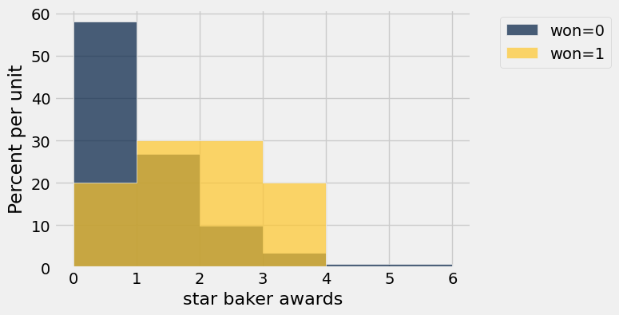
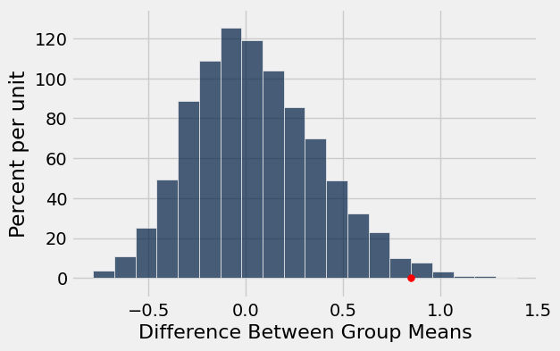

# Lab 7: Great British Bake Off (A/B Test)

Welcome to Lab 7! This week's lab will focus on A/B Testing using data from the popular British television show, [*The Great British Bake Off*](https://en.wikipedia.org/wiki/The_Great_British_Bake_Off).

#### **Helpful Resource:**
- [Python Reference](http://data8.org/su26/reference/)

**Recommended Readings:**

* [Error Probabilities](https://inferentialthinking.com/chapters/11/4/Error_Probabilities.html)
* [A/B Testing](https://inferentialthinking.com/chapters/12/1/AB_Testing.html)

**Lab Submission Deadline: Friday, March 20th at 5pm**

**Getting help on lab**: Whenever you feel stuck or need some further clarification, find a GSI or tutor, and they'll be happy to help!

As a reminder, here are the policies for getting full credit if you are in regular lab (Lab is worth 20% of your final grade):
- 80% of lab credit will be attendance-based. To receive attendance credit for lab, you must attend the full discussion portion (first hour) at which point the GSI will take attendance. 
- The remaining 20% of credit will be awarded for submitting the programming-based assignment to Pensive by the deadline (5pm on Friday) with all test cases passing.

If you are in self-service lab, 100% of credit will be awarded for submitting the programming-based assignment to Pensive by the deadline (5pm on Friday) with all test cases passing.

**Submission**: Once you’re finished, run all cells besides the last one, select File > Save Notebook, and then execute the final cell. The result will contain a zip file that you can use to submit on Pensive.

Let's begin by setting up the tests and imports by running the cell below.

**Code:**

```python
# Run this cell to set up the notebook, but please don't change it.

# These lines import the Numpy and Datascience modules.
import numpy as np
from datascience import *

# These lines do some fancy plotting magic.
import matplotlib
%matplotlib inline
import matplotlib.pyplot as plots
plots.style.use('fivethirtyeight')
import warnings
warnings.simplefilter('ignore', FutureWarning)
```

---
## 0. Mid-Semester Survey

We would like you to fill out the mid-semester survey before proceeding any further in this assignment.

Please fill out the survey below and input the secret phrase that is shown at the end of the form when you submit. Please assign this phrase to `mid_secret` as a string in the cell below!

Find the survey [here](https://docs.google.com/forms/d/e/1FAIpQLScpcSK2MHTeZK8DtBmapfPezTp6JoKjeQvcDZIOzpYN-wdV-A/viewform?usp=dialog).

**Student scaffold:**

```python
mid_secret = ...
```

**Solution:**

```python
mid_secret = "cherryblossom" # SOLUTION
```

**Test — `q0`**

```python
>>> from lab07_check import correctness_check_0
>>> correctness_check_0(mid_secret)
True
```

---
## 1. A/B Testing

A/B testing is a form of hypothesis testing that allows you to make comparisons between two distributions — distribution of group “A” and distribution of group “B”. We may also refer to an A/B test as a permutation test.

You'll almost never be explicitly asked to perform an A/B test. Make sure you can identify situations where the test is appropriate and know how to correctly implement each step. Oftentimes, we use an A/B test to determine whether or not two samples came from the same underlying distribution.

---
**Question 1.1.** The following statements are the steps of an A/B hypothesis test presented in a *random order*:

1. Choose a test statistic (typically the difference in means between two categories)

2. Shuffle the labels of the original sample, find your simulated test statistic, and repeat many times

3. Find the value of the observed test statistic

4. Calculate the p-value based off your observed and simulated test statistics

5. Define a null and alternate hypothesis

6. Use the p-value and p-value cutoff to draw a conclusion about the null hypothesis

Assign `ab_test_order` to an array of integers that contains the correct order of an A/B test, where the first item of the array is the first step of an A/B test and the last item of the array is the last step of an A/B test.

**Student scaffold:**

```python
ab_test_order = ...
```

**Solution:**

```python
ab_test_order = make_array(5, 1, 3, 2, 4, 6) # SOLUTION
```

**Test — `q1_1`**

```python
>>> len(ab_test_order) == 6
True

>>> np.allclose(np.array(ab_test_order)[:3] % 2 == 1, True)
True

>>> np.allclose(np.array(ab_test_order)[3:] % 2 == 0, True)
True

>>> import hashlib
>>> def get_hash(num):
...     """Helper function for assessing correctness."""
...     return hashlib.md5(str(num).encode()).hexdigest()
>>> get_hash(np.array(ab_test_order).astype(int))
'a7196ed0f271c873d9750cb92422d911'
```

---
**Question 1.2.** If the null hypothesis of an A/B test is correct, should the order of labels affect the differences in means between each group? Why do we shuffle labels in an A/B test? If you are in a lab section, confirm your answer with a neighbor or staff member before moving on.

**SOLUTION:** Under the null model, there should be no statistically significant difference between the grouped means. We shuffle labels as a way to resample the original data, and understand the baseline differences between groups in the data.

---
## 2. The Great British Bake Off

>"The Great British Bake Off (often abbreviated to Bake Off or GBBO) is a British television baking competition, produced by Love Productions, in which a group of amateur bakers compete against each other in a series of rounds, attempting to impress a group of judges with their baking skills" [Wikipedia](https://en.wikipedia.org/wiki/The_Great_British_Bake_Off)

For every week of the competition, the judges assign one contestant the title "Star Baker". Ultimately, one winner is crowned every season. Using this information, we would like to investigate how winning Star Baker awards affects the odds of winning a season of the show.

---
**Question 2.1.** We want to know whether winning more Star Baker awards ___causes___ an increase in likelihood of winning a season.  Why is it not sufficient to compare star baker rates for winners and losers?

**SOLUTION:** We didn't run a randomized controlled experiment, so we may be misled by confounding factors or reverse causation.

---
### Running an Experiment

We are going to run the following hypothesis test to determine the association between winning and number of Star Baker awards. The population we are examining is every contestant from seasons 2 through 11 of GBBO. We are going to use the following null and alternative hypotheses:

**Null hypothesis:** The distribution of Star Baker awards between contestants who won their season and contestants who did not win their season is the same.

**Alternative hypothesis:** Contestants who win their season of the show will win more Star Baker awards on average.

Our alternative hypothesis is related to our suspicion that contestants who win more Star Baker awards are more skilled, so they are more likely to win the season.

---

**Question 2.2.** Why is it appropriate to use an A/B test to test this hypothesis? What is the “A” group and what is the “B” group?

**SOLUTION:** We should be using an A/B test to check if the groups come from the same underlying distribution. The "A" group consists of non winners. The "B" group consists of the winners of the show.

Check your answers with your neighbors or a staff member before you move on to the next section.

The `bakers` table below describes the number of star baker awards each contest won and whether or not they won their season (`1` if they won, `0` if they did not win). The data was manually aggregated from Wikipedia for seasons 2-11 of the show. We randomized the order of rows as to not spoil the outcome of the show.

**Code:**

```python
bakers = Table.read_table("star_bakers.csv")
bakers.show(3)
```

*Output:*

| star baker awards | won |
| --- | --- |
| 3 | 1 |
| 0 | 0 |
| 1 | 0 |

---
**Question 2.3.** Visualize the distribution of Star Baker awards for winners and non-winners as overlaid histograms. You should use the bins we provided.

Hint: You will want to use the group argument of `tbl.hist`. In order to produce several overlayed histograms based on unique values in a given column, we can do something like `tbl.hist(..., group=<col_name>, bins=...)`. This will graph one histogram for each unique value in the specified column all on a single plot.

**Code:**

```python
useful_bins = np.arange(0, 7) # Do not delete!
```

**Student scaffold:**

```python
...
```

**Solution:**

```python
bakers.hist('star baker awards', group='won', bins=useful_bins) # SOLUTION
```



---
**Question 2.4.** We want to figure out if there is a difference between the distribution of Star Baker awards between winners and non winners. 

What should the test statistic be? Which values of this test statistic support the null, and which values support the alternative? **Assign `test_option` to the number corresponding to the correct test statistic.**

1. Absolute value of the difference between the means between both groups; high values support the null
2. Absolute value of the difference between the means between both groups; low values support the null
3. Average Star Baker awards for winners - average Star Baker awards for non-winners; high values support the null
4. Average Star Baker awards for winners - average Star Baker awards for non-winners; low values support the null

Before moving on, confirm your answer with a peer or in the discussion forums.

_Hint:_ You should think about what measures we use to describe a distribution.

**Student scaffold:**

```python
test_option = ...
```

**Solution:**

```python
test_option = 4 # SOLUTION
```

**Test — `q2_4`**

```python
>>> from lab07_check import correctness_check_2_4
>>> correctness_check_2_4(test_option)
True
```

---
**Question 2.5.** Create a new table called `means` that contains the mean number of star baker awards for bakers who did not win (`won==0`) and bakers that did win (`won==1`). The table should have the column names `won` and `star baker awards mean`.

**Student scaffold:**

```python
means = ...
means
```

**Solution:**

```python
means = bakers.group('won', np.mean) # SOLUTION
means
```

*Output:*

| won | star baker awards mean |
| --- | --- |
| 0 | 0.651786 |
| 1 | 1.5 |

**Test — `q2_5`**

```python
>>> means.num_rows
2

>>> bool(np.round(min(means.column('star baker awards mean')), 2) == 0.65)
True

>>> bool(np.round(max(means.column('star baker awards mean')), 2) == 1.5)
True
```

---
**Question 2.6.** Set `observed_difference` to the observed test statistic using the `means` table.

**Student scaffold:**

```python
observed_difference = ...
observed_difference
```

**Solution:**

```python
observed_difference = means.column(1).item(1) - means.column(1).item(0) # SOLUTION
observed_difference
```

*Output:*

```text
0.8482142857142857
```

**Test — `q2_6`**

```python
>>> bool(isinstance(observed_difference, float))
True

>>> from lab07_check import correctness_check_2_6
>>> correctness_check_2_6(observed_difference)
True
```

---
**Question 2.7.** Given a table `tbl` (like `bakers`), a label column `label_col`, and a values column `val_col`, write a function that calculates the appropriate test statistic.

*Hint:* Inside the function, you will most likely want to make a **new** `means` table based on the function's arguments. **However, avoid using the original `means` table itself,** since this assumes you will always use the same `bakers` table.

*Hint:* Make sure that you are taking the directionality of our alternative hypothesis into account.

**Student scaffold:**

```python
def find_test_stat(tbl, label_col, val_col):
    ...

find_test_stat(bakers, "won", "star baker awards")
```

**Solution:**

```python
def find_test_stat(tbl, label_col, val_col):
    # BEGIN SOLUTION
    reduced = tbl.select(label_col, val_col)
    means_tbl = reduced.group(label_col, np.average)
    means = means_tbl.column(1)
    return means.item(1) - means.item(0)
    # END SOLUTION

find_test_stat(bakers, "won", "star baker awards")
```

*Output:*

```text
0.8482142857142857
```

**Test — `q2_7`**

```python
>>> bool(np.isclose(round(find_test_stat(bakers, 'won', 'star baker awards'), 3) - 0.848, 0))
True

>>> np.random.seed(1)
>>> test_stat = find_test_stat(bakers.sample(), 'won', 'star baker awards')
>>> bool(np.isclose(round(test_stat, 3) - 1.232, 0))
True
```

When we run a simulation for A/B testing, we resample by **shuffling the labels** of the original sample. If the null hypothesis is true and the star baker award distributions are the same, we expect that the difference in mean star baker awards to not change when `"won"` labels are changed.

---
**Question 2.8.** Write a function `simulate_and_test_statistic` to compute one trial of our A/B test. Your function should run a simulation and return a test statistic.

*Hint:* Textbook chapter [12.1.4](https://inferentialthinking.com/chapters/12/1/AB_Testing.html#predicting-the-statistic-under-the-null-hypothesis) can help!

**Student scaffold:**

```python
def simulate_and_test_statistic(tbl, labels_col, values_col):
    ...

simulate_and_test_statistic(bakers, "won", "star baker awards")
```

**Solution:**

```python
def simulate_and_test_statistic(tbl, labels_col, values_col):
    # BEGIN SOLUTION
    shuffled_labels = tbl.sample(with_replacement = False).column(labels_col)
    original_and_shuffled = tbl.with_column(labels_col, shuffled_labels)
    return find_test_stat(original_and_shuffled, labels_col, values_col)
    # END SOLUTION

simulate_and_test_statistic(bakers, "won", "star baker awards")
```

*Output:*

```text
0.4125000000000001
```

**Test — `q2_8`**

```python
>>> test_stat = round(simulate_and_test_statistic(bakers, 'won', 'star baker awards'), 3)
>>> bool(-2 < test_stat < 2)
True

>>> np.random.seed(1)
>>> test_stat2 = simulate_and_test_statistic(bakers, 'won', 'star baker awards')
>>> bool(np.round(test_stat2, 3) == -0.023) or bool(np.round(test_stat2, 3) == -0.132)
True
```

---
**Question 2.9.** Simulate 5000 trials of our A/B test and store the test statistics in an array called `differences`.

**Student scaffold:**

```python
# This cell might take a couple seconds to run
differences = make_array()

...
                                                 
differences
```

**Solution:**

```python
# This cell might take a couple seconds to run
differences = make_array()

# BEGIN SOLUTION 
repetitions = 5000
for i in np.arange(repetitions):
    new_difference = simulate_and_test_statistic(bakers, "won", "star baker awards")
    differences = np.append(differences, new_difference)
# END SOLUTION
                                                 
differences
```

*Output:*

```text
array([ 0.08571429, -0.24107143,  0.19464286, ..., -0.45892857,
        0.08571429, -0.24107143])
```

**Test — `q2_9`**

```python
>>> len(differences)
5000

>>> bool(abs(np.average(differences)) < 0.05)
True

>>> bool(all(differences == differences.item(0)) == False)
True
```

Run the cell below to view a histogram of your simulated test statistics plotted with your observed test statistic as a red dot.

**Code:**

```python
Table().with_column('Difference Between Group Means', differences).hist(bins=20)
plots.scatter(observed_difference, 0, color='red', s=30, zorder=2)
plots.ylim(-0.1, 1.35);
```



---
**Question 2.10.** Find the p-value for your test and assign it to `empirical_p`.

**Student scaffold:**

```python
empirical_p = ...
empirical_p
```

**Solution:**

```python
empirical_p = np.count_nonzero(differences >= observed_difference) / repetitions # SOLUTION
empirical_p
```

*Output:*

```text
0.0144
```

**Test — `q2_10`**

```python
>>> bool(0 <= empirical_p < 0.05)
True
```

---
**Question 2.11.** Using a 5% p-value cutoff, draw a conclusion about the null and alternative hypotheses. Describe your findings using simple, non-technical language. What does your analysis tell you about the association between star baker awards and winning? What can you claim about causation from your statistical analysis? Confirm your answer with a peer, instructor or in the discussion forums. 

*Hint:* See section [12.1.6](https://inferentialthinking.com/chapters/12/1/AB_Testing.html#conclusion-of-the-test)

**SOLUTION:** Our p-value (staff solutions had a p-value of 0.014) is less than the cutoff of 0.05. Our data supports the alternative hypothesis that star baker award rates do significantly change between winners and non-winners. Any observed different was due to something besides just chance.

---
---

---

You're done with lab!

**Important submission information:**
- **Run all the tests** and verify that they all pass
- **Save** from the **File** menu
- **Run the final cell to generate the zip file**
- **Click the link to download the zip file**
- Then, go to [Pensive](https://www.pensieve.co/) and submit the zip file to the corresponding assignment. The name of this assignment is "Lab XX Autograder", where XX is the lab number -- 01, 02, 03, etc.

- If you finish early in Regular Lab, **ask one of the staff members to check you off**.

**It is your responsibility to make sure your work is saved before running the last cell.**

---

To double-check your work, the cell below will rerun all of the autograder tests.

## Submission

Make sure you have run all cells in your notebook in order before running the cell below, so that all images/graphs appear in the output. The cell below will generate a zip file for you to submit. **Please save before exporting!**

---

## Datasets

Datasets this notebook loads with `Table.read_table`. Column names are exact, including spaces and capitalization. Only the schema is recorded here — the data itself is not in this document, so any question about its values must be answered by running code, not by reasoning over the rows shown elsewhere in this file.

### `star_bakers.csv`

122 rows, 2 columns.

| Column | Type |
| --- | --- |
| `star baker awards` | int |
| `won` | int |
