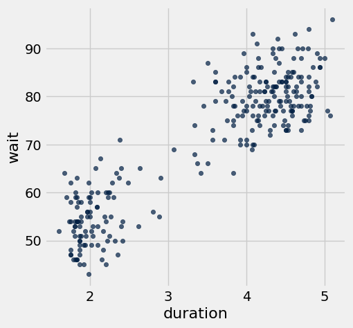
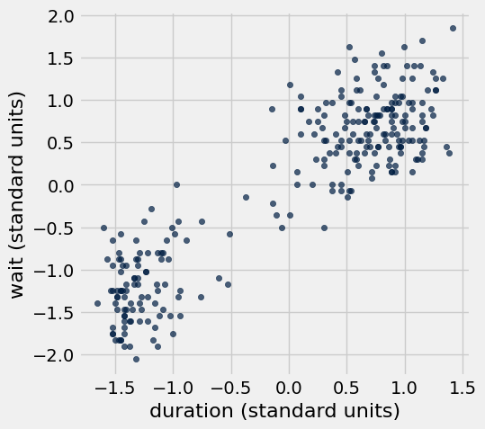
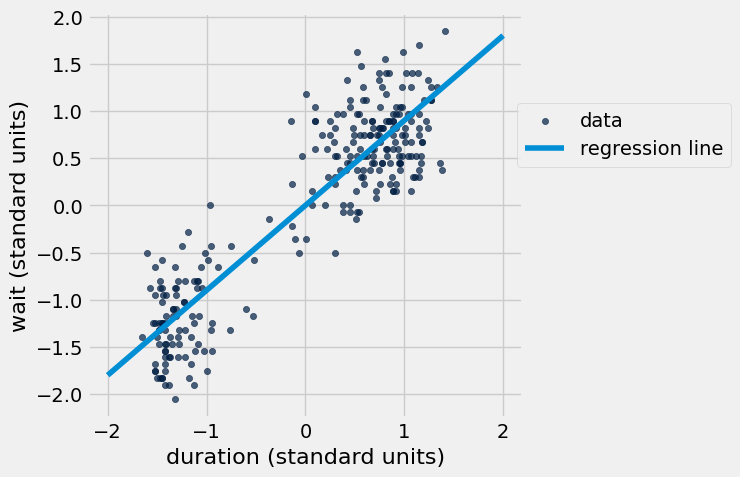
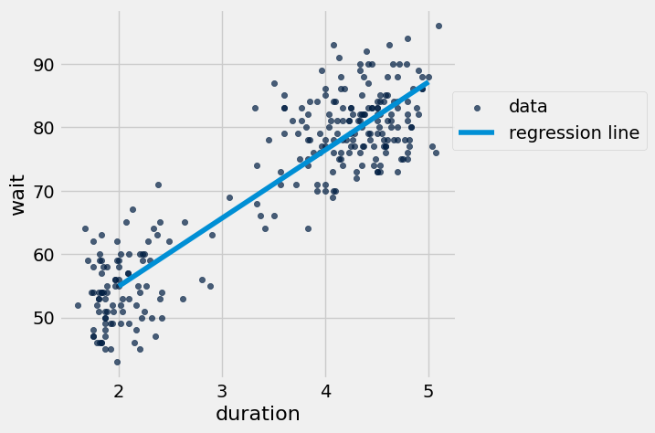
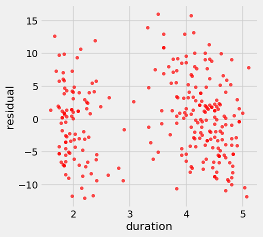
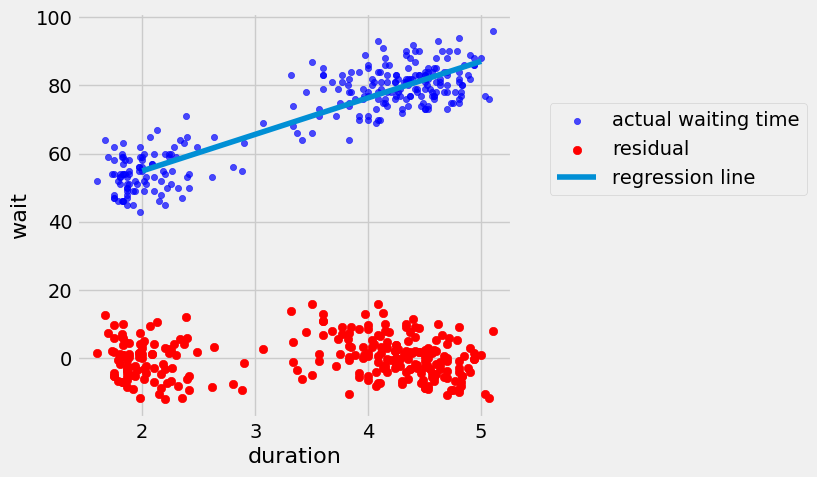
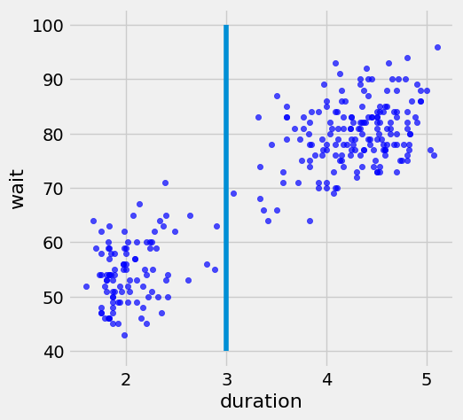
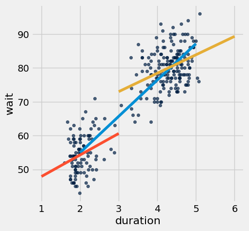
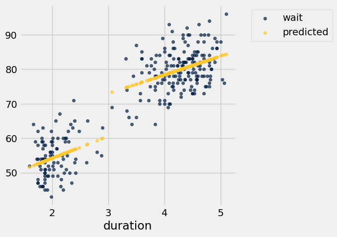
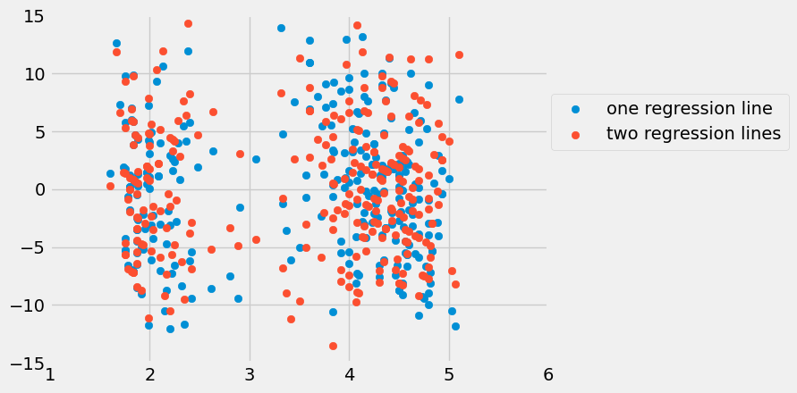

# Lab 9: Regression

Welcome to Lab 9!

Today we will get some hands-on practice with linear regression. 

#### **Helpful Resources:**
- [Python Reference](http://data8.org/su26/reference/)

**Recommended Readings:**

* [Variability](https://inferentialthinking.com/chapters/14/2/Variability.html#)
* [Correlation](https://inferentialthinking.com/chapters/15/1/Correlation.html#)
* [The Regression Line](https://www.inferentialthinking.com/chapters/15/2/Regression_Line.html#the-regression-line)

**Getting help on lab**: Whenever you feel stuck or need some further clarification, find a GSI or tutor, and they'll be happy to help!

As a reminder, here are the policies for getting full credit if you are in regular lab (Lab is worth 20% of your final grade):
- 80% of lab credit will be attendance-based. To receive attendance credit for lab, you must attend the full discussion portion (first hour) at which point the GSI will take attendance. 
- The remaining 20% of credit will be awarded for submitting the programming-based assignment to Pensive by the deadline (5pm on Friday) with all test cases passing.

If you are in self-service lab, 100% of credit will be awarded for submitting the programming-based assignment to Pensive by the deadline (5pm on Friday) with all test cases passing.

**Submission**: Once you’re finished, run all cells besides the last one, select File > Save Notebook, and then execute the final cell. The result will contain a zip file that you can use to submit on Pensive.

Let's begin by setting up the tests and imports by running the cell below.

**Code:**

```python
# Run this cell, but please don't change it.

# These lines import the Numpy and Datascience modules.
import numpy as np
from datascience import *

# These lines do some fancy plotting magic.
import matplotlib
%matplotlib inline
import matplotlib.pyplot as plots
plots.style.use('fivethirtyeight')
import warnings
warnings.simplefilter('ignore', FutureWarning)
```

---
# 1. How Faithful is Old Faithful? 

Old Faithful is a geyser in Yellowstone National Park that is famous for eruption on a fairly regular schedule. Run the cell below to see Old Faithful in action!

**Code:**

```python
# For the curious: this is how to display a YouTube video in a
# Jupyter notebook.  The argument to YouTubeVideo is the part
# of the URL (called a "query parameter") that identifies the
# video.  For example, the full URL for this video is:
#   https://www.youtube.com/watch?v=wE8NDuzt8eg
from IPython.display import YouTubeVideo
YouTubeVideo("wE8NDuzt8eg")
```


Some of Old Faithful's eruptions last longer than others.  Whenever there is a long eruption, it is usually followed by an even longer wait before the next eruption. If you visit Yellowstone, you might want to predict when the next eruption will happen, so that you can see the rest of the park instead of waiting by the geyser.
 
Today, we will use a dataset on eruption durations and waiting times to see if we can make such predictions accurately with linear regression.

The dataset has one row for each observed eruption.  It includes the following columns:
- `duration`: Eruption duration, in minutes
- `wait`: Time between this eruption and the next, also in minutes

Run the next cell to load the dataset.

**Code:**

```python
faithful = Table.read_table("faithful.csv")
faithful
```

*Output:*

| duration | wait |
| --- | --- |
| 3.6 | 79 |
| 1.8 | 54 |
| 3.333 | 74 |
| 2.283 | 62 |
| 4.533 | 85 |
| 2.883 | 55 |
| 4.7 | 88 |
| 3.6 | 85 |
| 1.95 | 51 |
| 4.35 | 85 |

---
**Question 1.0.** The following statements are the unordered steps of linear regression.  

1. Compute the parameters of the regression line: the slope and the intercept. 
2. Evaluate the regression line by computing the line’s RMSE and analyzing the residuals plot. 
3. Use the regression line to generate predictions for each x value. 
4. Determine if linear regression is a reasonable method by visualizing your data and computing the correlation coefficient. 

Make an array called `least_squares_order` that contains the correct order of a linear regression analysis, where the first item of the array is the first step of a linear regression analysis and the last item of the array is the last step of a linear regression analysis.

**Student scaffold:**

```python
least_squares_order = ...
```

**Solution:**

```python
least_squares_order = make_array(4, 1, 3, 2) # SOLUTION
```

**Test — `q1_0`**

```python
>>> len(least_squares_order) == 4
True

>>> from lab09_check import correctness_check_1_0
>>> correctness_check_1_0(least_squares_order)
array([ True,  True,  True,  True], dtype=bool)
```

We would like to use linear regression to make predictions, but that won't work well if the data aren't roughly linearly related.  To check that, we should look at the data.

---
**Question 1.1.** Make a scatter plot of the data.  It's conventional to put the column we want to predict on the vertical axis and the other column on the horizontal axis.

**Student scaffold:**

```python
...
```

**Solution:**

```python
faithful.scatter("duration") #SOLUTION
```



---
**Question 1.2.** Are eruption duration and waiting time roughly linearly related based on the scatter plot above? Is this relationship positive?

**SOLUTION:** Yes, they are roughly linearly related.  The eruption durations seem to cluster; there are a bunch of short eruptions and a bunch of longer ones.  But the data in both clusters fall roughly on a line, and that's what's important when it comes to predicting waiting times with linear regression.  The relationship is positive, meaning that longer eruptions have longer waiting times, as we claimed.

We're going to continue with the assumption that they are linearly related, so it's reasonable to use linear regression to analyze this data.

We'd next like to plot the data in standard units. If you don't remember the definition of standard units, textbook section [14.2](https://www.inferentialthinking.com/chapters/14/2/Variability.html#standard-units) might help!

---
**Question 1.3.** Compute the mean and standard deviation of the eruption durations and waiting times.  **Then** create a table called `faithful_standard` containing the eruption durations and waiting times in standard units.  The columns should be named `duration (standard units)` and `wait (standard units)`.

**Student scaffold:**

```python
duration_mean = ...
duration_std = ...
wait_mean = ...
wait_std = ...

faithful_standard = Table().with_columns(
    "duration (standard units)", ...,
    "wait (standard units)", ...)
faithful_standard
```

**Solution:**

```python
# BEGIN SOLUTION NO PROMPT
duration_mean = np.mean(faithful.column("duration"))
duration_std = np.std(faithful.column("duration"))
wait_mean = np.mean(faithful.column("wait"))
wait_std = np.std(faithful.column("wait"))

faithful_standard = Table().with_columns(
    "duration (standard units)", (faithful.column("duration") - duration_mean) / duration_std,
    "wait (standard units)", (faithful.column("wait") - wait_mean) / wait_std)
faithful_standard
# END SOLUTION
""" # BEGIN PROMPT
duration_mean = ...
duration_std = ...
wait_mean = ...
wait_std = ...

faithful_standard = Table().with_columns(
    "duration (standard units)", ...,
    "wait (standard units)", ...)
faithful_standard
"""; # END PROMPT
```

**Test — `q1_3`**

```python
>>> abs(sum(faithful_standard.column(0))) <= 1e-08
True

>>> from lab09_check import correctness_check_1_3_a
>>> correctness_check_1_3_a(duration_std)
True

>>> from lab09_check import correctness_check_1_3_b
>>> correctness_check_1_3_b(wait_std)
True
```

---
**Question 1.4.** Plot the data again, but this time in standard units.

**Student scaffold:**

```python
...
```

**Solution:**

```python
faithful_standard.scatter(0) #SOLUTION
```



You'll notice that this plot looks the same as the last one!  However, the data and axes are scaled differently.  So it's important to read the ticks on the axes.

---
**Question 1.5.** Among the following numbers, which would you guess is closest to the correlation between eruption duration and waiting time in this dataset? (Hint: Think about which values correlation can take on)

1. -2
2. -1
3. 0
4. 1
5. 2

Assign `correlation` to the number corresponding to your guess (either 1, 2 3, 4, or 5).

**Student scaffold:**

```python
correlation = ...
```

**Solution:**

```python
correlation = 4 # SOLUTION
```

**Test — `q1_5`**

```python
>>> from lab09_check import correctness_check_1_5
>>> correctness_check_1_5(correlation)
True
```

---
**Question 1.6.** Compute the correlation coefficient: `r`.  

*Hint:* Use `faithful_standard`.  Section [15.1](https://www.inferentialthinking.com/chapters/15/1/Correlation.html#calculating-r) explains how to do this.

**Student scaffold:**

```python
r = ...
r
```

**Solution:**

```python
r = np.mean(faithful_standard.column(0) * faithful_standard.column(1)) #SOLUTION
r
```

*Output:*

```text
0.90081116832181318
```

**Test — `q1_6`**

```python
>>> -1 <= r <= 1
True

>>> from lab09_check import correctness_check_1_6
>>> correctness_check_1_6(r)
True
```

---
## 2. The regression line
Recall that the **correlation** is the **slope of the regression line when the data are put in standard units**.

The next cell plots the regression line in standard units:

$$\text{waiting time in standard units} = r \times \text{eruption duration in standard units}$$

Then, it plots the data in standard units again, for comparison.

**Code:**

```python
def plot_data_and_line(dataset, x, y, point_0, point_1):
    """Makes a scatter plot of the dataset, along with a line passing through two points."""
    dataset.scatter(x, y, label="data")
    xs, ys = zip(point_0, point_1)
    plots.plot(xs, ys, label="regression line")
    plots.legend(bbox_to_anchor=(1.5,.8))

plot_data_and_line(faithful_standard, 
                   "duration (standard units)", 
                   "wait (standard units)", 
                   [-2, -2*r], 
                   [2, 2*r])
```



How would you take a point in standard units and convert it back to original units?  We'd have to "stretch" its horizontal position by `duration_std` and its vertical position by `wait_std`. That means the same thing would happen to the slope of the line.

Stretching a line horizontally makes it less steep, so we divide the slope by the horizontal stretching factor. Stretching a line vertically makes it more steep, so we multiply the slope by the vertical stretching factor.
---
**Question 2.1.** Calculate the slope of the regression line in original units, and assign it to `slope`.

(If the "stretching" explanation is unintuitive, consult section [15.2](https://www.inferentialthinking.com/chapters/15/2/Regression_Line.html#the-equation-of-the-regression-line) in the textbook.)

**Student scaffold:**

```python
slope = ...
slope
```

**Solution:**

```python
slope = (wait_std/duration_std) * r #SOLUTION
slope
```

*Output:*

```text
10.729641395133527
```

**Test — `q2_1`**

```python
>>> (slope * 13 - 100) / 98 <= 0.5
True

>>> from lab09_check import correctness_check_2_1
>>> correctness_check_2_1(slope)
True
```

---
We know that the regression line passes through the point `(duration_mean, wait_mean)`. Recall that the general equation of the regression line in original units is:

$$ \text{estimate of y} = \text{slope of the regression line} \cdot \text{x} + \text{intercept of the regression line}$$

For this scenario, that would become:

$$ \text{estimated waiting time} = \text{slope} \cdot \text{eruption duration} + (\text{wait mean} - \text{slope} \cdot \text{duration mean})$$

**Question 2.2.** Calculate the intercept in original units and assign it to `intercept`. [Section 15.2.5](https://inferentialthinking.com/chapters/15/2/Regression_Line.html#the-equation-of-the-regression-line) may be helpful.

**Student scaffold:**

```python
intercept = ...
intercept
```

**Solution:**

```python
intercept = slope*(-duration_mean) + wait_mean #SOLUTION
intercept
```

*Output:*

```text
33.474397022753351
```

**Test — `q2_2`**

```python
>>> 33 < intercept < 34
True

>>> from lab09_check import correctness_check_2_2
>>> correctness_check_2_2(intercept)
True
```

---
## 3. Investigating the regression line

The slope and intercept tell you exactly what the regression line looks like.  To predict the waiting time for an eruption, multiply the eruption's duration by `slope` and then add `intercept`.
---
**Question 3.1.** Compute the predicted waiting time for an eruption that lasts 2 minutes, and for an eruption that lasts 5 minutes.

**Student scaffold:**

```python
two_minute_predicted_waiting_time = ...
five_minute_predicted_waiting_time = ...

# Here is a helper function to print out your predictions.
# Don't modify the code below.
def print_prediction(duration, predicted_waiting_time):
    print("After an eruption lasting", duration,
          "minutes, we predict you'll wait", predicted_waiting_time,
          "minutes until the next eruption.")

print_prediction(2, two_minute_predicted_waiting_time)
print_prediction(5, five_minute_predicted_waiting_time)
```

**Solution:**

```python
two_minute_predicted_waiting_time = slope*2 + intercept #SOLUTION
five_minute_predicted_waiting_time = slope*5 + intercept #SOLUTION

# Here is a helper function to print out your predictions.
# Don't modify the code below.
def print_prediction(duration, predicted_waiting_time):
    print("After an eruption lasting", duration,
          "minutes, we predict you'll wait", predicted_waiting_time,
          "minutes until the next eruption.")

print_prediction(2, two_minute_predicted_waiting_time)
print_prediction(5, five_minute_predicted_waiting_time)
```

*Output (stdout):*

```text
After an eruption lasting 2 minutes, we predict you'll wait 54.933679813 minutes until the next eruption.
After an eruption lasting 5 minutes, we predict you'll wait 87.1226039984 minutes until the next eruption.
```

**Test — `q3_1`**

```python
>>> from lab09_check import correctness_check_3_1_a
>>> correctness_check_3_1_a(two_minute_predicted_waiting_time)
True

>>> from lab09_check import correctness_check_3_1_b
>>> correctness_check_3_1_b(five_minute_predicted_waiting_time)
True
```

The next cell plots the line that goes between those two points, which is (a segment of) the regression line.

**Code:**

```python
plot_data_and_line(faithful, "duration", "wait", 
                   [2, two_minute_predicted_waiting_time], 
                   [5, five_minute_predicted_waiting_time])
```



---
**Question 3.2.** Make predictions for the waiting time after each eruption in the `faithful` table.  (Of course, we know exactly what the waiting times were!  We are doing this so we can see how accurate our predictions are.)  Put these numbers into a column in a new table called `faithful_predictions`.  Its first row should look like this:

|duration|wait|predicted wait|
|-|-|-|
|3.6|79|72.1011|

*Hint:* Your answer can be just one line, though you are not limited to one line.  There is no need for a `for` loop; use array arithmetic instead.

**Student scaffold:**

```python
faithful_predictions = ...
faithful_predictions
```

**Solution:**

```python
faithful_predictions = faithful.with_column("predicted wait", slope*faithful.column("duration") + intercept) #SOLUTION
faithful_predictions
```

*Output:*

| duration | wait | predicted wait |
| --- | --- | --- |
| 3.6 | 79 | 72.1011 |
| 1.8 | 54 | 52.7878 |
| 3.333 | 74 | 69.2363 |
| 2.283 | 62 | 57.9702 |
| 4.533 | 85 | 82.1119 |
| 2.883 | 55 | 64.408 |
| 4.7 | 88 | 83.9037 |
| 3.6 | 85 | 72.1011 |
| 1.95 | 51 | 54.3972 |
| 4.35 | 85 | 80.1483 |

**Test — `q3_2`**

```python
>>> set(faithful_predictions.labels) == set(['duration', 'wait', 'predicted wait'])
True

>>> abs(1 - np.mean(faithful_predictions.column(2)) / 100) <= 0.35
True
```

---
**Question 3.3.** How close were we?  Compute the *residual* for each eruption in the dataset.  The residual is the **actual waiting time** minus the **predicted waiting time**.  Add the residuals to `faithful_predictions` as a new column called `residual` and name the resulting table `faithful_residuals`.

As mentioned in [Chapter 15.6](https://inferentialthinking.com/chapters/15/6/Numerical_Diagnostics.html?highlight=residuals#average-of-residuals), a useful property of linear regression is that the sum of the residuals will always be zero. You can always check this to make sure you’ve calculated your residuals correctly. Note it may be slightly off from zero due to rounding errors.

Feel free to copy and paste this line of code, to check your work! Note that the answer may be *very slightly* different from zero due to rounding errors in python.

```python
sum(faithful_residuals.column('residual'))
```

*Hint:* Again, your code will be much simpler if you don't use a `for` loop.

*Hint:* residual = actual_value − predicted_value

**Student scaffold:**

```python
residuals = ...
faithful_residuals = ...
faithful_residuals
```

**Solution:**

```python
residuals = faithful_predictions.column(1) - faithful_predictions.column(2) #SOLUTION
faithful_residuals = faithful_predictions.with_column("residual", residuals) #SOLUTION
faithful_residuals
```

*Output:*

| duration | wait | predicted wait | residual |
| --- | --- | --- | --- |
| 3.6 | 79 | 72.1011 | 6.89889 |
| 1.8 | 54 | 52.7878 | 1.21225 |
| 3.333 | 74 | 69.2363 | 4.76371 |
| 2.283 | 62 | 57.9702 | 4.02983 |
| 4.533 | 85 | 82.1119 | 2.88814 |
| 2.883 | 55 | 64.408 | -9.40795 |
| 4.7 | 88 | 83.9037 | 4.09629 |
| 3.6 | 85 | 72.1011 | 12.8989 |
| 1.95 | 51 | 54.3972 | -3.3972 |
| 4.35 | 85 | 80.1483 | 4.85166 |

**Test — `q3_3`**

```python
>>> set(faithful_residuals.labels) == set(['duration', 'wait', 'predicted wait', 'residual'])
True

>>> abs(sum(faithful_residuals.column('residual'))) <= 1e-08
True
```

Here is a plot of the residuals you computed.  Each point corresponds to one eruption.  It shows how much our prediction over- or under-estimated the waiting time.

**Code:**

```python
faithful_residuals.scatter("duration", "residual", color="r")
```



There isn't really a pattern in the residuals, which confirms that it was reasonable to try linear regression.  It's true that there are two separate clouds; the eruption durations seemed to fall into two distinct clusters.  But that's just a pattern in the eruption durations, not a pattern in the relationship between eruption durations and waiting times.

---
## 4. How accurate are different predictions?
Earlier, you should have found that the correlation is fairly close to 1, so the line fits fairly well on the training data.  That means the residuals are overall small (close to 0) in comparison to the waiting times.

We can see that visually by plotting the waiting times and residuals together:

**Code:**

```python
# Just run this cell.
faithful_residuals.scatter("duration", "wait", label="actual waiting time", color="blue")
plots.scatter(faithful_residuals.column("duration"), faithful_residuals.column("residual"), label="residual", color="r")
plots.plot([2, 5], [two_minute_predicted_waiting_time, five_minute_predicted_waiting_time], label="regression line")
plots.legend(bbox_to_anchor=(1.7,.8));
```



However, unless you have a strong reason to believe that the linear regression model is true, you should be wary of applying your prediction model to data that are very different from the training data.

---
**Question 4.1.** In `faithful`, no eruption lasted exactly 0, 2.5, or 60 minutes.  Using this line, what is the predicted waiting time for an eruption that lasts 0 minutes?  2.5 minutes?  An hour?

**Student scaffold:**

```python
zero_minute_predicted_waiting_time = ...
two_point_five_minute_predicted_waiting_time = ...
hour_predicted_waiting_time = ...

print_prediction(0, zero_minute_predicted_waiting_time)
print_prediction(2.5, two_point_five_minute_predicted_waiting_time)
print_prediction(60, hour_predicted_waiting_time)
```

**Solution:**

```python
zero_minute_predicted_waiting_time = intercept #SOLUTION
two_point_five_minute_predicted_waiting_time = slope * 2.5 + intercept #SOLUTION
hour_predicted_waiting_time = slope * 60 + intercept #SOLUTION

print_prediction(0, zero_minute_predicted_waiting_time)
print_prediction(2.5, two_point_five_minute_predicted_waiting_time)
print_prediction(60, hour_predicted_waiting_time)
```

*Output (stdout):*

```text
After an eruption lasting 0 minutes, we predict you'll wait 33.4743970228 minutes until the next eruption.
After an eruption lasting 2.5 minutes, we predict you'll wait 60.2985005106 minutes until the next eruption.
After an eruption lasting 60 minutes, we predict you'll wait 677.252880731 minutes until the next eruption.
```

**Test — `q4_1`**

```python
>>> 12 - zero_minute_predicted_waiting_time * 1.4 / 4 <= 0.35
True

>>> zero_minute_predicted_waiting_time - intercept <= 100000.0
True

>>> 2 - two_point_five_minute_predicted_waiting_time / 35 <= 0.4
True

>>> (26 - hour_predicted_waiting_time / 30) / 10 <= 0.43
True
```

---
**Question 4.2.** For each prediction, state whether you think it's reliable and explain your reasoning.

**SOLUTION:** The prediction for 2.5 is believable, since the dataset has eruptions that are *around* that long.  A 0 minute eruption is physically impossible, so the predicted waiting time is meaningless.  A 60 minute eruption might be possible, but since we never saw one nearly that long, it would probably be very different in character than the ones in `faithful`.  So we probably shouldn't trust that prediction, either.

---
## 5. Divide and Conquer

The scatter plot below shows the relationship between eruption durations on the x-axis and the wait time to the next eruption on the y-axis.

It appears from the scatter diagram that there are two clusters of points: one for durations around 2 and another for durations between 3.5 and 5. A vertical line at 3 divides these two clusters.

**Code:**

```python
faithful.scatter("duration", "wait", label="actual waiting time", color="blue")
plots.plot([3, 3], [40, 100]);
```



The `standardize` function from lecture appears below, which takes in a table with numerical columns and returns the same table with each column converted into standard units.

**Code:**

```python
# Just run this cell.

def standard_units(any_numbers):
    "Convert any array of numbers to standard units."
    return (any_numbers - np.mean(any_numbers)) / np.std(any_numbers)  

def standardize(table):
    """Return a table in which all columns of t are converted to standard units."""
    t_su = Table()
    for label in table.labels:
        t_su = t_su.with_column(label + ' (su)', standard_units(table.column(label)))
    return t_su
```

---
**Question 5.1.** Separately compute the correlation coefficient *r* for all the points with a duration below 3 **and then** for all the points with a duration above 3. To do so, create a function that computes `r` from a table, and then pass in two different tables of points, called `below_3` and `above_3`.

*Hint:* You can assume that the table does not have any duration values that are exactly 3.

**Student scaffold:**

```python
def corr_coeff(table):
    """Return the regression coefficient for columns 0 & 1."""
    t_su = standardize(table)
    ...

below_3 = ...
above_3 = ...
below_3_r = corr_coeff(below_3)
above_3_r = corr_coeff(above_3)
print("For points below 3, r is", below_3_r, "; for points above 3, r is", above_3_r)
```

**Solution:**

```python
def corr_coeff(table):
    """Return the regression coefficient for columns 0 & 1."""
    t_su = standardize(table)
    return np.mean(t_su.column(0) * t_su.column(1)) # SOLUTION

below_3 = faithful.where('duration', are.below(3)) # SOLUTION
above_3 = faithful.where('duration', are.above(3)) # SOLUTION
below_3_r = corr_coeff(below_3)
above_3_r = corr_coeff(above_3)
print("For points below 3, r is", below_3_r, "; for points above 3, r is", above_3_r)
```

*Output (stdout):*

```text
For points below 3, r is 0.290189526493 ; for points above 3, r is 0.372782225571
```

**Test — `q5_1`**

```python
>>> [below_3.num_rows, above_3.num_rows]
[97, 175]

>>> from lab09_check import correctness_check_5_1
>>> correctness_check_5_1(below_3_r, above_3_r)
True
```

---
**Question 5.2.** Complete the functions `slope_of` and `intercept_of` below. 

When you're done, the functions `wait_below_3` and `wait_above_3` should each use a different regression line to predict a wait time for a duration. The first function should use the regression line for all points with duration below 3. The second function should use the regression line for all points with duration above 3.

**Student scaffold:**

```python
def slope_of(table, r):
    """Return the slope of the regression line for table in original units.
    
    Assume that column 0 contains x values and column 1 contains y values.
    r is the regression coefficient for x and y.
    """
    ...

def intercept_of(table, r):
    """Return the intercept of the regression line for table in original units.
    
    Assume that column 0 contains x values and column 1 contains y values.
    r is the regression coefficient for x and y.
    """
    slope = slope_of(table, r)
    ...
    
below_3_slope = slope_of(below_3, below_3_r)
below_3_intercept = intercept_of(below_3, below_3_r)
above_3_slope = slope_of(above_3, above_3_r)
above_3_intercept = intercept_of(above_3, above_3_r)

def wait_below_3(duration):
    return below_3_slope * duration + below_3_intercept

def wait_above_3(duration):
    return above_3_slope * duration + above_3_intercept
```

**Solution:**

```python
def slope_of(table, r):
    """Return the slope of the regression line for table in original units.
    
    Assume that column 0 contains x values and column 1 contains y values.
    r is the regression coefficient for x and y.
    """
    return r * np.std(table.column(1)) / np.std(table.column(0)) # SOLUTION

def intercept_of(table, r):
    """Return the intercept of the regression line for table in original units.
    
    Assume that column 0 contains x values and column 1 contains y values.
    r is the regression coefficient for x and y.
    """
    slope = slope_of(table, r)
    return slope * (-np.mean(table.column(0))) + np.mean(table.column(1)) # SOLUTION
    
below_3_slope = slope_of(below_3, below_3_r)
below_3_intercept = intercept_of(below_3, below_3_r)
above_3_slope = slope_of(above_3, above_3_r)
above_3_intercept = intercept_of(above_3, above_3_r)

def wait_below_3(duration):
    return below_3_slope * duration + below_3_intercept

def wait_above_3(duration):
    return above_3_slope * duration + above_3_intercept
```

**Test — `q5_2`**

```python
>>> np.allclose([wait_below_3(1), wait_below_3(3), wait_above_3(3), wait_above_3(6)], [47.90215160574252, 60.60319718202381, 72.96541399053837, 89.2818591974495])
True
```

The plot below shows the two different regression lines, one for each cluster, along with the original regression line!

**Code:**

```python
faithful.scatter(0, 1)
plots.plot([2, 5], [two_minute_predicted_waiting_time, five_minute_predicted_waiting_time])
plots.plot([1, 3], [wait_below_3(1), wait_below_3(3)])
plots.plot([3, 6], [wait_above_3(3), wait_above_3(6)]);
```



---
**Question 5.3.** Write a function `predict_wait` that takes a `duration` and returns the predicted wait time using the appropriate regression line, depending on whether the duration is below 3 or greater than 3.

*Hint:* Consider using conditional statements.

**Student scaffold:**

```python
def predict_wait(duration):
    ...
```

**Solution:**

```python
# BEGIN SOLUTION NO PROMPT
def predict_wait(duration):
    if duration < 3:
        return wait_below_3(duration)
    else:
        return wait_above_3(duration)
# END SOLUTION
""" # BEGIN PROMPT
def predict_wait(duration):
    ...
"""; # END PROMPT
```

**Test — `q5_3`**

```python
>>> np.allclose([predict_wait(x) for x in [1.5, 2.5]], [51.077412999812836, 57.42793578795349])
True

>>> np.allclose([predict_wait(x) for x in [3.5, 4.5]], [75.68482152502355, 81.12363659399392])
True
```

The predicted wait times for each point appear below.

**Code:**

```python
faithful_pred_split = faithful.with_column('predicted', faithful.apply(predict_wait, 'duration'))
faithful_pred_split.scatter(0)
```



---
**Question 5.4.** Do you think the predictions produced by `predict_wait` would be more or less accurate than the predictions from the regression line you created in section 2? How could you tell?

**SOLUTION:** More accurate, because each line is specific to the values in its cluster. To verify, we could measure the average magnitude of the residual values.

The following cell will plot the residuals for each eruption in the dataset when we have one regression line and two regression lines. We also see the average magnitude of the residual values.

**Code:**

```python
# Just run this cell
faithful_pred_split_residuals = faithful_pred_split.with_column('residual', faithful_pred_split.column(1) - faithful_pred_split.column(2))
plots.scatter(faithful_residuals.column('duration'), faithful_residuals.column('residual'), label='one regression line')
plots.scatter(faithful_pred_split_residuals.column('duration'), faithful_pred_split_residuals.column('residual'), label='two regression lines');
plots.axis([1, 6, -15, 15])
plots.legend(bbox_to_anchor=(1.5,.8));
print("Average Magnitude of Residual Values for One Regression Line: ", np.mean(abs(faithful_residuals.column('residual'))))
print("Average Magnitude of Residual Values for Two Regression Lines: ", np.mean(abs(faithful_pred_split_residuals.column('residual'))))
```

*Output (stdout):*

```text
Average Magnitude of Residual Values for One Regression Line:  4.77872005877
Average Magnitude of Residual Values for Two Regression Lines:  4.57575882719
```



The residual plot for the wait times when they are predicted by two regression lines (red) doesn't really have a pattern, which confirms that it was also appropriate to use linear regression in our "Divide and Conquer" scenario. How do the two residual plots compare?

---
## 6. Jupytutor Survey

We hope your experience using Jupytutor has been smooth and helpful for you!

Please fill out the survey below and input the secret phrase that is shown at the end of the form when you submit. Please assign this phrase to `secret` as a string in the cell below!

Find the survey [here](https://docs.google.com/forms/d/e/1FAIpQLSenRkqnZkCt1ssv98_hajf2Z10I6VeIbCzuVSXGH3pdOjS70Q/viewform?usp=sharing&ouid=115427732962189163058).

**Student scaffold:**

```python
secret = ...
```

**Solution:**

```python
secret = "beep boop" # SOLUTION
```

**Test — `q6`**

```python
>>> from lab09_check import correctness_check_6
>>> correctness_check_6(secret)
True
```

---

You're done with lab!

**Important submission information:**
- **Run all the tests** and verify that they all pass
- **Save** from the **File** menu
- **Run the final cell to generate the zip file**
- **Click the link to download the zip file**
- Then, go to [Pensive](https://www.pensieve.co/) and submit the zip file to the corresponding assignment. The name of this assignment is "Lab XX Autograder", where XX is the lab number -- 01, 02, 03, etc.

- If you finish early in Regular Lab, **ask one of the staff members to check you off**.

**It is your responsibility to make sure your work is saved before running the last cell.**

---

To double-check your work, the cell below will rerun all of the autograder tests.

## Submission

Make sure you have run all cells in your notebook in order before running the cell below, so that all images/graphs appear in the output. The cell below will generate a zip file for you to submit. **Please save before exporting!**

---

## Datasets

Datasets this notebook loads with `Table.read_table`. Column names are exact, including spaces and capitalization. Only the schema is recorded here — the data itself is not in this document, so any question about its values must be answered by running code, not by reasoning over the rows shown elsewhere in this file.

### `faithful.csv`

272 rows, 2 columns.

| Column | Type |
| --- | --- |
| `duration` | float |
| `wait` | float |
