# Data 8 lectures

Assignments included:

- lec01
- lec03
- lec04
- lec05
- lec06
- lec07
- lec08
- lec09
- lec10
- lec11
- lec12
- lec13
- lec14
- lec15
- lec16
- lec17
- lec17_live
- lec18
- lec19
- lec20
- lec22
- lec22_live
- lec23
- lec24
- lec25
- lec26
- lec27
- lec28
- lec29
- lec30
- lec31
- monty_hall
- lec32
- lec33
- lec34
- lec35
- lec36
- lec37
- lec38


---

# lec01

---
title: "lec01"
lecture: lec01
course: data8
semester: sp26
source: lectures/data8/sp26/lec01/lec01.ipynb
language: python
---

**Note:** In this example there is a lot of code. You are not expected to know how to read any of this yet. This is just a preview of the things you will see in the next few weeks.

## This is a Jupyter Notebook

A Jupyter Notebook is a document that combines:

1. **Narrative:** The text describing your analysis
2. **Code:** The program that does the analysis
3. **Results:** The output of the program

The Jupyter environment was created by faculty here at Berkeley (Fernando Perez). These ideas are now in a lot of different technologies (e.g., Google Colab).

## Our first example: analyzing the text of Little Women

*["Little Women"](https://en.wikipedia.org/wiki/Little_Women)* by Louisa May Alcott is the story of four sisters and their neighbor Laurie (Theodore Laurence).

To analyze it, we define a **function** that reads data from the Internet.

**Code:**

```python
# A tiny program to download text from the web.
def read_url(url): 
    from urllib.request import urlopen 
    import re
    return re.sub('\\s+', ' ', urlopen(url).read().decode())
```

Here we download the book, which is hosted on the Data 8 textbook website.

**Code:**

```python
little_women_url = 'https://www.inferentialthinking.com/data/little_women.txt'
little_women_text = read_url(little_women_url)
little_women_chapters = little_women_text.split('CHAPTER ')[1:]
```

## Tables

- A lot of data science is about transforming data. This is often in service of producing **tables**, a widely used data structure that we can more easily analyze our data with. 
- In this class you will use the `datascience` library (specifically created for this course) to manipulate and data.

**Code:**

```python
from datascience import *
```

**Code:**

```python
Table().with_column('Chapters', little_women_chapters)
```

*Output:*

| Chapters |
| --- |
| ONE PLAYING PILGRIMS "Christmas won't be Christmas witho ... |
| TWO A MERRY CHRISTMAS Jo was the first to wake in the gr ... |
| THREE THE LAURENCE BOY "Jo! Jo! Where are you?" cried Me ... |
| FOUR BURDENS "Oh, dear, how hard it does seem to take up ... |
| FIVE BEING NEIGHBORLY "What in the world are you going t ... |
| SIX BETH FINDS THE PALACE BEAUTIFUL The big house did pr ... |
| SEVEN AMY'S VALLEY OF HUMILIATION "That boy is a perfect ... |
| EIGHT JO MEETS APOLLYON "Girls, where are you going?" as ... |
| NINE MEG GOES TO VANITY FAIR "I do think it was the most ... |
| TEN THE P.C. AND P.O. As spring came on, a new set of am ... |

## We will learn to visualize data

Most notebooks contain some setup for data manipulation and visualization. The details aren't important, but an LM can tell you about them.

**Code:**

```python
from datascience import *
import numpy as np
%matplotlib inline
import matplotlib.pyplot as plt
plt.style.use('fivethirtyeight')
import warnings
warnings.simplefilter(action="ignore", category=FutureWarning)
```

We can calculate the number of times Jo was mentioned in each chapter.

**Code:**

```python
np.char.count(little_women_chapters, 'Jo')
```

*Output:*

```text
array([44, 21, 62, 34, 55, 13,  9, 71, 21, 12, 42, 60, 24, 48, 26, 13, 29,
       35,  5, 29, 67, 17, 51, 36, 12, 17, 28, 69, 49, 39,  7, 60,  2, 55,
       42, 35,  5, 47, 15, 15, 17, 36, 61,  9,  6, 56, 37])
```

How about the other characters? We could build a table.

**Code:**

```python
# Counts of names in the chapters of Little Women

names = ['Amy', 'Beth', 'Jo', 'Laurie', 'Meg']
mentions = {name: np.char.count(little_women_chapters, name) for name in names}

counts = Table().with_columns([
        'Amy',    mentions['Amy'],
        'Beth',   mentions['Beth'],
        'Jo',     mentions['Jo'],
        'Laurie', mentions['Laurie'],
        'Meg',    mentions['Meg']
    ])
counts
```

*Output:*

| Amy | Beth | Jo | Laurie | Meg |
| --- | --- | --- | --- | --- |
| 23 | 26 | 44 | 0 | 26 |
| 13 | 12 | 21 | 0 | 20 |
| 2 | 2 | 62 | 16 | 36 |
| 14 | 18 | 34 | 0 | 17 |
| 6 | 14 | 55 | 35 | 13 |
| 6 | 28 | 13 | 9 | 5 |
| 27 | 5 | 9 | 7 | 5 |
| 48 | 9 | 71 | 17 | 16 |
| 3 | 5 | 21 | 24 | 71 |
| 5 | 5 | 12 | 4 | 4 |

We can accumulate the counts for each character to show the total in the book so far.

**Code:**

```python
cumulative_counts = Table()
for label in counts.labels:
    cumulative_counts = cumulative_counts.with_column(label, np.cumsum(counts.column(label)))
cumulative_counts
```

*Output:*

| Amy | Beth | Jo | Laurie | Meg |
| --- | --- | --- | --- | --- |
| 23 | 26 | 44 | 0 | 26 |
| 36 | 38 | 65 | 0 | 46 |
| 38 | 40 | 127 | 16 | 82 |
| 52 | 58 | 161 | 16 | 99 |
| 58 | 72 | 216 | 51 | 112 |
| 64 | 100 | 229 | 60 | 117 |
| 91 | 105 | 238 | 67 | 122 |
| 139 | 114 | 309 | 84 | 138 |
| 142 | 119 | 330 | 108 | 209 |
| 147 | 124 | 342 | 112 | 213 |

And then to study these numbers we can create a line chart of cumulative counts.

**Code:**

```python
cumulative_counts.plot()
plt.title('Cumulative # of Times A Name Appears in Little Women')
plt.show()
```

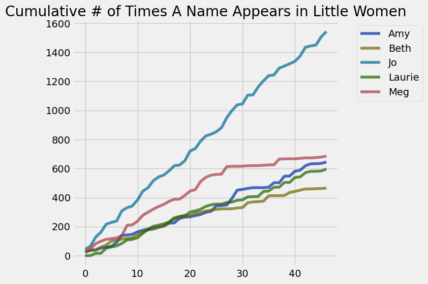


---

# lec03

---
title: "lec03"
lecture: lec03
course: data8
semester: sp26
source: lectures/data8/sp26/lec03/lec03.ipynb
language: python
---

**Code:**

```python
from datascience import *
import numpy as np

%matplotlib inline
import matplotlib.pyplot as plots
plots.style.use('fivethirtyeight')
```

## New material

### Python fundamentals

Python as a calculator:

**Code:**

```python
2 + 9
```

**Code:**

```python
2 * 4
```

**Code:**

```python
# The line below errors
# * 4
```

**Code:**

```python
2 ** 4
```

**Code:**

```python
# The line below errors 
# 2 * * 4
```

**Code:**

```python
2/9
```

Python understands the order of operations!

**Code:**

```python
2 + 3 * 9
```

**Code:**

```python
(2 + 3) * 9
```

**Code:**

```python
-1 - 1 + 2 * (3 * 4 * 5 / 6) ** 3 + 7 + 8 + 12
```

Floating point vs integer representation

**Code:**

```python
8
```

**Code:**

```python
64 / 8
```

Strings!

**Code:**

```python
'hello'
```

**Code:**

```python
'Data 8'
```

**Code:**

```python
"hello"
```

**Code:**

```python
'I don't ever want to miss class'
```

**Code:**

```python
"I don't ever want to miss class"
```

### Names

**Code:**

```python
a = 2
```

**Code:**

```python
a
```

Names must first be assgined to a value! The line below causes a name error since `b` isn't assigned yet.

**Code:**

```python
b
```

**Code:**

```python
b = 3
```

**Code:**

```python
b
```

**Discussion Question 1**: What will the value of `a` be once the code in the following cell has finished running?

**Code:**

```python
a = 2 
a + 5
```

**Code:**

```python
a = a + 5
a
```

______

**Code:**

```python
a * b
```

**Code:**

```python
a
```

**Code:**

```python
b
```

**Discussion Question 2**: What will the value of `total` be once the code in the following cell has finished running?

**Code:**

```python
total = a + b
total

a = 10
total
```

______

**Code:**

```python
total
```

**Code:**

```python
a
```

**Code:**

```python
total = a + b
total
```

The line below causes a *syntax error*.

**Code:**

```python
a + b = total
```

#### Why Names?

A cell with arithmetic but no names is difficult to interpret.

**Example:** On January 1, 2025, the CA Minimum Wage for Employers with 26 Employees or More increased to $16.50/hour. Calculate the yearly minimum wage of an employee who works for such an employer.

Method 1:

**Code:**

```python
40 * 16.5
```

**Code:**

```python
40 * 52 * 16.5
```

Method 2:

**Code:**

```python
ca_hourly_minimum_wage = 16.50
hours_per_week = 40
weeks_per_year = 52
```

**Code:**

```python
weekly_wages = hours_per_week * ca_hourly_minimum_wage
weekly_wages
```

**Code:**

```python
yearly_wages = weekly_wages * weeks_per_year
yearly_wages
```

### Call Expressions and Arguments

**Code:**

```python
abs(-5)
```

**Code:**

```python
abs(1 - 3)
```

Names can help us with inputs (called **arguments** in computer science jargon) to functions!

**Code:**

```python
day_temp = 52
night_temp = 47
abs(night_temp - day_temp)
```

Functions can take multiple arguments.

**Code:**

```python
min(14, 15)
```

Some functions can be called with a single argument *or* with multiple arguments!

**Code:**

```python
round(123.456)
```

**Code:**

```python
round(123.456, 1)
```

**STOP**

**Code:**

```python
round(123.456, ndigits=1)
```

In the third line, `ndigits` is a **named argument**.

How did I know that `ndigits` would work as a name? You can use `?` to figure out everything you want to know about a function.

**Code:**

```python
round?
```

**Code:**

```python
round(number=123.456)
```

The line below causes a type error because the wrong name was used.

**Code:**

```python
round(123.456, digs=1)
```

### Tables

#### Example: Ice cream

**Code:**

```python
cones = Table.read_table('cones.csv')
cones
```

**Code:**

```python
cones.show(3)
```

**Code:**

```python
cones.show()
```

**Table Operations**

**Code:**

```python
cones.select('Flavor')
```

**Code:**

```python
cones.select('Flavor', 'Price')
```

The line below causes an error because `Flavor` is not a name, but rather, a *column* in the `cones` table.

**Code:**

```python
cones.select(Flavor, 'Price')
```

**Code:**

```python
cones.drop('Price')
```

**Code:**

```python
cones
```

**Code:**

```python
cones_without_price = cones.drop('Price')
cones_without_price
```

**Code:**

```python
cones.where('Flavor', 'chocolate')
```

**Code:**

```python
cones.sort('Price')
```

**Code:**

```python
cones.sort('Price', descending=True)
```

**Code:**

```python
cones.sort('Flavor', descending=True)
```

### Example 2: Basketball

**Code:**

```python
# From https://github.com/erikgregorywebb/datasets/blob/master/nba-salaries.csv
nba = Table.read_table('nba_salaries.csv')
nba
```

**Code:**

```python
point_guards = nba.where('position', 'PG').where('season', 2020)
```

**Code:**

```python
point_guards
```

**Code:**

```python
point_guards.drop('position')
```

**Code:**

```python
point_guards
```

**Code:**

```python
point_guards = point_guards.drop('rank', 'position', 'season')
```

**Code:**

```python
point_guards.show(10)
```

**Code:**

```python
point_guards.sort('salary').show(10)
```

**Code:**

```python
point_guards.sort('salary', descending=True).show(10)
```

The order of the computations does matter!

**Discussion Question**: Which one of the following two lines of code fail?

**Code:**

```python
nba.drop('position').where('position', 'PG')
```

**Code:**

```python
nba.where('position', 'PG').drop('position')
```

---

## Datasets

Datasets this notebook loads with `Table.read_table`. Column names are exact, including spaces and capitalization. Only the schema is recorded here — the data itself is not in this document, so any question about its values must be answered by running code, not by reasoning over the rows shown elsewhere in this file.

### `cones.csv`

6 rows, 3 columns.

| Column | Type |
| --- | --- |
| `Flavor` | str |
| `Color` | str |
| `Price` | float |

### `nba_salaries.csv`

9,456 rows, 6 columns.

| Column | Type |
| --- | --- |
| `rank` | int |
| `name` | str |
| `position` | str |
| `team` | str |
| `salary` | int |
| `season` | int |


---

# lec04

---
title: "lec04"
lecture: lec04
course: data8
semester: sp26
source: lectures/data8/sp26/lec04/lec04.ipynb
language: python
---

**Code:**

```python
from datascience import *
import numpy as np
```

## Tables ##

A table is given a name (such as `nba`) in our programming environment so that we can perform operations on the whole table.

**Code:**

```python
# From https://github.com/erikgregorywebb/datasets/blob/master/nba-salaries.csv
nba = Table.read_table('nba_salaries.csv')
nba
```

*Output:*

| rank | name | position | team | salary | season |
| --- | --- | --- | --- | --- | --- |
| 1 | Shaquille O'Neal | C | Los Angeles Lakers | 17142000 | 2000 |
| 2 | Kevin Garnett | PF | Minnesota Timberwolves | 16806000 | 2000 |
| 3 | Alonzo Mourning | C | Miami Heat | 15004000 | 2000 |
| 4 | Juwan Howard | PF | Washington Wizards | 15000000 | 2000 |
| 5 | Scottie Pippen | SF | Portland Trail Blazers | 14795000 | 2000 |
| 6 | Karl Malone | PF | Utah Jazz | 14000000 | 2000 |
| 7 | Larry Johnson | F | New York Knicks | 11910000 | 2000 |
| 8 | Gary Payton | PG | Seattle SuperSonics | 11020000 | 2000 |
| 9 | Rasheed Wallace | PF | Portland Trail Blazers | 10800000 | 2000 |
| 10 | Shawn Kemp | C | Cleveland Cavaliers | 10780000 | 2000 |

Manipulating the table creates a new table, but doesn't change/lose the original.

**Code:**

```python
nba.select('name')
```

*Output:*

| name |
| --- |
| Shaquille O'Neal |
| Kevin Garnett |
| Alonzo Mourning |
| Juwan Howard |
| Scottie Pippen |
| Karl Malone |
| Larry Johnson |
| Gary Payton |
| Rasheed Wallace |
| Shawn Kemp |

**Code:**

```python
nba.drop('rank', 'position').sort('name')
```

*Output:*

| name | team | salary | season |
| --- | --- | --- | --- |
| A.C. Green | Miami Heat | 2250000 | 2001 |
| A.J. Guyton | Chicago Bulls | 316000 | 2001 |
| A.J. Guyton | Chicago Bulls | 465000 | 2002 |
| A.J. Price | Indiana Pacers | 457588 | 2010 |
| A.J. Price | Indiana Pacers | 762195 | 2011 |
| A.J. Price | Indiana Pacers | 854389 | 2012 |
| A.J. Price | Washington Wizards | 854389 | 2013 |
| A.J. Price | Phoenix Suns | 53838 | 2015 |
| AJ Hammons | Dallas Mavericks | 650000 | 2017 |
| AJ Hammons | Miami Heat | 1312611 | 2018 |

**Code:**

```python
nba.sort('name')
```

*Output:*

| rank | name | position | team | salary | season |
| --- | --- | --- | --- | --- | --- |
| 180 | A.C. Green | F | Miami Heat | 2250000 | 2001 |
| 355 | A.J. Guyton | G | Chicago Bulls | 316000 | 2001 |
| 384 | A.J. Guyton | G | Chicago Bulls | 465000 | 2002 |
| 441 | A.J. Price | PG | Indiana Pacers | 457588 | 2010 |
| 444 | A.J. Price | PG | Indiana Pacers | 762195 | 2011 |
| 414 | A.J. Price | PG | Indiana Pacers | 854389 | 2012 |
| 445 | A.J. Price | PG | Washington Wizards | 854389 | 2013 |
| 522 | A.J. Price | PG | Phoenix Suns | 53838 | 2015 |
| 477 | AJ Hammons | C | Dallas Mavericks | 650000 | 2017 |
| 418 | AJ Hammons | C | Miami Heat | 1312611 | 2018 |

**Code:**

```python
'nba'
```

Because each operation creates a new table, multiple operations can be applied.

**Code:**

```python
nba.where('position', 'PG')
```

*Output:*

| rank | name | position | team | salary | season |
| --- | --- | --- | --- | --- | --- |
| 8 | Gary Payton | PG | Seattle SuperSonics | 11020000 | 2000 |
| 11 | Damon Stoudamire | PG | Portland Trail Blazers | 10125000 | 2000 |
| 20 | Stephon Marbury | PG | New Jersey Nets | 9000000 | 2000 |
| 24 | Nick Van Exel | PG | Denver Nuggets | 8354000 | 2000 |
| 26 | Terrell Brandon | PG | Minnesota Timberwolves | 7400000 | 2000 |
| 34 | Jason Kidd | PG | Phoenix Suns | 6858000 | 2000 |
| 35 | Kenny Anderson | PG | Boston Celtics | 6680000 | 2000 |
| 39 | Steve Nash | PG | Dallas Mavericks | 5500000 | 2000 |
| 55 | Charlie Ward | PG | New York Knicks | 4540000 | 2000 |
| 61 | Darrel Armstrong | PG | Orlando Magic | 4125000 | 2000 |

**Code:**

```python
nba.where('name', "Shaquille O'Neal")
```

*Output:*

| rank | name | position | team | salary | season |
| --- | --- | --- | --- | --- | --- |
| 1 | Shaquille O'Neal | C | Los Angeles Lakers | 17142000 | 2000 |
| 2 | Shaquille O'Neal | C | Los Angeles Lakers | 19285000 | 2001 |
| 2 | Shaquille O'Neal | C | Los Angeles Lakers | 21428000 | 2002 |
| 2 | Shaquille O'Neal | C | Los Angeles Lakers | 23571000 | 2003 |
| 2 | Shaquille O'Neal | C | Los Angeles Lakers | 26571000 | 2004 |
| 1 | Shaquille O'Neal | C | Miami Heat | 29464000 | 2005 |
| 1 | Shaquille O'Neal | C | Miami Heat | 20000000 | 2006 |
| 2 | Shaquille O'Neal | C | Miami Heat | 20000000 | 2007 |
| 2 | Shaquille O'Neal | C | Phoenix Suns | 21000000 | 2008 |
| 5 | Shaquille O'Neal | C | Phoenix Suns | 21000000 | 2009 |

The result of applying operations is a table, which can also be given a name (e.g., `point_guards`) in our programming environment.

**Code:**

```python
point_guards = nba.where('position', 'PG').drop('rank', 'position')
point_guards
```

*Output:*

| name | team | salary | season |
| --- | --- | --- | --- |
| Gary Payton | Seattle SuperSonics | 11020000 | 2000 |
| Damon Stoudamire | Portland Trail Blazers | 10125000 | 2000 |
| Stephon Marbury | New Jersey Nets | 9000000 | 2000 |
| Nick Van Exel | Denver Nuggets | 8354000 | 2000 |
| Terrell Brandon | Minnesota Timberwolves | 7400000 | 2000 |
| Jason Kidd | Phoenix Suns | 6858000 | 2000 |
| Kenny Anderson | Boston Celtics | 6680000 | 2000 |
| Steve Nash | Dallas Mavericks | 5500000 | 2000 |
| Charlie Ward | New York Knicks | 4540000 | 2000 |
| Darrel Armstrong | Orlando Magic | 4125000 | 2000 |

**Code:**

```python
point_guards.where('season', 2020).sort('name').sort('team')
```

*Output:*

| name | team | salary | season |
| --- | --- | --- | --- |
| Brandon Goodwin | Atlanta Hawks | 522738 | 2020 |
| Trae Young | Atlanta Hawks | 6273000 | 2020 |
| Brad Wanamaker | Boston Celtics | 1445697 | 2020 |
| Carsen Edwards | Boston Celtics | 1228026 | 2020 |
| Kemba Walker | Boston Celtics | 32742000 | 2020 |
| Marcus Smart | Boston Celtics | 12553571 | 2020 |
| Kyrie Irving | Brooklyn Nets | 31742000 | 2020 |
| Spencer Dinwiddie | Brooklyn Nets | 10605600 | 2020 |
| Devonte' Graham | Charlotte Hornets | 1416852 | 2020 |
| Terry Rozier | Charlotte Hornets | 19894737 | 2020 |

**Code:**

```python
nba
```

Sorting can be performed in descending order as well.

**Code:**

```python
point_guards.where('season', 2020).sort('salary').show(10)
```

*Output:*

| name | team | salary | season |
| --- | --- | --- | --- |
| Ky Bowman | Golden State Warriors | 350189 | 2020 |
| Reggie Jackson | LA Clippers | 512721 | 2020 |
| Brandon Goodwin | Atlanta Hawks | 522738 | 2020 |
| Chris Clemons | Houston Rockets | 563347 | 2020 |
| Justin Robinson | Washington Wizards | 898310 | 2020 |
| Jalen Lecque | Phoenix Suns | 898310 | 2020 |
| Gary Payton II | Washington Wizards | 1052909 | 2020 |
| Carsen Edwards | Boston Celtics | 1228026 | 2020 |
| Devonte' Graham | Charlotte Hornets | 1416852 | 2020 |
| Jevon Carter | Phoenix Suns | 1416852 | 2020 |

**Code:**

```python
point_guards.where('season', 2020).sort('salary', descending=True).show(10)
```

*Output:*

| name | team | salary | season |
| --- | --- | --- | --- |
| Stephen Curry | Golden State Warriors | 40231758 | 2020 |
| Chris Paul | Oklahoma City Thunder | 38506482 | 2020 |
| Russell Westbrook | Houston Rockets | 38506482 | 2020 |
| John Wall | Washington Wizards | 38199000 | 2020 |
| Kyle Lowry | Toronto Raptors | 34996296 | 2020 |
| Kemba Walker | Boston Celtics | 32742000 | 2020 |
| Mike Conley | Utah Jazz | 32511624 | 2020 |
| Kyrie Irving | Brooklyn Nets | 31742000 | 2020 |
| Damian Lillard | Portland Trail Blazers | 29802321 | 2020 |
| Malcolm Brogdon | Indiana Pacers | 20000000 | 2020 |

## Numbers ##

**Code:**

```python
30
```

*Output:*

```text
30
```

**Code:**

```python
10 * 3    # int
```

*Output:*

```text
30
```

**Code:**

```python
10 / 3    # float
```

*Output:*

```text
3.3333333333333335
```

**Code:**

```python
10 / 2
```

*Output:*

```text
5.0
```

**Code:**

```python
10 ** 3
```

*Output:*

```text
1000
```

**Code:**

```python
10 ** 0.5
```

*Output:*

```text
3.1622776601683795
```

**Code:**

```python
1234567 ** 89
```

*Output:*

```text
139574185988226216352411677967079384654819840770263154148901015711434587555916221871855053939370772085656915237689603767083349991793713346471091572628494106076146419389211087459209170823939332677859093756734470172351895079430772488109105692648444480028380122417140932569432824316430008740958025053716735421344729410520681559715479472541631321425013768978692403188995380725532383634472359562908542469547971146457062422356845701571795811721146126639734809904577967012608961528997012178537266420111446716001493476975934877110973383995456863730247
```

**Code:**

```python
10 / 3
```

*Output:*

```text
3.3333333333333335
```

**Code:**

```python
75892745.215489247589274985712
```

*Output:*

```text
75892745.21548925
```

**Code:**

```python
75892745.215489247589274985712 - 75892745.21548925
```

*Output:*

```text
0.0
```

**Code:**

```python
(13 ** 0.5) ** 2
```

*Output:*

```text
12.999999999999998
```

**Code:**

```python
3.605551275463989 * 3.605551275463989
```

*Output:*

```text
12.999999999999998
```

**Code:**

```python
int(10 / 5)
```

*Output:*

```text
2
```

**Code:**

```python
int(10 / 4)
```

*Output:*

```text
2
```

**Code:**

```python
float(3)
```

*Output:*

```text
3.0
```

**Code:**

```python
6 / 4
```

*Output:*

```text
1.5
```

**Code:**

```python
6 / 4000
```

*Output:*

```text
0.0015
```

**Code:**

```python
6 / 400000000000000000000000000000000000000000000000000000000
```

*Output:*

```text
1.5e-56
```

**Code:**

```python
400000000000000000000000000000000000000000000000000000000 * 1.5e-56
```

*Output:*

```text
6.0
```

**Code:**

```python
1.5e-56
```

*Output:*

```text
1.5e-56
```

**Code:**

```python
x = 5
```

**Code:**

```python
x
```

*Output:*

```text
5
```

**Code:**

```python
x + 1
```

*Output:*

```text
6
```

**Code:**

```python
2x
```

*Error:*

```text
  Cell In[64], line 1
    2x
    ^
SyntaxError: invalid decimal literal
```

**Code:**

```python
2 * x
```

*Output:*

```text
10
```

## Strings ##

**Code:**

```python
'Flavor'
```

*Output:*

```text
'Flavor'
```

**Code:**

```python
flavor = 2
```

**Code:**

```python
flavor
```

*Output:*

```text
2
```

**Code:**

```python
# The line below causes a name error
# Flavor
```

**Code:**

```python
"Flavor"
```

*Output:*

```text
'Flavor'
```

**Code:**

```python
'Don't always use single quotes'
```

*Error:*

```text
  Cell In[72], line 1
    'Don't always use single quotes'
                                   ^
SyntaxError: unterminated string literal (detected at line 1)
```

**Code:**

```python
"Don't always use single quotes"
```

*Output:*

```text
"Don't always use single quotes"
```

**Code:**

```python
'straw' 'berry' # concatenation
```

*Output:*

```text
'strawberry'
```

**Code:**

```python
'straw' + 'berry' # concatenation
```

*Output:*

```text
'strawberry'
```

**Code:**

```python
'Chris' + 'Paul' # spaces aren't added for you
```

*Output:*

```text
'ChrisPaul'
```

**Code:**

```python
'Chris' + ' ' + 'Paul'
```

*Output:*

```text
'Chris Paul'
```

**Code:**

```python
x = 'straw'
y = 'berry'
x + y
```

*Output:*

```text
'strawberry'
```

**Code:**

```python
x y
```

*Error:*

```text
  Cell In[80], line 1
    x y
      ^
SyntaxError: invalid syntax
```

**Code:**

```python
'ha' * 100
```

*Output:*

```text
'hahahahahahahahahahahahahahahahahahahahahahahahahahahahahahahahahahahahahahahahahahahahahahahahahahahahahahahahahahahahahahahahahahahahahahahahahahahahahahahahahahahahahahahahahahahahahahahahahahahaha'
```

**Code:**

```python
'lo' * 5.5
```

*Error:*

```text
---------------------------------------------------------------------------
TypeError                                 Traceback (most recent call last)
Cell In[82], line 1
----> 1 'lo' * 5.5

TypeError: can't multiply sequence by non-int of type 'float'
```

**Code:**

```python
'ha' + 10
```

*Error:*

```text
---------------------------------------------------------------------------
TypeError                                 Traceback (most recent call last)
Cell In[83], line 1
----> 1 'ha' + 10

TypeError: can only concatenate str (not "int") to str
```

**Code:**

```python
'ha' + str(10)
```

*Output:*

```text
'ha10'
```

**Code:**

```python
'ha' + '10'
```

*Output:*

```text
'ha10'
```

**Code:**

```python
'3' + 5
```

*Error:*

```text
---------------------------------------------------------------------------
TypeError                                 Traceback (most recent call last)
Cell In[87], line 1
----> 1 '3' + 5

TypeError: can only concatenate str (not "int") to str
```

**Code:**

```python
int('3') + 5
```

*Output:*

```text
8
```

**Code:**

```python
int('3.0')
```

*Error:*

```text
---------------------------------------------------------------------------
ValueError                                Traceback (most recent call last)
Cell In[90], line 1
----> 1 int('3.0')

ValueError: invalid literal for int() with base 10: '3.0'
```

**Code:**

```python
'3.0'
```

*Output:*

```text
'3.0'
```

**Code:**

```python
float('3.0')
```

*Output:*

```text
3.0
```

**Code:**

```python
int(3.0)
```

*Output:*

```text
3
```

**Code:**

```python
int(float('3.0'))
```

*Output:*

```text
3
```

**Code:**

```python
3
```

*Output:*

```text
3
```

**Code:**

```python
dot_oh = '.0'
float('3' + dot_oh)
```

*Output:*

```text
3.0
```

**Code:**

```python
float('3' + dot_oh) * 7
```

*Output:*

```text
21.0
```

## Types ##

**Code:**

```python
type(10)
```

*Output:*

```text
int
```

**Code:**

```python
a = 10
```

**Code:**

```python
a
```

*Output:*

```text
10
```

**Code:**

```python
type(a)
```

*Output:*

```text
int
```

**Code:**

```python
type(4.5)
```

*Output:*

```text
float
```

**Code:**

```python
type('abc')
```

*Output:*

```text
str
```

**Code:**

```python
type(nba)
```

*Output:*

```text
datascience.tables.Table
```

**Code:**

```python
type(Table.read_table('nba_salaries.csv'))
```

*Output:*

```text
datascience.tables.Table
```

**Code:**

```python
type(True)
```

*Output:*

```text
bool
```

**Code:**

```python
type(abs(-5))
```

*Output:*

```text
int
```

**Code:**

```python
type(abs)
```

*Output:*

```text
builtin_function_or_method
```

## Arrays ##

**Code:**

```python
first_four = make_array(1, 2, 3, 4)
```

**Code:**

```python
first_four
```

*Output:*

```text
array([1, 2, 3, 4])
```

**Code:**

```python
array([1, 2, 3, 4])
```

*Error:*

```text
---------------------------------------------------------------------------
NameError                                 Traceback (most recent call last)
Cell In[116], line 1
----> 1 array([1, 2, 3, 4])

NameError: name 'array' is not defined
```

**Code:**

```python
from numpy import array
```

**Code:**

```python
array([1, 2, 3, 4])
```

*Output:*

```text
array([1, 2, 3, 4])
```

**Code:**

```python
first_four
```

*Output:*

```text
array([1, 2, 3, 4])
```

**Code:**

```python
first_four * 2
```

*Output:*

```text
array([2, 4, 6, 8])
```

**Code:**

```python
first_four ** 2
```

*Output:*

```text
array([ 1,  4,  9, 16])
```

**Code:**

```python
(first_four + 1) ** 2
```

*Output:*

```text
array([ 4,  9, 16, 25])
```

**Code:**

```python
first_four # array is unchanged, just like when we call show/select/drop on Table
```

*Output:*

```text
array([1, 2, 3, 4])
```

**Code:**

```python
next_four = make_array(5, 6, 7, 8)
```

**Code:**

```python
next_four
```

*Output:*

```text
array([5, 6, 7, 8])
```

**Code:**

```python
first_four + next_four
```

*Output:*

```text
array([ 6,  8, 10, 12])
```

**Code:**

```python
only_three = make_array(5, 6, 7)
```

**Code:**

```python
# This line will cause an error 
first_four + only_three
```

*Error:*

```text
---------------------------------------------------------------------------
ValueError                                Traceback (most recent call last)
Cell In[129], line 2
      1 # This line will cause an error 
----> 2 first_four + only_three

ValueError: operands could not be broadcast together with shapes (4,) (3,)
```

**Code:**

```python
str_array = make_array('ha', 'he', 'ho')
```

**Code:**

```python
str_array
```

*Output:*

```text
array(['ha', 'he', 'ho'],
      dtype='<U2')
```

**Code:**

```python
str_array * 4
```

*Error:*

```text
---------------------------------------------------------------------------
UFuncTypeError                            Traceback (most recent call last)
Cell In[132], line 1
----> 1 str_array * 4

UFuncTypeError: ufunc 'multiply' did not contain a loop with signature matching types (dtype('<U2'), dtype('int64')) -> None
```

**Code:**

```python
next_four
```

*Output:*

```text
array([5, 6, 7, 8])
```

**Code:**

```python
next_four.item(0)
```

*Output:*

```text
5
```

**Code:**

```python
next_four.item(4)
```

*Error:*

```text
---------------------------------------------------------------------------
IndexError                                Traceback (most recent call last)
Cell In[138], line 1
----> 1 next_four.item(4)

IndexError: index 4 is out of bounds for axis 0 with size 4
```

**Code:**

```python
sum(next_four)
```

**Code:**

```python
np.average(next_four)
```

**Code:**

```python
len(next_four)
```

---

## Datasets

Datasets this notebook loads with `Table.read_table`. Column names are exact, including spaces and capitalization. Only the schema is recorded here — the data itself is not in this document, so any question about its values must be answered by running code, not by reasoning over the rows shown elsewhere in this file.

### `nba_salaries.csv`

9,456 rows, 6 columns.

| Column | Type |
| --- | --- |
| `rank` | int |
| `name` | str |
| `position` | str |
| `team` | str |
| `salary` | int |
| `season` | int |


---

# lec05

---
title: "lec05"
lecture: lec05
course: data8
semester: sp26
source: lectures/data8/sp26/lec05/lec05.ipynb
language: python
---

**Code:**

```python
from datascience import *
import numpy as np
```

## Arrays

**Code:**

```python
a = make_array(5, 6, 7, 8)
```

**Code:**

```python
a + 1
```

**Code:**

```python
a * 2
```

**Code:**

```python
a + a
```

**Code:**

```python
(a + a).item(2)
```

**Code:**

```python
sum(a)
```

**Code:**

```python
len(a)
```

**Code:**

```python
sum(a) / len(a)
```

**Code:**

```python
np.average(a)
```

## Columns of Tables are Arrays ##

**Code:**

```python
nba = Table.read_table('nba_salaries.csv').where('season', 2020)
warriors = nba.where('team', 'Golden State Warriors')
```

**Code:**

```python
warriors
```

**Code:**

```python
warriors.select('salary')
```

**Code:**

```python
warriors.column('salary')
```

What was the average salary among players on the warriors in the 2020 season?

**Code:**

```python
np.average(warriors.column('salary'))
```

**Code:**

```python
celtics = nba.where('team', 'Boston Celtics')
```

**Code:**

```python
np.average(warriors.column('salary')) - np.average(celtics.column('salary'))
```

## Ranges ##

**Code:**

```python
make_array(0, 1, 2, 3, 4, 5, 6)
```

**Code:**

```python
np.arange(7)
```

**Code:**

```python
np.arange(5, 11)
```

**Code:**

```python
np.arange(0, 20, 2)
```

**Code:**

```python
np.arange(0, 21, 2)
```

**Code:**

```python
np.arange(0, 1, 0.1)
```

### Create a table from columns

**Code:**

```python
streets = make_array('Bancroft', 'Durant', 'Channing', 'Haste')
streets
```

**Code:**

```python
Table()
```

**Code:**

```python
southside = Table().with_column('Streets', streets)
southside
```

**Code:**

```python
southside.with_column('Blocks from campus', np.arange(4))
```

**Code:**

```python
Table().with_columns(
    'Streets', streets,
    'Blocks from campus', np.arange(4)
)
```

### W.E.B. DuBois was a data scientist!

**Code:**

```python
du_bois = Table.read_table('du_bois.csv')
du_bois
```

**Code:**

```python
du_bois.column('ACTUAL AVERAGE')
```

**Code:**

```python
du_bois.column('FOOD')
```

**Code:**

```python
du_bois.column('ACTUAL AVERAGE') * du_bois.column('FOOD')
```

**Code:**

```python
food_dollars = du_bois.column('ACTUAL AVERAGE') * du_bois.column('FOOD')
du_bois.with_columns('Food $', food_dollars)
```

**Code:**

```python
du_bois
```

**Code:**

```python
du_bois = du_bois.with_columns('Food $', food_dollars)
du_bois
```

**Code:**

```python
du_bois.select('CLASS', 'ACTUAL AVERAGE', 'FOOD', 'Food $')
```

**Code:**

```python
du_bois.labels
```

**Code:**

```python
du_bois.num_rows
```

**Code:**

```python
du_bois.num_columns
```

---

## Datasets

Datasets this notebook loads with `Table.read_table`. Column names are exact, including spaces and capitalization. Only the schema is recorded here — the data itself is not in this document, so any question about its values must be answered by running code, not by reasoning over the rows shown elsewhere in this file.

### `nba_salaries.csv`

9,456 rows, 6 columns.

| Column | Type |
| --- | --- |
| `rank` | int |
| `name` | str |
| `position` | str |
| `team` | str |
| `salary` | int |
| `season` | int |

### `du_bois.csv`

7 rows, 8 columns.

| Column | Type |
| --- | --- |
| `CLASS` | str |
| `ACTUAL AVERAGE` | float |
| `RENT` | float |
| `FOOD` | float |
| `CLOTHES` | float |
| `TAXES` | float |
| `OTHER` | float |
| `STATUS` | str |


---

# lec06

---
title: "lec06"
lecture: lec06
course: data8
semester: sp26
source: lectures/data8/sp26/lec06/lec06.ipynb
language: python
---

**Code:**

```python
from datascience import *
import numpy as np

%matplotlib inline
import matplotlib.pyplot as plots
plots.style.use('fivethirtyeight')
```

## NBA Salaries

**Code:**

```python
nba = Table.read_table('nba_salaries.csv').where('season', 2020).drop('rank', 'season')
nba.show(3)
```

**Code:**

```python
nba.where('position', 'C').show(2)
```

**Code:**

```python
nba.where('position', are.equal_to('C')).show(2)
```

**Code:**

```python
nba.where('position', are.not_equal_to('C')).show(2)
```

**Code:**

```python
nba.where('salary', are.between(3e6, 5e6)).show(2)
```

**Code:**

```python
nba.where('salary', are.between(3e6, 5e6)).num_rows / nba.num_rows
```

## Census ##

**Code:**

```python
full = Table.read_table('nc-est2019-agesex-res.csv')
full.show(5)
```

**Code:**

```python
partial = full.select('SEX', 'AGE', 'POPESTIMATE2014', 'POPESTIMATE2019')
partial.show(5)
```

**Code:**

```python
us_pop = partial.relabeled(2, '2014').relabeled(3, '2019')
us_pop.show(5)
```

**Code:**

```python
us_pop.where('AGE', are.above_or_equal_to(100)).sort('AGE')
```

## 2019 Sex Ratios ##

**Code:**

```python
us_pop_2019 = us_pop.drop('2014')
us_pop_2019.show(3)
```

**Code:**

```python
all_ages = us_pop_2019.where('AGE', are.equal_to(999))
all_ages
```

**Code:**

```python
infants = us_pop_2019.where('AGE', are.equal_to(0))
infants
```

**Code:**

```python
females_all_rows = us_pop_2019.where('SEX', are.equal_to(2))
females = females_all_rows.where('AGE', are.not_equal_to(999))
females.show(3)
```

**Code:**

```python
males_all_rows = us_pop_2019.where('SEX', are.equal_to(1))
males = males_all_rows.where('AGE', are.not_equal_to(999))
males.show(3)
```

**Code:**

```python
f_to_m_ratios = females.column(2) / males.column(2)

ratios = Table().with_columns(
    'Age', females.column('AGE'),
    'F:M Ratio', f_to_m_ratios
)

ratios
```

**Code:**

```python
ratios.sort('Age', descending=True)
```

## Line Plot

**Code:**

```python
ratios.plot('Age', 'F:M Ratio')
```

---

## Datasets

Datasets this notebook loads with `Table.read_table`. Column names are exact, including spaces and capitalization. Only the schema is recorded here — the data itself is not in this document, so any question about its values must be answered by running code, not by reasoning over the rows shown elsewhere in this file.

### `nba_salaries.csv`

9,456 rows, 6 columns.

| Column | Type |
| --- | --- |
| `rank` | int |
| `name` | str |
| `position` | str |
| `team` | str |
| `salary` | int |
| `season` | int |

### `nc-est2019-agesex-res.csv`

306 rows, 14 columns.

| Column | Type |
| --- | --- |
| `SEX` | int |
| `AGE` | int |
| `CENSUS2010POP` | int |
| `ESTIMATESBASE2010` | int |
| `POPESTIMATE2010` | int |
| `POPESTIMATE2011` | int |
| `POPESTIMATE2012` | int |
| `POPESTIMATE2013` | int |
| `POPESTIMATE2014` | int |
| `POPESTIMATE2015` | int |
| `POPESTIMATE2016` | int |
| `POPESTIMATE2017` | int |
| `POPESTIMATE2018` | int |
| `POPESTIMATE2019` | int |


---

# lec07

---
title: "US Census Visualization"
lecture: lec07
course: data8
semester: sp26
source: lectures/data8/sp26/lec07/lec07.ipynb
language: python
---

**Code:**

```python
from datascience import *
import numpy as np

%matplotlib inline
import matplotlib.pyplot as plots
plots.style.use('fivethirtyeight')
```

## Lecture 7 ##

## Review

**Code:**

```python
united_flights = Table.read_table('united.csv')
united_flights.show(2)
```

**Discussion Question:** On what fraction of days was flight 73 delayed?

**Code:**

```python
#  (# of times that 73 was delayed) / (# of times that 73 existed)
flight73 = united_flights.where('Flight Number', 73)
flight73.where('Delay', are.above(0)).num_rows / flight73.num_rows
```

# US Census Visualization

**Code:**

```python
full = Table.read_table('nc-est2019-agesex-res.csv')
partial = full.where('AGE', are.below(100)).select('SEX', 'AGE', 'POPESTIMATE2019')
us_pop_2019 = partial.relabeled(2, '2019')
us_pop_2019.show(5)
```

**Code:**

```python
us_pop_2019.where('SEX', 0).plot('AGE', '2019')
```

**Code:**

```python
us_pop_2019.where('SEX', 0).scatter('AGE', '2019')
```

What does the expression below compute?

**Code:**

```python
np.average(us_pop_2019.where('SEX', 0).column('AGE'))
```

Answer: 
- Not the average age of a person in the US in 2019!
- The average of all numbers from 0 to 99
- This expression isn't about the US population at all!

How would you compute the average age of people in the US in 2019?
- (Total age of all people) / (# of people)
- (Sum over ages of age times # of people of that age) / (# of people)

**Code:**

```python
everyone = us_pop_2019.where('SEX', 0)
total_years = sum(everyone.column('AGE') * everyone.column('2019'))
total_people = sum(everyone.column('2019'))
total_years / total_people
```

## Males vs Females

**Code:**

```python
# Let's compare male and female counts per age
males = us_pop_2019.where('SEX', 1).drop('SEX')
females = us_pop_2019.where('SEX', 2).drop('SEX')
```

**Code:**

```python
pop_2019 = Table().with_columns(
    'Age', males.column('AGE'),
    'Males', males.column('2019'),
    'Females', females.column('2019')
)
pop_2019
```

**Code:**

```python
pop_2019.plot('Age')
```

## Scatter Plots ##

**Code:**

```python
# Actors and their highest grossing movies
actors = Table.read_table('actors.csv')
actors
```

**Code:**

```python
actors.scatter('Number of Movies', 'Total Gross')
```

**Code:**

```python
actors.scatter('Number of Movies', 'Average per Movie')
```

**Code:**

```python
actors.where('Average per Movie', are.above(400))
```

## Bar Charts ##

**Code:**

```python
# Highest grossing movies as of 2017
top_movies = Table.read_table('top_movies_2017.csv')
top_movies
```

**Code:**

```python
top10_adjusted = top_movies.take(np.arange(10))
top10_adjusted
```

**Code:**

```python
# Convert to millions of dollars for readability
millions = np.round(top10_adjusted.column('Gross (Adjusted)') / 1000000, 3)
top10_adjusted = top10_adjusted.with_column('Millions', millions)
top10_adjusted
```

**Code:**

```python
# A line plot doesn't make sense here: don't do this!
top10_adjusted.plot('Year', 'Millions')
```

**Code:**

```python
top10_adjusted.barh('Title', 'Millions')
```

Exercise: Generate the chart shown in the slides: a bar chart of age (# years since release) for the 10 highest grossing movies (non-adjusted).

**Code:**

```python
# Get a table of the top 10 grossing movies (not adjusted for increasing ticket prices)
#  - sort then take *
# Compute the age of each of these movies
#  - get an array of the years they were released and subtract from 2026 *
# Put it all together in a bar chart
#  - use with_column to put ages into the table and then use barh

top10 = top_movies.sort('Gross', descending=True).take(np.arange(10))
ages = 2026 - top10.column('Year')
top10_with_age = top10.with_column('Age in 2026', ages)
top10_with_age.barh('Title', 'Age in 2026')
```

---

## Datasets

Datasets this notebook loads with `Table.read_table`. Column names are exact, including spaces and capitalization. Only the schema is recorded here — the data itself is not in this document, so any question about its values must be answered by running code, not by reasoning over the rows shown elsewhere in this file.

### `united.csv`

13,825 rows, 4 columns.

| Column | Type |
| --- | --- |
| `Date` | str |
| `Flight Number` | int |
| `Destination` | str |
| `Delay` | int |

### `nc-est2019-agesex-res.csv`

306 rows, 14 columns.

| Column | Type |
| --- | --- |
| `SEX` | int |
| `AGE` | int |
| `CENSUS2010POP` | int |
| `ESTIMATESBASE2010` | int |
| `POPESTIMATE2010` | int |
| `POPESTIMATE2011` | int |
| `POPESTIMATE2012` | int |
| `POPESTIMATE2013` | int |
| `POPESTIMATE2014` | int |
| `POPESTIMATE2015` | int |
| `POPESTIMATE2016` | int |
| `POPESTIMATE2017` | int |
| `POPESTIMATE2018` | int |
| `POPESTIMATE2019` | int |

### `actors.csv`

50 rows, 6 columns.

| Column | Type |
| --- | --- |
| `Actor` | str |
| `Total Gross` | float |
| `Number of Movies` | int |
| `Average per Movie` | float |
| `#1 Movie` | str |
| `Gross` | float |

### `top_movies_2017.csv`

200 rows, 5 columns.

| Column | Type |
| --- | --- |
| `Title` | str |
| `Studio` | str |
| `Gross` | int |
| `Gross (Adjusted)` | int |
| `Year` | int |


---

# lec08

---
title: "lec08"
lecture: lec08
course: data8
semester: sp26
source: lectures/data8/sp26/lec08/lec08.ipynb
language: python
---

**Code:**

```python
from datascience import *
import numpy as np
import warnings
warnings.filterwarnings("ignore")

%matplotlib inline
import matplotlib.pyplot as plots
plots.style.use('fivethirtyeight')
plots.rcParams["patch.force_edgecolor"] = True
```

### Use counts and bar charts for categorical distributions

**Code:**

```python
nba_2020 = Table.read_table('nba_salaries.csv').where('season', 2020)
nba_2020.show(6)
```

**Code:**

```python
nba_2020.group('position').barh('position', 'count')
```

**Code:**

```python
nba_2020.where('salary', are.above(2e7)).group('position').barh('position', 'count')
```

Exercise: Show the **percentage** of each players in each position instead of the count

**Code:**

```python
counts = nba_2020.group('position')
percentages = counts.with_column('percentage', 100 * counts.column('count') /  sum(counts.column('count')))
percentages.barh('position', 'percentage')
```

### Use binning for numerical distributions

**Code:**

```python
# Data from https://www.boxofficemojo.com/chart/ww_top_lifetime_gross/
top_movies = Table.read_table('top_movies_2026.csv')
top_movies.show(4)
```

**Code:**

```python
top_movies.set_format([1, 2, 3], CurrencyFormatter).show(4)
```

**Code:**

```python
top_movies.scatter(2, 3)
```

**Code:**

```python
top_movies.sort(3, descending=True).show(5)
```

#### **Task**: Visualize the distribution of movie ages

**Code:**

```python
ages = 2026 - top_movies.column('Year')
ages
```

**Code:**

```python
top_movies = top_movies.with_column('Age', ages)
top_movies
```

**Code:**

```python
top_movies.select('Title', 'Age').show(6)
```

**Code:**

```python
min(ages), max(ages)
```

- If you want to make equally sized bins, `np.arange()` is a great tool to help you.

**Code:**

```python
np.arange(0, max(ages)+10, 10)
```

**Code:**

```python
top_movies.hist('Age', bins = np.arange(0, max(ages)+10, 10), unit = 'Year')
```

- Otherwise, you can pick your own bins. These are just bins that we picked out.

**Code:**

```python
my_bins = make_array(0, 5, 10, 15, 25, 60)
```

**Code:**

```python
binned_data = top_movies.bin('Age', bins = my_bins)
binned_data
```

**Note:** The last "bin" does not include any observations!!

### Introducing the histogram and the area principle

**Code:**

```python
top_movies.hist('Age', bins = my_bins, unit = 'Year')
```

#### **Discussion Question**: Compare the bins $[0, 5)$ and $[15, 25)$. 

- Which one has more movies?
- Which one is more crowded?

### Challenge tasks

#### **Task**: Find the height of the $[15,25)$ bin in the histogram above.

$$\text{height} = \frac{\text{percent}}{\text{width}}$$

Add a column containing what percent of movies are in each bin (the **area** of each bin)

**Code:**

```python
binned_data = binned_data.with_column('Percent', 100*binned_data.column('Age count')/top_movies.num_rows)
```

**Code:**

```python
binned_data.show()
```

**Code:**

```python
percent = binned_data.where('bin', 15).column('Percent').item(0)
```

**Code:**

```python
width = 25-15
height = percent / width
```

**Code:**

```python
height
```

#### **Task**: Find the heights of the (rest of the) bins.

$$\text{height} = \frac{\text{percent}}{\text{width}}$$

Remember that the last row in the table does not represent a bin!

**Code:**

```python
height_table = binned_data.take(np.arange(binned_data.num_rows - 1))
height_table
```

Remember `np.diff`?

**Code:**

```python
bin_widths = np.diff(binned_data.column('bin'))
```

**Code:**

```python
bin_widths
```

**Code:**

```python
height_table = height_table.with_column('Width', bin_widths)
height_table
```

**Code:**

```python
height_table = height_table.with_column('Height',
                                        height_table.column('Percent')/height_table.column('Width'))
```

**Code:**

```python
height_table
```

To check our work one last time, let's see if the numbers in the last column match the heights of the histogram:

**Code:**

```python
top_movies.hist('Age', bins = my_bins, unit = 'Year')
```

---

## Datasets

Datasets this notebook loads with `Table.read_table`. Column names are exact, including spaces and capitalization. Only the schema is recorded here — the data itself is not in this document, so any question about its values must be answered by running code, not by reasoning over the rows shown elsewhere in this file.

### `nba_salaries.csv`

9,456 rows, 6 columns.

| Column | Type |
| --- | --- |
| `rank` | int |
| `name` | str |
| `position` | str |
| `team` | str |
| `salary` | int |
| `season` | int |

### `top_movies_2026.csv`

200 rows, 5 columns.

| Column | Type |
| --- | --- |
| `Title` | str |
| `Worldwide Lifetime Gross` | int |
| `Domestic Lifetime Gross` | int |
| `Foreign Lifetime Gross` | int |
| `Year` | int |


---

# lec09

---
title: "Lecture 9: Functions #"
lecture: lec09
course: data8
semester: sp26
source: lectures/data8/sp26/lec09/lec09.ipynb
language: python
---

# Lecture 9: Functions #

**Code:**

```python
from datascience import *
import numpy as np

%matplotlib inline
import matplotlib.pyplot as plots
plots.style.use('fivethirtyeight')
```

## Histogram Example

**Code:**

```python
# From https://womenintheworld.org/highest-paid-actress/
incomes = Table.read_table('2022_female_actors.csv')
incomes.show(3)
```

**Code:**

```python
my_bins = make_array(0, 25, 30, 60)
incomes.hist('Income (millions)', bins=my_bins)
```

**Code:**

```python
min(incomes.column(1))
```

**Code:**

```python
my_bins = make_array(min(incomes.column(1)), 25, 30, 60)
incomes.hist('Income (millions)', bins=my_bins)
```

**Code:**

```python
incomes.hist('Income (millions)')
```

**Code:**

```python
incomes.hist('Income (millions)', bins=20)
```

## Defining Functions ##

Example: Create a function that takes a numerical input and triples it: $\textsf{triple}(x)=3\,x$

**Code:**

```python
def triple(x):
    return 3 * x
```

**Code:**

```python
triple(3)
```

We can also assign a value to a name, and call the function on the name:

**Code:**

```python
num = 4
```

**Code:**

```python
triple(num)
```

**Code:**

```python
triple(num * 5)
```

## The Anatomy of a Function ##  
    
```python
def functionname(Arguments_Parameters_Expressions_or_Values):     
      return return_expression
```

## Functions are Type-Agnostic  ##

**Code:**

```python
triple('ha')
```

**Code:**

```python
np.arange(4)
```

Feed the array above into our function `triple` to see what is produced:

**Code:**

```python
triple(np.arange(4))
```

### Discussion ###

- What does the following function do?
- What type of input does it take?
- What type of output does it produce?
- What's a good name for the function?

```python
def f(s):     
      return np.round(s / sum(s) * 100, 2)
```

**Code:**

```python
def percent_of_total(s):
    return np.round(s / sum(s) * 100, 2)
```

**Code:**

```python
first_four=make_array(1,2,3,4)
first_four
```

**Code:**

```python
percent_of_total(first_four)
```

**Code:**

```python
percent_of_total(make_array(1, 213, 38))
```

### Functions Can Take Multiple Arguments ###

Example: Calculate the Hypotenuse Length of a Right Triangle


Pythagoras's Theorem: If $x$ and $y$ denote the lengths of the right-angle sides, then the hypotenuse length $h$ satisfies:

$$ h^2 = x^2 + y^2 \qquad \text{which implies}\qquad \hspace{20 pt} h = \sqrt{ x^2 + y^2 } $$

**Code:**

```python
def hypotenuse(x, y):
    hypot_squared = (x ** 2 + y ** 2)
    hypot = hypot_squared ** 0.5
    return hypot
```

**Code:**

```python
hypotenuse(1, 2)
```

**Code:**

```python
hypotenuse(3, 4)
```

We could've typed the body all in one line. Do you find this more readable or less readable than the original version?

**Code:**

```python
def hypotenuse(x,y):
    return (x ** 2 + y ** 2) ** 0.5
```

**Code:**

```python
hypotenuse(9, 12)
```

### Example: A function that takes the year of birth of a person and produces their age in years. ###

**Code:**

```python
def age(year):
    age = 2026 - year
    return age
```

**Code:**

```python
age(1980)
```

Now add some bells and whistles:  Take person's name and year of birth (two arguments). Produce a sentence that states how old they are.

**Code:**

```python
def name_and_age(name, year):
    return name + ' is ' + str(age(year)) + ' years old.'
```

**Code:**

```python
name_and_age('John', 1980)
```

### A stratey for defining functions: ###
- Give generic, descriptive names to some example inputs.
- Try writing the code that gives you the right output for that example.
- Once that works, put that code into a `def` statement (without the example; with a `return`).
- Try calling it on some different example inputs (to make sure it's flexible).

For example, to write a function that computes the sum of the first `k` values in a column of a table.

**Code:**

```python
t = incomes                  # A generic name for an example table
label = 'Income (millions)'  # A generic name for an example column label
k = 5                        # A generic name for an example value of k
t.take(np.arange(k)).column(label).sum()
```

**Code:**

```python
def sum_first_k(t, label, k):
    "Sum the first k values in the label column of Table t."
    return t.take(np.arange(k)).column(label).sum()
```

**Code:**

```python
sum_first_k(incomes, 'Income (millions)', 10)
```

## Apply ##

**Code:**

```python
ages = Table().with_columns(
    'Person', make_array('Jim', 'Pam', 'Michael', 'Creed'),
    'Birth Year', make_array(1985, 1988, 1967, 1904)
)
ages
```

**Code:**

```python
ages.apply(age, 'Birth Year')
```

**Code:**

```python
make_array(age(ages.column('Birth Year').item(0)),
           age(ages.column('Birth Year').item(1)),
           age(ages.column('Birth Year').item(2)),
           age(ages.column('Birth Year').item(3)))
```

**Code:**

```python
ages.apply(name_and_age, 'Person', 'Birth Year')
```

---

## Datasets

Datasets this notebook loads with `Table.read_table`. Column names are exact, including spaces and capitalization. Only the schema is recorded here — the data itself is not in this document, so any question about its values must be answered by running code, not by reasoning over the rows shown elsewhere in this file.

### `2022_female_actors.csv`

20 rows, 2 columns.

| Column | Type |
| --- | --- |
| `Name` | str |
| `Income (millions)` | float |


---

# lec10

---
title: "Discussion Question"
lecture: lec10
course: data8
semester: sp26
source: lectures/data8/sp26/lec10/lec10.ipynb
language: python
---

**Code:**

```python
from datascience import *
import numpy as np

%matplotlib inline
import matplotlib.pyplot as plots
plots.style.use('fivethirtyeight')
import warnings
warnings.simplefilter(action='ignore',category=np.VisibleDeprecationWarning)
```

## Lecture 10 ##

## Prediction ##

**Code:**

```python
families = Table.read_table('family_heights.csv')
families
```

*Output:*

| family | father | mother | child | children | order | child m/f |
| --- | --- | --- | --- | --- | --- | --- |
| 1 | 78.5 | 67 | 73.2 | 4 | 1 | male |
| 1 | 78.5 | 67 | 69.2 | 4 | 2 | female |
| 1 | 78.5 | 67 | 69 | 4 | 3 | female |
| 1 | 78.5 | 67 | 69 | 4 | 4 | female |
| 2 | 75.5 | 66.5 | 73.5 | 4 | 1 | male |
| 2 | 75.5 | 66.5 | 72.5 | 4 | 2 | male |
| 2 | 75.5 | 66.5 | 65.5 | 4 | 3 | female |
| 2 | 75.5 | 66.5 | 65.5 | 4 | 4 | female |
| 3 | 75 | 64 | 71 | 2 | 1 | male |
| 3 | 75 | 64 | 68 | 2 | 2 | female |

**Code:**

```python
parent_avgs = (families.column('father') + families.column('mother'))/2
```

**Code:**

```python
heights = Table().with_columns(
    'Parent Average', parent_avgs,
    'Child', families.column('child'), # At adulthood
    'M/F', families.column('child m/f')
)
heights
```

*Output:*

| Parent Average | Child | M/F |
| --- | --- | --- |
| 72.75 | 73.2 | male |
| 72.75 | 69.2 | female |
| 72.75 | 69 | female |
| 72.75 | 69 | female |
| 71 | 73.5 | male |
| 71 | 72.5 | male |
| 71 | 65.5 | female |
| 71 | 65.5 | female |
| 69.5 | 71 | male |
| 69.5 | 68 | female |

**Code:**

```python
heights.scatter('Parent Average', 'Child')
```

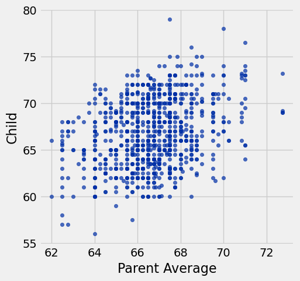

**Code:**

```python
heights.scatter('Parent Average', 'Child')
plots.plot([67.5, 67.5], [50, 85], color='red', lw=2)
plots.plot([68.5, 68.5], [50, 85], color='red', lw=2);
```

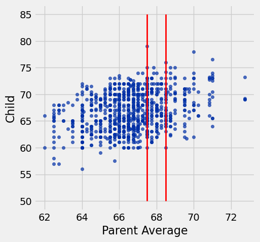

**Code:**

```python
nearby = heights.where('Parent Average', are.between(67.5, 68.5))
nearby_mean = np.average(nearby.column('Child'))
nearby_mean
```

*Output:*

```text
67.620000000000005
```

**Code:**

```python
heights.scatter('Parent Average', 'Child')
plots.plot([67.5, 67.5], [50, 85], color='red', lw=2)
plots.plot([68.5, 68.5], [50, 85], color='red', lw=2)
plots.scatter(68, nearby_mean, color='red', s=50);
```


**Code:**

```python
def predict(h):  # h is the average height of the parents, such as 68
    nearby = heights.where('Parent Average', are.between(h - 1/2, h + 1/2))
    return np.average(nearby.column('Child'))
```

**Code:**

```python
predict(68)
```

*Output:*

```text
67.620000000000005
```

**Code:**

```python
predict(70)
```

*Output:*

```text
68.561904761904756
```

**Code:**

```python
predict(73)
```

*Output:*

```text
70.099999999999994
```

**Code:**

```python
predicted_heights = heights.apply(predict, 'Parent Average')
```

**Code:**

```python
heights = heights.with_column('Prediction', predicted_heights)
heights
```

*Output:*

| Parent Average | Child | M/F | Prediction |
| --- | --- | --- | --- |
| 72.75 | 73.2 | male | 70.1 |
| 72.75 | 69.2 | female | 70.1 |
| 72.75 | 69 | female | 70.1 |
| 72.75 | 69 | female | 70.1 |
| 71 | 73.5 | male | 70.4158 |
| 71 | 72.5 | male | 70.4158 |
| 71 | 65.5 | female | 70.4158 |
| 71 | 65.5 | female | 70.4158 |
| 69.5 | 71 | male | 68.5025 |
| 69.5 | 68 | female | 68.5025 |

**Code:**

```python
heights.select('Parent Average', 'Child', 'Prediction').scatter('Parent Average')
```

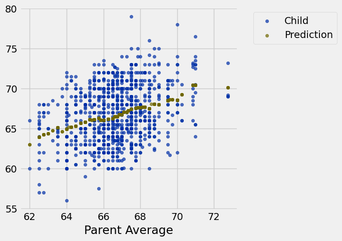

## Prediction Accuracy ##

**Code:**

```python
pred_errs = heights.column('Prediction') - heights.column('Child')
heights = heights.with_column('errors',pred_errs)
heights
```

*Output:*

| Parent Average | Child | M/F | Prediction | errors |
| --- | --- | --- | --- | --- |
| 72.75 | 73.2 | male | 70.1 | -3.1 |
| 72.75 | 69.2 | female | 70.1 | 0.9 |
| 72.75 | 69 | female | 70.1 | 1.1 |
| 72.75 | 69 | female | 70.1 | 1.1 |
| 71 | 73.5 | male | 70.4158 | -3.08421 |
| 71 | 72.5 | male | 70.4158 | -2.08421 |
| 71 | 65.5 | female | 70.4158 | 4.91579 |
| 71 | 65.5 | female | 70.4158 | 4.91579 |
| 69.5 | 71 | male | 68.5025 | -2.4975 |
| 69.5 | 68 | female | 68.5025 | 0.5025 |

**Code:**

```python
heights.hist('errors')
```

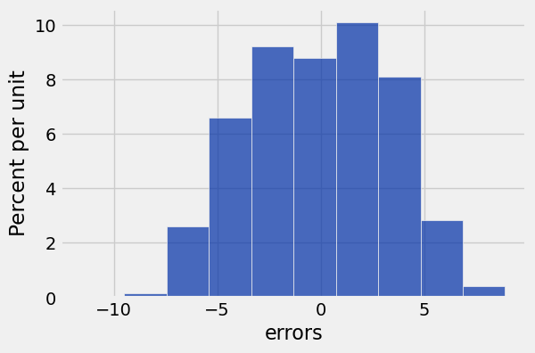

**Code:**

```python
heights.hist('errors', group='M/F')
```

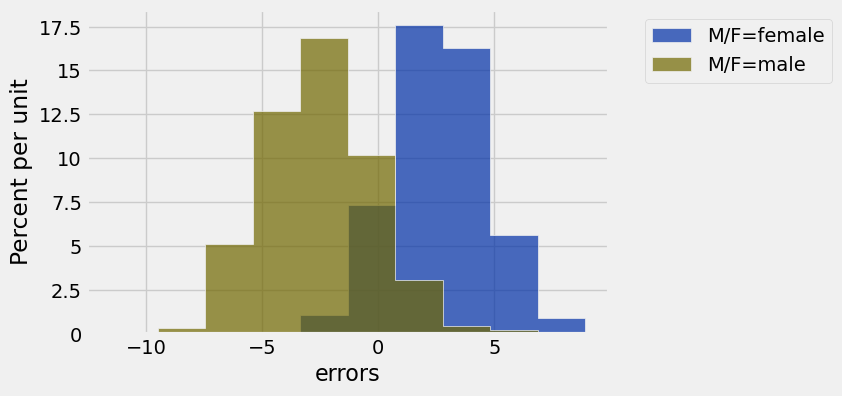

# Discussion Question

**Code:**

```python
def predict_smarter(h, s):
    nearby = heights.where('Parent Average', are.between(h - 1/2, h + 1/2))
    nearby_same_mf = nearby.where('M/F', s)
    return np.average(nearby_same_mf.column('Child'))
```

**Code:**

```python
predict_smarter(68, 'female')
```

*Output:*

```text
64.983516483516482
```

**Code:**

```python
predict_smarter(68, 'male')
```

*Output:*

```text
70.172340425531914
```

**Code:**

```python
heights.apply(predict_smarter, "Parent Average", "M/F")
```

*Output:*

```text
array([ 73.2       ,  69.06666667,  69.06666667,  69.06666667,
        73.48888889,  73.48888889,  67.65      ,  67.65      ,
        70.79545455,  65.7       ,  70.79545455,  70.79545455,
        65.7       ,  65.7       ,  65.7       ,  69.25322581,
        69.25322581,  69.25322581,  63.59495798,  63.59495798,
        63.59495798,  67.65      ,  73.48888889,  73.48888889,
        73.48888889,  73.48888889,  67.65      ,  67.65      ,
        66.82      ,  66.82      ,  66.82      ,  66.82      ,
        65.75882353,  70.17234043,  70.17234043,  64.98351648,
        64.98351648,  64.98351648,  64.98351648,  64.98351648,
        64.98351648,  64.67788462,  71.00952381,  66.11428571,
        71.00952381,  71.00952381,  71.00952381,  71.00952381,
        65.75882353,  70.921875  ,  70.921875  ,  70.921875  ,
        70.921875  ,  70.921875  ,  65.30571429,  65.30571429,
        65.30571429,  65.30571429,  70.79047619,  70.79047619,
        70.79047619,  70.79047619,  65.44318182,  65.44318182,
        65.25666667,  65.25666667,  65.25666667,  65.1       ,
        73.48888889,  73.48888889,  73.48888889,  67.65      ,
        67.65      ,  67.65      ,  67.65      ,  67.65      ,
        71.00952381,  66.11428571,  66.11428571,  70.79545455,
        70.79545455,  65.7       ,  70.56444444,  70.56444444,
        70.56444444,  65.25666667,  65.25666667,  65.25666667,
        65.25666667,  65.44318182,  64.98351648,  64.98351648,
        69.79677419,  69.79677419,  69.79677419,  64.67788462,
        64.67788462,  69.79677419,  69.79677419,  64.67788462,
        69.79677419,  69.79677419,  64.67788462,  64.67788462,
        64.67788462,  64.67788462,  64.98351648,  64.98351648,
        64.98351648,  63.88857143,  69.43969466,  69.43969466,
        69.43969466,  64.4       ,  64.4       ,  64.4       ,
        69.2553719 ,  69.2553719 ,  69.2553719 ,  63.88857143,
        63.88857143,  69.2553719 ,  69.2553719 ,  69.2553719 ,
        69.2553719 ,  63.88857143,  63.5928    ,  71.00952381,
        71.00952381,  71.00952381,  71.00952381,  66.11428571,
        70.921875  ,  70.921875  ,  70.921875  ,  65.30571429,
        70.56444444,  65.25666667,  65.25666667,  65.25666667,
        70.56444444,  70.56444444,  70.56444444,  65.25666667,
        65.25666667,  65.25666667,  70.56444444,  65.25666667,
        70.56444444,  70.56444444,  70.56444444,  70.56444444,
        65.25666667,  70.81555556,  70.61      ,  70.61      ,
        70.61      ,  70.61      ,  65.1       ,  65.1       ,
        70.56444444,  65.25666667,  70.61      ,  70.61      ,
        70.17234043,  70.17234043,  64.98351648,  64.67788462,
        64.67788462,  64.67788462,  64.67788462,  64.67788462,
        64.67788462,  64.67788462,  64.67788462,  70.61186441,
        70.61186441,  70.61186441,  65.1       ,  69.79677419,
        69.79677419,  69.79677419,  70.17234043,  70.17234043,
        70.17234043,  64.98351648,  64.98351648,  64.98351648,
        64.98351648,  70.08877551,  64.91382979,  64.39917355,
        64.39917355,  69.43969466,  69.43969466,  64.4       ,
        64.4       ,  64.4       ,  69.2553719 ,  69.2553719 ,
        69.2553719 ,  69.2553719 ,  63.88857143,  63.88857143,
        63.88857143,  63.88857143,  63.88857143,  69.2553719 ,
        69.2553719 ,  69.2553719 ,  63.88857143,  69.01344538,
        69.01344538,  63.5928    ,  63.5928    ,  63.5928    ,
        69.01344538,  69.01344538,  69.01344538,  63.5928    ,
        63.5928    ,  69.25322581,  63.59495798,  63.59495798,
        63.59495798,  63.59495798,  69.01344538,  69.01344538,
        69.01344538,  69.01344538,  69.01344538,  63.5928    ,
        63.5928    ,  63.44215686,  68.14047619,  68.14047619,
        70.79545455,  70.79545455,  70.79545455,  65.7       ,
        70.79545455,  70.79545455,  65.7       ,  65.7       ,
        65.7       ,  65.7       ,  70.921875  ,  70.56444444,
        70.56444444,  65.25666667,  65.25666667,  65.25666667,
        65.25666667,  70.61

... [output truncated, 10714 more characters]
```

**Code:**

```python
smarter_predicted_heights = heights.apply(predict_smarter, 'Parent Average', 'M/F')
heights = heights.with_column('Smarter Prediction', smarter_predicted_heights)
heights
```

*Output:*

| Parent Average | Child | M/F | Prediction | errors | Smarter Prediction |
| --- | --- | --- | --- | --- | --- |
| 72.75 | 73.2 | male | 70.1 | -3.1 | 73.2 |
| 72.75 | 69.2 | female | 70.1 | 0.9 | 69.0667 |
| 72.75 | 69 | female | 70.1 | 1.1 | 69.0667 |
| 72.75 | 69 | female | 70.1 | 1.1 | 69.0667 |
| 71 | 73.5 | male | 70.4158 | -3.08421 | 73.4889 |
| 71 | 72.5 | male | 70.4158 | -2.08421 | 73.4889 |
| 71 | 65.5 | female | 70.4158 | 4.91579 | 67.65 |
| 71 | 65.5 | female | 70.4158 | 4.91579 | 67.65 |
| 69.5 | 71 | male | 68.5025 | -2.4975 | 70.7955 |
| 69.5 | 68 | female | 68.5025 | 0.5025 | 65.7 |

**Code:**

```python
smarter_pred_errs = heights.apply(difference, 'Child', 'Smarter Prediction')
heights = heights.with_column('Smarter Errors', smarter_pred_errs)
```

**Code:**

```python
heights.hist('Smarter Errors', group='M/F')
```

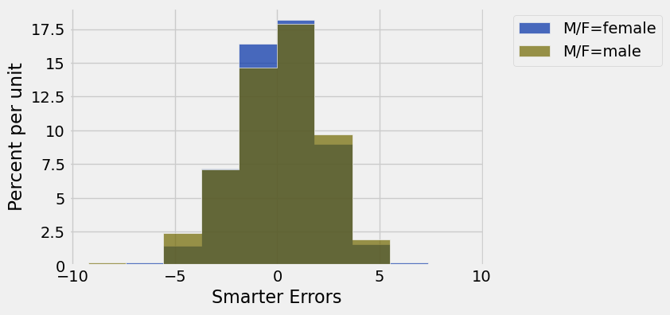

## Grouping by One Column ##

**Code:**

```python
cones = Table.read_table('cones.csv').drop('Color')
cones
```

*Output:*

| Flavor | Price |
| --- | --- |
| strawberry | 3.55 |
| chocolate | 4.75 |
| chocolate | 5.25 |
| strawberry | 5.25 |
| chocolate | 5.25 |
| bubblegum | 4.75 |

**Code:**

```python
cones.group('Flavor')
```

*Output:*

| Flavor | count |
| --- | --- |
| bubblegum | 1 |
| chocolate | 3 |
| strawberry | 2 |

**Code:**

```python
cones.group('Flavor', np.average)
```

*Output:*

| Flavor | Price average |
| --- | --- |
| bubblegum | 4.75 |
| chocolate | 5.08333 |
| strawberry | 4.4 |

**Code:**

```python
cones.group('Flavor', np.min)
```

*Output:*

| Flavor | Price min |
| --- | --- |
| bubblegum | 4.75 |
| chocolate | 4.75 |
| strawberry | 3.55 |

**Code:**

```python
cones.group('Flavor', list)
```

*Output:*

| Flavor | Price list |
| --- | --- |
| bubblegum | [4.75] |
| chocolate | [4.75, 5.25, 5.25] |
| strawberry | [3.5499999999999998, 5.25] |

## Grouping By One Column: Welcome Survey ##

**Code:**

```python
survey = Table.read_table('welcome_survey_sp26.csv')
survey.show(3)
```

*Output:*

| Year | Extroversion | Text Recipients | Sleep Hours | Handedness | Sleep Position | Piercings |
| --- | --- | --- | --- | --- | --- | --- |
| 1 | 5 | 1 | 8 | Right-handed | On your back | 2 |
| 2 | 8 | 20 | 6 | Right-handed | On your right side | 2 |
| 1 | 10 | 10 | 6 | Left-handed | On your back | 0 |

**Code:**

```python
survey.hist('Extroversion')
```

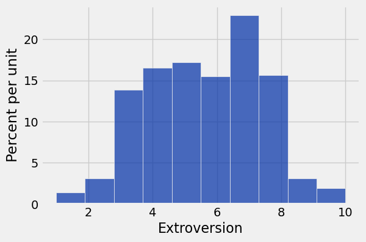

**Code:**

```python
survey.select(1, 2, 3).group('Extroversion', np.average)
```

*Output:*

| Extroversion | Text Recipients average | Sleep Hours average |
| --- | --- | --- |
| 1 | 2.69231 | 7.26923 |
| 2 | 5.6 | 7.2 |
| 3 | 4.24812 | 7.03008 |
| 4 | 4.94969 | 7.12893 |
| 5 | 5.41212 | 7.10303 |
| 6 | 5.87919 | 7.11409 |
| 7 | 6.89091 | 7.09091 |
| 8 | 9.15333 | 7.16667 |
| 9 | 9.53333 | 7.4 |
| 10 | 14.3889 | 6.83333 |

**Code:**

```python
survey.group('Extroversion', np.average).plot('Extroversion', 'Text Recipients average')
```

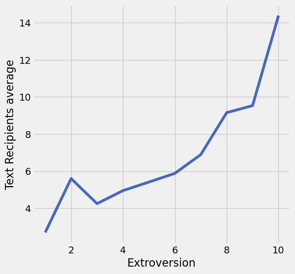

**Code:**

```python
survey.group("Year")
```

*Output:*

| Year | count |
| --- | --- |
| 1 | 572 |
| 2 | 207 |
| 3 | 203 |
| 4 | 71 |
| 5 | 14 |

**Code:**

```python
(survey
 .select("Year", "Sleep Hours")
 .group("Year", np.average))
```

*Output:*

| Year | Sleep Hours average |
| --- | --- |
| 1 | 7.17692 |
| 2 | 7.05314 |
| 3 | 6.94236 |
| 4 | 7.21831 |
| 5 | 7.42857 |

## Lists

**Code:**

```python
[1, 5, 'hello', 5.0]
```

**Code:**

```python
[1, 5, 'hello', 5.0, make_array(1,2,3)]
```

## Grouping by Two Columns ##

Do right-handed people tend to sleep on their left side and left-handed people sleep on their right?

**Code:**

```python
survey.group('Sleep Position')
```

*Output:*

| Sleep Position | count |
| --- | --- |
| On your back | 265 |
| On your left side | 273 |
| On your right side | 412 |
| On your stomach | 117 |

**Code:**

```python
survey.group(['Handedness', 'Sleep Position']).show()
```

*Output:*

| Handedness | Sleep Position | count |
| --- | --- | --- |
| Left-handed | On your back | 15 |
| Left-handed | On your left side | 20 |
| Left-handed | On your right side | 23 |
| Left-handed | On your stomach | 12 |
| Right-handed | On your back | 250 |
| Right-handed | On your left side | 251 |
| Right-handed | On your right side | 389 |
| Right-handed | On your stomach | 104 |
| ambidextrous | On your left side | 1 |
| both | On your stomach | 1 |
| i can use both | On your left side | 1 |

---

## Datasets

Datasets this notebook loads with `Table.read_table`. Column names are exact, including spaces and capitalization. Only the schema is recorded here — the data itself is not in this document, so any question about its values must be answered by running code, not by reasoning over the rows shown elsewhere in this file.

### `family_heights.csv`

934 rows, 7 columns.

| Column | Type |
| --- | --- |
| `family` | str |
| `father` | float |
| `mother` | float |
| `child` | float |
| `children` | int |
| `order` | int |
| `child m/f` | str |

### `cones.csv`

6 rows, 3 columns.

| Column | Type |
| --- | --- |
| `Flavor` | str |
| `Color` | str |
| `Price` | float |

### `welcome_survey_sp26.csv`

1,067 rows, 7 columns.

| Column | Type |
| --- | --- |
| `Year` | int |
| `Extroversion` | int |
| `Text Recipients` | int |
| `Sleep Hours` | float |
| `Handedness` | str |
| `Sleep Position` | str |
| `Piercings` | int |


---

# lec11

---
title: "Lecture 11 #"
lecture: lec11
course: data8
semester: sp26
source: lectures/data8/sp26/lec11/lec11.ipynb
language: python
---

**Code:**

```python
from datascience import *
import numpy as np

%matplotlib inline
import matplotlib.pyplot as plots
plots.style.use('fivethirtyeight')
import warnings
warnings.simplefilter(action='ignore',category=np.VisibleDeprecationWarning)
```

# Lecture 11 #

### Rows from lists

**Code:**

```python
Table().with_columns('Numbers', [1, 2, 3])
```

**Code:**

```python
drinks = Table(['Drink', 'Cafe', 'Price'])
drinks
```

**Code:**

```python
drinks = drinks.with_rows([
    ['Milk Tea', 'Asha', 5.5],
    ['Espresso', 'Strada',  1.75],
    ['Latte',    'Strada',  3.25],
    ['Espresso', "FSM",   2]
])
drinks
```

## Cross-classification: grouping by two columns

**Code:**

```python
survey = Table.read_table('welcome_survey_sp26.csv')
survey.show(3)
```

**Code:**

```python
survey.group(['Handedness', 'Sleep Position']).show()
```

**Code:**

```python
survey.group(['Handedness', 'Sleep Position'], np.average).show()
```

## Pivot Tables

**Code:**

```python
survey.group('Handedness')
```

**Code:**

```python
survey.pivot('Sleep Position', 'Handedness')
```

**Code:**

```python
survey.pivot('Sleep Position', 
             'Handedness', 
             values='Sleep Hours', 
             collect=np.average)
```

## Discussion Questions ##

**Code:**

```python
# From the CORGIS Dataset Project
# By Austin Cory Bart acbart@vt.edu
# Version 2.0.0, created 3/22/2016
# https://corgis-edu.github.io/corgis/csv/skyscrapers/

sky = Table.read_table('skyscrapers.csv')
sky = (sky.with_column('age', 2022 - sky.column('completed'))
          .drop('completed'))
sky.show(3)
```

**Code:**

```python
# 1. For each city, what’s the height of the tallest building for each material?

sky.pivot('material', 'city', 'height', max)
```

**Code:**

```python
# 2. For each city, what’s the height difference between the tallest 
#    steel building and the tallest concrete building?
```

**WARNING: ANSWERS BELOW**

**Code:**

```python
sky.select('material', 'city', 'height').group(['city', 'material'], collect=max)
```

**Code:**

```python
tallest = sky.pivot('material', 'city', values='height', collect=max)
tallest.show()
```

**Code:**

```python
diffs = Table().with_columns(
    'city', tallest.column('city'),
    'difference', abs(tallest.column('steel') - tallest.column('concrete'))
)
diffs
```

**Code:**

```python
diffs.sort('difference', descending=True)
```

**Code:**

```python
# 3. Generate a table of the names of the oldest buildings for each 
#    material for each city:

# Hint: You can use sort to find the name of the oldest building in the dataset
sky.sort('age', descending=True).column('name').item(0)
```

**WARNING: ANSWERS BELOW**

**Code:**

```python
def first(s):
    "Return the first element in an array."
    return s.item(0)

(sky
 .sort('age', descending=True)
 .pivot('material', 'city', 'name', first)
)#.where('city', 'San Francisco')
```

## Joins ##

**Code:**

```python
drinks
```

**Code:**

```python
discounts = Table().with_columns(
    'Coupon % off', make_array(10, 25, 5),
    'Location', make_array('Asha', 'Strada', 'Asha')
)
discounts
```

**Code:**

```python
combined = drinks.join('Cafe', discounts, 'Location')
combined
```

**Code:**

```python
discounted_frac = 1 - combined.column('Coupon % off') / 100
combined.with_column(
    'Discounted Price', 
    combined.column('Price') * discounted_frac
)
```

**Code:**

```python
drinks.join('Cafe', drinks, 'Cafe')
```

---

## Datasets

Datasets this notebook loads with `Table.read_table`. Column names are exact, including spaces and capitalization. Only the schema is recorded here — the data itself is not in this document, so any question about its values must be answered by running code, not by reasoning over the rows shown elsewhere in this file.

### `welcome_survey_sp26.csv`

1,067 rows, 7 columns.

| Column | Type |
| --- | --- |
| `Year` | int |
| `Extroversion` | int |
| `Text Recipients` | int |
| `Sleep Hours` | float |
| `Handedness` | str |
| `Sleep Position` | str |
| `Piercings` | int |

### `skyscrapers.csv`

1,781 rows, 5 columns.

| Column | Type |
| --- | --- |
| `name` | str |
| `material` | str |
| `city` | str |
| `height` | float |
| `completed` | int |


---

# lec12

---
title: "lec12"
lecture: lec12
course: data8
semester: sp26
source: lectures/data8/sp26/lec12/lec12.ipynb
language: python
---

**Code:**

```python
from datascience import *
import numpy as np

%matplotlib inline
import matplotlib.pyplot as plots
plots.style.use('fivethirtyeight')
import warnings
# warnings.simplefilter(action='ignore', category=np.VisibleDeprecationWarning)
```

### Appending Arrays

**Code:**

```python
first = np.arange(4)
second = np.arange(10, 17)
```

**Code:**

```python
first
```

*Output:*

```text
array([0, 1, 2, 3])
```

**Code:**

```python
np.append(first, 6)
```

*Output:*

```text
array([0, 1, 2, 3, 6])
```

**Code:**

```python
first
```

*Output:*

```text
array([0, 1, 2, 3])
```

**Code:**

```python
# how do we change `first`?
first = np.append(first, 6)
```

**Code:**

```python
np.append(first, second)
```

*Output:*

```text
array([ 0,  1,  2,  3,  6, 10, 11, 12, 13, 14, 15, 16])
```

**Code:**

```python
first
```

*Output:*

```text
array([0, 1, 2, 3, 6])
```

**Code:**

```python
second
```

*Output:*

```text
array([10, 11, 12, 13, 14, 15, 16])
```

## Comparison ##

**Code:**

```python
3 > 1
```

*Output:*

```text
True
```

**Code:**

```python
type(3 > 1)
```

*Output:*

```text
bool
```

**Code:**

```python
True
```

*Output:*

```text
True
```

**Code:**

```python
true
```

*Error:*

```text
---------------------------------------------------------------------------
NameError                                 Traceback (most recent call last)
Cell In[26], line 1
----> 1 true

NameError: name 'true' is not defined
```

(We see that capitalization matters.)

**Code:**

```python
3 = 3
```

*Error:*

```text
  Cell In[27], line 1
    3 = 3
    ^
SyntaxError: cannot assign to literal here. Maybe you meant '==' instead of '='?
```

**Code:**

```python
3 == 3.0
```

*Output:*

```text
True
```

**Code:**

```python
10 != 2
```

*Output:*

```text
True
```

**Code:**

```python
x = 14
y = 3
```

**Code:**

```python
x > 15
```

*Output:*

```text
False
```

**Code:**

```python
12 < x
```

*Output:*

```text
True
```

**Code:**

```python
x < 20
```

*Output:*

```text
True
```

**Code:**

```python
12 < x < 20
```

*Output:*

```text
True
```

**Code:**

```python
10 < x-y < 13
```

*Output:*

```text
True
```

**Code:**

```python
x > 13 and y < 3.14159
```

*Output:*

```text
True
```

(The comparison `12 < x < 20` is equivalent to `12 < x and x < 20`.)

## Comparisons with arrays

**Code:**

```python
pets = make_array('cat', 'cat', 'dog', 'cat', 'dog', 'rabbit')
```

**Code:**

```python
pets == 'cat'
```

*Output:*

```text
array([ True,  True, False,  True, False, False], dtype=bool)
```

**Code:**

```python
1 + 1 + 0 + 1 + 0 + 0
```

*Output:*

```text
3
```

**Code:**

```python
sum(make_array(True, True, False, True, False, False))
```

*Output:*

```text
3
```

**Code:**

```python
sum(pets == 'cat')
```

*Output:*

```text
3
```

**Code:**

```python
np.count_nonzero(pets == 'cat')
```

*Output:*

```text
3
```

**Code:**

```python
xs = np.arange(20, 31)
```

**Code:**

```python
xs
```

*Output:*

```text
array([20, 21, 22, 23, 24, 25, 26, 27, 28, 29, 30])
```

**Code:**

```python
xs > 28
```

*Output:*

```text
array([False, False, False, False, False, False, False, False, False,
        True,  True], dtype=bool)
```

**Code:**

```python
sum(xs > 28)
```

*Output:*

```text
2
```

## Conditional Statements

**Code:**

```python
age = 20
```

**Code:**

```python
if age >= 18:
    print('You can legally vote.')
else:
    if age >= 16:
        print("You can't vote just yet, but you can pre-register!")
    else:
        print("You can't vote just yet.")
```

*Output (stdout):*

```text
You can't vote just yet, but you can pre-register!
```

**Code:**

```python
if age >= 18:
    print('You can legally vote.')
if age >= 16:
    print("You can't vote just yet, but you can pre-register!")
else:
    print("You can't vote just yet.")
```

*Output (stdout):*

```text
You can legally vote.
You can't vote just yet, but you can pre-register!
```

**Code:**

```python
def vote(age):
    if age >= 18:
        return 'You can legally vote.'
    elif age >= 16:
        return "You can't vote just yet, but you can pre-register!"
    else:
        return "You can't vote just yet."
```

**Code:**

```python
vote(3)
```

*Output:*

```text
"You can't vote just yet."
```

**Code:**

```python
vote(17)
```

*Output:*

```text
"You can't vote just yet, but you can pre-register!"
```

**Code:**

```python
vote(25)
```

*Output:*

```text
'You can legally vote.'
```

**Code:**

```python
def rights(age):
	my_rights = make_array()
	if age >= 16:
		my_rights = np.append(my_rights, 'register to vote')
	if age >= 18:
		my_rights = np.append(my_rights, 'vote')
	return my_rights
```

**Code:**

```python
rights(3)
```

*Output:*

```text
array([], dtype=float64)
```

**Code:**

```python
rights(17)
```

*Output:*

```text
array(['register to vote'],
      dtype='<U32')
```

**Code:**

```python
rights(25)
```

*Output:*

```text
array(['register to vote', 'vote'],
      dtype='<U32')
```

**Code:**

```python
trip = Table().read_table('trip.csv').sort('Zip Code')
trip.show(5)
```

*Output:*

| Trip ID | Duration | Start Date | Start Station | Start Terminal | End Date | End Station | End Terminal | Bike # | Subscriber Type | Zip Code |
| --- | --- | --- | --- | --- | --- | --- | --- | --- | --- | --- |
| 901821 | 609 | 8/24/2015 0:11 | Powell at Post (Union Square) | 71 | 8/24/2015 0:21 | Grant Avenue at Columbus Avenue | 73 | 611 | Customer | 0 |
| 901820 | 1063 | 8/23/2015 23:44 | Embarcadero at Sansome | 60 | 8/24/2015 0:02 | Powell at Post (Union Square) | 71 | 383 | Customer | 0 |
| 901713 | 1550 | 8/23/2015 17:20 | Post at Kearny | 47 | 8/23/2015 17:45 | Market at 10th | 67 | 623 | Customer | 0 |
| 878924 | 11785 | 8/6/2015 16:02 | Civic Center BART (7th at Market) | 72 | 8/6/2015 19:18 | Embarcadero at Sansome | 60 | 625 | Customer | 0 |
| 878920 | 138 | 8/6/2015 15:58 | Civic Center BART (7th at Market) | 72 | 8/6/2015 16:00 | Civic Center BART (7th at Market) | 72 | 67 | Customer | 0 |

**Code:**

```python
def trip_kind(start, end):
    if start == end:
        return 'round trip'
    else:
        return 'one way'

# trip.show(5)

kinds = trip.apply(trip_kind, 'Start Station', 'End Station')
with_kinds = trip.with_column('Trip Kind', kinds)
with_kinds.show(5)
```

*Output:*

| Trip ID | Duration | Start Date | Start Station | Start Terminal | End Date | End Station | End Terminal | Bike # | Subscriber Type | Zip Code | Trip Kind |
| --- | --- | --- | --- | --- | --- | --- | --- | --- | --- | --- | --- |
| 901821 | 609 | 8/24/2015 0:11 | Powell at Post (Union Square) | 71 | 8/24/2015 0:21 | Grant Avenue at Columbus Avenue | 73 | 611 | Customer | 0 | one way |
| 901820 | 1063 | 8/23/2015 23:44 | Embarcadero at Sansome | 60 | 8/24/2015 0:02 | Powell at Post (Union Square) | 71 | 383 | Customer | 0 | one way |
| 901713 | 1550 | 8/23/2015 17:20 | Post at Kearny | 47 | 8/23/2015 17:45 | Market at 10th | 67 | 623 | Customer | 0 | one way |
| 878924 | 11785 | 8/6/2015 16:02 | Civic Center BART (7th at Market) | 72 | 8/6/2015 19:18 | Embarcadero at Sansome | 60 | 625 | Customer | 0 | one way |
| 878920 | 138 | 8/6/2015 15:58 | Civic Center BART (7th at Market) | 72 | 8/6/2015 16:00 | Civic Center BART (7th at Market) | 72 | 67 | Customer | 0 | round trip |

**Code:**

```python
# recall pivot! what will we see?
with_kinds.where('Duration', are.below(600)).pivot('Trip Kind', 'Start Station')
```

*Output:*

| Start Station | one way | round trip |
| --- | --- | --- |
| 2nd at Folsom | 6821 | 25 |
| 2nd at South Park | 6484 | 98 |
| 2nd at Townsend | 9513 | 83 |
| 5th at Howard | 5752 | 36 |
| Adobe on Almaden | 439 | 8 |
| Arena Green / SAP Center | 382 | 18 |
| Beale at Market | 5750 | 32 |
| Broadway St at Battery St | 4482 | 59 |
| California Ave Caltrain Station | 39 | 12 |
| Castro Street and El Camino Real | 1005 | 10 |

## Simulation

Let's play a game: we each roll a die. 

If my number is bigger: you pay me a dollar.

If they're the same: we do nothing.

If your number is bigger: I pay you a dollar.

Steps:
1. Find a way to simulate two dice rolls.
2. Compute how much money we win/lose based on the result.
3. Do steps 1 and 2 10,000 times.

### Conditional Statements

**Code:**

```python
# Work in progress
def one_round(my_roll, your_roll):
    if my_roll > your_roll:
        return 1
```

**Code:**

```python
one_round(4, 3)
```

*Output:*

```text
1
```

**Code:**

```python
one_round(2, 6)
```

**Code:**

```python
def one_round(my_roll, your_roll):
    if my_roll > your_roll:
        return 1
    elif your_roll > my_roll:
        return -1
    elif your_roll == my_roll:
        return 0
```

**Code:**

```python
one_round(1, 1)
```

*Output:*

```text
0
```

**Code:**

```python
one_round(6, 5)
```

*Output:*

```text
1
```

**Code:**

```python
one_round(-7, -1)
```

*Output:*

```text
-1
```

### Random Selection

**Code:**

```python
mornings = make_array('wake up', 'sleep in')
```

**Code:**

```python
np.random.choice(mornings)
```

*Output:*

```text
'wake up'
```

**Code:**

```python
np.random.choice(mornings)
```

*Output:*

```text
'sleep in'
```

**Code:**

```python
np.random.choice(mornings)
```

*Output:*

```text
'wake up'
```

We can also pass an argument that specifies how many times to make a random choice:

**Code:**

```python
np.random.choice(mornings, 7)
```

*Output:*

```text
array(['wake up', 'wake up', 'wake up', 'sleep in', 'wake up', 'sleep in',
       'wake up'],
      dtype='<U8')
```

**Code:**

```python
sum(np.random.choice(mornings, 7) == 'wake up')
```

*Output:*

```text
5
```

**Code:**

```python
sum(np.random.choice(mornings, 7) == 'sleep in')
```

*Output:*

```text
4
```

^ Why don't these (always) sum to 7?

**Code:**

```python
morning_week = np.random.choice(mornings, 7)
morning_week
```

*Output:*

```text
array(['sleep in', 'wake up', 'wake up', 'sleep in', 'wake up', 'wake up',
       'wake up'],
      dtype='<U8')
```

**Code:**

```python
sum(morning_week == 'wake up')
```

*Output:*

```text
5
```

**Code:**

```python
sum(morning_week == 'sleep in')
```

*Output:*

```text
2
```

### Simulating the roll of a die

**Code:**

```python
die_faces = np.arange(1, 7)
```

**Code:**

```python
np.random.choice(die_faces)
```

*Output:*

```text
4
```

**Code:**

```python
def simulate_one_round():
    my_roll = np.random.choice(die_faces)
    your_roll = np.random.choice(die_faces)
    return one_round(my_roll, your_roll)
```

**Code:**

```python
simulate_one_round()
```

*Output:*

```text
-1
```

### Repeated Betting ###

**Code:**

```python
results = make_array()
```

**Code:**

```python
results = np.append(results, simulate_one_round())
results
```

*Output:*

```text
array([-1.,  1.])
```

**Code:**

```python
results = np.append(results, simulate_one_round())
results
```

*Output:*

```text
array([-1.,  1.,  1., -1., -1.,  1., -1., -1.,  1.,  1.,  1.,  1.,  0.,
        1.,  1.,  1.,  1., -1.,  0.,  0., -1.,  0.,  1., -1.,  1.,  1.,
       -1.,  1.,  0.,  1.])
```

## `For` Statements

**Code:**

```python
for pet in make_array('cat', 'dog', 'rabbit'):
    print('I love my ' + pet)
```

*Output (stdout):*

```text
I love my cat
I love my dog
I love my rabbit
```

**Code:**

```python
pet = make_array('cat', 'dog', 'rabbit').item(0)
print('I love my ' + pet)

pet = make_array('cat', 'dog', 'rabbit').item(1)
print('I love my ' + pet)

pet = make_array('cat', 'dog', 'rabbit').item(2)
print('I love my ' + pet)
```

*Output (stdout):*

```text
I love my cat
I love my dog
I love my rabbit
```

**Code:**

```python
np.arange(10)
```

*Output:*

```text
array([0, 1, 2, 3, 4, 5, 6, 7, 8, 9])
```

**Code:**

```python
for i in np.arange(10):
    print('GO BEARSSSS')
```

*Output (stdout):*

```text
GO BEARSSSS
GO BEARSSSS
GO BEARSSSS
GO BEARSSSS
GO BEARSSSS
GO BEARSSSS
GO BEARSSSS
GO BEARSSSS
GO BEARSSSS
GO BEARSSSS
```

(see slides)

**Code:**

```python
game_outcomes = make_array()

for i in np.arange(5):
    game_outcomes = np.append(game_outcomes, simulate_one_round())
    
game_outcomes
```

*Output:*

```text
array([ 1., -1.,  1., -1.,  0.])
```

**Code:**

```python
game_outcomes = make_array()

for i in np.arange(10000):
    game_outcomes = np.append(game_outcomes, simulate_one_round())
    
game_outcomes
```

*Output:*

```text
array([-1.,  1.,  1., ..., -1.,  1.,  0.])
```

**Code:**

```python
len(game_outcomes)
```

*Output:*

```text
10000
```

**Code:**

```python
results = Table().with_column('My winnings', game_outcomes)
```

**Code:**

```python
results
```

*Output:*

| My winnings |
| --- |
| -1 |
| 1 |
| 1 |
| 1 |
| 0 |
| -1 |
| 0 |
| -1 |
| 1 |
| -1 |

**Code:**

```python
results.group('My winnings').barh('My winnings')
```

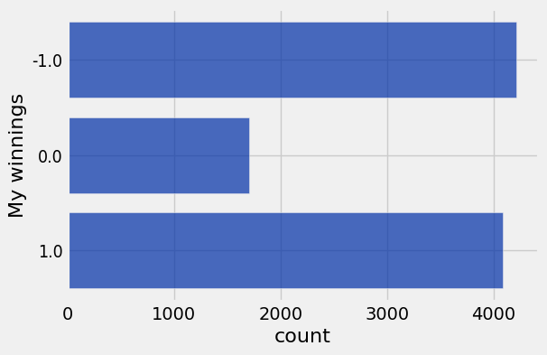

**Code:**

```python
sum(game_outcomes)
```

### Another example: simulating heads in 100 coin tosses

**Code:**

```python
coin = make_array('heads', 'tails')
```

**Code:**

```python
sum(np.random.choice(coin, 100) == 'heads')
```

*Output:*

```text
51
```

**Code:**

```python
# Simulate one outcome

def num_heads():
    return sum(np.random.choice(coin, 100) == 'heads')
```

**Code:**

```python
# Decide how many times you want to repeat the experiment

repetitions = 10000
```

**Code:**

```python
# Simulate that many outcomes

outcomes = make_array()

for i in np.arange(repetitions):
    outcomes = np.append(outcomes, num_heads())
```

**Code:**

```python
heads = Table().with_column('Heads', outcomes)
heads.hist(bins = np.arange(29.5, 70.6))
```

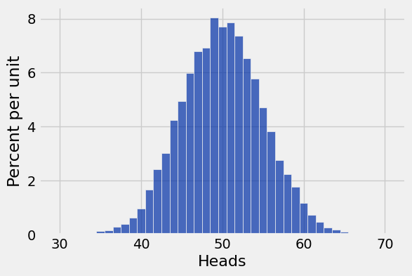

## `datascience` library

**Code:**

```python
trip.show(3)
```

*Output:*

| Trip ID | Duration | Start Date | Start Station | Start Terminal | End Date | End Station | End Terminal | Bike # | Subscriber Type | Zip Code |
| --- | --- | --- | --- | --- | --- | --- | --- | --- | --- | --- |
| 901821 | 609 | 8/24/2015 0:11 | Powell at Post (Union Square) | 71 | 8/24/2015 0:21 | Grant Avenue at Columbus Avenue | 73 | 611 | Customer | 0 |
| 901820 | 1063 | 8/23/2015 23:44 | Embarcadero at Sansome | 60 | 8/24/2015 0:02 | Powell at Post (Union Square) | 71 | 383 | Customer | 0 |
| 901713 | 1550 | 8/23/2015 17:20 | Post at Kearny | 47 | 8/23/2015 17:45 | Market at 10th | 67 | 623 | Customer | 0 |

**Code:**

```python
trip.where('Duration', are.above(1000))
# .column('Duration')
```

*Output:*

| Trip ID | Duration | Start Date | Start Station | Start Terminal | End Date | End Station | End Terminal | Bike # | Subscriber Type | Zip Code |
| --- | --- | --- | --- | --- | --- | --- | --- | --- | --- | --- |
| 901820 | 1063 | 8/23/2015 23:44 | Embarcadero at Sansome | 60 | 8/24/2015 0:02 | Powell at Post (Union Square) | 71 | 383 | Customer | 0 |
| 901713 | 1550 | 8/23/2015 17:20 | Post at Kearny | 47 | 8/23/2015 17:45 | Market at 10th | 67 | 623 | Customer | 0 |
| 878924 | 11785 | 8/6/2015 16:02 | Civic Center BART (7th at Market) | 72 | 8/6/2015 19:18 | Embarcadero at Sansome | 60 | 625 | Customer | 0 |
| 878906 | 12332 | 8/6/2015 15:52 | Civic Center BART (7th at Market) | 72 | 8/6/2015 19:18 | Embarcadero at Sansome | 60 | 531 | Customer | 0 |
| 871652 | 8820 | 8/1/2015 12:03 | Commercial at Montgomery | 45 | 8/1/2015 14:30 | Harry Bridges Plaza (Ferry Building) | 50 | 444 | Customer | 0 |
| 871651 | 8839 | 8/1/2015 12:02 | Commercial at Montgomery | 45 | 8/1/2015 14:29 | Harry Bridges Plaza (Ferry Building) | 50 | 390 | Customer | 0 |
| 862514 | 5698 | 7/26/2015 16:49 | Spear at Folsom | 49 | 7/26/2015 18:24 | Spear at Folsom | 49 | 419 | Customer | 0 |
| 854766 | 6281 | 7/21/2015 5:13 | University and Emerson | 35 | 7/21/2015 6:58 | University and Emerson | 35 | 101 | Customer | 0 |
| 852559 | 4411 | 7/19/2015 11:17 | Civic Center BART (7th at Market) | 72 | 7/19/2015 12:31 | Market at 4th | 76 | 877 | Customer | 0 |
| 805856 | 1194 | 6/13/2015 13:48 | Harry Bridges Plaza (Ferry Building) | 50 | 6/13/2015 14:08 | Embarcadero at Sansome | 60 | 518 | Customer | 0 |

**Code:**

```python
big_trip_durations = make_array()
```

**Code:**

```python
for duration in trip.column('Duration'):
    if duration > 1000:
        big_trip_durations = np.append(big_trip_durations, duration)
np.mean(big_trip_durations)
```

*Output:*

```text
5259.1915219611847
```

**Code:**

```python
np.mean(
    trip.where('Duration', are.above(1000)).column('Duration')
)
```

*Output:*

```text
5259.1915219611847
```

## Optional: Advanced `where` ##

**Code:**

```python
ages = make_array(16, 22, 18, 15, 19, 15, 16, 21)
age = Table().with_column('Age', ages)
```

**Code:**

```python
age
```

*Output:*

| Age |
| --- |
| 16 |
| 22 |
| 18 |
| 15 |
| 19 |
| 15 |
| 16 |
| 21 |

**Code:**

```python
age.where('Age', are.above_or_equal_to(18))
```

*Output:*

| Age |
| --- |
| 22 |
| 18 |
| 19 |
| 21 |

**Code:**

```python
voter = ages >= 18
```

**Code:**

```python
voter
```

*Output:*

```text
array([False,  True,  True, False,  True, False, False,  True], dtype=bool)
```

**Code:**

```python
age.where(voter)
```

*Output:*

| Age |
| --- |
| 22 |
| 18 |
| 19 |
| 21 |

**Code:**

```python
is_voter = are.above_or_equal_to(18)
```

**Code:**

```python
type(is_voter)
```

*Output:*

```text
datascience.predicates._combinable
```

**Code:**

```python
is_voter(22)
```

*Output:*

```text
True
```

**Code:**

```python
is_voter(3)
```

*Output:*

```text
False
```

**Code:**

```python
age.apply(is_voter, 'Age')
```

*Output:*

```text
array([False,  True,  True, False,  True, False, False,  True], dtype=bool)
```

**Code:**

```python
ages >= 18
```

*Output:*

```text
array([False,  True,  True, False,  True, False, False,  True], dtype=bool)
```

**Code:**

```python
voter
```

*Output:*

```text
array([False,  True,  True, False,  True, False, False,  True], dtype=bool)
```

**Code:**

```python
def my_voter_function(x):
    return x >= 18
```

**Code:**

```python
age.where('Age', are.above_or_equal_to(18))
```

*Output:*

| Age |
| --- |
| 22 |
| 18 |
| 19 |
| 21 |

**Code:**

```python
age.where(voter)
```

*Output:*

| Age |
| --- |
| 22 |
| 18 |
| 19 |
| 21 |

---

## Datasets

Datasets this notebook loads with `Table.read_table`. Column names are exact, including spaces and capitalization. Only the schema is recorded here — the data itself is not in this document, so any question about its values must be answered by running code, not by reasoning over the rows shown elsewhere in this file.

### `trip.csv`

354,152 rows, 11 columns.

| Column | Type |
| --- | --- |
| `Trip ID` | int |
| `Duration` | int |
| `Start Date` | str |
| `Start Station` | str |
| `Start Terminal` | int |
| `End Date` | str |
| `End Station` | str |
| `End Terminal` | int |
| `Bike #` | int |
| `Subscriber Type` | str |
| `Zip Code` | str |


---

# lec13

---
title: "Chance #"
lecture: lec13
course: data8
semester: sp26
source: lectures/data8/sp26/lec13/lec13.ipynb
language: python
---

**Code:**

```python
from datascience import *
%matplotlib inline

import matplotlib.pyplot as plt
plt.style.use('fivethirtyeight')
import numpy as np
import warnings
```

## Simulation Review

**Code:**

```python
coin = make_array('heads', 'tails')
```

**Code:**

```python
np.random.choice(coin)
```

*Output:*

```text
'tails'
```

**Code:**

```python
tosses = np.random.choice(coin, 10)
tosses
```

*Output:*

```text
array(['tails', 'tails', 'tails', 'tails', 'heads', 'tails', 'tails',
       'tails', 'tails', 'heads'],
      dtype='<U5')
```

**Code:**

```python
sum(tosses == 'heads')
```

*Output:*

```text
2
```

**Code:**

```python
sum(np.random.choice(coin, 10) == 'heads')
```

*Output:*

```text
5
```

**Code:**

```python
# Simulate one outcome based on 100 tosses

def heads_in_100_tosses():
    return sum(np.random.choice(coin, 100) == 'heads')
```

**Code:**

```python
# Decide how many times you want to repeat the experiment

num_simulations = 10000
```

**Code:**

```python
# Simulate that many outcomes

outcomes = make_array()

for i in np.arange(num_simulations):
    outcomes = np.append(outcomes, heads_in_100_tosses())
    
outcomes
```

*Output:*

```text
array([ 52.,  57.,  49., ...,  50.,  59.,  46.])
```

**Code:**

```python
heads = Table().with_column('Heads', outcomes)
heads.hist(bins = np.arange(24.5, 76.5))
```

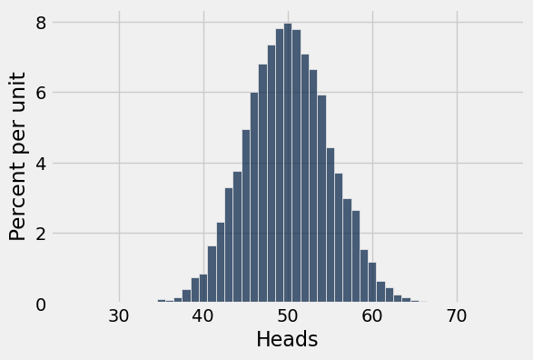

# Chance #

### Probability Question

3 cards: A, K, Q

Draw two cards at random without replacement.

What is the chance of a Queen followed by a King?

First Solution:

Alternative Solution:

### Another Question

Same setting as above.

What is the chance that one of the cards drawn is the King and the other is the Queen?

First Solution:

Alternative Solution:

### Complement Rule

Done on slide.

### The Monty Hall Problem ###

**Code:**

```python
goats = make_array('first goat', 'second goat')
doors = make_array('car', 'first goat', 'second goat')
doors
```

*Output:*

```text
array(['car', 'first goat', 'second goat'],
      dtype='<U11')
```

**Code:**

```python
def other_goat(x):
    if x == 'first goat':
        return 'second goat'
    elif x == 'second goat':
        return 'first goat'
```

**Code:**

```python
make_array(other_goat('first goat'), other_goat('second goat'))
```

*Output:*

```text
array(['second goat', 'first goat'],
      dtype='<U11')
```

**Code:**

```python
def monty_hall():
    """Return 
    [contestant's guess, what Monty reveals, what remains behind the other door]"""
    
    contestant_choice = np.random.choice(doors)
    
    if contestant_choice == 'first goat':
        monty_choice = 'second goat'
        remaining_choice = 'car'
    
    if contestant_choice == 'second goat':
        monty_choice = 'first goat'
        remaining_choice = 'car'
    
    if contestant_choice == 'car':
        monty_choice = np.random.choice(goats)
        remaining_choice = other_goat(monty_choice)
        
    return make_array(contestant_choice, monty_choice, remaining_choice)
```

**Code:**

```python
monty_hall()
```

*Output:*

```text
array(['car', 'first goat', 'second goat'],
      dtype='<U11')
```

**Code:**

```python
results = Table(make_array('Guess', 'Revealed', 'Remaining'))

for i in np.arange(10000):
    results.append(monty_hall())
```

**Code:**

```python
results.show(5)
```

*Output:*

| Guess | Revealed | Remaining |
| --- | --- | --- |
| first goat | second goat | car |
| first goat | second goat | car |
| first goat | second goat | car |
| first goat | second goat | car |
| first goat | second goat | car |

**Code:**

```python
original_choice = results.group('Guess')
original_choice
```

*Output:*

| Guess | count |
| --- | --- |
| car | 3324 |
| first goat | 3442 |
| second goat | 3234 |

**Code:**

```python
remaining_door = results.group('Remaining')
remaining_door
```

*Output:*

| Remaining | count |
| --- | --- |
| car | 6676 |
| first goat | 1654 |
| second goat | 1670 |

**Code:**

```python
# Collect all the results

all_results = Table().with_columns(
    'Item', doors,
    'Original Door', original_choice.column(1),
    'Remaining Door', remaining_door.column(1)
)
```

**Code:**

```python
all_results.barh('Item')
```

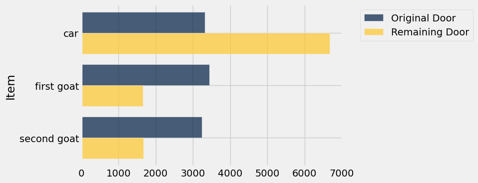


---

# lec14

---
title: "Lecture 14"
lecture: lec14
course: data8
semester: sp26
source: lectures/data8/sp26/lec14/lec14.ipynb
language: python
---

**Code:**

```python
from datascience import *
import numpy as np

%matplotlib inline
import matplotlib.pyplot as plots
plots.style.use('fivethirtyeight')
```

# Lecture 14

## Random Sampling ##

We load in a dataset of all United flights national flights from 6/1/15 to 8/9/15, their destination and how long they were delayed, in minutes.

**Code:**

```python
united = Table.read_table('united.csv')
united = united.with_column('Row', np.arange(united.num_rows)).move_to_start('Row')
united
```

Some deterministic samples:

**Code:**

```python
united.where('Destination', 'JFK')
```

**Code:**

```python
united.take(np.arange(0, united.num_rows, 1000))
```

**Code:**

```python
united.take(make_array(34, 6321, 10040))
```

Random samples:

**Code:**

```python
united.sample(5, with_replacement=False).sort('Row')
```

**Code:**

```python
rows = np.random.choice(np.arange(united.num_rows), 5, replace=False)
united.take(rows).sort('Row')
```

**Code:**

```python
start = np.random.choice(np.arange(1000))
systematic_sample = united.take(np.arange(start, united.num_rows, 1000))
systematic_sample.show()
```

## Distributions ##

**Code:**

```python
die = Table().with_column('Face', np.arange(1, 7))
die
```

**Code:**

```python
die.sample(10)
```

**Code:**

```python
die.hist()
```

**Code:**

```python
roll_bins = np.arange(0.5, 6.6, 1)
```

**Code:**

```python
die.hist(bins=roll_bins)
```

**Code:**

```python
die.sample(10).hist(bins=roll_bins)
```

**Code:**

```python
die.sample(1000).hist(bins=roll_bins)
```

**Code:**

```python
die.sample(100000).hist(bins=roll_bins)
```

## Large Random Samples ##

**Code:**

```python
united
```

**Code:**

```python
united_bins = np.arange(-20, 201, 5)
united.hist('Delay', bins = united_bins)
```

**Code:**

```python
min(united.column('Delay'))
```

**Code:**

```python
max(united.column('Delay'))
```

**Code:**

```python
np.average(united.column('Delay'))
```

**Code:**

```python
united.sample(10).hist('Delay', bins = united_bins)
```

**Code:**

```python
united.sample(1000).hist('Delay', bins = united_bins)
```

## Simulating Statistics ##

**Code:**

```python
np.median(united.column('Delay'))
```

**Code:**

```python
np.median(united.sample(10).column('Delay'))
```

**Code:**

```python
def sample_median(size):
    return np.median(united.sample(size).column('Delay'))
```

**Code:**

```python
sample_median(10)
```

**Code:**

```python
sample_medians = make_array()

for i in np.arange(1000):
    new_median = sample_median(10)
    sample_medians = np.append(sample_medians, new_median)
```

**Code:**

```python
Table().with_column('Sample medians', sample_medians).hist(bins = np.arange(-10,31))
```

**Code:**

```python
sample_medians = make_array()

for i in np.arange(1000):
    new_median = sample_median(1000)
    sample_medians = np.append(sample_medians, new_median)
```

**Code:**

```python
Table().with_column(
    'Sample medians', sample_medians).hist(bins = np.arange(-10,31))
```

---

## Datasets

Datasets this notebook loads with `Table.read_table`. Column names are exact, including spaces and capitalization. Only the schema is recorded here — the data itself is not in this document, so any question about its values must be answered by running code, not by reasoning over the rows shown elsewhere in this file.

### `united.csv`

13,825 rows, 4 columns.

| Column | Type |
| --- | --- |
| `Date` | str |
| `Flight Number` | int |
| `Destination` | str |
| `Delay` | int |


---

# lec15

---
title: "lec15"
lecture: lec15
course: data8
semester: sp26
source: lectures/data8/sp26/lec15/lec15.ipynb
language: python
---

**Code:**

```python
from datascience import *
import numpy as np

%matplotlib inline
import matplotlib.pyplot as plots
plots.style.use('fivethirtyeight')
```

## Empirical Distributions of a Statistic

**Code:**

```python
united = Table.read_table('united.csv')
united = united.with_column('Row', np.arange(united.num_rows)).move_to_start('Row')
```

**Code:**

```python
def sample_median(size):
    return np.median(united.sample(size).column('Delay'))
```

**Code:**

```python
# (Population) Parameter
np.median(united.column('Delay'))
```

**Code:**

```python
# (Sample) Statistic
sample_median(10)
```

**Code:**

```python
# (Sample) Statistic
sample_median(100)
```

**Code:**

```python
sample_medians_10 = make_array()
sample_medians_100 = make_array()
sample_medians_1000 = make_array()

num_simulations = 2000

for i in np.arange(num_simulations):
    new_median_10 = sample_median(10)
    sample_medians_10 = np.append(sample_medians_10, new_median_10)
    new_median_100 = sample_median(100)
    sample_medians_100 = np.append(sample_medians_100, new_median_100)
    new_median_1000 = sample_median(1000)
    sample_medians_1000 = np.append(sample_medians_1000, new_median_1000)
```

**Code:**

```python
sample_medians = Table().with_columns('Size 10', sample_medians_10, 
                                      'Size 100', sample_medians_100,
                                      'Size 1000', sample_medians_1000)
```

**Code:**

```python
sample_medians.hist(bins = np.arange(-5, 30))
```

## Swain vs. Alabama ##

**Code:**

```python
population_proportions = make_array(.26, .74)
population_proportions
```

**Code:**

```python
sample_proportions(100, population_proportions)
```

**Code:**

```python
def panel_proportion():
    return sample_proportions(100, population_proportions).item(0)
```

**Code:**

```python
panel_proportion()
```

**Code:**

```python
panels = make_array()

for i in np.arange(10000):
    new_panel = panel_proportion() * 100
    panels = np.append(panels, new_panel)
```

**Code:**

```python
Table().with_column(
    'Number of Black Men on Panel of 100', panels
).hist(bins=np.arange(5.5,40.))

# Plotting details; ignore this code
plots.ylim(-0.002, 0.09)
plots.scatter(8, 0, color='red', s=30);
```

## Mendel and Pea Flowers ##

**Code:**

```python
## Mendel had 929 plants, of which 709 had purple flowers
observed_purples = 709 / 929
observed_purples
```

**Code:**

```python
predicted_proportions = make_array(.75, .25)
sample_proportions(929, predicted_proportions)
```

**Code:**

```python
def purple_flowers():
    return sample_proportions(929, predicted_proportions).item(0) * 100
```

**Code:**

```python
purple_flowers()
```

**Code:**

```python
purples = make_array()

for i in np.arange(10000):
    new_purple = purple_flowers()
    purples = np.append(purples, new_purple)
```

**Code:**

```python
Table().with_column('Percent of purple flowers in sample of 929', purples).hist()

# Plotting details; ignore this code
plots.ylim(-0.02, 0.25)
plots.scatter(observed_purples * 100, 0, color='red', s=30);
```

**Code:**

```python
Table().with_column('Discrepancy in sample of 929 if the model is true', abs(purples- 75)).hist()

# Plotting details; ignore this code
plots.ylim(-0.02, 0.6)
plots.scatter(abs(observed_purples * 100 - 75), 0, color='red', s=30);
```

**Code:**

```python
abs(observed_purples * 100 - 75)
```

---

## Datasets

Datasets this notebook loads with `Table.read_table`. Column names are exact, including spaces and capitalization. Only the schema is recorded here — the data itself is not in this document, so any question about its values must be answered by running code, not by reasoning over the rows shown elsewhere in this file.

### `united.csv`

13,825 rows, 4 columns.

| Column | Type |
| --- | --- |
| `Date` | str |
| `Flight Number` | int |
| `Destination` | str |
| `Delay` | int |


---

# lec16

---
title: "Be the Jury Program"
lecture: lec16
course: data8
semester: sp26
source: lectures/data8/sp26/lec16/lec16.ipynb
language: python
---

**Code:**

```python
from datascience import *
import numpy as np

%matplotlib inline
import matplotlib.pyplot as plots
plots.style.use('fivethirtyeight')
```

## Alameda County Jury Panels ##

**Code:**

```python
jury = Table().with_columns(
    'Ethnicity', make_array('Asian', 'Black', 'Latino', 'White', 'Other'),
    'Eligible', make_array(0.15, 0.18, 0.12, 0.54, 0.01),
    'Panels', make_array(0.26, 0.08, 0.08, 0.54, 0.04)
)

jury
```

**Code:**

```python
jury.barh('Ethnicity')
```

**Code:**

```python
# Under the model, this is the true distribution of people
# from which the jurors are randomly sampled
model = jury.column('Eligible')
```

**Code:**

```python
# Let's simulate a random draw of 1423 jurors from this distribution
simulated = sample_proportions(1423, model)
simulated
```

**Code:**

```python
# The actual observed distribution (Panels) looks quite different
# from the simulation -- try running this several times to confirm!
jury_with_simulated = jury.with_column('Simulated', simulated)
jury_with_simulated
```

**Code:**

```python
jury_with_simulated.barh('Ethnicity')
```

## Distance Between Distributions

**Code:**

```python
# In the last lecture, the difference between observed black/purple
# and their expected values (26%/75%) was our statistic.
#
# In this case, we need to understand how each of the 5 categories
# differ from their expected values according to the model.

diffs = jury.column('Panels') - jury.column('Eligible')
jury_with_difference = jury.with_column('Difference', diffs)
jury_with_difference
```

## Total Variation Distance

**Code:**

```python
def tvd(dist1, dist2):
    return sum(abs(dist1 - dist2))/2
```

**Code:**

```python
# The TVD of our observed data (Panels) from their expected values
# assuming the model is true (Eligbible)
obsvd_tvd = tvd(jury.column('Panels'), jury.column('Eligible'))
obsvd_tvd
```

**Code:**

```python
# The TVD of a model simluation from its expected values
tvd(sample_proportions(1423, model), jury.column('Eligible'))
```

**Code:**

```python
def simulated_tvd():
    return tvd(sample_proportions(1423, model), model)

tvds = make_array()

num_simulations = 10000
for i in np.arange(num_simulations):
    new_tvd = simulated_tvd()
    tvds = np.append(tvds, new_tvd)
```

**Code:**

```python
title = 'Simulated TVDs (if model is true)'
bins = np.arange(0, .05, .005)

Table().with_column(title, tvds).hist(bins = bins)
print('Observed TVD: ' + str(obsvd_tvd))

# Plotting details; ignore this code
plots.ylim(-2, 55)
plots.scatter(obsvd_tvd, 0, color='red', s=30);
```

# Be the Jury Program

**Code:**

```python
# Counts are from the 88% of participants in Be the Jury in 2023 who completed the exit survey and shared their race

sf = Table().with_columns(
    'Race/Ethnicity',
    ['American Indian or Alaska Native',
     'Asian',
     'Black or African American',
     'Hispanic or Latino',
     'Native Hawaiian or Other Pacific Islander',
     'Some Other Race',
     'White'],
    'Count',[4, 168,23,59,4,5,175],
    'SF Census (2020)', [0.005, 0.3440, 0.0520, 0.1540, 0.0040, 0.0490, 0.3920])
sf.set_format(2, PercentFormatter)
```

**Code:**

```python
sum(sf.column('Count'))
```

**Code:**

```python
sf = (sf.with_column('Panels', sf.column('Count') / sum(sf.column('Count')))
        .relabeled('SF Census (2020)', 'Eligible'))
sf.set_format(3, PercentFormatter)
```

**Code:**

```python
sf.select(0, 2, 3).barh(0)
```

**Code:**

```python
jury = sf
obsvd_tvd = tvd(jury.column('Panels'), jury.column('Eligible'))
obsvd_tvd
```

**Code:**

```python
def simulated_tvd():
    return tvd(sample_proportions(438, model), model)

tvds = make_array()

num_simulations = 10000
for i in np.arange(num_simulations):
    new_tvd = simulated_tvd()
    tvds = np.append(tvds, new_tvd)
```

**Code:**

```python
title = 'Simulated TVDs (if model is true)'
bins = np.arange(0, .05, .005)

Table().with_column(title, tvds).hist(bins = bins)
print('Observed TVD: ' + str(obsvd_tvd))

# Plotting details; ignore this code
plots.ylim(-2, 55)
plots.scatter(obsvd_tvd, 0, color='red', s=30);
```


---

# lec17

---
title: "lec17"
lecture: lec17
course: data8
semester: sp26
source: lectures/data8/sp26/lec17/lec17.ipynb
language: python
---

**Code:**

```python
from datascience import *
import numpy as np

%matplotlib inline
import matplotlib.pyplot as plots
plots.style.use('fivethirtyeight')
```

## The GSI's Defense ##

**Code:**

```python
scores = Table.read_table('scores_by_section.csv')
scores
```

*Output:*

| Section | Midterm |
| --- | --- |
| 1 | 22 |
| 2 | 12 |
| 2 | 23 |
| 2 | 14 |
| 1 | 20 |
| 3 | 25 |
| 4 | 19 |
| 1 | 24 |
| 5 | 8 |
| 6 | 14 |

**Code:**

```python
max(scores.column('Midterm'))
```

*Output:*

```text
25
```

**Code:**

```python
min(scores.column('Midterm'))
```

*Output:*

```text
0
```

**Code:**

```python
scores.group('Section')
```

*Output:*

| Section | count |
| --- | --- |
| 1 | 32 |
| 2 | 32 |
| 3 | 27 |
| 4 | 30 |
| 5 | 33 |
| 6 | 32 |
| 7 | 24 |
| 8 | 29 |
| 9 | 30 |
| 10 | 34 |

**Code:**

```python
scores.group('Section', np.average).show()
```

*Output:*

| Section | Midterm average |
| --- | --- |
| 1 | 15.5938 |
| 2 | 15.125 |
| 3 | 13.6667 |
| 4 | 14.7667 |
| 5 | 17.4545 |
| 6 | 15.0312 |
| 7 | 16.625 |
| 8 | 16.3103 |
| 9 | 14.5667 |
| 10 | 15.2353 |
| 11 | 15.8077 |
| 12 | 15.7333 |

**Code:**

```python
observed_average = 13.6667
```

**Code:**

```python
# Null hypothesis: The midterm scores for section 3 are like a 
#                  random draw of 27 students from the course

# Alternative hyp: The midterm scores for section 3 are too low
#                  to be explained well by randomness alone.

random_sample = scores.sample(27, with_replacement=False)
random_sample
```

*Output:*

| Section | Midterm |
| --- | --- |
| 11 | 19 |
| 12 | 21 |
| 4 | 24 |
| 8 | 21 |
| 5 | 25 |
| 11 | 18 |
| 8 | 13 |
| 1 | 13 |
| 9 | 4 |
| 1 | 15 |

**Code:**

```python
np.average(random_sample.column('Midterm'))
```

*Output:*

```text
16.185185185185187
```

**Code:**

```python
# Simulate one value of the test statistic 
# under the hypothesis that the section is like a random sample from the class

def random_sample_midterm_avg():
    random_sample = scores.sample(27, with_replacement = False)
    return np.average(random_sample.column('Midterm'))
```

**Code:**

```python
# Simulate 100,000 copies of the test statistic

sample_averages = make_array()

for i in np.arange(100000):
    sample_averages = np.append(sample_averages, random_sample_midterm_avg())
```

## Our Decision

**Code:**

```python
# Compare the simulated distribution of the statistic
# and the actual observed statistic
averages_tbl = Table().with_column('Random Sample Average', sample_averages)
averages_tbl.hist(bins = 20)
plots.scatter(observed_average, -0.01, color='red', s=120);
```

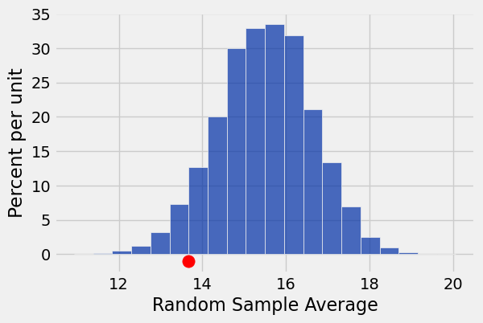

### Approach 1

**Code:**

```python
# (1) Calculate the p-value: simulation area beyond observed value
np.count_nonzero(sample_averages <= observed_average) / 100000
# (2) See if this is less than 5%
```

*Output:*

```text
0.05717
```

### Approach 2

**Code:**

```python
five_percent_point = averages_tbl.sort(0).column(0).item(round(len(sample_averages) * 0.05))
five_percent_point
```

*Output:*

```text
13.592592592592593
```

**Code:**

```python
# (2) See if this value is greater than observed value
observed_average
```

*Output:*

```text
13.6667
```

### Visual Representation

**Code:**

```python
averages_tbl.hist(bins = 20)
plots.plot([five_percent_point, five_percent_point], [0, 0.35], color='gold', lw=2)
plots.title('Area to the left of the gold line: 5%');
plots.scatter(observed_average, -0.01, color='red', s=120);
```

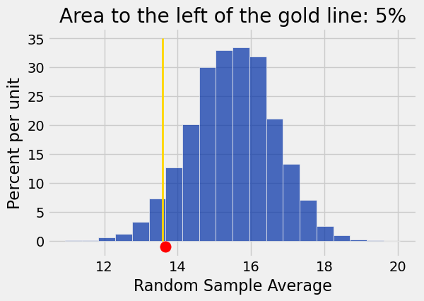

---

## Datasets

Datasets this notebook loads with `Table.read_table`. Column names are exact, including spaces and capitalization. Only the schema is recorded here — the data itself is not in this document, so any question about its values must be answered by running code, not by reasoning over the rows shown elsewhere in this file.

### `scores_by_section.csv`

359 rows, 2 columns.

| Column | Type |
| --- | --- |
| `Section` | int |
| `Midterm` | int |


---

# lec17_live

---
title: "lec17_live"
lecture: lec17
variant: live
course: data8
semester: sp26
source: lectures/data8/sp26/lec17/lec17_live.ipynb
language: python
---

**Code:**

```python
from datascience import *
import numpy as np

%matplotlib inline
import matplotlib.pyplot as plots
plots.style.use('fivethirtyeight')
```

## The GSI's Defense ##

**Code:**

```python
scores = Table.read_table('scores_by_section.csv')
scores.show(5)
```

*Output:*

| Section | Midterm |
| --- | --- |
| 1 | 22 |
| 2 | 12 |
| 2 | 23 |
| 2 | 14 |
| 1 | 20 |

### Visual Representation

**Code:**

```python
avg_t.hist(bins = 20)
plots.plot([five_percent_point, five_percent_point], [0, 0.35], color='gold', lw=2)
plots.title('Area to the left of the gold line: 5%');
plots.scatter(observed_average, -0.01, color='red', s=120);
```

---

## Datasets

Datasets this notebook loads with `Table.read_table`. Column names are exact, including spaces and capitalization. Only the schema is recorded here — the data itself is not in this document, so any question about its values must be answered by running code, not by reasoning over the rows shown elsewhere in this file.

### `scores_by_section.csv`

359 rows, 2 columns.

| Column | Type |
| --- | --- |
| `Section` | int |
| `Midterm` | int |


---

# lec18

---
title: "Comparing Two Samples"
lecture: lec18
course: data8
semester: sp26
source: lectures/data8/sp26/lec18/lec18.ipynb
language: python
---

**Code:**

```python
from datascience import *
import numpy as np

%matplotlib inline
import matplotlib.pyplot as plots
plots.style.use('fivethirtyeight')

import warnings
warnings.simplefilter("ignore")
```

# Comparing Two Samples

**Code:**

```python
births = Table.read_table('baby.csv')
```

**Code:**

```python
births
```

*Output:*

| Birth Weight | Gestational Days | Maternal Age | Maternal Height | Maternal Pregnancy Weight | Maternal Smoker |
| --- | --- | --- | --- | --- | --- |
| 120 | 284 | 27 | 62 | 100 | False |
| 113 | 282 | 33 | 64 | 135 | False |
| 128 | 279 | 28 | 64 | 115 | True |
| 108 | 282 | 23 | 67 | 125 | True |
| 136 | 286 | 25 | 62 | 93 | False |
| 138 | 244 | 33 | 62 | 178 | False |
| 132 | 245 | 23 | 65 | 140 | False |
| 120 | 289 | 25 | 62 | 125 | False |
| 143 | 299 | 30 | 66 | 136 | True |
| 140 | 351 | 27 | 68 | 120 | False |

**Code:**

```python
smoking_and_birthweight = births.select('Maternal Smoker', 'Birth Weight')
```

**Code:**

```python
smoking_and_birthweight.group('Maternal Smoker')
```

*Output:*

| Maternal Smoker | count |
| --- | --- |
| False | 715 |
| True | 459 |

**Code:**

```python
smoking_and_birthweight.hist('Birth Weight', group='Maternal Smoker')
```

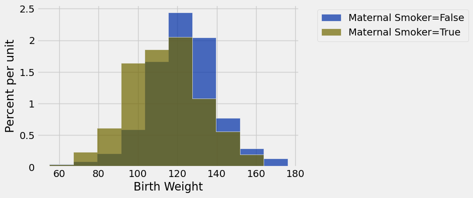

# Test Statistic

[Question] What values of our statistic are in favor of the alternative: positive or negative?

**Code:**

```python
means_table = smoking_and_birthweight.group('Maternal Smoker', np.average)
means_table
```

*Output:*

| Maternal Smoker | Birth Weight average |
| --- | --- |
| False | 123.085 |
| True | 113.819 |

**Code:**

```python
means = means_table.column(1)
observed_difference = means.item(1) - means.item(0)
observed_difference
```

*Output:*

```text
-9.266142572024918
```

**Code:**

```python
def difference_of_means(table, numeric_label, category_label):
    """
    Takes: 
       - name of table
       - column label of numerical variable
       - column label of categorical variable
       
    Returns: Difference of means of the two groups
    """
    
    #table with the two relevant columns
    reduced = table.select(numeric_label, category_label)  
    
    # table containing group means
    means_table = reduced.group(category_label, np.average)
    
    # array of group means
    means = means_table.column(1)
    
    return means.item(1) - means.item(0)
```

**Code:**

```python
difference_of_means(births, 'Birth Weight', 'Maternal Smoker')
```

*Output:*

```text
-9.266142572024918
```

# Random Permutation (Shuffling)

**Code:**

```python
staff = Table().with_columns(
    'Names', make_array('Jim', 'Pam', 'Dwight', 'Michael'),
    'Ages', make_array(29, 28, 34, 41)
)
```

**Code:**

```python
staff.sample()
```

*Output:*

| Names | Ages |
| --- | --- |
| Michael | 41 |
| Jim | 29 |
| Pam | 28 |
| Dwight | 34 |

**Code:**

```python
staff.sample(with_replacement = False)
```

*Output:*

| Names | Ages |
| --- | --- |
| Jim | 29 |
| Michael | 41 |
| Dwight | 34 |
| Pam | 28 |

**Code:**

```python
staff.with_column('Shuffled', staff.sample(with_replacement = False).column(0))
```

*Output:*

| Names | Ages | Shuffled |
| --- | --- | --- |
| Jim | 29 | Jim |
| Pam | 28 | Michael |
| Dwight | 34 | Pam |
| Michael | 41 | Dwight |

# Simulation Under Null Hypothesis

**Code:**

```python
smoking_and_birthweight
```

*Output:*

| Maternal Smoker | Birth Weight |
| --- | --- |
| False | 120 |
| False | 113 |
| True | 128 |
| True | 108 |
| False | 136 |
| False | 138 |
| False | 132 |
| False | 120 |
| True | 143 |
| False | 140 |

**Code:**

```python
shuffled_labels = smoking_and_birthweight.sample(with_replacement=False).column('Maternal Smoker')
```

**Code:**

```python
original_and_shuffled = smoking_and_birthweight.with_column(
    'Shuffled Label', shuffled_labels
)
```

**Code:**

```python
original_and_shuffled
```

*Output:*

| Maternal Smoker | Birth Weight | Shuffled Label |
| --- | --- | --- |
| False | 120 | False |
| False | 113 | False |
| True | 128 | True |
| True | 108 | True |
| False | 136 | False |
| False | 138 | True |
| False | 132 | True |
| False | 120 | True |
| True | 143 | False |
| False | 140 | True |

**Code:**

```python
difference_of_means(original_and_shuffled, 'Birth Weight', 'Shuffled Label')
```

*Output:*

```text
1.0220302573243742
```

**Code:**

```python
difference_of_means(original_and_shuffled, 'Birth Weight', 'Maternal Smoker')
```

*Output:*

```text
-9.266142572024918
```

# Permutation Test

**Code:**

```python
def one_simulated_difference(table, numeric_label, category_label):
    """
    Takes: 
       - name of table
       - column label of numerical variable
       - column label of categorical variable
       
    Returns: Difference of means of the two groups
    """
    
    # array of shuffled labels
    shuffled_labels = table.sample(with_replacement = False).column(category_label)
    
    # table of numerical variable and shuffled labels
    shuffled_table = table.select(numeric_label).with_column('Shuffled Label', shuffled_labels)
    
    return difference_of_means(shuffled_table, numeric_label, 'Shuffled Label')
```

**Code:**

```python
one_simulated_difference(births, 'Birth Weight', 'Maternal Smoker')
```

*Output:*

```text
-0.6342367871779686
```

**Code:**

```python
differences = make_array()

for i in np.arange(2000):
    new_difference = one_simulated_difference(births, 'Birth Weight', 'Maternal Smoker')
    differences = np.append(differences, new_difference)
```

**Code:**

```python
Table().with_column('Difference Between Group Means', differences).hist()
print('Observed Difference:', observed_difference)
plots.title('Prediction Under the Null Hypothesis');
```

*Output (stdout):*

```text
Observed Difference: -9.266142572024918
```

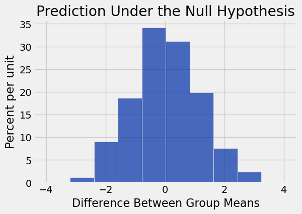

---

## Datasets

Datasets this notebook loads with `Table.read_table`. Column names are exact, including spaces and capitalization. Only the schema is recorded here — the data itself is not in this document, so any question about its values must be answered by running code, not by reasoning over the rows shown elsewhere in this file.

### `baby.csv`

1,174 rows, 6 columns.

| Column | Type |
| --- | --- |
| `Birth Weight` | int |
| `Gestational Days` | int |
| `Maternal Age` | int |
| `Maternal Height` | int |
| `Maternal Pregnancy Weight` | int |
| `Maternal Smoker` | bool |


---

# lec19

---
title: "Randomized Control Experiment"
lecture: lec19
course: data8
semester: sp26
source: lectures/data8/sp26/lec19/lec19.ipynb
language: python
---

**Code:**

```python
from datascience import *
import numpy as np

%matplotlib inline
import matplotlib.pyplot as plots
plots.style.use('fivethirtyeight')

import warnings
warnings.simplefilter("ignore")
```

## Review: Comparing Two Samples

**Code:**

```python
def difference_of_means(table, numeric_label, group_label):
    """
    Takes: name of table, column label of numerical variable,
    column label of group-label variable
    
    Returns: Difference of means of the two groups
    """
    
    #table with the two relevant columns
    reduced = table.select(numeric_label, group_label)  
    
    # table containing group means
    means_table = reduced.group(group_label, np.average)
    
    # array of group means
    means = means_table.column(1)
    
    return means.item(1) - means.item(0)
```

**Code:**

```python
def one_simulated_difference(table, numeric_label, group_label):
    """
    Takes: name of table, column label of numerical variable,
    column label of group-label variable
    
    Returns: Difference of means of the two groups after shuffling labels
    """
    
    # array of shuffled labels
    shuffled_labels = table.sample(
        with_replacement = False).column(group_label)
    
    # table of numerical variable and shuffled labels
    shuffled_table = table.select(numeric_label).with_column(
        'Shuffled Label', shuffled_labels)
    
    return difference_of_means(
        shuffled_table, numeric_label, 'Shuffled Label')
```

**Code:**

```python
births = Table.read_table('baby.csv')
```

**Code:**

```python
means = births.group('Maternal Smoker', np.average)
means
```

*Output:*

| Maternal Smoker | Birth Weight average | Gestational Days average | Maternal Age average | Maternal Height average | Maternal Pregnancy Weight average |
| --- | --- | --- | --- | --- | --- |
| False | 123.085 | 279.874 | 27.5441 | 64.014 | 129.48 |
| True | 113.819 | 277.898 | 26.7364 | 64.1046 | 126.919 |

**Code:**

```python
observed_difference = means.column(1).item(1) - means.column(1).item(0)
observed_difference
```

*Output:*

```text
-9.266142572024918
```

**Code:**

```python
one_simulated_difference(births, 'Birth Weight', 'Maternal Smoker')
```

*Output:*

```text
-0.094071941130764
```

**Code:**

```python
differences = make_array()

for i in np.arange(2000):
    new_difference = one_simulated_difference(births, 'Birth Weight', 'Maternal Smoker')
    differences = np.append(differences, new_difference)
```

**Code:**

```python
Table().with_column('Difference Between Group Means', differences).hist()
print('Observed Difference:', observed_difference)
plots.title('Prediction Under the Null Hypothesis');
```

*Output (stdout):*

```text
Observed Difference: -9.266142572024918
```

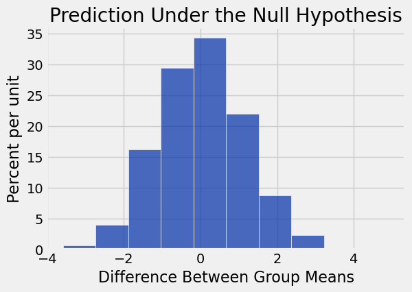

# Randomized Control Experiment

**Code:**

```python
botox = Table.read_table('bta.csv')
botox.show()
```

*Output:*

| Group | Result |
| --- | --- |
| Control | 1 |
| Control | 1 |
| Control | 0 |
| Control | 0 |
| Control | 0 |
| Control | 0 |
| Control | 0 |
| Control | 0 |
| Control | 0 |
| Control | 0 |
| Control | 0 |
| Control | 0 |
| Control | 0 |
| Control | 0 |
| Control | 0 |
| Control | 0 |
| Treatment | 1 |
| Treatment | 1 |
| Treatment | 1 |
| Treatment | 1 |

_... 11 more rows_

**Code:**

```python
botox.pivot('Result', 'Group')
```

*Output:*

| Group | 0.0 | 1.0 |
| --- | --- | --- |
| Control | 14 | 2 |
| Treatment | 6 | 9 |

**Code:**

```python
botox.group('Group', np.average)
```

*Output:*

| Group | Result average |
| --- | --- |
| Control | 0.125 |
| Treatment | 0.6 |

# Testing the Hypothesis

**Code:**

```python
observed_diff = difference_of_means(botox, 'Result', 'Group')
observed_diff
```

*Output:*

```text
0.475
```

**Code:**

```python
one_simulated_difference(botox, 'Result', 'Group')
```

*Output:*

```text
-0.3
```

**Code:**

```python
simulated_diffs = make_array()

for i in np.arange(10000):
    sim_diff = one_simulated_difference(botox, 'Result', 'Group')
    simulated_diffs = np.append(simulated_diffs, sim_diff)
```

**Code:**

```python
col_name = 'Distances between groups'
Table().with_column(col_name, simulated_diffs).hist(col_name)
```

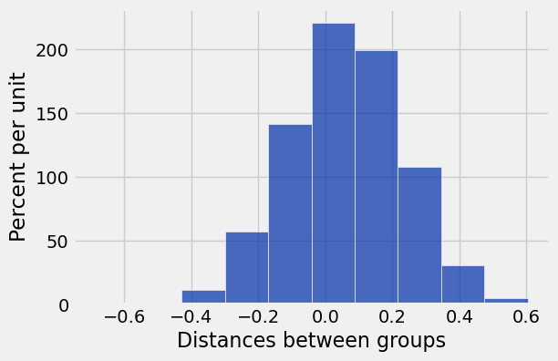

**Code:**

```python
# p-value
sum(simulated_diffs >= observed_diff)/len(simulated_diffs)
```

*Output:*

```text
0.0063
```

## Discussion Question: Super Soda

**Code:**

```python
def simulate_one_count(sample_size):
    return np.count_nonzero(np.random.choice(['H', 'T'], sample_size) == 'H')
simulate_one_count(200)
```

*Output:*

```text
100
```

**Code:**

```python
num_simulations = 10000
counts = make_array()
for i in np.arange(num_simulations):
    counts = np.append(counts, simulate_one_count(200))
```

**Code:**

```python
trials = Table().with_column('Number of Heads', counts)
trials.hist(right_end=91)
plots.ylim(-0.001, 0.055)
plots.scatter(91, 0, color='red', s=40, zorder=3)
plots.title('Prediction Under the Null');
```

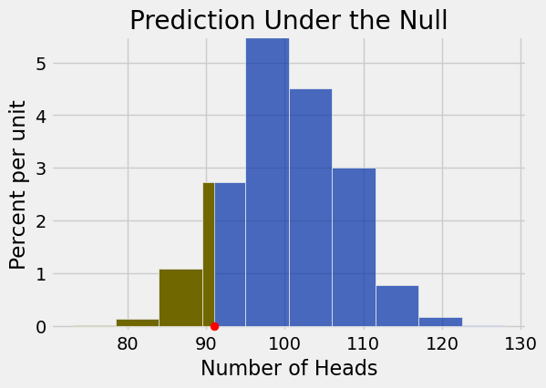

**Code:**

```python
np.count_nonzero(counts <= 91)/len(counts)
```

*Output:*

```text
0.1117
```

Conclusion:

## Changing the number of simulations

**Code:**

```python
# Keeping the data fixed, we can re-run the test with a new simulation under the null
def run_test(num_simulations, sample_size):
    counts = make_array()
    for i in np.arange(num_simulations):
        counts = np.append(counts, simulate_one_count(sample_size))
    return counts

counts = run_test(10000, 200)
np.count_nonzero(counts <= 91)/len(counts)
```

*Output:*

```text
0.1131
```

**Code:**

```python
# Let's repeat that 50 times for each number of simulations
tests = Table(['simulations', 'p-value for 91'])
for num_sims in [100, 1000, 10000]:
    for k in np.arange(50):
        counts = run_test(num_sims, 200)
        tests = tests.with_row([
            num_sims, 
            np.count_nonzero(counts <= 91)/len(counts),
        ])
tests.show(3)
```

*Output:*

| simulations | p-value for 91 |
| --- | --- |
| 100 | 0.04 |
| 100 | 0.14 |
| 100 | 0.12 |

**Code:**

```python
# For larger numbers of simulations, p-values are more consistent
tests.hist(1, group='simulations')
```

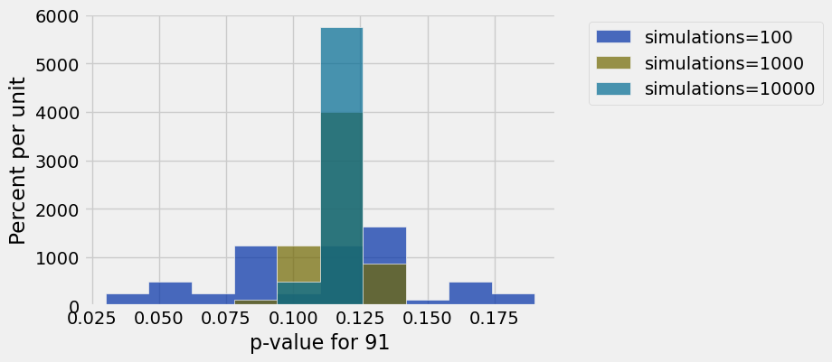

## Changing the size of the taste test

**Code:**

```python
# Suppose that the true proportion of people who prefer Super Soda is 45%
true_proportion = 0.45
true_distribution = make_array(true_proportion, 1 - true_proportion)
true_distribution
```

*Output:*

```text
array([ 0.45,  0.55])
```

**Code:**

```python
# Taste tests with 200 people will give varioius numbers of people who prefer Super Soda
sample_size = 200
sample_proportions(sample_size, true_distribution) * sample_size
```

*Output:*

```text
array([  77.,  123.])
```

**Code:**

```python
# If you run a taste test for 200 people, what might you conclude?
def run_experiment(num_simulations, sample_size, true_proportion):
    # Collect data
    true_distribution = make_array(true_proportion, 1 - true_proportion)
    taste_test_results = sample_proportions(sample_size, true_distribution) * sample_size
    observed_stat_from_this_sample = taste_test_results.item(0)
    
    # Conduct hypothesis test
    counts = run_test(num_simulations, sample_size)
    p_value = np.count_nonzero(counts <= observed_stat_from_this_sample) / len(counts)
    return p_value

run_experiment(10000, 200, 0.45)
```

*Output:*

```text
0.4702
```

**Code:**

```python
# Let's imagine running our taste test over and over again to see how often we reject the null
true_proportion = 0.45
sample_size = 200
p_values = make_array()
for k in np.arange(100):
    p_value = run_experiment(1000, sample_size, true_proportion)
    p_values = np.append(p_values, p_value)
Table().with_column('P-value', p_values).hist(0, bins=20)
print('Percent of p-values at or below 0.05:', 100 * np.count_nonzero(p_values <= 0.05) / len(p_values))
```

*Output (stdout):*

```text
Percent of p-values at or below 0.05: 40.0
```

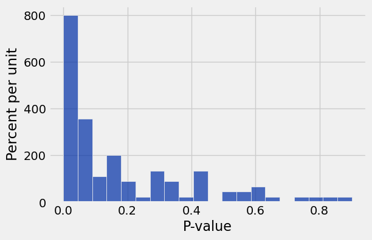

---

## Datasets

Datasets this notebook loads with `Table.read_table`. Column names are exact, including spaces and capitalization. Only the schema is recorded here — the data itself is not in this document, so any question about its values must be answered by running code, not by reasoning over the rows shown elsewhere in this file.

### `baby.csv`

1,174 rows, 6 columns.

| Column | Type |
| --- | --- |
| `Birth Weight` | int |
| `Gestational Days` | int |
| `Maternal Age` | int |
| `Maternal Height` | int |
| `Maternal Pregnancy Weight` | int |
| `Maternal Smoker` | bool |

### `bta.csv`

31 rows, 2 columns.

| Column | Type |
| --- | --- |
| `Group` | str |
| `Result` | float |


---

# lec20

---
title: "Simulation"
lecture: lec20
course: data8
semester: sp26
source: lectures/data8/sp26/lec20/lec20.ipynb
language: python
---

**Code:**

```python
from datascience import *
import numpy as np

%matplotlib inline
import matplotlib.pyplot as plots
plots.style.use('fivethirtyeight')

import warnings
warnings.simplefilter("ignore")
```

## Discussion Question: Super Soda

**Code:**

```python
def simulate_one_count(sample_size):
    return np.count_nonzero(np.random.choice(['H', 'T'], sample_size) == 'H')
simulate_one_count(200)
```

**Code:**

```python
num_simulations = 10000
counts = make_array()
for i in np.arange(num_simulations):
    counts = np.append(counts, simulate_one_count(200))
```

**Code:**

```python
trials = Table().with_column('Number of Heads', counts)
trials.hist(right_end=91)
plots.ylim(-0.001, 0.055)
plots.scatter(91, 0, color='red', s=40, zorder=3)
plots.title('Prediction Under the Null');
```

**Code:**

```python
np.count_nonzero(counts <= 91)/len(counts)
```

Conclusion:

## Changing the number of simulations

**Code:**

```python
# Keeping the data fixed, we can re-run the test with a new simulation under the null
def run_test(num_simulations, sample_size):
    counts = make_array()
    for i in np.arange(num_simulations):
        counts = np.append(counts, simulate_one_count(sample_size))
    return counts

counts = run_test(10000, 200)
np.count_nonzero(counts <= 91)/len(counts)
```

**Code:**

```python
# Let's repeat that 50 times for each number of simulations
tests = Table(['simulations', 'p-value for 91'])
for num_sims in [100, 1000, 10000]:
    for k in np.arange(50):
        counts = run_test(num_sims, 200)
        tests = tests.with_row([
            num_sims, 
            np.count_nonzero(counts <= 91)/len(counts),
        ])
tests.show(3)
```

**Code:**

```python
# For larger numbers of simulations, p-values are more consistent
tests.hist(1, group='simulations')
```

## Changing the size of the taste test

**Code:**

```python
# Suppose that the true proportion of people who prefer Super Soda is 45%
true_proportion = 0.45
true_distribution = make_array(true_proportion, 1 - true_proportion)
true_distribution
```

**Code:**

```python
# Taste tests with 200 people will give varioius numbers of people who prefer Super Soda
sample_size = 200
sample_proportions(sample_size, true_distribution) * sample_size
```

**Code:**

```python
# If you run a taste test for 200 people, what might you conclude?
def run_experiment(num_simulations, sample_size, true_proportion):
    # Collect data
    true_distribution = make_array(true_proportion, 1 - true_proportion)
    taste_test_results = sample_proportions(sample_size, true_distribution) * sample_size
    observed_stat_from_this_sample = taste_test_results.item(0)
    
    # Conduct hypothesis test
    counts = run_test(num_simulations, sample_size)
    p_value = np.count_nonzero(counts <= observed_stat_from_this_sample) / len(counts)
    return p_value

run_experiment(10000, 200, 0.45)
```

**Code:**

```python
# Let's imagine running our taste test over and over again to see how often we reject the null
true_proportion = 0.45
sample_size = 200
p_values = make_array()
for k in np.arange(100):
    p_value = run_experiment(1000, sample_size, true_proportion)
    p_values = np.append(p_values, p_value)
Table().with_column('P-value', p_values).hist(0, bins=20)
print('Percent of p-values at or below 0.05:', 100 * np.count_nonzero(p_values <= 0.05) / len(p_values))
```

# Simulation

10 tickets are selected at random with replacement from a basket that contains 30% green tickets, 20% blue tickets, and 50% red tickets. 
What's the chance that 5 or more of those 10 tickets are blue?

**Code:**

```python
sample_proportions(10, [.3, .2, .5]).item(1) * 10
```

**Code:**

```python
blue_counts = make_array()
for i in np.arange(10000):
    c = sample_proportions(10, [.3, .2, .5]).item(1) * 10
    blue_counts = np.append(blue_counts, c)
np.count_nonzero(blue_counts >= 5) / len(blue_counts)
```


---

# lec22

---
title: "Bootstrap"
lecture: lec22
course: data8
semester: sp26
source: lectures/data8/sp26/lec22/lec22.ipynb
language: python
---

**Code:**

```python
from datascience import *
%matplotlib inline

import matplotlib.pyplot as plots
plots.style.use('fivethirtyeight')
import numpy as np

import warnings
warnings.simplefilter("ignore")
```

## Percentiles ##

**Code:**

```python
# Manually compute the 55th percentile.
x = make_array(43, 20, 51, 7, 28, 34)
```

**Code:**

```python
# Step 1. Sort the data
np.sort(x)
```

**Code:**

```python
# Step 2. Figure out where 55th percentile would be.
```

**Code:**

```python
np.arange(1, 7)/6
```

**Code:**

```python
np.arange(1, 7)/6 >= 55/100
```

**Code:**

```python
np.sort(x).item(3)
```

**Code:**

```python
# Alternatively: One line of code
percentile(55, x)
```

## Discussion Question

**Code:**

```python
s = make_array(1, 3, 5, 7, 9)
```

**Code:**

```python
percentile(10, s) == 0
```

**Code:**

```python
percentile(39, s) == percentile(40, s)
```

**Code:**

```python
percentile(40, s) == percentile(41, s)
```

**Code:**

```python
percentile(50, s) == 5
```

## Inference: Estimation

**Code:**

```python
sf = Table.read_table('san_francisco_2019.csv')
sf.show(3)
```

**Code:**

```python
# Who made the most money
sf.sort('Total Compensation', descending=True).show(5)
```

**Code:**

```python
# Who made the least money
sf.sort('Total Compensation', descending=False).show(5)
```

**Code:**

```python
# $15/hr, 20 hr/wk, 50 weeks

min_salary = 15 * 20 * 50
sf = sf.where('Salary', are.above(min_salary))
```

**Code:**

```python
# Population Distribution

sf_bins = np.arange(0, 726000, 25000)
sf.hist('Total Compensation', bins=sf_bins)
```

**Code:**

```python
# An Empirical Distribution

our_sample = sf.sample(400, with_replacement=False)
our_sample.hist('Total Compensation', bins=sf_bins)
```

**Code:**

```python
# Parameter: Median Total Compensation 

pop_median = percentile(50, sf.column('Total Compensation'))
pop_median
```

**Code:**

```python
# Estimate: Median of a Sample

percentile(50, our_sample.column('Total Compensation'))
```

## Variability of the Estimate

**Code:**

```python
def generate_sample_median(samp_size):
    new_sample = sf.sample(samp_size, with_replacement=False)
    return percentile(50, new_sample.column('Total Compensation'))
```

**Code:**

```python
generate_sample_median(400)
```

## Quantifying Uncertainty

**Code:**

```python
sample_medians = make_array()

for i in np.arange(1000):
    new_median = generate_sample_median(400)
    sample_medians = np.append(sample_medians, new_median)
```

**Code:**

```python
med_bins = np.arange(120000, 160000, 2000)
Table().with_column('Sample Medians', sample_medians).hist(bins=med_bins)

plots.ylim(-0.000005, 0.00014)
plots.scatter(pop_median, 0, color='red');
```

**Code:**

```python
print('Less than 2.5% of estimates are more than', pop_median - percentile(2.5, sample_medians), 'lower than', pop_median)
print('Less than 2.5% of estimates are more than', percentile(97.5, sample_medians) - pop_median, 'higher than', pop_median)
```

# Bootstrap

Sample randomly
 - from the original sample
 - with replacement
 - the same number of times as the original sample size

**Code:**

```python
# Default behavior of t.sample():
# at random with replacement,
# the same number of times as the number of rows in t

bootstrap_sample = our_sample.sample()
bootstrap_sample.hist('Total Compensation', bins=sf_bins)
percentile(50, bootstrap_sample.column('Total Compensation'))
```

**Code:**

```python
def one_bootstrap_median():
    # draw the bootstrap sample
    resample = our_sample.sample()
    # return the median total compensation in the bootstrap sample
    return percentile(50, resample.column('Total Compensation'))
```

**Code:**

```python
one_bootstrap_median()
```

**Code:**

```python
# Generate the medians of 1000 bootstrap samples
num_repetitions = 1000
bstrap_medians = make_array()
for i in np.arange(num_repetitions):
    bstrap_medians = np.append(bstrap_medians, one_bootstrap_median())
```

**Code:**

```python
resampled_medians = Table().with_column('Bootstrap Sample Median', bstrap_medians)
median_bins=np.arange(120000, 160000, 2000)
resampled_medians.hist(bins = median_bins)

# Plotting parameters; you can ignore this code
parameter_green = '#32CD32'
plots.ylim(-0.000005, 0.00014)
plots.scatter(pop_median, 0, color=parameter_green, s=40, zorder=2)
plots.title('Bootstrap Medians and the Parameter (Green Dot)');
```

## Percentile Method: Middle 95% of the Bootstrap Estimates

**Code:**

```python
left = percentile(2.5, bstrap_medians)
right = percentile(97.5, bstrap_medians)

make_array(left, right)
```

**Code:**

```python
resampled_medians.hist(bins = median_bins)

# Plotting parameters; you can ignore this code
plots.ylim(-0.000005, 0.00014)
plots.plot(make_array(left, right), make_array(0, 0), color='yellow', lw=3, zorder=1)
plots.scatter(pop_median, 0, color=parameter_green, s=40, zorder=2);
```

---

## Datasets

Datasets this notebook loads with `Table.read_table`. Column names are exact, including spaces and capitalization. Only the schema is recorded here — the data itself is not in this document, so any question about its values must be answered by running code, not by reasoning over the rows shown elsewhere in this file.

### `san_francisco_2019.csv`

44,525 rows, 8 columns.

| Column | Type |
| --- | --- |
| `Organization Group` | str |
| `Department` | str |
| `Job Family` | str |
| `Job` | str |
| `Salary` | float |
| `Overtime` | float |
| `Benefits` | float |
| `Total Compensation` | float |


---

# lec22_live

---
title: "Bootstrap"
lecture: lec22
variant: live
course: data8
semester: sp26
source: lectures/data8/sp26/lec22/lec22_live.ipynb
language: python
---

**Code:**

```python
from datascience import *
%matplotlib inline

import matplotlib.pyplot as plots
plots.style.use('fivethirtyeight')
import numpy as np

import warnings
warnings.simplefilter("ignore")
```

## Percentiles ##

**Code:**

```python
# Manually compute the 55th percentile.
x = make_array(43, 20, 51, 7, 28, 34)
```

**Code:**

```python
x
```

*Output:*

```text
array([43, 20, 51,  7, 28, 34])
```

**Code:**

```python
# Step 1. Sort the data
np.sort(x)
```

*Output:*

```text
array([ 7, 20, 28, 34, 43, 51])
```

**Code:**

```python
x
```

*Output:*

```text
array([43, 20, 51,  7, 28, 34])
```

**Code:**

```python
# Step 2. Figure out where 55th percentile would be.
```

**Code:**

```python
np.arange(1, 7)/6
```

*Output:*

```text
array([ 0.16666667,  0.33333333,  0.5       ,  0.66666667,  0.83333333,
        1.        ])
```

**Code:**

```python
np.arange(1, 7)/6 >= 55/100
```

*Output:*

```text
array([False, False, False,  True,  True,  True], dtype=bool)
```

**Code:**

```python
np.sort(x).item(3)
```

*Output:*

```text
34
```

**Code:**

```python
# Alternatively: One line of code
percentile(55, x)
```

*Output:*

```text
34
```

**Code:**

```python
x
```

*Output:*

```text
array([43, 20, 51,  7, 28, 34])
```

## Discussion Question

**Code:**

```python
s = make_array(1, 5, 7, 3, 9)
s
```

*Output:*

```text
array([1, 5, 7, 3, 9])
```

**Code:**

```python
percentile(100, s)
```

*Output:*

```text
9
```

**Code:**

```python
percentile(39, s)
```

*Output:*

```text
3
```

**Code:**

```python
percentile(41, s)
```

*Output:*

```text
5
```

**Code:**

```python
percentile(50, s) == 5
```

*Output:*

```text
True
```

## Inference: Estimation

**Code:**

```python
sf = Table.read_table('san_francisco_2019.csv')
sf.sample(3)
```

*Output:*

| Organization Group | Department | Job Family | Job | Salary | Overtime | Benefits | Total Compensation |
| --- | --- | --- | --- | --- | --- | --- | --- |
| Public Protection | Police | Budget, Admn & Stats Analysis | Administrative Analyst | 83061 | 0 | 38367 | 121428 |
| Public Protection | Fire Department | Fire Services | Battalion Chief, Fire Suppress | 231247 | 80894 | 69714 | 381855 |
| Public Protection | Fire Department | Fire Services | Firefighter | 148937 | 11666 | 47916 | 208518 |

**Code:**

```python
# Who made the most money
sf.sort('Total Compensation', descending=True).show(5)
```

*Output:*

| Organization Group | Department | Job Family | Job | Salary | Overtime | Benefits | Total Compensation |
| --- | --- | --- | --- | --- | --- | --- | --- |
| General Administration & Finance | Retirement Services | Administrative & Mgmt (Unrep) | Chief Investment Officer | 577633 | 0 | 146398 | 724031 |
| General Administration & Finance | Retirement Services | Unassigned | Managing Director | 483072 | 0 | 134879 | 617951 |
| General Administration & Finance | Retirement Services | Unassigned | Managing Director | 482649 | 0 | 134905 | 617554 |
| General Administration & Finance | Retirement Services | Unassigned | Managing Director | 451507 | 0 | 120276 | 571784 |
| General Administration & Finance | Retirement Services | Unassigned | Managing Director | 449378 | 0 | 120857 | 570235 |

**Code:**

```python
# Who made the least money
sf.sort('Total Compensation', descending=False).show(5)
```

*Output:*

| Organization Group | Department | Job Family | Job | Salary | Overtime | Benefits | Total Compensation |
| --- | --- | --- | --- | --- | --- | --- | --- |
| Public Protection | Adult Probation | Probation & Parole | Deputy Probation Officer | 0 | 0 | 0 | 0 |
| Public Protection | Fire Department | Clerical, Secretarial & Steno | Senior Clerk Typist | 0 | 0 | 0 | 0 |
| Public Protection | Juvenile Court | Correction & Detention | Counselor, Juvenile Hall PERS | 0 | 0 | 0 | 0 |
| Public Protection | Police | Clerical, Secretarial & Steno | Clerk Typist | 0 | 0 | 0 | 0 |
| Public Protection | Sheriff | Correction & Detention | Deputy Sheriff | 0 | 0 | 0 | 0 |

**Code:**

```python
# $15/hr, 20 hr/wk, 50 weeks

min_salary = 15 * 20 * 50
sf = sf.where('Salary', are.above(min_salary))
sf.sort('Total Compensation', descending=False).show(5)
```

*Output:*

| Organization Group | Department | Job Family | Job | Salary | Overtime | Benefits | Total Compensation |
| --- | --- | --- | --- | --- | --- | --- | --- |
| Public Works, Transportation & Commerce | Municipal Transportation Agcy | Sub-Professional Engineering | StdntDsgnTrain1, Arch/Eng/Plng | 15578 | 0 | 41 | 15619 |
| Public Protection | Trial Courts | Untitled | Superior Court Judge | 15414 | 0 | 224 | 15637 |
| Culture & Recreation | Recreation And Park Commission | Recreation | Recreation Coordinator | 15016 | 0 | 1180 | 16196 |
| Public Works, Transportation & Commerce | Municipal Transportation Agcy | Protection & Apprehension | School Crossing Guard | 15053 | 0 | 1168 | 16221 |
| Human Welfare & Neighborhood Development | Human Services | Public Service Aide | Public Service Trainee | 15008 | 0 | 1230 | 16238 |

**Code:**

```python
# Population Distribution

sf_bins = np.arange(0, 726000, 25000)
sf.hist('Total Compensation', bins=sf_bins)
```

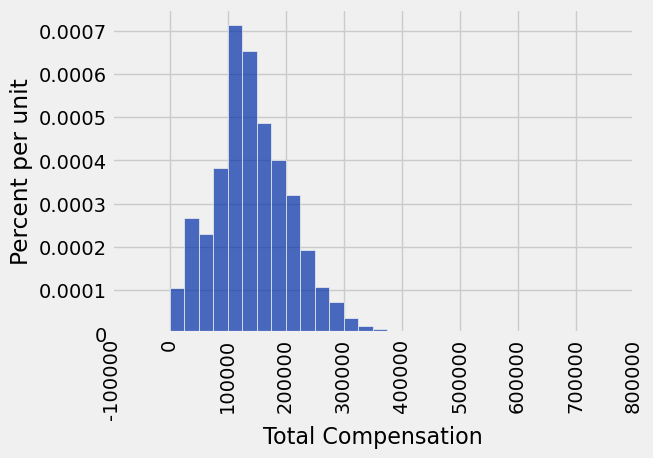

**Code:**

```python
# An Empirical Distribution

our_sample = sf.sample(400, with_replacement=False)
our_sample.hist('Total Compensation', bins=sf_bins)
```

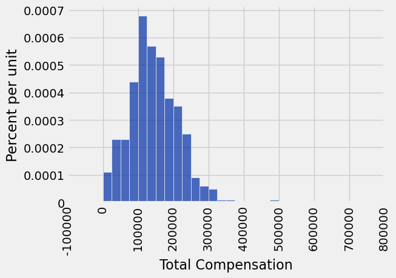

**Code:**

```python
# Parameter: Median Total Compensation 

pop_median = percentile(50, sf.column('Total Compensation'))  # 37,000+ people
pop_median
```

*Output:*

```text
135747.0
```

**Code:**

```python
# Estimate: Median of a Sample

percentile(50, our_sample.column('Total Compensation')) # 400 people
```

*Output:*

```text
139708.0
```

## Variability of the Estimate

**Code:**

```python
def generate_sample_median(samp_size):
    new_sample = sf.sample(samp_size, with_replacement=False)
    return percentile(50, new_sample.column('Total Compensation'))
```

**Code:**

```python
generate_sample_median(400)
```

*Output:*

```text
137804.0
```

## Quantifying Uncertainty

**Code:**

```python
sample_medians = make_array()

for i in np.arange(1000):
    new_median = generate_sample_median(400)
    sample_medians = np.append(sample_medians, new_median)
```

**Code:**

```python
med_bins = np.arange(120000, 160000, 2000)
Table().with_column('Sample Medians', sample_medians).hist(bins=med_bins)

plots.ylim(-0.000005, 0.00014)
plots.scatter(pop_median, 0, color='red');
```

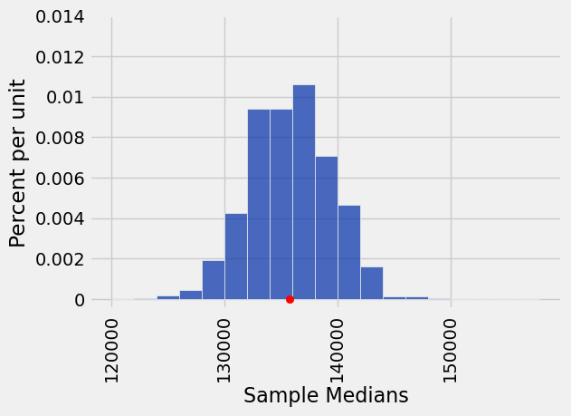

**Code:**

```python
print('Less than 2.5% of estimates are more than', pop_median - percentile(2.5, sample_medians), 'lower than', pop_median)
print('Less than 2.5% of estimates are more than', percentile(97.5, sample_medians) - pop_median, 'higher than', pop_median)
```

*Output (stdout):*

```text
Less than 2.5% of estimates are more than 6878.0 lower than 135747.0
Less than 2.5% of estimates are more than 6604.0 higher than 135747.0
```

# Bootstrap

Sample randomly
 - from the original sample
 - with replacement
 - the same number of times as the original sample size

**Code:**

```python
# Default behavior of t.sample():
# at random with replacement,
# the same number of times as the number of rows in t

bootstrap_sample = our_sample.sample()
bootstrap_sample.hist('Total Compensation', bins=sf_bins)
percentile(50, bootstrap_sample.column('Total Compensation'))
```

*Output:*

```text
140501.0
```

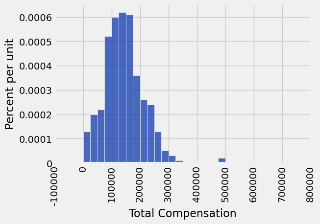

**Code:**

```python
def one_bootstrap_median():
    # draw the bootstrap sample
    resample = our_sample.sample()
    # return the median total compensation in the bootstrap sample
    return percentile(50, resample.column('Total Compensation'))
```

**Code:**

```python
one_bootstrap_median()
```

*Output:*

```text
135380.0
```

**Code:**

```python
# Generate the medians of 1000 bootstrap samples
num_repetitions = 1000
bstrap_medians = make_array()
for i in np.arange(num_repetitions):
    bstrap_medians = np.append(bstrap_medians, one_bootstrap_median())
```

**Code:**

```python
resampled_medians = Table().with_column('Bootstrap Sample Median', bstrap_medians)
median_bins=np.arange(120000, 160000, 2000)
resampled_medians.hist(bins = median_bins)

# Plotting parameters; you can ignore this code
parameter_green = '#32CD32'
plots.ylim(-0.000005, 0.00014)
plots.scatter(pop_median, 0, color=parameter_green, s=40, zorder=2)
plots.title('Bootstrap Medians and the Parameter (Green Dot)');
```

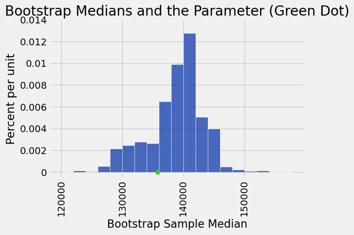

## Percentile Method: Middle 95% of the Bootstrap Estimates

**Code:**

```python
left = percentile(2.5, bstrap_medians)
right = percentile(97.5, bstrap_medians)

make_array(left, right)  # The middle 95% of medians of bootstrap resamples
```

*Output:*

```text
array([ 128909.,  145220.])
```

**Code:**

```python
resampled_medians.hist(bins = median_bins)

# Plotting parameters; you can ignore this code
plots.ylim(-0.000005, 0.00014)
plots.plot(make_array(left, right), make_array(0, 0), color='yellow', lw=3, zorder=1)
plots.scatter(pop_median, 0, color=parameter_green, s=40, zorder=2);
```

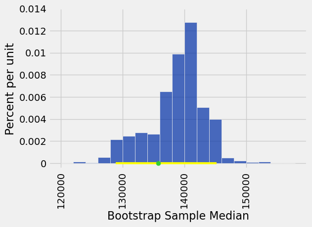

---

## Datasets

Datasets this notebook loads with `Table.read_table`. Column names are exact, including spaces and capitalization. Only the schema is recorded here — the data itself is not in this document, so any question about its values must be answered by running code, not by reasoning over the rows shown elsewhere in this file.

### `san_francisco_2019.csv`

44,525 rows, 8 columns.

| Column | Type |
| --- | --- |
| `Organization Group` | str |
| `Department` | str |
| `Job Family` | str |
| `Job` | str |
| `Salary` | float |
| `Overtime` | float |
| `Benefits` | float |
| `Total Compensation` | float |


---

# lec23

---
title: "lec23"
lecture: lec23
course: data8
semester: sp26
source: lectures/data8/sp26/lec23/lec23.ipynb
language: python
---

**Code:**

```python
from datascience import *
%matplotlib inline
path_data = '../../../assets/data/'
import matplotlib.pyplot as plots
plots.style.use('fivethirtyeight')
import numpy as np
import warnings
warnings.simplefilter(action='ignore', category=np.VisibleDeprecationWarning)
```

## Bootstrap

**Code:**

```python
sf = Table.read_table('san_francisco_2019.csv')
min_salary = 15 * 20 * 50
sf = sf.where('Salary', are.above(min_salary))
```

**Code:**

```python
sf.num_rows
```

**Code:**

```python
sf_bins = np.arange(0, 726000, 25000)
sf.hist('Total Compensation', bins=sf_bins)
```

**Code:**

```python
# Parameter: Median total compensation in the population
def median_comp(t):
    return percentile(50, t.column('Total Compensation'))

median_comp(sf)
```

## Bootstrap Estimates of the Parameter (Pretend it is Unknown)

**Code:**

```python
def confidence_interval_95(sample_size):
    # Collect one random sample from the population
    our_sample = sf.sample(sample_size, with_replacement=False)
    median_comp(our_sample)

    # Generate the medians of 1000 bootstrap samples
    num_repetitions = 1000
    bstrap_medians = make_array()
    for i in np.arange(num_repetitions):
        # Resample the same number of rows, with replacement
        bstrap_medians = np.append(bstrap_medians, 
                                   median_comp(our_sample.sample()))

    # Find the middle 95% of medians; that's a confidence interval
    left = percentile(2.5, bstrap_medians)
    right = percentile(97.5, bstrap_medians)
    return make_array(left, right)

confidence_interval_95(100)
```

**Code:**

```python
intervals = Table(['k', 'lower', 'upper'])

sample_size=32
for k in np.arange(100):
    interval = confidence_interval_95(sample_size)
    intervals = intervals.with_row([
        k, interval.item(0), interval.item(1)
    ])
    
intervals.show(4)
```

**Code:**

```python
truth = median_comp(sf)
plots.plot((truth, truth), (0, intervals.num_rows), color='green', lw=3)
plots.xticks([90000, 120000, 150000, 180000])
for row in intervals.rows:
    if row.item('lower') > truth or row.item('upper') < truth:
        color = 'red'
    else:
        color = 'blue'
    plots.plot((row.item('lower'), row.item('upper')),
               (row.item('k'), row.item('k')),
               color, lw=1)
```

## Confidence Interval for Unknown Population Mean

**Code:**

```python
# Random sample of mother-newborn pairs
births = Table.read_table('baby.csv')
```

**Code:**

```python
births.hist('Maternal Age')
```

**Code:**

```python
# Average age of mothers in the sample
np.average(births.column('Maternal Age'))
```

### Question
What is the average age of the mothers in the population?

**Code:**

```python
def one_bootstrap_mean():
    resample = births.sample()
    return np.average(resample.column('Maternal Age'))
```

**Code:**

```python
# Generate means from 3000 bootstrap samples
num_repetitions = 3000
bstrap_means = make_array()
for i in np.arange(num_repetitions):
    bstrap_means = np.append(bstrap_means, one_bootstrap_mean())
```

### Bootstrap Percentile Method for Confidence Interval

The interval of estimates is the "middle 95%" of the bootstrap estimates.

This is called a *95% confidence interval* for the mean age in the population.

**Code:**

```python
# Get the endpoints of the 95% confidence interval
left = percentile(2.5, bstrap_means)
right = percentile(97.5, bstrap_means)

make_array(left, right)
```

**Code:**

```python
resampled_means = Table().with_columns(
    'Bootstrap Sample Mean', bstrap_means
)
resampled_means.hist(bins=15)
plots.plot([left, right], [0, 0], color='yellow', lw=8);
```

**Code:**

```python
births.hist('Maternal Age')
plots.plot([left, right], [0, 0], color='yellow', lw=8);
```

---

## Datasets

Datasets this notebook loads with `Table.read_table`. Column names are exact, including spaces and capitalization. Only the schema is recorded here — the data itself is not in this document, so any question about its values must be answered by running code, not by reasoning over the rows shown elsewhere in this file.

### `san_francisco_2019.csv`

44,525 rows, 8 columns.

| Column | Type |
| --- | --- |
| `Organization Group` | str |
| `Department` | str |
| `Job Family` | str |
| `Job` | str |
| `Salary` | float |
| `Overtime` | float |
| `Benefits` | float |
| `Total Compensation` | float |

### `baby.csv`

1,174 rows, 6 columns.

| Column | Type |
| --- | --- |
| `Birth Weight` | int |
| `Gestational Days` | int |
| `Maternal Age` | int |
| `Maternal Height` | int |
| `Maternal Pregnancy Weight` | int |
| `Maternal Smoker` | bool |


---

# lec24

---
title: "lec24"
lecture: lec24
course: data8
semester: sp26
source: lectures/data8/sp26/lec24/lec24.ipynb
language: python
---

**Code:**

```python
import matplotlib
from datascience import *
%matplotlib inline
import matplotlib.pyplot as plots
import numpy as np
plots.style.use('fivethirtyeight')
```

## Average (Mean) ##

**Code:**

```python
values = make_array(2, 3, 3, 9)
values
```

**Code:**

```python
sum(values)/len(values)
```

**Code:**

```python
np.average(values)
```

**Code:**

```python
np.mean(values)
```

**Code:**

```python
(2 + 3 + 3 + 9)/4
```

**Code:**

```python
2*(1/4) + 3*(2/4) + 9*(1/4)
```

**Code:**

```python
2*0.25 + 3*0.5 + 9*0.25
```

**Code:**

```python
values_table = Table().with_columns('value', values)
values_table
```

**Code:**

```python
bins_for_display = np.arange(0.5, 10.6, 1)
values_table.hist('value', bins = bins_for_display)
```

**Code:**

```python
## Make array of 10 2s, 20 3s, and 10 9s

new_vals = make_array(2, 2, 2, 2, 2, 2, 2, 2, 2, 2,
                      3, 3, 3, 3, 3, 3, 3, 3, 3, 3, 3, 3, 3, 3, 3, 3, 3, 3, 3, 3,
                      9, 9, 9, 9, 9, 9, 9, 9, 9, 9)
```

**Code:**

```python
Table().with_column('value', new_vals).hist(bins = bins_for_display)
```

**Code:**

```python
np.average(new_vals)
```

**Code:**

```python
Table().with_column('value', new_vals).hist(bins = bins_for_display)
plots.ylim(-0.04, 0.5)
plots.plot([0, 10], [0, 0], color='grey', lw=2)
plots.scatter(4.25, -0.015, marker='^', color='red', s=100)
plots.title('Average as a Center of Gravity');
```

## Standard Deviation ##

**Code:**

```python
sd_table = Table().with_columns('Value', values)
sd_table
```

**Code:**

```python
average_value = np.mean(values)
average_value
```

**Code:**

```python
deviations = values - average_value
sd_table = sd_table.with_column('Deviation', deviations)
sd_table
```

**Code:**

```python
sum(deviations)
```

**Code:**

```python
sd_table = sd_table.with_column('Squared Deviation', deviations ** 2)
sd_table
```

**Code:**

```python
# Variance of the data:
# mean squared deviation from average

variance = np.mean(deviations ** 2)
variance
```

**Code:**

```python
# Standard Deviation (SD): 
# root mean squared deviation from average
# = square root of the variance

sd = variance ** 0.5
sd
```

**Code:**

```python
np.std(values)
```

## Chebyshev's Bounds: "Tail" Bounds ##

**Code:**

```python
# Proportion in the range "mean +/- 3.5 SDs"
# Chebyshev's bound: this proportion is AT LEAST
z = 3.5
1 - 1/z**2
```

**Code:**

```python
# Proportion in the range "mean +/- 0.5 SDs"
# Chebyshev's bound: this proportion is AT LEAST
z = 0.5
1 - 1/z**2
```

**Code:**

```python
births = Table.read_table('baby.csv').drop('Maternal Smoker')
```

**Code:**

```python
births.labels
```

**Code:**

```python
births.hist(overlay = False)
```

**Code:**

```python
mpw = births.column('Maternal Pregnancy Weight')
mean = np.mean(mpw)
sd = np.std(mpw)
mean, sd
```

**Code:**

```python
within_3_SDs = births.where(
    'Maternal Pregnancy Weight', are.between(mean - 3*sd, mean + 3*sd))
```

**Code:**

```python
# Proportion within 3 SDs of the mean

within_3_SDs.num_rows / births.num_rows
```

**Code:**

```python
# Chebyshev's bound: 
# This proportion should be at least

1 - 1/3**2
```

**Code:**

```python
births.labels
```

**Code:**

```python
# See if Chebyshev's bounds work for distributions with various shapes

for feature in births.labels:
    values = births.column(feature)
    mean = np.mean(values)
    sd = np.std(values)
    print()
    print(feature)
    for z in make_array(2, 3, 4, 5):
        chosen = births.where(feature, are.between(mean - z*sd, mean + z*sd))
        proportion = chosen.num_rows / births.num_rows
        percent = round(proportion * 100, 2)
        print('Average plus or minus', z, 'SDs:', percent, '%')
```

## Standard Units ##

**Code:**

```python
def standard_units(x):
    """Convert array x to standard units."""
    return (x - np.mean(x)) / np.std(x)
```

**Code:**

```python
ages = births.column('Maternal Age')
ages
```

**Code:**

```python
ages_standard_units = standard_units(ages)
ages_standard_units
```

**Code:**

```python
np.mean(ages_standard_units), np.std(ages_standard_units)
```

## Discussion Question

**Code:**

```python
both = Table().with_columns(
    'Age in Years', ages,
    'Age in Standard Units', ages_standard_units
)
both
```

**Code:**

```python
np.mean(ages), np.std(ages)
```

**Code:**

```python
both.hist('Age in Years', bins = np.arange(15, 46, 2))
```

**Code:**

```python
both.hist('Age in Standard Units', bins = np.arange(-2.2, 3.4, 0.35))
plots.xlim(-2, 3.1);
```

## The SD and Bell Shaped Curves

**Code:**

```python
births.hist('Maternal Height', bins = np.arange(56.5, 72.6, 1))
plots.xticks(np.arange(57, 72, 2));
```

Estimates by eye

The average is approximately: 

Locate the point of inflection on the right. The SD is approximately:

**Code:**

```python
heights = births.column('Maternal Height')
np.mean(heights), np.std(heights)
```

---

## Datasets

Datasets this notebook loads with `Table.read_table`. Column names are exact, including spaces and capitalization. Only the schema is recorded here — the data itself is not in this document, so any question about its values must be answered by running code, not by reasoning over the rows shown elsewhere in this file.

### `baby.csv`

1,174 rows, 6 columns.

| Column | Type |
| --- | --- |
| `Birth Weight` | int |
| `Gestational Days` | int |
| `Maternal Age` | int |
| `Maternal Height` | int |
| `Maternal Pregnancy Weight` | int |
| `Maternal Smoker` | bool |


---

# lec25

---
title: "lec25"
lecture: lec25
course: data8
semester: sp26
source: lectures/data8/sp26/lec25/lec25.ipynb
language: python
---

**Code:**

```python
import matplotlib
from datascience import *
%matplotlib inline
import matplotlib.pyplot as plots
import numpy as np
plots.style.use('fivethirtyeight')
```

## Standard Units

**Code:**

```python
exams = Table.read_table('exams_fa18.csv')
exams.show(5)
```

**Code:**

```python
exams.hist(overlay=False, bins=np.arange(0,101,5))
```

**Code:**

```python
def standard_units(x):
    """Convert array of values to standard units"""
    return (x - np.average(x)) / np.std(x)
```

**Code:**

```python
midterm_su = standard_units(exams.column('Midterm'))
exams = exams.with_column('Midterm in Standard Units', midterm_su)

final_su = standard_units(exams.column('Final'))
exams = exams.with_column('Final in Standard Units', final_su)

exams.show(10)
```

**Code:**

```python
exams.select(
    'Midterm in Standard Units', 'Final in Standard Units'
).hist(overlay=False, bins=np.arange(-4,2,0.1))
```

## The SD and Bell Shaped Curves

**Code:**

```python
births = Table.read_table('baby.csv')
```

**Code:**

```python
births.hist('Maternal Height', bins = np.arange(56.5, 72.6, 1))
```

**Code:**

```python
heights = births.column('Maternal Height')
np.mean(heights), np.std(heights)
```

**Code:**

```python
# 1 SD below & above the mean
np.mean(heights) - np.std(heights), np.mean(heights) + np.std(heights)
```

## Central Limit Theorem ##

**Code:**

```python
united = Table.read_table('united.csv')
united
```

**Code:**

```python
united_bins = np.arange(-20, 300, 10)
united.hist('Delay', bins=united_bins)
```

**Code:**

```python
delays = united.column('Delay')
delay_mean = np.mean(delays)
delay_sd = np.std(delays)
delay_mean, delay_sd
```

**Code:**

```python
percentile(50, delays)
```

**Code:**

```python
def one_sample_mean(sample_size):
    """ 
    Takes a sample from the population of flights 
    and computes its mean
    """
    sampled_flights = united.sample(sample_size)
    return np.mean(sampled_flights.column('Delay'))
```

**Code:**

```python
one_sample_mean(100)
```

**Code:**

```python
def ten_thousand_sample_means(sample_size):
    means = make_array()
    for i in np.arange(10000):
        mean = one_sample_mean(sample_size)
        means = np.append(means, mean)
    return means
```

**Code:**

```python
sample_means_100 = ten_thousand_sample_means(100)
```

**Code:**

```python
sample_means_100
```

**Code:**

```python
len(sample_means_100)
```

**Code:**

```python
Table().with_column(
    'Mean of 100 flight delays', sample_means_100).hist(bins=20)

print('Population Average:', delay_mean)
```

**Code:**

```python
sample_means_400 = ten_thousand_sample_means(400)
Table().with_column(
    'Mean of 400 flight delays', sample_means_400).hist(bins=20)

print('Population Average:', delay_mean)
```

---

## Datasets

Datasets this notebook loads with `Table.read_table`. Column names are exact, including spaces and capitalization. Only the schema is recorded here — the data itself is not in this document, so any question about its values must be answered by running code, not by reasoning over the rows shown elsewhere in this file.

### `exams_fa18.csv`

1,242 rows, 2 columns.

| Column | Type |
| --- | --- |
| `Midterm` | float |
| `Final` | float |

### `baby.csv`

1,174 rows, 6 columns.

| Column | Type |
| --- | --- |
| `Birth Weight` | int |
| `Gestational Days` | int |
| `Maternal Age` | int |
| `Maternal Height` | int |
| `Maternal Pregnancy Weight` | int |
| `Maternal Smoker` | bool |

### `united.csv`

13,825 rows, 4 columns.

| Column | Type |
| --- | --- |
| `Date` | str |
| `Flight Number` | int |
| `Destination` | str |
| `Delay` | int |


---

# lec26

---
title: "lec26"
lecture: lec26
course: data8
semester: sp26
source: lectures/data8/sp26/lec26/lec26.ipynb
language: python
---

**Code:**

```python
import warnings
warnings.filterwarnings('ignore')
import matplotlib
from datascience import *
%matplotlib inline
import matplotlib.pyplot as plots
import numpy as np
plots.style.use('fivethirtyeight')

import warnings
warnings.simplefilter(action='ignore')
```

## Distribution of the Sample Average

**Code:**

```python
united = Table.read_table('united.csv')
united_bins = np.arange(-20, 300, 10)
united.hist('Delay', bins=united_bins)
```

**Code:**

```python
delays = united.column('Delay')
population_mean = np.mean(delays)
population_sd = np.std(delays)
population_mean, population_sd
```

**Code:**

```python
def one_sample_mean(sample_size):
    """Take a sample from the population of flights and compute its mean"""
    sampled_flights = united.sample(sample_size)
    return np.mean(sampled_flights.column('Delay'))
```

**Code:**

```python
def ten_thousand_sample_means(sample_size):
    """Approximate the distribution of the sample mean"""
    means = make_array()
    for i in np.arange(10000):
        mean = one_sample_mean(sample_size)
        means = np.append(means, mean)
    return means
```

**Code:**

```python
sample_means_400 = ten_thousand_sample_means(400)
Table().with_column('Mean of 400 flight delays', sample_means_400).hist(bins=20)
print('Population Average:', population_mean)
```

## Center of this Probability Distribution

**Code:**

```python
np.mean(sample_means_400), population_mean
```

## The Number of Possible Samples of size 400
How many possible ways are there that the sample could have come out?

**Code:**

```python
united.num_rows
```

**Code:**

```python
# How many possible samples are there?
united.num_rows ** 400
```

## Increasing the Sample Size

**Code:**

```python
sample_means_900 = ten_thousand_sample_means(900)
```

**Code:**

```python
means_tbl = Table().with_columns(
    '400', sample_means_400,
    '900', sample_means_900
)
```

**Code:**

```python
means_tbl.hist(bins = np.arange(5, 31, 0.5))
plots.title('Distribution of Sample Average');
```

### Relationship Between Population SD and Sample Size

**Code:**

```python
"""Empirical distribution of random sample means"""
def plot_sample_means(sample_size):
    sample_means = ten_thousand_sample_means(sample_size)
    sample_means_tbl = Table().with_column('Sample Means', sample_means)
    
    # Print some information about the distribution of the sample means
    print("Sample size: ", sample_size)
    print("Population mean:", population_mean)
    print("Average of sample means: ", np.mean(sample_means))
    print("Population SD:", population_sd)
    print("SD of sample means:", np.std(sample_means))

    # Plot a histogram of the sample means
    sample_means_tbl.hist(bins=20)
    plots.xlabel('Sample Means')
    plots.title('Sample Size ' + str(sample_size))
```

**Code:**

```python
plot_sample_means(100)
```

**Code:**

```python
# Sample size 100
# population_SD / SD_of_sample_means
39.48 / 3.998
```

**Code:**

```python
plot_sample_means(400)
```

**Code:**

```python
# Sample size 400
# population_SD / SD_of_sample_means
39.48 / 1.992
```

**Code:**

```python
plot_sample_means(625)
```

**Code:**

```python
# Sample size 625
# population_SD / SD_of_sample_means
39.48 / 1.567
```

**Code:**

```python
39.48 / np.sqrt(100)
```

**Code:**

```python
39.48 / np.sqrt(400)
```

**Code:**

```python
39.48 / np.sqrt(625)
```

## Variability of the Sample Mean

**Code:**

```python
# Warning: this cell will take a long time to run!
sample_sizes = np.arange(100, 950, 50)

sample_mean_sds = make_array()
for n in sample_sizes:
    sample_means = ten_thousand_sample_means(n)
    sample_mean_sds = np.append(sample_mean_sds, np.std(sample_means))
```

**Code:**

```python
sd_table = Table().with_columns(
    'Sample size', sample_sizes,
    'SD of simulated sample means', sample_mean_sds,
    'Pop SD / sqrt(sample size)', population_sd / np.sqrt(sample_sizes),
)
sd_table
```

**Code:**

```python
sd_table.scatter('Sample size')
```

## Other distributions

**Code:**

```python
sf_salaries = Table.read_table("san_francisco_2019.csv")
sf_salaries.hist("Salary")
```

**Code:**

```python
def one_sample_mean(sample_size):
    """Take a sample from the population of flights and compute its mean"""
    sampled_salaries = sf_salaries.sample(sample_size)
    return np.mean(sampled_salaries.column('Salary'))
```

**Code:**

```python
def ten_thousand_sample_means(sample_size):
    """Approximate the distribution of the sample mean"""
    means = make_array()
    for i in np.arange(10000):
        mean = one_sample_mean(sample_size)
        means = np.append(means, mean)
    return means
```

**Code:**

```python
sample_means_400 = ten_thousand_sample_means(400)
Table().with_column('Mean of 400 salaries', sample_means_400).hist(bins=20)
print('Population Average:', np.mean(sf_salaries.column("Salary")))
```

---

## Datasets

Datasets this notebook loads with `Table.read_table`. Column names are exact, including spaces and capitalization. Only the schema is recorded here — the data itself is not in this document, so any question about its values must be answered by running code, not by reasoning over the rows shown elsewhere in this file.

### `united.csv`

13,825 rows, 4 columns.

| Column | Type |
| --- | --- |
| `Date` | str |
| `Flight Number` | int |
| `Destination` | str |
| `Delay` | int |

### `san_francisco_2019.csv`

44,525 rows, 8 columns.

| Column | Type |
| --- | --- |
| `Organization Group` | str |
| `Department` | str |
| `Job Family` | str |
| `Job` | str |
| `Salary` | float |
| `Overtime` | float |
| `Benefits` | float |
| `Total Compensation` | float |


---

# lec27

---
title: "lec27"
lecture: lec27
course: data8
semester: sp26
source: lectures/data8/sp26/lec27/lec27.ipynb
language: python
---

**Code:**

```python
import matplotlib
from datascience import *
%matplotlib inline
import matplotlib.pyplot as plots
import numpy as np
plots.style.use('fivethirtyeight')
```

## New material

### Choosing a sample size given an interval width

**Code:**

```python
# population of size 10

number_of_ones = 2
zero_one_population = np.append(np.ones(number_of_ones), np.zeros(10 - number_of_ones))

print('Standard Deviation:', np.round(np.std(zero_one_population),2))

zero_one_population
```

*Output (stdout):*

```text
Standard Deviation: 0.4
```

*Output:*

```text
array([ 1.,  1.,  0.,  0.,  0.,  0.,  0.,  0.,  0.,  0.])
```

**Code:**

```python
def sd_of_zero_one_population(number_of_ones):
    """Returns the SD of a population 
    that has 10 elements: num_ones with value 1 and (10 - num_ones) with value 0"""
    zero_one_population = np.append(np.ones(number_of_ones), 
                                    np.zeros(10 - number_of_ones))
    return np.std(zero_one_population)
```

**Code:**

```python
possible_ones = np.arange(11)
zero_one_pop = Table().with_columns(
    'Number of Ones', possible_ones,
    'Proportion of Ones', possible_ones / 10
)
zero_one_pop.show()
```

*Output:*

| Number of Ones | Proportion of Ones |
| --- | --- |
| 0 | 0 |
| 1 | 0.1 |
| 2 | 0.2 |
| 3 | 0.3 |
| 4 | 0.4 |
| 5 | 0.5 |
| 6 | 0.6 |
| 7 | 0.7 |
| 8 | 0.8 |
| 9 | 0.9 |
| 10 | 1 |

**Code:**

```python
sds = zero_one_pop.apply(sd_of_zero_one_population, 'Number of Ones')
zero_one_pop = zero_one_pop.with_column('Pop SD', sds)
zero_one_pop.show()
```

*Output:*

| Number of Ones | Proportion of Ones | Pop SD |
| --- | --- | --- |
| 0 | 0 | 0 |
| 1 | 0.1 | 0.3 |
| 2 | 0.2 | 0.4 |
| 3 | 0.3 | 0.458258 |
| 4 | 0.4 | 0.489898 |
| 5 | 0.5 | 0.5 |
| 6 | 0.6 | 0.489898 |
| 7 | 0.7 | 0.458258 |
| 8 | 0.8 | 0.4 |
| 9 | 0.9 | 0.3 |
| 10 | 1 | 0 |

**Code:**

```python
zero_one_pop.scatter('Proportion of Ones', 'Pop SD')
```

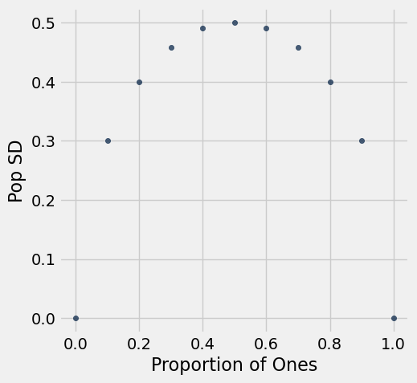


---

# lec28

---
title: "lec28"
lecture: lec28
course: data8
semester: sp26
source: lectures/data8/sp26/lec28/lec28.ipynb
language: python
---

**Code:**

```python
import matplotlib
from datascience import *
%matplotlib inline
import matplotlib.pyplot as plots
import numpy as np
plots.style.use('fivethirtyeight')
```

**Code:**

```python
def r_scatter(r):
    plots.figure(figsize=(5,5))
    "Generate a scatter plot with a correlation approximately r"
    x = np.random.normal(0, 1, 1000)
    z = np.random.normal(0, 1, 1000)
    y = r*x + (np.sqrt(1-r**2))*z
    plots.scatter(x, y, color='darkblue', s=20)
    plots.xlim(-4, 4)
    plots.ylim(-4, 4)
```

## Prediction

**Code:**

```python
# Note: Child heights are the **adult** heights of children in a family
families = Table.read_table('family_heights.csv')
parent_avgs = (families.column('father') + families.column('mother'))/2
heights = Table().with_columns(
    'Parent Average', parent_avgs,
    'Child', families.column('child'),
)
heights
```

**Code:**

```python
heights.scatter('Parent Average', 'Child')
```

**Code:**

```python
nearby = heights.where('Parent Average', are.between(67.5, 68.5))
nearby_mean = np.average(nearby.column('Child'))
nearby_mean
```

**Code:**

```python
heights.scatter('Parent Average', 'Child')
plots.plot([67.5, 67.5], [50, 85], color='red', lw=2)
plots.plot([68.5, 68.5], [50, 85], color='red', lw=2)
plots.scatter(68, nearby_mean, color='red', s=50);
```

**Code:**

```python
def predict_child(h):
    """Predict the height of a child whose parents have a parent average height of p_avg.
    
    The prediction is the average height of the children whose parent average height is
    in the range p_avg plus or minus 0.5.
    """
    nearby = heights.where('Parent Average', are.between(h - 1/2, h + 1/2))
    return np.average(nearby.column('Child'))
```

**Code:**

```python
heights_with_predictions = heights.with_columns(
    'Prediction', heights.apply(predict_child, 'Parent Average'))
```

**Code:**

```python
heights_with_predictions.scatter('Parent Average')
```

## Association

**Code:**

```python
hybrid = Table.read_table('hybrid.csv')
```

**Code:**

```python
hybrid.group('year').barh('year')
```

**Code:**

```python
hybrid.sort('msrp', descending=True)
```

**Code:**

```python
hybrid.scatter('mpg', 'msrp')
```

**Code:**

```python
hybrid.scatter('acceleration', 'msrp')
```

**Code:**

```python
suv = hybrid.where('class', 'SUV')
suv.num_rows
```

**Code:**

```python
suv.scatter('acceleration', 'msrp')
```

**Code:**

```python
suv.scatter('mpg', 'msrp')
```

**Code:**

```python
def standard_units(x):
    "Convert any array of numbers to standard units."
    return (x - np.average(x)) / np.std(x)
```

**Code:**

```python
Table().with_columns(
    'mpg (standard units)',  standard_units(suv.column('mpg')), 
    'msrp (standard units)', standard_units(suv.column('msrp'))
).scatter(0, 1)
plots.xlim(-3, 3)
plots.ylim(-3, 3);
```

**Code:**

```python
suv.scatter('acceleration', 'msrp')
```

**Code:**

```python
Table().with_columns(
    'acceleration (standard units)', standard_units(suv.column('acceleration')), 
    'msrp (standard units)',         standard_units(suv.column('msrp'))
).scatter(0, 1)
plots.xlim(-3, 3)
plots.ylim(-3, 3);
```

## Correlation

**Code:**

```python
r_scatter(-1)
```

**Code:**

```python
x = np.arange(1, 7, 1)
y = make_array(2, 3, 1, 5, 2, 7)
t = Table().with_columns(
        'x', x,
        'y', y
    )
t
```

**Code:**

```python
t.scatter('x', 'y', s=30, color='red')
```

**Code:**

```python
t = t.with_columns(
        'x (standard units)', standard_units(x),
        'y (standard units)', standard_units(y)
    )
t
```

**Code:**

```python
t.scatter(2, 3, s=30, color='red')
```

**Code:**

```python
t = t.with_columns(
    'product of standard units', t.column(2) * t.column(3))
t
```

**Code:**

```python
# r is the average of the products of the standard units

r = np.average(t.column(2) * t.column(3))
r
```

**Code:**

```python
def correlation(t, x, y):
    """t is a table; x and y are column labels"""
    x_in_standard_units = standard_units(t.column(x))
    y_in_standard_units = standard_units(t.column(y))
    return np.average(x_in_standard_units * y_in_standard_units)
```

**Code:**

```python
correlation(t, 'x', 'y')
```

**Code:**

```python
suv.scatter('mpg', 'msrp')
```

**Code:**

```python
correlation(suv, 'mpg', 'msrp')
```

**Code:**

```python
suv.scatter('acceleration', 'msrp')
```

**Code:**

```python
correlation(suv, 'acceleration', 'msrp')
```

### Switching Axes

**Code:**

```python
correlation(t, 'x', 'y')
```

**Code:**

```python
t.scatter('x', 'y', s=30, color='red')
```

**Code:**

```python
t.scatter('y', 'x', s=30, color='red')
```

**Code:**

```python
correlation(t, 'y', 'x')
```

### Nonlinearity

**Code:**

```python
new_x = np.arange(-4, 4.1, 0.5)
nonlinear = Table().with_columns(
        'x', new_x,
        'y', new_x**2
    )
nonlinear.scatter('x', 'y', s=30, color='r')
```

**Code:**

```python
correlation(nonlinear, 'x', 'y')
```

### Outliers

**Code:**

```python
line = Table().with_columns(
        'x', make_array(1, 2, 3, 4),
        'y', make_array(1, 2, 3, 4)
    )
line.scatter('x', 'y', s=30, color='r')
```

**Code:**

```python
correlation(line, 'x', 'y')
```

**Code:**

```python
outlier = Table().with_columns(
        'x', make_array(1, 2, 3, 4, 5),
        'y', make_array(1, 2, 3, 4, 0)
    )
outlier.scatter('x', 'y', s=30, color='r')
```

**Code:**

```python
correlation(outlier, 'x', 'y')
```

### Ecological Correlations

**Code:**

```python
sat2014 = Table.read_table('sat2014.csv').sort('State')
sat2014
```

**Code:**

```python
sat2014.scatter('Critical Reading', 'Math')
```

**Code:**

```python
correlation(sat2014, 'Critical Reading', 'Math')
```

**Code:**

```python
def rate_code(x):
    if x <= 25:
        return 'low'
    elif x <= 50:
        return 'low-moderate'
    elif x <= 75:
        return 'moderate_high'
    else:
        return 'high'
```

**Code:**

```python
rate_codes = sat2014.apply(rate_code, 'Participation Rate')
```

**Code:**

```python
sat2014 = sat2014.with_columns('Rate Code', rate_codes)
sat2014
```

**Code:**

```python
sat2014.scatter('Critical Reading', 'Math', group='Rate Code')
```

**Code:**

```python
sat2014.where('Rate Code', 'low').show()
```

**Code:**

```python
sat2014.where('Rate Code', 'high').show()
```

---

## Datasets

Datasets this notebook loads with `Table.read_table`. Column names are exact, including spaces and capitalization. Only the schema is recorded here — the data itself is not in this document, so any question about its values must be answered by running code, not by reasoning over the rows shown elsewhere in this file.

### `family_heights.csv`

934 rows, 7 columns.

| Column | Type |
| --- | --- |
| `family` | str |
| `father` | float |
| `mother` | float |
| `child` | float |
| `children` | int |
| `order` | int |
| `m/f` | str |

### `hybrid.csv`

153 rows, 6 columns.

| Column | Type |
| --- | --- |
| `vehicle` | str |
| `year` | int |
| `msrp` | float |
| `acceleration` | float |
| `mpg` | float |
| `class` | str |

### `sat2014.csv`

51 rows, 6 columns.

| Column | Type |
| --- | --- |
| `State` | str |
| `Participation Rate` | float |
| `Critical Reading` | int |
| `Math` | int |
| `Writing` | int |
| `Combined` | int |


---

# lec29

---
title: "Functions from previous lectures"
lecture: lec29
course: data8
semester: sp26
source: lectures/data8/sp26/lec29/lec29.ipynb
language: python
---

**Code:**

```python
import matplotlib
from datascience import *
%matplotlib inline
import matplotlib.pyplot as plots
import numpy as np
plots.style.use('fivethirtyeight')
```

**Code:**

```python
# Some functions for plotting. You don't have to understand how any
# of the functions in this cell work, since they use things we 
# haven't learned about in Data 8.

def resize_window(lim=3.5):
    plots.xlim(-lim, lim)
    plots.ylim(-lim, lim)
    
def draw_line(slope=0, intercept=0, x=make_array(-4, 4), color='#44AA00'):
    y = x*slope + intercept
    plots.plot(x, y, color=color, lw=3)
    
def draw_vertical_line(x_position, color='black'):
    x = make_array(x_position, x_position)
    y = make_array(-4, 4)
    plots.plot(x, y, color=color, lw=3)
    
def make_correlated_data(r):
    x = np.random.normal(0, 1, 1000)
    z = np.random.normal(0, 1, 1000)
    y = r*x + (np.sqrt(1-r**2))*z
    return x, y

def r_scatter(r):
    """Generate a scatter plot with a correlation approximately r"""
    plots.figure(figsize=(5,5))
    x, y = make_correlated_data(r)
    plots.scatter(x, y, color='darkblue', s=20)
    plots.xlim(-4, 4)
    plots.ylim(-4, 4)
    
def r_table(r):
    """
    Generate a table of 1000 data points with a correlation approximately r
    """
    np.random.seed(8)
    x, y = make_correlated_data(r)
    return Table().with_columns('x', x, 'y', y)
```

# Functions from previous lectures

**Code:**

```python
def standard_units(x):
    "Convert any array of numbers to standard units."
    return (x - np.average(x)) / np.std(x)
```

**Code:**

```python
def correlation(t, x, y):
    """t is a table; x and y are column labels"""
    x_in_standard_units = standard_units(t.column(x))
    y_in_standard_units = standard_units(t.column(y))
    return np.average(x_in_standard_units * y_in_standard_units)
```

### Nonlinearity

**Code:**

```python
new_x = np.arange(-4, 4.1, 0.5)
nonlinear = Table().with_columns(
        'x', new_x,
        'y', new_x**2
    )
nonlinear.scatter('x', 'y', s=30, color='r')
```

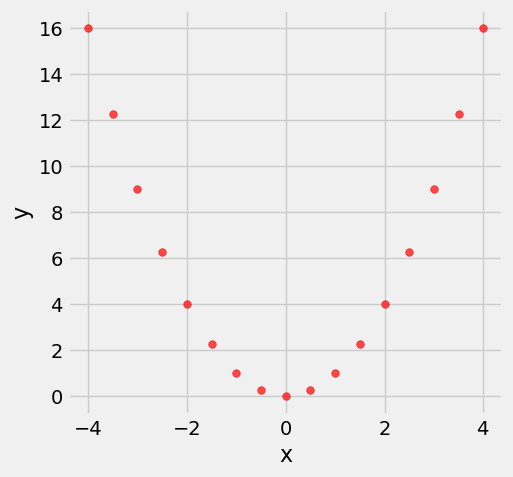

**Code:**

```python
correlation(nonlinear, 'x', 'y')
```

*Output:*

```text
0.0
```

## Prediction Lines

**Code:**

```python
example = r_table(0.99)
example.show(3)
```

*Output:*

| x | y |
| --- | --- |
| 0.0912047 | -0.0680119 |
| 1.09128 | 1.04391 |
| -1.94697 | -1.88316 |

**Code:**

```python
example.scatter('x', 'y')
resize_window()
```

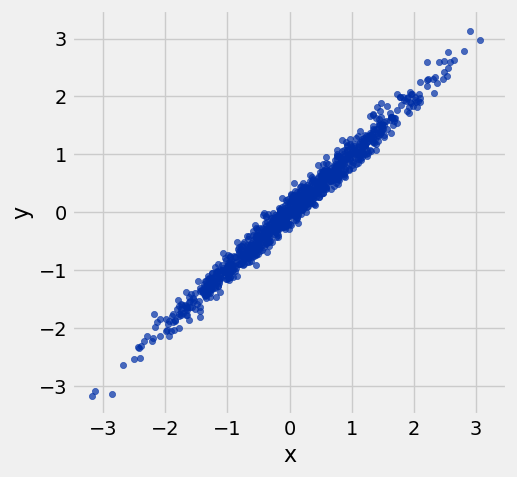

**Code:**

```python
def nn_prediction_example(x_val):
    """ Predicts y-value for x based on the example table """
    neighbors = example.where('x', are.between(x_val - .25, x_val + .25))
    return np.mean(neighbors.column('y'))
```

**Code:**

```python
nn_prediction_example(-2.25)
```

*Output:*

```text
-2.1476337989800527
```

**Code:**

```python
example = example.with_columns(
    'Predicted y', 
    example.apply(nn_prediction_example, 'x'))
```

**Code:**

```python
example.scatter('x')
resize_window()
```

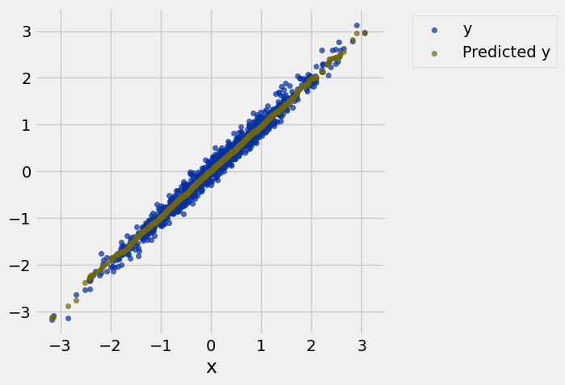

**Code:**

```python
example.scatter('x')
draw_line(slope=1)
resize_window()
```

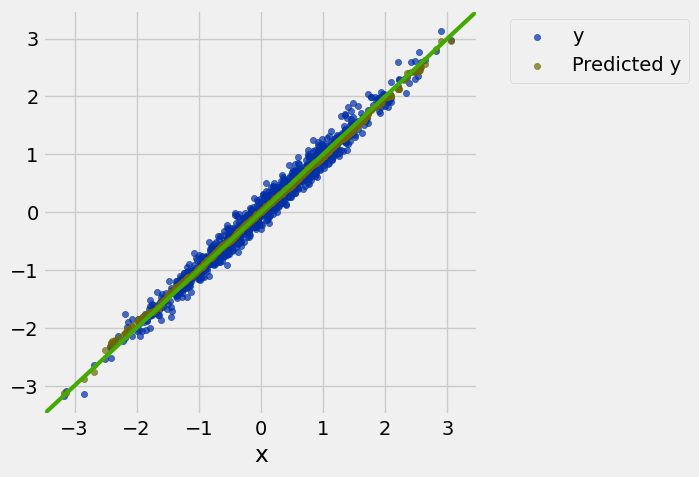

### r = 0

**Code:**

```python
example = r_table(0)
example.scatter('x', 'y')
resize_window()
```

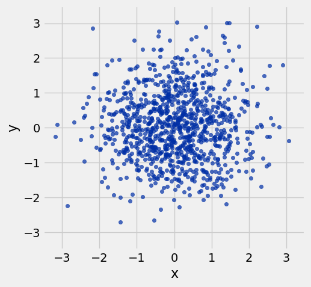

**Code:**

```python
example = example.with_columns(
    'Predicted y', 
    example.apply(nn_prediction_example, 'x'))
```

**Code:**

```python
example.scatter('x')
draw_line(slope=0)
resize_window()
```

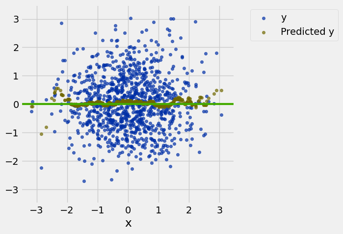

### r = 0.5

**Code:**

```python
example = r_table(0.5)
example.scatter('x', 'y')
resize_window()
```

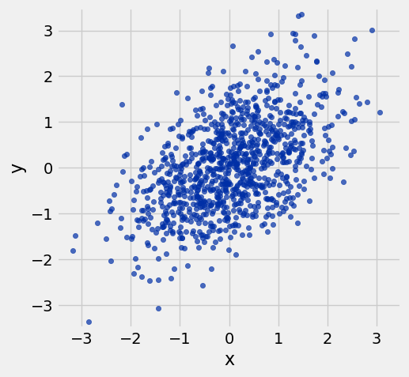

**Code:**

```python
example = r_table(0.5)
example.scatter('x', 'y')
resize_window()
draw_vertical_line(1.5)
draw_line(slope=1, intercept=0, color='red')
```

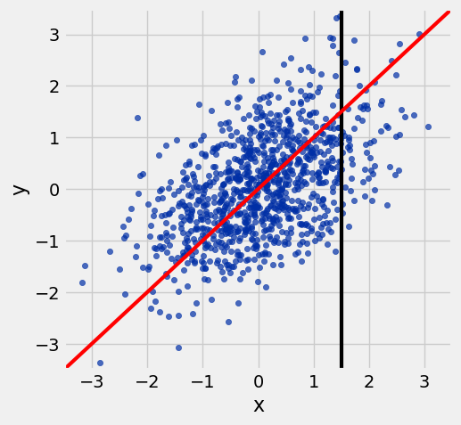

**Code:**

```python
example = example.with_column('Predicted y', example.apply(nn_prediction_example, 'x'))
example.scatter('x')
draw_line(slope=1, color='red')
draw_vertical_line(1.5)
resize_window()
```

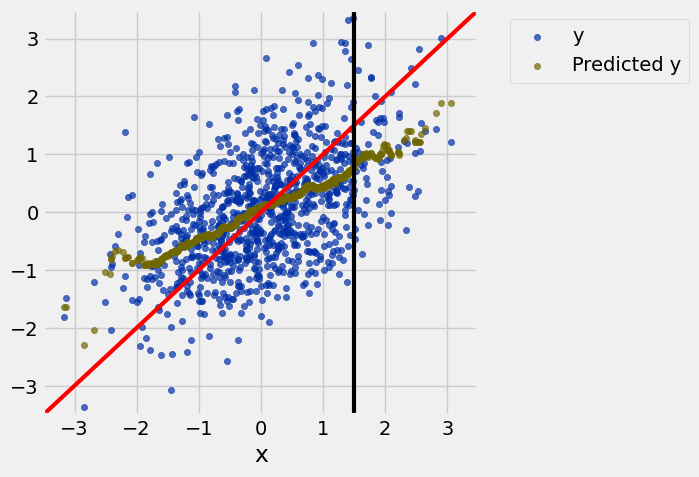

**Code:**

```python
example.scatter('x')
draw_line(slope=1, intercept=0, color='red')
draw_line(slope=0.5, intercept=0)
resize_window()
```

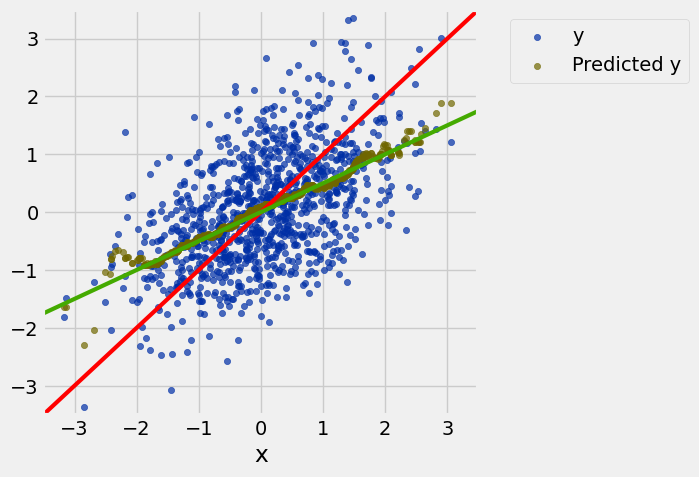

###  r = 0.7

**Code:**

```python
example = r_table(0.7)
example = example.with_column('Predicted y', example.apply(nn_prediction_example, 'x'))
example.scatter('x')
draw_line(slope=1, intercept=0, color='red')
draw_line(slope=0.7, intercept=0)
resize_window()
```

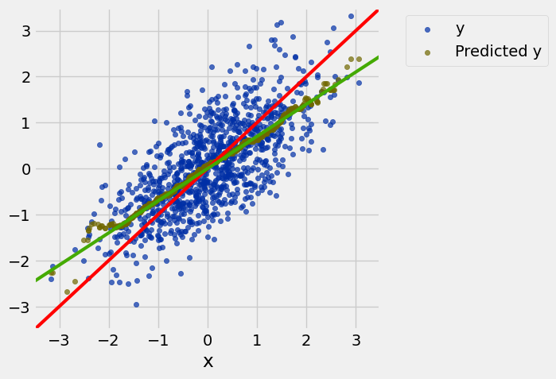

## Linear regression: defining the line

**Code:**

```python
def slope(t, x, y):
    """Computes the slope of the regression line"""
    r = correlation(t, x, y)
    y_sd = np.std(t.column(y))
    x_sd = np.std(t.column(x))
    return r * y_sd / x_sd
```

**Code:**

```python
def intercept(t, x, y):
    """Computes the intercept of the regression line"""
    x_mean = np.mean(t.column(x))
    y_mean = np.mean(t.column(y))
    return y_mean - slope(t, x, y)*x_mean
```

**Code:**

```python
example = r_table(0.5)
slope(example, 'x', 'y')
```

*Output:*

```text
0.50226382816259152
```

## Heights Data and Regression Line

**Code:**

```python
# Note: Child heights are the **adult** heights of children in a family
families = Table.read_table('family_heights.csv')
parent_avgs = (families.column('father') + families.column('mother'))/2
heights = Table().with_columns(
    'Parent Average', parent_avgs,
    'Child', families.column('child'),
)
heights.show(5)
```

*Output:*

| Parent Average | Child |
| --- | --- |
| 72.75 | 73.2 |
| 72.75 | 69.2 |
| 72.75 | 69 |
| 72.75 | 69 |
| 71 | 73.5 |

**Code:**

```python
def nn_prediction_height(p_avg):
    """Predict the height of a child whose parents have a parent average height of p_avg.
    
    The prediction is the average height of the children whose parent average height is
    in the range p_avg plus or minus 0.5.
    """
    
    close_points = heights.where('Parent Average', are.between(p_avg-0.5, p_avg + 0.5))
    return np.average(close_points.column('Child'))
```

**Code:**

```python
heights_with_predictions = heights.with_column(
    'Nearest neighbor prediction', 
    heights.apply(nn_prediction_height, 'Parent Average'))
heights_with_predictions.show(5)
```

*Output:*

| Parent Average | Child | Nearest neighbor prediction |
| --- | --- | --- |
| 72.75 | 73.2 | 70.1 |
| 72.75 | 69.2 | 70.1 |
| 72.75 | 69 | 70.1 |
| 72.75 | 69 | 70.1 |
| 71 | 73.5 | 70.4158 |

**Code:**

```python
heights_with_predictions.scatter('Parent Average')
```

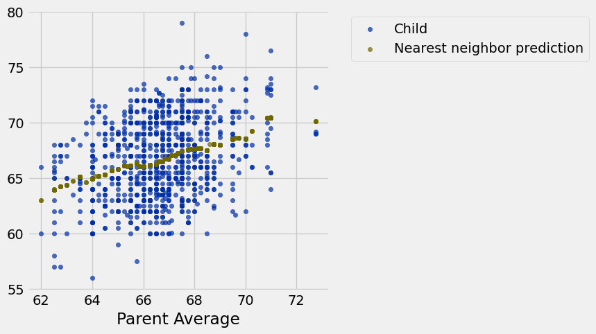

**Code:**

```python
predicted_heights_slope = slope(heights, 'Parent Average', 'Child')
predicted_heights_intercept = intercept(heights, 'Parent Average', 'Child')
[predicted_heights_slope, predicted_heights_intercept]
```

*Output:*

```text
[0.66449526235258838, 22.461839955758798]
```

**Code:**

```python
heights_with_predictions.scatter('Parent Average')
draw_line(slope=predicted_heights_slope, 
          intercept=predicted_heights_intercept, 
          x=heights.column('Parent Average'))
```

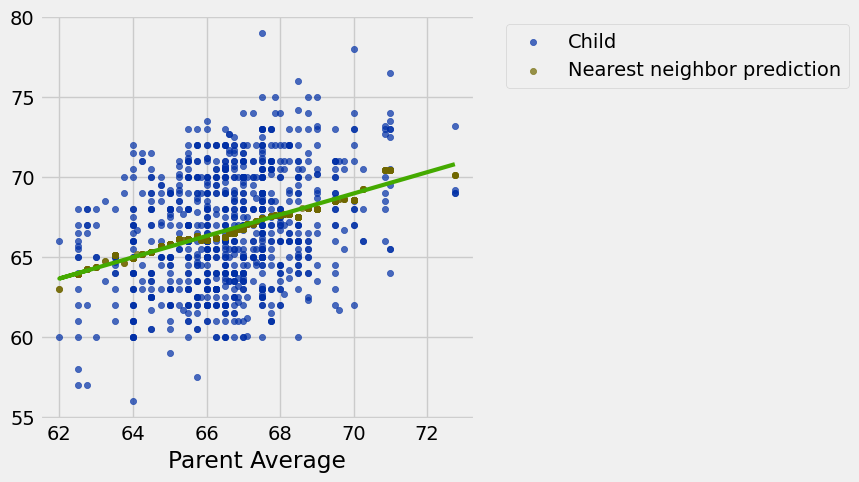

## Discussion Question: Exam Score Prediction

**Code:**

```python
# X-axis: midterm scores
midterm_mean = 70
midterm_sd = 10

# Y-axis: final scores
final_mean = 50
final_sd = 12

# Correlation (relates X to Y values)
corr = 0.75

# X value
midterm_student = 90
```

**Code:**

```python
midterm_student_su = (midterm_student - midterm_mean) / midterm_sd
midterm_student_su
```

*Output:*

```text
2.0
```

**Code:**

```python
final_student_su = midterm_student_su * corr
final_student_su
```

*Output:*

```text
1.5
```

**Code:**

```python
final_student = final_student_su * final_sd + final_mean
final_student
```

*Output:*

```text
68.0
```

---

## Datasets

Datasets this notebook loads with `Table.read_table`. Column names are exact, including spaces and capitalization. Only the schema is recorded here — the data itself is not in this document, so any question about its values must be answered by running code, not by reasoning over the rows shown elsewhere in this file.

### `family_heights.csv`

934 rows, 7 columns.

| Column | Type |
| --- | --- |
| `family` | str |
| `father` | float |
| `mother` | float |
| `child` | float |
| `children` | int |
| `order` | int |
| `m/f` | str |


---

# lec30

---
title: "lec30"
lecture: lec30
course: data8
semester: sp26
source: lectures/data8/sp26/lec30/lec30.ipynb
language: python
---

**Code:**

```python
from datascience import *
import numpy as np
%matplotlib inline
import matplotlib.pyplot as plots
plots.style.use('fivethirtyeight')
```

**Code:**

```python
# Some functions for plotting. You don't have to understand how any
# of the functions in this cell work, since they use things we 
# haven't learned about in Data 8.

def resize_window(lim=3.5):
    plots.xlim(-lim, lim)
    plots.ylim(-lim, lim)
    
def draw_line(slope=0, intercept=0, x=make_array(-4, 4), color='r'):
    y = x*slope + intercept
    plots.plot(x, y, color=color)
    
def draw_vertical_line(x_position, color='black'):
    x = make_array(x_position, x_position)
    y = make_array(-4, 4)
    plots.plot(x, y, color=color)
    
def make_correlated_data(r):
    x = np.random.normal(0, 1, 1000)
    z = np.random.normal(0, 1, 1000)
    y = r*x + (np.sqrt(1-r**2))*z
    return x, y

def r_table(r):
    """
    Generate a table of 1000 x,y data points in standard units
    whose correlation is approximately equal to r
    """
    np.random.seed(8)
    x, y = make_correlated_data(r)
    return Table().with_columns('x', x, 'y', y)
```

**Code:**

```python
def demographics_errors(slope, intercept):
    # Use four convenient points from the original data
    sample = [[14.7, 33995], [19.1, 61454], [50.7, 71183], [59.5, 105918]]
    demographics.scatter('College%', 'Median Income', alpha=0.5)
    xlims = make_array(5, 75)
    # Plot a line with the slope and intercept you specified:
    plots.plot(xlims, slope * xlims + intercept, lw=4)
    # Plot red lines from each of the four points to the line
    for x, y in sample:
        plots.plot([x, x], [y, slope * x + intercept], color='r', lw=4)
```

**Code:**

```python
def show_demographics_rmse(slope, intercept):
    demographics_errors(slope, intercept)
    x = demographics.column('College%')
    y = demographics.column('Median Income')
    prediction = slope * x + intercept
    mse = np.mean((y - prediction) ** 2)
    print("Root mean squared error:", round(mse ** 0.5, 2))
```

**Code:**

```python
def fitted_values(t, x, y):
    """Return an array of the regressions estimates at all the x values"""
    a = slope(t, x, y)
    b = intercept(t, x, y)
    return a*t.column(x) + b
```

## Slope & Intercept

**Code:**

```python
def standard_units(x):
    """Converts an array x to standard units"""
    return (x - np.mean(x)) / np.std(x)

def correlation(t, x, y):
    x_su = standard_units(t.column(x))
    y_su = standard_units(t.column(y))
    return np.mean(x_su * y_su)
```

**Code:**

```python
def slope(t, x, y):
    """Computes the slope of the regression line"""
    r = correlation(t, x, y)
    y_sd = np.std(t.column(y))
    x_sd = np.std(t.column(x))
    return r * y_sd / x_sd

def intercept(t, x, y):
    """Computes the intercept of the regression line"""
    x_mean = np.mean(t.column(x))
    y_mean = np.mean(t.column(y))
    return y_mean - slope(t, x, y)*x_mean
```

### Error in Estimation

**Code:**

```python
demographics = Table.read_table('district_demographics2016.csv')
demographics.show(5)
```

**Code:**

```python
demographics = demographics.drop(
    'State', 'District', 'Percent voting for Clinton')
demographics.show(5)
```

**Code:**

```python
demographics.scatter('College%', 'Median Income')
```

**Code:**

```python
college = demographics.column('College%')
income = demographics.column('Median Income')
print("     College% average", np.average(college), 'and SD', np.std(college))
print("Median Income average", np.average(income), 'and SD', np.std(income))
print("Correlation", correlation(demographics, 'College%', 'Median Income'))
```

**Code:**

```python
regression_slope = slope(demographics, 'College%', 'Median Income')
regression_intercept = intercept(demographics, 'College%', 'Median Income')
regression_slope, regression_intercept
```

**Code:**

```python
predicted = fitted_values(demographics, 'College%', 'Median Income')
demographics = demographics.with_column(
    'Linear Prediction', predicted)
demographics.scatter('College%')
```

**Code:**

```python
actual = demographics.column('Median Income')
errors = actual - predicted
```

**Code:**

```python
demographics.with_column('Error', errors)
```

**Code:**

```python
demographics.with_column('Error', errors).hist('Error')
```

**Code:**

```python
np.mean(errors)
```

**Code:**

```python
np.mean(errors ** 2) ** 0.5
```

**Code:**

```python
demographics_errors(regression_slope, regression_intercept)
```

**Code:**

```python
demographics_errors(regression_slope, regression_intercept - 30000)
```

**Code:**

```python
# takes any slope, any intercept

demographics_errors(1350, 19000)
```

**Code:**

```python
demographics_errors(-1000, 75000)
```

### Root Mean Square Error ###

**Code:**

```python
show_demographics_rmse(-1000, 75000)
```

**Code:**

```python
show_demographics_rmse(1350, 19000)
```

**Code:**

```python
show_demographics_rmse(regression_slope, regression_intercept)
```

### Numerical Optimization ###

**Code:**

```python
x = np.arange(1, 3, 0.1)
y = (x-2)**2 + 3
Table().with_columns('x', x, 'y', y).plot('x')
```

**Code:**

```python
def f(x):
    return ((x-2)**2) + 3
```

**Code:**

```python
minimize(f)
```

**Code:**

```python
f(minimize(f))
```

**Code:**

```python
x = np.arange(-1.5, 1.5, 0.05)
y2 = 2 * np.sin(x*np.pi) + x ** 3 + x ** 4 
Table().with_columns('x', x, 'y', y2).plot('x')
```

**Code:**

```python
def complicated_function(x):
    return 2 * np.sin(x*np.pi) + x ** 3 + x ** 4
```

**Code:**

```python
minimize(complicated_function)
```

### Minimizing RMSE ###

**Code:**

```python
def demographics_rmse(any_slope, any_intercept):
    x = demographics.column('College%')
    y = demographics.column('Median Income')
    estimate = any_slope*x + any_intercept
    return (np.mean((y - estimate) ** 2)) ** 0.5
```

**Code:**

```python
demographics_rmse(1500, 20000)
```

**Code:**

```python
demographics_rmse(1350, 19000)
```

**Code:**

```python
demographics_rmse(-1000, 75000)
```

**Code:**

```python
minimize(demographics_rmse)
```

**Code:**

```python
make_array(regression_slope, regression_intercept)
```

### Nonlinear Regression ###

**Code:**

```python
shotput = Table.read_table('shotput.csv')
shotput
```

**Code:**

```python
shotput.scatter('Weight Lifted')
```

**Code:**

```python
def shotput_linear_rmse(any_slope, any_intercept):
    x = shotput.column('Weight Lifted')
    y = shotput.column('Shot Put Distance')
    estimate = any_slope*x + any_intercept
    return np.mean((y - estimate) ** 2) ** 0.5
```

**Code:**

```python
best_line = minimize(shotput_linear_rmse)
best_line
```

**Code:**

```python
weights = shotput.column(0)
```

**Code:**

```python
linear_fit = best_line.item(0)*weights + best_line.item(1)

shotput.with_column(
    'Best Line', linear_fit
).scatter(0)
```

**Quadratic Function**

$$
f(x) ~=~ ax^2 + bx + c
$$
for constants $a$, $b$, and $c$.

**Code:**

```python
def shotput_quadratic_rmse(a, b, c):
    x = shotput.column('Weight Lifted')
    y = shotput.column('Shot Put Distance')
    estimate = a*(x**2) + b*x + c
    return np.mean((y - estimate) ** 2) ** 0.5
```

**Code:**

```python
best_quad = minimize(shotput_quadratic_rmse)
best_quad
```

**Code:**

```python
# x = weight lifted = 100 kg
# Then predicted shot put distance:

(-0.00104)*(100**2) + 0.2827*100 - 1.5318
```

**Code:**

```python
quad_fit = best_quad.item(0)*(weights**2) + best_quad.item(1)*weights + best_quad.item(2)
```

**Code:**

```python
shotput.with_column('Best Quadratic Curve', quad_fit).scatter(0)
```

**Code:**

```python
shotput_linear_rmse(best_line.item(0), best_line.item(1))
```

**Code:**

```python
shotput_quadratic_rmse(best_quad.item(0), best_quad.item(1), best_quad.item(2))
```

---

## Datasets

Datasets this notebook loads with `Table.read_table`. Column names are exact, including spaces and capitalization. Only the schema is recorded here — the data itself is not in this document, so any question about its values must be answered by running code, not by reasoning over the rows shown elsewhere in this file.

### `district_demographics2016.csv`

435 rows, 5 columns.

| Column | Type |
| --- | --- |
| `State` | str |
| `District` | str |
| `Median Income` | int |
| `Percent voting for Clinton` | float |
| `College%` | float |

### `shotput.csv`

28 rows, 2 columns.

| Column | Type |
| --- | --- |
| `Weight Lifted` | float |
| `Shot Put Distance` | float |


---

# lec31

---
title: "Residuals"
lecture: lec31
course: data8
semester: sp26
source: lectures/data8/sp26/lec31/lec31.ipynb
language: python
---

**Code:**

```python
# HIDDEN
from datascience import *
import numpy as np
%matplotlib inline
import matplotlib.pyplot as plots
plots.style.use('fivethirtyeight')
```

## Regression-Related Functions

**Code:**

```python
def standard_units(arr):
    """ Converts an array to standard units """
    return (arr - np.average(arr))/np.std(arr)

def correlation(t, x, y):
    """ Computes correlation: t is a table, and x and y are column names """
    x_standard = standard_units(t.column(x))
    y_standard = standard_units(t.column(y))
    return np.average(x_standard * y_standard)

def slope(t, x, y):
    """ Computes the slope of the regression line, like correlation above """
    r = correlation(t, x, y)
    y_sd = np.std(t.column(y))
    x_sd = np.std(t.column(x))
    return r * y_sd / x_sd

def intercept(t, x, y):
    """ Computes the intercept of the regression line, like slope above """
    x_mean = np.mean(t.column(x))
    y_mean = np.mean(t.column(y))
    return y_mean - slope(t, x, y)*x_mean

def fitted_values(t, x, y):
    """Return an array of the regression estimates (predictions) at all the x values"""
    a = slope(t, x, y)
    b = intercept(t, x, y)
    return a*t.column(x) + b
```

**Code:**

```python
demographics = Table.read_table('district_demographics2016.csv')
demographics.sample(6).show()
```

**Linear Fit**

$\text{estimate of Median Income} = a \cdot \text{College\%} + b$

**Code:**

```python
fitted_income = demographics.select('College%', 'Median Income')
fitted_income = fitted_income.with_columns('Fitted Median Income',
    fitted_values(demographics, 'College%', 'Median Income'))
fitted_income.scatter('College%')
fitted_income.sample(5).show()
```

# Residuals

**Code:**

```python
def residuals(t, x, y):
    predictions = fitted_values(t, x, y)
    return t.column(y) - predictions
```

### Residual plots can tell us about our model fit

#### Case study 1: 2016 election demographics

**Code:**

```python
income_residuals = fitted_income.with_columns(
    'Residual', residuals(demographics, 'College%', 'Median Income')
)
income_residuals.show(5)
```

These two functions will help us plot things the rest of the way.

**Code:**

```python
def plot_fitted(t, x, y):
    fitted_label = 'Fitted ' + y
    (t.with_column(fitted_label, fitted_values(t, x, y))
      .select(x, y, fitted_label).scatter(0))

def plot_residuals(t, x, y):
    residuals_label = y + ' Residuals'
    (t.with_columns(residuals_label, residuals(t, x, y))
      .scatter(x, residuals_label))
```

______

**Code:**

```python
plot_fitted(demographics, 'College%', 'Median Income')
```

**Code:**

```python
plot_residuals(demographics, 'College%', 'Median Income')
```

#### Case study 2: dugongs

**Code:**

```python
dugong = Table.read_table('dugong.csv')
dugong.show(5)
```

**Code:**

```python
dugong.scatter('Length', 'Age')
```

**Code:**

```python
correlation(dugong, 'Length', 'Age')
```

$\text{estimate of Age} = a \cdot \text{Length} + b$

**Code:**

```python
plot_fitted(dugong, 'Length', 'Age')
```

**Code:**

```python
plot_residuals(dugong, 'Length', 'Age')
```

#### Case study 3: US women

**Code:**

```python
us_women = Table.read_table('us_women.csv')
us_women.show(5)
```

**Code:**

```python
us_women.scatter('height')
```

**Code:**

```python
correlation(us_women, 'height', 'ave weight')
```

$\text{estimate of height} = a \cdot \text{average weight} + b$

**Code:**

```python
plot_fitted(us_women, 'height', 'ave weight')
```

**Code:**

```python
plot_residuals(us_women, 'height', 'ave weight')
```

#### Case study 4: Heights

**Code:**

```python
family_heights = Table.read_table('family_heights.csv')
family_heights.where('family', '1')
```

**Code:**

```python
parents = (family_heights.column('father') + family_heights.column('mother'))/2
heights = Table().with_columns(
    'Parent Average', parents,
    'Child', family_heights.column('child')
    )
heights.show(6)
```

$\text{estimate of a child's adult height} = a \cdot \text{average parent height} + b$

**Code:**

```python
plot_fitted(heights, 'Parent Average', 'Child')
```

**Code:**

```python
plot_residuals(heights, 'Parent Average', 'Child')
```

### Mathematical Properties of Regression

The average of the residuals are zero.

**Code:**

```python
round(np.average(residuals(demographics, 'College%', 'Median Income')), 10)
```

**Code:**

```python
round(np.average(residuals(dugong, 'Length', 'Age')), 10)
```

**Code:**

```python
round(np.average(residuals(heights, 'Parent Average', 'Child')), 10)
```

______

The correlation coefficients between:

- The residuals and $x$
- The residuals and the fitted values

are both 0.

**Code:**

```python
heights = heights.with_columns(
    'Residual', residuals(heights, 'Parent Average', 'Child'),
    'Fitted Value', fitted_values(heights, 'Parent Average', 'Child')
)
```

**Code:**

```python
round(correlation(heights, 'Parent Average', 'Residual'), 10)
```

**Code:**

```python
round(correlation(heights, 'Fitted Value', 'Residual'), 10)
```

---

## Datasets

Datasets this notebook loads with `Table.read_table`. Column names are exact, including spaces and capitalization. Only the schema is recorded here — the data itself is not in this document, so any question about its values must be answered by running code, not by reasoning over the rows shown elsewhere in this file.

### `district_demographics2016.csv`

435 rows, 5 columns.

| Column | Type |
| --- | --- |
| `State` | str |
| `District` | str |
| `Median Income` | int |
| `Percent voting for Clinton` | float |
| `College%` | float |

### `dugong.csv`

27 rows, 2 columns.

| Column | Type |
| --- | --- |
| `Length` | float |
| `Age` | float |

### `us_women.csv`

15 rows, 2 columns.

| Column | Type |
| --- | --- |
| `height` | int |
| `ave weight` | int |

### `family_heights.csv`

934 rows, 7 columns.

| Column | Type |
| --- | --- |
| `family` | str |
| `father` | float |
| `mother` | float |
| `child` | float |
| `children` | int |
| `order` | int |
| `sex` | str |


---

# monty_hall

---
title: "3 Door (Classic) Version"
lecture: lec31
variant: monty_hall
course: data8
semester: sp26
source: lectures/data8/sp26/lec31/monty_hall.ipynb
language: python
---

**Code:**

```python
from datascience import *
%matplotlib inline

import matplotlib.pyplot as plt
plt.style.use('fivethirtyeight')
import numpy as np
import warnings
```

# 3 Door (Classic) Version

**Code:**

```python
three_door_prizes = ['car', 'goat 1', 'goat 2']
def hide(prizes):
    prize_table = Table().with_column('Prize', prizes)
    return (prize_table.sample(with_replacement=False)
                       .with_column('Door', np.arange(1, len(prizes) + 1))
                       .select('Door', 'Prize'))
    
hide(three_door_prizes)
```

*Output:*

| Door | Prize |
| --- | --- |
| 1 | goat 2 |
| 2 | goat 1 |
| 3 | car |

**Code:**

```python
def pick(t):
    """Return the door number of a randomly selected row of a doors table."""
    return np.random.choice(t.column('Door'))

def monty_hall():
    doors = hide(three_door_prizes)
    contestant_initial_choice = pick(doors)
    remaining = doors.where('Door', are.not_equal_to(contestant_initial_choice))
    revealed = pick(remaining.where('Prize', are.containing('goat')))
    remaining = remaining.where('Door', are.not_equal_to(revealed))
    contestant_final_choice = pick(remaining)
    what_happened = Table().with_columns(
        'Door', [contestant_initial_choice, revealed, contestant_final_choice],
        'Status', ['Picked first', 'Revealed', 'Final choice'])
    return doors.join('Door', what_happened, 'Door')

monty_hall()
```

*Output:*

| Door | Prize | Status |
| --- | --- | --- |
| 1 | goat 1 | Final choice |
| 2 | goat 2 | Revealed |
| 3 | car | Picked first |

**Code:**

```python
def won_the_car(result_table):
    return result_table.where('Status', 'Final choice').column('Prize').item(0) == 'car'

won_the_car(monty_hall())
```

*Output:*

```text
False
```

**Code:**

```python
trials = 10000
cars = 0
for i in np.arange(trials):
    if won_the_car(monty_hall()):
        cars = cars + 1
print(100 * cars / trials, 'percent cars')
```

*Output (stdout):*

```text
66.13 percent cars
```

# 4 Door Version from Spring 2026 Midterm

**Code:**

```python
four_door_prizes = ['car', 'goat 1', 'goat 2', 'goat 3']
hide(four_door_prizes)
```

*Output:*

| Door | Prize |
| --- | --- |
| 1 | goat 1 |
| 2 | goat 2 |
| 3 | car |
| 4 | goat 3 |

**Code:**

```python
def monty_hall_4(lock):
    doors = hide(four_door_prizes)
    contestant_initial_choice = pick(doors)
    remaining = doors.where('Door', are.not_equal_to(contestant_initial_choice))
    
    if lock:
        locked = pick(remaining)
        remaining = remaining.where('Door', are.not_equal_to(locked))
    else:
        locked = None

    revealed = pick(remaining.where('Prize', are.containing('goat')))
    remaining = remaining.where('Door', are.not_equal_to(revealed))
    contestant_final_choice = pick(remaining)
    
    if lock:
        ignored = None
    else:
        remaining = remaining.where('Door', are.not_equal_to(contestant_final_choice))
        ignored = pick(remaining)
    
    what_happened = Table().with_columns(
        'Door', [contestant_initial_choice, revealed, contestant_final_choice, 
                 locked, ignored],
        'Status', ['Picked first', 'Revealed', 'Final choice',
                   'Locked', 'Ignored'])
    return doors.join('Door', what_happened, 'Door')

print('With Lock')
monty_hall_4(True).show()
print('Without Lock')
monty_hall_4(False).show()
```

*Output (stdout):*

```text
With Lock
```

*Output:*

| Door | Prize | Status |
| --- | --- | --- |
| 1 | car | Locked |
| 2 | goat 2 | Picked first |
| 3 | goat 3 | Revealed |
| 4 | goat 1 | Final choice |

*Output (stdout):*

```text
Without Lock
```

*Output:*

| Door | Prize | Status |
| --- | --- | --- |
| 1 | goat 3 | Picked first |
| 2 | goat 2 | Revealed |
| 3 | goat 1 | Ignored |
| 4 | car | Final choice |

**Code:**

```python
trials = 10000
lock = True

for lock in [True, False]:
    cars = 0
    for i in np.arange(trials):
        if won_the_car(monty_hall_4(lock)):
            cars = cars + 1
    print('With lock equal to', lock, 'win percentage is', 100 * cars / trials)
```

*Output (stdout):*

```text
With lock equal to True win percentage is 50.26
With lock equal to False win percentage is 37.79
```


---

# lec32

---
title: "lec32"
lecture: lec32
course: data8
semester: sp26
source: lectures/data8/sp26/lec32/lec32.ipynb
language: python
---

**Code:**

```python
from datascience import *
import numpy as np
import matplotlib
%matplotlib inline
import matplotlib.pyplot as plots
plots.style.use('fivethirtyeight')
```

**Code:**

```python
# Predefined functions; they should look familiar to functions you've coded in assignments!
def standard_units(arr):
    return (arr - np.average(arr))/np.std(arr)

def correlation(t, x, y):
    x_standard = standard_units(t.column(x))
    y_standard = standard_units(t.column(y))
    return np.average(x_standard * y_standard)

def slope(t, x, y):
    r = correlation(t, x, y)
    y_sd = np.std(t.column(y))
    x_sd = np.std(t.column(x))
    return r * y_sd / x_sd

def intercept(t, x, y):
    x_mean = np.mean(t.column(x))
    y_mean = np.mean(t.column(y))
    return y_mean - slope(t, x, y)*x_mean

def fitted_values(t, x, y):
    """Return an array of the regression estimates at all the x values"""
    a = slope(t, x, y)
    b = intercept(t, x, y)
    return a*t.column(x) + b

def residuals(t, x, y):
    """Return an array of all the residuals"""
    predictions = fitted_values(t, x, y)
    return t.column(y) - predictions
```

## Regression Model

**Code:**

```python
# Ignore this code; it produces plots for demonstrating the regression model
def draw_and_compare(true_slope, true_int, sample_size):
    x = np.random.normal(50, 5, sample_size)
    xlims = np.array([np.min(x), np.max(x)])
    errors = np.random.normal(0, 6, sample_size)
    y = (true_slope * x + true_int) + errors
    sample = Table().with_columns('x', x, 'y', y)

    sample.scatter('x', 'y')
    plots.plot(xlims, true_slope*xlims + true_int, lw=2, color='green')
    plots.title('True Line, and Points Created')

    sample.scatter('x', 'y')
    plots.title('What We Get to See')

    sample.scatter('x', 'y', fit_line=True)
    plots.title('Regression Line: Estimate of True Line')

    sample.scatter('x', 'y', fit_line=True)
    plots.plot(xlims, true_slope*xlims + true_int, lw=2, color='green')
    plots.title("Regression Line and True Line")
```

**Code:**

```python
draw_and_compare(2, -5, 10)
```

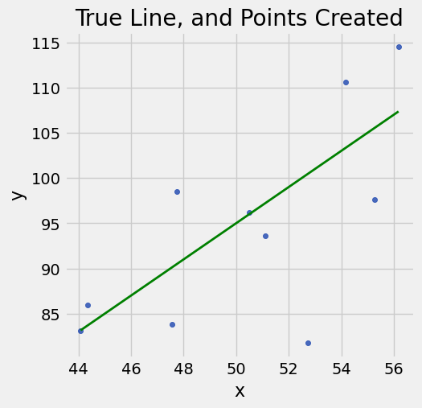

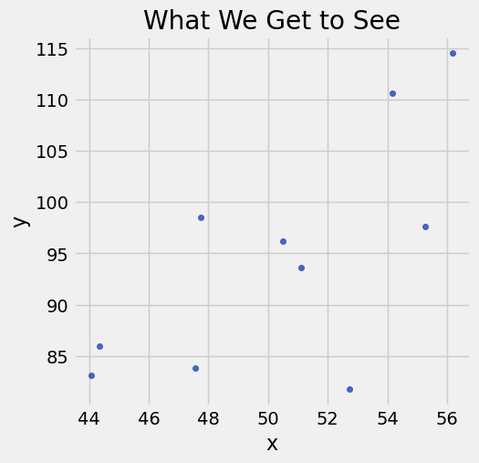

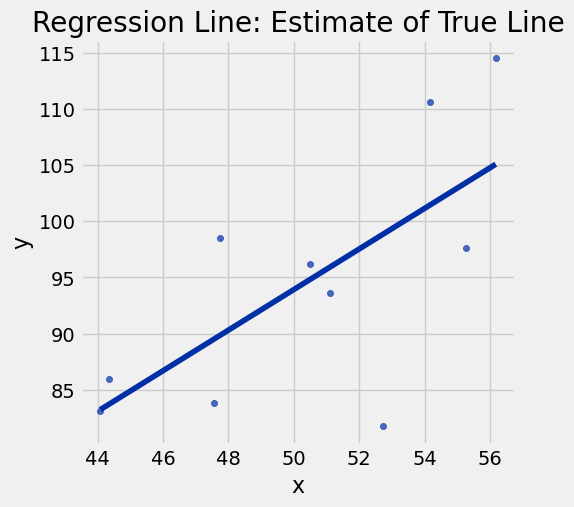

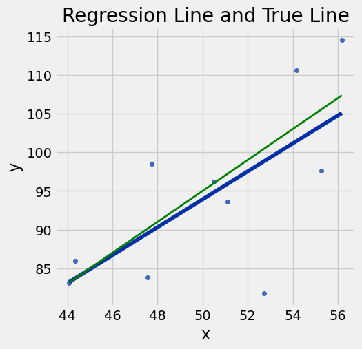

**Code:**

```python
draw_and_compare(2, -5, 10)
```

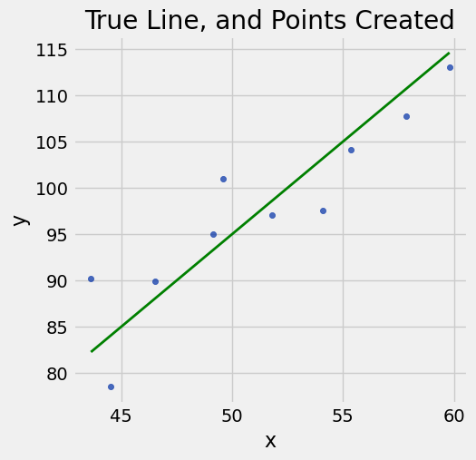

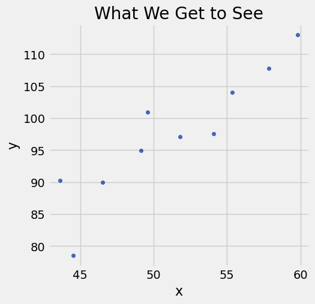

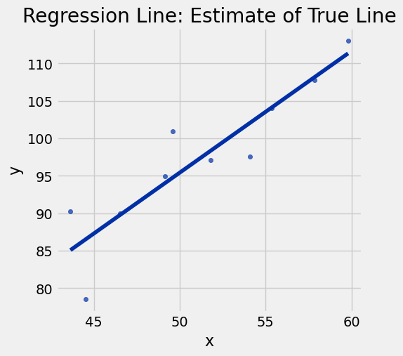

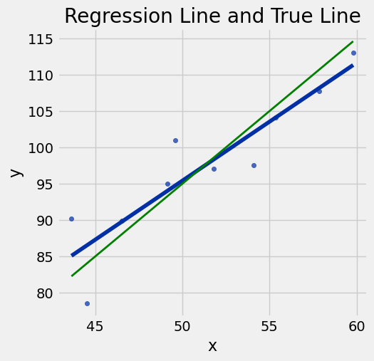

**Code:**

```python
draw_and_compare(2, -5, 100)
```


**Code:**

```python
draw_and_compare(2, -5, 100)
```


## Prediction

**Code:**

```python
births = Table.read_table('baby.csv')
births.show(3)
```

*Output:*

| Birth Weight | Gestational Days | Maternal Age | Maternal Height | Maternal Pregnancy Weight | Maternal Smoker |
| --- | --- | --- | --- | --- | --- |
| 120 | 284 | 27 | 62 | 100 | False |
| 113 | 282 | 33 | 64 | 135 | False |
| 128 | 279 | 28 | 64 | 115 | True |

**Code:**

```python
# Preterm and postterm pregnancy cutoffs, according to the CDC
37 * 7, 42 * 7
```

*Output:*

```text
(259, 294)
```

**Code:**

```python
births.scatter('Gestational Days', 'Birth Weight')
```


**Code:**

```python
births = births.where('Gestational Days', are.between(225, 325))
```

**Code:**

```python
births.scatter('Gestational Days', 'Birth Weight')
```


## Suppose we assume the regression model

**Code:**

```python
correlation(births, 'Gestational Days', 'Birth Weight')
```

*Output:*

```text
0.42295118452423991
```

**Code:**

```python
births.scatter('Gestational Days', 'Birth Weight', fit_line=True)
```


## Prediction at a Given Value of x

**Code:**

```python
def prediction_at(t, x, y, x_value):
    '''
    t - table
    x - label of x column
    y - label of y column
    x_value - the x value for which we want to predict y
    '''
    return slope(t, x, y) * x_value + intercept(t, x, y)
```

**Code:**

```python
prediction_at_300 = prediction_at(births, 'Gestational Days', 'Birth Weight', 300)
prediction_at_300
```

*Output:*

```text
130.80951674248769
```

**Code:**

```python
prediction_at(births, 'Gestational Days', 'Birth Weight', 260)
```

*Output:*

```text
109.29570203577155
```

**Code:**

```python
x = 300
births.scatter('Gestational Days', 'Birth Weight', fit_line=True)
plots.plot([x, x], [40, prediction_at_300], color='red', lw=2);
```


## Bootstrapping the Sample

**Code:**

```python
# You don't need to understand the plotting code in this cell,
# but you should understand the figure that comes out.

plots.figure(figsize=(10, 11))
plots.subplot(3, 2, 1)
plots.scatter(births[1], births[0], s=10, color='darkblue')
plots.xlim([225, 325])
plots.title('Original sample')

for i in np.arange(1, 6, 1):
    plots.subplot(3,2,i+1)
    resampled = births.sample()
    plots.scatter(resampled.column('Gestational Days'), resampled.column('Birth Weight'), s=10, color='tab:green')
    plots.xlim([225, 325])
    plots.title('Bootstrap sample '+str(i))
plots.tight_layout()
```


**Code:**

```python
for i in np.arange(4):
    resample = births.sample()
    predicted_y = prediction_at(resample, 'Gestational Days', 'Birth Weight', 300)
    print('Predicted y from bootstrap sample was', predicted_y)
    resample.scatter('Gestational Days', 'Birth Weight', fit_line=True)
    plots.scatter(300, predicted_y, color='gold', s=50, zorder=3);
    plots.plot([x, x], [40, predicted_y], color='red', lw=2);
    plots.plot([200, x], [predicted_y, predicted_y], color='red', lw=2);
```

*Output (stdout):*

```text
Predicted y from bootstrap sample was 130.115816965
Predicted y from bootstrap sample was 131.397935957
Predicted y from bootstrap sample was 130.277967429
Predicted y from bootstrap sample was 130.953463926
```


**Code:**

```python
lines = Table(['slope','intercept', 'at 210', 'at 300', 'at 320'])

for i in range(10):
    resample = births.sample()
    a = slope(resample, 'Gestational Days', 'Birth Weight')
    b = intercept(resample, 'Gestational Days', 'Birth Weight')
    lines.append([a, b, a * 210 + b, a * 300 + b, a * 320 + b])

for i in np.arange(lines.num_rows):
    line = lines.row(i)
    plots.plot([210, 320], [line.item('at 210'), line.item('at 320')], lw=1)
    plots.scatter(300, line.item('at 300'), s=30, zorder=3)
```


**Code:**

```python
np.mean(births.column('Gestational Days')), np.mean(births.column('Birth Weight'))
```

*Output:*

```text
(279.11015490533561, 119.57401032702238)
```

**Code:**

```python
lines = Table(['slope','intercept', 'at 291', 'at 300', 'at 309'])

for i in range(10):
    resample = births.sample()
    a = slope(resample, 'Gestational Days', 'Birth Weight')
    b = intercept(resample, 'Gestational Days', 'Birth Weight')
    lines.append([a, b, a * 291 + b, a * 300 + b, a * 309 + b])
lines
```

*Output:*

| slope | intercept | at 291 | at 300 | at 309 |
| --- | --- | --- | --- | --- |
| 0.470266 | -11.8985 | 124.949 | 129.181 | 133.414 |
| 0.515706 | -25.0966 | 124.974 | 129.615 | 134.257 |
| 0.50111 | -18.8308 | 126.992 | 131.502 | 136.012 |
| 0.540616 | -31.6267 | 125.693 | 130.558 | 135.424 |
| 0.500778 | -20.3524 | 125.374 | 129.881 | 134.388 |
| 0.582346 | -42.8997 | 126.563 | 131.804 | 137.045 |
| 0.50133 | -20.0712 | 125.816 | 130.328 | 134.84 |
| 0.510783 | -22.7916 | 125.846 | 130.443 | 135.04 |
| 0.557533 | -35.609 | 126.633 | 131.651 | 136.669 |
| 0.515053 | -24.2061 | 125.674 | 130.31 | 134.945 |

**Code:**

```python
for i in np.arange(lines.num_rows):
    line = lines.row(i)
    plots.plot([291, 309], [line.item('at 291'), line.item('at 309')], lw=1)
    plots.scatter(300, line.item('at 300'), s=30, zorder=3)
```


## Prediction Interval

**Code:**

```python
def bootstrap_prediction(t, x, y, new_x, repetitions=2500):
    """ 
    Makes a 95% confidence interval for the height of the true line at new_x, 
    using linear regression on the data in t (column names x and y).
    Shows a histogram of the bootstrap samples and shows the interval
    in gold.
    """

    # Bootstrap the scatter, predict, collect
    predictions = make_array()
    for i in np.arange(repetitions):
        resample = t.sample()
        predicted_y = prediction_at(resample, x, y, new_x)
        predictions = np.append(predictions, predicted_y)

    # Find the ends of the approximate 95% prediction interval
    left = percentile(2.5, predictions)
    right = percentile(97.5, predictions)
    round_left = round(left, 3)
    round_right = round(right, 3)

    # Display results
    Table().with_column('Prediction', predictions).hist(bins=20)
    plots.xlabel('predictions at x='+str(new_x))
    plots.plot([left, right], [0, 0], color='yellow', lw=8);
    print('Approximate 95%-confidence interval for height of true line at x =', new_x)
    print(round_left, 'to', round_right, '( width =', round(right - left, 3), ')')
```

**Code:**

```python
bootstrap_prediction(births, 'Gestational Days', 'Birth Weight', 300)
```

*Output (stdout):*

```text
Approximate 95%-confidence interval for height of true line at x = 300
128.955 to 132.657 ( width = 3.702 )
```


## Predictions at Different Values of x

**Code:**

```python
x = 300
births.scatter('Gestational Days', 'Birth Weight', fit_line=True)
plots.plot([x, x], [40, prediction_at_300], color='red', lw=2);
```


**Code:**

```python
bootstrap_prediction(births, 'Gestational Days', 'Birth Weight', 230)
```

*Output (stdout):*

```text
Approximate 95%-confidence interval for height of true line at x = 230
89.452 to 97.141 ( width = 7.688 )
```


**Code:**

```python
bootstrap_prediction(births, 'Gestational Days', 'Birth Weight', 280)
```

*Output (stdout):*

```text
Approximate 95%-confidence interval for height of true line at x = 280
119.124 to 120.985 ( width = 1.861 )
```


**Code:**

```python
# No need to follow the code in this cell; just understand the graph

lines = Table(['slope','intercept', 'at 210', 'at 300', 'at 320'])

for i in range(10):
    resample = births.sample()
    a = slope(resample, 'Gestational Days', 'Birth Weight')
    b = intercept(resample, 'Gestational Days', 'Birth Weight')
    lines.append([a, b, a * 210 + b, a * 300 + b, a * 320 + b])

for i in np.arange(lines.num_rows):
    line = lines.row(i)
    plots.plot([210, 320], [line.item('at 210'), line.item('at 320')], lw=1)
```


## Inference for the True Slope

**Code:**

```python
births.scatter('Gestational Days', 'Birth Weight', fit_line=True)
```


**Code:**

```python
slope(births, 'Gestational Days', 'Birth Weight')
```

*Output:*

```text
0.53784536766790358
```

**Code:**

```python
def bootstrap_slope(t, x, y, repetitions=2500):
    """ 
    Makes a 95% confidence interval for the slope of the true line, 
    using linear regression on the data in t (column names x and y).
    Shows a histogram of the bootstrap samples and shows the interval
    in gold.
    """
    
    # Bootstrap the scatter, find the slope, collect
    slopes = make_array()
    for i in np.arange(repetitions):
        bootstrap_sample = t.sample()
        bootstrap_slope = slope(bootstrap_sample, x, y)
        slopes = np.append(slopes, bootstrap_slope)
    
    # Find the endpoints of the 95% confidence interval for the true slope
    left = percentile(2.5, slopes)
    right = percentile(97.5, slopes)
    round_left = round(left, 3)
    round_right = round(right, 3)
    
    # Slope of the regression line from the original sample
    observed_slope = slope(t, x, y)
    
    # Display results (no need to follow this code)
    Table().with_column('Bootstrap Slopes', slopes).hist(bins=20)
    plots.plot(make_array(left, right), make_array(0, 0), color='yellow', lw=8);
    print('Slope of regression line:', round(observed_slope, 3))
    print('Approximate 95%-confidence interval for the slope of the true line:')
    print(round_left, 'to', round_right)
```

**Code:**

```python
bootstrap_slope(births, 'Gestational Days', 'Birth Weight')
```

*Output (stdout):*

```text
Slope of regression line: 0.538
Approximate 95%-confidence interval for the slope of the true line:
0.459 to 0.618
```


**Code:**

```python
births.num_rows
```

*Output:*

```text
1162
```

## Zero Correlation Regression

**Code:**

```python
draw_and_compare(0, 10, 25)
```


### Maternal Age and Birth Weight

**Code:**

```python
births.scatter('Maternal Age', 'Birth Weight')
```


**Code:**

```python
slope(births, 'Maternal Age', 'Birth Weight')
```

*Output:*

```text
0.095142237298344659
```

**Code:**

```python
births.scatter('Maternal Age', 'Birth Weight', fit_line=True)
```


**Null:** Slope of true line is equal to 0.

**Alternative:** Slope of true line is not equal to 0.

**Code:**

```python
bootstrap_slope(births, 'Maternal Age', 'Birth Weight')
```

*Output (stdout):*

```text
Slope of regression line: 0.095
Approximate 95%-confidence interval for the slope of the true line:
-0.089 to 0.281
```


---

## Datasets

Datasets this notebook loads with `Table.read_table`. Column names are exact, including spaces and capitalization. Only the schema is recorded here — the data itself is not in this document, so any question about its values must be answered by running code, not by reasoning over the rows shown elsewhere in this file.

### `baby.csv`

1,174 rows, 6 columns.

| Column | Type |
| --- | --- |
| `Birth Weight` | int |
| `Gestational Days` | int |
| `Maternal Age` | int |
| `Maternal Height` | int |
| `Maternal Pregnancy Weight` | int |
| `Maternal Smoker` | bool |


---

# lec33

---
title: "Classification Examples"
lecture: lec33
course: data8
semester: sp26
source: lectures/data8/sp26/lec33/lec33.ipynb
language: python
---

**Code:**

```python
from datascience import *
import numpy as np
import matplotlib
from mpl_toolkits.mplot3d import Axes3D

%matplotlib inline
import matplotlib.pyplot as plt
plt.style.use('fivethirtyeight')

import warnings
warnings.simplefilter("ignore")
```

**Code:**

```python
def standard_units(x):
    return (x - np.mean(x))/np.std(x)
```

**Code:**

```python
def distance(point1, point2):
    """The distance between two arrays of numbers."""
    return np.sqrt(np.sum((point1 - point2)**2))

def all_distances(training, point):
    """The distance between p (an array of numbers) and the numbers in row i of attribute_table."""
    attributes = training.drop('Class')
    def distance_from_point(row):
        return distance(point, np.array(row))
    return attributes.apply(distance_from_point)

def table_with_distances(training, point):
    """A copy of the training table with the distance from each row to array p."""
    return training.with_column('Distance', all_distances(training, point))

def closest(training, point, k):
    """A table containing the k closest rows in the training table to array p."""
    with_dists = table_with_distances(training, point)
    sorted_by_distance = with_dists.sort('Distance')
    topk = sorted_by_distance.take(np.arange(k))
    return topk

def majority(topkclasses):
    """1 if the majority of the "Class" column is 1s, and 0 otherwise."""
    ones = topkclasses.where('Class', are.equal_to(1)).num_rows
    zeros = topkclasses.where('Class', are.equal_to(0)).num_rows
    if ones > zeros:
        return 1
    else:
        return 0

def classify(training, p, k):
    """Classify an example with attributes p using k-nearest neighbor classification with the given training table."""
    closestk = closest(training, p, k)
    topkclasses = closestk.select('Class')
    return majority(topkclasses)

def show_closest(point):
    """point = array([x,y]) 
    gives the coordinates of a new point
    shown in red"""
    
    HemoGl = ckd.drop('White Blood Cell Count', 'Color')
    t = closest(HemoGl, point, 1)
    x_closest = t.row(0).item(1)
    y_closest = t.row(0).item(2)
    ckd.scatter('Hemoglobin', 'Glucose', group='Color')
    plt.scatter(point.item(0), point.item(1), color='red', s=30)
    plt.plot(make_array(point.item(0), x_closest), make_array(point.item(1), y_closest), color='k', lw=2);
```

**Code:**

```python
def plot_all_points(test_grid):
    test_grid.scatter('Hemoglobin', 'Glucose', color='red', alpha=0.4, s=30)

    plt.scatter(ckd.column('Hemoglobin'), ckd.column('Glucose'), c=ckd.column('Color'), edgecolor='k')

    plt.xlim(-2, 2)
    plt.ylim(-2, 2);
    
def classify_grid(training, test, k):
    c = make_array()
    for i in range(test.num_rows):
        # Run the classifier on the ith patient in the test set
        c = np.append(c, classify(training, make_array(test.row(i)), k))   
    return c

def plot_all_points_classified(test_grid):
    c = classify_grid(ckd.drop('White Blood Cell Count', 'Color'), test_grid, 1)
    test_grid = test_grid.with_column('Class', c).join('Class', color_table)
    test_grid.scatter('Hemoglobin', 'Glucose', group='Color', alpha=0.4, s=30)

    plt.scatter(ckd.column('Hemoglobin'), ckd.column('Glucose'), c=ckd.column('Color'), edgecolor='k')

    plt.xlim(-2, 2)
    plt.ylim(-2, 2);
```

# Classification Examples

## Classifying Patients ##

**Code:**

```python
ckd = Table.read_table('ckd.csv').relabeled('Blood Glucose Random', 'Glucose')
ckd.show(3)
```

**Code:**

```python
ckd.group('Class')
```

**Code:**

```python
ckd.scatter('White Blood Cell Count', 'Glucose', group='Class')
```

**Code:**

```python
ckd.scatter('Hemoglobin', 'Glucose', group='Class')
```

**Code:**

```python
# we want to be able to way to predict the class of someone
# without having to plot & eye ball this graph every time.
#
# one way to do this is to put some thresholds into code

max_glucose_for_0 = ckd.where('Class',are.equal_to(0)).column('Glucose').max()
min_hemoglobin_for_0 = ckd.where('Class',are.equal_to(0)).column('Hemoglobin').min()
```

**Code:**

```python
def classify_manually(hemoglobin, glucose):
    if hemoglobin < min_hemoglobin_for_0 or glucose > max_glucose_for_0:
        return 1
    else:
        return 0
```

**Code:**

```python
# Let's try our classifier!
classify_manually(15, 100)
```

**Code:**

```python
classify_manually(10, 300)
```

## Classifying Banknotes ##

**Code:**

```python
banknotes = Table.read_table('banknote.csv')
banknotes
```

**Code:**

```python
banknotes.group('Class')
```

**Code:**

```python
banknotes.scatter('WaveletVar', 'WaveletCurt', group='Class')
```

**Code:**

```python
banknotes.scatter('WaveletSkew', 'Entropy', group='Class')
```

**Code:**

```python
from ipywidgets import interact, IntSlider
import matplotlib.pyplot as plt
from mpl_toolkits.mplot3d import Axes3D

def plot_banknotes(angle):
    fig = plt.figure(figsize=(8,8))
    ax = fig.add_subplot(111, projection='3d')
    ax.scatter(banknotes.column('WaveletSkew'), 
               banknotes.column('WaveletVar'), 
               banknotes.column('WaveletCurt'), 
               c=banknotes.column('Class'),
               cmap='viridis',
               s=50)
    ax.view_init(elev=30, azim=angle)
    
# Create the interactive sliders
interact(plot_banknotes, 
         angle=IntSlider(min=0, max=360, step=5, value=45));
```

## Nearest Neighbor Classifer

**Code:**

```python
# convert features into standard units
ckd = Table().with_columns(
    'Hemoglobin', standard_units(ckd.column('Hemoglobin')),
    'Glucose', standard_units(ckd.column('Glucose')),
    'White Blood Cell Count', standard_units(ckd.column('White Blood Cell Count')),
    'Class', ckd.column('Class')
)
```

**Code:**

```python
color_table = Table().with_columns(
    'Class', make_array(0, 1),
    'Color', make_array('darkblue', 'gold')
)
ckd = ckd.join('Class', color_table)
```

**Code:**

```python
ckd.scatter('Hemoglobin', 'Glucose', group='Color')
```

**Code:**

```python
alice = make_array(0, 1.5)
show_closest(alice)
```

## Decision Boundary

**Code:**

```python
alice = make_array(0, 0)
show_closest(alice)
```

**Code:**

```python
# Create a grid of all points
x_array = make_array()
y_array = make_array()
for x in np.arange(-2, 2.1, 0.1):
    for y in np.arange(-2, 2.1, 0.1):
        x_array = np.append(x_array, x)
        y_array = np.append(y_array, y)

test_grid = Table().with_columns(
    'Hemoglobin', x_array,
    'Glucose', y_array
)
```

**Code:**

```python
plot_all_points(test_grid)
```

**Code:**

```python
plot_all_points_classified(test_grid)
```

---

## Datasets

Datasets this notebook loads with `Table.read_table`. Column names are exact, including spaces and capitalization. Only the schema is recorded here — the data itself is not in this document, so any question about its values must be answered by running code, not by reasoning over the rows shown elsewhere in this file.

### `ckd.csv`

158 rows, 25 columns.

| Column | Type |
| --- | --- |
| `Age` | int |
| `Blood Pressure` | int |
| `Specific Gravity` | float |
| `Albumin` | int |
| `Sugar` | int |
| `Red Blood Cells` | str |
| `Pus Cell` | str |
| `Pus Cell clumps` | str |
| `Bacteria` | str |
| `Blood Glucose Random` | int |
| `Blood Urea` | int |
| `Serum Creatinine` | float |
| `Sodium` | int |
| `Potassium` | float |
| `Hemoglobin` | float |
| `Packed Cell Volume` | int |
| `White Blood Cell Count` | int |
| `Red Blood Cell Count` | float |
| `Hypertension` | str |
| `Diabetes Mellitus` | str |
| `Coronary Artery Disease` | str |
| `Appetite` | str |
| `Pedal Edema` | str |
| `Anemia` | str |
| `Class` | int |

### `banknote.csv`

1,372 rows, 5 columns.

| Column | Type |
| --- | --- |
| `WaveletVar` | float |
| `WaveletSkew` | float |
| `WaveletCurt` | float |
| `Entropy` | float |
| `Class` | int |


---

# lec34

---
title: "Google Science Fair"
lecture: lec34
course: data8
semester: sp26
source: lectures/data8/sp26/lec34/lec34.ipynb
language: python
---

**Code:**

```python
from datascience import *
import numpy as np
import matplotlib
from mpl_toolkits.mplot3d import Axes3D

%matplotlib inline
import matplotlib.pyplot as plots
plots.style.use('fivethirtyeight')

import warnings
warnings.simplefilter("ignore")
```

**Code:**

```python
ckd = Table.read_table('ckd.csv')
ckd = ckd.relabeled('Blood Glucose Random', 'Glucose').select('Glucose', 'Hemoglobin', 'White Blood Cell Count', 'Class')
```

**Code:**

```python
patients = Table.read_table('breast-cancer.csv').drop('ID')

def randomize_column(a):
    return a + np.random.normal(0.0, 0.09, size=len(a))

jittered = Table().with_columns([
        'Bland Chromatin (jittered)', 
        randomize_column(patients.column('Bland Chromatin')),
        'Single Epithelial Cell Size (jittered)', 
        randomize_column(patients.column('Single Epithelial Cell Size')),
        'Class',
        patients.column('Class')
    ])
```

# Google Science Fair

**Code:**

```python
patients = Table.read_table('breast-cancer.csv').drop('ID')
patients.show(3)
```

*Output:*

| Clump Thickness | Uniformity of Cell Size | Uniformity of Cell Shape | Marginal Adhesion | Single Epithelial Cell Size | Bare Nuclei | Bland Chromatin | Normal Nucleoli | Mitoses | Class |
| --- | --- | --- | --- | --- | --- | --- | --- | --- | --- |
| 5 | 1 | 1 | 1 | 2 | 1 | 3 | 1 | 1 | 0 |
| 5 | 4 | 4 | 5 | 7 | 10 | 3 | 2 | 1 | 0 |
| 3 | 1 | 1 | 1 | 2 | 2 | 3 | 1 | 1 | 0 |

**Code:**

```python
patients.group('Class')
```

*Output:*

| Class | count |
| --- | --- |
| 0 | 444 |
| 1 | 239 |

**Code:**

```python
patients.scatter('Bland Chromatin', 'Single Epithelial Cell Size', group='Class')
```


**Code:**

```python
jittered.scatter(0, 1, group='Class')
```


## Distance ##

**Code:**

```python
def distance(pt1, pt2):
    """Return the distance between two points, represented as arrays"""
    return np.sqrt(sum((pt1 - pt2)**2))
```

**Code:**

```python
example1 = make_array(4, 2)
example2 = make_array(4, 3)
distance(example1, example2)
```

*Output:*

```text
1.0
```

**Code:**

```python
(example1 - example2)** 2
```

*Output:*

```text
array([0, 1])
```

**Code:**

```python
np.array(patients.drop('Class').row(0))
```

*Output:*

```text
array([5, 1, 1, 1, 2, 1, 3, 1, 1])
```

**Code:**

```python
def row_distance(row1, row2):
    """Return the distance between two numerical rows of a table"""
    return distance(np.array(row1), np.array(row2))
```

**Code:**

```python
attributes = patients.drop('Class')
attributes.show(3)
```

*Output:*

| Clump Thickness | Uniformity of Cell Size | Uniformity of Cell Shape | Marginal Adhesion | Single Epithelial Cell Size | Bare Nuclei | Bland Chromatin | Normal Nucleoli | Mitoses |
| --- | --- | --- | --- | --- | --- | --- | --- | --- |
| 5 | 1 | 1 | 1 | 2 | 1 | 3 | 1 | 1 |
| 5 | 4 | 4 | 5 | 7 | 10 | 3 | 2 | 1 |
| 3 | 1 | 1 | 1 | 2 | 2 | 3 | 1 | 1 |

**Code:**

```python
row_distance(attributes.row(0), attributes.row(1))
```

*Output:*

```text
11.874342087037917
```

**Code:**

```python
row_distance(attributes.row(0), attributes.row(2))
```

*Output:*

```text
2.2360679774997898
```

**Code:**

```python
row_distance(attributes.row(2), attributes.row(2))
```

*Output:*

```text
0.0
```

# The Classifier

**Code:**

```python
def distances(training, example):
    """
    Compute distance between example and every row in training.
    Return training augmented with Distance column
    """
    distances = make_array()
    attributes_only = training.drop('Class')
    
    for row in attributes_only.rows:
        distances = np.append(distances, row_distance(row, example))
    
#   ^ SAME AS DOING:
#
#   for i in np.arange(attributes_only.num_rows):
#       row = attributes_only.row(i)
#       distances = np.append(distances, row_distance(row, example))
        
    return training.with_column('Distance_to_ex', distances)
```

**Code:**

```python
example = attributes.row(21)
example
```

*Output:*

```text
Row(Clump Thickness=10, Uniformity of Cell Size=5, Uniformity of Cell Shape=5, Marginal Adhesion=3, Single Epithelial Cell Size=6, Bare Nuclei=7, Bland Chromatin=7, Normal Nucleoli=10, Mitoses=1)
```

**Code:**

```python
distances(patients.exclude(21), example).sort('Distance_to_ex')
```

*Output:*

| Clump Thickness | Uniformity of Cell Size | Uniformity of Cell Shape | Marginal Adhesion | Single Epithelial Cell Size | Bare Nuclei | Bland Chromatin | Normal Nucleoli | Mitoses | Class | Distance_to_ex |
| --- | --- | --- | --- | --- | --- | --- | --- | --- | --- | --- |
| 8 | 4 | 4 | 5 | 4 | 7 | 7 | 8 | 2 | 0 | 4.3589 |
| 10 | 5 | 7 | 4 | 4 | 10 | 8 | 9 | 1 | 1 | 4.47214 |
| 7 | 4 | 4 | 3 | 4 | 10 | 6 | 9 | 1 | 1 | 5.09902 |
| 10 | 3 | 6 | 2 | 3 | 5 | 4 | 10 | 2 | 1 | 5.38516 |
| 10 | 5 | 5 | 6 | 3 | 10 | 7 | 9 | 2 | 1 | 5.38516 |
| 10 | 6 | 6 | 2 | 4 | 10 | 9 | 7 | 1 | 1 | 5.38516 |
| 9 | 7 | 7 | 5 | 5 | 10 | 7 | 8 | 3 | 1 | 5.56776 |
| 10 | 6 | 4 | 3 | 10 | 10 | 9 | 10 | 1 | 1 | 5.56776 |
| 8 | 7 | 4 | 4 | 5 | 3 | 5 | 10 | 1 | 1 | 5.56776 |
| 10 | 7 | 7 | 4 | 5 | 10 | 5 | 7 | 2 | 1 | 5.74456 |

**Code:**

```python
def closest(training, example, k):
    """
    Return a table of the k closest neighbors to example
    """
    return distances(training, example).sort('Distance_to_ex').take(np.arange(k))
```

**Code:**

```python
closest(patients.exclude(21), example, 5)
```

*Output:*

| Clump Thickness | Uniformity of Cell Size | Uniformity of Cell Shape | Marginal Adhesion | Single Epithelial Cell Size | Bare Nuclei | Bland Chromatin | Normal Nucleoli | Mitoses | Class | Distance_to_ex |
| --- | --- | --- | --- | --- | --- | --- | --- | --- | --- | --- |
| 8 | 4 | 4 | 5 | 4 | 7 | 7 | 8 | 2 | 0 | 4.3589 |
| 10 | 5 | 7 | 4 | 4 | 10 | 8 | 9 | 1 | 1 | 4.47214 |
| 7 | 4 | 4 | 3 | 4 | 10 | 6 | 9 | 1 | 1 | 5.09902 |
| 10 | 3 | 6 | 2 | 3 | 5 | 4 | 10 | 2 | 1 | 5.38516 |
| 10 | 5 | 5 | 6 | 3 | 10 | 7 | 9 | 2 | 1 | 5.38516 |

**Code:**

```python
closest(patients.exclude(21), example, 5).group('Class').sort('count', descending=True) # .column('Class').item(0)
```

*Output:*

| Class | count |
| --- | --- |
| 1 | 4 |
| 0 | 1 |

**Code:**

```python
def majority_class(topk):
    """
    Return the class with the highest count
    """
    return topk.group('Class').sort('count', descending=True).column(0).item(0)
```

**Code:**

```python
def classify(training, example, k):
    """
    Return the majority class among the 
    k nearest neighbors of example
    """
    return majority_class(closest(training, example, k))
```

**Code:**

```python
classify(patients.exclude(21), example, 5)
```

*Output:*

```text
1
```

**Code:**

```python
patients.take(21)
```

*Output:*

| Clump Thickness | Uniformity of Cell Size | Uniformity of Cell Shape | Marginal Adhesion | Single Epithelial Cell Size | Bare Nuclei | Bland Chromatin | Normal Nucleoli | Mitoses | Class |
| --- | --- | --- | --- | --- | --- | --- | --- | --- | --- |
| 10 | 5 | 5 | 3 | 6 | 7 | 7 | 10 | 1 | 1 |

**Code:**

```python
new_example = attributes.row(10)
classify(patients.exclude(10), new_example, 5)
```

*Output:*

```text
0
```

**Code:**

```python
patients.take(10)
```

*Output:*

| Clump Thickness | Uniformity of Cell Size | Uniformity of Cell Shape | Marginal Adhesion | Single Epithelial Cell Size | Bare Nuclei | Bland Chromatin | Normal Nucleoli | Mitoses | Class |
| --- | --- | --- | --- | --- | --- | --- | --- | --- | --- |
| 1 | 1 | 1 | 1 | 1 | 1 | 3 | 1 | 1 | 0 |

**Code:**

```python
another_example = attributes.row(15)
classify(patients.exclude(15), another_example, 5)
```

*Output:*

```text
0
```

**Code:**

```python
patients.take(15)
```

*Output:*

| Clump Thickness | Uniformity of Cell Size | Uniformity of Cell Shape | Marginal Adhesion | Single Epithelial Cell Size | Bare Nuclei | Bland Chromatin | Normal Nucleoli | Mitoses | Class |
| --- | --- | --- | --- | --- | --- | --- | --- | --- | --- |
| 7 | 4 | 6 | 4 | 6 | 1 | 4 | 3 | 1 | 1 |

## Review of the Steps ##

- `distance(pt1, pt2)`: Returns the distance between the arrays `pt1` and `pt2`
- `row_distance(row1, row2)`: Returns the distance between the rows `row1` and `row2`
- `distances(training, example)`: Returns a table that is `training` with an additional column `'Distance'` that contains the distance between `example` and each row of `training`
- `closest(training, example, k)`: Returns a table of the rows corresponding to the k smallest distances 
- `majority_class(topk)`: Returns the majority class in the `'Class'` column
- `classify(training, example, k)`: Returns the predicted class of `example` based on a `k` nearest neighbors classifier using the historical sample `training`

## Accuracy of a Classifier ##

**Code:**

```python
patients.num_rows
```

*Output:*

```text
683
```

**Code:**

```python
shuffled = patients.sample(with_replacement=False) # Randomly permute the rows
training_set = shuffled.take(np.arange(342))
test_set  = shuffled.take(np.arange(342, 683))
```

**Code:**

```python
def evaluate_accuracy(training, test, k):
    """Return the proportion of correctly classified examples 
    in the test set"""
    test_attributes = test.drop('Class')
    num_correct = 0
    for i in np.arange(test.num_rows):
        c = classify(training, test_attributes.row(i), k)
        num_correct = num_correct + (c == test.column('Class').item(i))
    return num_correct / test.num_rows
```

**Code:**

```python
def predictions(training, test, k):
```

**Code:**

```python
evaluate_accuracy(training_set, test_set, 5)
```

*Output:*

```text
0.9648093841642229
```

**Code:**

```python
evaluate_accuracy(training_set, test_set, 3)
```

*Output:*

```text
0.9706744868035191
```

**Code:**

```python
evaluate_accuracy(training_set, test_set, 11)
```

*Output:*

```text
0.9560117302052786
```

**Code:**

```python
evaluate_accuracy(training_set, test_set, 1)
```

*Output:*

```text
0.9648093841642229
```

# Standardize if Necessary

**Code:**

```python
ckd.show(5)
```

*Output:*

| Glucose | Hemoglobin | White Blood Cell Count | Class |
| --- | --- | --- | --- |
| 117 | 11.2 | 6700 | 1 |
| 70 | 9.5 | 12100 | 1 |
| 380 | 10.8 | 4500 | 1 |
| 157 | 5.6 | 11000 | 1 |
| 173 | 7.7 | 9200 | 1 |

**Code:**

```python
shuffled = ckd.sample(with_replacement=False) 
training_set = shuffled.take(np.arange(74))
test_set  = shuffled.take(np.arange(74, 148))
```

**Code:**

```python
evaluate_accuracy(training_set, test_set, 3)
```

*Output:*

```text
0.7702702702702703
```

**Code:**

```python
def standard_units(x):
    return (x - np.average(x)) / np.std(x)
```

**Code:**

```python
ckd_new = ckd.select('Class').with_columns(
    'Glucose_su', standard_units(ckd.column('Glucose')),
    'Hemoglobin_su', standard_units(ckd.column('Hemoglobin')),
    'WBC_su', standard_units(ckd.column('White Blood Cell Count'))
)
```

**Code:**

```python
ckd_new.show(3)
```

*Output:*

| Class | Glucose_su | Hemoglobin_su | WBC_su |
| --- | --- | --- | --- |
| 1 | -0.221549 | -0.865744 | -0.569768 |
| 1 | -0.947597 | -1.45745 | 1.16268 |
| 1 | 3.84123 | -1.00497 | -1.27558 |

**Code:**

```python
shuffled = ckd_new.sample(with_replacement=False) 
training_set = shuffled.take(np.arange(74))
test_set  = shuffled.take(np.arange(74, 148))
```

**Code:**

```python
evaluate_accuracy(training_set, test_set, 3)
```

*Output:*

```text
0.9594594594594594
```

---

## Datasets

Datasets this notebook loads with `Table.read_table`. Column names are exact, including spaces and capitalization. Only the schema is recorded here — the data itself is not in this document, so any question about its values must be answered by running code, not by reasoning over the rows shown elsewhere in this file.

### `ckd.csv`

158 rows, 25 columns.

| Column | Type |
| --- | --- |
| `Age` | int |
| `Blood Pressure` | int |
| `Specific Gravity` | float |
| `Albumin` | int |
| `Sugar` | int |
| `Red Blood Cells` | str |
| `Pus Cell` | str |
| `Pus Cell clumps` | str |
| `Bacteria` | str |
| `Blood Glucose Random` | int |
| `Blood Urea` | int |
| `Serum Creatinine` | float |
| `Sodium` | int |
| `Potassium` | float |
| `Hemoglobin` | float |
| `Packed Cell Volume` | int |
| `White Blood Cell Count` | int |
| `Red Blood Cell Count` | float |
| `Hypertension` | str |
| `Diabetes Mellitus` | str |
| `Coronary Artery Disease` | str |
| `Appetite` | str |
| `Pedal Edema` | str |
| `Anemia` | str |
| `Class` | int |

### `breast-cancer.csv`

683 rows, 11 columns.

| Column | Type |
| --- | --- |
| `ID` | int |
| `Clump Thickness` | int |
| `Uniformity of Cell Size` | int |
| `Uniformity of Cell Shape` | int |
| `Marginal Adhesion` | int |
| `Single Epithelial Cell Size` | int |
| `Bare Nuclei` | int |
| `Bland Chromatin` | int |
| `Normal Nucleoli` | int |
| `Mitoses` | int |
| `Class` | int |


---

# lec35

---
title: "Evaluation & Inference"
lecture: lec35
course: data8
semester: sp26
source: lectures/data8/sp26/lec35/lec35.ipynb
language: python
---

**Code:**

```python
from datascience import *
import numpy as np
import matplotlib

%matplotlib inline
import matplotlib.pyplot as plots
plots.style.use('fivethirtyeight')

import warnings
warnings.simplefilter("ignore")
```

## Review of the Steps ##

- `distance(pt1, pt2)`: Returns the distance between the arrays `pt1` and `pt2`
- `row_distance(row1, row2)`: Returns the distance between the rows `row1` and `row2`
- `distances(training, example)`: Returns a table that is `training` with an additional column `'Distance'` that contains the distance between `example` and each row of `training`
- `closest(training, example, k)`: Returns a table of the rows corresponding to the k smallest distances 
- `majority_class(topk)`: Returns the majority class in the `'Class'` column
- `classify(training, example, k)`: Returns the predicted class of `example` based on a `k` nearest neighbors classifier using the historical sample `training`

**Code:**

```python
def distance(pt1, pt2):
    """Return the distance between two points, represented as arrays"""
    return np.sqrt(sum((pt1 - pt2)**2))

def row_distance(row1, row2):
    """Return the distance between two numerical rows of a table"""
    return distance(np.array(row1), np.array(row2))

def distances(training, example):
    """
    Compute distance between example and every row in training.
    Return training augmented with Distance column
    """
    distances = make_array()
    attributes_only = training.drop('Class')
    
    for row in attributes_only.rows:
        distances = np.append(distances, row_distance(row, example))
            
    return training.with_column('Distance_to_ex', distances)

def closest(training, example, k):
    """
    Return a table of the k closest neighbors to example
    """
    return distances(training, example).sort('Distance_to_ex').take(np.arange(k))

def majority_class(topk):
    """
    Return the class with the highest count
    """
    return topk.group('Class').sort('count', descending=True).column(0).item(0)

def classify(training, example, k):
    """
    Return the majority class among the 
    k nearest neighbors of example
    """
    return majority_class(closest(training, example, k))

def evaluate_accuracy(training, test, k):
    """Return the proportion of correctly classified examples 
    in the test set"""
    test_attributes = test.drop('Class')
    num_correct = 0
    for i in np.arange(test.num_rows):
        c = classify(training, test_attributes.row(i), k)
        num_correct = num_correct + (c == test.column('Class').item(i))
    return num_correct / test.num_rows
```

# Evaluation & Inference

**Code:**

```python
def classify_all(training, test, k):
    """Classify each row of the test table and add a column of the results."""
    test_attributes = test.drop('Class')
    guesses = make_array()
    for i in np.arange(test.num_rows):
        c = classify(training, test_attributes.row(i), k)
        guesses = np.append(guesses, c)
    return test.with_column("Prediction", guesses)
```

**Code:**

```python
patients = Table.read_table('breast-cancer.csv').drop('ID')
shuffled = patients.sample(with_replacement=False) # Randomly permute the rows
training_set = shuffled.take(np.arange(342))
test_set  = shuffled.take(np.arange(342, 683))
test_result = classify_all(training_set, test_set, 3)
test_result.show(3)
```

**Code:**

```python
# A confusion matrix

test_result.pivot('Prediction', 'Class')
```

**Code:**

```python
def get_accuracy(t, prediction_label='Prediction'):
    """Return the accuracy on a test table with Class and Prediction columns."""
    return sum(t.column('Class') == t.column(prediction_label)) / t.num_rows
    
get_accuracy(test_result)
```

**Code:**

```python
# A confidence interval for the accuracy of this classifier 
# on the population from which the data were sampled

accuracies = make_array()
for i in np.arange(1000):
    resample = test_result.sample()
    accuracies = np.append(accuracies, get_accuracy(resample))
left = percentile(2.5, accuracies)
right = percentile(97.5, accuracies)

make_array(left, right)
```

**Code:**

```python
evaluate_accuracy(training_set, test_set, 3)
```

**Code:**

```python
evaluate_accuracy(training_set, test_set, 7)
```

**Code:**

```python
with_3 = classify_all(training_set, test_set, 3)
with_7 = classify_all(training_set, test_set, 7)
with_3_and_7 = (with_3.relabeled('Prediction', 'Prediction A')
                      .with_column('Prediction B', with_7.column('Prediction')))
with_3_and_7.show(3)
```

**Code:**

```python
# How often do the classifiers disagree on the test set?

with_3_and_7.pivot('Prediction A', 'Prediction B')
```

**Code:**

```python
get_accuracy(with_3_and_7, 'Prediction A')
```

**Code:**

```python
get_accuracy(with_3_and_7, 'Prediction B')
```

**Code:**

```python
# A confidence interval for the difference in accuracies of two
# classifiers on the population from which the data were sampled

acc_diffs = make_array()
for i in np.arange(1000):
    resample = with_3_and_7.sample()
    diff = get_accuracy(resample, 'Prediction A') - get_accuracy(resample, 'Prediction B')
    acc_diffs = np.append(acc_diffs, diff)
left = percentile(2.5, acc_diffs)
right = percentile(97.5, acc_diffs)

make_array(left, right)
```

---

## Datasets

Datasets this notebook loads with `Table.read_table`. Column names are exact, including spaces and capitalization. Only the schema is recorded here — the data itself is not in this document, so any question about its values must be answered by running code, not by reasoning over the rows shown elsewhere in this file.

### `breast-cancer.csv`

683 rows, 11 columns.

| Column | Type |
| --- | --- |
| `ID` | int |
| `Clump Thickness` | int |
| `Uniformity of Cell Size` | int |
| `Uniformity of Cell Shape` | int |
| `Marginal Adhesion` | int |
| `Single Epithelial Cell Size` | int |
| `Bare Nuclei` | int |
| `Bland Chromatin` | int |
| `Normal Nucleoli` | int |
| `Mitoses` | int |
| `Class` | int |


---

# lec36

---
title: "Text Classification"
lecture: lec36
course: data8
semester: sp26
source: lectures/data8/sp26/lec36/lec36.ipynb
language: python
---

**Code:**

```python
from datascience import *
import numpy as np
import matplotlib

%matplotlib inline
import matplotlib.pyplot as plots
plots.style.use('fivethirtyeight')

import warnings
warnings.simplefilter("ignore")
```

## Review of the Steps in Classification & Functions ##

- `distance(pt1, pt2)`: Returns the distance between the arrays `pt1` and `pt2`
- `row_distance(row1, row2)`: Returns the distance between the rows `row1` and `row2`
- `distances(training, example)`: Returns a table that is `training` with an additional column `'Distance'` that contains the distance between `example` and each row of `training`
- `closest(training, example, k)`: Returns a table of the rows corresponding to the k smallest distances 
- `majority_class(topk)`: Returns the majority class in the `'Class'` column
- `classify(training, example, k)`: Returns the predicted class of `example` based on a `k` nearest neighbors classifier using the historical sample `training`
- `classify_all(training, test, k)`: Return the `test` table with a `Prediction` column that results from calling `classify` on each `test` example.
- `get_accuracy(t, prediction_label='Prediction')`: Return the accuracy, which is the fraction of values in the `Prediction` column that match the `Class` column.
- `evaluate_accuracy(training, test, k)`: Classify all rows of the test set and return the accuracy.

**Code:**

```python
from tqdm.notebook import tqdm  # This generates animated progress bars

def distance(pt1, pt2):
    """Return the distance between two points, represented as arrays"""
    return np.sqrt(sum((pt1 - pt2)**2))

def row_distance(row1, row2):
    """Return the distance between two numerical rows of a table"""
    return distance(np.array(row1), np.array(row2))

def distances(training, example):
    """
    Compute distance between example and every row in training.
    Return training augmented with Distance column
    """
    distances = make_array()
    attributes_only = training.drop('Class')
    
    for row in attributes_only.rows:
        distances = np.append(distances, row_distance(row, example))
            
    return training.with_column('Distance_to_ex', distances)

def closest(training, example, k):
    """
    Return a table of the k closest neighbors to example
    """
    return distances(training, example).sort('Distance_to_ex').take(np.arange(k))

def majority_class(topk):
    """
    Return the class with the highest count
    """
    return topk.group('Class').sort('count', descending=True).column(0).item(0)

def classify(training, example, k):
    """
    Return the majority class among the 
    k nearest neighbors of example
    """
    return majority_class(closest(training, example, k))

def classify_all(training, test, k):
    """Classify each row of the test table and add a column of the results."""
    test_attributes = test.drop('Class')
    guesses = make_array()
    for i in tqdm(np.arange(test.num_rows)):
        c = classify(training, test_attributes.row(i), k)
        guesses = np.append(guesses, c)
    return test.with_column("Prediction", guesses)

def get_accuracy(t, prediction_label='Prediction'):
    """Return the accuracy on a test table with Class and Prediction columns."""
    return sum(t.column('Class') == t.column(prediction_label)) / t.num_rows

def evaluate_accuracy(training, test, k):
    """Return the proportion of correctly classified examples 
    in the test set"""
    return get_accuracy(classify_all(training, test, k))
```

# Text Classification

## SMS Spam

**Code:**

```python
from datasets import load_dataset

sms = load_dataset('ucirvine/sms_spam', split='train').shuffle(seed=42)
sms_texts = np.array(sms['sms'])
sms_labels = np.array(sms['label'])

sms_tbl = Table().with_columns('Text', sms_texts, 'Class', sms_labels)
sms_tbl.group('Class').show()
```

*Output:*

| Class | count |
| --- | --- |
| 0 | 4827 |
| 1 | 747 |

**Code:**

```python
sms_tbl.where('Class', 1).sample(with_replacement=False).show(5)
```

*Output:*

| Text | Class |
| --- | --- |
| Am new 2 club & dont fink we met yet Will B gr8 2 C U Pl ... | 1 |
| Someone U know has asked our dating service 2 contact yo ... | 1 |
| We tried to call you re your reply to our sms for a vide ... | 1 |
| Today's Offer! Claim ur £150 worth of discount vouchers! ... | 1 |
| Sunshine Quiz Wkly Q! Win a top Sony DVD player if u kno ... | 1 |

**Code:**

```python
sms_tbl.where('Class', 0).sample(with_replacement=False).show(5)
```

*Output:*

| Text | Class |
| --- | --- |
| Have a safe trip to Nigeria. Wish you happiness and very ... | 0 |
| Enjoy ur life. . Good night | 0 |
| I did. One slice and one breadstick. Lol | 0 |
| 7 wonders in My WORLD 7th You 6th Ur style 5th Ur smile ... | 0 |
| How's ur paper? | 0 |

**Code:**

```python
texts = sms_tbl.column('Text')

sms_data = Table().with_columns(
    'Chars', np.char.str_len(texts),
    'Digits', sum(np.char.count(texts, str(d)) for d in range(10)),
    'Caps', sum(np.char.count(texts, chr(c)) for c in range(65, 91)),
    'Exclamations', np.char.count(texts, '!'),
    'Class', sms_tbl.column('Class')
)
sms_data
```

*Output:*

| Chars | Digits | Caps | Exclamations | Class |
| --- | --- | --- | --- | --- |
| 154 | 23 | 24 | 0 | 1 |
| 85 | 0 | 1 | 1 | 0 |
| 46 | 1 | 2 | 0 | 0 |
| 133 | 0 | 2 | 0 | 0 |
| 81 | 0 | 3 | 2 | 0 |
| 28 | 0 | 2 | 0 | 0 |
| 48 | 0 | 1 | 0 | 0 |
| 123 | 0 | 5 | 3 | 0 |
| 38 | 0 | 2 | 0 | 0 |
| 53 | 0 | 1 | 0 | 0 |

**Code:**

```python
sms_data.scatter('Digits', 'Caps', group='Class')
```


**Code:**

```python
shuffled = sms_data.sample(with_replacement=False)
test_size = 100
train_sms = shuffled.take(np.arange(test_size, shuffled.num_rows))
test_sms = shuffled.take(np.arange(test_size))

print('Training:', train_sms.num_rows, ' Test:', test_sms.num_rows)
evaluate_accuracy(train_sms, test_sms, 5)
```

*Output (stdout):*

```text
Training: 5474  Test: 100
```

*Output:*

```text
  0%|          | 0/100 [00:00<?, ?it/s]
```

*Output:*

```text
0.97999999999999998
```

## Rotten Tomatoes Movie Reviews

**Code:**

```python
reviews_full = load_dataset('rotten_tomatoes', split='train')
reviews_short = reviews_full.filter(lambda x: 5 <= len(x['text'].split()) <= 10)

reviews = Table().with_columns('Text', reviews_short['text'],
                               'Class', reviews_short['label'])
reviews = reviews.sample(with_replacement=False)  # Permute the rows
reviews.group('Class')
```

*Output (stderr):*

```text
Warning: You are sending unauthenticated requests to the HF Hub. Please set a HF_TOKEN to enable higher rate limits and faster downloads.
```

*Output:*

| Class | count |
| --- | --- |
| 0 | 529 |
| 1 | 543 |

**Code:**

```python
reviews.sample(5)
```

*Output:*

| Text | Class |
| --- | --- |
| it's fitfully funny but never really takes off . | 0 |
| the result is something quite fresh and delightful . | 1 |
| the fast runner' transports the viewer into an unusual space | 1 |
| a mild , reluctant , thumbs down . | 0 |
| death might be a release . | 0 |

**Code:**

```python
words = [  # The most common adjectives in the data
    'good', 'bad', 'funny', 'little', 'much', 'new', 'best',
    'many', 'own', 'other', 'big', 'great', 'most', 'few',
    'real', 'first', 'full', 'american', 'romantic', 'same', 'old',
    'better', 'young', 'original', 'interesting', 'human',
    'hard', 'cinematic', 'enough', 'emotional', 'last', 'least', 'long',
    'true', 'predictable', 'visual', 'whole', 'high', 'special',
    'entertaining', 'sweet', 'enjoyable', 'narrative', 'familiar'
]
counts = Table(['Word', 'Positive', 'Negative'])
for word in words:
    has_word = reviews.where('Text', are.containing(word))
    counts = counts.with_row([word, has_word.where('Class', 1).num_rows,
                                    has_word.where('Class', 0).num_rows])

counts
```

*Output:*

| Word | Positive | Negative |
| --- | --- | --- |
| good | 17 | 7 |
| bad | 2 | 8 |
| funny | 27 | 14 |
| little | 8 | 13 |
| much | 1 | 17 |
| new | 2 | 4 |
| best | 11 | 1 |
| many | 0 | 6 |
| own | 2 | 25 |
| other | 5 | 15 |

**Code:**

```python
reviews.where('Text', are.containing('funny')).where('Class', 0).sample(5, with_replacement=False)
```

*Output:*

| Text | Class |
| --- | --- |
| not only unfunny , but downright repellent . | 0 |
| neither funny nor suspenseful nor particularly well-drawn . | 0 |
| a little weak -- and it isn't that funny . | 0 |
| what a stiflingly unfunny and unoriginal mess this is ! | 0 |
| this strenuously unfunny showtime deserves the hook . | 0 |

**Code:**

```python
texts = reviews.column('Text')
review_words = Table().with_column('Class', reviews.column('Class'))
for word in words:
    review_words = review_words.with_column(word, np.char.count(np.char.lower(texts), word))

review_words.sample(5)
```

*Output:*

| Class | good | bad | funny | little | much | new | best | many | own | other | big | great | most | few | ... |
| --- | --- | --- | --- | --- | --- | --- | --- | --- | --- | --- | --- | --- | --- | --- | --- |
| 1 | 0 | 0 | 0 | 0 | 0 | 0 | 0 | 0 | 0 | 0 | 0 | 0 | 0 | 0 | ... |
| 1 | 1 | 0 | 0 | 0 | 0 | 0 | 0 | 0 | 0 | 0 | 0 | 0 | 0 | 0 | ... |
| 0 | 0 | 0 | 0 | 0 | 0 | 0 | 0 | 0 | 0 | 0 | 0 | 0 | 0 | 0 | ... |
| 0 | 0 | 0 | 0 | 0 | 0 | 0 | 0 | 0 | 0 | 0 | 0 | 0 | 0 | 0 | ... |
| 1 | 0 | 0 | 0 | 0 | 0 | 0 | 0 | 0 | 0 | 0 | 0 | 0 | 0 | 0 | ... |

_... 30 more columns_

**Code:**

```python
train_reviews = review_words.take(np.arange(test_size, reviews.num_rows))
test_reviews = review_words.take(np.arange(test_size))

print('Word-count KNN:')
evaluate_accuracy(train_reviews, test_reviews, 5)
```

*Output (stdout):*

```text
Word-count KNN:
```

*Output:*

```text
  0%|          | 0/100 [00:00<?, ?it/s]
```

*Output:*

```text
0.57999999999999996
```

**Code:**

```python
classify_all(train_reviews, test_reviews, 5).pivot('Prediction', 'Class')
```

*Output:*

```text
  0%|          | 0/100 [00:00<?, ?it/s]
```

*Output:*

| Class | 0.0 | 1.0 |
| --- | --- | --- |
| 0 | 10 | 41 |
| 1 | 1 | 48 |

## Sentence Embeddings

Data 8 students are not responsible for learning the details of the code below, such as how to call `embedder.encode` or understanding what it does.

**Code:**

```python
from sentence_transformers import SentenceTransformer

embedder = SentenceTransformer('all-MiniLM-L6-v2')
review_emb = embedder.encode(list(reviews.column('Text')), show_progress_bar=True)
print('Embedding shape:', review_emb.shape)
```

*Output:*

```text
Loading weights:   0%|          | 0/103 [00:00<?, ?it/s]
```

*Output (stderr):*

```text
BertModel LOAD REPORT from: sentence-transformers/all-MiniLM-L6-v2
Key                     | Status     |  | 
------------------------+------------+--+-
embeddings.position_ids | UNEXPECTED |  | 

Notes:
- UNEXPECTED:	can be ignored when loading from different task/architecture; not ok if you expect identical arch.
```

*Output:*

```text
Batches:   0%|          | 0/34 [00:00<?, ?it/s]
```

*Output (stdout):*

```text
Embedding shape: (1072, 384)
```

**Code:**

```python
n_features = 384  # Increasing this will help, but above 128 datahub will crash

cols = ['Class', reviews.column('Class')]
for i in range(n_features):
    cols += [f'Embed{i}', review_emb[:, i]]

review_emb_table = Table().with_columns(*cols)
review_emb_table.row(0)
```

*Output:*

```text
Row(Class=1, Embed0=0.019200735, Embed1=-0.033960462, Embed2=-0.0064136791, Embed3=0.03181849, Embed4=-0.040090643, Embed5=0.094549574, Embed6=0.052497644, Embed7=-0.0090332543, Embed8=0.14175008, Embed9=-0.040151011, Embed10=0.018321985, Embed11=-0.0025268409, Embed12=0.10903085, Embed13=-0.022248896, Embed14=-0.072498359, Embed15=0.0020178349, Embed16=-0.096268445, Embed17=-0.14937204, Embed18=0.064575993, Embed19=-0.011026557, Embed20=-0.0015952713, Embed21=0.11924704, Embed22=0.091237433, Embed23=-0.0199525, Embed24=0.033193659, Embed25=-0.051121421, Embed26=-0.024570983, Embed27=-0.01853261, Embed28=0.0062042526, Embed29=0.015071545, Embed30=-0.040215664, Embed31=0.055361636, Embed32=0.066318102, Embed33=0.031858876, Embed34=-0.018447991, Embed35=-0.039461486, Embed36=0.041817583, Embed37=-0.04022523, Embed38=0.0095656691, Embed39=0.04338371, Embed40=0.046871517, Embed41=-0.035502426, Embed42=0.041842945, Embed43=0.0083235353, Embed44=-0.053895228, Embed45=0.10517883, Embed46=-0.054763012, Embed47=-0.01858039, Embed48=-0.032416202, Embed49=0.050635505, Embed50=0.051845279, Embed51=0.14508191, Embed52=-0.022398172, Embed53=0.017713087, Embed54=0.095303684, Embed55=0.045846161, Embed56=0.031230815, Embed57=-0.012224013, Embed58=-0.018359009, Embed59=0.061371267, Embed60=-0.011415593, Embed61=0.0055315895, Embed62=-0.027610051, Embed63=0.0038601193, Embed64=-0.072858371, Embed65=-0.025136555, Embed66=-0.055012017, Embed67=-0.028078653, Embed68=0.017812012, Embed69=0.057447948, Embed70=-0.032159958, Embed71=0.048654668, Embed72=0.11205786, Embed73=0.062967733, Embed74=-0.069438316, Embed75=-0.034947701, Embed76=0.0038991128, Embed77=-0.051407687, Embed78=0.051953442, Embed79=0.0041363183, Embed80=0.011574274, Embed81=-0.091281667, Embed82=-0.013339411, Embed83=0.0095055038, Embed84=0.025257861, Embed85=-0.014197022, Embed86=0.024549646, Embed87=-0.05214956, Embed88=0.025298683, Embed89=-0.029525256, Embed90=-0.066384219, Embed91=0.0037996785, Embed92=0.011668861, Embed93=0.029969702, Embed94=-0.013003308, Embed95=-0.014168013, Embed96=-0.035101067, Embed97=0.16861662, Embed98=-0.014492441, Embed99=0.097652614, Embed100=-0.057462871, Embed101=-0.040398788, Embed102=-0.025071179, Embed103=0.043633301, Embed104=-0.047790032, Embed105=-0.010052725, Embed106=-0.01096565, Embed107=0.012094741, Embed108=-0.024276933, Embed109=-0.051693216, Embed110=0.034855492, Embed111=-0.032485507, Embed112=0.032803603, Embed113=0.075656474, Embed114=0.0027889144, Embed115=-0.099236466, Embed116=0.036478061, Embed117=-0.057118833, Embed118=0.085922398, Embed119=-0.0079054935, Embed120=0.030957622, Embed121=0.044843595, Embed122=0.00047890045, Embed123=-0.04620802, Embed124=0.0075430772, Embed125=-0.037438426, Embed126=0.04486056, Embed127=-9.5167486e-33, Embed128=0.039664309, Embed129=-0.019245725, Embed130=0.044307977, Embed131=0.054080449, Embed132=0.026630839, Embed133=0.027727518, Embed134=-0.014169834, Embed135=0.015142147, Embed136=-0.016158871, Embed137=-0.027471203, Embed138=0.044244338, Embed139=-0.0026568449, Embed140=0.036940068, Embed141=0.037486009, Embed142=0.020068616, Embed143=-0.013498004, Embed144=0.037955794, Embed145=0.042284511, Embed146=0.037065268, Embed147=-0.044414748, Embed148=-0.017840335, Embed149=-0.095402896, Embed150=0.023636816, Embed151=-0.02077104, Embed152=-0.049024913, Embed153=0.020972947, Embed154=-0.061179101, Embed155=0.023439497, Embed156=-0.022836359, Embed157=-0.0040775314, Embed158=0.081237651, Embed159=0.013401201, Embed160=-0.039235558, Embed161=0.0035797185, Embed162=0.058674473, Embed163=-0.054377079, Embed164=0.070006497, Embed165=0.0096483352, Embed166=-0.011844392, Embed167=0.016547123, Embed168=-0.019024095, Embed169=-0.013837093, Embed170=-0.0171184, Embed171=-0.026276613, Embed172=0.011452054, Embed173=0.02993915, Embed174=0.081330098, Embed175=0.012481669, Embed176=-0.090216488, Embed177=0.0321934, Embed178=0.044502884, Embed179=0.011759531, Embed180=0.073093362, Embed181=0.006523449, Embed182

... [output truncated, 4559 more characters]
```

**Code:**

```python
train = review_emb_table.take(np.arange(test_size, reviews.num_rows))
test = review_emb_table.take(np.arange(test_size))
evaluate_accuracy(train, test, 5)
```

*Output:*

```text
  0%|          | 0/100 [00:00<?, ?it/s]
```

*Output:*

```text
0.78000000000000003
```

**Code:**

```python
classify_all(train, test, 5).pivot('Prediction', 'Class')
```

*Output:*

```text
  0%|          | 0/100 [00:00<?, ?it/s]
```

*Output:*

| Class | 0.0 | 1.0 |
| --- | --- | --- |
| 0 | 38 | 13 |
| 1 | 9 | 40 |

# BONUS MATERIAL

**WARNING:** Unfortunately, data8.datahub.berkeley.edu does not have enough RAM per student to run this code. Running the next cell will crash your kernel. It runs on a 2023 Macbook Air. Also, the code uses many features of Python and modules that we haven't covered in the course. Please don't feel like you have to understand it all.

### Fine-tuned embeddings

**Code:**

```python
import torch
from transformers import AutoTokenizer, AutoModelForSequenceClassification

model_name = 'sentence-transformers/all-MiniLM-L6-v2'

tokenizer = AutoTokenizer.from_pretrained(model_name)
model = AutoModelForSequenceClassification.from_pretrained(model_name, num_labels=2)

finetune_texts = list(reviews.column('Text')[test_size:])
finetune_labels = torch.tensor(list(reviews.column('Class')[test_size:]))

optimizer = torch.optim.Adam(model.parameters(), lr=5e-5)
batch_size = 16

model.train()
for epoch in tqdm(range(7)):
    for i in range(0, len(finetune_texts), batch_size):
        batch_texts = finetune_texts[i:i+batch_size]
        batch_labels = finetune_labels[i:i+batch_size]
        inputs = tokenizer(batch_texts, return_tensors='pt', padding=True, truncation=True, max_length=64)
        loss = model(**inputs, labels=batch_labels).loss
        loss.backward()
        optimizer.step()
        optimizer.zero_grad()
```

*Output:*

```text
Loading weights:   0%|          | 0/103 [00:00<?, ?it/s]
```

*Output (stderr):*

```text
BertForSequenceClassification LOAD REPORT from: sentence-transformers/all-MiniLM-L6-v2
Key                     | Status     | 
------------------------+------------+-
embeddings.position_ids | UNEXPECTED | 
classifier.bias         | MISSING    | 
classifier.weight       | MISSING    | 

Notes:
- UNEXPECTED:	can be ignored when loading from different task/architecture; not ok if you expect identical arch.
- MISSING:	those params were newly initialized because missing from the checkpoint. Consider training on your downstream task.
```

*Output:*

```text
  0%|          | 0/7 [00:00<?, ?it/s]
```

**Code:**

```python
model.eval()
eval_texts = list(reviews.column('Text'))
with torch.no_grad():
    inputs = tokenizer(eval_texts, return_tensors='pt', padding=True, truncation=True, max_length=64)
    review_bert_emb = model.bert(**inputs).pooler_output.numpy()
print('Fine-tuned embedding shape:', review_bert_emb.shape)
```

*Output (stdout):*

```text
Fine-tuned embedding shape: (1072, 384)
```

**Code:**

```python
cols = ['Class', reviews.column('Class')]
for i in range(review_bert_emb.shape[1]):
    cols += [f'Embed{i}', review_bert_emb[:, i]]

review_bert_table = Table().with_columns(*cols)

train = review_bert_table.take(np.arange(test_size, reviews.num_rows))
test = review_bert_table.take(np.arange(test_size))

evaluate_accuracy(train, test, 5)
```

*Output:*

```text
  0%|          | 0/100 [00:00<?, ?it/s]
```

*Output:*

```text
0.81000000000000005
```

**Code:**

```python
test_texts = list(reviews.column('Text')[:test_size])
test_labels = reviews.column('Class')[:test_size]

with torch.no_grad():
    inputs = tokenizer(test_texts, return_tensors='pt', padding=True, truncation=True, max_length=64)
    predictions = model(**inputs).logits.argmax(dim=1).numpy()

print('BERT classifier accuracy:', np.mean(predictions == test_labels))
```

*Output (stdout):*

```text
BERT classifier accuracy: 0.83
```


---

# lec37

---
title: "lec37"
lecture: lec37
course: data8
semester: sp26
source: lectures/data8/sp26/lec37/lec37.ipynb
language: python
---

**Code:**

```python
from datascience import *
import numpy as np
import matplotlib
from mpl_toolkits.mplot3d import Axes3D

%matplotlib inline
import matplotlib.pyplot as plots
plots.style.use('fivethirtyeight')

import warnings
warnings.simplefilter("ignore")
```

**Code:**

```python
# np.array(list) converts list to an array
# provided all the elements of list are of the same type

n = 100
second = round(n * 0.6)
third = round(n * 0.4)

year = np.array(['Second'] * second + ['Third'] * third)
major = np.array(['Declared'] * (round(second * 0.5)) + ['Undeclared'] * (round(second * 0.5)) + \
                 ['Declared'] * (round(third * 0.8))  + ['Undeclared'] * (round(third * 0.2)))
                 
students = Table().with_columns(
    'Year', year,
    'Major', major
)
```

**Code:**

```python
def create_population(prior_disease_prob, n):
    disease = round(n * prior_disease_prob)
    no_disease = round(n * (1 - prior_disease_prob))

    status = np.array(['Disease'] * disease  +  ['No disease'] * no_disease)
    result = np.array(['Test +'] * (disease) + ['Test +'] * (round(no_disease * 0.05))  + \
                 ['Test -'] * (round(no_disease * 0.95)))
                 
    t = Table().with_columns(
    'Status', status,
    'Test Result', result
    )
    return t.pivot('Test Result', 'Status')
```

## More Likely Than Not ##

**Code:**

```python
students.show(3)
```

*Output:*

| Year | Major |
| --- | --- |
| Second | Declared |
| Second | Declared |
| Second | Declared |

**Code:**

```python
students.group('Year')
```

*Output:*

| Year | count |
| --- | --- |
| Second | 60 |
| Third | 40 |

**Code:**

```python
students.where('Year', 'Second').group('Major')
```

*Output:*

| Major | count |
| --- | --- |
| Declared | 30 |
| Undeclared | 30 |

**Code:**

```python
students.where('Year', 'Third').group('Major')
```

*Output:*

| Major | count |
| --- | --- |
| Declared | 32 |
| Undeclared | 8 |

**Code:**

```python
32 / (32 + 8)
```

*Output:*

```text
0.8
```

**Code:**

```python
students.pivot('Major', 'Year')
```

*Output:*

| Year | Declared | Undeclared |
| --- | --- | --- |
| Second | 30 | 30 |
| Third | 32 | 8 |

**Code:**

```python
# Chance of second year, given that they have declared
# P(second year | declared)

30 / (30 + 32)
```

*Output:*

```text
0.4838709677419355
```

**Code:**

```python
# P(third year | declared)

32 / (30 + 32)
```

*Output:*

```text
0.5161290322580645
```

## Tree Diagram Calculation

**Code:**

```python
# P(second year | declared), from tree diagram

(0.6 * 0.5) / (0.6 * 0.5 + 0.4 * 0.8)
```

## Decisions ##

**Code:**

```python
create_population(1/1000, 10000)
```

**Code:**

```python
10 / 510
```

**Code:**

```python
# P(disease | tested +)

# = P(disease & tested +) / P(tested +)

# if prior probability of disease is 1/10

(0.1 * 1) / (0.1*1 + 0.9*0.05)
```

*Output:*

```text
0.689655172413793
```

**Code:**

```python
create_population(1/10, 10000)
```

**Code:**

```python
# P(disease | tested +)
# if prior probability of disease is 0.5

(0.5 * 1) / (0.5*1 + 0.5*0.05)
```

**Code:**

```python
create_population(1/2, 10000)
```


---

# lec38

---
title: "lec38"
lecture: lec38
course: data8
semester: sp26
source: lectures/data8/sp26/lec38/lec38.ipynb
language: python
---

**Code:**

```python
from datascience import *
import numpy as np

import matplotlib.pyplot as plots
plots.style.use('fivethirtyeight')
%matplotlib inline
```

## The Broste Thesis

**Code:**

```python
summary = Table(['Age', 'Condition', 'Total', 'Deaths', 'CHD Deaths']).with_rows([
    ['0-34',  'Diet',    1367, 3, 0],
    ['35-44', 'Diet',    728, 3, 0],
    ['45-54', 'Diet',    767, 14, 4],
    ['55-64', 'Diet',    870, 35, 7],
    ['65+',   'Diet',    953, 190, 42],
    ['0-34',  'Control', 1337, 7, 1],
    ['35-44', 'Control', 731, 4, 1],
    ['45-54', 'Control', 816, 16, 4],
    ['55-64', 'Control', 896, 33, 12],
    ['65+',   'Control', 958, 162, 34],   
])
summary
```

**Code:**

```python
np.arange(12) < 3
```

**Code:**

```python
subjects = Table(['Age', 'Condition', 'Participated', 'Died'])
for row in summary.rows:
    i = np.arange(0, row.item('Total'))
    t = Table().with_columns('Died', i < row.item('Deaths'))
    t.append_column('Age', row.item('Age'))
    t.append_column('Condition', row.item('Condition'))
    t.append_column('Participated', True)
    subjects.append(t)
subjects
```

**Code:**

```python
subjects.group(['Age', 'Condition'], sum)
```

**Code:**

```python
def hazard_rate(counts):
    return counts.item('Died sum') / counts.item('Participated sum')

def rate_difference(t):
    counts = t.drop('Age').group('Condition', sum)
    return abs(hazard_rate(counts.row(1)) - hazard_rate(counts.row(0)))

rate_difference(subjects)
```

**Code:**

```python
rate_difference(subjects.where('Age', '0-34'))
```

**Code:**

```python
rate_difference(subjects.where('Age', '65+'))
```

**Code:**

```python
def test(t):
    observed = rate_difference(t)
    repetitions = 200

    stats = make_array()
    for i in np.arange(repetitions):
        simulated_results = t.select('Died').sample().column('Died')
        simulated_outcomes = t.with_column('Died', simulated_results)
        simulated_stat = rate_difference(simulated_outcomes)
        stats = np.append(stats, simulated_stat)

    # Find the empirical P-value:
    p = np.count_nonzero(stats >= observed) / repetitions
    
    print('Observed absolute difference in hazard rates:', observed)
    print('P-value:', p)

#test(subjects)
```

**Code:**

```python
for age in subjects.group('Age').column('Age'):
    print('Ages', age)
    test(subjects.where('Age', age))
```
