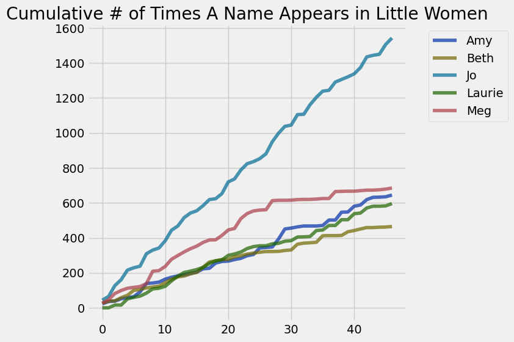

**Note:** In this example there is a lot of code. You are not expected to know how to read any of this yet. This is just a preview of the things you will see in the next few weeks.

## This is a Jupyter Notebook

A Jupyter Notebook is a document that combines:

1. **Narrative:** The text describing your analysis
2. **Code:** The program that does the analysis
3. **Results:** The output of the program

The Jupyter environment was created by faculty here at Berkeley (Fernando Perez). These ideas are now in a lot of different technologies (e.g., Google Colab).

## Our first example: analyzing the text of Little Women

*["Little Women"](https://en.wikipedia.org/wiki/Little_Women)* by Louisa May Alcott is the story of four sisters and their neighbor Laurie (Theodore Laurence).

To analyze it, we define a **function** that reads data from the Internet.

**Code:**

```python
# A tiny program to download text from the web.
def read_url(url): 
    from urllib.request import urlopen 
    import re
    return re.sub('\\s+', ' ', urlopen(url).read().decode())
```

Here we download the book, which is hosted on the Data 8 textbook website.

**Code:**

```python
little_women_url = 'https://www.inferentialthinking.com/data/little_women.txt'
little_women_text = read_url(little_women_url)
little_women_chapters = little_women_text.split('CHAPTER ')[1:]
```

## Tables

- A lot of data science is about transforming data. This is often in service of producing **tables**, a widely used data structure that we can more easily analyze our data with. 
- In this class you will use the `datascience` library (specifically created for this course) to manipulate and data.

**Code:**

```python
from datascience import *
```

**Code:**

```python
Table().with_column('Chapters', little_women_chapters)
```

*Output:*

| Chapters |
| --- |
| ONE PLAYING PILGRIMS "Christmas won't be Christmas witho ... |
| TWO A MERRY CHRISTMAS Jo was the first to wake in the gr ... |
| THREE THE LAURENCE BOY "Jo! Jo! Where are you?" cried Me ... |
| FOUR BURDENS "Oh, dear, how hard it does seem to take up ... |
| FIVE BEING NEIGHBORLY "What in the world are you going t ... |
| SIX BETH FINDS THE PALACE BEAUTIFUL The big house did pr ... |
| SEVEN AMY'S VALLEY OF HUMILIATION "That boy is a perfect ... |
| EIGHT JO MEETS APOLLYON "Girls, where are you going?" as ... |
| NINE MEG GOES TO VANITY FAIR "I do think it was the most ... |
| TEN THE P.C. AND P.O. As spring came on, a new set of am ... |

## We will learn to visualize data

Most notebooks contain some setup for data manipulation and visualization. The details aren't important, but an LM can tell you about them.

**Code:**

```python
from datascience import *
import numpy as np
%matplotlib inline
import matplotlib.pyplot as plt
plt.style.use('fivethirtyeight')
import warnings
warnings.simplefilter(action="ignore", category=FutureWarning)
```

We can calculate the number of times Jo was mentioned in each chapter.

**Code:**

```python
np.char.count(little_women_chapters, 'Jo')
```

*Output:*

```text
array([44, 21, 62, 34, 55, 13,  9, 71, 21, 12, 42, 60, 24, 48, 26, 13, 29,
       35,  5, 29, 67, 17, 51, 36, 12, 17, 28, 69, 49, 39,  7, 60,  2, 55,
       42, 35,  5, 47, 15, 15, 17, 36, 61,  9,  6, 56, 37])
```

How about the other characters? We could build a table.

**Code:**

```python
# Counts of names in the chapters of Little Women

names = ['Amy', 'Beth', 'Jo', 'Laurie', 'Meg']
mentions = {name: np.char.count(little_women_chapters, name) for name in names}

counts = Table().with_columns([
        'Amy',    mentions['Amy'],
        'Beth',   mentions['Beth'],
        'Jo',     mentions['Jo'],
        'Laurie', mentions['Laurie'],
        'Meg',    mentions['Meg']
    ])
counts
```

*Output:*

| Amy | Beth | Jo | Laurie | Meg |
| --- | --- | --- | --- | --- |
| 23 | 26 | 44 | 0 | 26 |
| 13 | 12 | 21 | 0 | 20 |
| 2 | 2 | 62 | 16 | 36 |
| 14 | 18 | 34 | 0 | 17 |
| 6 | 14 | 55 | 35 | 13 |
| 6 | 28 | 13 | 9 | 5 |
| 27 | 5 | 9 | 7 | 5 |
| 48 | 9 | 71 | 17 | 16 |
| 3 | 5 | 21 | 24 | 71 |
| 5 | 5 | 12 | 4 | 4 |

We can accumulate the counts for each character to show the total in the book so far.

**Code:**

```python
cumulative_counts = Table()
for label in counts.labels:
    cumulative_counts = cumulative_counts.with_column(label, np.cumsum(counts.column(label)))
cumulative_counts
```

*Output:*

| Amy | Beth | Jo | Laurie | Meg |
| --- | --- | --- | --- | --- |
| 23 | 26 | 44 | 0 | 26 |
| 36 | 38 | 65 | 0 | 46 |
| 38 | 40 | 127 | 16 | 82 |
| 52 | 58 | 161 | 16 | 99 |
| 58 | 72 | 216 | 51 | 112 |
| 64 | 100 | 229 | 60 | 117 |
| 91 | 105 | 238 | 67 | 122 |
| 139 | 114 | 309 | 84 | 138 |
| 142 | 119 | 330 | 108 | 209 |
| 147 | 124 | 342 | 112 | 213 |

And then to study these numbers we can create a line chart of cumulative counts.

**Code:**

```python
cumulative_counts.plot()
plt.title('Cumulative # of Times A Name Appears in Little Women')
plt.show()
```


