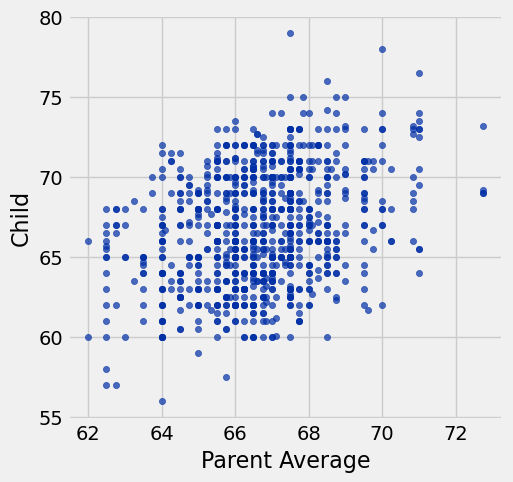
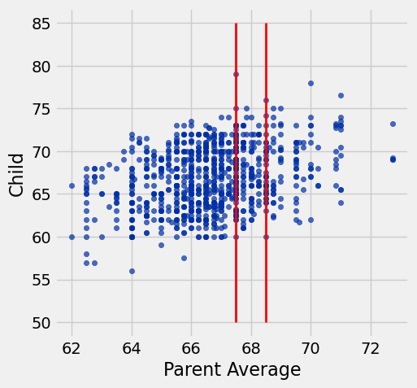
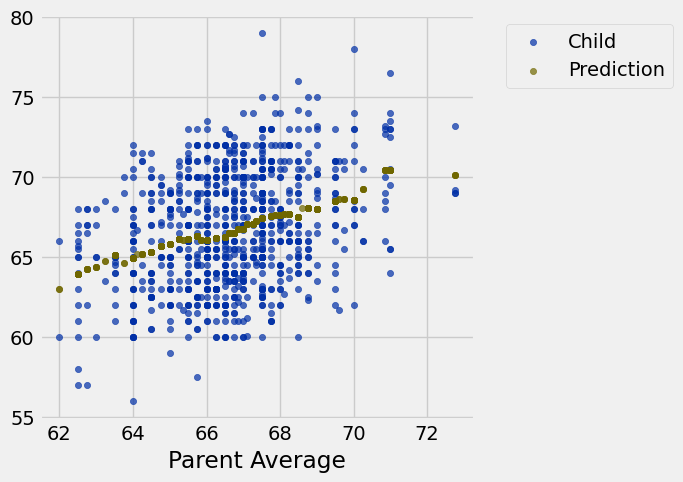
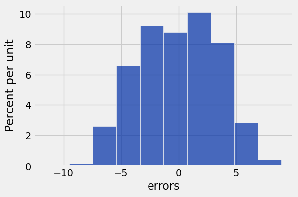
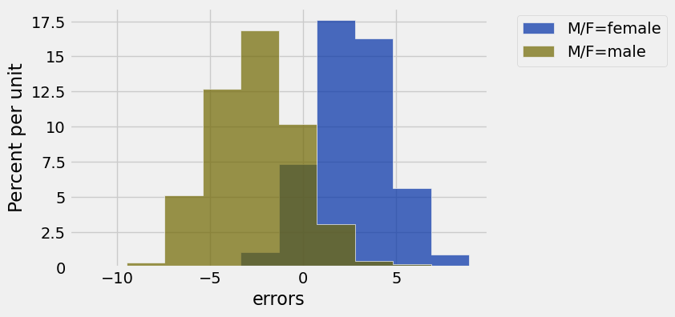
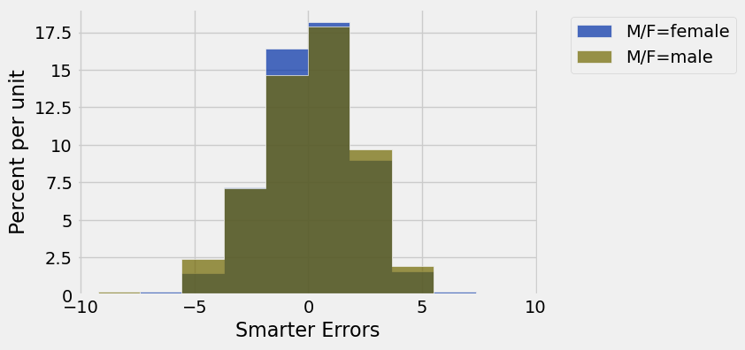
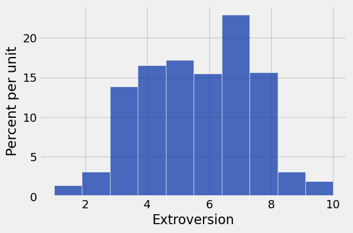
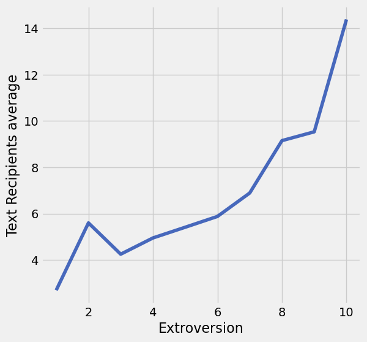

**Code:**

```python
from datascience import *
import numpy as np

%matplotlib inline
import matplotlib.pyplot as plots
plots.style.use('fivethirtyeight')
import warnings
warnings.simplefilter(action='ignore',category=np.VisibleDeprecationWarning)
```

## Lecture 10 ##

## Prediction ##

**Code:**

```python
families = Table.read_table('family_heights.csv')
families
```

*Output:*

| family | father | mother | child | children | order | child m/f |
| --- | --- | --- | --- | --- | --- | --- |
| 1 | 78.5 | 67 | 73.2 | 4 | 1 | male |
| 1 | 78.5 | 67 | 69.2 | 4 | 2 | female |
| 1 | 78.5 | 67 | 69 | 4 | 3 | female |
| 1 | 78.5 | 67 | 69 | 4 | 4 | female |
| 2 | 75.5 | 66.5 | 73.5 | 4 | 1 | male |
| 2 | 75.5 | 66.5 | 72.5 | 4 | 2 | male |
| 2 | 75.5 | 66.5 | 65.5 | 4 | 3 | female |
| 2 | 75.5 | 66.5 | 65.5 | 4 | 4 | female |
| 3 | 75 | 64 | 71 | 2 | 1 | male |
| 3 | 75 | 64 | 68 | 2 | 2 | female |

**Code:**

```python
parent_avgs = (families.column('father') + families.column('mother'))/2
```

**Code:**

```python
heights = Table().with_columns(
    'Parent Average', parent_avgs,
    'Child', families.column('child'), # At adulthood
    'M/F', families.column('child m/f')
)
heights
```

*Output:*

| Parent Average | Child | M/F |
| --- | --- | --- |
| 72.75 | 73.2 | male |
| 72.75 | 69.2 | female |
| 72.75 | 69 | female |
| 72.75 | 69 | female |
| 71 | 73.5 | male |
| 71 | 72.5 | male |
| 71 | 65.5 | female |
| 71 | 65.5 | female |
| 69.5 | 71 | male |
| 69.5 | 68 | female |

**Code:**

```python
heights.scatter('Parent Average', 'Child')
```



**Code:**

```python
heights.scatter('Parent Average', 'Child')
plots.plot([67.5, 67.5], [50, 85], color='red', lw=2)
plots.plot([68.5, 68.5], [50, 85], color='red', lw=2);
```



**Code:**

```python
nearby = heights.where('Parent Average', are.between(67.5, 68.5))
nearby_mean = np.average(nearby.column('Child'))
nearby_mean
```

*Output:*

```text
67.620000000000005
```

**Code:**

```python
heights.scatter('Parent Average', 'Child')
plots.plot([67.5, 67.5], [50, 85], color='red', lw=2)
plots.plot([68.5, 68.5], [50, 85], color='red', lw=2)
plots.scatter(68, nearby_mean, color='red', s=50);
```


**Code:**

```python
def predict(h):  # h is the average height of the parents, such as 68
    nearby = heights.where('Parent Average', are.between(h - 1/2, h + 1/2))
    return np.average(nearby.column('Child'))
```

**Code:**

```python
predict(68)
```

*Output:*

```text
67.620000000000005
```

**Code:**

```python
predict(70)
```

*Output:*

```text
68.561904761904756
```

**Code:**

```python
predict(73)
```

*Output:*

```text
70.099999999999994
```

**Code:**

```python
predicted_heights = heights.apply(predict, 'Parent Average')
```

**Code:**

```python
heights = heights.with_column('Prediction', predicted_heights)
heights
```

*Output:*

| Parent Average | Child | M/F | Prediction |
| --- | --- | --- | --- |
| 72.75 | 73.2 | male | 70.1 |
| 72.75 | 69.2 | female | 70.1 |
| 72.75 | 69 | female | 70.1 |
| 72.75 | 69 | female | 70.1 |
| 71 | 73.5 | male | 70.4158 |
| 71 | 72.5 | male | 70.4158 |
| 71 | 65.5 | female | 70.4158 |
| 71 | 65.5 | female | 70.4158 |
| 69.5 | 71 | male | 68.5025 |
| 69.5 | 68 | female | 68.5025 |

**Code:**

```python
heights.select('Parent Average', 'Child', 'Prediction').scatter('Parent Average')
```



## Prediction Accuracy ##

**Code:**

```python
pred_errs = heights.column('Prediction') - heights.column('Child')
heights = heights.with_column('errors',pred_errs)
heights
```

*Output:*

| Parent Average | Child | M/F | Prediction | errors |
| --- | --- | --- | --- | --- |
| 72.75 | 73.2 | male | 70.1 | -3.1 |
| 72.75 | 69.2 | female | 70.1 | 0.9 |
| 72.75 | 69 | female | 70.1 | 1.1 |
| 72.75 | 69 | female | 70.1 | 1.1 |
| 71 | 73.5 | male | 70.4158 | -3.08421 |
| 71 | 72.5 | male | 70.4158 | -2.08421 |
| 71 | 65.5 | female | 70.4158 | 4.91579 |
| 71 | 65.5 | female | 70.4158 | 4.91579 |
| 69.5 | 71 | male | 68.5025 | -2.4975 |
| 69.5 | 68 | female | 68.5025 | 0.5025 |

**Code:**

```python
heights.hist('errors')
```



**Code:**

```python
heights.hist('errors', group='M/F')
```



# Discussion Question

**Code:**

```python
def predict_smarter(h, s):
    nearby = heights.where('Parent Average', are.between(h - 1/2, h + 1/2))
    nearby_same_mf = nearby.where('M/F', s)
    return np.average(nearby_same_mf.column('Child'))
```

**Code:**

```python
predict_smarter(68, 'female')
```

*Output:*

```text
64.983516483516482
```

**Code:**

```python
predict_smarter(68, 'male')
```

*Output:*

```text
70.172340425531914
```

**Code:**

```python
heights.apply(predict_smarter, "Parent Average", "M/F")
```

*Output:*

```text
array([ 73.2       ,  69.06666667,  69.06666667,  69.06666667,
        73.48888889,  73.48888889,  67.65      ,  67.65      ,
        70.79545455,  65.7       ,  70.79545455,  70.79545455,
        65.7       ,  65.7       ,  65.7       ,  69.25322581,
        69.25322581,  69.25322581,  63.59495798,  63.59495798,
        63.59495798,  67.65      ,  73.48888889,  73.48888889,
        73.48888889,  73.48888889,  67.65      ,  67.65      ,
        66.82      ,  66.82      ,  66.82      ,  66.82      ,
        65.75882353,  70.17234043,  70.17234043,  64.98351648,
        64.98351648,  64.98351648,  64.98351648,  64.98351648,
        64.98351648,  64.67788462,  71.00952381,  66.11428571,
        71.00952381,  71.00952381,  71.00952381,  71.00952381,
        65.75882353,  70.921875  ,  70.921875  ,  70.921875  ,
        70.921875  ,  70.921875  ,  65.30571429,  65.30571429,
        65.30571429,  65.30571429,  70.79047619,  70.79047619,
        70.79047619,  70.79047619,  65.44318182,  65.44318182,
        65.25666667,  65.25666667,  65.25666667,  65.1       ,
        73.48888889,  73.48888889,  73.48888889,  67.65      ,
        67.65      ,  67.65      ,  67.65      ,  67.65      ,
        71.00952381,  66.11428571,  66.11428571,  70.79545455,
        70.79545455,  65.7       ,  70.56444444,  70.56444444,
        70.56444444,  65.25666667,  65.25666667,  65.25666667,
        65.25666667,  65.44318182,  64.98351648,  64.98351648,
        69.79677419,  69.79677419,  69.79677419,  64.67788462,
        64.67788462,  69.79677419,  69.79677419,  64.67788462,
        69.79677419,  69.79677419,  64.67788462,  64.67788462,
        64.67788462,  64.67788462,  64.98351648,  64.98351648,
        64.98351648,  63.88857143,  69.43969466,  69.43969466,
        69.43969466,  64.4       ,  64.4       ,  64.4       ,
        69.2553719 ,  69.2553719 ,  69.2553719 ,  63.88857143,
        63.88857143,  69.2553719 ,  69.2553719 ,  69.2553719 ,
        69.2553719 ,  63.88857143,  63.5928    ,  71.00952381,
        71.00952381,  71.00952381,  71.00952381,  66.11428571,
        70.921875  ,  70.921875  ,  70.921875  ,  65.30571429,
        70.56444444,  65.25666667,  65.25666667,  65.25666667,
        70.56444444,  70.56444444,  70.56444444,  65.25666667,
        65.25666667,  65.25666667,  70.56444444,  65.25666667,
        70.56444444,  70.56444444,  70.56444444,  70.56444444,
        65.25666667,  70.81555556,  70.61      ,  70.61      ,
        70.61      ,  70.61      ,  65.1       ,  65.1       ,
        70.56444444,  65.25666667,  70.61      ,  70.61      ,
        70.17234043,  70.17234043,  64.98351648,  64.67788462,
        64.67788462,  64.67788462,  64.67788462,  64.67788462,
        64.67788462,  64.67788462,  64.67788462,  70.61186441,
        70.61186441,  70.61186441,  65.1       ,  69.79677419,
        69.79677419,  69.79677419,  70.17234043,  70.17234043,
        70.17234043,  64.98351648,  64.98351648,  64.98351648,
        64.98351648,  70.08877551,  64.91382979,  64.39917355,
        64.39917355,  69.43969466,  69.43969466,  64.4       ,
        64.4       ,  64.4       ,  69.2553719 ,  69.2553719 ,
        69.2553719 ,  69.2553719 ,  63.88857143,  63.88857143,
        63.88857143,  63.88857143,  63.88857143,  69.2553719 ,
        69.2553719 ,  69.2553719 ,  63.88857143,  69.01344538,
        69.01344538,  63.5928    ,  63.5928    ,  63.5928    ,
        69.01344538,  69.01344538,  69.01344538,  63.5928    ,
        63.5928    ,  69.25322581,  63.59495798,  63.59495798,
        63.59495798,  63.59495798,  69.01344538,  69.01344538,
        69.01344538,  69.01344538,  69.01344538,  63.5928    ,
        63.5928    ,  63.44215686,  68.14047619,  68.14047619,
        70.79545455,  70.79545455,  70.79545455,  65.7       ,
        70.79545455,  70.79545455,  65.7       ,  65.7       ,
        65.7       ,  65.7       ,  70.921875  ,  70.56444444,
        70.56444444,  65.25666667,  65.25666667,  65.25666667,
        65.25666667,  70.61

... [output truncated, 10714 more characters]
```

**Code:**

```python
smarter_predicted_heights = heights.apply(predict_smarter, 'Parent Average', 'M/F')
heights = heights.with_column('Smarter Prediction', smarter_predicted_heights)
heights
```

*Output:*

| Parent Average | Child | M/F | Prediction | errors | Smarter Prediction |
| --- | --- | --- | --- | --- | --- |
| 72.75 | 73.2 | male | 70.1 | -3.1 | 73.2 |
| 72.75 | 69.2 | female | 70.1 | 0.9 | 69.0667 |
| 72.75 | 69 | female | 70.1 | 1.1 | 69.0667 |
| 72.75 | 69 | female | 70.1 | 1.1 | 69.0667 |
| 71 | 73.5 | male | 70.4158 | -3.08421 | 73.4889 |
| 71 | 72.5 | male | 70.4158 | -2.08421 | 73.4889 |
| 71 | 65.5 | female | 70.4158 | 4.91579 | 67.65 |
| 71 | 65.5 | female | 70.4158 | 4.91579 | 67.65 |
| 69.5 | 71 | male | 68.5025 | -2.4975 | 70.7955 |
| 69.5 | 68 | female | 68.5025 | 0.5025 | 65.7 |

**Code:**

```python
smarter_pred_errs = heights.apply(difference, 'Child', 'Smarter Prediction')
heights = heights.with_column('Smarter Errors', smarter_pred_errs)
```

**Code:**

```python
heights.hist('Smarter Errors', group='M/F')
```



## Grouping by One Column ##

**Code:**

```python
cones = Table.read_table('cones.csv').drop('Color')
cones
```

*Output:*

| Flavor | Price |
| --- | --- |
| strawberry | 3.55 |
| chocolate | 4.75 |
| chocolate | 5.25 |
| strawberry | 5.25 |
| chocolate | 5.25 |
| bubblegum | 4.75 |

**Code:**

```python
cones.group('Flavor')
```

*Output:*

| Flavor | count |
| --- | --- |
| bubblegum | 1 |
| chocolate | 3 |
| strawberry | 2 |

**Code:**

```python
cones.group('Flavor', np.average)
```

*Output:*

| Flavor | Price average |
| --- | --- |
| bubblegum | 4.75 |
| chocolate | 5.08333 |
| strawberry | 4.4 |

**Code:**

```python
cones.group('Flavor', np.min)
```

*Output:*

| Flavor | Price min |
| --- | --- |
| bubblegum | 4.75 |
| chocolate | 4.75 |
| strawberry | 3.55 |

**Code:**

```python
cones.group('Flavor', list)
```

*Output:*

| Flavor | Price list |
| --- | --- |
| bubblegum | [4.75] |
| chocolate | [4.75, 5.25, 5.25] |
| strawberry | [3.5499999999999998, 5.25] |

## Grouping By One Column: Welcome Survey ##

**Code:**

```python
survey = Table.read_table('welcome_survey_sp26.csv')
survey.show(3)
```

*Output:*

| Year | Extroversion | Text Recipients | Sleep Hours | Handedness | Sleep Position | Piercings |
| --- | --- | --- | --- | --- | --- | --- |
| 1 | 5 | 1 | 8 | Right-handed | On your back | 2 |
| 2 | 8 | 20 | 6 | Right-handed | On your right side | 2 |
| 1 | 10 | 10 | 6 | Left-handed | On your back | 0 |

**Code:**

```python
survey.hist('Extroversion')
```



**Code:**

```python
survey.select(1, 2, 3).group('Extroversion', np.average)
```

*Output:*

| Extroversion | Text Recipients average | Sleep Hours average |
| --- | --- | --- |
| 1 | 2.69231 | 7.26923 |
| 2 | 5.6 | 7.2 |
| 3 | 4.24812 | 7.03008 |
| 4 | 4.94969 | 7.12893 |
| 5 | 5.41212 | 7.10303 |
| 6 | 5.87919 | 7.11409 |
| 7 | 6.89091 | 7.09091 |
| 8 | 9.15333 | 7.16667 |
| 9 | 9.53333 | 7.4 |
| 10 | 14.3889 | 6.83333 |

**Code:**

```python
survey.group('Extroversion', np.average).plot('Extroversion', 'Text Recipients average')
```



**Code:**

```python
survey.group("Year")
```

*Output:*

| Year | count |
| --- | --- |
| 1 | 572 |
| 2 | 207 |
| 3 | 203 |
| 4 | 71 |
| 5 | 14 |

**Code:**

```python
(survey
 .select("Year", "Sleep Hours")
 .group("Year", np.average))
```

*Output:*

| Year | Sleep Hours average |
| --- | --- |
| 1 | 7.17692 |
| 2 | 7.05314 |
| 3 | 6.94236 |
| 4 | 7.21831 |
| 5 | 7.42857 |

## Lists

**Code:**

```python
[1, 5, 'hello', 5.0]
```

**Code:**

```python
[1, 5, 'hello', 5.0, make_array(1,2,3)]
```

## Grouping by Two Columns ##

Do right-handed people tend to sleep on their left side and left-handed people sleep on their right?

**Code:**

```python
survey.group('Sleep Position')
```

*Output:*

| Sleep Position | count |
| --- | --- |
| On your back | 265 |
| On your left side | 273 |
| On your right side | 412 |
| On your stomach | 117 |

**Code:**

```python
survey.group(['Handedness', 'Sleep Position']).show()
```

*Output:*

| Handedness | Sleep Position | count |
| --- | --- | --- |
| Left-handed | On your back | 15 |
| Left-handed | On your left side | 20 |
| Left-handed | On your right side | 23 |
| Left-handed | On your stomach | 12 |
| Right-handed | On your back | 250 |
| Right-handed | On your left side | 251 |
| Right-handed | On your right side | 389 |
| Right-handed | On your stomach | 104 |
| ambidextrous | On your left side | 1 |
| both | On your stomach | 1 |
| i can use both | On your left side | 1 |

---

## Datasets

Datasets this notebook loads with `Table.read_table`. Column names are exact, including spaces and capitalization. Only the schema is recorded here — the data itself is not in this document, so any question about its values must be answered by running code, not by reasoning over the rows shown elsewhere in this file.

### `family_heights.csv`

934 rows, 7 columns.

| Column | Type |
| --- | --- |
| `family` | str |
| `father` | float |
| `mother` | float |
| `child` | float |
| `children` | int |
| `order` | int |
| `child m/f` | str |

### `cones.csv`

6 rows, 3 columns.

| Column | Type |
| --- | --- |
| `Flavor` | str |
| `Color` | str |
| `Price` | float |

### `welcome_survey_sp26.csv`

1,067 rows, 7 columns.

| Column | Type |
| --- | --- |
| `Year` | int |
| `Extroversion` | int |
| `Text Recipients` | int |
| `Sleep Hours` | float |
| `Handedness` | str |
| `Sleep Position` | str |
| `Piercings` | int |
