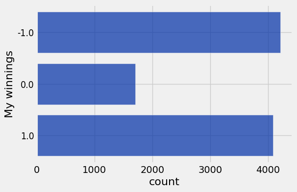
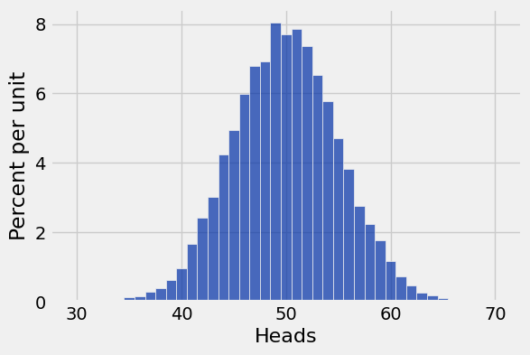

**Code:**

```python
from datascience import *
import numpy as np

%matplotlib inline
import matplotlib.pyplot as plots
plots.style.use('fivethirtyeight')
import warnings
# warnings.simplefilter(action='ignore', category=np.VisibleDeprecationWarning)
```

### Appending Arrays

**Code:**

```python
first = np.arange(4)
second = np.arange(10, 17)
```

**Code:**

```python
first
```

*Output:*

```text
array([0, 1, 2, 3])
```

**Code:**

```python
np.append(first, 6)
```

*Output:*

```text
array([0, 1, 2, 3, 6])
```

**Code:**

```python
first
```

*Output:*

```text
array([0, 1, 2, 3])
```

**Code:**

```python
# how do we change `first`?
first = np.append(first, 6)
```

**Code:**

```python
np.append(first, second)
```

*Output:*

```text
array([ 0,  1,  2,  3,  6, 10, 11, 12, 13, 14, 15, 16])
```

**Code:**

```python
first
```

*Output:*

```text
array([0, 1, 2, 3, 6])
```

**Code:**

```python
second
```

*Output:*

```text
array([10, 11, 12, 13, 14, 15, 16])
```

## Comparison ##

**Code:**

```python
3 > 1
```

*Output:*

```text
True
```

**Code:**

```python
type(3 > 1)
```

*Output:*

```text
bool
```

**Code:**

```python
True
```

*Output:*

```text
True
```

**Code:**

```python
true
```

*Error:*

```text
---------------------------------------------------------------------------
NameError                                 Traceback (most recent call last)
Cell In[26], line 1
----> 1 true

NameError: name 'true' is not defined
```

(We see that capitalization matters.)

**Code:**

```python
3 = 3
```

*Error:*

```text
  Cell In[27], line 1
    3 = 3
    ^
SyntaxError: cannot assign to literal here. Maybe you meant '==' instead of '='?
```

**Code:**

```python
3 == 3.0
```

*Output:*

```text
True
```

**Code:**

```python
10 != 2
```

*Output:*

```text
True
```

**Code:**

```python
x = 14
y = 3
```

**Code:**

```python
x > 15
```

*Output:*

```text
False
```

**Code:**

```python
12 < x
```

*Output:*

```text
True
```

**Code:**

```python
x < 20
```

*Output:*

```text
True
```

**Code:**

```python
12 < x < 20
```

*Output:*

```text
True
```

**Code:**

```python
10 < x-y < 13
```

*Output:*

```text
True
```

**Code:**

```python
x > 13 and y < 3.14159
```

*Output:*

```text
True
```

(The comparison `12 < x < 20` is equivalent to `12 < x and x < 20`.)

## Comparisons with arrays

**Code:**

```python
pets = make_array('cat', 'cat', 'dog', 'cat', 'dog', 'rabbit')
```

**Code:**

```python
pets == 'cat'
```

*Output:*

```text
array([ True,  True, False,  True, False, False], dtype=bool)
```

**Code:**

```python
1 + 1 + 0 + 1 + 0 + 0
```

*Output:*

```text
3
```

**Code:**

```python
sum(make_array(True, True, False, True, False, False))
```

*Output:*

```text
3
```

**Code:**

```python
sum(pets == 'cat')
```

*Output:*

```text
3
```

**Code:**

```python
np.count_nonzero(pets == 'cat')
```

*Output:*

```text
3
```

**Code:**

```python
xs = np.arange(20, 31)
```

**Code:**

```python
xs
```

*Output:*

```text
array([20, 21, 22, 23, 24, 25, 26, 27, 28, 29, 30])
```

**Code:**

```python
xs > 28
```

*Output:*

```text
array([False, False, False, False, False, False, False, False, False,
        True,  True], dtype=bool)
```

**Code:**

```python
sum(xs > 28)
```

*Output:*

```text
2
```

## Conditional Statements

**Code:**

```python
age = 20
```

**Code:**

```python
if age >= 18:
    print('You can legally vote.')
else:
    if age >= 16:
        print("You can't vote just yet, but you can pre-register!")
    else:
        print("You can't vote just yet.")
```

*Output (stdout):*

```text
You can't vote just yet, but you can pre-register!
```

**Code:**

```python
if age >= 18:
    print('You can legally vote.')
if age >= 16:
    print("You can't vote just yet, but you can pre-register!")
else:
    print("You can't vote just yet.")
```

*Output (stdout):*

```text
You can legally vote.
You can't vote just yet, but you can pre-register!
```

**Code:**

```python
def vote(age):
    if age >= 18:
        return 'You can legally vote.'
    elif age >= 16:
        return "You can't vote just yet, but you can pre-register!"
    else:
        return "You can't vote just yet."
```

**Code:**

```python
vote(3)
```

*Output:*

```text
"You can't vote just yet."
```

**Code:**

```python
vote(17)
```

*Output:*

```text
"You can't vote just yet, but you can pre-register!"
```

**Code:**

```python
vote(25)
```

*Output:*

```text
'You can legally vote.'
```

**Code:**

```python
def rights(age):
	my_rights = make_array()
	if age >= 16:
		my_rights = np.append(my_rights, 'register to vote')
	if age >= 18:
		my_rights = np.append(my_rights, 'vote')
	return my_rights
```

**Code:**

```python
rights(3)
```

*Output:*

```text
array([], dtype=float64)
```

**Code:**

```python
rights(17)
```

*Output:*

```text
array(['register to vote'],
      dtype='<U32')
```

**Code:**

```python
rights(25)
```

*Output:*

```text
array(['register to vote', 'vote'],
      dtype='<U32')
```

**Code:**

```python
trip = Table().read_table('trip.csv').sort('Zip Code')
trip.show(5)
```

*Output:*

| Trip ID | Duration | Start Date | Start Station | Start Terminal | End Date | End Station | End Terminal | Bike # | Subscriber Type | Zip Code |
| --- | --- | --- | --- | --- | --- | --- | --- | --- | --- | --- |
| 901821 | 609 | 8/24/2015 0:11 | Powell at Post (Union Square) | 71 | 8/24/2015 0:21 | Grant Avenue at Columbus Avenue | 73 | 611 | Customer | 0 |
| 901820 | 1063 | 8/23/2015 23:44 | Embarcadero at Sansome | 60 | 8/24/2015 0:02 | Powell at Post (Union Square) | 71 | 383 | Customer | 0 |
| 901713 | 1550 | 8/23/2015 17:20 | Post at Kearny | 47 | 8/23/2015 17:45 | Market at 10th | 67 | 623 | Customer | 0 |
| 878924 | 11785 | 8/6/2015 16:02 | Civic Center BART (7th at Market) | 72 | 8/6/2015 19:18 | Embarcadero at Sansome | 60 | 625 | Customer | 0 |
| 878920 | 138 | 8/6/2015 15:58 | Civic Center BART (7th at Market) | 72 | 8/6/2015 16:00 | Civic Center BART (7th at Market) | 72 | 67 | Customer | 0 |

**Code:**

```python
def trip_kind(start, end):
    if start == end:
        return 'round trip'
    else:
        return 'one way'

# trip.show(5)

kinds = trip.apply(trip_kind, 'Start Station', 'End Station')
with_kinds = trip.with_column('Trip Kind', kinds)
with_kinds.show(5)
```

*Output:*

| Trip ID | Duration | Start Date | Start Station | Start Terminal | End Date | End Station | End Terminal | Bike # | Subscriber Type | Zip Code | Trip Kind |
| --- | --- | --- | --- | --- | --- | --- | --- | --- | --- | --- | --- |
| 901821 | 609 | 8/24/2015 0:11 | Powell at Post (Union Square) | 71 | 8/24/2015 0:21 | Grant Avenue at Columbus Avenue | 73 | 611 | Customer | 0 | one way |
| 901820 | 1063 | 8/23/2015 23:44 | Embarcadero at Sansome | 60 | 8/24/2015 0:02 | Powell at Post (Union Square) | 71 | 383 | Customer | 0 | one way |
| 901713 | 1550 | 8/23/2015 17:20 | Post at Kearny | 47 | 8/23/2015 17:45 | Market at 10th | 67 | 623 | Customer | 0 | one way |
| 878924 | 11785 | 8/6/2015 16:02 | Civic Center BART (7th at Market) | 72 | 8/6/2015 19:18 | Embarcadero at Sansome | 60 | 625 | Customer | 0 | one way |
| 878920 | 138 | 8/6/2015 15:58 | Civic Center BART (7th at Market) | 72 | 8/6/2015 16:00 | Civic Center BART (7th at Market) | 72 | 67 | Customer | 0 | round trip |

**Code:**

```python
# recall pivot! what will we see?
with_kinds.where('Duration', are.below(600)).pivot('Trip Kind', 'Start Station')
```

*Output:*

| Start Station | one way | round trip |
| --- | --- | --- |
| 2nd at Folsom | 6821 | 25 |
| 2nd at South Park | 6484 | 98 |
| 2nd at Townsend | 9513 | 83 |
| 5th at Howard | 5752 | 36 |
| Adobe on Almaden | 439 | 8 |
| Arena Green / SAP Center | 382 | 18 |
| Beale at Market | 5750 | 32 |
| Broadway St at Battery St | 4482 | 59 |
| California Ave Caltrain Station | 39 | 12 |
| Castro Street and El Camino Real | 1005 | 10 |

## Simulation

Let's play a game: we each roll a die. 

If my number is bigger: you pay me a dollar.

If they're the same: we do nothing.

If your number is bigger: I pay you a dollar.

Steps:
1. Find a way to simulate two dice rolls.
2. Compute how much money we win/lose based on the result.
3. Do steps 1 and 2 10,000 times.

### Conditional Statements

**Code:**

```python
# Work in progress
def one_round(my_roll, your_roll):
    if my_roll > your_roll:
        return 1
```

**Code:**

```python
one_round(4, 3)
```

*Output:*

```text
1
```

**Code:**

```python
one_round(2, 6)
```

**Code:**

```python
def one_round(my_roll, your_roll):
    if my_roll > your_roll:
        return 1
    elif your_roll > my_roll:
        return -1
    elif your_roll == my_roll:
        return 0
```

**Code:**

```python
one_round(1, 1)
```

*Output:*

```text
0
```

**Code:**

```python
one_round(6, 5)
```

*Output:*

```text
1
```

**Code:**

```python
one_round(-7, -1)
```

*Output:*

```text
-1
```

### Random Selection

**Code:**

```python
mornings = make_array('wake up', 'sleep in')
```

**Code:**

```python
np.random.choice(mornings)
```

*Output:*

```text
'wake up'
```

**Code:**

```python
np.random.choice(mornings)
```

*Output:*

```text
'sleep in'
```

**Code:**

```python
np.random.choice(mornings)
```

*Output:*

```text
'wake up'
```

We can also pass an argument that specifies how many times to make a random choice:

**Code:**

```python
np.random.choice(mornings, 7)
```

*Output:*

```text
array(['wake up', 'wake up', 'wake up', 'sleep in', 'wake up', 'sleep in',
       'wake up'],
      dtype='<U8')
```

**Code:**

```python
sum(np.random.choice(mornings, 7) == 'wake up')
```

*Output:*

```text
5
```

**Code:**

```python
sum(np.random.choice(mornings, 7) == 'sleep in')
```

*Output:*

```text
4
```

^ Why don't these (always) sum to 7?

**Code:**

```python
morning_week = np.random.choice(mornings, 7)
morning_week
```

*Output:*

```text
array(['sleep in', 'wake up', 'wake up', 'sleep in', 'wake up', 'wake up',
       'wake up'],
      dtype='<U8')
```

**Code:**

```python
sum(morning_week == 'wake up')
```

*Output:*

```text
5
```

**Code:**

```python
sum(morning_week == 'sleep in')
```

*Output:*

```text
2
```

### Simulating the roll of a die

**Code:**

```python
die_faces = np.arange(1, 7)
```

**Code:**

```python
np.random.choice(die_faces)
```

*Output:*

```text
4
```

**Code:**

```python
def simulate_one_round():
    my_roll = np.random.choice(die_faces)
    your_roll = np.random.choice(die_faces)
    return one_round(my_roll, your_roll)
```

**Code:**

```python
simulate_one_round()
```

*Output:*

```text
-1
```

### Repeated Betting ###

**Code:**

```python
results = make_array()
```

**Code:**

```python
results = np.append(results, simulate_one_round())
results
```

*Output:*

```text
array([-1.,  1.])
```

**Code:**

```python
results = np.append(results, simulate_one_round())
results
```

*Output:*

```text
array([-1.,  1.,  1., -1., -1.,  1., -1., -1.,  1.,  1.,  1.,  1.,  0.,
        1.,  1.,  1.,  1., -1.,  0.,  0., -1.,  0.,  1., -1.,  1.,  1.,
       -1.,  1.,  0.,  1.])
```

## `For` Statements

**Code:**

```python
for pet in make_array('cat', 'dog', 'rabbit'):
    print('I love my ' + pet)
```

*Output (stdout):*

```text
I love my cat
I love my dog
I love my rabbit
```

**Code:**

```python
pet = make_array('cat', 'dog', 'rabbit').item(0)
print('I love my ' + pet)

pet = make_array('cat', 'dog', 'rabbit').item(1)
print('I love my ' + pet)

pet = make_array('cat', 'dog', 'rabbit').item(2)
print('I love my ' + pet)
```

*Output (stdout):*

```text
I love my cat
I love my dog
I love my rabbit
```

**Code:**

```python
np.arange(10)
```

*Output:*

```text
array([0, 1, 2, 3, 4, 5, 6, 7, 8, 9])
```

**Code:**

```python
for i in np.arange(10):
    print('GO BEARSSSS')
```

*Output (stdout):*

```text
GO BEARSSSS
GO BEARSSSS
GO BEARSSSS
GO BEARSSSS
GO BEARSSSS
GO BEARSSSS
GO BEARSSSS
GO BEARSSSS
GO BEARSSSS
GO BEARSSSS
```

(see slides)

**Code:**

```python
game_outcomes = make_array()

for i in np.arange(5):
    game_outcomes = np.append(game_outcomes, simulate_one_round())
    
game_outcomes
```

*Output:*

```text
array([ 1., -1.,  1., -1.,  0.])
```

**Code:**

```python
game_outcomes = make_array()

for i in np.arange(10000):
    game_outcomes = np.append(game_outcomes, simulate_one_round())
    
game_outcomes
```

*Output:*

```text
array([-1.,  1.,  1., ..., -1.,  1.,  0.])
```

**Code:**

```python
len(game_outcomes)
```

*Output:*

```text
10000
```

**Code:**

```python
results = Table().with_column('My winnings', game_outcomes)
```

**Code:**

```python
results
```

*Output:*

| My winnings |
| --- |
| -1 |
| 1 |
| 1 |
| 1 |
| 0 |
| -1 |
| 0 |
| -1 |
| 1 |
| -1 |

**Code:**

```python
results.group('My winnings').barh('My winnings')
```



**Code:**

```python
sum(game_outcomes)
```

### Another example: simulating heads in 100 coin tosses

**Code:**

```python
coin = make_array('heads', 'tails')
```

**Code:**

```python
sum(np.random.choice(coin, 100) == 'heads')
```

*Output:*

```text
51
```

**Code:**

```python
# Simulate one outcome

def num_heads():
    return sum(np.random.choice(coin, 100) == 'heads')
```

**Code:**

```python
# Decide how many times you want to repeat the experiment

repetitions = 10000
```

**Code:**

```python
# Simulate that many outcomes

outcomes = make_array()

for i in np.arange(repetitions):
    outcomes = np.append(outcomes, num_heads())
```

**Code:**

```python
heads = Table().with_column('Heads', outcomes)
heads.hist(bins = np.arange(29.5, 70.6))
```



## `datascience` library

**Code:**

```python
trip.show(3)
```

*Output:*

| Trip ID | Duration | Start Date | Start Station | Start Terminal | End Date | End Station | End Terminal | Bike # | Subscriber Type | Zip Code |
| --- | --- | --- | --- | --- | --- | --- | --- | --- | --- | --- |
| 901821 | 609 | 8/24/2015 0:11 | Powell at Post (Union Square) | 71 | 8/24/2015 0:21 | Grant Avenue at Columbus Avenue | 73 | 611 | Customer | 0 |
| 901820 | 1063 | 8/23/2015 23:44 | Embarcadero at Sansome | 60 | 8/24/2015 0:02 | Powell at Post (Union Square) | 71 | 383 | Customer | 0 |
| 901713 | 1550 | 8/23/2015 17:20 | Post at Kearny | 47 | 8/23/2015 17:45 | Market at 10th | 67 | 623 | Customer | 0 |

**Code:**

```python
trip.where('Duration', are.above(1000))
# .column('Duration')
```

*Output:*

| Trip ID | Duration | Start Date | Start Station | Start Terminal | End Date | End Station | End Terminal | Bike # | Subscriber Type | Zip Code |
| --- | --- | --- | --- | --- | --- | --- | --- | --- | --- | --- |
| 901820 | 1063 | 8/23/2015 23:44 | Embarcadero at Sansome | 60 | 8/24/2015 0:02 | Powell at Post (Union Square) | 71 | 383 | Customer | 0 |
| 901713 | 1550 | 8/23/2015 17:20 | Post at Kearny | 47 | 8/23/2015 17:45 | Market at 10th | 67 | 623 | Customer | 0 |
| 878924 | 11785 | 8/6/2015 16:02 | Civic Center BART (7th at Market) | 72 | 8/6/2015 19:18 | Embarcadero at Sansome | 60 | 625 | Customer | 0 |
| 878906 | 12332 | 8/6/2015 15:52 | Civic Center BART (7th at Market) | 72 | 8/6/2015 19:18 | Embarcadero at Sansome | 60 | 531 | Customer | 0 |
| 871652 | 8820 | 8/1/2015 12:03 | Commercial at Montgomery | 45 | 8/1/2015 14:30 | Harry Bridges Plaza (Ferry Building) | 50 | 444 | Customer | 0 |
| 871651 | 8839 | 8/1/2015 12:02 | Commercial at Montgomery | 45 | 8/1/2015 14:29 | Harry Bridges Plaza (Ferry Building) | 50 | 390 | Customer | 0 |
| 862514 | 5698 | 7/26/2015 16:49 | Spear at Folsom | 49 | 7/26/2015 18:24 | Spear at Folsom | 49 | 419 | Customer | 0 |
| 854766 | 6281 | 7/21/2015 5:13 | University and Emerson | 35 | 7/21/2015 6:58 | University and Emerson | 35 | 101 | Customer | 0 |
| 852559 | 4411 | 7/19/2015 11:17 | Civic Center BART (7th at Market) | 72 | 7/19/2015 12:31 | Market at 4th | 76 | 877 | Customer | 0 |
| 805856 | 1194 | 6/13/2015 13:48 | Harry Bridges Plaza (Ferry Building) | 50 | 6/13/2015 14:08 | Embarcadero at Sansome | 60 | 518 | Customer | 0 |

**Code:**

```python
big_trip_durations = make_array()
```

**Code:**

```python
for duration in trip.column('Duration'):
    if duration > 1000:
        big_trip_durations = np.append(big_trip_durations, duration)
np.mean(big_trip_durations)
```

*Output:*

```text
5259.1915219611847
```

**Code:**

```python
np.mean(
    trip.where('Duration', are.above(1000)).column('Duration')
)
```

*Output:*

```text
5259.1915219611847
```

## Optional: Advanced `where` ##

**Code:**

```python
ages = make_array(16, 22, 18, 15, 19, 15, 16, 21)
age = Table().with_column('Age', ages)
```

**Code:**

```python
age
```

*Output:*

| Age |
| --- |
| 16 |
| 22 |
| 18 |
| 15 |
| 19 |
| 15 |
| 16 |
| 21 |

**Code:**

```python
age.where('Age', are.above_or_equal_to(18))
```

*Output:*

| Age |
| --- |
| 22 |
| 18 |
| 19 |
| 21 |

**Code:**

```python
voter = ages >= 18
```

**Code:**

```python
voter
```

*Output:*

```text
array([False,  True,  True, False,  True, False, False,  True], dtype=bool)
```

**Code:**

```python
age.where(voter)
```

*Output:*

| Age |
| --- |
| 22 |
| 18 |
| 19 |
| 21 |

**Code:**

```python
is_voter = are.above_or_equal_to(18)
```

**Code:**

```python
type(is_voter)
```

*Output:*

```text
datascience.predicates._combinable
```

**Code:**

```python
is_voter(22)
```

*Output:*

```text
True
```

**Code:**

```python
is_voter(3)
```

*Output:*

```text
False
```

**Code:**

```python
age.apply(is_voter, 'Age')
```

*Output:*

```text
array([False,  True,  True, False,  True, False, False,  True], dtype=bool)
```

**Code:**

```python
ages >= 18
```

*Output:*

```text
array([False,  True,  True, False,  True, False, False,  True], dtype=bool)
```

**Code:**

```python
voter
```

*Output:*

```text
array([False,  True,  True, False,  True, False, False,  True], dtype=bool)
```

**Code:**

```python
def my_voter_function(x):
    return x >= 18
```

**Code:**

```python
age.where('Age', are.above_or_equal_to(18))
```

*Output:*

| Age |
| --- |
| 22 |
| 18 |
| 19 |
| 21 |

**Code:**

```python
age.where(voter)
```

*Output:*

| Age |
| --- |
| 22 |
| 18 |
| 19 |
| 21 |

---

## Datasets

Datasets this notebook loads with `Table.read_table`. Column names are exact, including spaces and capitalization. Only the schema is recorded here — the data itself is not in this document, so any question about its values must be answered by running code, not by reasoning over the rows shown elsewhere in this file.

### `trip.csv`

354,152 rows, 11 columns.

| Column | Type |
| --- | --- |
| `Trip ID` | int |
| `Duration` | int |
| `Start Date` | str |
| `Start Station` | str |
| `Start Terminal` | int |
| `End Date` | str |
| `End Station` | str |
| `End Terminal` | int |
| `Bike #` | int |
| `Subscriber Type` | str |
| `Zip Code` | str |
