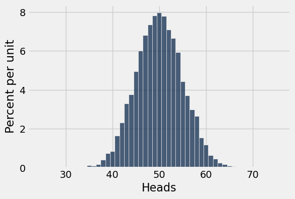
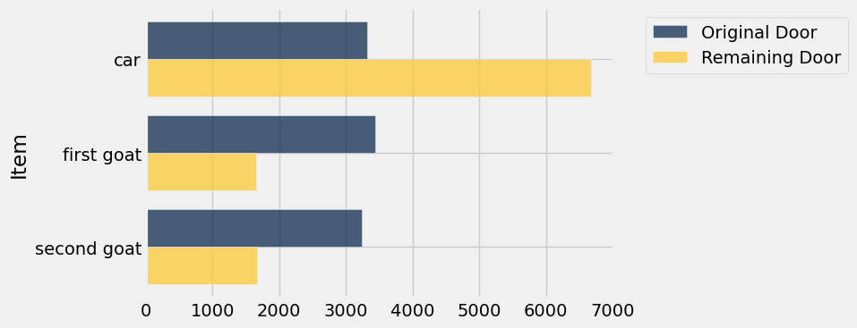

**Code:**

```python
from datascience import *
%matplotlib inline

import matplotlib.pyplot as plt
plt.style.use('fivethirtyeight')
import numpy as np
import warnings
```

## Simulation Review

**Code:**

```python
coin = make_array('heads', 'tails')
```

**Code:**

```python
np.random.choice(coin)
```

*Output:*

```text
'tails'
```

**Code:**

```python
tosses = np.random.choice(coin, 10)
tosses
```

*Output:*

```text
array(['tails', 'tails', 'tails', 'tails', 'heads', 'tails', 'tails',
       'tails', 'tails', 'heads'],
      dtype='<U5')
```

**Code:**

```python
sum(tosses == 'heads')
```

*Output:*

```text
2
```

**Code:**

```python
sum(np.random.choice(coin, 10) == 'heads')
```

*Output:*

```text
5
```

**Code:**

```python
# Simulate one outcome based on 100 tosses

def heads_in_100_tosses():
    return sum(np.random.choice(coin, 100) == 'heads')
```

**Code:**

```python
# Decide how many times you want to repeat the experiment

num_simulations = 10000
```

**Code:**

```python
# Simulate that many outcomes

outcomes = make_array()

for i in np.arange(num_simulations):
    outcomes = np.append(outcomes, heads_in_100_tosses())
    
outcomes
```

*Output:*

```text
array([ 52.,  57.,  49., ...,  50.,  59.,  46.])
```

**Code:**

```python
heads = Table().with_column('Heads', outcomes)
heads.hist(bins = np.arange(24.5, 76.5))
```



# Chance #

### Probability Question

3 cards: A, K, Q

Draw two cards at random without replacement.

What is the chance of a Queen followed by a King?

First Solution:

Alternative Solution:

### Another Question

Same setting as above.

What is the chance that one of the cards drawn is the King and the other is the Queen?

First Solution:

Alternative Solution:

### Complement Rule

Done on slide.

### The Monty Hall Problem ###

**Code:**

```python
goats = make_array('first goat', 'second goat')
doors = make_array('car', 'first goat', 'second goat')
doors
```

*Output:*

```text
array(['car', 'first goat', 'second goat'],
      dtype='<U11')
```

**Code:**

```python
def other_goat(x):
    if x == 'first goat':
        return 'second goat'
    elif x == 'second goat':
        return 'first goat'
```

**Code:**

```python
make_array(other_goat('first goat'), other_goat('second goat'))
```

*Output:*

```text
array(['second goat', 'first goat'],
      dtype='<U11')
```

**Code:**

```python
def monty_hall():
    """Return 
    [contestant's guess, what Monty reveals, what remains behind the other door]"""
    
    contestant_choice = np.random.choice(doors)
    
    if contestant_choice == 'first goat':
        monty_choice = 'second goat'
        remaining_choice = 'car'
    
    if contestant_choice == 'second goat':
        monty_choice = 'first goat'
        remaining_choice = 'car'
    
    if contestant_choice == 'car':
        monty_choice = np.random.choice(goats)
        remaining_choice = other_goat(monty_choice)
        
    return make_array(contestant_choice, monty_choice, remaining_choice)
```

**Code:**

```python
monty_hall()
```

*Output:*

```text
array(['car', 'first goat', 'second goat'],
      dtype='<U11')
```

**Code:**

```python
results = Table(make_array('Guess', 'Revealed', 'Remaining'))

for i in np.arange(10000):
    results.append(monty_hall())
```

**Code:**

```python
results.show(5)
```

*Output:*

| Guess | Revealed | Remaining |
| --- | --- | --- |
| first goat | second goat | car |
| first goat | second goat | car |
| first goat | second goat | car |
| first goat | second goat | car |
| first goat | second goat | car |

**Code:**

```python
original_choice = results.group('Guess')
original_choice
```

*Output:*

| Guess | count |
| --- | --- |
| car | 3324 |
| first goat | 3442 |
| second goat | 3234 |

**Code:**

```python
remaining_door = results.group('Remaining')
remaining_door
```

*Output:*

| Remaining | count |
| --- | --- |
| car | 6676 |
| first goat | 1654 |
| second goat | 1670 |

**Code:**

```python
# Collect all the results

all_results = Table().with_columns(
    'Item', doors,
    'Original Door', original_choice.column(1),
    'Remaining Door', remaining_door.column(1)
)
```

**Code:**

```python
all_results.barh('Item')
```


