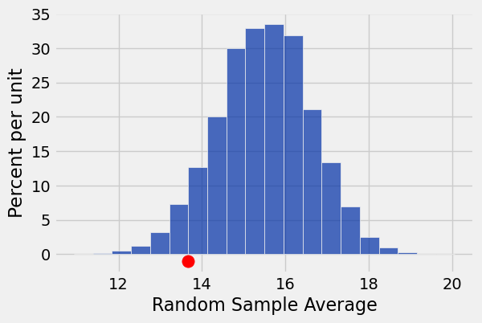
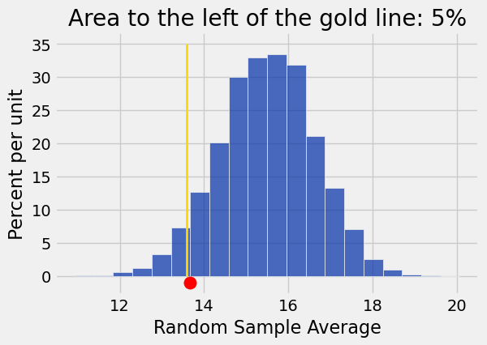

**Code:**

```python
from datascience import *
import numpy as np

%matplotlib inline
import matplotlib.pyplot as plots
plots.style.use('fivethirtyeight')
```

## The GSI's Defense ##

**Code:**

```python
scores = Table.read_table('scores_by_section.csv')
scores
```

*Output:*

| Section | Midterm |
| --- | --- |
| 1 | 22 |
| 2 | 12 |
| 2 | 23 |
| 2 | 14 |
| 1 | 20 |
| 3 | 25 |
| 4 | 19 |
| 1 | 24 |
| 5 | 8 |
| 6 | 14 |

**Code:**

```python
max(scores.column('Midterm'))
```

*Output:*

```text
25
```

**Code:**

```python
min(scores.column('Midterm'))
```

*Output:*

```text
0
```

**Code:**

```python
scores.group('Section')
```

*Output:*

| Section | count |
| --- | --- |
| 1 | 32 |
| 2 | 32 |
| 3 | 27 |
| 4 | 30 |
| 5 | 33 |
| 6 | 32 |
| 7 | 24 |
| 8 | 29 |
| 9 | 30 |
| 10 | 34 |

**Code:**

```python
scores.group('Section', np.average).show()
```

*Output:*

| Section | Midterm average |
| --- | --- |
| 1 | 15.5938 |
| 2 | 15.125 |
| 3 | 13.6667 |
| 4 | 14.7667 |
| 5 | 17.4545 |
| 6 | 15.0312 |
| 7 | 16.625 |
| 8 | 16.3103 |
| 9 | 14.5667 |
| 10 | 15.2353 |
| 11 | 15.8077 |
| 12 | 15.7333 |

**Code:**

```python
observed_average = 13.6667
```

**Code:**

```python
# Null hypothesis: The midterm scores for section 3 are like a 
#                  random draw of 27 students from the course

# Alternative hyp: The midterm scores for section 3 are too low
#                  to be explained well by randomness alone.

random_sample = scores.sample(27, with_replacement=False)
random_sample
```

*Output:*

| Section | Midterm |
| --- | --- |
| 11 | 19 |
| 12 | 21 |
| 4 | 24 |
| 8 | 21 |
| 5 | 25 |
| 11 | 18 |
| 8 | 13 |
| 1 | 13 |
| 9 | 4 |
| 1 | 15 |

**Code:**

```python
np.average(random_sample.column('Midterm'))
```

*Output:*

```text
16.185185185185187
```

**Code:**

```python
# Simulate one value of the test statistic 
# under the hypothesis that the section is like a random sample from the class

def random_sample_midterm_avg():
    random_sample = scores.sample(27, with_replacement = False)
    return np.average(random_sample.column('Midterm'))
```

**Code:**

```python
# Simulate 100,000 copies of the test statistic

sample_averages = make_array()

for i in np.arange(100000):
    sample_averages = np.append(sample_averages, random_sample_midterm_avg())
```

## Our Decision

**Code:**

```python
# Compare the simulated distribution of the statistic
# and the actual observed statistic
averages_tbl = Table().with_column('Random Sample Average', sample_averages)
averages_tbl.hist(bins = 20)
plots.scatter(observed_average, -0.01, color='red', s=120);
```



### Approach 1

**Code:**

```python
# (1) Calculate the p-value: simulation area beyond observed value
np.count_nonzero(sample_averages <= observed_average) / 100000
# (2) See if this is less than 5%
```

*Output:*

```text
0.05717
```

### Approach 2

**Code:**

```python
five_percent_point = averages_tbl.sort(0).column(0).item(round(len(sample_averages) * 0.05))
five_percent_point
```

*Output:*

```text
13.592592592592593
```

**Code:**

```python
# (2) See if this value is greater than observed value
observed_average
```

*Output:*

```text
13.6667
```

### Visual Representation

**Code:**

```python
averages_tbl.hist(bins = 20)
plots.plot([five_percent_point, five_percent_point], [0, 0.35], color='gold', lw=2)
plots.title('Area to the left of the gold line: 5%');
plots.scatter(observed_average, -0.01, color='red', s=120);
```



---

## Datasets

Datasets this notebook loads with `Table.read_table`. Column names are exact, including spaces and capitalization. Only the schema is recorded here — the data itself is not in this document, so any question about its values must be answered by running code, not by reasoning over the rows shown elsewhere in this file.

### `scores_by_section.csv`

359 rows, 2 columns.

| Column | Type |
| --- | --- |
| `Section` | int |
| `Midterm` | int |
