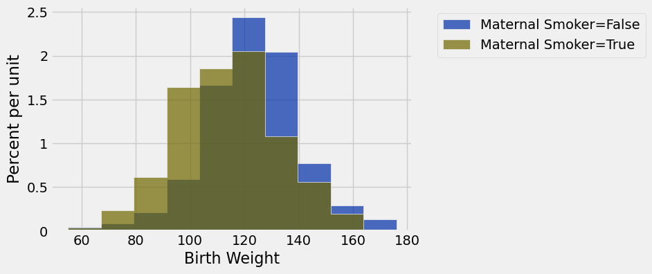
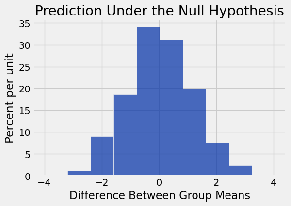

**Code:**

```python
from datascience import *
import numpy as np

%matplotlib inline
import matplotlib.pyplot as plots
plots.style.use('fivethirtyeight')

import warnings
warnings.simplefilter("ignore")
```

# Comparing Two Samples

**Code:**

```python
births = Table.read_table('baby.csv')
```

**Code:**

```python
births
```

*Output:*

| Birth Weight | Gestational Days | Maternal Age | Maternal Height | Maternal Pregnancy Weight | Maternal Smoker |
| --- | --- | --- | --- | --- | --- |
| 120 | 284 | 27 | 62 | 100 | False |
| 113 | 282 | 33 | 64 | 135 | False |
| 128 | 279 | 28 | 64 | 115 | True |
| 108 | 282 | 23 | 67 | 125 | True |
| 136 | 286 | 25 | 62 | 93 | False |
| 138 | 244 | 33 | 62 | 178 | False |
| 132 | 245 | 23 | 65 | 140 | False |
| 120 | 289 | 25 | 62 | 125 | False |
| 143 | 299 | 30 | 66 | 136 | True |
| 140 | 351 | 27 | 68 | 120 | False |

**Code:**

```python
smoking_and_birthweight = births.select('Maternal Smoker', 'Birth Weight')
```

**Code:**

```python
smoking_and_birthweight.group('Maternal Smoker')
```

*Output:*

| Maternal Smoker | count |
| --- | --- |
| False | 715 |
| True | 459 |

**Code:**

```python
smoking_and_birthweight.hist('Birth Weight', group='Maternal Smoker')
```



# Test Statistic

[Question] What values of our statistic are in favor of the alternative: positive or negative?

**Code:**

```python
means_table = smoking_and_birthweight.group('Maternal Smoker', np.average)
means_table
```

*Output:*

| Maternal Smoker | Birth Weight average |
| --- | --- |
| False | 123.085 |
| True | 113.819 |

**Code:**

```python
means = means_table.column(1)
observed_difference = means.item(1) - means.item(0)
observed_difference
```

*Output:*

```text
-9.266142572024918
```

**Code:**

```python
def difference_of_means(table, numeric_label, category_label):
    """
    Takes: 
       - name of table
       - column label of numerical variable
       - column label of categorical variable
       
    Returns: Difference of means of the two groups
    """
    
    #table with the two relevant columns
    reduced = table.select(numeric_label, category_label)  
    
    # table containing group means
    means_table = reduced.group(category_label, np.average)
    
    # array of group means
    means = means_table.column(1)
    
    return means.item(1) - means.item(0)
```

**Code:**

```python
difference_of_means(births, 'Birth Weight', 'Maternal Smoker')
```

*Output:*

```text
-9.266142572024918
```

# Random Permutation (Shuffling)

**Code:**

```python
staff = Table().with_columns(
    'Names', make_array('Jim', 'Pam', 'Dwight', 'Michael'),
    'Ages', make_array(29, 28, 34, 41)
)
```

**Code:**

```python
staff.sample()
```

*Output:*

| Names | Ages |
| --- | --- |
| Michael | 41 |
| Jim | 29 |
| Pam | 28 |
| Dwight | 34 |

**Code:**

```python
staff.sample(with_replacement = False)
```

*Output:*

| Names | Ages |
| --- | --- |
| Jim | 29 |
| Michael | 41 |
| Dwight | 34 |
| Pam | 28 |

**Code:**

```python
staff.with_column('Shuffled', staff.sample(with_replacement = False).column(0))
```

*Output:*

| Names | Ages | Shuffled |
| --- | --- | --- |
| Jim | 29 | Jim |
| Pam | 28 | Michael |
| Dwight | 34 | Pam |
| Michael | 41 | Dwight |

# Simulation Under Null Hypothesis

**Code:**

```python
smoking_and_birthweight
```

*Output:*

| Maternal Smoker | Birth Weight |
| --- | --- |
| False | 120 |
| False | 113 |
| True | 128 |
| True | 108 |
| False | 136 |
| False | 138 |
| False | 132 |
| False | 120 |
| True | 143 |
| False | 140 |

**Code:**

```python
shuffled_labels = smoking_and_birthweight.sample(with_replacement=False).column('Maternal Smoker')
```

**Code:**

```python
original_and_shuffled = smoking_and_birthweight.with_column(
    'Shuffled Label', shuffled_labels
)
```

**Code:**

```python
original_and_shuffled
```

*Output:*

| Maternal Smoker | Birth Weight | Shuffled Label |
| --- | --- | --- |
| False | 120 | False |
| False | 113 | False |
| True | 128 | True |
| True | 108 | True |
| False | 136 | False |
| False | 138 | True |
| False | 132 | True |
| False | 120 | True |
| True | 143 | False |
| False | 140 | True |

**Code:**

```python
difference_of_means(original_and_shuffled, 'Birth Weight', 'Shuffled Label')
```

*Output:*

```text
1.0220302573243742
```

**Code:**

```python
difference_of_means(original_and_shuffled, 'Birth Weight', 'Maternal Smoker')
```

*Output:*

```text
-9.266142572024918
```

# Permutation Test

**Code:**

```python
def one_simulated_difference(table, numeric_label, category_label):
    """
    Takes: 
       - name of table
       - column label of numerical variable
       - column label of categorical variable
       
    Returns: Difference of means of the two groups
    """
    
    # array of shuffled labels
    shuffled_labels = table.sample(with_replacement = False).column(category_label)
    
    # table of numerical variable and shuffled labels
    shuffled_table = table.select(numeric_label).with_column('Shuffled Label', shuffled_labels)
    
    return difference_of_means(shuffled_table, numeric_label, 'Shuffled Label')
```

**Code:**

```python
one_simulated_difference(births, 'Birth Weight', 'Maternal Smoker')
```

*Output:*

```text
-0.6342367871779686
```

**Code:**

```python
differences = make_array()

for i in np.arange(2000):
    new_difference = one_simulated_difference(births, 'Birth Weight', 'Maternal Smoker')
    differences = np.append(differences, new_difference)
```

**Code:**

```python
Table().with_column('Difference Between Group Means', differences).hist()
print('Observed Difference:', observed_difference)
plots.title('Prediction Under the Null Hypothesis');
```

*Output (stdout):*

```text
Observed Difference: -9.266142572024918
```



---

## Datasets

Datasets this notebook loads with `Table.read_table`. Column names are exact, including spaces and capitalization. Only the schema is recorded here — the data itself is not in this document, so any question about its values must be answered by running code, not by reasoning over the rows shown elsewhere in this file.

### `baby.csv`

1,174 rows, 6 columns.

| Column | Type |
| --- | --- |
| `Birth Weight` | int |
| `Gestational Days` | int |
| `Maternal Age` | int |
| `Maternal Height` | int |
| `Maternal Pregnancy Weight` | int |
| `Maternal Smoker` | bool |
