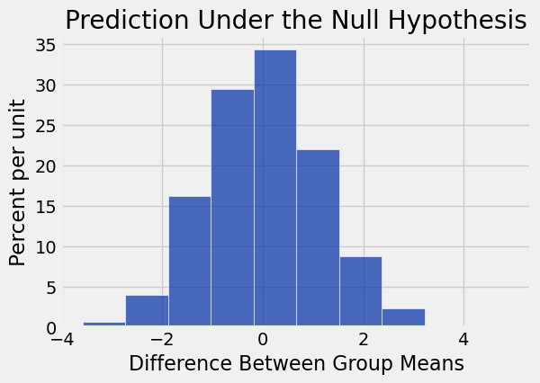
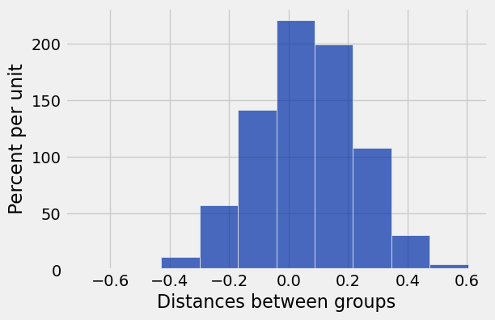
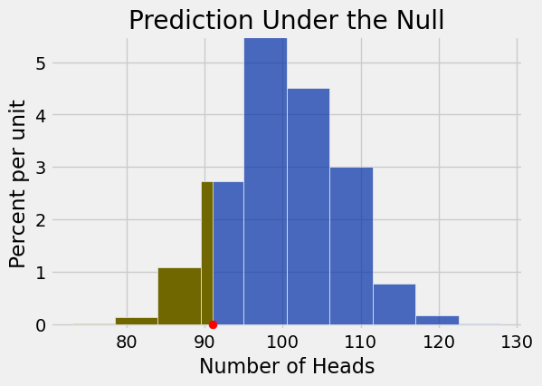
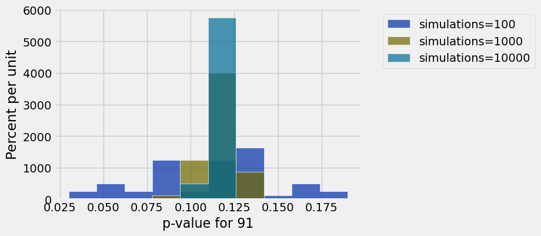
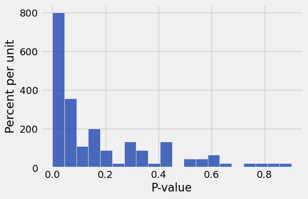

**Code:**

```python
from datascience import *
import numpy as np

%matplotlib inline
import matplotlib.pyplot as plots
plots.style.use('fivethirtyeight')

import warnings
warnings.simplefilter("ignore")
```

## Review: Comparing Two Samples

**Code:**

```python
def difference_of_means(table, numeric_label, group_label):
    """
    Takes: name of table, column label of numerical variable,
    column label of group-label variable
    
    Returns: Difference of means of the two groups
    """
    
    #table with the two relevant columns
    reduced = table.select(numeric_label, group_label)  
    
    # table containing group means
    means_table = reduced.group(group_label, np.average)
    
    # array of group means
    means = means_table.column(1)
    
    return means.item(1) - means.item(0)
```

**Code:**

```python
def one_simulated_difference(table, numeric_label, group_label):
    """
    Takes: name of table, column label of numerical variable,
    column label of group-label variable
    
    Returns: Difference of means of the two groups after shuffling labels
    """
    
    # array of shuffled labels
    shuffled_labels = table.sample(
        with_replacement = False).column(group_label)
    
    # table of numerical variable and shuffled labels
    shuffled_table = table.select(numeric_label).with_column(
        'Shuffled Label', shuffled_labels)
    
    return difference_of_means(
        shuffled_table, numeric_label, 'Shuffled Label')
```

**Code:**

```python
births = Table.read_table('baby.csv')
```

**Code:**

```python
means = births.group('Maternal Smoker', np.average)
means
```

*Output:*

| Maternal Smoker | Birth Weight average | Gestational Days average | Maternal Age average | Maternal Height average | Maternal Pregnancy Weight average |
| --- | --- | --- | --- | --- | --- |
| False | 123.085 | 279.874 | 27.5441 | 64.014 | 129.48 |
| True | 113.819 | 277.898 | 26.7364 | 64.1046 | 126.919 |

**Code:**

```python
observed_difference = means.column(1).item(1) - means.column(1).item(0)
observed_difference
```

*Output:*

```text
-9.266142572024918
```

**Code:**

```python
one_simulated_difference(births, 'Birth Weight', 'Maternal Smoker')
```

*Output:*

```text
-0.094071941130764
```

**Code:**

```python
differences = make_array()

for i in np.arange(2000):
    new_difference = one_simulated_difference(births, 'Birth Weight', 'Maternal Smoker')
    differences = np.append(differences, new_difference)
```

**Code:**

```python
Table().with_column('Difference Between Group Means', differences).hist()
print('Observed Difference:', observed_difference)
plots.title('Prediction Under the Null Hypothesis');
```

*Output (stdout):*

```text
Observed Difference: -9.266142572024918
```



# Randomized Control Experiment

**Code:**

```python
botox = Table.read_table('bta.csv')
botox.show()
```

*Output:*

| Group | Result |
| --- | --- |
| Control | 1 |
| Control | 1 |
| Control | 0 |
| Control | 0 |
| Control | 0 |
| Control | 0 |
| Control | 0 |
| Control | 0 |
| Control | 0 |
| Control | 0 |
| Control | 0 |
| Control | 0 |
| Control | 0 |
| Control | 0 |
| Control | 0 |
| Control | 0 |
| Treatment | 1 |
| Treatment | 1 |
| Treatment | 1 |
| Treatment | 1 |

_... 11 more rows_

**Code:**

```python
botox.pivot('Result', 'Group')
```

*Output:*

| Group | 0.0 | 1.0 |
| --- | --- | --- |
| Control | 14 | 2 |
| Treatment | 6 | 9 |

**Code:**

```python
botox.group('Group', np.average)
```

*Output:*

| Group | Result average |
| --- | --- |
| Control | 0.125 |
| Treatment | 0.6 |

# Testing the Hypothesis

**Code:**

```python
observed_diff = difference_of_means(botox, 'Result', 'Group')
observed_diff
```

*Output:*

```text
0.475
```

**Code:**

```python
one_simulated_difference(botox, 'Result', 'Group')
```

*Output:*

```text
-0.3
```

**Code:**

```python
simulated_diffs = make_array()

for i in np.arange(10000):
    sim_diff = one_simulated_difference(botox, 'Result', 'Group')
    simulated_diffs = np.append(simulated_diffs, sim_diff)
```

**Code:**

```python
col_name = 'Distances between groups'
Table().with_column(col_name, simulated_diffs).hist(col_name)
```



**Code:**

```python
# p-value
sum(simulated_diffs >= observed_diff)/len(simulated_diffs)
```

*Output:*

```text
0.0063
```

## Discussion Question: Super Soda

**Code:**

```python
def simulate_one_count(sample_size):
    return np.count_nonzero(np.random.choice(['H', 'T'], sample_size) == 'H')
simulate_one_count(200)
```

*Output:*

```text
100
```

**Code:**

```python
num_simulations = 10000
counts = make_array()
for i in np.arange(num_simulations):
    counts = np.append(counts, simulate_one_count(200))
```

**Code:**

```python
trials = Table().with_column('Number of Heads', counts)
trials.hist(right_end=91)
plots.ylim(-0.001, 0.055)
plots.scatter(91, 0, color='red', s=40, zorder=3)
plots.title('Prediction Under the Null');
```



**Code:**

```python
np.count_nonzero(counts <= 91)/len(counts)
```

*Output:*

```text
0.1117
```

Conclusion:

## Changing the number of simulations

**Code:**

```python
# Keeping the data fixed, we can re-run the test with a new simulation under the null
def run_test(num_simulations, sample_size):
    counts = make_array()
    for i in np.arange(num_simulations):
        counts = np.append(counts, simulate_one_count(sample_size))
    return counts

counts = run_test(10000, 200)
np.count_nonzero(counts <= 91)/len(counts)
```

*Output:*

```text
0.1131
```

**Code:**

```python
# Let's repeat that 50 times for each number of simulations
tests = Table(['simulations', 'p-value for 91'])
for num_sims in [100, 1000, 10000]:
    for k in np.arange(50):
        counts = run_test(num_sims, 200)
        tests = tests.with_row([
            num_sims, 
            np.count_nonzero(counts <= 91)/len(counts),
        ])
tests.show(3)
```

*Output:*

| simulations | p-value for 91 |
| --- | --- |
| 100 | 0.04 |
| 100 | 0.14 |
| 100 | 0.12 |

**Code:**

```python
# For larger numbers of simulations, p-values are more consistent
tests.hist(1, group='simulations')
```



## Changing the size of the taste test

**Code:**

```python
# Suppose that the true proportion of people who prefer Super Soda is 45%
true_proportion = 0.45
true_distribution = make_array(true_proportion, 1 - true_proportion)
true_distribution
```

*Output:*

```text
array([ 0.45,  0.55])
```

**Code:**

```python
# Taste tests with 200 people will give varioius numbers of people who prefer Super Soda
sample_size = 200
sample_proportions(sample_size, true_distribution) * sample_size
```

*Output:*

```text
array([  77.,  123.])
```

**Code:**

```python
# If you run a taste test for 200 people, what might you conclude?
def run_experiment(num_simulations, sample_size, true_proportion):
    # Collect data
    true_distribution = make_array(true_proportion, 1 - true_proportion)
    taste_test_results = sample_proportions(sample_size, true_distribution) * sample_size
    observed_stat_from_this_sample = taste_test_results.item(0)
    
    # Conduct hypothesis test
    counts = run_test(num_simulations, sample_size)
    p_value = np.count_nonzero(counts <= observed_stat_from_this_sample) / len(counts)
    return p_value

run_experiment(10000, 200, 0.45)
```

*Output:*

```text
0.4702
```

**Code:**

```python
# Let's imagine running our taste test over and over again to see how often we reject the null
true_proportion = 0.45
sample_size = 200
p_values = make_array()
for k in np.arange(100):
    p_value = run_experiment(1000, sample_size, true_proportion)
    p_values = np.append(p_values, p_value)
Table().with_column('P-value', p_values).hist(0, bins=20)
print('Percent of p-values at or below 0.05:', 100 * np.count_nonzero(p_values <= 0.05) / len(p_values))
```

*Output (stdout):*

```text
Percent of p-values at or below 0.05: 40.0
```



---

## Datasets

Datasets this notebook loads with `Table.read_table`. Column names are exact, including spaces and capitalization. Only the schema is recorded here — the data itself is not in this document, so any question about its values must be answered by running code, not by reasoning over the rows shown elsewhere in this file.

### `baby.csv`

1,174 rows, 6 columns.

| Column | Type |
| --- | --- |
| `Birth Weight` | int |
| `Gestational Days` | int |
| `Maternal Age` | int |
| `Maternal Height` | int |
| `Maternal Pregnancy Weight` | int |
| `Maternal Smoker` | bool |

### `bta.csv`

31 rows, 2 columns.

| Column | Type |
| --- | --- |
| `Group` | str |
| `Result` | float |
