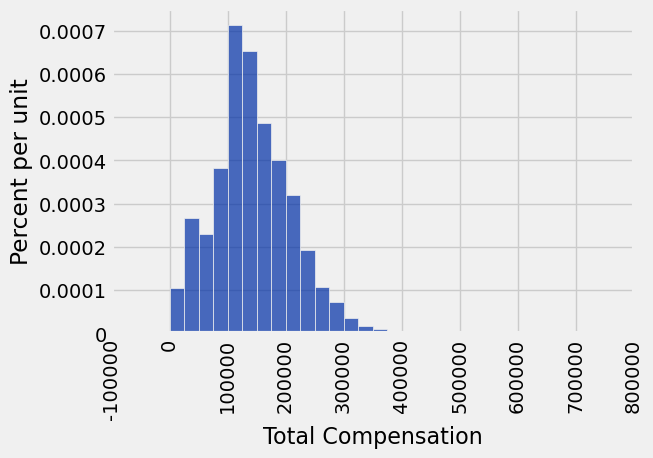
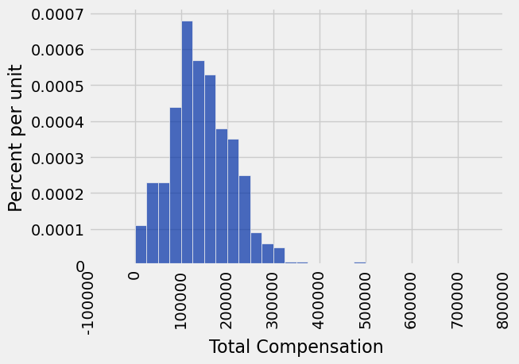
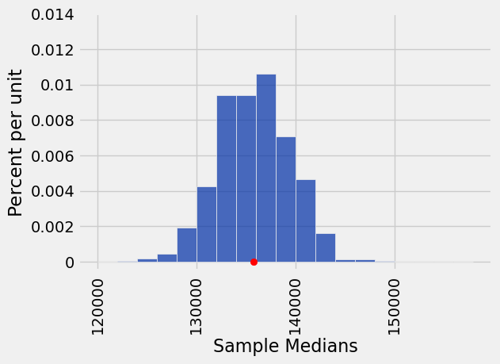
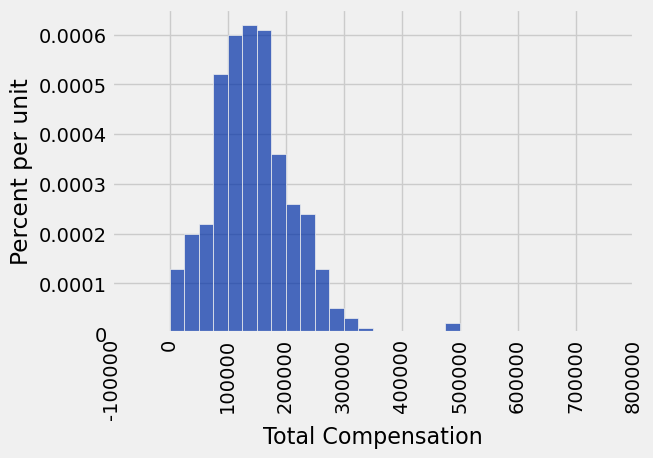
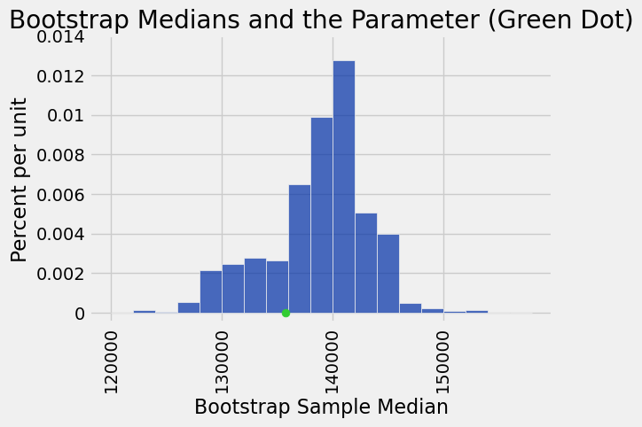
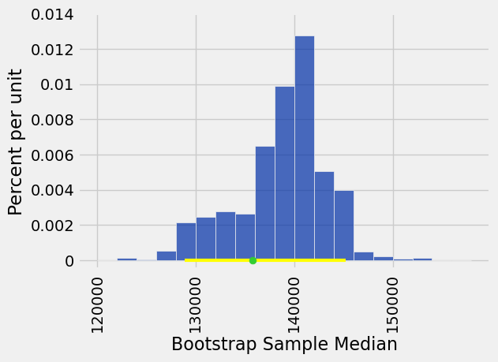

**Code:**

```python
from datascience import *
%matplotlib inline

import matplotlib.pyplot as plots
plots.style.use('fivethirtyeight')
import numpy as np

import warnings
warnings.simplefilter("ignore")
```

## Percentiles ##

**Code:**

```python
# Manually compute the 55th percentile.
x = make_array(43, 20, 51, 7, 28, 34)
```

**Code:**

```python
x
```

*Output:*

```text
array([43, 20, 51,  7, 28, 34])
```

**Code:**

```python
# Step 1. Sort the data
np.sort(x)
```

*Output:*

```text
array([ 7, 20, 28, 34, 43, 51])
```

**Code:**

```python
x
```

*Output:*

```text
array([43, 20, 51,  7, 28, 34])
```

**Code:**

```python
# Step 2. Figure out where 55th percentile would be.
```

**Code:**

```python
np.arange(1, 7)/6
```

*Output:*

```text
array([ 0.16666667,  0.33333333,  0.5       ,  0.66666667,  0.83333333,
        1.        ])
```

**Code:**

```python
np.arange(1, 7)/6 >= 55/100
```

*Output:*

```text
array([False, False, False,  True,  True,  True], dtype=bool)
```

**Code:**

```python
np.sort(x).item(3)
```

*Output:*

```text
34
```

**Code:**

```python
# Alternatively: One line of code
percentile(55, x)
```

*Output:*

```text
34
```

**Code:**

```python
x
```

*Output:*

```text
array([43, 20, 51,  7, 28, 34])
```

## Discussion Question

**Code:**

```python
s = make_array(1, 5, 7, 3, 9)
s
```

*Output:*

```text
array([1, 5, 7, 3, 9])
```

**Code:**

```python
percentile(100, s)
```

*Output:*

```text
9
```

**Code:**

```python
percentile(39, s)
```

*Output:*

```text
3
```

**Code:**

```python
percentile(41, s)
```

*Output:*

```text
5
```

**Code:**

```python
percentile(50, s) == 5
```

*Output:*

```text
True
```

## Inference: Estimation

**Code:**

```python
sf = Table.read_table('san_francisco_2019.csv')
sf.sample(3)
```

*Output:*

| Organization Group | Department | Job Family | Job | Salary | Overtime | Benefits | Total Compensation |
| --- | --- | --- | --- | --- | --- | --- | --- |
| Public Protection | Police | Budget, Admn & Stats Analysis | Administrative Analyst | 83061 | 0 | 38367 | 121428 |
| Public Protection | Fire Department | Fire Services | Battalion Chief, Fire Suppress | 231247 | 80894 | 69714 | 381855 |
| Public Protection | Fire Department | Fire Services | Firefighter | 148937 | 11666 | 47916 | 208518 |

**Code:**

```python
# Who made the most money
sf.sort('Total Compensation', descending=True).show(5)
```

*Output:*

| Organization Group | Department | Job Family | Job | Salary | Overtime | Benefits | Total Compensation |
| --- | --- | --- | --- | --- | --- | --- | --- |
| General Administration & Finance | Retirement Services | Administrative & Mgmt (Unrep) | Chief Investment Officer | 577633 | 0 | 146398 | 724031 |
| General Administration & Finance | Retirement Services | Unassigned | Managing Director | 483072 | 0 | 134879 | 617951 |
| General Administration & Finance | Retirement Services | Unassigned | Managing Director | 482649 | 0 | 134905 | 617554 |
| General Administration & Finance | Retirement Services | Unassigned | Managing Director | 451507 | 0 | 120276 | 571784 |
| General Administration & Finance | Retirement Services | Unassigned | Managing Director | 449378 | 0 | 120857 | 570235 |

**Code:**

```python
# Who made the least money
sf.sort('Total Compensation', descending=False).show(5)
```

*Output:*

| Organization Group | Department | Job Family | Job | Salary | Overtime | Benefits | Total Compensation |
| --- | --- | --- | --- | --- | --- | --- | --- |
| Public Protection | Adult Probation | Probation & Parole | Deputy Probation Officer | 0 | 0 | 0 | 0 |
| Public Protection | Fire Department | Clerical, Secretarial & Steno | Senior Clerk Typist | 0 | 0 | 0 | 0 |
| Public Protection | Juvenile Court | Correction & Detention | Counselor, Juvenile Hall PERS | 0 | 0 | 0 | 0 |
| Public Protection | Police | Clerical, Secretarial & Steno | Clerk Typist | 0 | 0 | 0 | 0 |
| Public Protection | Sheriff | Correction & Detention | Deputy Sheriff | 0 | 0 | 0 | 0 |

**Code:**

```python
# $15/hr, 20 hr/wk, 50 weeks

min_salary = 15 * 20 * 50
sf = sf.where('Salary', are.above(min_salary))
sf.sort('Total Compensation', descending=False).show(5)
```

*Output:*

| Organization Group | Department | Job Family | Job | Salary | Overtime | Benefits | Total Compensation |
| --- | --- | --- | --- | --- | --- | --- | --- |
| Public Works, Transportation & Commerce | Municipal Transportation Agcy | Sub-Professional Engineering | StdntDsgnTrain1, Arch/Eng/Plng | 15578 | 0 | 41 | 15619 |
| Public Protection | Trial Courts | Untitled | Superior Court Judge | 15414 | 0 | 224 | 15637 |
| Culture & Recreation | Recreation And Park Commission | Recreation | Recreation Coordinator | 15016 | 0 | 1180 | 16196 |
| Public Works, Transportation & Commerce | Municipal Transportation Agcy | Protection & Apprehension | School Crossing Guard | 15053 | 0 | 1168 | 16221 |
| Human Welfare & Neighborhood Development | Human Services | Public Service Aide | Public Service Trainee | 15008 | 0 | 1230 | 16238 |

**Code:**

```python
# Population Distribution

sf_bins = np.arange(0, 726000, 25000)
sf.hist('Total Compensation', bins=sf_bins)
```



**Code:**

```python
# An Empirical Distribution

our_sample = sf.sample(400, with_replacement=False)
our_sample.hist('Total Compensation', bins=sf_bins)
```



**Code:**

```python
# Parameter: Median Total Compensation 

pop_median = percentile(50, sf.column('Total Compensation'))  # 37,000+ people
pop_median
```

*Output:*

```text
135747.0
```

**Code:**

```python
# Estimate: Median of a Sample

percentile(50, our_sample.column('Total Compensation')) # 400 people
```

*Output:*

```text
139708.0
```

## Variability of the Estimate

**Code:**

```python
def generate_sample_median(samp_size):
    new_sample = sf.sample(samp_size, with_replacement=False)
    return percentile(50, new_sample.column('Total Compensation'))
```

**Code:**

```python
generate_sample_median(400)
```

*Output:*

```text
137804.0
```

## Quantifying Uncertainty

**Code:**

```python
sample_medians = make_array()

for i in np.arange(1000):
    new_median = generate_sample_median(400)
    sample_medians = np.append(sample_medians, new_median)
```

**Code:**

```python
med_bins = np.arange(120000, 160000, 2000)
Table().with_column('Sample Medians', sample_medians).hist(bins=med_bins)

plots.ylim(-0.000005, 0.00014)
plots.scatter(pop_median, 0, color='red');
```



**Code:**

```python
print('Less than 2.5% of estimates are more than', pop_median - percentile(2.5, sample_medians), 'lower than', pop_median)
print('Less than 2.5% of estimates are more than', percentile(97.5, sample_medians) - pop_median, 'higher than', pop_median)
```

*Output (stdout):*

```text
Less than 2.5% of estimates are more than 6878.0 lower than 135747.0
Less than 2.5% of estimates are more than 6604.0 higher than 135747.0
```

# Bootstrap

Sample randomly
 - from the original sample
 - with replacement
 - the same number of times as the original sample size

**Code:**

```python
# Default behavior of t.sample():
# at random with replacement,
# the same number of times as the number of rows in t

bootstrap_sample = our_sample.sample()
bootstrap_sample.hist('Total Compensation', bins=sf_bins)
percentile(50, bootstrap_sample.column('Total Compensation'))
```

*Output:*

```text
140501.0
```



**Code:**

```python
def one_bootstrap_median():
    # draw the bootstrap sample
    resample = our_sample.sample()
    # return the median total compensation in the bootstrap sample
    return percentile(50, resample.column('Total Compensation'))
```

**Code:**

```python
one_bootstrap_median()
```

*Output:*

```text
135380.0
```

**Code:**

```python
# Generate the medians of 1000 bootstrap samples
num_repetitions = 1000
bstrap_medians = make_array()
for i in np.arange(num_repetitions):
    bstrap_medians = np.append(bstrap_medians, one_bootstrap_median())
```

**Code:**

```python
resampled_medians = Table().with_column('Bootstrap Sample Median', bstrap_medians)
median_bins=np.arange(120000, 160000, 2000)
resampled_medians.hist(bins = median_bins)

# Plotting parameters; you can ignore this code
parameter_green = '#32CD32'
plots.ylim(-0.000005, 0.00014)
plots.scatter(pop_median, 0, color=parameter_green, s=40, zorder=2)
plots.title('Bootstrap Medians and the Parameter (Green Dot)');
```



## Percentile Method: Middle 95% of the Bootstrap Estimates

**Code:**

```python
left = percentile(2.5, bstrap_medians)
right = percentile(97.5, bstrap_medians)

make_array(left, right)  # The middle 95% of medians of bootstrap resamples
```

*Output:*

```text
array([ 128909.,  145220.])
```

**Code:**

```python
resampled_medians.hist(bins = median_bins)

# Plotting parameters; you can ignore this code
plots.ylim(-0.000005, 0.00014)
plots.plot(make_array(left, right), make_array(0, 0), color='yellow', lw=3, zorder=1)
plots.scatter(pop_median, 0, color=parameter_green, s=40, zorder=2);
```



---

## Datasets

Datasets this notebook loads with `Table.read_table`. Column names are exact, including spaces and capitalization. Only the schema is recorded here — the data itself is not in this document, so any question about its values must be answered by running code, not by reasoning over the rows shown elsewhere in this file.

### `san_francisco_2019.csv`

44,525 rows, 8 columns.

| Column | Type |
| --- | --- |
| `Organization Group` | str |
| `Department` | str |
| `Job Family` | str |
| `Job` | str |
| `Salary` | float |
| `Overtime` | float |
| `Benefits` | float |
| `Total Compensation` | float |
