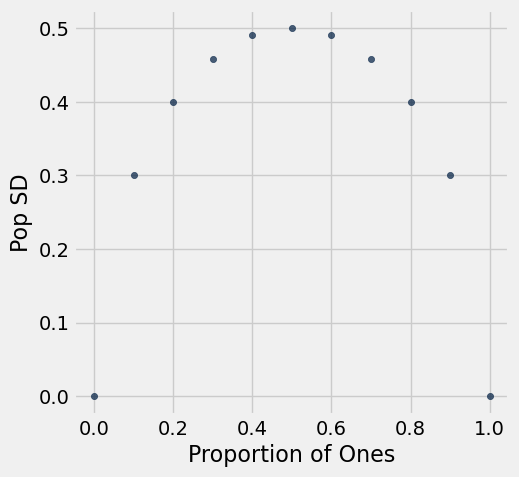

**Code:**

```python
import matplotlib
from datascience import *
%matplotlib inline
import matplotlib.pyplot as plots
import numpy as np
plots.style.use('fivethirtyeight')
```

## New material

### Choosing a sample size given an interval width

**Code:**

```python
# population of size 10

number_of_ones = 2
zero_one_population = np.append(np.ones(number_of_ones), np.zeros(10 - number_of_ones))

print('Standard Deviation:', np.round(np.std(zero_one_population),2))

zero_one_population
```

*Output (stdout):*

```text
Standard Deviation: 0.4
```

*Output:*

```text
array([ 1.,  1.,  0.,  0.,  0.,  0.,  0.,  0.,  0.,  0.])
```

**Code:**

```python
def sd_of_zero_one_population(number_of_ones):
    """Returns the SD of a population 
    that has 10 elements: num_ones with value 1 and (10 - num_ones) with value 0"""
    zero_one_population = np.append(np.ones(number_of_ones), 
                                    np.zeros(10 - number_of_ones))
    return np.std(zero_one_population)
```

**Code:**

```python
possible_ones = np.arange(11)
zero_one_pop = Table().with_columns(
    'Number of Ones', possible_ones,
    'Proportion of Ones', possible_ones / 10
)
zero_one_pop.show()
```

*Output:*

| Number of Ones | Proportion of Ones |
| --- | --- |
| 0 | 0 |
| 1 | 0.1 |
| 2 | 0.2 |
| 3 | 0.3 |
| 4 | 0.4 |
| 5 | 0.5 |
| 6 | 0.6 |
| 7 | 0.7 |
| 8 | 0.8 |
| 9 | 0.9 |
| 10 | 1 |

**Code:**

```python
sds = zero_one_pop.apply(sd_of_zero_one_population, 'Number of Ones')
zero_one_pop = zero_one_pop.with_column('Pop SD', sds)
zero_one_pop.show()
```

*Output:*

| Number of Ones | Proportion of Ones | Pop SD |
| --- | --- | --- |
| 0 | 0 | 0 |
| 1 | 0.1 | 0.3 |
| 2 | 0.2 | 0.4 |
| 3 | 0.3 | 0.458258 |
| 4 | 0.4 | 0.489898 |
| 5 | 0.5 | 0.5 |
| 6 | 0.6 | 0.489898 |
| 7 | 0.7 | 0.458258 |
| 8 | 0.8 | 0.4 |
| 9 | 0.9 | 0.3 |
| 10 | 1 | 0 |

**Code:**

```python
zero_one_pop.scatter('Proportion of Ones', 'Pop SD')
```


