**Code:**

```python
import matplotlib
from datascience import *
%matplotlib inline
import matplotlib.pyplot as plots
import numpy as np
plots.style.use('fivethirtyeight')
```

**Code:**

```python
# Some functions for plotting. You don't have to understand how any
# of the functions in this cell work, since they use things we 
# haven't learned about in Data 8.

def resize_window(lim=3.5):
    plots.xlim(-lim, lim)
    plots.ylim(-lim, lim)
    
def draw_line(slope=0, intercept=0, x=make_array(-4, 4), color='#44AA00'):
    y = x*slope + intercept
    plots.plot(x, y, color=color, lw=3)
    
def draw_vertical_line(x_position, color='black'):
    x = make_array(x_position, x_position)
    y = make_array(-4, 4)
    plots.plot(x, y, color=color, lw=3)
    
def make_correlated_data(r):
    x = np.random.normal(0, 1, 1000)
    z = np.random.normal(0, 1, 1000)
    y = r*x + (np.sqrt(1-r**2))*z
    return x, y

def r_scatter(r):
    """Generate a scatter plot with a correlation approximately r"""
    plots.figure(figsize=(5,5))
    x, y = make_correlated_data(r)
    plots.scatter(x, y, color='darkblue', s=20)
    plots.xlim(-4, 4)
    plots.ylim(-4, 4)
    
def r_table(r):
    """
    Generate a table of 1000 data points with a correlation approximately r
    """
    np.random.seed(8)
    x, y = make_correlated_data(r)
    return Table().with_columns('x', x, 'y', y)
```

# Functions from previous lectures

**Code:**

```python
def standard_units(x):
    "Convert any array of numbers to standard units."
    return (x - np.average(x)) / np.std(x)
```

**Code:**

```python
def correlation(t, x, y):
    """t is a table; x and y are column labels"""
    x_in_standard_units = standard_units(t.column(x))
    y_in_standard_units = standard_units(t.column(y))
    return np.average(x_in_standard_units * y_in_standard_units)
```

### Nonlinearity

**Code:**

```python
new_x = np.arange(-4, 4.1, 0.5)
nonlinear = Table().with_columns(
        'x', new_x,
        'y', new_x**2
    )
nonlinear.scatter('x', 'y', s=30, color='r')
```

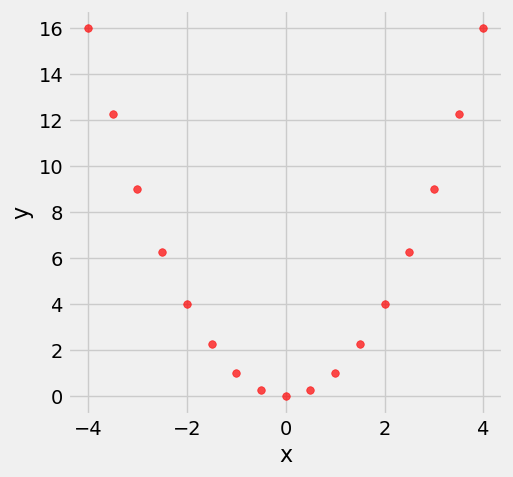

**Code:**

```python
correlation(nonlinear, 'x', 'y')
```

*Output:*

```text
0.0
```

## Prediction Lines

**Code:**

```python
example = r_table(0.99)
example.show(3)
```

*Output:*

| x | y |
| --- | --- |
| 0.0912047 | -0.0680119 |
| 1.09128 | 1.04391 |
| -1.94697 | -1.88316 |

**Code:**

```python
example.scatter('x', 'y')
resize_window()
```

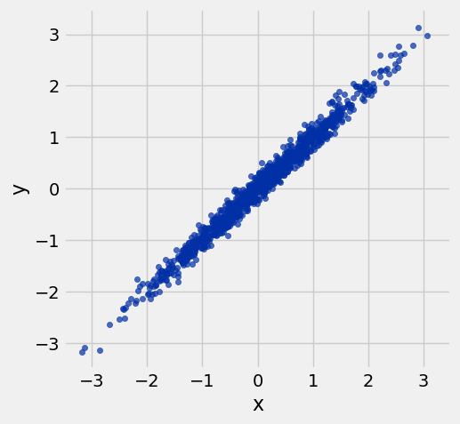

**Code:**

```python
def nn_prediction_example(x_val):
    """ Predicts y-value for x based on the example table """
    neighbors = example.where('x', are.between(x_val - .25, x_val + .25))
    return np.mean(neighbors.column('y'))
```

**Code:**

```python
nn_prediction_example(-2.25)
```

*Output:*

```text
-2.1476337989800527
```

**Code:**

```python
example = example.with_columns(
    'Predicted y', 
    example.apply(nn_prediction_example, 'x'))
```

**Code:**

```python
example.scatter('x')
resize_window()
```

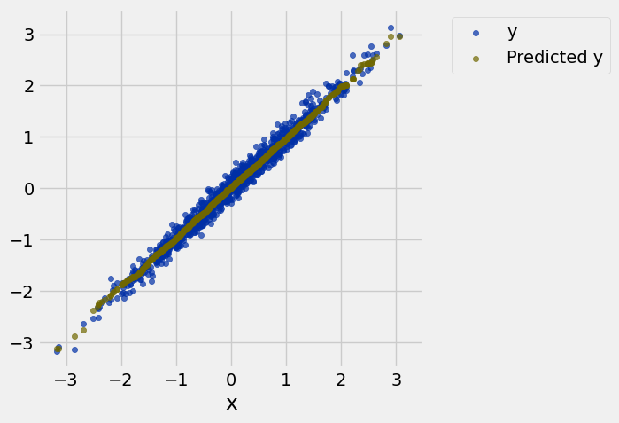

**Code:**

```python
example.scatter('x')
draw_line(slope=1)
resize_window()
```

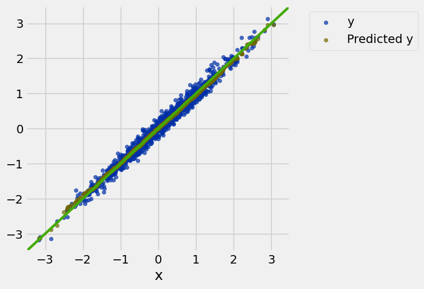

### r = 0

**Code:**

```python
example = r_table(0)
example.scatter('x', 'y')
resize_window()
```

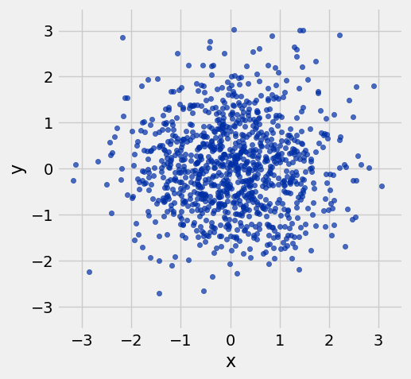

**Code:**

```python
example = example.with_columns(
    'Predicted y', 
    example.apply(nn_prediction_example, 'x'))
```

**Code:**

```python
example.scatter('x')
draw_line(slope=0)
resize_window()
```

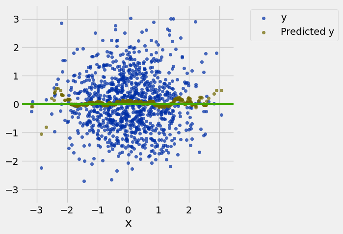

### r = 0.5

**Code:**

```python
example = r_table(0.5)
example.scatter('x', 'y')
resize_window()
```

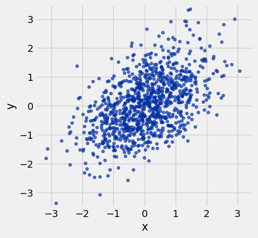

**Code:**

```python
example = r_table(0.5)
example.scatter('x', 'y')
resize_window()
draw_vertical_line(1.5)
draw_line(slope=1, intercept=0, color='red')
```

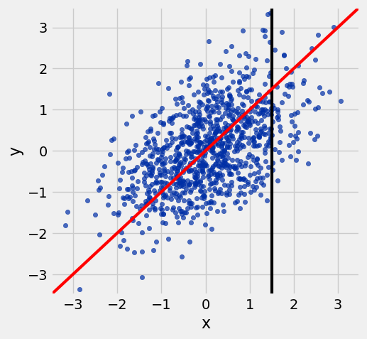

**Code:**

```python
example = example.with_column('Predicted y', example.apply(nn_prediction_example, 'x'))
example.scatter('x')
draw_line(slope=1, color='red')
draw_vertical_line(1.5)
resize_window()
```

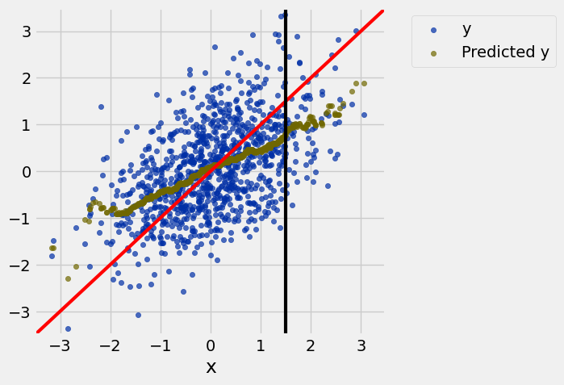

**Code:**

```python
example.scatter('x')
draw_line(slope=1, intercept=0, color='red')
draw_line(slope=0.5, intercept=0)
resize_window()
```

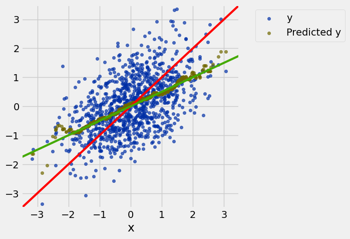

###  r = 0.7

**Code:**

```python
example = r_table(0.7)
example = example.with_column('Predicted y', example.apply(nn_prediction_example, 'x'))
example.scatter('x')
draw_line(slope=1, intercept=0, color='red')
draw_line(slope=0.7, intercept=0)
resize_window()
```

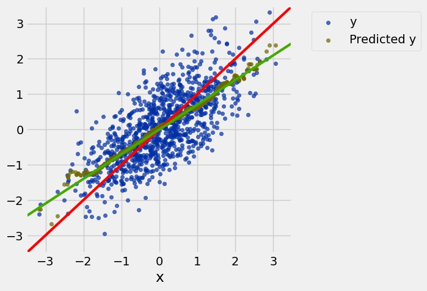

## Linear regression: defining the line

**Code:**

```python
def slope(t, x, y):
    """Computes the slope of the regression line"""
    r = correlation(t, x, y)
    y_sd = np.std(t.column(y))
    x_sd = np.std(t.column(x))
    return r * y_sd / x_sd
```

**Code:**

```python
def intercept(t, x, y):
    """Computes the intercept of the regression line"""
    x_mean = np.mean(t.column(x))
    y_mean = np.mean(t.column(y))
    return y_mean - slope(t, x, y)*x_mean
```

**Code:**

```python
example = r_table(0.5)
slope(example, 'x', 'y')
```

*Output:*

```text
0.50226382816259152
```

## Heights Data and Regression Line

**Code:**

```python
# Note: Child heights are the **adult** heights of children in a family
families = Table.read_table('family_heights.csv')
parent_avgs = (families.column('father') + families.column('mother'))/2
heights = Table().with_columns(
    'Parent Average', parent_avgs,
    'Child', families.column('child'),
)
heights.show(5)
```

*Output:*

| Parent Average | Child |
| --- | --- |
| 72.75 | 73.2 |
| 72.75 | 69.2 |
| 72.75 | 69 |
| 72.75 | 69 |
| 71 | 73.5 |

**Code:**

```python
def nn_prediction_height(p_avg):
    """Predict the height of a child whose parents have a parent average height of p_avg.
    
    The prediction is the average height of the children whose parent average height is
    in the range p_avg plus or minus 0.5.
    """
    
    close_points = heights.where('Parent Average', are.between(p_avg-0.5, p_avg + 0.5))
    return np.average(close_points.column('Child'))
```

**Code:**

```python
heights_with_predictions = heights.with_column(
    'Nearest neighbor prediction', 
    heights.apply(nn_prediction_height, 'Parent Average'))
heights_with_predictions.show(5)
```

*Output:*

| Parent Average | Child | Nearest neighbor prediction |
| --- | --- | --- |
| 72.75 | 73.2 | 70.1 |
| 72.75 | 69.2 | 70.1 |
| 72.75 | 69 | 70.1 |
| 72.75 | 69 | 70.1 |
| 71 | 73.5 | 70.4158 |

**Code:**

```python
heights_with_predictions.scatter('Parent Average')
```

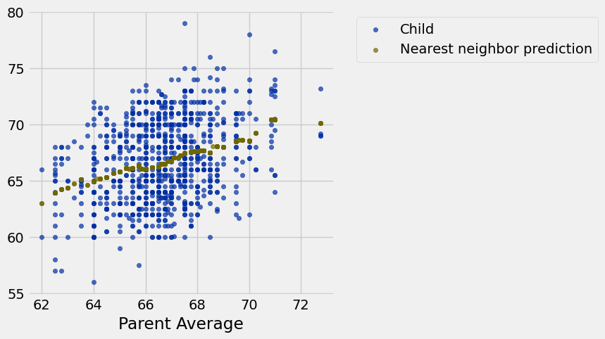

**Code:**

```python
predicted_heights_slope = slope(heights, 'Parent Average', 'Child')
predicted_heights_intercept = intercept(heights, 'Parent Average', 'Child')
[predicted_heights_slope, predicted_heights_intercept]
```

*Output:*

```text
[0.66449526235258838, 22.461839955758798]
```

**Code:**

```python
heights_with_predictions.scatter('Parent Average')
draw_line(slope=predicted_heights_slope, 
          intercept=predicted_heights_intercept, 
          x=heights.column('Parent Average'))
```

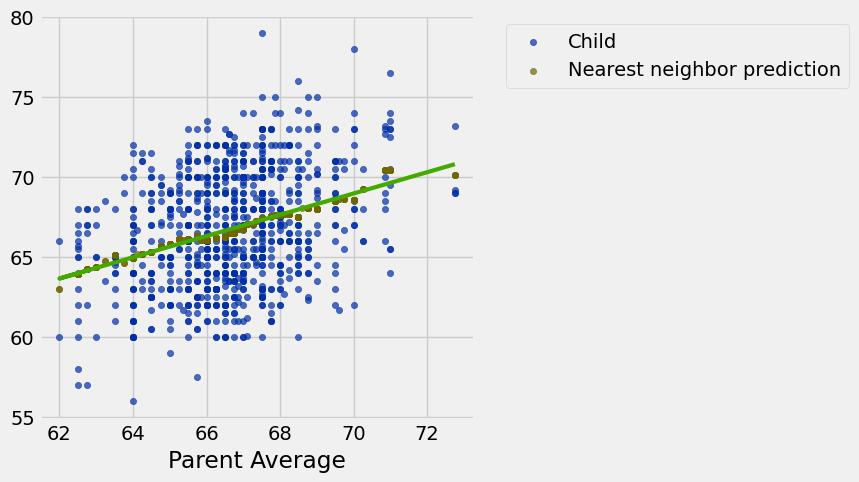

## Discussion Question: Exam Score Prediction

**Code:**

```python
# X-axis: midterm scores
midterm_mean = 70
midterm_sd = 10

# Y-axis: final scores
final_mean = 50
final_sd = 12

# Correlation (relates X to Y values)
corr = 0.75

# X value
midterm_student = 90
```

**Code:**

```python
midterm_student_su = (midterm_student - midterm_mean) / midterm_sd
midterm_student_su
```

*Output:*

```text
2.0
```

**Code:**

```python
final_student_su = midterm_student_su * corr
final_student_su
```

*Output:*

```text
1.5
```

**Code:**

```python
final_student = final_student_su * final_sd + final_mean
final_student
```

*Output:*

```text
68.0
```

---

## Datasets

Datasets this notebook loads with `Table.read_table`. Column names are exact, including spaces and capitalization. Only the schema is recorded here — the data itself is not in this document, so any question about its values must be answered by running code, not by reasoning over the rows shown elsewhere in this file.

### `family_heights.csv`

934 rows, 7 columns.

| Column | Type |
| --- | --- |
| `family` | str |
| `father` | float |
| `mother` | float |
| `child` | float |
| `children` | int |
| `order` | int |
| `m/f` | str |
