**Code:**

```python
from datascience import *
import numpy as np
import matplotlib
%matplotlib inline
import matplotlib.pyplot as plots
plots.style.use('fivethirtyeight')
```

**Code:**

```python
# Predefined functions; they should look familiar to functions you've coded in assignments!
def standard_units(arr):
    return (arr - np.average(arr))/np.std(arr)

def correlation(t, x, y):
    x_standard = standard_units(t.column(x))
    y_standard = standard_units(t.column(y))
    return np.average(x_standard * y_standard)

def slope(t, x, y):
    r = correlation(t, x, y)
    y_sd = np.std(t.column(y))
    x_sd = np.std(t.column(x))
    return r * y_sd / x_sd

def intercept(t, x, y):
    x_mean = np.mean(t.column(x))
    y_mean = np.mean(t.column(y))
    return y_mean - slope(t, x, y)*x_mean

def fitted_values(t, x, y):
    """Return an array of the regression estimates at all the x values"""
    a = slope(t, x, y)
    b = intercept(t, x, y)
    return a*t.column(x) + b

def residuals(t, x, y):
    """Return an array of all the residuals"""
    predictions = fitted_values(t, x, y)
    return t.column(y) - predictions
```

## Regression Model

**Code:**

```python
# Ignore this code; it produces plots for demonstrating the regression model
def draw_and_compare(true_slope, true_int, sample_size):
    x = np.random.normal(50, 5, sample_size)
    xlims = np.array([np.min(x), np.max(x)])
    errors = np.random.normal(0, 6, sample_size)
    y = (true_slope * x + true_int) + errors
    sample = Table().with_columns('x', x, 'y', y)

    sample.scatter('x', 'y')
    plots.plot(xlims, true_slope*xlims + true_int, lw=2, color='green')
    plots.title('True Line, and Points Created')

    sample.scatter('x', 'y')
    plots.title('What We Get to See')

    sample.scatter('x', 'y', fit_line=True)
    plots.title('Regression Line: Estimate of True Line')

    sample.scatter('x', 'y', fit_line=True)
    plots.plot(xlims, true_slope*xlims + true_int, lw=2, color='green')
    plots.title("Regression Line and True Line")
```

**Code:**

```python
draw_and_compare(2, -5, 10)
```

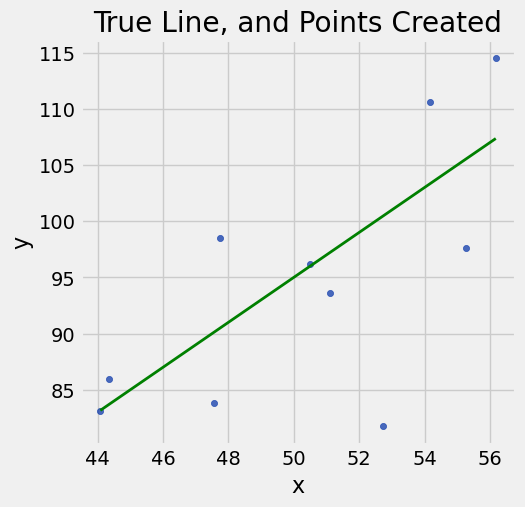

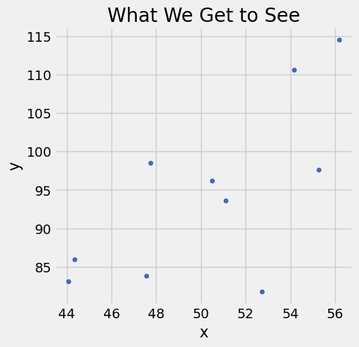

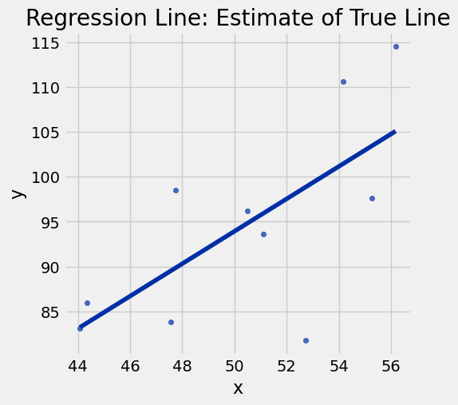

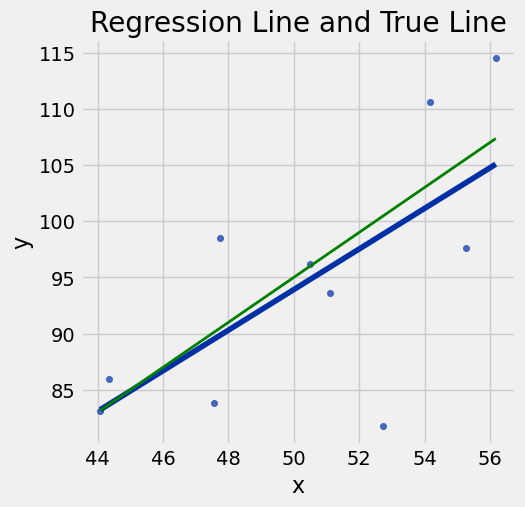

**Code:**

```python
draw_and_compare(2, -5, 10)
```

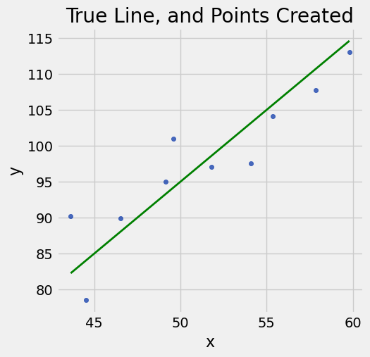

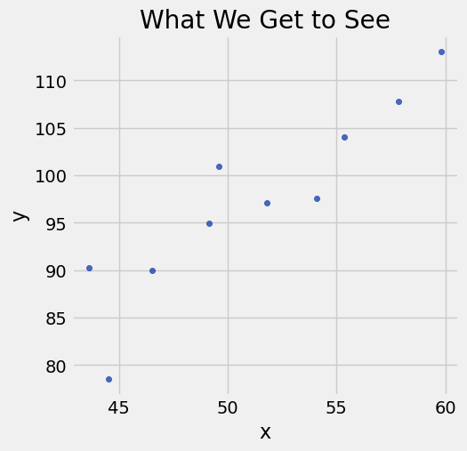

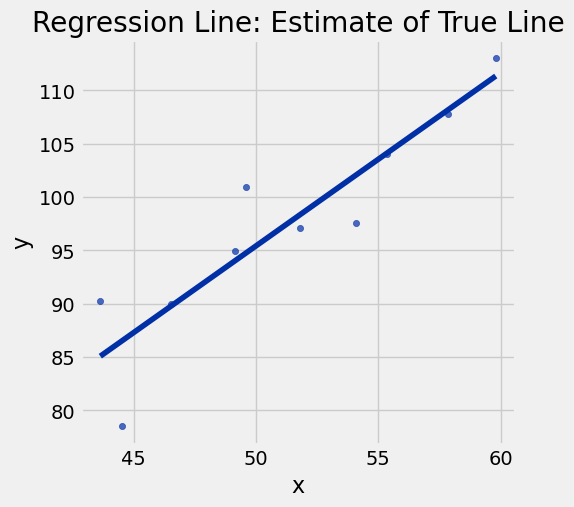

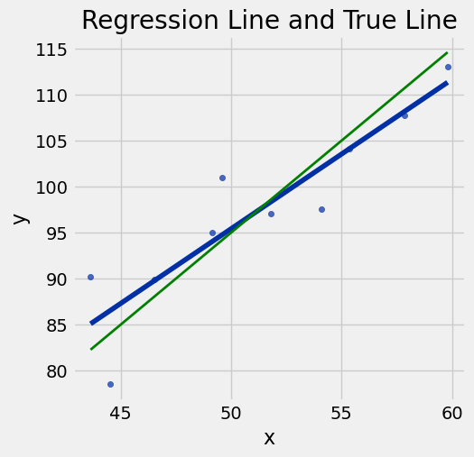

**Code:**

```python
draw_and_compare(2, -5, 100)
```

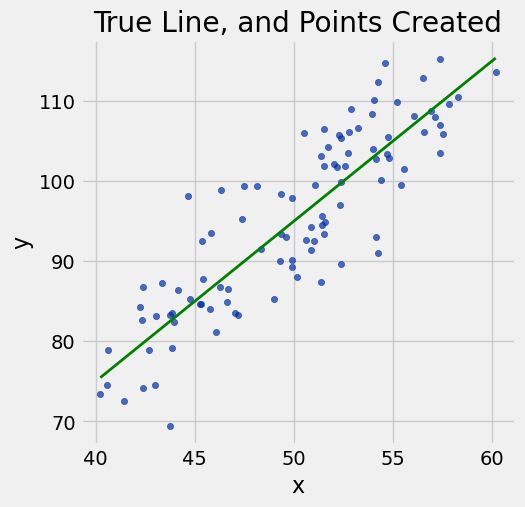

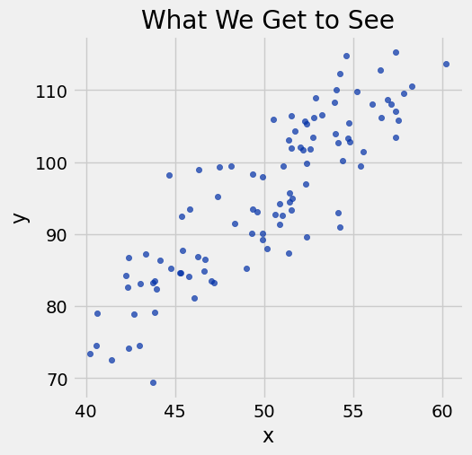

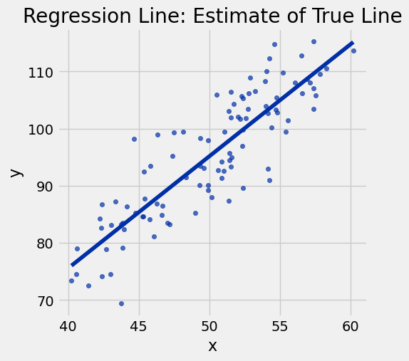

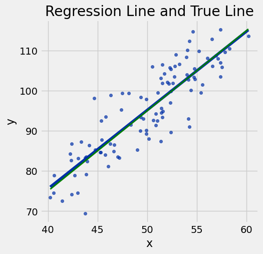

**Code:**

```python
draw_and_compare(2, -5, 100)
```

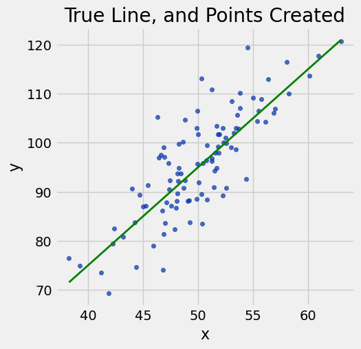

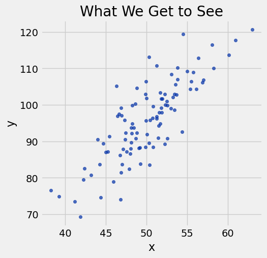

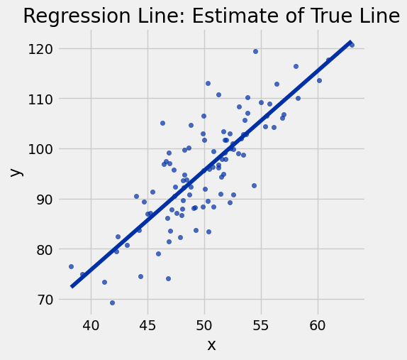

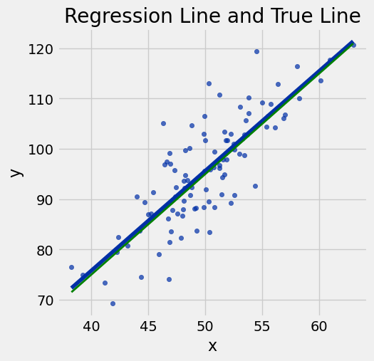

## Prediction

**Code:**

```python
births = Table.read_table('baby.csv')
births.show(3)
```

*Output:*

| Birth Weight | Gestational Days | Maternal Age | Maternal Height | Maternal Pregnancy Weight | Maternal Smoker |
| --- | --- | --- | --- | --- | --- |
| 120 | 284 | 27 | 62 | 100 | False |
| 113 | 282 | 33 | 64 | 135 | False |
| 128 | 279 | 28 | 64 | 115 | True |

**Code:**

```python
# Preterm and postterm pregnancy cutoffs, according to the CDC
37 * 7, 42 * 7
```

*Output:*

```text
(259, 294)
```

**Code:**

```python
births.scatter('Gestational Days', 'Birth Weight')
```

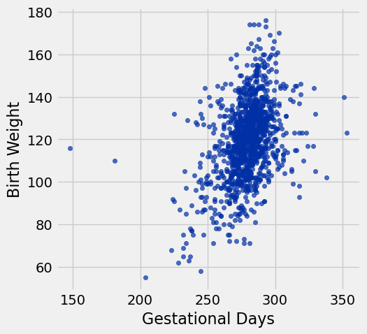

**Code:**

```python
births = births.where('Gestational Days', are.between(225, 325))
```

**Code:**

```python
births.scatter('Gestational Days', 'Birth Weight')
```

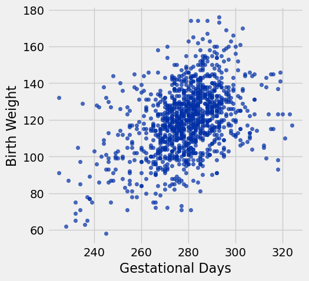

## Suppose we assume the regression model

**Code:**

```python
correlation(births, 'Gestational Days', 'Birth Weight')
```

*Output:*

```text
0.42295118452423991
```

**Code:**

```python
births.scatter('Gestational Days', 'Birth Weight', fit_line=True)
```

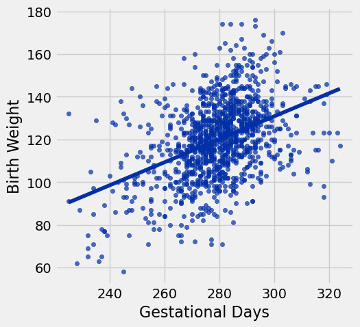

## Prediction at a Given Value of x

**Code:**

```python
def prediction_at(t, x, y, x_value):
    '''
    t - table
    x - label of x column
    y - label of y column
    x_value - the x value for which we want to predict y
    '''
    return slope(t, x, y) * x_value + intercept(t, x, y)
```

**Code:**

```python
prediction_at_300 = prediction_at(births, 'Gestational Days', 'Birth Weight', 300)
prediction_at_300
```

*Output:*

```text
130.80951674248769
```

**Code:**

```python
prediction_at(births, 'Gestational Days', 'Birth Weight', 260)
```

*Output:*

```text
109.29570203577155
```

**Code:**

```python
x = 300
births.scatter('Gestational Days', 'Birth Weight', fit_line=True)
plots.plot([x, x], [40, prediction_at_300], color='red', lw=2);
```

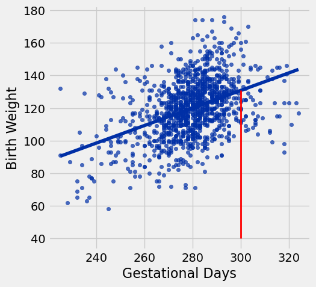

## Bootstrapping the Sample

**Code:**

```python
# You don't need to understand the plotting code in this cell,
# but you should understand the figure that comes out.

plots.figure(figsize=(10, 11))
plots.subplot(3, 2, 1)
plots.scatter(births[1], births[0], s=10, color='darkblue')
plots.xlim([225, 325])
plots.title('Original sample')

for i in np.arange(1, 6, 1):
    plots.subplot(3,2,i+1)
    resampled = births.sample()
    plots.scatter(resampled.column('Gestational Days'), resampled.column('Birth Weight'), s=10, color='tab:green')
    plots.xlim([225, 325])
    plots.title('Bootstrap sample '+str(i))
plots.tight_layout()
```

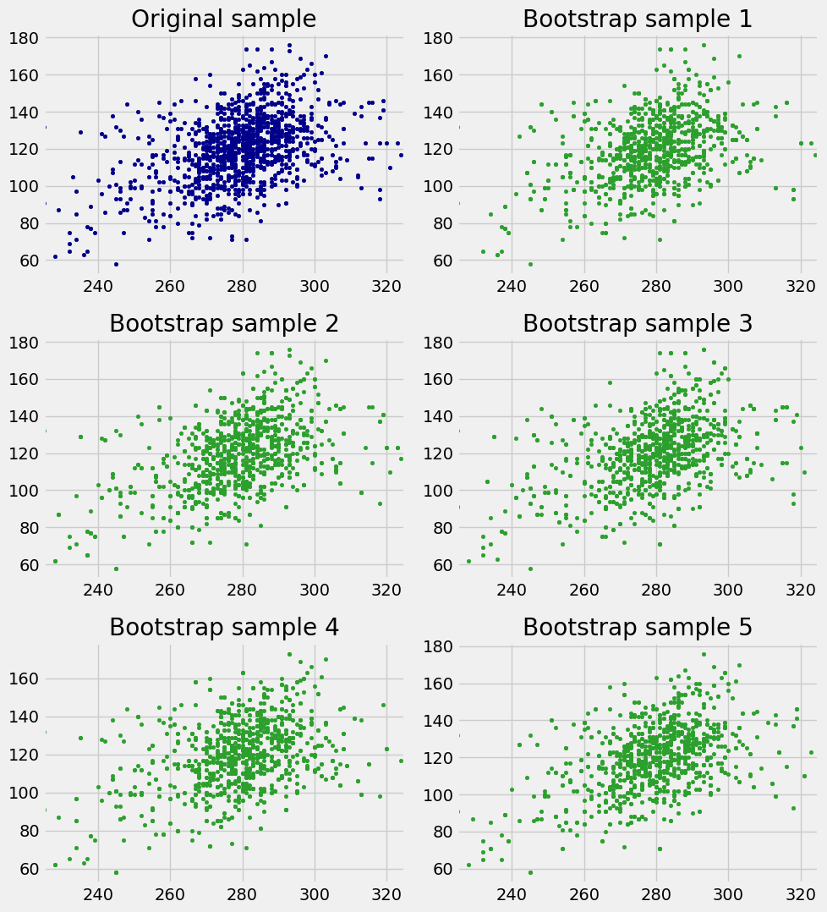

**Code:**

```python
for i in np.arange(4):
    resample = births.sample()
    predicted_y = prediction_at(resample, 'Gestational Days', 'Birth Weight', 300)
    print('Predicted y from bootstrap sample was', predicted_y)
    resample.scatter('Gestational Days', 'Birth Weight', fit_line=True)
    plots.scatter(300, predicted_y, color='gold', s=50, zorder=3);
    plots.plot([x, x], [40, predicted_y], color='red', lw=2);
    plots.plot([200, x], [predicted_y, predicted_y], color='red', lw=2);
```

*Output (stdout):*

```text
Predicted y from bootstrap sample was 130.115816965
Predicted y from bootstrap sample was 131.397935957
Predicted y from bootstrap sample was 130.277967429
Predicted y from bootstrap sample was 130.953463926
```

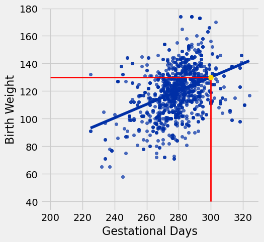

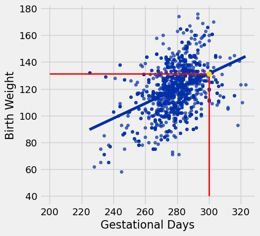

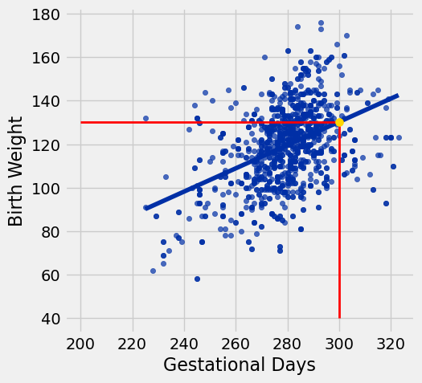

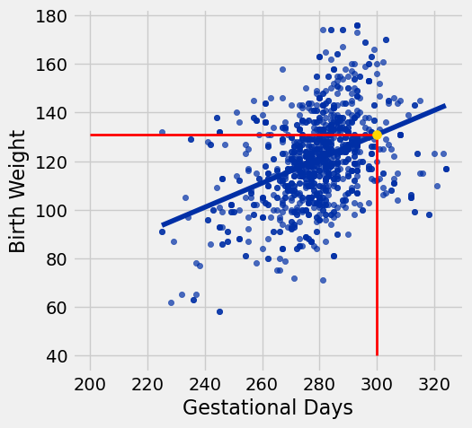

**Code:**

```python
lines = Table(['slope','intercept', 'at 210', 'at 300', 'at 320'])

for i in range(10):
    resample = births.sample()
    a = slope(resample, 'Gestational Days', 'Birth Weight')
    b = intercept(resample, 'Gestational Days', 'Birth Weight')
    lines.append([a, b, a * 210 + b, a * 300 + b, a * 320 + b])

for i in np.arange(lines.num_rows):
    line = lines.row(i)
    plots.plot([210, 320], [line.item('at 210'), line.item('at 320')], lw=1)
    plots.scatter(300, line.item('at 300'), s=30, zorder=3)
```

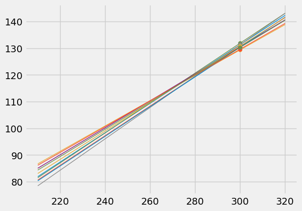

**Code:**

```python
np.mean(births.column('Gestational Days')), np.mean(births.column('Birth Weight'))
```

*Output:*

```text
(279.11015490533561, 119.57401032702238)
```

**Code:**

```python
lines = Table(['slope','intercept', 'at 291', 'at 300', 'at 309'])

for i in range(10):
    resample = births.sample()
    a = slope(resample, 'Gestational Days', 'Birth Weight')
    b = intercept(resample, 'Gestational Days', 'Birth Weight')
    lines.append([a, b, a * 291 + b, a * 300 + b, a * 309 + b])
lines
```

*Output:*

| slope | intercept | at 291 | at 300 | at 309 |
| --- | --- | --- | --- | --- |
| 0.470266 | -11.8985 | 124.949 | 129.181 | 133.414 |
| 0.515706 | -25.0966 | 124.974 | 129.615 | 134.257 |
| 0.50111 | -18.8308 | 126.992 | 131.502 | 136.012 |
| 0.540616 | -31.6267 | 125.693 | 130.558 | 135.424 |
| 0.500778 | -20.3524 | 125.374 | 129.881 | 134.388 |
| 0.582346 | -42.8997 | 126.563 | 131.804 | 137.045 |
| 0.50133 | -20.0712 | 125.816 | 130.328 | 134.84 |
| 0.510783 | -22.7916 | 125.846 | 130.443 | 135.04 |
| 0.557533 | -35.609 | 126.633 | 131.651 | 136.669 |
| 0.515053 | -24.2061 | 125.674 | 130.31 | 134.945 |

**Code:**

```python
for i in np.arange(lines.num_rows):
    line = lines.row(i)
    plots.plot([291, 309], [line.item('at 291'), line.item('at 309')], lw=1)
    plots.scatter(300, line.item('at 300'), s=30, zorder=3)
```

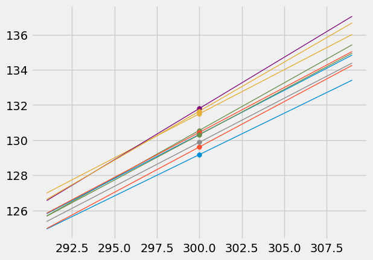

## Prediction Interval

**Code:**

```python
def bootstrap_prediction(t, x, y, new_x, repetitions=2500):
    """ 
    Makes a 95% confidence interval for the height of the true line at new_x, 
    using linear regression on the data in t (column names x and y).
    Shows a histogram of the bootstrap samples and shows the interval
    in gold.
    """

    # Bootstrap the scatter, predict, collect
    predictions = make_array()
    for i in np.arange(repetitions):
        resample = t.sample()
        predicted_y = prediction_at(resample, x, y, new_x)
        predictions = np.append(predictions, predicted_y)

    # Find the ends of the approximate 95% prediction interval
    left = percentile(2.5, predictions)
    right = percentile(97.5, predictions)
    round_left = round(left, 3)
    round_right = round(right, 3)

    # Display results
    Table().with_column('Prediction', predictions).hist(bins=20)
    plots.xlabel('predictions at x='+str(new_x))
    plots.plot([left, right], [0, 0], color='yellow', lw=8);
    print('Approximate 95%-confidence interval for height of true line at x =', new_x)
    print(round_left, 'to', round_right, '( width =', round(right - left, 3), ')')
```

**Code:**

```python
bootstrap_prediction(births, 'Gestational Days', 'Birth Weight', 300)
```

*Output (stdout):*

```text
Approximate 95%-confidence interval for height of true line at x = 300
128.955 to 132.657 ( width = 3.702 )
```

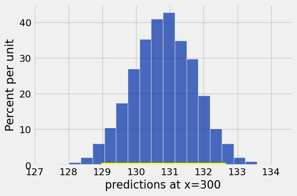

## Predictions at Different Values of x

**Code:**

```python
x = 300
births.scatter('Gestational Days', 'Birth Weight', fit_line=True)
plots.plot([x, x], [40, prediction_at_300], color='red', lw=2);
```


**Code:**

```python
bootstrap_prediction(births, 'Gestational Days', 'Birth Weight', 230)
```

*Output (stdout):*

```text
Approximate 95%-confidence interval for height of true line at x = 230
89.452 to 97.141 ( width = 7.688 )
```

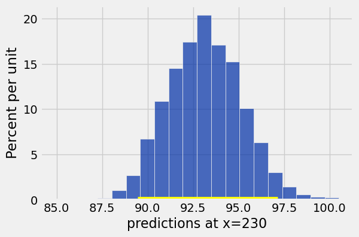

**Code:**

```python
bootstrap_prediction(births, 'Gestational Days', 'Birth Weight', 280)
```

*Output (stdout):*

```text
Approximate 95%-confidence interval for height of true line at x = 280
119.124 to 120.985 ( width = 1.861 )
```

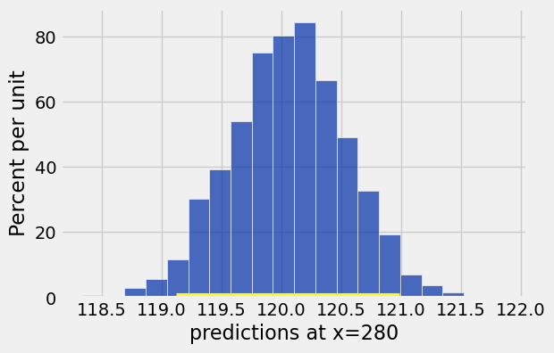

**Code:**

```python
# No need to follow the code in this cell; just understand the graph

lines = Table(['slope','intercept', 'at 210', 'at 300', 'at 320'])

for i in range(10):
    resample = births.sample()
    a = slope(resample, 'Gestational Days', 'Birth Weight')
    b = intercept(resample, 'Gestational Days', 'Birth Weight')
    lines.append([a, b, a * 210 + b, a * 300 + b, a * 320 + b])

for i in np.arange(lines.num_rows):
    line = lines.row(i)
    plots.plot([210, 320], [line.item('at 210'), line.item('at 320')], lw=1)
```

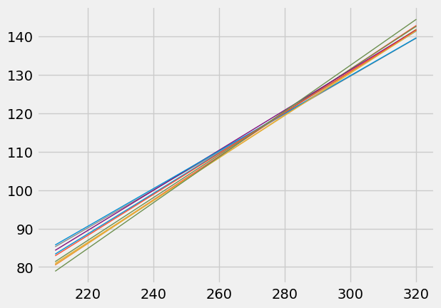

## Inference for the True Slope

**Code:**

```python
births.scatter('Gestational Days', 'Birth Weight', fit_line=True)
```


**Code:**

```python
slope(births, 'Gestational Days', 'Birth Weight')
```

*Output:*

```text
0.53784536766790358
```

**Code:**

```python
def bootstrap_slope(t, x, y, repetitions=2500):
    """ 
    Makes a 95% confidence interval for the slope of the true line, 
    using linear regression on the data in t (column names x and y).
    Shows a histogram of the bootstrap samples and shows the interval
    in gold.
    """
    
    # Bootstrap the scatter, find the slope, collect
    slopes = make_array()
    for i in np.arange(repetitions):
        bootstrap_sample = t.sample()
        bootstrap_slope = slope(bootstrap_sample, x, y)
        slopes = np.append(slopes, bootstrap_slope)
    
    # Find the endpoints of the 95% confidence interval for the true slope
    left = percentile(2.5, slopes)
    right = percentile(97.5, slopes)
    round_left = round(left, 3)
    round_right = round(right, 3)
    
    # Slope of the regression line from the original sample
    observed_slope = slope(t, x, y)
    
    # Display results (no need to follow this code)
    Table().with_column('Bootstrap Slopes', slopes).hist(bins=20)
    plots.plot(make_array(left, right), make_array(0, 0), color='yellow', lw=8);
    print('Slope of regression line:', round(observed_slope, 3))
    print('Approximate 95%-confidence interval for the slope of the true line:')
    print(round_left, 'to', round_right)
```

**Code:**

```python
bootstrap_slope(births, 'Gestational Days', 'Birth Weight')
```

*Output (stdout):*

```text
Slope of regression line: 0.538
Approximate 95%-confidence interval for the slope of the true line:
0.459 to 0.618
```

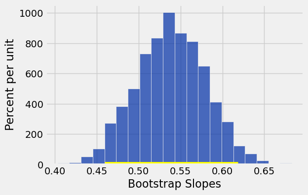

**Code:**

```python
births.num_rows
```

*Output:*

```text
1162
```

## Zero Correlation Regression

**Code:**

```python
draw_and_compare(0, 10, 25)
```

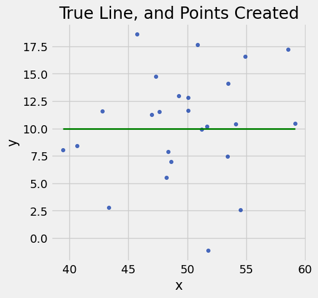

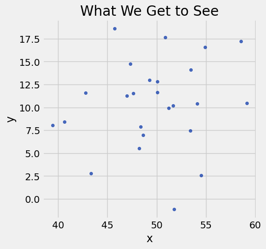

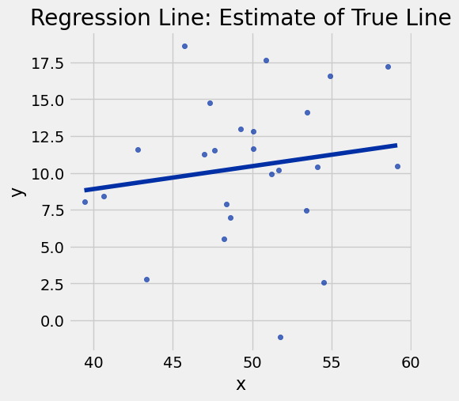

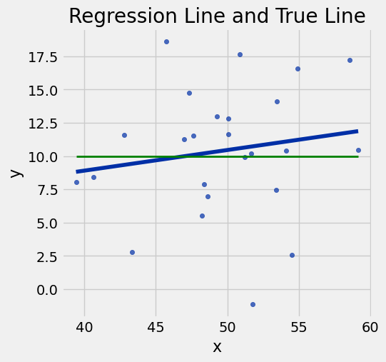

### Maternal Age and Birth Weight

**Code:**

```python
births.scatter('Maternal Age', 'Birth Weight')
```

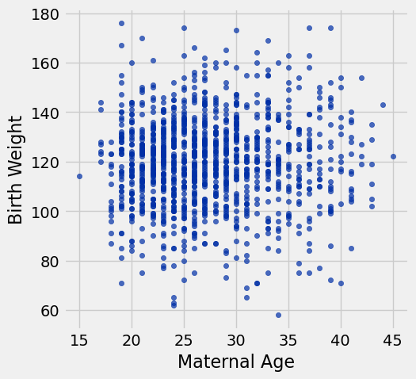

**Code:**

```python
slope(births, 'Maternal Age', 'Birth Weight')
```

*Output:*

```text
0.095142237298344659
```

**Code:**

```python
births.scatter('Maternal Age', 'Birth Weight', fit_line=True)
```

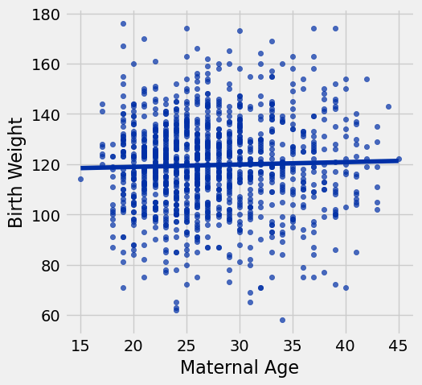

**Null:** Slope of true line is equal to 0.

**Alternative:** Slope of true line is not equal to 0.

**Code:**

```python
bootstrap_slope(births, 'Maternal Age', 'Birth Weight')
```

*Output (stdout):*

```text
Slope of regression line: 0.095
Approximate 95%-confidence interval for the slope of the true line:
-0.089 to 0.281
```

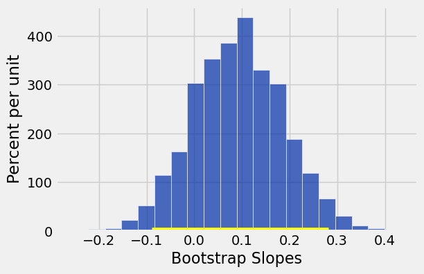

---

## Datasets

Datasets this notebook loads with `Table.read_table`. Column names are exact, including spaces and capitalization. Only the schema is recorded here — the data itself is not in this document, so any question about its values must be answered by running code, not by reasoning over the rows shown elsewhere in this file.

### `baby.csv`

1,174 rows, 6 columns.

| Column | Type |
| --- | --- |
| `Birth Weight` | int |
| `Gestational Days` | int |
| `Maternal Age` | int |
| `Maternal Height` | int |
| `Maternal Pregnancy Weight` | int |
| `Maternal Smoker` | bool |
