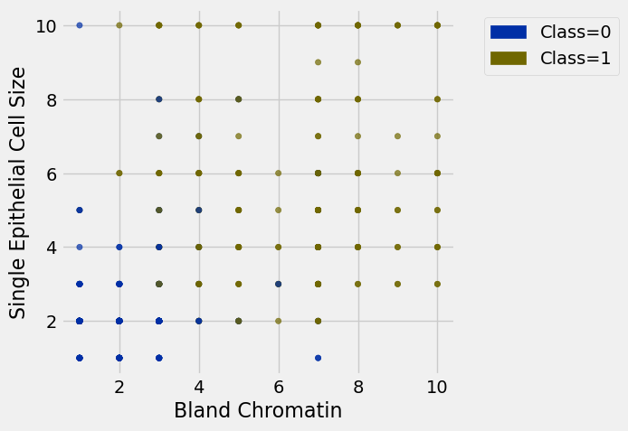
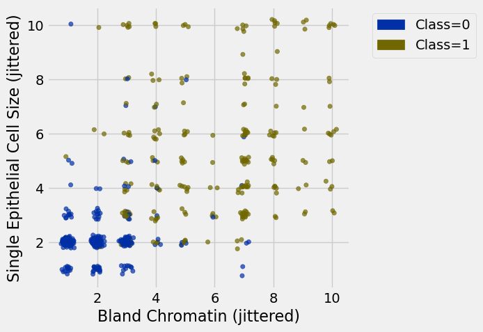

**Code:**

```python
from datascience import *
import numpy as np
import matplotlib
from mpl_toolkits.mplot3d import Axes3D

%matplotlib inline
import matplotlib.pyplot as plots
plots.style.use('fivethirtyeight')

import warnings
warnings.simplefilter("ignore")
```

**Code:**

```python
ckd = Table.read_table('ckd.csv')
ckd = ckd.relabeled('Blood Glucose Random', 'Glucose').select('Glucose', 'Hemoglobin', 'White Blood Cell Count', 'Class')
```

**Code:**

```python
patients = Table.read_table('breast-cancer.csv').drop('ID')

def randomize_column(a):
    return a + np.random.normal(0.0, 0.09, size=len(a))

jittered = Table().with_columns([
        'Bland Chromatin (jittered)', 
        randomize_column(patients.column('Bland Chromatin')),
        'Single Epithelial Cell Size (jittered)', 
        randomize_column(patients.column('Single Epithelial Cell Size')),
        'Class',
        patients.column('Class')
    ])
```

# Google Science Fair

**Code:**

```python
patients = Table.read_table('breast-cancer.csv').drop('ID')
patients.show(3)
```

*Output:*

| Clump Thickness | Uniformity of Cell Size | Uniformity of Cell Shape | Marginal Adhesion | Single Epithelial Cell Size | Bare Nuclei | Bland Chromatin | Normal Nucleoli | Mitoses | Class |
| --- | --- | --- | --- | --- | --- | --- | --- | --- | --- |
| 5 | 1 | 1 | 1 | 2 | 1 | 3 | 1 | 1 | 0 |
| 5 | 4 | 4 | 5 | 7 | 10 | 3 | 2 | 1 | 0 |
| 3 | 1 | 1 | 1 | 2 | 2 | 3 | 1 | 1 | 0 |

**Code:**

```python
patients.group('Class')
```

*Output:*

| Class | count |
| --- | --- |
| 0 | 444 |
| 1 | 239 |

**Code:**

```python
patients.scatter('Bland Chromatin', 'Single Epithelial Cell Size', group='Class')
```



**Code:**

```python
jittered.scatter(0, 1, group='Class')
```



## Distance ##

**Code:**

```python
def distance(pt1, pt2):
    """Return the distance between two points, represented as arrays"""
    return np.sqrt(sum((pt1 - pt2)**2))
```

**Code:**

```python
example1 = make_array(4, 2)
example2 = make_array(4, 3)
distance(example1, example2)
```

*Output:*

```text
1.0
```

**Code:**

```python
(example1 - example2)** 2
```

*Output:*

```text
array([0, 1])
```

**Code:**

```python
np.array(patients.drop('Class').row(0))
```

*Output:*

```text
array([5, 1, 1, 1, 2, 1, 3, 1, 1])
```

**Code:**

```python
def row_distance(row1, row2):
    """Return the distance between two numerical rows of a table"""
    return distance(np.array(row1), np.array(row2))
```

**Code:**

```python
attributes = patients.drop('Class')
attributes.show(3)
```

*Output:*

| Clump Thickness | Uniformity of Cell Size | Uniformity of Cell Shape | Marginal Adhesion | Single Epithelial Cell Size | Bare Nuclei | Bland Chromatin | Normal Nucleoli | Mitoses |
| --- | --- | --- | --- | --- | --- | --- | --- | --- |
| 5 | 1 | 1 | 1 | 2 | 1 | 3 | 1 | 1 |
| 5 | 4 | 4 | 5 | 7 | 10 | 3 | 2 | 1 |
| 3 | 1 | 1 | 1 | 2 | 2 | 3 | 1 | 1 |

**Code:**

```python
row_distance(attributes.row(0), attributes.row(1))
```

*Output:*

```text
11.874342087037917
```

**Code:**

```python
row_distance(attributes.row(0), attributes.row(2))
```

*Output:*

```text
2.2360679774997898
```

**Code:**

```python
row_distance(attributes.row(2), attributes.row(2))
```

*Output:*

```text
0.0
```

# The Classifier

**Code:**

```python
def distances(training, example):
    """
    Compute distance between example and every row in training.
    Return training augmented with Distance column
    """
    distances = make_array()
    attributes_only = training.drop('Class')
    
    for row in attributes_only.rows:
        distances = np.append(distances, row_distance(row, example))
    
#   ^ SAME AS DOING:
#
#   for i in np.arange(attributes_only.num_rows):
#       row = attributes_only.row(i)
#       distances = np.append(distances, row_distance(row, example))
        
    return training.with_column('Distance_to_ex', distances)
```

**Code:**

```python
example = attributes.row(21)
example
```

*Output:*

```text
Row(Clump Thickness=10, Uniformity of Cell Size=5, Uniformity of Cell Shape=5, Marginal Adhesion=3, Single Epithelial Cell Size=6, Bare Nuclei=7, Bland Chromatin=7, Normal Nucleoli=10, Mitoses=1)
```

**Code:**

```python
distances(patients.exclude(21), example).sort('Distance_to_ex')
```

*Output:*

| Clump Thickness | Uniformity of Cell Size | Uniformity of Cell Shape | Marginal Adhesion | Single Epithelial Cell Size | Bare Nuclei | Bland Chromatin | Normal Nucleoli | Mitoses | Class | Distance_to_ex |
| --- | --- | --- | --- | --- | --- | --- | --- | --- | --- | --- |
| 8 | 4 | 4 | 5 | 4 | 7 | 7 | 8 | 2 | 0 | 4.3589 |
| 10 | 5 | 7 | 4 | 4 | 10 | 8 | 9 | 1 | 1 | 4.47214 |
| 7 | 4 | 4 | 3 | 4 | 10 | 6 | 9 | 1 | 1 | 5.09902 |
| 10 | 3 | 6 | 2 | 3 | 5 | 4 | 10 | 2 | 1 | 5.38516 |
| 10 | 5 | 5 | 6 | 3 | 10 | 7 | 9 | 2 | 1 | 5.38516 |
| 10 | 6 | 6 | 2 | 4 | 10 | 9 | 7 | 1 | 1 | 5.38516 |
| 9 | 7 | 7 | 5 | 5 | 10 | 7 | 8 | 3 | 1 | 5.56776 |
| 10 | 6 | 4 | 3 | 10 | 10 | 9 | 10 | 1 | 1 | 5.56776 |
| 8 | 7 | 4 | 4 | 5 | 3 | 5 | 10 | 1 | 1 | 5.56776 |
| 10 | 7 | 7 | 4 | 5 | 10 | 5 | 7 | 2 | 1 | 5.74456 |

**Code:**

```python
def closest(training, example, k):
    """
    Return a table of the k closest neighbors to example
    """
    return distances(training, example).sort('Distance_to_ex').take(np.arange(k))
```

**Code:**

```python
closest(patients.exclude(21), example, 5)
```

*Output:*

| Clump Thickness | Uniformity of Cell Size | Uniformity of Cell Shape | Marginal Adhesion | Single Epithelial Cell Size | Bare Nuclei | Bland Chromatin | Normal Nucleoli | Mitoses | Class | Distance_to_ex |
| --- | --- | --- | --- | --- | --- | --- | --- | --- | --- | --- |
| 8 | 4 | 4 | 5 | 4 | 7 | 7 | 8 | 2 | 0 | 4.3589 |
| 10 | 5 | 7 | 4 | 4 | 10 | 8 | 9 | 1 | 1 | 4.47214 |
| 7 | 4 | 4 | 3 | 4 | 10 | 6 | 9 | 1 | 1 | 5.09902 |
| 10 | 3 | 6 | 2 | 3 | 5 | 4 | 10 | 2 | 1 | 5.38516 |
| 10 | 5 | 5 | 6 | 3 | 10 | 7 | 9 | 2 | 1 | 5.38516 |

**Code:**

```python
closest(patients.exclude(21), example, 5).group('Class').sort('count', descending=True) # .column('Class').item(0)
```

*Output:*

| Class | count |
| --- | --- |
| 1 | 4 |
| 0 | 1 |

**Code:**

```python
def majority_class(topk):
    """
    Return the class with the highest count
    """
    return topk.group('Class').sort('count', descending=True).column(0).item(0)
```

**Code:**

```python
def classify(training, example, k):
    """
    Return the majority class among the 
    k nearest neighbors of example
    """
    return majority_class(closest(training, example, k))
```

**Code:**

```python
classify(patients.exclude(21), example, 5)
```

*Output:*

```text
1
```

**Code:**

```python
patients.take(21)
```

*Output:*

| Clump Thickness | Uniformity of Cell Size | Uniformity of Cell Shape | Marginal Adhesion | Single Epithelial Cell Size | Bare Nuclei | Bland Chromatin | Normal Nucleoli | Mitoses | Class |
| --- | --- | --- | --- | --- | --- | --- | --- | --- | --- |
| 10 | 5 | 5 | 3 | 6 | 7 | 7 | 10 | 1 | 1 |

**Code:**

```python
new_example = attributes.row(10)
classify(patients.exclude(10), new_example, 5)
```

*Output:*

```text
0
```

**Code:**

```python
patients.take(10)
```

*Output:*

| Clump Thickness | Uniformity of Cell Size | Uniformity of Cell Shape | Marginal Adhesion | Single Epithelial Cell Size | Bare Nuclei | Bland Chromatin | Normal Nucleoli | Mitoses | Class |
| --- | --- | --- | --- | --- | --- | --- | --- | --- | --- |
| 1 | 1 | 1 | 1 | 1 | 1 | 3 | 1 | 1 | 0 |

**Code:**

```python
another_example = attributes.row(15)
classify(patients.exclude(15), another_example, 5)
```

*Output:*

```text
0
```

**Code:**

```python
patients.take(15)
```

*Output:*

| Clump Thickness | Uniformity of Cell Size | Uniformity of Cell Shape | Marginal Adhesion | Single Epithelial Cell Size | Bare Nuclei | Bland Chromatin | Normal Nucleoli | Mitoses | Class |
| --- | --- | --- | --- | --- | --- | --- | --- | --- | --- |
| 7 | 4 | 6 | 4 | 6 | 1 | 4 | 3 | 1 | 1 |

## Review of the Steps ##

- `distance(pt1, pt2)`: Returns the distance between the arrays `pt1` and `pt2`
- `row_distance(row1, row2)`: Returns the distance between the rows `row1` and `row2`
- `distances(training, example)`: Returns a table that is `training` with an additional column `'Distance'` that contains the distance between `example` and each row of `training`
- `closest(training, example, k)`: Returns a table of the rows corresponding to the k smallest distances 
- `majority_class(topk)`: Returns the majority class in the `'Class'` column
- `classify(training, example, k)`: Returns the predicted class of `example` based on a `k` nearest neighbors classifier using the historical sample `training`

## Accuracy of a Classifier ##

**Code:**

```python
patients.num_rows
```

*Output:*

```text
683
```

**Code:**

```python
shuffled = patients.sample(with_replacement=False) # Randomly permute the rows
training_set = shuffled.take(np.arange(342))
test_set  = shuffled.take(np.arange(342, 683))
```

**Code:**

```python
def evaluate_accuracy(training, test, k):
    """Return the proportion of correctly classified examples 
    in the test set"""
    test_attributes = test.drop('Class')
    num_correct = 0
    for i in np.arange(test.num_rows):
        c = classify(training, test_attributes.row(i), k)
        num_correct = num_correct + (c == test.column('Class').item(i))
    return num_correct / test.num_rows
```

**Code:**

```python
def predictions(training, test, k):
```

**Code:**

```python
evaluate_accuracy(training_set, test_set, 5)
```

*Output:*

```text
0.9648093841642229
```

**Code:**

```python
evaluate_accuracy(training_set, test_set, 3)
```

*Output:*

```text
0.9706744868035191
```

**Code:**

```python
evaluate_accuracy(training_set, test_set, 11)
```

*Output:*

```text
0.9560117302052786
```

**Code:**

```python
evaluate_accuracy(training_set, test_set, 1)
```

*Output:*

```text
0.9648093841642229
```

# Standardize if Necessary

**Code:**

```python
ckd.show(5)
```

*Output:*

| Glucose | Hemoglobin | White Blood Cell Count | Class |
| --- | --- | --- | --- |
| 117 | 11.2 | 6700 | 1 |
| 70 | 9.5 | 12100 | 1 |
| 380 | 10.8 | 4500 | 1 |
| 157 | 5.6 | 11000 | 1 |
| 173 | 7.7 | 9200 | 1 |

**Code:**

```python
shuffled = ckd.sample(with_replacement=False) 
training_set = shuffled.take(np.arange(74))
test_set  = shuffled.take(np.arange(74, 148))
```

**Code:**

```python
evaluate_accuracy(training_set, test_set, 3)
```

*Output:*

```text
0.7702702702702703
```

**Code:**

```python
def standard_units(x):
    return (x - np.average(x)) / np.std(x)
```

**Code:**

```python
ckd_new = ckd.select('Class').with_columns(
    'Glucose_su', standard_units(ckd.column('Glucose')),
    'Hemoglobin_su', standard_units(ckd.column('Hemoglobin')),
    'WBC_su', standard_units(ckd.column('White Blood Cell Count'))
)
```

**Code:**

```python
ckd_new.show(3)
```

*Output:*

| Class | Glucose_su | Hemoglobin_su | WBC_su |
| --- | --- | --- | --- |
| 1 | -0.221549 | -0.865744 | -0.569768 |
| 1 | -0.947597 | -1.45745 | 1.16268 |
| 1 | 3.84123 | -1.00497 | -1.27558 |

**Code:**

```python
shuffled = ckd_new.sample(with_replacement=False) 
training_set = shuffled.take(np.arange(74))
test_set  = shuffled.take(np.arange(74, 148))
```

**Code:**

```python
evaluate_accuracy(training_set, test_set, 3)
```

*Output:*

```text
0.9594594594594594
```

---

## Datasets

Datasets this notebook loads with `Table.read_table`. Column names are exact, including spaces and capitalization. Only the schema is recorded here — the data itself is not in this document, so any question about its values must be answered by running code, not by reasoning over the rows shown elsewhere in this file.

### `ckd.csv`

158 rows, 25 columns.

| Column | Type |
| --- | --- |
| `Age` | int |
| `Blood Pressure` | int |
| `Specific Gravity` | float |
| `Albumin` | int |
| `Sugar` | int |
| `Red Blood Cells` | str |
| `Pus Cell` | str |
| `Pus Cell clumps` | str |
| `Bacteria` | str |
| `Blood Glucose Random` | int |
| `Blood Urea` | int |
| `Serum Creatinine` | float |
| `Sodium` | int |
| `Potassium` | float |
| `Hemoglobin` | float |
| `Packed Cell Volume` | int |
| `White Blood Cell Count` | int |
| `Red Blood Cell Count` | float |
| `Hypertension` | str |
| `Diabetes Mellitus` | str |
| `Coronary Artery Disease` | str |
| `Appetite` | str |
| `Pedal Edema` | str |
| `Anemia` | str |
| `Class` | int |

### `breast-cancer.csv`

683 rows, 11 columns.

| Column | Type |
| --- | --- |
| `ID` | int |
| `Clump Thickness` | int |
| `Uniformity of Cell Size` | int |
| `Uniformity of Cell Shape` | int |
| `Marginal Adhesion` | int |
| `Single Epithelial Cell Size` | int |
| `Bare Nuclei` | int |
| `Bland Chromatin` | int |
| `Normal Nucleoli` | int |
| `Mitoses` | int |
| `Class` | int |
