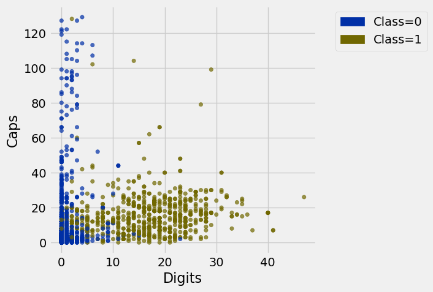

**Code:**

```python
from datascience import *
import numpy as np
import matplotlib

%matplotlib inline
import matplotlib.pyplot as plots
plots.style.use('fivethirtyeight')

import warnings
warnings.simplefilter("ignore")
```

## Review of the Steps in Classification & Functions ##

- `distance(pt1, pt2)`: Returns the distance between the arrays `pt1` and `pt2`
- `row_distance(row1, row2)`: Returns the distance between the rows `row1` and `row2`
- `distances(training, example)`: Returns a table that is `training` with an additional column `'Distance'` that contains the distance between `example` and each row of `training`
- `closest(training, example, k)`: Returns a table of the rows corresponding to the k smallest distances 
- `majority_class(topk)`: Returns the majority class in the `'Class'` column
- `classify(training, example, k)`: Returns the predicted class of `example` based on a `k` nearest neighbors classifier using the historical sample `training`
- `classify_all(training, test, k)`: Return the `test` table with a `Prediction` column that results from calling `classify` on each `test` example.
- `get_accuracy(t, prediction_label='Prediction')`: Return the accuracy, which is the fraction of values in the `Prediction` column that match the `Class` column.
- `evaluate_accuracy(training, test, k)`: Classify all rows of the test set and return the accuracy.

**Code:**

```python
from tqdm.notebook import tqdm  # This generates animated progress bars

def distance(pt1, pt2):
    """Return the distance between two points, represented as arrays"""
    return np.sqrt(sum((pt1 - pt2)**2))

def row_distance(row1, row2):
    """Return the distance between two numerical rows of a table"""
    return distance(np.array(row1), np.array(row2))

def distances(training, example):
    """
    Compute distance between example and every row in training.
    Return training augmented with Distance column
    """
    distances = make_array()
    attributes_only = training.drop('Class')
    
    for row in attributes_only.rows:
        distances = np.append(distances, row_distance(row, example))
            
    return training.with_column('Distance_to_ex', distances)

def closest(training, example, k):
    """
    Return a table of the k closest neighbors to example
    """
    return distances(training, example).sort('Distance_to_ex').take(np.arange(k))

def majority_class(topk):
    """
    Return the class with the highest count
    """
    return topk.group('Class').sort('count', descending=True).column(0).item(0)

def classify(training, example, k):
    """
    Return the majority class among the 
    k nearest neighbors of example
    """
    return majority_class(closest(training, example, k))

def classify_all(training, test, k):
    """Classify each row of the test table and add a column of the results."""
    test_attributes = test.drop('Class')
    guesses = make_array()
    for i in tqdm(np.arange(test.num_rows)):
        c = classify(training, test_attributes.row(i), k)
        guesses = np.append(guesses, c)
    return test.with_column("Prediction", guesses)

def get_accuracy(t, prediction_label='Prediction'):
    """Return the accuracy on a test table with Class and Prediction columns."""
    return sum(t.column('Class') == t.column(prediction_label)) / t.num_rows

def evaluate_accuracy(training, test, k):
    """Return the proportion of correctly classified examples 
    in the test set"""
    return get_accuracy(classify_all(training, test, k))
```

# Text Classification

## SMS Spam

**Code:**

```python
from datasets import load_dataset

sms = load_dataset('ucirvine/sms_spam', split='train').shuffle(seed=42)
sms_texts = np.array(sms['sms'])
sms_labels = np.array(sms['label'])

sms_tbl = Table().with_columns('Text', sms_texts, 'Class', sms_labels)
sms_tbl.group('Class').show()
```

*Output:*

| Class | count |
| --- | --- |
| 0 | 4827 |
| 1 | 747 |

**Code:**

```python
sms_tbl.where('Class', 1).sample(with_replacement=False).show(5)
```

*Output:*

| Text | Class |
| --- | --- |
| Am new 2 club & dont fink we met yet Will B gr8 2 C U Pl ... | 1 |
| Someone U know has asked our dating service 2 contact yo ... | 1 |
| We tried to call you re your reply to our sms for a vide ... | 1 |
| Today's Offer! Claim ur £150 worth of discount vouchers! ... | 1 |
| Sunshine Quiz Wkly Q! Win a top Sony DVD player if u kno ... | 1 |

**Code:**

```python
sms_tbl.where('Class', 0).sample(with_replacement=False).show(5)
```

*Output:*

| Text | Class |
| --- | --- |
| Have a safe trip to Nigeria. Wish you happiness and very ... | 0 |
| Enjoy ur life. . Good night | 0 |
| I did. One slice and one breadstick. Lol | 0 |
| 7 wonders in My WORLD 7th You 6th Ur style 5th Ur smile ... | 0 |
| How's ur paper? | 0 |

**Code:**

```python
texts = sms_tbl.column('Text')

sms_data = Table().with_columns(
    'Chars', np.char.str_len(texts),
    'Digits', sum(np.char.count(texts, str(d)) for d in range(10)),
    'Caps', sum(np.char.count(texts, chr(c)) for c in range(65, 91)),
    'Exclamations', np.char.count(texts, '!'),
    'Class', sms_tbl.column('Class')
)
sms_data
```

*Output:*

| Chars | Digits | Caps | Exclamations | Class |
| --- | --- | --- | --- | --- |
| 154 | 23 | 24 | 0 | 1 |
| 85 | 0 | 1 | 1 | 0 |
| 46 | 1 | 2 | 0 | 0 |
| 133 | 0 | 2 | 0 | 0 |
| 81 | 0 | 3 | 2 | 0 |
| 28 | 0 | 2 | 0 | 0 |
| 48 | 0 | 1 | 0 | 0 |
| 123 | 0 | 5 | 3 | 0 |
| 38 | 0 | 2 | 0 | 0 |
| 53 | 0 | 1 | 0 | 0 |

**Code:**

```python
sms_data.scatter('Digits', 'Caps', group='Class')
```



**Code:**

```python
shuffled = sms_data.sample(with_replacement=False)
test_size = 100
train_sms = shuffled.take(np.arange(test_size, shuffled.num_rows))
test_sms = shuffled.take(np.arange(test_size))

print('Training:', train_sms.num_rows, ' Test:', test_sms.num_rows)
evaluate_accuracy(train_sms, test_sms, 5)
```

*Output (stdout):*

```text
Training: 5474  Test: 100
```

*Output:*

```text
  0%|          | 0/100 [00:00<?, ?it/s]
```

*Output:*

```text
0.97999999999999998
```

## Rotten Tomatoes Movie Reviews

**Code:**

```python
reviews_full = load_dataset('rotten_tomatoes', split='train')
reviews_short = reviews_full.filter(lambda x: 5 <= len(x['text'].split()) <= 10)

reviews = Table().with_columns('Text', reviews_short['text'],
                               'Class', reviews_short['label'])
reviews = reviews.sample(with_replacement=False)  # Permute the rows
reviews.group('Class')
```

*Output (stderr):*

```text
Warning: You are sending unauthenticated requests to the HF Hub. Please set a HF_TOKEN to enable higher rate limits and faster downloads.
```

*Output:*

| Class | count |
| --- | --- |
| 0 | 529 |
| 1 | 543 |

**Code:**

```python
reviews.sample(5)
```

*Output:*

| Text | Class |
| --- | --- |
| it's fitfully funny but never really takes off . | 0 |
| the result is something quite fresh and delightful . | 1 |
| the fast runner' transports the viewer into an unusual space | 1 |
| a mild , reluctant , thumbs down . | 0 |
| death might be a release . | 0 |

**Code:**

```python
words = [  # The most common adjectives in the data
    'good', 'bad', 'funny', 'little', 'much', 'new', 'best',
    'many', 'own', 'other', 'big', 'great', 'most', 'few',
    'real', 'first', 'full', 'american', 'romantic', 'same', 'old',
    'better', 'young', 'original', 'interesting', 'human',
    'hard', 'cinematic', 'enough', 'emotional', 'last', 'least', 'long',
    'true', 'predictable', 'visual', 'whole', 'high', 'special',
    'entertaining', 'sweet', 'enjoyable', 'narrative', 'familiar'
]
counts = Table(['Word', 'Positive', 'Negative'])
for word in words:
    has_word = reviews.where('Text', are.containing(word))
    counts = counts.with_row([word, has_word.where('Class', 1).num_rows,
                                    has_word.where('Class', 0).num_rows])

counts
```

*Output:*

| Word | Positive | Negative |
| --- | --- | --- |
| good | 17 | 7 |
| bad | 2 | 8 |
| funny | 27 | 14 |
| little | 8 | 13 |
| much | 1 | 17 |
| new | 2 | 4 |
| best | 11 | 1 |
| many | 0 | 6 |
| own | 2 | 25 |
| other | 5 | 15 |

**Code:**

```python
reviews.where('Text', are.containing('funny')).where('Class', 0).sample(5, with_replacement=False)
```

*Output:*

| Text | Class |
| --- | --- |
| not only unfunny , but downright repellent . | 0 |
| neither funny nor suspenseful nor particularly well-drawn . | 0 |
| a little weak -- and it isn't that funny . | 0 |
| what a stiflingly unfunny and unoriginal mess this is ! | 0 |
| this strenuously unfunny showtime deserves the hook . | 0 |

**Code:**

```python
texts = reviews.column('Text')
review_words = Table().with_column('Class', reviews.column('Class'))
for word in words:
    review_words = review_words.with_column(word, np.char.count(np.char.lower(texts), word))

review_words.sample(5)
```

*Output:*

| Class | good | bad | funny | little | much | new | best | many | own | other | big | great | most | few | ... |
| --- | --- | --- | --- | --- | --- | --- | --- | --- | --- | --- | --- | --- | --- | --- | --- |
| 1 | 0 | 0 | 0 | 0 | 0 | 0 | 0 | 0 | 0 | 0 | 0 | 0 | 0 | 0 | ... |
| 1 | 1 | 0 | 0 | 0 | 0 | 0 | 0 | 0 | 0 | 0 | 0 | 0 | 0 | 0 | ... |
| 0 | 0 | 0 | 0 | 0 | 0 | 0 | 0 | 0 | 0 | 0 | 0 | 0 | 0 | 0 | ... |
| 0 | 0 | 0 | 0 | 0 | 0 | 0 | 0 | 0 | 0 | 0 | 0 | 0 | 0 | 0 | ... |
| 1 | 0 | 0 | 0 | 0 | 0 | 0 | 0 | 0 | 0 | 0 | 0 | 0 | 0 | 0 | ... |

_... 30 more columns_

**Code:**

```python
train_reviews = review_words.take(np.arange(test_size, reviews.num_rows))
test_reviews = review_words.take(np.arange(test_size))

print('Word-count KNN:')
evaluate_accuracy(train_reviews, test_reviews, 5)
```

*Output (stdout):*

```text
Word-count KNN:
```

*Output:*

```text
  0%|          | 0/100 [00:00<?, ?it/s]
```

*Output:*

```text
0.57999999999999996
```

**Code:**

```python
classify_all(train_reviews, test_reviews, 5).pivot('Prediction', 'Class')
```

*Output:*

```text
  0%|          | 0/100 [00:00<?, ?it/s]
```

*Output:*

| Class | 0.0 | 1.0 |
| --- | --- | --- |
| 0 | 10 | 41 |
| 1 | 1 | 48 |

## Sentence Embeddings

Data 8 students are not responsible for learning the details of the code below, such as how to call `embedder.encode` or understanding what it does.

**Code:**

```python
from sentence_transformers import SentenceTransformer

embedder = SentenceTransformer('all-MiniLM-L6-v2')
review_emb = embedder.encode(list(reviews.column('Text')), show_progress_bar=True)
print('Embedding shape:', review_emb.shape)
```

*Output:*

```text
Loading weights:   0%|          | 0/103 [00:00<?, ?it/s]
```

*Output (stderr):*

```text
BertModel LOAD REPORT from: sentence-transformers/all-MiniLM-L6-v2
Key                     | Status     |  | 
------------------------+------------+--+-
embeddings.position_ids | UNEXPECTED |  | 

Notes:
- UNEXPECTED:	can be ignored when loading from different task/architecture; not ok if you expect identical arch.
```

*Output:*

```text
Batches:   0%|          | 0/34 [00:00<?, ?it/s]
```

*Output (stdout):*

```text
Embedding shape: (1072, 384)
```

**Code:**

```python
n_features = 384  # Increasing this will help, but above 128 datahub will crash

cols = ['Class', reviews.column('Class')]
for i in range(n_features):
    cols += [f'Embed{i}', review_emb[:, i]]

review_emb_table = Table().with_columns(*cols)
review_emb_table.row(0)
```

*Output:*

```text
Row(Class=1, Embed0=0.019200735, Embed1=-0.033960462, Embed2=-0.0064136791, Embed3=0.03181849, Embed4=-0.040090643, Embed5=0.094549574, Embed6=0.052497644, Embed7=-0.0090332543, Embed8=0.14175008, Embed9=-0.040151011, Embed10=0.018321985, Embed11=-0.0025268409, Embed12=0.10903085, Embed13=-0.022248896, Embed14=-0.072498359, Embed15=0.0020178349, Embed16=-0.096268445, Embed17=-0.14937204, Embed18=0.064575993, Embed19=-0.011026557, Embed20=-0.0015952713, Embed21=0.11924704, Embed22=0.091237433, Embed23=-0.0199525, Embed24=0.033193659, Embed25=-0.051121421, Embed26=-0.024570983, Embed27=-0.01853261, Embed28=0.0062042526, Embed29=0.015071545, Embed30=-0.040215664, Embed31=0.055361636, Embed32=0.066318102, Embed33=0.031858876, Embed34=-0.018447991, Embed35=-0.039461486, Embed36=0.041817583, Embed37=-0.04022523, Embed38=0.0095656691, Embed39=0.04338371, Embed40=0.046871517, Embed41=-0.035502426, Embed42=0.041842945, Embed43=0.0083235353, Embed44=-0.053895228, Embed45=0.10517883, Embed46=-0.054763012, Embed47=-0.01858039, Embed48=-0.032416202, Embed49=0.050635505, Embed50=0.051845279, Embed51=0.14508191, Embed52=-0.022398172, Embed53=0.017713087, Embed54=0.095303684, Embed55=0.045846161, Embed56=0.031230815, Embed57=-0.012224013, Embed58=-0.018359009, Embed59=0.061371267, Embed60=-0.011415593, Embed61=0.0055315895, Embed62=-0.027610051, Embed63=0.0038601193, Embed64=-0.072858371, Embed65=-0.025136555, Embed66=-0.055012017, Embed67=-0.028078653, Embed68=0.017812012, Embed69=0.057447948, Embed70=-0.032159958, Embed71=0.048654668, Embed72=0.11205786, Embed73=0.062967733, Embed74=-0.069438316, Embed75=-0.034947701, Embed76=0.0038991128, Embed77=-0.051407687, Embed78=0.051953442, Embed79=0.0041363183, Embed80=0.011574274, Embed81=-0.091281667, Embed82=-0.013339411, Embed83=0.0095055038, Embed84=0.025257861, Embed85=-0.014197022, Embed86=0.024549646, Embed87=-0.05214956, Embed88=0.025298683, Embed89=-0.029525256, Embed90=-0.066384219, Embed91=0.0037996785, Embed92=0.011668861, Embed93=0.029969702, Embed94=-0.013003308, Embed95=-0.014168013, Embed96=-0.035101067, Embed97=0.16861662, Embed98=-0.014492441, Embed99=0.097652614, Embed100=-0.057462871, Embed101=-0.040398788, Embed102=-0.025071179, Embed103=0.043633301, Embed104=-0.047790032, Embed105=-0.010052725, Embed106=-0.01096565, Embed107=0.012094741, Embed108=-0.024276933, Embed109=-0.051693216, Embed110=0.034855492, Embed111=-0.032485507, Embed112=0.032803603, Embed113=0.075656474, Embed114=0.0027889144, Embed115=-0.099236466, Embed116=0.036478061, Embed117=-0.057118833, Embed118=0.085922398, Embed119=-0.0079054935, Embed120=0.030957622, Embed121=0.044843595, Embed122=0.00047890045, Embed123=-0.04620802, Embed124=0.0075430772, Embed125=-0.037438426, Embed126=0.04486056, Embed127=-9.5167486e-33, Embed128=0.039664309, Embed129=-0.019245725, Embed130=0.044307977, Embed131=0.054080449, Embed132=0.026630839, Embed133=0.027727518, Embed134=-0.014169834, Embed135=0.015142147, Embed136=-0.016158871, Embed137=-0.027471203, Embed138=0.044244338, Embed139=-0.0026568449, Embed140=0.036940068, Embed141=0.037486009, Embed142=0.020068616, Embed143=-0.013498004, Embed144=0.037955794, Embed145=0.042284511, Embed146=0.037065268, Embed147=-0.044414748, Embed148=-0.017840335, Embed149=-0.095402896, Embed150=0.023636816, Embed151=-0.02077104, Embed152=-0.049024913, Embed153=0.020972947, Embed154=-0.061179101, Embed155=0.023439497, Embed156=-0.022836359, Embed157=-0.0040775314, Embed158=0.081237651, Embed159=0.013401201, Embed160=-0.039235558, Embed161=0.0035797185, Embed162=0.058674473, Embed163=-0.054377079, Embed164=0.070006497, Embed165=0.0096483352, Embed166=-0.011844392, Embed167=0.016547123, Embed168=-0.019024095, Embed169=-0.013837093, Embed170=-0.0171184, Embed171=-0.026276613, Embed172=0.011452054, Embed173=0.02993915, Embed174=0.081330098, Embed175=0.012481669, Embed176=-0.090216488, Embed177=0.0321934, Embed178=0.044502884, Embed179=0.011759531, Embed180=0.073093362, Embed181=0.006523449, Embed182

... [output truncated, 4559 more characters]
```

**Code:**

```python
train = review_emb_table.take(np.arange(test_size, reviews.num_rows))
test = review_emb_table.take(np.arange(test_size))
evaluate_accuracy(train, test, 5)
```

*Output:*

```text
  0%|          | 0/100 [00:00<?, ?it/s]
```

*Output:*

```text
0.78000000000000003
```

**Code:**

```python
classify_all(train, test, 5).pivot('Prediction', 'Class')
```

*Output:*

```text
  0%|          | 0/100 [00:00<?, ?it/s]
```

*Output:*

| Class | 0.0 | 1.0 |
| --- | --- | --- |
| 0 | 38 | 13 |
| 1 | 9 | 40 |

# BONUS MATERIAL

**WARNING:** Unfortunately, data8.datahub.berkeley.edu does not have enough RAM per student to run this code. Running the next cell will crash your kernel. It runs on a 2023 Macbook Air. Also, the code uses many features of Python and modules that we haven't covered in the course. Please don't feel like you have to understand it all.

### Fine-tuned embeddings

**Code:**

```python
import torch
from transformers import AutoTokenizer, AutoModelForSequenceClassification

model_name = 'sentence-transformers/all-MiniLM-L6-v2'

tokenizer = AutoTokenizer.from_pretrained(model_name)
model = AutoModelForSequenceClassification.from_pretrained(model_name, num_labels=2)

finetune_texts = list(reviews.column('Text')[test_size:])
finetune_labels = torch.tensor(list(reviews.column('Class')[test_size:]))

optimizer = torch.optim.Adam(model.parameters(), lr=5e-5)
batch_size = 16

model.train()
for epoch in tqdm(range(7)):
    for i in range(0, len(finetune_texts), batch_size):
        batch_texts = finetune_texts[i:i+batch_size]
        batch_labels = finetune_labels[i:i+batch_size]
        inputs = tokenizer(batch_texts, return_tensors='pt', padding=True, truncation=True, max_length=64)
        loss = model(**inputs, labels=batch_labels).loss
        loss.backward()
        optimizer.step()
        optimizer.zero_grad()
```

*Output:*

```text
Loading weights:   0%|          | 0/103 [00:00<?, ?it/s]
```

*Output (stderr):*

```text
BertForSequenceClassification LOAD REPORT from: sentence-transformers/all-MiniLM-L6-v2
Key                     | Status     | 
------------------------+------------+-
embeddings.position_ids | UNEXPECTED | 
classifier.bias         | MISSING    | 
classifier.weight       | MISSING    | 

Notes:
- UNEXPECTED:	can be ignored when loading from different task/architecture; not ok if you expect identical arch.
- MISSING:	those params were newly initialized because missing from the checkpoint. Consider training on your downstream task.
```

*Output:*

```text
  0%|          | 0/7 [00:00<?, ?it/s]
```

**Code:**

```python
model.eval()
eval_texts = list(reviews.column('Text'))
with torch.no_grad():
    inputs = tokenizer(eval_texts, return_tensors='pt', padding=True, truncation=True, max_length=64)
    review_bert_emb = model.bert(**inputs).pooler_output.numpy()
print('Fine-tuned embedding shape:', review_bert_emb.shape)
```

*Output (stdout):*

```text
Fine-tuned embedding shape: (1072, 384)
```

**Code:**

```python
cols = ['Class', reviews.column('Class')]
for i in range(review_bert_emb.shape[1]):
    cols += [f'Embed{i}', review_bert_emb[:, i]]

review_bert_table = Table().with_columns(*cols)

train = review_bert_table.take(np.arange(test_size, reviews.num_rows))
test = review_bert_table.take(np.arange(test_size))

evaluate_accuracy(train, test, 5)
```

*Output:*

```text
  0%|          | 0/100 [00:00<?, ?it/s]
```

*Output:*

```text
0.81000000000000005
```

**Code:**

```python
test_texts = list(reviews.column('Text')[:test_size])
test_labels = reviews.column('Class')[:test_size]

with torch.no_grad():
    inputs = tokenizer(test_texts, return_tensors='pt', padding=True, truncation=True, max_length=64)
    predictions = model(**inputs).logits.argmax(dim=1).numpy()

print('BERT classifier accuracy:', np.mean(predictions == test_labels))
```

*Output (stdout):*

```text
BERT classifier accuracy: 0.83
```
