# Data 8 project solutions

Assignments included:

- project1
- project1c
- project2
- project2c
- project3
- project3c


---

# project1

---
title: "Project 1: World Population and Poverty"
assignment: project1
semester: sp26
source: semester_assignments/sp26/project/project1/autograder/project1.ipynb
version: solution (autograder) with student scaffolds
student_source: semester_assignments/sp26/project/project1/student/project1.ipynb
total_points: 65
language: python
---


# Project 1: World Population and Poverty

In this project, you'll explore data from [Gapminder.org](http://gapminder.org), a website dedicated to providing a fact-based view of the world and how it has changed. That site includes several data visualizations and presentations, but also publishes the raw data that we will use in this project to recreate and extend some of their most famous visualizations.

The Gapminder website collects data from many sources and compiles them into tables that describe many countries around the world. All of the data they aggregate are published in the [Systema Globalis](https://github.com/open-numbers/ddf--gapminder--systema_globalis/blob/master/README.md). Their goal is "to compile all public statistics; Social, Economic and Environmental; into a comparable total dataset." All data sets in this project are copied directly from the Systema Globalis without any changes.

This project is dedicated to [Hans Rosling](https://en.wikipedia.org/wiki/Hans_Rosling) (1948-2017), who championed the use of data to understand and prioritize global development challenges.

### Logistics

**Deadline.**  This project is due at **5:00pm PT on Friday 2/27**. Projects will be accepted up to 1 day (24 hours) late. Projects submitted fewer than 24 hours after the deadline will receive 80% credit. It's **much** better to be early than late, so start working now.

**Checkpoint.**  For full credit on the checkpoint, you must complete the questions up to the checkpoint, **pass all _public_ autograder tests** for those sections, and submit to the Pensive Project 1 Checkpoint assignment by **5:00pm PT on Friday, 2/20**. <span style="color: #BC412B">**The checkpoint is worth 1 lab score**</span>. After you've submitted the checkpoint, you may still change your project answers before the final project deadline - only your final submission, to the "Project 1" assignment, will be graded for correctness. You will have some lab time to work on these questions, but we recommend that you start the project before lab and leave time to finish the checkpoint afterward. Additionally, the second half of the project is longer than the first, so if you have time, we encourage you to continue working past the checkpoint.

**Partners.** You may work with one other partner; your partner must be from your assigned lab section. **<span style="color: #BC412B">Only one partner should submit the project notebook to Pensive.</span> If both partners submit, you will be docked 10% of your project grade. On Pensive, the person who submits should also designate their partner so that both of you receive credit.** Once you submit, click into your submission, and there will be an option to Add Group Member in the top right corner. You may also reference [this walkthrough video](https://drive.google.com/file/d/1bs1l_f44tUeF1yKY_iljZMTE1X0dYKLl/view?usp=sharing) on how to add partners on Pensive.


**Rules.** Don't share your code with anybody but your partner. You are welcome to discuss questions with other students, but don't share the answers. The experience of solving the problems in this project will prepare you for exams (and life). If someone asks you for the answer, resist! Instead, you can demonstrate how you would solve a similar problem.

**Support.** You are not alone! Come to office hours, post on Ed, and talk to your classmates. If you want to ask about the details of your solution to a problem, make a private Ed post and the staff will respond. If you're ever feeling overwhelmed or don't know how to make progress, email your TA or tutor for help. You can find contact information for the staff on the [course website](https://www.data8.org/su26/).

**Tests.** <span style="color: #BC412B">The tests that are given are **not comprehensive** and passing the tests for a question **does not** mean that you answered the question correctly.</span> Tests usually only check that your table has the correct column labels. However, more tests will be applied to verify the correctness of your submission in order to assign your final score, so be careful and check your work! You might want to create your own checks along the way to see if your answers make sense. Additionally, before you submit, make sure that none of your cells take a very long time to run (several minutes).

**Free Response Questions:** Make sure that you put the answers to the written questions in the indicated cell we provide. **Every free response question should include an explanation** that adequately answers the question.

**Tabular Thinking Guide:** Feel free to reference [Tabular Thinking Guide](https://drive.google.com/file/d/1NvbBECCBdI0Ku380oPcTUOcpjH3RI230/view) for extra guidance.

**Advice.** Develop your answers incrementally. To perform a complicated table manipulation, break it up into steps, perform each step on a different line, give a new name to each result, and check that each intermediate result is what you expect. You can add any additional names or functions you want to the provided cells. Make sure that you are using distinct and meaningful variable names throughout the notebook. Along that line, **DO NOT** reuse the variable names that we use when we grade your answers. For example, in Question 1 of the Global Poverty section we ask you to assign an answer to `latest`. Do not reassign the variable name `latest` to anything else in your notebook, otherwise there is the chance that our tests grade against what `latest` was reassigned to.

You are **never** restricted to using only one line of code to solve a question in this project or any others. Feel free to use intermediate variables and multiple lines as much as you would like!

---

The point breakdown for this assignment is given in the table below:
| Category | Points |
| --- | --- |
| Autograder (Coding questions) | 65 |
| Written | 35 |
| **Total** | 100 |

---

To get started, load `datascience`, `numpy`, `plots`, and `otter`.

**Code:**

```python
# Run this cell to set up the notebook, but please don't change it. 

# These lines import the NumPy and Datascience modules.
from datascience import *
import numpy as np

# These lines do some fancy plotting magic.
%matplotlib inline
import matplotlib.pyplot as plots
plots.style.use('fivethirtyeight')

from ipywidgets import interact, interactive, fixed, interact_manual
import ipywidgets as widgets
```

---
## 0. Hazards with `.show`

As a heads up, please do not run the function `tbl.show()` in this assignment without an argument. For instance if you want to view a table, please type `tbl.show(10)` instead of `tbl.show()`. This may break your notebook and we cannot guarantee that we will have the capacity to aid you in this. Please answer the question below, and set the value to `True` to confirm you have read this and agree.

**Student scaffold:**

```python
i_wont_use_show_without_an_argument = ...
```

**Solution:**

```python
i_wont_use_show_without_an_argument = True # SOLUTION
```

**Test — `q0` (0 points)**

```python
>>> i_wont_use_show_without_an_argument == True
True
```

---
## 1. Global Population Growth

The global population of humans reached 1 billion around 1800, 3 billion around 1960, 7 billion around 2011, and 8 billion around 2022. The potential impact of population growth has concerned scientists, economists, and politicians alike.

The United Nations Population Division estimates that the world population will likely continue to grow throughout the 21st century, but at a slower rate, perhaps reaching and stabilizing at 10 billion by 2100. However, the UN does not rule out scenarios of slower or more extreme growth. These projections help us understand long-term population processes, even if they leave out possible global catastrophic events like war or climate crises.

<a href="https://population.un.org/wpp/Graphs/Probabilistic/POP/TOT/900"> 
 ![UN line chart titled 'World: Total Population', population in billions from 1950 to 2100. A black observed curve rises from about 2.5 billion in 1950 to about 8 billion in 2022, then projections fan out: a red median curve peaking near 10.3 billion around 2080 and easing to about 10.2 billion by 2100, with 80% and 95% prediction intervals, 60 sample trajectories, and a +/- 0.5 child scenario band spanning roughly 6.3 to 14 billion by 2100. Source: UN DESA Population Division, World Population Prospects 2024.](project1_assets/un_population_projection.png) 
</a>

In this part of the project, we will examine some of the factors that influence population growth and how they have been changing over the years and around the world. There are two main sub-parts of this analysis.

- First, we will examine the data for one country, Poland. We will see how factors such as life expectancy, fertility rate, and child mortality have changed over time in Poland, and how they are related to the rate of population growth.
- Next, we will examine whether the changes we have observed for Poland are particular to that country or whether they reflect general patterns observable in other countries too. We will study aspects of world population growth and see how they have been changing.

The first table we will consider contains the total population of each country over time. Run the cell below.

**Code:**

```python
population = Table.read_table('population.csv').where("time", are.below(2026))
population.show(3)
```

*Output:*

| geo | time | population_total |
| --- | --- | --- |
| afg | 1800 | 3280000 |
| afg | 1801 | 3280000 |
| afg | 1802 | 3280000 |

**Note:** The population data can also be found [here](https://www.gapminder.org/data/documentation/gd003/).

### Poland

The Central European nation of Poland has undergone many changes over the centuries. In modern times it was (re)created as a democratic republic in 1919 after World War I. It was invaded and divided in World War II between Germany and the Soviet Union. War and the Holocaust had a devastating impact on its people. Poland was constituted in its current borders at the end of World War II (1945) under a communist government. In 1989, with the fall of the Soviet Union, Poland re-established itself as a democratic republic.

In this section of the project, we will examine aspects of the population of Poland since 1900. Poland's borders have changed, so we will look at the population within its current (2025) borders.

In the `population` table, the `geo` column contains three-letter codes established by the [International Organization for Standardization](https://en.wikipedia.org/wiki/International_Organization_for_Standardization) (ISO) in the [Alpha-3](https://en.wikipedia.org/wiki/ISO_3166-1_alpha-3#Current_codes) standard. **Use the Alpha-3 link to find the 3-letter code for Poland.**

---

**Question 1.1.** Using the `population` table, create a table called `p_pop` for **Poland's population data since 1900**. It should have two columns labeled `time` and `population_total`. The first column should contain the years from 1900 through 2025 (including both 1900 and 2025) and the second column should contain the population of **Poland** in each of those years. **(5 points)**

**Student scaffold:**

```python
p_pop = ...
p_pop
```

**Solution:**

```python
p_pop = population.where('geo', 'pol').where('time', are.between(1900, 2026)).drop('geo') # SOLUTION
p_pop
```

*Output:*

| time | population_total |
| --- | --- |
| 1900 | 24308265 |
| 1901 | 24485193 |
| 1902 | 24660489 |
| 1903 | 24834119 |
| 1904 | 25008969 |
| 1905 | 25185047 |
| 1906 | 25362361 |
| 1907 | 25540920 |
| 1908 | 25720733 |
| 1909 | 25808244 |

**Test — `q1_1` (5 points)**

```python
>>> p_pop.labels == ('time', 'population_total')
True

>>> all(p_pop.sort('time').column('time') == np.arange(1900, 2026))
True

# hidden test
>>> p_pop.sort('time', descending=True).column('population_total').item(0)
38140910

# hidden test
>>> p_pop.sort('time').column('population_total').item(0)
24308265
```

Run the following cell to create a table called `p_five` that has the population of Poland every five years.

**Code:**

```python
p_pop.set_format('population_total', NumberFormatter)

fives = np.arange(1900, 2026, 5) # 1900, 1905, 1910, ..., 2025
p_five = p_pop.sort('time').where('time', are.contained_in(fives))
p_five.show(3)
```

*Output:*

| time | population_total |
| --- | --- |
| 1900 | 24,308,265 |
| 1905 | 25,185,047 |
| 1910 | 25,803,855 |

Run the following cell to visualize the population over time. Following the devastating effects of World War I and World War II, Poland's population increased steadily from 1950 to 2000 and then leveled off. In the following questions we'll investigate this period of population growth.

**Code:**

```python
p_five.plot(0, 1)
```

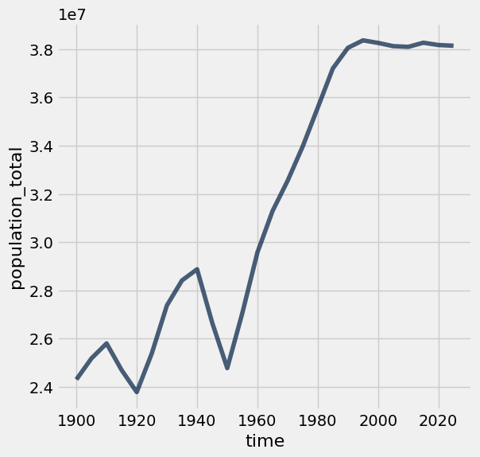

---

**Question 1.2.** Assign `initial` to an array that contains the population for every five year interval from **1900 to 2020** (inclusive). Then, assign `changed` to an array that contains the population for every five year interval from **1905 to 2025** (inclusive). The first array should include both 1900 and 2020, and the second array should include both 1905 and 2025. You should use the `p_five` table to create both arrays, by first filtering the table to only contain the relevant years.

The annual growth rate for a time period is equal to:

$$\left(\left(\frac{\text{Population at end of period}}{\text{Population at start of period}}\right)^{\displaystyle\frac{1}{\text{number of years}}}\right) -1$$

We have provided the code below that uses `initial` and `changed` in order to add a column to `p_five` called `annual_growth`. **Don't worry about the calculation of the growth rates**; run the test below to test your solution.

If you are interested in how we came up with the formula for growth rates, consult the [growth rates](https://inferentialthinking.com/chapters/03/2/1/Growth.html) section of the textbook. **(5 points)**

**Student scaffold:**

```python
initial = ...
changed = ...

p_1900_through_2020 = p_five.where('time', are.below_or_equal_to(2020)) 
p_five_growth = p_1900_through_2020.with_column('annual_growth', (changed/initial)**0.2-1)
p_five_growth.set_format('annual_growth', PercentFormatter)
```

**Solution:**

```python
initial = p_five.where("time", are.below(2021)).column('population_total') # SOLUTION
changed = p_five.where("time", are.above(1900)).column('population_total') # SOLUTION

p_1900_through_2020 = p_five.where('time', are.below_or_equal_to(2020)) 
p_five_growth = p_1900_through_2020.with_column('annual_growth', (changed/initial)**0.2-1)
p_five_growth.set_format('annual_growth', PercentFormatter)
```

*Output:*

| time | population_total | annual_growth |
| --- | --- | --- |
| 1900 | 24,308,265 | 0.71% |
| 1905 | 25,185,047 | 0.49% |
| 1910 | 25,803,855 | -0.87% |
| 1915 | 24,696,678 | -0.75% |
| 1920 | 23,785,820 | 1.32% |
| 1925 | 25,395,008 | 1.52% |
| 1930 | 27,378,955 | 0.75% |
| 1935 | 28,414,953 | 0.32% |
| 1940 | 28,876,472 | -1.58% |
| 1945 | 26,666,588 | -1.46% |

**Test — `q1_2` (5 points)**

```python
>>> first = round(p_five_growth.sort(0).column(2).item(0), 8)
>>> 0.005 <= first <= 0.5
True

>>> max(p_five_growth.column(2)) < 0.03
True

# hidden test
>>> np.allclose(np.round(sum(p_five_growth.column(2)), 5), 0.09136)
False

# hidden test
>>> round(p_five_growth.column(2).item(0), 8) == 0.00711198
True

# hidden test
>>> round(p_five_growth.column(2).item(3), 8) == -0.00748765
True

# hidden test
>>> round(p_five_growth.column(2).item(8), 8) == -0.01579705
True
```

The annual growth rate in Poland has been declining since 1950, as shown in the table below.

**Code:**

```python
# Run this cell to view annual growth rates in Poland since 1950.
p_five_growth.where('time', are.above_or_equal_to(1950)).show()
```

*Output:*

| time | population_total | annual_growth |
| --- | --- | --- |
| 1950 | 24,780,161 | 1.78% |
| 1955 | 27,063,640 | 1.79% |
| 1960 | 29,575,966 | 1.13% |
| 1965 | 31,288,336 | 0.79% |
| 1970 | 32,542,633 | 0.86% |
| 1975 | 33,964,399 | 0.93% |
| 1980 | 35,576,519 | 0.90% |
| 1985 | 37,200,853 | 0.46% |
| 1990 | 38,055,455 | 0.16% |
| 1995 | 38,364,667 | -0.06% |
| 2000 | 38,258,071 | -0.07% |
| 2005 | 38,124,379 | -0.02% |
| 2010 | 38,095,351 | 0.09% |
| 2015 | 38,266,314 | -0.05% |
| 2020 | 38,171,012 | -0.02% |

Next, we'll try to understand what has changed in Poland that might explain the slowing population growth rate. Run the next cell to load three additional tables of measurements about countries over time.

**Code:**

```python
life_expectancy = Table.read_table('life_expectancy.csv').where('time', are.below(2026))
child_mortality = Table.read_table('child_mortality.csv').relabel(2, 'child_mortality_under_5_per_1000_born').where('time', are.below(2026))
fertility = Table.read_table('fertility.csv').where('time', are.below(2026))
```

The `life_expectancy` table contains a statistic that is often used to measure how long people live, called _life expectancy at birth_. This number, for a country in a given year, [does not measure how long babies born in that year are expected to live](http://blogs.worldbank.org/opendata/what-does-life-expectancy-birth-really-mean). Instead, it measures how long someone would live, on average, if the _mortality conditions_ in that year persisted throughout their lifetime. These "mortality conditions" describe what fraction of people for each age survived the year. So, it is a way of measuring the proportion of people that are staying alive, aggregated over different age groups in the population.

The `child_mortality` table has the column _child_mortality_under_5_per_1000_born_ which records the number of children who died before age 5, per 1,000 births.

The `fertility` table contains a statistic that is often used to measure how many babies are being born, the _total fertility rate_. This number describes the [number of children a woman would have in her lifetime](https://www.data4impactproject.org/prh/family-planning/fertility/total-fertility-rate/), on average, if the current rates of birth by age of the mother persisted throughout her child bearing years, assuming she survived through age 49.

Run the following cells below to see `life_expectancy`, `child_mortality`, and `fertility`. Refer back to these tables as they will be helpful for answering further questions!

**Code:**

```python
life_expectancy.show(3)
```

*Output:*

| geo | time | life_expectancy_years |
| --- | --- | --- |
| afg | 1800 | 28.21 |
| afg | 1801 | 28.2 |
| afg | 1802 | 28.19 |

**Code:**

```python
child_mortality.show(3)
```

*Output:*

| geo | time | child_mortality_under_5_per_1000_born |
| --- | --- | --- |
| afg | 1800 | 468.58 |
| afg | 1801 | 468.58 |
| afg | 1802 | 468.58 |

**Code:**

```python
fertility.show(3)
```

*Output:*

| geo | time | children_per_woman_total_fertility |
| --- | --- | --- |
| afg | 1800 | 7 |
| afg | 1801 | 7 |
| afg | 1802 | 7 |

---

**Question 1.3.** Is population growing more slowly perhaps because people aren’t living as long? Use the `life_expectancy` table to draw a line graph with the years 1950 and later on the horizontal axis that shows how the _life expectancy at birth_ has changed in Poland. **(5 points)**

_Hint_: Make sure you filter the table properly; otherwise, the graph may look funky!

**Student scaffold:**

```python
# Fill in code here
...
```

**Solution:**

```python
# Fill in code here
life_expectancy.where("geo", are.equal_to("pol")).where("time", are.above_or_equal_to(1950)).plot("time", "life_expectancy_years") # SOLUTION
```

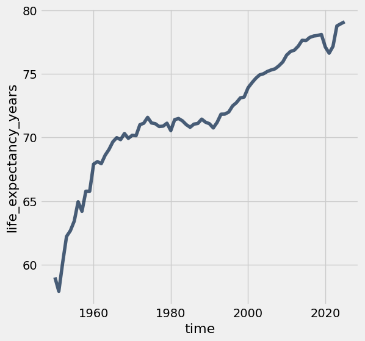

---

**Question 1.4.** Assuming no other factors, such as birth rates or fertility rates, have changed, could the trends in life expectancy in the graph above directly explain why the population growth rate decreased since 1950 in Poland? Why or why not? **(5 points)**

**SOLUTION:** No. This graph indicates that people are living longer, which would increase population growth if everything else stayed the same.

---

**Question 1.5.** Complete the function `fertility_over_time`. It takes two input arguments, the Alpha-3 code of a country (given as `country_code`) and a year to start from (given as `start`). It returns a two-column table with the column labels `Year` and `Children per woman`. These columns can be used to generate a line chart of the country’s fertility rate each year (starting from the year given by `start`). The plot should include the start year and all later years that appear in the fertility table.

Then, determine the Alpha-3 code for **Poland**. The code at the very bottom for `poland_code` and the year `1950` are inputted to your `fertility_over_time` function. The function returns a table which we use in order to plot how Poland's fertility rate has changed since `1950`. Note that the function `fertility_over_time` should not return the plot itself – it returns a two-column table. The expression that draws the line plot is provided for you; please don’t change it. **(5 points)**

_Hint_: Read about `tbl.relabeled` in the [Python Reference](https://www.data8.org/su26/reference/) to rename columns.


_Hint_: You might find [8.0](https://inferentialthinking.com/chapters/08/Functions_and_Tables.html) helpful.

**Student scaffold:**

```python
def fertility_over_time(country_code, start):
    """Create a two-column table that describes a country's total fertility rate each year."""
    # It's a good idea (but not required) to use multiple lines in your solution.
    ...


poland_code = ...
fertility_over_time(poland_code, 1950)
```

**Solution:**

```python
def fertility_over_time(country_code, start):
    """Create a two-column table that describes a country's total fertility rate each year."""
    # It's a good idea (but not required) to use multiple lines in your solution.
    # BEGIN SOLUTION
    country_fertility = fertility.where('geo', are.equal_to(country_code))
    country_fertility_after_start = country_fertility.where('time', are.above_or_equal_to(start))
    cleaned_table = country_fertility_after_start.select('time', 'children_per_woman_total_fertility').relabeled('time', 'Year').relabeled('children_per_woman_total_fertility', 'Children per woman')
    return cleaned_table
    # END SOLUTION


poland_code = 'pol' # SOLUTION
fertility_over_time(poland_code, 1950)
```

*Output:*

| Year | Children per woman |
| --- | --- |
| 1950 | 3.66 |
| 1951 | 3.68 |
| 1952 | 3.64 |
| 1953 | 3.6 |
| 1954 | 3.56 |
| 1955 | 3.54 |
| 1956 | 3.45 |
| 1957 | 3.44 |
| 1958 | 3.34 |
| 1959 | 3.21 |

**Test — `q1_5` (5 points)**

```python
>>> fertility_over_time('usa', 2010).labels == ('Year', 'Children per woman')
True

>>> all(fertility_over_time('usa', 2010).column('Year') == np.arange(2010, 2026))
True

>>> all(fertility_over_time('usa', 2005).column('Year') == np.arange(2005, 2026))
True

# hidden test
>>> print(fertility_over_time('pol', 2012))
Year | Children per woman
2012 | 1.33
2013 | 1.29
2014 | 1.32
2015 | 1.32
2016 | 1.39
2017 | 1.47
2018 | 1.44
2019 | 1.44
2020 | 1.38
2021 | 1.32
... (4 rows omitted)

# hidden test
>>> print(fertility_over_time('usa', 2015))
Year | Children per woman
2015 | 1.83
2016 | 1.8
2017 | 1.75
2018 | 1.72
2019 | 1.68
2020 | 1.62
2021 | 1.63
2022 | 1.67
2023 | 1.62
2024 | 1.62
... (1 rows omitted)

# hidden test
>>> print(fertility_over_time('hti', 2015))
Year | Children per woman
2015 | 3.11
2016 | 3.05
2017 | 2.99
2018 | 2.92
2019 | 2.86
2020 | 2.8
2021 | 2.75
2022 | 2.7
2023 | 2.66
2024 | 2.63
... (1 rows omitted)
```

Plotting the fertility rate in Poland since 1950, we see a downward trend.

**Code:**

```python
fertility_over_time(poland_code, 1950).plot(0, 1)
```

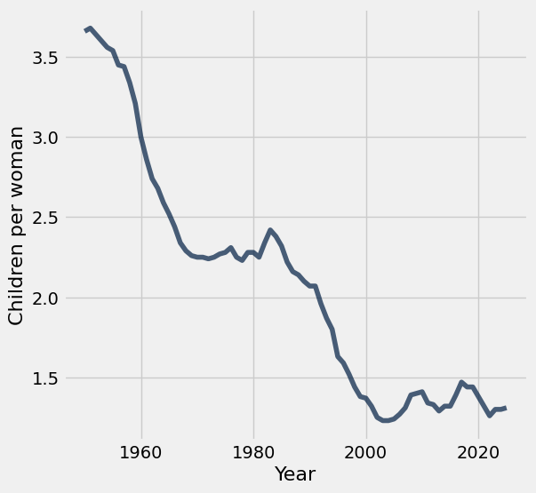

---

**Question 1.6.** Assuming everything else is constant, could the trends in fertility in the graph above help directly explain why the population growth rate decreased since 1950 in Poland? Why or why not? **(5 points)**

**SOLUTION:** Yes, a declining fertility rate shows that fewer babies are being born each year, which contributes to decreasing population growth. (It's ok to point out that the population growth curve and the fertility curve do not match up exactly, but this is not necessary for a correct solution.)

It has been [observed](https://www.ageing.ox.ac.uk/download/143) that lower fertility rates are often associated with lower child mortality rates. We can see if this association is evident in Poland by plotting the relationship between total fertility rate and [child mortality rate per 1000 children](https://en.wikipedia.org/wiki/Child_mortality).

---

**Question 1.7.** Create a table `poland_since_1950` that contains one row per year starting with 1950 and:

- A column `Year` containing the year
- A column `Children per woman` describing total fertility in Poland that year
- A column `Child deaths per 1000 born` describing child mortality in Poland that year

**(5 points)**

**Student scaffold:**

```python
pol_fertility = fertility_over_time(poland_code, 1950)  # Try starting with the table you built already!
# It's a good idea (but not required) to use multiple lines in your solution.
pol_child_mortality = ...
pol_fertility_and_child_mortality = ...
poland_since_1950 = ...
poland_since_1950
```

**Solution:**

```python
pol_fertility = fertility_over_time(poland_code, 1950)  # Try starting with the table you built already!
# It's a good idea (but not required) to use multiple lines in your solution.
pol_child_mortality = child_mortality.where('geo', are.equal_to('pol')).drop('geo') # SOLUTION
pol_fertility_and_child_mortality = pol_fertility.join('Year', pol_child_mortality, 'time') # SOLUTION
poland_since_1950 = pol_fertility_and_child_mortality.relabel('child_mortality_under_5_per_1000_born', 'Child deaths per 1000 born') # SOLUTION
poland_since_1950
```

*Output:*

| Year | Children per woman | Child deaths per 1000 born |
| --- | --- | --- |
| 1950 | 3.66 | 164.08 |
| 1951 | 3.68 | 177.18 |
| 1952 | 3.64 | 140.16 |
| 1953 | 3.6 | 127.65 |
| 1954 | 3.56 | 118.9 |
| 1955 | 3.54 | 110.38 |
| 1956 | 3.45 | 94.19 |
| 1957 | 3.44 | 86.72 |
| 1958 | 3.34 | 81.28 |
| 1959 | 3.21 | 72.1 |

**Test — `q1_7` (5 points)**

```python
>>> poland_since_1950.num_rows
76

>>> all([label in poland_since_1950.labels for label in ['Children per woman', 'Child deaths per 1000 born']])
True

# hidden test
>>> facm = poland_since_1950.select('Children per woman', 'Child deaths per 1000 born')
>>> np.allclose(facm.column(1).item(0), 164.08)
True

# hidden test
>>> facm = poland_since_1950.select('Children per woman', 'Child deaths per 1000 born')
>>> np.allclose(facm.column(1).item(-1), 3.71)
False

# hidden test
>>> facm = poland_since_1950.select('Children per woman', 'Child deaths per 1000 born')
>>> np.allclose(facm.column(0).item(-1), 1.3)
False

# hidden test
>>> facm = poland_since_1950.select('Children per woman', 'Child deaths per 1000 born')
>>> np.allclose(facm.column(0).item(0), 3.66)
True

# hidden test
>>> facm = poland_since_1950.select('Children per woman', 'Child deaths per 1000 born')
>>> np.allclose(facm.column(1).mean(), 32.679733333333)
False

# hidden test
>>> facm = poland_since_1950.select('Children per woman', 'Child deaths per 1000 born')
>>> np.allclose(facm.column(0).mean(), 2.08946666666666)
False
```

Run the following cell to generate a scatter plot from the `poland_since_1950` table you created.

The plot uses **color** to encode data about the `Year` column. The colors, ranging from dark blue to white, represent the passing of time between 1950 and 2025. For example, a point on the scatter plot representing data from the 1950s would appear as **dark blue** and a point from the 2010s would appear as **light blue**.

**Code:**

```python
x_births = poland_since_1950.column("Children per woman")
y_deaths = poland_since_1950.column("Child deaths per 1000 born")
time_colors = poland_since_1950.column("Year")

plots.figure(figsize=(6,6))
plots.scatter(x_births, y_deaths, c=time_colors, cmap="Blues_r")
plots.colorbar()                  
plots.xlabel("Children per woman")
plots.ylabel("Child deaths per 1000 born");
```

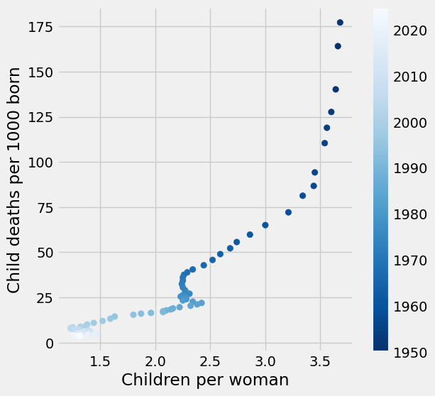

---

**Question 1.8.** In one or two sentences, describe the association (if any) that is illustrated by this scatter plot. Does the diagram show any causal relation between fertility and child mortality? **(5 points)**

**SOLUTION:** We can observe that fertility rates and child mortality rates decrease together over time, although the association is not entirely linear or consistent. However, this association does not tell us whether one of these changes caused a change in the other. (It's ok to point out that decreases in child mortality sometimes precede decreases in fertility, but this observation is not necessary for a correct response.)

_Optional food for thought_: What other context or information would you need in order to better understand the factors affecting life expectancy, child mortality, and fertility?

### Checkpoint (due Friday 2/18 by 5:00 PM PT)


**WOOOHOO!!!** Fifi and Yoyo want to congratulate you on reaching the checkpoint!

**Run the following cells and submit to the Pensive assignment corresponding to the checkpoint: <u>Project 1 Checkpoint</u>**

**<span style="color: #BC412B">Remember to add your project partner to your submission on Pensive!</span>** <u>Only one partner should submit to [Pensive](https://www.pensieve.co/).</u>

Note: If you have the time, we encourage you to continue working past the checkpoint! Some students found that the next section of the project took them a lot longer to complete.

--- 

To double check your work, the cell below will rerun all of the autograder tests for Section 1.

**Code:**

```python
checkpoint_tests = ["q1_1", "q1_2", "q1_5", "q1_7"]
for test in checkpoint_tests:
    display(grader.check(test))
```

*Output (stdout):*

```text
Unexpected exception formatting exception. Falling back to standard exception
```

*Output (stderr):*

```text
Traceback (most recent call last):
  File "/Users/marissalumpkin/Desktop/data8/assignments_new/env/lib/python3.13/site-packages/IPython/core/interactiveshell.py", line 3577, in run_code
    exec(code_obj, self.user_global_ns, self.user_ns)
    ~~~~^^^^^^^^^^^^^^^^^^^^^^^^^^^^^^^^^^^^^^^^^^^^^
  File "/var/folders/xv/tl5mnl5s0mz_ykhsrhdyb_rm0000gn/T/ipykernel_50708/1374029256.py", line 3, in <module>
    display(grader.check(test))
            ^^^^^^
NameError: name 'grader' is not defined

During handling of the above exception, another exception occurred:

Traceback (most recent call last):
  File "/Users/marissalumpkin/Desktop/data8/assignments_new/env/lib/python3.13/site-packages/IPython/core/interactiveshell.py", line 2168, in showtraceback
    stb = self.InteractiveTB.structured_traceback(
        etype, value, tb, tb_offset=tb_offset
    )
  File "/Users/marissalumpkin/Desktop/data8/assignments_new/env/lib/python3.13/site-packages/IPython/core/ultratb.py", line 1454, in structured_traceback
    return FormattedTB.structured_traceback(
           ~~~~~~~~~~~~~~~~~~~~~~~~~~~~~~~~^
        self, etype, evalue, etb, tb_offset, number_of_lines_of_context
        ^^^^^^^^^^^^^^^^^^^^^^^^^^^^^^^^^^^^^^^^^^^^^^^^^^^^^^^^^^^^^^^
    )
    ^
  File "/Users/marissalumpkin/Desktop/data8/assignments_new/env/lib/python3.13/site-packages/IPython/core/ultratb.py", line 1345, in structured_traceback
    return VerboseTB.structured_traceback(
           ~~~~~~~~~~~~~~~~~~~~~~~~~~~~~~^
        self, etype, value, tb, tb_offset, number_of_lines_of_context
        ^^^^^^^^^^^^^^^^^^^^^^^^^^^^^^^^^^^^^^^^^^^^^^^^^^^^^^^^^^^^^
    )
    ^
  File "/Users/marissalumpkin/Desktop/data8/assignments_new/env/lib/python3.13/site-packages/IPython/core/ultratb.py", line 1192, in structured_traceback
    formatted_exception = self.format_exception_as_a_whole(etype, evalue, etb, number_of_lines_of_context,
                                                           tb_offset)
  File "/Users/marissalumpkin/Desktop/data8/assignments_new/env/lib/python3.13/site-packages/IPython/core/ultratb.py", line 1082, in format_exception_as_a_whole
    self.get_records(etb, number_of_lines_of_context, tb_offset) if etb else []
    ~~~~~~~~~~~~~~~~^^^^^^^^^^^^^^^^^^^^^^^^^^^^^^^^^^^^^^^^^^^^
  File "/Users/marissalumpkin/Desktop/data8/assignments_new/env/lib/python3.13/site-packages/IPython/core/ultratb.py", line 1179, in get_records
    res = list(stack_data.FrameInfo.stack_data(etb, options=options))[tb_offset:]
          ~~~~^^^^^^^^^^^^^^^^^^^^^^^^^^^^^^^^^^^^^^^^^^^^^^^^^^^^^^^
  File "/Users/marissalumpkin/Desktop/data8/assignments_new/env/lib/python3.13/site-packages/stack_data/core.py", line 597, in stack_data
    yield from collapse_repeated(
    ...<4 lines>...
    )
  File "/Users/marissalumpkin/Desktop/data8/assignments_new/env/lib/python3.13/site-packages/stack_data/utils.py", line 83, in collapse_repeated
    yield from map(mapper, original_group)
  File "/Users/marissalumpkin/Desktop/data8/assignments_new/env/lib/python3.13/site-packages/stack_data/core.py", line 587, in mapper
    return cls(f, options)
  File "/Users/marissalumpkin/Desktop/data8/assignments_new/env/lib/python3.13/site-packages/stack_data/core.py", line 551, in __init__
    self.executing = Source.executing(frame_or_tb)
                     ~~~~~~~~~~~~~~~~^^^^^^^^^^^^^
  File "/Users/marissalumpkin/Desktop/data8/assignments_new/env/lib/python3.13/site-packages/executing/executing.py", line 283, in executing
    assert_(new_stmts <= stmts)
    ~~~~~~~^^^^^^^^^^^^^^^^^^^^
  File "/Users/marissalumpkin/Desktop/data8/assignments_new/env/lib/python3.13/site-packages/executing/executing.py", line 80, in assert_
    raise AssertionError(str(message))
AssertionError
```

## Submission

Make sure you have run all cells in your notebook in order before running the cell below, so that all images/graphs appear in the output. The cell below will generate a zip file for you to submit. You only need to submit the zip file for the checkpoint. **Please save before exporting!**

---
### The World

The changes observed in Poland can also be observed in many other countries: except during periods of extended war, famine, and social chaos, health services generally improve, life expectancy increases, and child mortality decreases. At the same time, the fertility rate often plummets, and where it does, the population growth rate decreases despite increasing longevity.

Run the cell below to generate two overlaid histograms, one for 1962 and one for 2010, that show the distributions of total fertility rates for these two years among all 201 countries in the `fertility` table.

**Code:**

```python
Table().with_columns( 
    '1962', fertility.where('time', 1962).column(2),
    '2010', fertility.where('time', 2010).column(2)
).hist(bins=np.arange(0, 10, 0.5), unit='child per woman')
_ = plots.xlabel('Children per woman')
_ = plots.ylabel('Percent per children per woman')
_ = plots.xticks(np.arange(10))
```

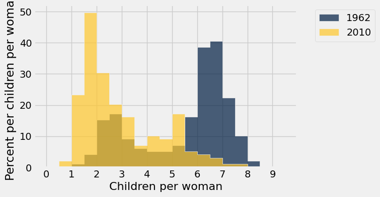

---

**Question 1.9.** Assign `fertility_statements` to an **array** of the numbers of each statement below that can be correctly inferred from these histograms.

For example, if the answer choices you selected were 1, 2, and 3, your code should look like `make_array(1, 2, 3)`.

1. In 1962, less than 20% of countries had a fertility rate below 3.
1. At least half of countries had a fertility rate between 5 and 8 in 1962.
1. In 2010, about 40% of countries had a fertility rate between 1.5 and 2.
1. At least half of countries had a fertility rate below 3 in 2010.
1. More countries had a fertility rate above 3 in 1962 than in 2010.
1. About the same number of countries had a fertility rate between 3.5 and 4.5 in both 1962 and 2010.

**(4 points)**

**Student scaffold:**

```python
fertility_statements = ...
```

**Solution:**

```python
fertility_statements = make_array(1, 2, 4, 5) # SOLUTION
```

**Test — `q1_9` (4 points)**

```python
>>> all((x in range(1, 7) for x in set(fertility_statements)))
True

# hidden test
>>> set(fertility_statements) == set(make_array(1, 2, 4, 5))
True
```

---

**Question 1.10.** Draw a line plot of the **world population** from 1800 through 2025 (inclusive of both endpoints). The world population is the sum of all of the countries' populations. You should use the `population` table defined earlier in the project. **(5 points)**

**Student scaffold:**

```python
#Fill in code here
...
```

**Solution:**

```python
#Fill in code here
population.where('time', are.between(1800, 2026)).drop('geo').group('time', sum).plot('time', "population_total sum") # SOLUTION
```

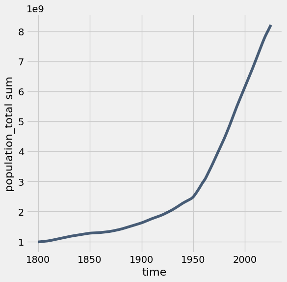

---

**Question 1.11.** Create a function `stats_for_year` that takes a `year` and returns a table of statistics. The table it returns should have four columns: `geo`, `population_total`, `children_per_woman_total_fertility`, and `child_mortality_under_5_per_1000_born`. Each row should contain one unique Alpha-3 country code and three statistics: population, fertility rate, and child mortality for that `year` from the `population`, `fertility` and `child_mortality` tables. Only include rows for which all three statistics are available for the country and year.

In addition, restrict the result to country codes that appears in `big_50`, an array of the 50 most populous countries in 2025. This restriction will speed up computations later in the project.

After you write `stats_for_year`, try calling `stats_for_year` on any year between 1960 and 2025. Try to understand the output of `stats_for_year`.

*Hint*: The tests for this question are quite comprehensive, so if you pass the tests, your function is probably correct. However, without calling your function yourself and looking at the output, it will be very difficult to understand any problems you have, so try your best to write the function correctly and check that it works before you rely on the `grader` tests to confirm your work.

*Hint*: What do all three tables have in common (pay attention to column names)?

*Hint*: Create additional cells before directly writing the function.

**(5 points)**

**Student scaffold:**

```python
# We first create a population table that only includes the 
# 50 countries with the largest 2025 populations. We focus on 
# these 50 countries only so that plotting later will run faster.
big_50 = population.where('time', are.equal_to(2025)).sort("population_total", descending=True).take(np.arange(50)).column('geo')
population_of_big_50 = population.where('time', are.above(1959)).where('geo', are.contained_in(big_50))

def stats_for_year(year):
    """Return a table of the stats for each country that year."""
    p = population_of_big_50.where('time', are.equal_to(year)).drop('time')
    f = fertility.where('time', are.equal_to(year)).drop('time')
    c = child_mortality.where('time', are.equal_to(year)).drop('time')
    ...

...
```

**Solution:**

```python
# We first create a population table that only includes the 
# 50 countries with the largest 2025 populations. We focus on 
# these 50 countries only so that plotting later will run faster.
big_50 = population.where('time', are.equal_to(2025)).sort("population_total", descending=True).take(np.arange(50)).column('geo')
population_of_big_50 = population.where('time', are.above(1959)).where('geo', are.contained_in(big_50))

def stats_for_year(year):
    """Return a table of the stats for each country that year."""
    p = population_of_big_50.where('time', are.equal_to(year)).drop('time')
    f = fertility.where('time', are.equal_to(year)).drop('time')
    c = child_mortality.where('time', are.equal_to(year)).drop('time')
    return p.join('geo', f.join('geo', c)) # SOLUTION

stats_for_year(1987) # SOLUTION
```

*Output:*

| geo | population_total | children_per_woman_total_fertility | child_mortality_under_5_per_1000_born |
| --- | --- | --- | --- |
| afg | 11387818 | 7.55 | 198.17 |
| ago | 10497858 | 7.41 | 224.1 |
| arg | 31291762 | 3.04 | 29.11 |
| bgd | 104959291 | 5.08 | 161.62 |
| bra | 141104944 | 3.23 | 71.26 |
| can | 26540921 | 1.56 | 9.12 |
| chn | 1096217446 | 2.76 | 53.78 |
| civ | 10851475 | 7.09 | 153.51 |
| cod | 33298904 | 6.65 | 192.52 |
| col | 30499467 | 3.09 | 39.14 |

**Test — `q1_11` (5 points)**

```python
>>> t = stats_for_year(1990)
>>> t.labels == ('geo', 'population_total', 'children_per_woman_total_fertility', 'child_mortality_under_5_per_1000_born')
True

>>> t = stats_for_year(1990)
>>> t.num_rows
50

>>> print(stats_for_year(1960).sort('geo').take(np.arange(5, 50, 5)))
geo  | population_total | children_per_woman_total_fertility | child_mortality_under_5_per_1000_born
can  | 17898790         | 3.84                               | 32.6
deu  | 72811640         | 2.39                               | 40.47
fra  | 46428134         | 2.74                               | 28.5
irn  | 21470434         | 7.37                               | 326.94
kor  | 26115379         | 5.99                               | 112.18
moz  | 6713695          | 6.38                               | 277.4
phl  | 27891897         | 7.03                               | 103.65
tha  | 26851747         | 6.28                               | 146.46
usa  | 180274555        | 3.72                               | 30.05

>>> print(stats_for_year(2010).sort('geo').take(np.arange(3, 50, 5)))
geo  | population_total | children_per_woman_total_fertility | child_mortality_under_5_per_1000_born
bgd  | 152201981        | 2.38                               | 49.1
cod  | 68563038         | 6.59                               | 115.29
esp  | 46840471         | 1.37                               | 3.85
idn  | 246305322        | 2.46                               | 34.12
jpn  | 128185275        | 1.36                               | 3.2
mex  | 113623895        | 2.34                               | 17.36
pak  | 199239047        | 4.4                                | 87.51
sau  | 25157128         | 2.81                               | 12.08
uga  | 32390802         | 6.02                               | 77.39
yem  | 26754387         | 4.81                               | 55.96
```

---

**Question 1.12.** Create a table called `pop_by_decade` with two columns called `decade` and `population`, in this order. It should contain a row for each year that starts a decade, in increasing order starting with 1960 and ending with 2020. For example, 1960 is the start of the 1960's decade. The `population` column contains the total population of all countries included in the result of `stats_for_year(year)` for the first `year` of the decade. You should see that these countries contain most of the world's population.

*Hint:* One approach is to define a function `pop_for_year` that computes this total population, then `apply` it to the `decade` column.  **Think about how you can use the `stats_for_year` function** from the previous question if you want to implement `pop_for_year`.

This first test is just a sanity check for your helper function if you choose to use it. **You will not lose points for not implementing the function `pop_for_year`**.

**Note:** The cell where you will generate the `pop_by_decade` table is below the cell where you can choose to define the helper function `pop_for_year`. You should define your `pop_by_decade` table in the cell that starts with the table `decades` being defined. 

**(4 points)**

**Student scaffold:**

```python
def pop_for_year(year):
    """Return the total population for the specified year."""
    ...
```

**Solution:**

```python
def pop_for_year(year):
    """Return the total population for the specified year."""
    return sum(stats_for_year(year).column('population_total')) # SOLUTION
```

**Test — `q1_12_0` (0 points)**

```python
>>> pop_for_year(1972) == 3334568709
True

>>> pop_for_year(2020) == 6840687359
True

>>> pop_for_year(1989) == 4556698997
True

# hidden test
>>> pop_for_year(2002) == 5525600587
True
```

---

Now that you've defined your helper function (if you've chosen to do so), define the `pop_by_decade` table.

**Student scaffold:**

```python
decades = Table().with_column('decade', np.arange(1960, 2021, 10))

pop_by_decade = ...
pop_by_decade.set_format(1, NumberFormatter)
```

**Solution:**

```python
decades = Table().with_column('decade', np.arange(1960, 2021, 10))

pop_by_decade = decades.with_column('population', decades.apply(pop_for_year, 'decade')) # SOLUTION
pop_by_decade.set_format(1, NumberFormatter)
```

*Output:*

| decade | population |
| --- | --- |
| 1960 | 2,604,997,601 |
| 1970 | 3,202,277,698 |
| 1980 | 3,863,485,128 |
| 1990 | 4,639,963,324 |
| 2000 | 5,381,686,829 |
| 2010 | 6,107,215,351 |
| 2020 | 6,840,687,359 |

**Test — `q1_12` (4 points)**

```python
>>> pop_by_decade.labels == ('decade', 'population')
True

>>> pop_by_decade.column(0).item(0) == 1960
True

# hidden test
>>> pop_by_decade.num_rows == 7
True

# hidden test
>>> pop_by_decade.column(0).item(0) == 1960
True

# hidden test
>>> pop_by_decade.column(0).item(6) == 2020
True

# hidden test
>>> pop_by_decade.column(1).item(1) == 3202277698
True

# hidden test
>>> pop_by_decade.column(1).item(5) == 6107215351
True
```

The `countries` table describes various characteristics of countries. The `country` column contains the same codes as the `geo` column in each of the other data tables (`population`, `fertility`, and `child_mortality`). The `world_6region` column classifies each country into a region of the world. Run the cell below to inspect the data.

**Code:**

```python
countries = Table.read_table('countries.csv').where('country', are.contained_in(population.group('geo').column('geo')))
countries.select('country', 'name', 'world_6region')
```

*Output:*

| country | name | world_6region |
| --- | --- | --- |
| afg | Afghanistan | south_asia |
| ago | Angola | sub_saharan_africa |
| alb | Albania | europe_central_asia |
| and | Andorra | europe_central_asia |
| are | United Arab Emirates | middle_east_north_africa |
| arg | Argentina | america |
| arm | Armenia | europe_central_asia |
| atg | Antigua and Barbuda | america |
| aus | Australia | east_asia_pacific |
| aut | Austria | europe_central_asia |

---

**Question 1.13.** Create a table called `region_counts`. It should contain two columns called `region` and `count`. The `region` column should contain regions of the world, and the `count` column should contain the number of countries in each region that appears in the result of `stats_for_year(2025)`. 

For example, one row would have `south_asia` as its `region` value and an integer as its `count` value: the number of large South Asian countries for which we have population, fertility, and child mortality numbers from 2025.

*Hint*: You may have to relabel a column to name it `region`. 

**(4 points)**

**Student scaffold:**

```python
stats_for_2025 = ...
region_counts = ...
region_counts
```

**Solution:**

```python
stats_for_2025 = stats_for_year(2025) # SOLUTION
region_counts = countries.join('country', stats_for_2025, 'geo').group('world_6region').relabeled('world_6region', 'region') # SOLUTION
region_counts
```

*Output:*

| region | count |
| --- | --- |
| america | 7 |
| east_asia_pacific | 9 |
| europe_central_asia | 10 |
| middle_east_north_africa | 7 |
| south_asia | 4 |
| sub_saharan_africa | 13 |

**Test — `q1_13` (4 points)**

```python
>>> region_counts.labels == ('region', 'count')
True

>>> sum(region_counts.column('count')) == 50
True

# hidden test
>>> list(region_counts.sort('count').column('count'))
[4, 7, 7, 9, 10, 13]

# hidden test
>>> print(list(region_counts.sort('count').column('region')))
['south_asia', 'america', 'middle_east_north_africa', 'east_asia_pacific', 'europe_central_asia', 'sub_saharan_africa']
```

The following scatter diagram compares total fertility rate and child mortality rate for each country in 1960. The area of each dot represents the population of the country, and the color represents its region of the world. Run the cell. Do you think you can identify any of the dots?

**Code:**

```python
from functools import lru_cache as cache

# This cache annotation makes sure that if the same year
# is passed as an argument twice, the work of computing
# the result is only carried out once.
@cache(None)
def stats_relabeled(year):
    """Relabeled and cached version of stats_for_year."""
    return stats_for_year(year).relabel(2, 'Children per woman').relabel(3, 'Child deaths per 1000 born')

def fertility_vs_child_mortality(year):
    """Draw a color scatter diagram comparing child mortality and fertility."""
    with_region = stats_relabeled(year).join('geo', countries.select('country', 'world_6region'), 'country')
    with_region.scatter(2, 3, sizes=1, group=4, s=500)
    plots.xlim(0,10)
    plots.ylim(-50, 500)
    plots.title(year)
    plots.show()

fertility_vs_child_mortality(1960)
```

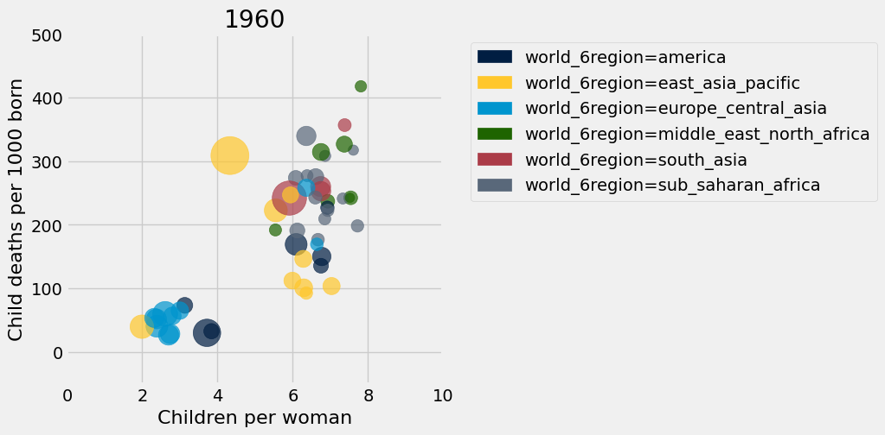

---

**Question 1.14.** Assign `scatter_statements` to an array of the numbers of each statement below that can be inferred from this scatter diagram for 1960. 
1. All countries in `europe_central_asia` had uniformly low fertility rates.
1. Most countries had a fertility rate above 5.
1. The lowest child mortality rate of any country was from an `east_asia_pacific` country.
1. There was an association between child mortality and fertility.
1. The two largest countries by population also had the two highest child mortality rates.

**(4 points)**

**Student scaffold:**

```python
scatter_statements = ...
```

**Solution:**

```python
scatter_statements = make_array(2, 4) # SOLUTION
```

**Test — `q1_14` (4 points)**

```python
>>> all((x in range(1, 6) for x in set(scatter_statements)))
True

# hidden test
>>> set(scatter_statements) == {2, 4}
True
```

The result of the cell below is interactive. Drag the slider to the right to see how countries have changed over time. You’ll find that in terms of population growth, the divide between the countries of the global North and global South that existed in the 1960s has shrunk significantly. 

This shift in fertility rates is the reason that the global population is expected to grow more slowly in the 21st century than it did in the 19th and 20th centuries. Fertility rates change for reasons that include cultural patterns, better prospects for children surviving to adulthood, and family planning (such as contraception and women’s greater control over their reproduction).

**Note:** Don't worry if a red warning pops up when running the cell below. You'll still be able to run the cell!

**Code:**

```python
_ = widgets.interact(fertility_vs_child_mortality, 
                     year=widgets.IntSlider(min=1960, max=2025, value=1960))
```

*Output:*

```text
interactive(children=(IntSlider(value=1960, description='year', max=2025, min=1960), Output()), _dom_classes=(…
```

Now is a great time to take a break and watch the same data presented by [Hans Rosling in a 2010 TEDx talk](https://www.gapminder.org/videos/reducing-child-mortality-a-moral-and-environmental-imperative) with smoother animation and witty commentary.

When we look at population and fertility as data scientists, we need to learn about the experiences of people in real life, not just abstractly as data. We should also recognize that population studies have sometimes had political undercurrents. Those undercurrents have included population control, control of women’s reproduction, or fears of shifts between racial groups. To do better as data scientists, we should check our assumptions to avoid unthinkingly reproducing past patterns.

---
## 2. Global Poverty

In 1800, 85% of the world's 1 billion people lived in [extreme poverty](https://en.wikipedia.org/wiki/Extreme_poverty), defined by the United Nations as "a condition characterized by severe deprivation of basic human needs, including food, safe drinking water, sanitation facilities, health, shelter, education and information." At the time when the data in this project were gathered, a common definition of extreme poverty was a person living on less than \$1.25 a day.

In 2018, the proportion of people living in extreme poverty was estimated to be [about 9\%](https://unstats.un.org/sdgs/report/2019/goal-01/). Although the world rate of extreme poverty has declined consistently for hundreds of years, the number of people living in extreme poverty is still over 600 million. The United Nations adopted an [ambitious goal](http://www.un.org/sustainabledevelopment/poverty/): "By 2030, eradicate extreme poverty for all people everywhere."

In this part of the project, we will examine some aspects of global poverty that might affect whether the goal is achievable. The causes of poverty are complex. They include global histories, such as colonialism, as well as factors such as health care, economics, and social inequality in each country.

First, load the population and poverty rate by country and year and the country descriptions. While the `population` table has values for every recent year for many countries, the `poverty` table only includes certain years for each country in which a measurement of the rate of extreme poverty was available.

**Code:**

```python
population = Table.read_table('population.csv') 
countries = Table.read_table('countries.csv').where('country', are.contained_in(population.group('geo').column('geo')))
poverty = Table.read_table('poverty.csv')
poverty.show(3)
```

*Output:*

| geo | time | extreme_poverty_percent_people_below_125_a_day |
| --- | --- | --- |
| alb | 1996 | 0.2 |
| alb | 2002 | 0.73 |
| alb | 2004 | 0.53 |

---

**Question 2.1.** Assign `latest_poverty` to a three-column table with one row for each country that appears in the `poverty` table. The first column should contain the 3-letter code for the country. The second column should contain the most recent year for which an extreme poverty rate is available for the country. The third column should contain the poverty rate in that year. **Do not change the last line, so that the labels of your table are set correctly.**

*Hint*: think about how ```group``` works: it does a sequential search of the table (from top to bottom) and collects values in the array in the order in which they appear, and then applies a function to that array. The `first` function may be helpful, but you are not required to use it.

**(4 points)**

**Student scaffold:**

```python
def first(values):
    return values.item(0)

latest_poverty = ...
latest_poverty = latest_poverty.relabeled(0, 'geo').relabeled(1, 'time').relabeled(2, 'poverty_percent') # You should *not* change this line.
latest_poverty
```

**Solution:**

```python
def first(values):
    return values.item(0)

latest_poverty = poverty.sort('time', descending=True).group('geo', first) # SOLUTION
latest_poverty = latest_poverty.relabeled(0, 'geo').relabeled(1, 'time').relabeled(2, 'poverty_percent') # You should *not* change this line.
latest_poverty
```

*Output:*

| geo | time | poverty_percent |
| --- | --- | --- |
| ago | 2009 | 43.37 |
| alb | 2012 | 0.46 |
| arg | 2011 | 1.41 |
| arm | 2012 | 1.75 |
| aus | 2003 | 1.36 |
| aut | 2004 | 0.34 |
| aze | 2008 | 0.31 |
| bdi | 2006 | 81.32 |
| bel | 2000 | 0.5 |
| ben | 2012 | 51.61 |

**Test — `q2_1` (4 points)**

```python
>>> latest_poverty.labels == ('geo', 'time', 'poverty_percent')
True

>>> latest_poverty.num_rows
145

# hidden test
>>> print(latest_poverty.sort('geo').take(np.arange(7, 107, 10)))
geo  | time | poverty_percent
bdi  | 2006 | 81.32
bra  | 2012 | 3.75
cod  | 2006 | 87.72
dom  | 2012 | 2.25
fsm  | 2000 | 31.15
guy  | 1998 | 8.7
isr  | 2010 | 0.39
lbr  | 2007 | 83.76
mex  | 2012 | 1.03
nga  | 2010 | 62.03
```

---

**Question 2.2.** Using both `latest_poverty` and `population`, create a four-column table called `recent_poverty_total` with one row for each country in `latest_poverty`. The four columns should have the following labels and contents:
1. `geo` contains the 3-letter country code,
1. `poverty_percent` contains the most recent poverty percent,
1. `population_total` contains the population of the country in 2010,
1. `poverty_total` contains the number of people in poverty **rounded to the nearest integer**, based on the 2010 population and most recent poverty rate.

*Hint*: You are not required to use `poverty_and_pop`, and you are always welcome to add any additional names. 

**(4 points)**

**Student scaffold:**

```python
poverty_and_pop = ...
recent_poverty_total = ...
recent_poverty_total
```

**Solution:**

```python
""" # BEGIN PROMPT
poverty_and_pop = ...
recent_poverty_total = ...
recent_poverty_total
"""; # END PROMPT
# BEGIN SOLUTION NO PROMPT
pop_2010 = population.where("time", are.equal_to(2010)).drop('time')
poverty_and_pop = latest_poverty.drop('time').join('geo', pop_2010)
poverty_total_arr = np.round(poverty_and_pop.column('poverty_percent')/100*poverty_and_pop.column('population_total'))
recent_poverty_total = poverty_and_pop.with_column('poverty_total', poverty_total_arr)
recent_poverty_total
# END SOLUTION
```

*Output:*

| geo | poverty_percent | population_total | poverty_total |
| --- | --- | --- | --- |
| ago | 43.37 | 23294825 | 1.0103e+07 |
| alb | 0.46 | 2928722 | 13472 |
| arg | 1.41 | 41288694 | 582171 |
| arm | 1.75 | 2931078 | 51294 |
| aus | 1.36 | 22141581 | 301126 |
| aut | 0.34 | 8365092 | 28441 |
| aze | 0.31 | 9146851 | 28355 |
| bdi | 81.32 | 9376444 | 7.62492e+06 |
| bel | 0.5 | 10936626 | 54683 |
| ben | 51.61 | 9797484 | 5.05648e+06 |

**Test — `q2_2` (4 points)**

```python
>>> recent_poverty_total.labels == ('geo', 'poverty_percent', 'population_total', 'poverty_total')
True

>>> float(recent_poverty_total.where('geo', 'aus').column(2).item(0)) == 22141581
True

>>> recent_poverty_total.where('geo', 'aus').column(3).item(0) < recent_poverty_total.where('geo', 'aus').column(2).item(0)
True

>>> float(recent_poverty_total.where('geo', 'aus').column(3).item(0)) == 301126
True

# hidden test
>>> sum(recent_poverty_total.column(3)) == 1011667558
True
```

---

**Question 2.3.** Assign the name `poverty_percent` to the known percentage of the world’s 2010 population that were living in extreme poverty. Assume that the `poverty_total` numbers in the `recent_poverty_total` table describe **all** people in 2010 living in extreme poverty. You should get a number that is above the 2018 global estimate of 9%, since many country-specific poverty rates are older than 2018.

*Hint*: The sum of the `population_total` column in the `recent_poverty_total` table is not the world population, because only a subset of the world's countries are included in the `recent_poverty_total` table (only some countries have known poverty rates). Use the `population` table to compute the world's 2010 total population.

*Hint*: We are computing a percentage (value between 0 and 100), not a proportion (value between 0 and 1).

**(4 points)**

**Student scaffold:**

```python
poverty_percent = ...
poverty_percent
```

**Solution:**

```python
""" # BEGIN PROMPT
poverty_percent = ...
poverty_percent
"""; # END PROMPT
# BEGIN SOLUTION NO PROMPT
total_2010_pop = sum(population.where('time', are.equal_to(2010)).column("population_total"))
poverty_2010_pop = sum(recent_poverty_total.column('poverty_total'))
poverty_percent = 100* poverty_2010_pop/total_2010_pop
poverty_percent
# END SOLUTION
```

*Output:*

```text
14.429159949245513
```

**Test — `q2_3` (4 points)**

```python
>>> 10 <= poverty_percent <= 20
True

# hidden test
>>> np.allclose(np.round(poverty_percent, 2), 14.43)
True
```

The `countries` table includes not only the name and region of countries, but also their positions on the globe.

**Code:**

```python
countries.select('country', 'name', 'world_4region', 'latitude', 'longitude')
```

*Output:*

| country | name | world_4region | latitude | longitude |
| --- | --- | --- | --- | --- |
| afg | Afghanistan | asia | 33 | 66 |
| ago | Angola | africa | -12.5 | 18.5 |
| alb | Albania | europe | 41 | 20 |
| and | Andorra | europe | 42.5078 | 1.52109 |
| are | United Arab Emirates | asia | 23.75 | 54.5 |
| arg | Argentina | americas | -34 | -64 |
| arm | Armenia | europe | 40.25 | 45 |
| atg | Antigua and Barbuda | americas | 17.05 | -61.8 |
| aus | Australia | asia | -25 | 135 |
| aut | Austria | europe | 47.3333 | 13.3333 |

---

**Question 2.4.** Using both `countries` and `recent_poverty_total`, create a five-column table called `poverty_map` with one row for every country in `recent_poverty_total`.  The five columns should have the following labels and contents, in this order:
1. `latitude` contains the country's latitude,
1. `longitude` contains the country's longitude,
1. `name` contains the country's name,
1. `region` contains the country's region from the `world_4region` column of `countries`,
1. `poverty_total` contains the country's poverty total.

**(6 points)**

**Student scaffold:**

```python
poverty_map = ...
poverty_map
```

**Solution:**

```python
""" # BEGIN PROMPT
poverty_map = ...
poverty_map
"""; # END PROMPT
# BEGIN SOLUTION NO PROMPT
small_countries = countries.select('country', 'latitude', 'longitude', 'name', 'world_4region').relabeled('world_4region', 'region')
small_recent_poverty = recent_poverty_total.select('geo', 'poverty_total')
poverty_map = small_countries.join('country', small_recent_poverty, 'geo' ).drop('country')
poverty_map
# END SOLUTION
```

*Output:*

| latitude | longitude | name | region | poverty_total |
| --- | --- | --- | --- | --- |
| -12.5 | 18.5 | Angola | africa | 1.0103e+07 |
| 41 | 20 | Albania | europe | 13472 |
| -34 | -64 | Argentina | americas | 582171 |
| 40.25 | 45 | Armenia | europe | 51294 |
| -25 | 135 | Australia | asia | 301126 |
| 47.3333 | 13.3333 | Austria | europe | 28441 |
| 40.5 | 47.5 | Azerbaijan | europe | 28355 |
| -3.5 | 30 | Burundi | africa | 7.62492e+06 |
| 50.75 | 4.5 | Belgium | europe | 54683 |
| 9.5 | 2.25 | Benin | africa | 5.05648e+06 |

**Test — `q2_4` (6 points)**

```python
>>> poverty_map.labels == ('latitude', 'longitude', 'name', 'region', 'poverty_total')
True

>>> list(np.sort(np.unique(poverty_map.column('region'))))
['africa', 'americas', 'asia', 'europe']

# hidden test
>>> print(poverty_map.sort('name').take(np.arange(10)).drop(4))
latitude | longitude | name       | region
41       | 20        | Albania    | europe
28       | 3         | Algeria    | africa
-12.5    | 18.5      | Angola     | africa
-34      | -64       | Argentina  | americas
40.25    | 45        | Armenia    | europe
-25      | 135       | Australia  | asia
47.3333  | 13.3333   | Austria    | europe
40.5     | 47.5      | Azerbaijan | europe
24       | 90        | Bangladesh | asia
53       | 28        | Belarus    | europe

# hidden test
>>> sum(poverty_map.column(4)) == sum(recent_poverty_total.column(3))
True
```

Run the cell below to draw a map of the world in which the areas of circles represent the number of people living in extreme poverty. Double-click on the map to zoom in.

> ***Note:*** If the cell below isn't loading, you can view the output [here](https://github.jonathanferrari.com/static/poverty_map.html)

**Code:**

```python
# It may take a few seconds to generate this map.
colors = {'africa': 'blue', 'europe': 'black', 'asia': 'red', 'americas': 'green'}
scaled = poverty_map.with_columns(
    'labels', poverty_map.column('name'),
    'colors', poverty_map.apply(colors.get, 'region'),
    'areas', 1e-4 * poverty_map.column('poverty_total')
).drop('name', 'region', 'poverty_total')

Circle.map_table(scaled)
```

*Output:*

Make this Notebook Trusted to load map: File -> Trust Notebook

Although people lived in extreme poverty throughout the world in 2010 (with more than 5 million in the United States), the largest numbers were in Asia and Africa.

---

**Question 2.5.** Assign `largest` to a two-column table with the `name` (not the 3-letter code) and `poverty_total` of the 10 countries with the largest number of people living in extreme poverty.

*Hint*: How can we use `take` and `np.arange` in conjunction with each other?

**(6 points)**

**Student scaffold:**

```python
largest = ...
largest.set_format('poverty_total', NumberFormatter)
```

**Solution:**

```python
largest = poverty_map.sort('poverty_total', descending=True).take(np.arange(10)).select('name', 'poverty_total') #SOLUTION
largest.set_format('poverty_total', NumberFormatter)
```

*Output:*

| name | poverty_total |
| --- | --- |
| India | 293,834,694.00 |
| Nigeria | 103,368,582.00 |
| China | 84,607,751.00 |
| Bangladesh | 65,827,357.00 |
| Congo, Dem. Rep. | 60,143,497.00 |
| Indonesia | 39,901,462.00 |
| Ethiopia | 33,309,119.00 |
| Pakistan | 25,383,055.00 |
| Tanzania | 19,460,991.00 |
| Madagascar | 19,448,134.00 |

**Test — `q2_5` (6 points)**

```python
>>> largest.labels == ('name', 'poverty_total')
True

>>> largest.column(0).item(0)
'India'

>>> largest.num_rows
10

# hidden test
>>> float(largest.take(1).column(1).item(0)) == 103368582
True
```

---

**Question 2.6.** It is important to study the absolute number of people living in poverty, not just the percent. The absolute number is an important factor in determining the amount of resources needed to support people living in poverty. In the next two questions you will explore this.

In Question 7, you will be asked to write a function called `poverty_timeline` that takes **the name of a country** as its argument (not the Alpha-3 country code). It should draw a line plot of the number of people living in poverty in that country with time on the horizontal axis. The line plot should have a point for each row in the poverty table for that country. To compute the population living in poverty from a poverty percentage, multiply by the population of the country **in that year**.

For this question, write out a generalized process for Question 7. Make sure to answer/include the following: 
- What should this function output? 
- Additionally, **make a numbered list** of the steps you take within the function body. If you added/edited, say, 5 lines in the function body, then it would be good to see the numbers 1 through 5 describing what you did (i.e. what functions/methods you used) in each line and why.

As a tip, after finishing question 7, we recommend polishing up your description of the steps for this question. This question will be graded for correctness.

**(5 points)**

**SOLUTION**: The function should output a line plot of people living in extreme poverty in a country. To generate the line plot, we first filter the `countries` table to find the country code of the country we passed into our function. Then, we filter the `poverty` and `population` tables to only contain the rows with our desired country code, and then drop the `geo` columns from each table. Next, we join `poverty` and `population`. Then, we perform array operations to multiply the population with the percent of the population living in extreme poverty to get the number of people living in extreme poverty. Finally, we can add a column to our joined table that contains the number of people in poverty, which will allow us to create a plot.

---

**Question 2.7.** Now, we'll actually write the function called `poverty_timeline`. Recall that `poverty_timeline` takes **the name of a country** as its argument (not the Alpha-3 country code). It should draw a line plot of the number of people living in poverty in that country with time on the horizontal axis. The line plot should have a point for each row in the `poverty` table for that country.

**Note:** You **should <u>not</u>** return anything from your function. Simply call `plots.show()` at the end of your function body.

*Hint 1:* This question is long. Feel free to create cells and experiment. You can create cells by going to the toolbar and hitting the `+` button.

*Hint 2:* Consider using `join` in your code.

*Hint 3:* Remember from Question 6—to compute the population living in poverty from a poverty percentage, multiply the percentage by the country’s population **in that year.**

Feel free to use the markdown cell below to plan out your answer, but you needn't fill it in.

**(5 points)**

**Student scaffold:**

```python
def poverty_timeline(country):
    '''Draw a timeline of people living in extreme poverty in a country.'''
    geo = ...
    # This solution will take multiple lines of code. Use as many as you need
    ...
    # Don't change anything below this line. 
    plots.title(country)
    plots.ylim(bottom=0)
    plots.show() # This should be the last line of your function.
```

**Solution:**

```python
""" # BEGIN PROMPT
def poverty_timeline(country):
    '''Draw a timeline of people living in extreme poverty in a country.'''
    geo = ...
    # This solution will take multiple lines of code. Use as many as you need
    ...
    # Don't change anything below this line. 
    plots.title(country)
    plots.ylim(bottom=0)
    plots.show() # This should be the last line of your function. 
"""; # END PROMPT
# BEGIN SOLUTION NO PROMPT
def poverty_timeline(country):
    geo = countries.where('name', are.equal_to(country)).column('country').item(0)
    country_poverty = poverty.where('geo', are.equal_to(geo)).drop('geo')
    country_population = population.where('geo', are.equal_to(geo)).drop('geo')
    country_pov_and_pop = country_poverty.join('time', country_population)
    num_poverty = country_pov_and_pop.column('population_total') * country_pov_and_pop.column('extreme_poverty_percent_people_below_125_a_day')/100
    final_tbl = country_pov_and_pop.with_column('Number in Poverty', num_poverty)
    final_tbl.plot('time', 'Number in Poverty')
    plots.title(country)
    plots.ylim(bottom=0)
    plots.show() 
# END SOLUTION
```

Finally, draw the line plots below to see how the world is changing. Pay attention to the axes!

**Solution:**

```python
poverty_timeline('Poland')
poverty_timeline('India')
poverty_timeline('Nigeria')
poverty_timeline('China')
poverty_timeline('Colombia')
poverty_timeline('United States')
```

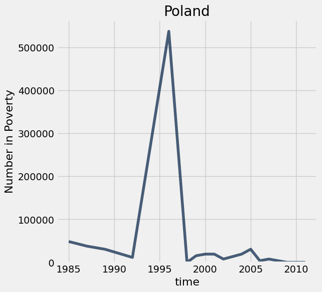

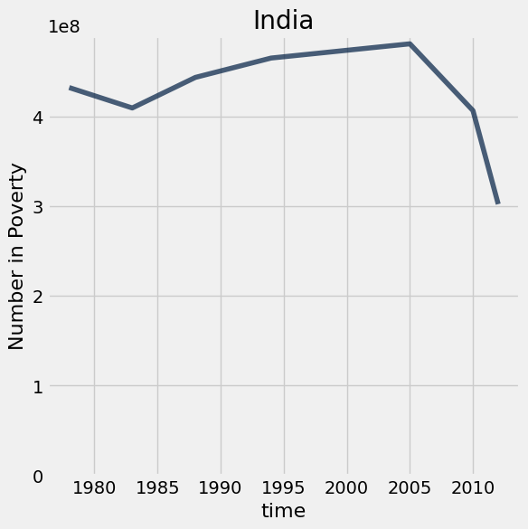

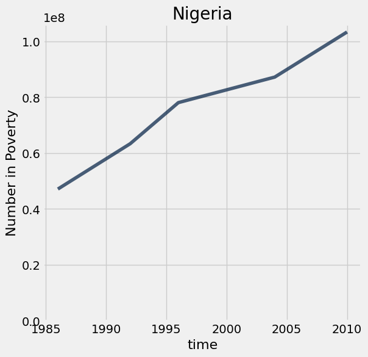

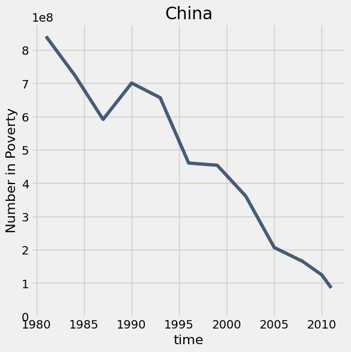

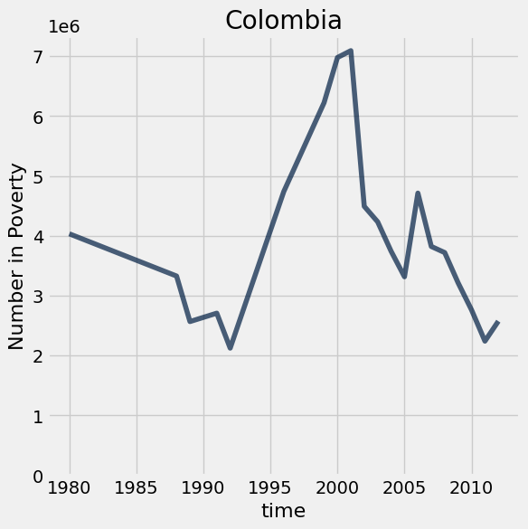

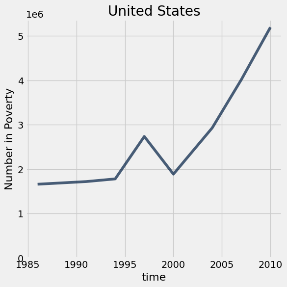

Although the number of people living in extreme poverty increased in some countries including Nigeria and the United States, the decreases in other countries, most notably the massive decreases in China and India, have shaped the overall trend that extreme poverty is decreasing worldwide, both in percentage and in absolute number. 

To learn more, watch [Hans Rosling in a 2015 film](https://www.gapminder.org/videos/dont-panic-end-poverty/) about the UN goal of eradicating extreme poverty from the world. 

Below, we've also added an interactive dropdown menu for you to visualize `poverty_timeline` graphs for other countries. Note that each dropdown menu selection may take a few seconds to run.

**Code:**

```python
# Just run this cell

all_countries = poverty_map.column('name')
_ = widgets.interact(poverty_timeline, country=list(all_countries))
```

*Output:*

```text
interactive(children=(Dropdown(description='country', options=('Angola', 'Albania', 'Argentina', 'Armenia', 'A…
```


**Mario and Mr. Fuzzles wants to tell you, you're finished!** Congratulations on discovering many important facts about global poverty and demonstrating your mastery of table manipulation and data visualization. Time to submit.

**<span style="color: #BC412B">Remember to add your project partner to your submission on Pensive!</span>** <u>Only one partner should submit to Pensive.</u>

---

To double-check your work, the cell below will rerun all of the autograder tests.

## Submission

Make sure you have run all cells in your notebook in order before running the cell below, so that all images/graphs appear in the output. The cell below will generate a zip file for you to submit. **Please save before exporting!**

---

## Datasets

Datasets this notebook loads with `Table.read_table`. Column names are exact, including spaces and capitalization. Only the schema is recorded here — the data itself is not in this document, so any question about its values must be answered by running code, not by reasoning over the rows shown elsewhere in this file.

### `population.csv`

59,297 rows, 3 columns.

| Column | Type |
| --- | --- |
| `geo` | str |
| `time` | int |
| `population_total` | int |

### `life_expectancy.csv`

57,496 rows, 3 columns.

| Column | Type |
| --- | --- |
| `geo` | str |
| `time` | int |
| `life_expectancy_years` | float |

### `child_mortality.csv`

57,497 rows, 3 columns.

| Column | Type |
| --- | --- |
| `geo` | str |
| `time` | int |
| `child_mortality_0_5_year_olds_dying_per_1000_born` | float |

### `fertility.csv`

59,297 rows, 3 columns.

| Column | Type |
| --- | --- |
| `geo` | str |
| `time` | int |
| `children_per_woman_total_fertility` | float |

### `countries.csv`

273 rows, 18 columns.

| Column | Type |
| --- | --- |
| `country` | str |
| `g77_and_oecd_countries` | str |
| `income_groups` | str |
| `is--country` | bool |
| `iso3166_1_alpha2` | str |
| `iso3166_1_alpha3` | str |
| `iso3166_1_numeric` | float |
| `iso3166_2` | str |
| `landlocked` | str |
| `latitude` | float |
| `longitude` | float |
| `main_religion_2008` | str |
| `name` | str |
| `un_state` | bool |
| `unicef_region` | str |
| `unicode_region_subtag` | str |
| `world_4region` | str |
| `world_6region` | str |

### `poverty.csv`

1,099 rows, 3 columns.

| Column | Type |
| --- | --- |
| `geo` | str |
| `time` | int |
| `extreme_poverty_percent_people_below_125_a_day` | float |


---

# project1c

---
title: "Project 1: World Population and Poverty"
assignment: project1c
semester: sp26
source: semester_assignments/sp26/project/project1c/autograder/project1c.ipynb
version: solution (autograder) with student scaffolds
student_source: semester_assignments/sp26/project/project1c/student/project1c.ipynb
language: python
---


# Project 1: World Population and Poverty

In this project, you'll explore data from [Gapminder.org](http://gapminder.org), a website dedicated to providing a fact-based view of the world and how it has changed. That site includes several data visualizations and presentations, but also publishes the raw data that we will use in this project to recreate and extend some of their most famous visualizations.

The Gapminder website collects data from many sources and compiles them into tables that describe many countries around the world. All of the data they aggregate are published in the [Systema Globalis](https://github.com/open-numbers/ddf--gapminder--systema_globalis/blob/master/README.md). Their goal is "to compile all public statistics; Social, Economic and Environmental; into a comparable total dataset." All data sets in this project are copied directly from the Systema Globalis without any changes.

This project is dedicated to [Hans Rosling](https://en.wikipedia.org/wiki/Hans_Rosling) (1948-2017), who championed the use of data to understand and prioritize global development challenges.

### Logistics

**Deadline.**  This project is due at **5:00pm PT on Friday 2/27**. Projects will be accepted up to 1 day (24 hours) late. Projects submitted fewer than 24 hours after the deadline will receive 80% credit. It's **much** better to be early than late, so start working now.

**Checkpoint.**  For full credit on the checkpoint, you must complete the questions up to the checkpoint, **pass all _public_ autograder tests** for those sections, and submit to the Pensieve Project 1 Checkpoint assignment by **5:00pm PT on Friday, 2/20**. <span style="color: #BC412B">**The checkpoint is worth 1 lab score**</span>. After you've submitted the checkpoint, you may still change your project answers before the final project deadline - only your final submission, to the "Project 1" assignment, will be graded for correctness. You will have some lab time to work on these questions, but we recommend that you start the project before lab and leave time to finish the checkpoint afterward. Additionally, the second half of the project is longer than the first, so if you have time, we encourage you to continue working past the checkpoint.

**Partners.** You may work with one other partner; your partner must be from your assigned lab section. **<span style="color: #BC412B">Only one partner should submit the project notebook to Pensieve.</span> If both partners submit, you will be docked 10% of your project grade. On Pensieve, the person who submits should also designate their partner so that both of you receive credit.** Once you submit, click into your submission, and there will be an option to Add Group Member in the top right corner. You may also reference [this walkthrough video](https://drive.google.com/file/d/1bs1l_f44tUeF1yKY_iljZMTE1X0dYKLl/view?usp=sharing) on how to add partners on Pensieve.


**Rules.** Don't share your code with anybody but your partner. You are welcome to discuss questions with other students, but don't share the answers. The experience of solving the problems in this project will prepare you for exams (and life). If someone asks you for the answer, resist! Instead, you can demonstrate how you would solve a similar problem.

**Support.** You are not alone! Come to office hours, post on Ed, and talk to your classmates. If you want to ask about the details of your solution to a problem, make a private Ed post and the staff will respond. If you're ever feeling overwhelmed or don't know how to make progress, email your TA or tutor for help. You can find contact information for the staff on the [course website](https://www.data8.org/su26/).

**Tests.** <span style="color: #BC412B">The tests that are given are **not comprehensive** and passing the tests for a question **does not** mean that you answered the question correctly.</span> Tests usually only check that your table has the correct column labels. However, more tests will be applied to verify the correctness of your submission in order to assign your final score, so be careful and check your work! You might want to create your own checks along the way to see if your answers make sense. Additionally, before you submit, make sure that none of your cells take a very long time to run (several minutes).

**Free Response Questions:** Make sure that you put the answers to the written questions in the indicated cell we provide. **Every free response question should include an explanation** that adequately answers the question.

**Tabular Thinking Guide:** Feel free to reference [Tabular Thinking Guide](https://drive.google.com/file/d/1NvbBECCBdI0Ku380oPcTUOcpjH3RI230/view) for extra guidance.

**Advice.** Develop your answers incrementally. To perform a complicated table manipulation, break it up into steps, perform each step on a different line, give a new name to each result, and check that each intermediate result is what you expect. You can add any additional names or functions you want to the provided cells. Make sure that you are using distinct and meaningful variable names throughout the notebook. Along that line, **DO NOT** reuse the variable names that we use when we grade your answers. For example, in Question 1 of the Global Poverty section we ask you to assign an answer to `latest`. Do not reassign the variable name `latest` to anything else in your notebook, otherwise there is the chance that our tests grade against what `latest` was reassigned to.

You are **never** restricted to using only one line of code to solve a question in this project or any others. Feel free to use intermediate variables and multiple lines as much as you would like!

---

The point breakdown for this assignment is given in the table below:
| Category | Points |
| --- | --- |
| Autograder (Coding questions) | 65 |
| Written | 35 |
| **Total** | 100 |

---

To get started, load `datascience`, `numpy`, `plots`, and `otter`.

**Code:**

```python
# Run this cell to set up the notebook, but please don't change it. 

# These lines import the NumPy and Datascience modules.
from datascience import *
import numpy as np

# These lines do some fancy plotting magic.
%matplotlib inline
import matplotlib.pyplot as plots
plots.style.use('fivethirtyeight')

from ipywidgets import interact, interactive, fixed, interact_manual
import ipywidgets as widgets
```

---
## 0. Hazards with `.show`

As a heads up, please do not run the function `tbl.show()` in this assignment without an argument. For instance if you want to view a table, please type `tbl.show(10)` instead of `tbl.show()`. This may break your notebook and we cannot guarantee that we will have the capacity to aid you in this. Please answer the question below, and set the value to `True` to confirm you have read this and agree.

**Student scaffold:**

```python
i_wont_use_show_without_an_argument = ...
```

**Solution:**

```python
i_wont_use_show_without_an_argument = True # SOLUTION
```

**Test — `q0` (0 points)**

```python
>>> i_wont_use_show_without_an_argument == True
True
```

---
## 1. Global Population Growth

The global population of humans reached 1 billion around 1800, 3 billion around 1960, 7 billion around 2011, and 8 billion around 2022. The potential impact of population growth has concerned scientists, economists, and politicians alike.

The United Nations Population Division estimates that the world population will likely continue to grow throughout the 21st century, but at a slower rate, perhaps reaching and stabilizing at 10 billion by 2100. However, the UN does not rule out scenarios of slower or more extreme growth. These projections help us understand long-term population processes, even if they leave out possible global catastrophic events like war or climate crises.

<a href="https://population.un.org/wpp/Graphs/Probabilistic/POP/TOT/900"> 
 ![UN line chart titled 'World: Total Population', population in billions from 1950 to 2100. A black observed curve rises from about 2.5 billion in 1950 to about 8 billion in 2022, then projections fan out: a red median curve peaking near 10.3 billion around 2080 and easing to about 10.2 billion by 2100, with 80% and 95% prediction intervals, 60 sample trajectories, and a +/- 0.5 child scenario band spanning roughly 6.3 to 14 billion by 2100. Source: UN DESA Population Division, World Population Prospects 2024.](project1c_assets/un_population_projection.png) 
</a>

In this part of the project, we will examine some of the factors that influence population growth and how they have been changing over the years and around the world. There are two main sub-parts of this analysis.

- First, we will examine the data for one country, Poland. We will see how factors such as life expectancy, fertility rate, and child mortality have changed over time in Poland, and how they are related to the rate of population growth.
- Next, we will examine whether the changes we have observed for Poland are particular to that country or whether they reflect general patterns observable in other countries too. We will study aspects of world population growth and see how they have been changing.

The first table we will consider contains the total population of each country over time. Run the cell below.

**Code:**

```python
population = Table.read_table('population.csv').where("time", are.below(2026))
population.show(3)
```

*Output:*

| geo | time | population_total |
| --- | --- | --- |
| afg | 1800 | 3280000 |
| afg | 1801 | 3280000 |
| afg | 1802 | 3280000 |

**Note:** The population data can also be found [here](https://www.gapminder.org/data/documentation/gd003/).

### Poland

The Central European nation of Poland has undergone many changes over the centuries. In modern times it was (re)created as a democratic republic in 1919 after World War I. It was invaded and divided in World War II between Germany and the Soviet Union. War and the Holocaust had a devastating impact on its people. Poland was constituted in its current borders at the end of World War II (1945) under a communist government. In 1989, with the fall of the Soviet Union, Poland re-established itself as a democratic republic.

In this section of the project, we will examine aspects of the population of Poland since 1900. Poland's borders have changed, so we will look at the population within its current (2025) borders.

In the `population` table, the `geo` column contains three-letter codes established by the [International Organization for Standardization](https://en.wikipedia.org/wiki/International_Organization_for_Standardization) (ISO) in the [Alpha-3](https://en.wikipedia.org/wiki/ISO_3166-1_alpha-3#Current_codes) standard. **Use the Alpha-3 link to find the 3-letter code for Poland.**

---

**Question 1.** Create a table called `p_pop` that has two columns labeled `time` and `population_total`. The first column should contain the years from 1900 through 2025 (including both 1900 and 2025) and the second column should contain the population of Poland in each of those years.

**Student scaffold:**

```python
p_pop = ...
p_pop
```

**Solution:**

```python
p_pop = population.where('geo', 'pol').where('time', are.between(1900, 2026)).drop('geo') # SOLUTION
p_pop
```

*Output:*

| time | population_total |
| --- | --- |
| 1900 | 24308265 |
| 1901 | 24485193 |
| 1902 | 24660489 |
| 1903 | 24834119 |
| 1904 | 25008969 |
| 1905 | 25185047 |
| 1906 | 25362361 |
| 1907 | 25540920 |
| 1908 | 25720733 |
| 1909 | 25808244 |

**Test — `q1_1`**

```python
>>> p_pop.labels == ('time', 'population_total')
True

>>> all(p_pop.sort('time').column('time') == np.arange(1900, 2026))
True
```

Run the following cell to create a table called `p_five` that has the population of Poland every five years.

**Code:**

```python
p_pop.set_format('population_total', NumberFormatter)

fives = np.arange(1900, 2026, 5) # 1900, 1905, 1910, ..., 2025
p_five = p_pop.sort('time').where('time', are.contained_in(fives))
p_five.show(3)
```

*Output:*

| time | population_total |
| --- | --- |
| 1900 | 24,308,265 |
| 1905 | 25,185,047 |
| 1910 | 25,803,855 |

Run the following cell to visualize the population over time. Following the devastating effects of World War I and World War II, Poland's population increased steadily from 1950 to 2000 and then leveled off. In the following questions we'll investigate this period of population growth.

**Code:**

```python
p_five.plot(0, 1)
```


---

**Question 2.** Assign `initial` to an array that contains the population for every five year interval from **1900 to 2020** (inclusive). Then, assign `changed` to an array that contains the population for every five year interval from **1905 to 2025** (inclusive). The first array should include both 1900 and 2020, and the second array should include both 1905 and 2025. You should use the `p_five` table to create both arrays, by first filtering the table to only contain the relevant years.

The annual growth rate for a time period is equal to:

$$\left(\left(\frac{\text{Population at end of period}}{\text{Population at start of period}}\right)^{\displaystyle\frac{1}{\text{number of years}}}\right) -1$$

We have provided the code below that uses `initial` and `changed` in order to add a column to `p_five` called `annual_growth`. **Don't worry about the calculation of the growth rates**; run the test below to test your solution.

If you are interested in how we came up with the formula for growth rates, consult the [growth rates](https://inferentialthinking.com/chapters/03/2/1/Growth.html) section of the textbook.

**Student scaffold:**

```python
initial = ...
changed = ...

p_1900_through_2020 = p_five.where('time', are.below_or_equal_to(2020)) 
p_five_growth = p_1900_through_2020.with_column('annual_growth', (changed/initial)**0.2-1)
p_five_growth.set_format('annual_growth', PercentFormatter)
```

**Solution:**

```python
initial = p_five.where("time", are.below(2021)).column('population_total') # SOLUTION
changed = p_five.where("time", are.above(1900)).column('population_total') # SOLUTION

p_1900_through_2020 = p_five.where('time', are.below_or_equal_to(2020)) 
p_five_growth = p_1900_through_2020.with_column('annual_growth', (changed/initial)**0.2-1)
p_five_growth.set_format('annual_growth', PercentFormatter)
```

*Output:*

| time | population_total | annual_growth |
| --- | --- | --- |
| 1900 | 24,308,265 | 0.71% |
| 1905 | 25,185,047 | 0.49% |
| 1910 | 25,803,855 | -0.87% |
| 1915 | 24,696,678 | -0.75% |
| 1920 | 23,785,820 | 1.32% |
| 1925 | 25,395,008 | 1.52% |
| 1930 | 27,378,955 | 0.75% |
| 1935 | 28,414,953 | 0.32% |
| 1940 | 28,876,472 | -1.58% |
| 1945 | 26,666,588 | -1.46% |

**Test — `q1_2`**

```python
>>> first = round(p_five_growth.sort(0).column(2).item(0), 8)
>>> 0.005 <= first <= 0.5
True

>>> max(p_five_growth.column(2)) < 0.03
True
```

The annual growth rate in Poland has been declining since 1950, as shown in the table below.

**Code:**

```python
# Run this cell to view annual growth rates in Poland since 1950.
p_five_growth.where('time', are.above_or_equal_to(1950)).show()
```

*Output:*

| time | population_total | annual_growth |
| --- | --- | --- |
| 1950 | 24,780,161 | 1.78% |
| 1955 | 27,063,640 | 1.79% |
| 1960 | 29,575,966 | 1.13% |
| 1965 | 31,288,336 | 0.79% |
| 1970 | 32,542,633 | 0.86% |
| 1975 | 33,964,399 | 0.93% |
| 1980 | 35,576,519 | 0.90% |
| 1985 | 37,200,853 | 0.46% |
| 1990 | 38,055,455 | 0.16% |
| 1995 | 38,364,667 | -0.06% |
| 2000 | 38,258,071 | -0.07% |
| 2005 | 38,124,379 | -0.02% |
| 2010 | 38,095,351 | 0.09% |
| 2015 | 38,266,314 | -0.05% |
| 2020 | 38,171,012 | -0.02% |

Next, we'll try to understand what has changed in Poland that might explain the slowing population growth rate. Run the next cell to load three additional tables of measurements about countries over time.

**Code:**

```python
life_expectancy = Table.read_table('life_expectancy.csv').where('time', are.below(2026))
child_mortality = Table.read_table('child_mortality.csv').relabel(2, 'child_mortality_under_5_per_1000_born').where('time', are.below(2026))
fertility = Table.read_table('fertility.csv').where('time', are.below(2026))
```

The `life_expectancy` table contains a statistic that is often used to measure how long people live, called _life expectancy at birth_. This number, for a country in a given year, [does not measure how long babies born in that year are expected to live](http://blogs.worldbank.org/opendata/what-does-life-expectancy-birth-really-mean). Instead, it measures how long someone would live, on average, if the _mortality conditions_ in that year persisted throughout their lifetime. These "mortality conditions" describe what fraction of people for each age survived the year. So, it is a way of measuring the proportion of people that are staying alive, aggregated over different age groups in the population.

The `child_mortality` table has the column _child_mortality_under_5_per_1000_born_ which records the number of children who died before age 5, per 1,000 births.

The `fertility` table contains a statistic that is often used to measure how many babies are being born, the _total fertility rate_. This number describes the [number of children a woman would have in her lifetime](https://www.data4impactproject.org/prh/family-planning/fertility/total-fertility-rate/), on average, if the current rates of birth by age of the mother persisted throughout her child bearing years, assuming she survived through age 49.

Run the following cells below to see `life_expectancy`, `child_mortality`, and `fertility`. Refer back to these tables as they will be helpful for answering further questions!

**Code:**

```python
life_expectancy.show(3)
```

*Output:*

| geo | time | life_expectancy_years |
| --- | --- | --- |
| afg | 1800 | 28.21 |
| afg | 1801 | 28.2 |
| afg | 1802 | 28.19 |

**Code:**

```python
child_mortality.show(3)
```

*Output:*

| geo | time | child_mortality_under_5_per_1000_born |
| --- | --- | --- |
| afg | 1800 | 468.58 |
| afg | 1801 | 468.58 |
| afg | 1802 | 468.58 |

**Code:**

```python
fertility.show(3)
```

*Output:*

| geo | time | children_per_woman_total_fertility |
| --- | --- | --- |
| afg | 1800 | 7 |
| afg | 1801 | 7 |
| afg | 1802 | 7 |

---

**Question 3.** Is population growing more slowly perhaps because people aren’t living as long? Use the `life_expectancy` table to draw a line graph with the years 1950 and later on the horizontal axis that shows how the _life expectancy at birth_ has changed in Poland.

_Hint_: Make sure you filter the table properly; otherwise, the graph may look funky!

**Student scaffold:**

```python
# Fill in code here
...
```

**Solution:**

```python
# Fill in code here
life_expectancy.where("geo", are.equal_to("pol")).where("time", are.above_or_equal_to(1950)).plot("time", "life_expectancy_years") # SOLUTION
```


---

**Question 4.** Assuming no other factors, such as birth rates or fertility rates, have changed, do the trends in life expectancy in the graph above directly explain why the population growth rate decreased since 1950 in Poland? Why or why not?

**SOLUTION:** No. This graph indicates that people are living longer, which would increase population growth if everything else stayed the same.

The `fertility` table contains a statistic that is often used to measure how many babies are being born, the _total fertility rate_. This number describes the [number of children a woman would have in her lifetime](https://www.measureevaluation.org/prh/rh_indicators/specific/fertility/total-fertility-rate), on average, if the current rates of birth by age of the mother persisted throughout her child bearing years, assuming she survived through age 49.

---

**Question 5.** Complete the function `fertility_over_time`. It takes two input arguments, the Alpha-3 code of a country (denoted as `country_code`) and a year to `start` from (denoted as start). It returns a two-column table with the column labels `Year` and `Children per woman`. These columns can be used to generate a line chart of the country’s fertility rate each year, starting from the year given by `start`. The plot should include the start year and all later years that appear in the fertility table.

Then, determine the Alpha-3 code for **Poland**. The code at the very bottom for `poland_code` and the year `1950` are inputted to your `fertility_over_time` function. The function returns a table which we use in order to plot how Poland's fertility rate has changed since `1950`. Note that the function `fertility_over_time` should not return the plot itself – it returns a two-column table. The expression that draws the line plot is provided for you; please don’t change it.

_Hint_: Read about `tbl.relabeled` in the [Python Reference](https://www.data8.org/fa25/reference/) to rename columns.

_Hint_: You might fine [8.0](https://inferentialthinking.com/chapters/08/Functions_and_Tables.html) helpful.

**Student scaffold:**

```python
def fertility_over_time(country_code, start):
    """Create a two-column table that describes a country's total fertility rate each year."""
    # It's a good idea (but not required) to use multiple lines in your solution.
    ...


poland_code = ...
fertility_over_time(poland_code, 1950)
```

**Solution:**

```python
def fertility_over_time(country_code, start):
    """Create a two-column table that describes a country's total fertility rate each year."""
    # It's a good idea (but not required) to use multiple lines in your solution.
    # BEGIN SOLUTION
    country_fertility = fertility.where('geo', are.equal_to(country_code))
    country_fertility_after_start = country_fertility.where('time', are.above_or_equal_to(start))
    cleaned_table = country_fertility_after_start.select('time', 'children_per_woman_total_fertility').relabeled('time', 'Year').relabeled('children_per_woman_total_fertility', 'Children per woman')
    return cleaned_table
    # END SOLUTION


poland_code = 'pol' # SOLUTION
fertility_over_time(poland_code, 1950)
```

*Output:*

| Year | Children per woman |
| --- | --- |
| 1950 | 3.66 |
| 1951 | 3.68 |
| 1952 | 3.64 |
| 1953 | 3.6 |
| 1954 | 3.56 |
| 1955 | 3.54 |
| 1956 | 3.45 |
| 1957 | 3.44 |
| 1958 | 3.34 |
| 1959 | 3.21 |

**Test — `q1_5`**

```python
>>> fertility_over_time('usa', 2010).labels == ('Year', 'Children per woman')
True

>>> all(fertility_over_time('usa', 2010).column('Year') == np.arange(2010, 2026))
True

>>> all(fertility_over_time('usa', 2005).column('Year') == np.arange(2005, 2026))
True
```

Plotting the fertility rate in Poland since 1950, we see a downward trend.

**Code:**

```python
fertility_over_time(poland_code, 1950).plot(0, 1)
```


---

**Question 6.** Assuming everything else is constant, do the trends in fertility in the graph above help directly explain why the population growth rate decreased since 1950 in Poland? Why or why not?

**SOLUTION:** Yes, a declining fertility rate shows that fewer babies are being born each year, which contributes to decreasing population growth. (It's ok to point out that the population growth curve and the fertility curve do not match up exactly, but this is not necessary for a correct solution.)

It has been [observed](https://www.ageing.ox.ac.uk/download/143) that lower fertility rates are often associated with lower child mortality rates. We can see if this association is evident in Poland by plotting the relationship between total fertility rate and [child mortality rate per 1000 children](https://en.wikipedia.org/wiki/Child_mortality).

---

**Question 7.** Create a table `poland_since_1950` that contains one row per year starting with 1950 and:

- A column `Year` containing the year
- A column `Children per woman` describing total fertility in Poland that year
- A column `Child deaths per 1000 born` describing child mortality in Poland that year

**Student scaffold:**

```python
pol_fertility = fertility_over_time(poland_code, 1950)  # Try starting with the table you built already!
# It's a good idea (but not required) to use multiple lines in your solution.
pol_child_mortality = ...
pol_fertility_and_child_mortality = ...
poland_since_1950 = ...
poland_since_1950
```

**Solution:**

```python
pol_fertility = fertility_over_time(poland_code, 1950)  # Try starting with the table you built already!
# It's a good idea (but not required) to use multiple lines in your solution.
pol_child_mortality = child_mortality.where('geo', are.equal_to('pol')).drop('geo') # SOLUTION
pol_fertility_and_child_mortality = pol_fertility.join('Year', pol_child_mortality, 'time') # SOLUTION
poland_since_1950 = pol_fertility_and_child_mortality.relabel('child_mortality_under_5_per_1000_born', 'Child deaths per 1000 born') # SOLUTION
poland_since_1950
```

*Output:*

| Year | Children per woman | Child deaths per 1000 born |
| --- | --- | --- |
| 1950 | 3.66 | 164.08 |
| 1951 | 3.68 | 177.18 |
| 1952 | 3.64 | 140.16 |
| 1953 | 3.6 | 127.65 |
| 1954 | 3.56 | 118.9 |
| 1955 | 3.54 | 110.38 |
| 1956 | 3.45 | 94.19 |
| 1957 | 3.44 | 86.72 |
| 1958 | 3.34 | 81.28 |
| 1959 | 3.21 | 72.1 |

**Test — `q1_7`**

```python
>>> poland_since_1950.num_rows
76

>>> all([label in poland_since_1950.labels for label in ['Children per woman', 'Child deaths per 1000 born']])
True
```

Run the following cell to generate a scatter plot from the `poland_since_1950` table you created.

The plot uses **color** to encode data about the `Year` column. The colors, ranging from dark blue to white, represent the passing of time between 1950 and 2025. For example, a point on the scatter plot representing data from the 1950s would appear as **dark blue** and a point from the 2010s would appear as **light blue**.

**Code:**

```python
x_births = poland_since_1950.column("Children per woman")
y_deaths = poland_since_1950.column("Child deaths per 1000 born")
time_colors = poland_since_1950.column("Year")

plots.figure(figsize=(6,6))
plots.scatter(x_births, y_deaths, c=time_colors, cmap="Blues_r")
plots.colorbar()                  
plots.xlabel("Children per woman")
plots.ylabel("Child deaths per 1000 born");
```


---

**Question 8.** In one or two sentences, describe the association (if any) that is illustrated by this scatter plot. Does the diagram show any causal relation between fertility and child mortality?

**SOLUTION:** We can observe that fertility rates and child mortality rates decrease together over time, although the association is not entirely linear or consistent. However, this association does not tell us whether one of these changes caused a change in the other. (It's ok to point out that decreases in child mortality sometimes precede decreases in fertility, but this observation is not necessary for a correct response.)

_Optional food for thought_: What other context or information you would need in order to better understand the factors affecting life expectancy, child mortality, and fertility?

---

To double-check your work, the cell below will rerun all of the autograder tests.

## Submission

Make sure you have run all cells in your notebook in order before running the cell below, so that all images/graphs appear in the output. The cell below will generate a zip file for you to submit. **Please save before exporting!**

---

## Datasets

Datasets this notebook loads with `Table.read_table`. Column names are exact, including spaces and capitalization. Only the schema is recorded here — the data itself is not in this document, so any question about its values must be answered by running code, not by reasoning over the rows shown elsewhere in this file.

### `population.csv`

59,297 rows, 3 columns.

| Column | Type |
| --- | --- |
| `geo` | str |
| `time` | int |
| `population_total` | int |

### `life_expectancy.csv`

57,496 rows, 3 columns.

| Column | Type |
| --- | --- |
| `geo` | str |
| `time` | int |
| `life_expectancy_years` | float |

### `child_mortality.csv`

57,497 rows, 3 columns.

| Column | Type |
| --- | --- |
| `geo` | str |
| `time` | int |
| `child_mortality_0_5_year_olds_dying_per_1000_born` | float |

### `fertility.csv`

59,297 rows, 3 columns.

| Column | Type |
| --- | --- |
| `geo` | str |
| `time` | int |
| `children_per_woman_total_fertility` | float |


---

# project2

---
title: "Project 2: Climate Change - Temperatures and Precipitation"
assignment: project2
semester: sp26
source: semester_assignments/sp26/project/project2/autograder/project2.ipynb
version: solution (autograder) with student scaffolds
student_source: semester_assignments/sp26/project/project2/student/project2.ipynb
total_points: 60.0
language: python
---


# Project 2: Climate Change - Temperatures and Precipitation

In this project, you will investigate data on climate change, or the long-term shifts in temperatures and weather patterns!


### Logistics

**Deadline.**  This project is due at **5:00pm PT on Friday, 4/17**. You can receive 5 bonus points for submitting the project by **5:00pm PT on Thursday, 4/16.** Projects submitted fewer than 24 hours after the deadline will receive 80% credit. Any submissions later than 24 hours after the deadline will not be accepted. It's **much** better to be early than late, so start working now.

**Checkpoint.**  For full credit on the checkpoint, you must complete the questions up to the checkpoint, **pass all _public_ autograder tests** for those sections, and submit to the Pensieve Project 2 Checkpoint assignment by **5:00pm PT on Friday, 4/10**. <span style="color: #BC412B">**The checkpoint is worth 1 lab score**</span>. After you've submitted the checkpoint, you may still change your project answers before the final project deadline - **only your final submission, to the "Project 2 Autograder" assignment, will be graded for correctness** (including questions from before the checkpoint). You will have some lab time to work on these questions, but we recommend that you start the project before lab and leave time to finish the checkpoint afterward.

**Partners.** You may work with one other partner; your partner must be from your assigned lab section. **<span style="color: #BC412B">Only one partner should submit the project notebook to Pensieve.</span> If both partners submit, you will be docked 10% of your project grade. On Pensieve, the person who submits should also designate their partner so that both of you receive credit.** Once you submit, click into your submission, and there will be an option to Add Group Member in the top right corner. You may also reference [this walkthrough video](https://drive.google.com/file/d/1bs1l_f44tUeF1yKY_iljZMTE1X0dYKLl/view?usp=sharing) on how to add partners on Pensieve.

**Rules.** Don't share your code with anybody but your partner. You are welcome to discuss questions with other students, but don't share the answers. The experience of solving the problems in this project will prepare you for exams (and life). If someone asks you for the answer, resist! Instead, you can demonstrate how you would solve a similar problem.

**Support.** You are not alone! Come to office hours, post on Ed, and talk to your classmates. If you want to ask about the details of your solution to a problem, make a private Ed post and the staff will respond. If you're ever feeling overwhelmed or don't know how to make progress, email your TA or tutor for help. You can find contact information for the staff on the [course website](https://www.data8.org/su26/staff).

**Tests.** <span style="color: #BC412B">The tests that are given are **not comprehensive** and passing the tests for a question **does not** mean that you answered the question correctly.</span> For table manipulation questions, tests usually only check that your table has the correct column labels. Similarly, on multiple choice / select all that apply questions, tests are only checking that your response in the right format, not that it is correct. However, more tests will be applied to verify the correctness of your submission in order to assign your final score, so be careful and check your work! You might want to create your own checks along the way to see if your answers make sense. Additionally, before you submit, make sure that none of your cells take a very long time to run (several minutes).

**Free Response Questions:** Make sure that you put the answers to the written questions in the indicated cell we provide. **Every free response question should include an explanation** that adequately answers the question. 

**Advice.** Develop your answers incrementally. To perform a complicated task, break it up into steps, perform each step on a different line, give a new name to each result, and check that each intermediate result is what you expect. You can add any additional names or functions you want to the provided cells. Make sure that you are using distinct and meaningful variable names throughout the notebook. Along that line, **DO NOT** reuse the variable names that we use when we grade your answers. 

You **never** have to use just one line in this project or any others. Use intermediate variables and multiple lines as much as you would like!

All of the concepts necessary for this project are found in the textbook. If you are stuck on a particular problem, reading through the relevant textbook section will often help to clarify concepts.

---

The point breakdown for this assignment is given in the table below:
| Category | Points |
| --- | --- |
| Autograder (Coding questions) | 60 |
| Written | 40 |
| **Total** | 100 |

---

To get started, load `datascience`, `numpy`, and `matplotlib`. Make sure to also run the first cell of this notebook to load `otter`.

**Code:**

```python
# Run this cell to set up the notebook, but please don't change it.
from datascience import *
import numpy as np

%matplotlib inline
import matplotlib.pyplot as plt
plt.style.use('fivethirtyeight')
np.set_printoptions(legacy='1.13')

import warnings
warnings.simplefilter('ignore')

import plotly.graph_objects as go
```

---
## Part 1: Temperatures

In the following analysis, we will investigate one of the 21st century's most prominent issues: climate change. While the details of climate science are beyond the scope of this course, we can start to learn about climate change just by analyzing public records of different cities' temperature and precipitation over time.

We will analyze a collection of historical daily temperature and precipitation measurements from weather stations in 210 U.S. cities. The dataset was compiled by Yuchuan Lai and David Dzombak [1]; a description of the data from the original authors and the data itself is available [here](https://kilthub.cmu.edu/articles/dataset/Compiled_daily_temperature_and_precipitation_data_for_the_U_S_cities/7890488). 

[1] Lai, Yuchuan; Dzombak, David (2019): Compiled historical daily temperature and precipitation data for selected 210 U.S. cities. Carnegie Mellon University. Dataset.

### Part 1, Section 1: Cities

Run the following cell to load information about the `cities` and preview the first few rows.

**Code:**

```python
cities = Table.read_table('city_info.csv', index_col=0)
cities.show(3)
```

*Output:*

| Name | ID | Lat | Lon | Stn.Name | Stn.stDate | Stn.edDate |
| --- | --- | --- | --- | --- | --- | --- |
| Lander | USW00024021 | 42.8153 | -108.726 | LANDER WBO | 1892-01-01 | 1946-05-28 |
| Lander | USW00024021 | 42.8153 | -108.726 | LANDER HUNT FIELD | 1946-05-29 | 2021-12-31 |
| Cheyenne | USW00024018 | 41.1519 | -104.806 | CHEYENNE WBO | 1871-01-01 | 1935-08-31 |

The `cities` table has one row per weather station and the following columns:

1. `"Name"`: The name of the US city
2. `"ID"`: The unique identifier for the US city
3. `"Lat"`: The latitude of the US city (measured in degrees of latitude)
4. `"Lon"`: The longitude of the US city (measured in degrees of longitude)
4. `"Stn.Name"`: The name of the weather station in which the data was collected
5. `"Stn.stDate"`: A string representing the date of the first recording at that particular station
6. `"Stn.edDate"`: A string representing the date of the last recording at that particular station

The data lists the weather stations at which temperature and precipitation data were collected. Note that although some cities have multiple weather stations, only one station records data for a city at any given time. Thus, we are able to just focus on the cities themselves.

---

**Question 1.1.1:** In the cell below, produce a scatter plot that plots the latitude and longitude of every city in the `cities` table so that the result places northern cities at the top and western cities at the left.

*Note*: It's okay to plot the same point multiple times!

*Hint*: A latitude is the set of horizontal lines that measures distances *north or south* of the equator. A longitude is the set of vertical lines that measures distances *east or west* of the prime meridian.

**Student scaffold:**

```python
...
```

**Solution:**

```python
cities.scatter("Lon", "Lat") # SOLUTION
```

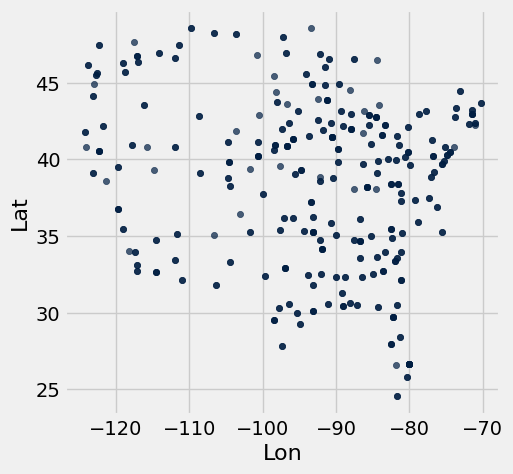

These cities are all within the contiguous U.S., and so the general shape of the U.S. should be visible in your plot. The shape will appear distorted compared to most maps for two reasons: the scatter plot is square even though the U.S. is wider than it is tall, and this scatter plot is an [equirectangular projection](https://en.wikipedia.org/wiki/Equirectangular_projection) of the spherical Earth. A geographical map of the same data uses the common [Pseudo-Mercator projection](https://en.wikipedia.org/wiki/Web_Mercator_projection).

> *Note:* If this visualization doesn't load for you, please view a version of it online [here](https://github.jonathanferrari.com/static/city_map.html).

**Code:**

```python
# Just run this cell
fig = go.Figure(data=go.Scattergeo(
        lon = cities.column('Lon'),
        lat = cities.column('Lat'),
        text = cities.column('Name'),
        mode = 'markers'))

fig.update_layout(geo_scope='usa', width=800, height=500, margin={'r': 0, 't': 0, 'l': 0, 'b': 0})
fig.show()
```

*Output: interactive Plotly figure (not captured).*

---

**Question 1.1.2** Does it appear that these city locations are sampled uniformly at random from all land in the continental U.S.? Why or why not?

**SOLUTION:** No. The cities are very concentrated around the coasts; a uniform random sample would include more cities in the central regions.

---

**Question 1.1.3:** Assign `num_unique_cities` to the number of unique cities that appear in the `cities` table.

**Student scaffold:**

```python
num_unique_cities = ...

# Do not change this line
print(f"There are {num_unique_cities} unique cities that appear within our dataset.")
```

**Solution:**

```python
num_unique_cities = cities.group("Name").num_rows # SOLUTION

# Do not change this line
print(f"There are {num_unique_cities} unique cities that appear within our dataset.")
```

*Output (stdout):*

```text
There are 210 unique cities that appear within our dataset.
```

**Test — `q1_1_3` (4 points)**

```python
>>> bool(type(num_unique_cities) in set([int, np.int32, np.int64]))
True

>>> bool(num_unique_cities > 0)
True

# hidden test
>>> bool(num_unique_cities == 210)
True
```

In order to investigate further, it will be helpful to determine what region of the United States each city was located in: Northeast, Northwest, Southeast, or Southwest. For our purposes, we will be using the following geographical boundaries:


1. A station is located in the `"Northeast"` region if its latitude is above or equal to 40 degrees and its longitude is greater than or equal to -100 degrees.
2. A station is located in the `"Northwest"` region if its latitude is above or equal to 40 degrees and its longitude is less than -100 degrees.
3. A station is located in the `"Southeast"` region if its latitude is below 40 degrees and its longitude is greater than or equal to -100 degrees.
4. A station is located in the `"Southwest"` region if its latitude is below 40 degrees and its longitude is less than -100 degrees.

---

**Question 1.1.4**: Define the `coordinates_to_region` function below. It should take in two arguments, a city's latitude (`lat`) and longitude (`lon`) coordinates, and output a string representing the region it is located in.

**Student scaffold:**

```python
def coordinates_to_region(...):
    ...
```

**Solution:**

```python
""" # BEGIN PROMPT
def coordinates_to_region(...):
    ...
"""; # END PROMPT
# BEGIN SOLUTION NO PROMPT
def coordinates_to_region(lat, lon):
    """Returns a string representing the geographical region corresponding to the lat and lon"""
    if lat < 40:
        if lon < -100:
            return "Southwest"
        elif lon >= -100:
            return "Southeast"
    elif lat >= 40:
        if lon <-100:
            return "Northwest"
        elif lon >= -100:
            return "Northeast"
# END SOLUTION
```

**Test — `q1_1_4` (4.0 points)**

```python
>>> bool(type(coordinates_to_region(50, 100)) == str)
True

# hidden test
>>> bool(coordinates_to_region(41, 10) == 'Northeast')
True

# hidden test
>>> bool(coordinates_to_region(40, -100) == 'Northeast')
True

# hidden test
>>> bool(coordinates_to_region(41, -110) == 'Northwest')
True

# hidden test
>>> bool(coordinates_to_region(10, -110) == 'Southwest')
True

# hidden test
>>> bool(coordinates_to_region(10, 15) == 'Southeast')
True

# hidden test
>>> bool(coordinates_to_region(39, -100) == 'Southeast')
True
```

---

**Question 1.1.5**: Add a new column in `cities` labeled `Region` that contains the region in which the city is located. For full credit, you must use the `coordinates_to_region` function you defined rather than reimplementing its logic.

**Student scaffold:**

```python
regions_array = ...
cities = ...
cities.show(5)
```

**Solution:**

```python
regions_array = cities.apply(coordinates_to_region, "Lat", "Lon") # SOLUTION
cities = cities.with_column("Region", regions_array) # SOLUTION
cities.show(5)
```

*Output:*

| Name | ID | Lat | Lon | Stn.Name | Stn.stDate | Stn.edDate | Region |
| --- | --- | --- | --- | --- | --- | --- | --- |
| Lander | USW00024021 | 42.8153 | -108.726 | LANDER WBO | 1892-01-01 | 1946-05-28 | Northwest |
| Lander | USW00024021 | 42.8153 | -108.726 | LANDER HUNT FIELD | 1946-05-29 | 2021-12-31 | Northwest |
| Cheyenne | USW00024018 | 41.1519 | -104.806 | CHEYENNE WBO | 1871-01-01 | 1935-08-31 | Northwest |
| Cheyenne | USW00024018 | 41.1519 | -104.806 | CHEYENNE MUNICIPAL ARPT | 1935-09-01 | 2021-12-31 | Northwest |
| Wausau | USW00014897 | 44.9258 | -89.6256 | Wausau Record Herald | 1896-01-01 | 1941-12-31 | Northeast |

**Test — `q1_1_5` (4 points)**

```python
>>> bool(len(cities.labels) == 8)
True

>>> bool(cities.labels[-1] == 'Region')
True

>>> bool(cities.row(0).item('Region') == 'Northwest')
True

# hidden test
>>> bool(np.all(np.sort(cities.group('Region').column('Region')) == make_array('Northeast', 'Northwest', 'Southeast', 'Southwest')))
True

# hidden test
>>> bool(np.all(cities.group('Region').column('count') == make_array(149, 62, 203, 47)))
True
```

To confirm that you've defined your `coordinates_to_region` function correctly and successfully added the `Region` column to the `cities` table, run the following cell. Each region should have a different color in the result.

**Code:**

```python
# Just run this cell
cities.scatter("Lon", "Lat", group="Region")
```


---

**Challenge Question 1.1.6 <span style="color:#BC412B">(OPTIONAL, ungraded)</span>**: Create a new table called `cities_nearest`. It should contain the same columns as the `cities` table and an additional column called `"Nearest"` that contains the **name of the nearest city** that is in a different region from the city described by the row.

To approximate the distance between two cities, take the square root of the sum of the squared difference between their latitudes and the square difference between their longitudes. **Don't use a `for` statement; instead, use the `apply` method and array arithmetic.**

*Hint*: We have defined a `distance` function for you, which can be called on numbers `lat0` and `lon0` and arrays `lat1` and `lon1`.

**Student scaffold:**

```python
def distance(lat0, lon0, lat1, lon1):
    "Approximate the distance between point (lat0, lon0) and (lat1, lon1) pairs in the arrays."
    return np.sqrt((lat0 - lat1) * (lat0 - lat1) + (lon0 - lon1) * (lon0 - lon1))

...

cities_nearest = ...
# Note: remove the comment(#) on the next line if you choose to do this question
#cities_nearest.show(5)
```

**Solution:**

```python
def distance(lat0, lon0, lat1, lon1):
    "Approximate the distance between point (lat0, lon0) and (lat1, lon1) pairs in the arrays."
    return np.sqrt((lat0 - lat1) * (lat0 - lat1) + (lon0 - lon1) * (lon0 - lon1))

# BEGIN SOLUTION
def nearest(name):
    row = cities.where('Name', name).row(0)
    others = cities.where('Region', are.not_equal_to(row.item('Region')))
    distances = distance(row.item('Lat'), row.item('Lon'), 
                         others.column('Lat'), others.column('Lon'))
    return others.with_column('dist', distances).sort('dist').row(0).item('Name')

nearest_array = cities.apply(nearest, "Name")
# END SOLUTION

cities_nearest = cities.with_column("Nearest", nearest_array) # SOLUTION
# Note: remove the comment(#) on the next line if you choose to do this question
#cities_nearest.show(5)
```

### Part 1, Section 2: Welcome to Phoenix, Arizona

Each city has a different CSV file full of daily temperature and precipitation measurements. The file for Phoenix, Arizona is included with this project as `phoenix.csv`. The files for other cities can be downloaded [here](https://kilthub.cmu.edu/articles/dataset/Compiled_daily_temperature_and_precipitation_data_for_the_U_S_cities/7890488) by matching them to the ID of the city in the `cities` table.

Since Phoenix is located on the upper edge of the Sonoran Desert, it has some impressive temperatures.

Run the following cell to load in the `phoenix` table. It has one row per day and the following columns:

1. `"Date"`: The date (a string) representing the date of the recording in **YYYY-MM-DD** format
2. `"tmax"`: The maximum temperature for the  day (°F)
3. `"tmin"`: The minimum temperature for the day (°F)
4. `"prcp"`: The recorded precipitation for the day (inches)

**Code:**

```python
phoenix = Table.read_table("phoenix.csv", index_col=0)
phoenix.show(3)
```

*Output:*

| Date | tmax | tmin | prcp |
| --- | --- | --- | --- |
| 1896-01-01 | 66 | 30 | 0 |
| 1896-01-02 | 64 | 30 | 0 |
| 1896-01-03 | 68 | 30 | 0 |

---

**Question 1.2.1:** Assign the variable `largest_2010_range_date` to the date of the **largest temperature range** in Phoenix, Arizona for any day between January 1st, 2010 and December 31st, 2010. To get started, use the variable `phoenix_with_ranges_2010` to filter the phoenix table to days in 2010 with an additional column corresponding to the temperature range for that day. 

**Your answer should be a string in the "YYYY-MM-DD" format.** Feel free to use as many lines as you need. A temperature range is calculated as the difference between the max and min temperatures for the day.

*Hint*: To limit the values in a column to only those that *contain* a certain string, pick the right `are.` predicate from the [Python Reference Sheet](https://www.data8.org/su26/reference/#table-filtering-predicates).

*Note:* Do **not** re-assign the `phoenix` variable; please use the `phoenix_with_ranges_2010` variable instead.

**Student scaffold:**

```python
...
phoenix_with_ranges_2010 = ...
largest_2010_range_date = ...
largest_2010_range_date
```

**Solution:**

```python
""" # BEGIN PROMPT
...
phoenix_with_ranges_2010 = ...
largest_2010_range_date = ...
"""; # END PROMPT
# BEGIN SOLUTION NO PROMPT
ranges_array = phoenix.column("tmax") - phoenix.column("tmin")
phoenix_with_ranges = phoenix.with_column("ranges", ranges_array)
phoenix_with_ranges_2010 = phoenix_with_ranges.where("Date", are.containing("2010"))
largest_2010_range_date = phoenix_with_ranges_2010.sort("ranges", descending=True).column("Date").item(0)
# END SOLUTION
largest_2010_range_date
```

*Output:*

```text
'2010-06-24'
```

**Test — `q1_2_1` (4 points)**

```python
>>> bool(isinstance(largest_2010_range_date, str) or isinstance(largest_2010_range_date, np.str_))
True

# hidden test
>>> bool(str(largest_2010_range_date) == '2010-06-24')
True
```

We can look back to our `phoenix` table to check the temperature readings for our `largest_2010_range_date` to see if anything special is going on. Run the cell below to find the row of the `phoenix` table that corresponds to the date we found above.

**Code:**

```python
# Just run this cell
phoenix.where("Date", largest_2010_range_date)
```

*Output:*

| Date | tmax | tmin | prcp |
| --- | --- | --- | --- |
| 2010-06-24 | 113 | 79 | 0 |

ZOO WEE MAMA! Look at the maximum temperature for that day. That's hot.

The function `extract_year_from_date` takes a date string in the **YYYY-MM-DD** format and returns an integer representing the **year**. The function `extract_month_from_date` takes a date string and returns a string describing the month. Run this cell, but you do not need to understand how this code works or edit it.

**Code:**

```python
# Just run this cell
import calendar

def extract_year_from_date(date):
    """Returns an integer corresponding to the year of the input string's date."""
    return int(date[:4])

def extract_month_from_date(date):
    "Return an abbreviation of the name of the month for a string's date."
    month = date[5:7]
    return f'{month} ({calendar.month_abbr[int(date[5:7])]})'


# Example
print('2022-04-01 has year', extract_year_from_date('2022-04-01'),
      'and month', extract_month_from_date('2022-04-01'))
```

*Output (stdout):*

```text
2022-04-01 has year 2022 and month 04 (Apr)
```

---

**Question 1.2.2:** Add two new columns called `"Year"` and `"Month"` to the `phoenix` table that contain, for each day, the year as an integer and the month as a string (such as `"04 (Apr)"`).

*Note*: The functions above may be helpful!

**Student scaffold:**

```python
years_array = ...
months_array = ...
...
phoenix.show(5)
```

**Solution:**

```python
years_array = phoenix.apply(extract_year_from_date, 'Date') # SOLUTION
months_array = phoenix.apply(extract_month_from_date, 'Date') # SOLUTION
# BEGIN SOLUTION
phoenix = phoenix.with_column('Year', years_array).with_column('Month', months_array)
# END SOLUTION
phoenix.show(5)
```

*Output:*

| Date | tmax | tmin | prcp | Year | Month |
| --- | --- | --- | --- | --- | --- |
| 1896-01-01 | 66 | 30 | 0 | 1896 | 01 (Jan) |
| 1896-01-02 | 64 | 30 | 0 | 1896 | 01 (Jan) |
| 1896-01-03 | 68 | 30 | 0 | 1896 | 01 (Jan) |
| 1896-01-04 | 69 | 34 | 0 | 1896 | 01 (Jan) |
| 1896-01-05 | 70 | 46 | 0 | 1896 | 01 (Jan) |

**Test — `q1_2_2` (4 points)**

```python
>>> bool(phoenix.num_rows == 46021)
True

>>> bool(len(phoenix.labels) == 6)
True

>>> bool(phoenix.labels == ('Date', 'tmax', 'tmin', 'prcp', 'Year', 'Month'))
True

# hidden test
>>> bool(phoenix.group('Year').column(1).item(0) == 366)
True

# hidden test
>>> bool(phoenix.group('Year').column(1).item(110) == 365)
True

# hidden test
>>> bool(list(phoenix.group('Month').row(1)) == ['02 (Feb)', 3559])
True
```

---

**Question 1.2.3:** Using the `phoenix` table, create an overlaid line plot of the **average maximum temperature** and **average minimum temperature** for each year between 1900 and 2020 (both ends inclusive). 

*Hint:* To draw a line plot with more than one line, call `plot` on the column label of the x-axis values and all other columns will be treated as y-axis values.

**Student scaffold:**

```python
...
```

**Solution:**

```python
phoenix.select('Year', 'tmax', 'tmin').group("Year", np.mean).where('Year', are.between_or_equal_to(1900, 2020)).plot("Year") # SOLUTION
```


---

**Question 1.2.4:** Although still hotly debated (pun intended), many climate scientists agree that the effects of climate change began to surface in the early 1960s as a result of elevated levels of greenhouse gas emissions. How does the graph you produced in Question 1.2.3 support the claim that modern-day global warming began in the early 1960s?

**SOLUTION:** After about 1963, the minimum temperatures increase rapidly and the maximum temperatures increase slowly. Before then, they stayed within a consistent range.

Averaging temperatures across an entire year can obscure some effects of climate change. For example, if summers get hotter but winters get colder, the annual average may not change much. Let's investigate how average **monthly** maximum temperatures have changed over time in Phoenix.

---

**Question 1.2.5:** Create a copy of the `phoenix` table called `phoenix_periods` with a new column called 
`"period"` containing the corresponding **period** for each row. The period refers to whether the year is in the `"Past"`, `"Present"`, or `"Other"` category. You may find the `period` function helpful to see which years correspond to each period.

**Student scaffold:**

```python
def period(year):
    "Output if a year is in the Past, Present, or Other."
    if 1900 <= year <= 1960:
        return "Past"
    elif 2019 <= year <= 2021:
        return "Present"
    else:
        return "Other"
    
...
phoenix_periods = ...
phoenix_periods.show(5)
```

**Solution:**

```python
def period(year):
    "Output if a year is in the Past, Present, or Other."
    if 1900 <= year <= 1960:
        return "Past"
    elif 2019 <= year <= 2021:
        return "Present"
    else:
        return "Other"
    
""" # BEGIN PROMPT
...
phoenix_periods = ...
"""; # END PROMPT
# BEGIN SOLUTION NO PROMPT
periods = phoenix.apply(period, 'Year')
phoenix_periods = phoenix.with_column('period', periods)
# END SOLUTION
phoenix_periods.show(5)
```

*Output:*

| Date | tmax | tmin | prcp | Year | Month | period |
| --- | --- | --- | --- | --- | --- | --- |
| 1896-01-01 | 66 | 30 | 0 | 1896 | 01 (Jan) | Other |
| 1896-01-02 | 64 | 30 | 0 | 1896 | 01 (Jan) | Other |
| 1896-01-03 | 68 | 30 | 0 | 1896 | 01 (Jan) | Other |
| 1896-01-04 | 69 | 34 | 0 | 1896 | 01 (Jan) | Other |
| 1896-01-05 | 70 | 46 | 0 | 1896 | 01 (Jan) | Other |

**Test — `q1_2_5` (2 points)**

```python
>>> bool(phoenix_periods.labels == ('Date', 'tmax', 'tmin', 'prcp', 'Year', 'Month', 'period'))
True

>>> bool(phoenix_periods.num_rows == 46021)
True

# hidden test
>>> bool(phoenix_periods.row(2000).item('period') == 'Past')
True

# hidden test
>>> def period(year):
...     """Output if a year is in the Past, Present, or Other."""
...     if 1900 <= year <= 1960:
...         return 'Past'
...     elif 2019 <= year <= 2021:
...         return 'Present'
...     else:
...         return 'Other'
>>> periods_test = phoenix.apply(period, 'Year')
>>> phoenix_periods_test = phoenix.with_column('period', periods_test)
>>> bool(np.all(phoenix_periods.column('period') == phoenix_periods_test.column('period')))
True
```

---

**Question 1.2.6:** Use `phoenix_periods` to create a `monthly_increases` table with one row per month and the following four columns in order: 
1. `"Month"`: The month (such as `"02 (Feb)"`)
2. `"Past"`: The average max temperature in that month from 1900-1960 (both ends inclusive)
3. `"Present"`: The average max temperature in that month from 2019-2021 (both ends inclusive)
4. `"Increase"`: The difference between the present and past average max temperatures in that month

Feel free to use as many lines as you need.

*Hint*: What table method can we use to get each **unique value** as its own column? 

*Note*: Please do **not** re-assign the `phoenix` variable!

**Student scaffold:**

```python
...
monthly_increases = ...
monthly_increases.show()
```

**Solution:**

```python
""" # BEGIN PROMPT
...
monthly_increases = ...
"""; # END PROMPT
# BEGIN SOLUTION NO PROMPT
p = phoenix_periods.pivot('period', 'Month', 'tmax', np.average).drop('Other')
monthly_increases = p.with_column('Increase', p.column(2) - p.column(1))
# END SOLUTION
monthly_increases.show()
```

*Output:*

| Month | Past | Present | Increase |
| --- | --- | --- | --- |
| 01 (Jan) | 65.0164 | 67.8312 | 2.81479 |
| 02 (Feb) | 68.8485 | 69.1859 | 0.337362 |
| 03 (Mar) | 74.6499 | 75.9796 | 1.32965 |
| 04 (Apr) | 82.6421 | 88.4 | 5.75792 |
| 05 (May) | 91.4299 | 94.571 | 3.14104 |
| 06 (Jun) | 101.166 | 105.734 | 4.56832 |
| 07 (Jul) | 103.599 | 107.245 | 3.64654 |
| 08 (Aug) | 101.416 | 107.384 | 5.96769 |
| 09 (Sep) | 97.6874 | 101.238 | 3.55035 |
| 10 (Oct) | 86.798 | 90.1667 | 3.36868 |
| 11 (Nov) | 74.6273 | 80.5178 | 5.89046 |
| 12 (Dec) | 65.9064 | 67.4548 | 1.54844 |

**Test — `q1_2_6` (3.0 points)**

```python
>>> bool(monthly_increases.num_rows == 12)
True

>>> bool(monthly_increases.labels == ('Month', 'Past', 'Present', 'Increase'))
True

>>> bool(monthly_increases.row(2).item('Month') == '03 (Mar)')
True

# hidden test
>>> bool(np.isclose(monthly_increases.row(2).item('Past'), 74.64992067689053))
True

# hidden test
>>> bool(np.isclose(monthly_increases.row(2).item('Present'), 75.97956989247312))
True
```

### February in Phoenix

The `"Past"` column values are averaged over many decades, and so they are reliable estimates of the average high temperatures in those months before the effects of modern climate change. However, the `"Present"` column is based on only three years of observations. February, the shortest month, has the fewest total observations: only 85 days. Run the following cell to see this.

**Code:**

```python
# Just run this cell
feb_present = phoenix.where('Year', are.between_or_equal_to(2019, 2021)).where('Month', '02 (Feb)')
feb_present.num_rows
```

*Output:*

```text
85
```

Look back to your `monthly_increases` table. Compared to the other months, the increase for the month of February is quite small; the February difference is very close to zero. Run the following cell to print out our observed difference.

**Code:**

```python
# Just run this cell
print(f"February Difference: {monthly_increases.row(1).item('Increase')}")
```

*Output (stdout):*

```text
February Difference: 0.3373623297258632
```

Perhaps that small difference is somehow due to chance! To investigate this idea requires a thought experiment.

We can observe all of the February maximum temperatures from 2019 to 2021 (the present period), so we have access to the census; there's no random sampling involved. But, we can imagine that if more years pass with the same present-day climate, there would be different but similar maximum temperatures in future February days. From the data we observe, we can try to estimate the **average maximum February temperature** in this imaginary collection of all future February days that would occur in our modern climate, assuming the climate doesn't change any further and many years pass.

We can also imagine that the maximum temperature each day is like a **random draw from a distribution of max daily temperatures for that month**. Treating actual observations of natural events as if they were each *randomly* sampled from some unknown distribution is a simplifying assumption. These temperatures were not actually sampled at random—instead they occurred due to the complex interactions of the Earth's climate—but treating them as if they were random abstracts away the details of this naturally occurring process and allows us to carry out statistical inference.  Conclusions are only as valid as the assumptions upon which they rest, but in this case thinking of daily temperatures as random samples from some unknown climate distribution seems at least plausible.

If we assume that the **actual temperatures were drawn at random from some large population of possible February days** in our modern climate, then we can not only estimate the population average of this distribution, but also quantify our uncertainty about that estimate using a confidence interval.

**We will now compute the confidence interval of the present February average max daily temperature.** To unpack this statement, we are saying that this confidence interval is looking at present-day February conditions (think about which table is relevant to this), and the confidence interval is for present-day February average max daily temperatures. We will compare this confidence interval to the historical average (ie. the `"Past"` value in our `monthly_increases` table). How will we do the comparison? Well, since we are essentially interested in seeing if the average February max daily temperatures have ***changed*** since the past, we care about whether the historical average lies within the confidence interval we create.

---

**Question 1.2.7.** Based on the information above, define a null and alternative hypothesis for the investigation.

*Note:* Please format your answer as follows:
- Null Hypothesis: ...
- Alternative Hypothesis: ...

**SOLUTION:**

- *Null Hypothesis:* The average maximum February temperature in the present-period is the same as the average maximum February temperature in the past. Any observed difference is simply due to chance.

- *Alternative Hypothesis:* The average maximum February temperature in the present-period is different from the average maximum February temperature in the past. Any observed difference is not just due to chance.

---

**Question 1.2.8.** Complete the implementation of the function `make_ci`, which takes a one-column table `tbl` containing sample observations and a confidence `level` percentage such as 95 or 99. **It returns an array containing the lower and upper bound in that order, of a confidence interval** for the population mean constructed using 5,000 bootstrap resamples.

After defining `make_ci`, we have provided a line of code that calls `make_ci` on the present-day February max temperatures to output the 99% confidence interval for the average of daily max temperatures in February. The result should be around 67 degrees for the lower bound and around 71 degrees for the upper bound of the interval.

**Student scaffold:**

```python
def make_ci(tbl, level):
    """Compute a level% confidence interval of the average of the population for 
    which column 0 of Table tbl contains a sample. This function should return an 
    array of the lower and upper bounds of the confidence interval.
    """
    stats = make_array()
    for k in np.arange(5000):
        stat = ...
        stats = ...
    lower_bound = ...
    upper_bound = ...
    ...

# Call make_ci on the max temperatures in present-day February to find the lower and upper bound of a 99% confidence interval.
feb_present_ci = make_ci(feb_present.select('tmax'), 99)
feb_present_ci
```

**Solution:**

```python
def make_ci(tbl, level):
    """Compute a level% confidence interval of the average of the population for 
    which column 0 of Table tbl contains a sample. This function should return an 
    array of the lower and upper bounds of the confidence interval.
    """
    stats = make_array()
    for k in np.arange(5000):
        stat = np.average(tbl.sample().column(0)) # SOLUTION
        stats = np.append(stats, stat) # SOLUTION
    lower_bound = percentile((100 - level) / 2, stats) # SOLUTION
    upper_bound = percentile(100 - (100 - level) / 2, stats) # SOLUTION
    return make_array(lower_bound, upper_bound) # SOLUTION

# Call make_ci on the max temperatures in present-day February to find the lower and upper bound of a 99% confidence interval.
feb_present_ci = make_ci(feb_present.select('tmax'), 99)
feb_present_ci
```

*Output:*

```text
array([ 66.99647059,  71.25529412])
```

**Test — `q1_2_8` (5.0 points)**

```python
>>> bool(66.6 <= feb_present_ci.item(0) <= 67.3)
True

>>> bool(70.7 <= feb_present_ci.item(1) <= 72)
True
```

---

**Question 1.2.9** The `feb_present_ci` 99% confidence interval contains the observed past February average maximum temperature of 68.8485 (from the `monthly_increases` table). What conclusion can you draw about the effect of climate change on February maximum temperatures in Phoenix from this information? Use a 1% p-value cutoff.

*Note*: If you're stuck on this question, consider your null and alternative hypotheses from Question 1.2.6. What does your conclusion imply about the effect of climate change? Re-reading the paragraphs under the *February* heading (particularly the first few) may be helpful.

**SOLUTION:** The confidence interval for the present average contains the past average, so we cannot reject the null hypothesis that the present average is in fact the past average. Under our assumptions, it's consistent with the data that climate change has not affected the average maximum February temperature at all.

### All Months

---

**Question 1.2.10.** Repeat the process of seeing whether the **past average for each month** is **contained within the 99% confidence interval** of the **present average**. Just as a note for the context, remember that these “averages” are averages of the max daily temperatures within those time periods. Code has already been written to print out the results in the format of a month (e.g., `02 (Feb)`), the observed past average, the confidence interval for the present average, and whether the past average was contained in the interval or not.

Use the provided call to `print` in order to format the result as one line per month.

*Hint*: Your code should follow the same format as our code from above (i.e. the *February* section).

**Student scaffold:**

```python
comparisons = make_array()
months = ...
for month in months:
    past_average = ...
    present_observations = ...
    present_ci = ...
    
    # Do not change the code below this line
    GREEN_BOLD = '\033[1;32m'
    RED_BOLD = '\033[1;31m'
    RESET_STYLE = '\033[0m'
    within = (past_average >= present_ci.item(0)) and (past_average <= present_ci.item(1))
    if within:
        comparison = f'{GREEN_BOLD}contained{RESET_STYLE}'
    else:
        comparison = f'{RED_BOLD}NOT contained{RESET_STYLE}'
    comparisons = np.append(comparisons, comparison)
    
    print(f'For {month} the past avg {round(past_average, 1)} is {comparison} in the interval '
           f'{np.round(present_ci, 1)}, the 99% CI of the present avg.\n')
```

**Solution:**

```python
comparisons = make_array()
months = monthly_increases.column('Month') # SOLUTION
for month in months:
    past_average = monthly_increases.where('Month', month).row(0).item('Past') # SOLUTION
    present_observations = phoenix.where('Year', are.between_or_equal_to(2019, 2021)).where('Month', month) # SOLUTION
    present_ci = make_ci(present_observations.select('tmax'), 99) # SOLUTION
    
    # Do not change the code below this line
    GREEN_BOLD = '\033[1;32m'
    RED_BOLD = '\033[1;31m'
    RESET_STYLE = '\033[0m'
    within = (past_average >= present_ci.item(0)) and (past_average <= present_ci.item(1))
    if within:
        comparison = f'{GREEN_BOLD}contained{RESET_STYLE}'
    else:
        comparison = f'{RED_BOLD}NOT contained{RESET_STYLE}'
    comparisons = np.append(comparisons, comparison)
    
    print(f'For {month} the past avg {round(past_average, 1)} is {comparison} in the interval '
           f'{np.round(present_ci, 1)}, the 99% CI of the present avg.\n')
```

*Output (stdout):*

```text
For 01 (Jan) the past avg 65.0 is NOT contained in the interval [ 66.3  69.2], the 99% CI of the present avg.
```

*Output (stdout):*

```text
For 02 (Feb) the past avg 68.8 is contained in the interval [ 67.   71.3], the 99% CI of the present avg.
```

*Output (stdout):*

```text
For 03 (Mar) the past avg 74.6 is contained in the interval [ 74.   77.9], the 99% CI of the present avg.
```

*Output (stdout):*

```text
For 04 (Apr) the past avg 82.6 is NOT contained in the interval [ 86.5  90.5], the 99% CI of the present avg.
```

*Output (stdout):*

```text
For 05 (May) the past avg 91.4 is NOT contained in the interval [ 92.5  96.6], the 99% CI of the present avg.
```

*Output (stdout):*

```text
For 06 (Jun) the past avg 101.2 is NOT contained in the interval [ 104.2  107.2], the 99% CI of the present avg.
```

*Output (stdout):*

```text
For 07 (Jul) the past avg 103.6 is NOT contained in the interval [ 105.4  108.8], the 99% CI of the present avg.
```

*Output (stdout):*

```text
For 08 (Aug) the past avg 101.4 is NOT contained in the interval [ 105.7  108.9], the 99% CI of the present avg.
```

*Output (stdout):*

```text
For 09 (Sep) the past avg 97.7 is NOT contained in the interval [  99.2  103.1], the 99% CI of the present avg.
```

*Output (stdout):*

```text
For 10 (Oct) the past avg 86.8 is NOT contained in the interval [ 87.9  92.3], the 99% CI of the present avg.
```

*Output (stdout):*

```text
For 11 (Nov) the past avg 74.6 is NOT contained in the interval [ 78.1  82.8], the 99% CI of the present avg.
```

*Output (stdout):*

```text
For 12 (Dec) the past avg 65.9 is contained in the interval [ 65.6  69.2], the 99% CI of the present avg.
```

**Test — `q1_2_10` (4 points)**

```python
>>> bool(type(months) == np.ndarray)
True

# hidden test
>>> comparison_results = make_array('\x1b[1;31mNOT contained\x1b[0m', '\x1b[1;32mcontained\x1b[0m', '\x1b[1;32mcontained\x1b[0m', '\x1b[1;31mNOT contained\x1b[0m', '\x1b[1;31mNOT contained\x1b[0m', '\x1b[1;31mNOT contained\x1b[0m', '\x1b[1;31mNOT contained\x1b[0m', '\x1b[1;31mNOT contained\x1b[0m', '\x1b[1;31mNOT contained\x1b[0m', '\x1b[1;31mNOT contained\x1b[0m', '\x1b[1;31mNOT contained\x1b[0m', '\x1b[1;32mcontained\x1b[0m')
>>> bool(np.all(comparisons == comparison_results))
True
```

---

**Question 1.2.11.** Summarize your findings. After checking whether the past average (of max temperatures, as defined above 1.2.6)  is contained in the 99% confidence interval for each month, what conclusions can we make about the monthly average maximum temperature in historical (1900-1960) vs. modern (2019-2021) times in the twelve months? In other words, what null hypothesis should you consider, and for which months would you reject or fail to reject the null hypothesis? Use a 1% p-value cutoff.

*Hint*: Do you notice any seasonal patterns?

**SOLUTION:** For most months, the modern average maximum temperature for the month is above the historical average maximum temperature, indicating the climate has changed. But for some winter months—Feb, March, Dec—we fail to reject the null, as we do not have evidence that the average maximum temperature has changed.

> It is important to be wary of making conclusions based on the results of multiple hypothesis tests. Specifically, recall that a 1% p-value cutoff means that if the null is true, we would expect to incorrectly reject the null 1% of the time. Now, if we run multiple of these tests, the chance we observe an error will be greater than if we had just run one test – the error chance compounds.

### Checkpoint (due Friday, 4/10 by 5:00pm PT)


Congrats on reaching the checkpoint! **Charlee** says good job on finishing the first half of the project.

**Run the following cells and submit to the <u>Project 2 Checkpoint</u>** Pensieve assignment.

--- 

To earn full credit for this checkpoint, you must pass all the public autograder tests above this cell. The cell below will re-run all of the autograder tests for Part 1 to double check your work.

**Code:**

```python
checkpoint_tests = ["q1_1_3", "q1_1_4", "q1_1_5", 
                    "q1_2_1", "q1_2_2", "q1_2_5", "q1_2_6", "q1_2_8", "q1_2_10"]

for test in checkpoint_tests:
    display(grader.check(test))
```

*Output (stdout):*

```text
Unexpected exception formatting exception. Falling back to standard exception
```

*Output (stderr):*

```text
Traceback (most recent call last):
  File "/Users/marissalumpkin/Desktop/data8/assignments_new/env/lib/python3.13/site-packages/IPython/core/interactiveshell.py", line 3577, in run_code
    exec(code_obj, self.user_global_ns, self.user_ns)
    ~~~~^^^^^^^^^^^^^^^^^^^^^^^^^^^^^^^^^^^^^^^^^^^^^
  File "/var/folders/xv/tl5mnl5s0mz_ykhsrhdyb_rm0000gn/T/ipykernel_68017/2873164019.py", line 5, in <module>
    display(grader.check(test))
            ^^^^^^
NameError: name 'grader' is not defined

During handling of the above exception, another exception occurred:

Traceback (most recent call last):
  File "/Users/marissalumpkin/Desktop/data8/assignments_new/env/lib/python3.13/site-packages/IPython/core/interactiveshell.py", line 2168, in showtraceback
    stb = self.InteractiveTB.structured_traceback(
        etype, value, tb, tb_offset=tb_offset
    )
  File "/Users/marissalumpkin/Desktop/data8/assignments_new/env/lib/python3.13/site-packages/IPython/core/ultratb.py", line 1454, in structured_traceback
    return FormattedTB.structured_traceback(
           ~~~~~~~~~~~~~~~~~~~~~~~~~~~~~~~~^
        self, etype, evalue, etb, tb_offset, number_of_lines_of_context
        ^^^^^^^^^^^^^^^^^^^^^^^^^^^^^^^^^^^^^^^^^^^^^^^^^^^^^^^^^^^^^^^
    )
    ^
  File "/Users/marissalumpkin/Desktop/data8/assignments_new/env/lib/python3.13/site-packages/IPython/core/ultratb.py", line 1345, in structured_traceback
    return VerboseTB.structured_traceback(
           ~~~~~~~~~~~~~~~~~~~~~~~~~~~~~~^
        self, etype, value, tb, tb_offset, number_of_lines_of_context
        ^^^^^^^^^^^^^^^^^^^^^^^^^^^^^^^^^^^^^^^^^^^^^^^^^^^^^^^^^^^^^
    )
    ^
  File "/Users/marissalumpkin/Desktop/data8/assignments_new/env/lib/python3.13/site-packages/IPython/core/ultratb.py", line 1192, in structured_traceback
    formatted_exception = self.format_exception_as_a_whole(etype, evalue, etb, number_of_lines_of_context,
                                                           tb_offset)
  File "/Users/marissalumpkin/Desktop/data8/assignments_new/env/lib/python3.13/site-packages/IPython/core/ultratb.py", line 1082, in format_exception_as_a_whole
    self.get_records(etb, number_of_lines_of_context, tb_offset) if etb else []
    ~~~~~~~~~~~~~~~~^^^^^^^^^^^^^^^^^^^^^^^^^^^^^^^^^^^^^^^^^^^^
  File "/Users/marissalumpkin/Desktop/data8/assignments_new/env/lib/python3.13/site-packages/IPython/core/ultratb.py", line 1179, in get_records
    res = list(stack_data.FrameInfo.stack_data(etb, options=options))[tb_offset:]
          ~~~~^^^^^^^^^^^^^^^^^^^^^^^^^^^^^^^^^^^^^^^^^^^^^^^^^^^^^^^
  File "/Users/marissalumpkin/Desktop/data8/assignments_new/env/lib/python3.13/site-packages/stack_data/core.py", line 597, in stack_data
    yield from collapse_repeated(
    ...<4 lines>...
    )
  File "/Users/marissalumpkin/Desktop/data8/assignments_new/env/lib/python3.13/site-packages/stack_data/utils.py", line 83, in collapse_repeated
    yield from map(mapper, original_group)
  File "/Users/marissalumpkin/Desktop/data8/assignments_new/env/lib/python3.13/site-packages/stack_data/core.py", line 587, in mapper
    return cls(f, options)
  File "/Users/marissalumpkin/Desktop/data8/assignments_new/env/lib/python3.13/site-packages/stack_data/core.py", line 551, in __init__
    self.executing = Source.executing(frame_or_tb)
                     ~~~~~~~~~~~~~~~~^^^^^^^^^^^^^
  File "/Users/marissalumpkin/Desktop/data8/assignments_new/env/lib/python3.13/site-packages/executing/executing.py", line 283, in executing
    assert_(new_stmts <= stmts)
    ~~~~~~~^^^^^^^^^^^^^^^^^^^^
  File "/Users/marissalumpkin/Desktop/data8/assignments_new/env/lib/python3.13/site-packages/executing/executing.py", line 80, in assert_
    raise AssertionError(str(message))
AssertionError
```

## Submission

Make sure you have run all cells in your notebook in order before running the cell below, so that all images/graphs appear in the output. The cell below will generate a zip file for you to submit. **Please save before exporting!**

**Reminders**:

- If you worked on Project 2 with a partner, please remember to add your partner to your Pensieve submission. If you resubmit, make sure to re-add your partner, as Pensieve does not save any partner information.
- Make sure to wait until the autograder finishes running to ensure that your submission was processed properly and that you submitted to the correct assignment.

**Code:**

```python
# Run this cell to set up the notebook, but please don't change it.
from datascience import *
import numpy as np

%matplotlib inline
import matplotlib.pyplot as plt
plt.style.use('fivethirtyeight')
np.set_printoptions(legacy='1.13')
 
import warnings
warnings.simplefilter('ignore')
```

---
# Part 2: Drought

According to the [United States Environmental Protection Agency](https://www.epa.gov/), "Large portions of the Southwest have experienced drought conditions since weekly Drought Monitor records began in 2000. For extended periods from 2002 to 2005 and from 2012 to 2020, nearly the entire region was abnormally dry or even drier." 

Assessing the impact of drought is challenging with just city-level data because so much of the water that people use is transported from elsewhere, but we'll explore the data we have and see what we can learn.

Let's first take a look at the precipitation data in the Southwest region. The `southwest.csv` file contains total annual precipitation for 13 cities in the southwestern United States for each year from 1960 to 2021. This dataset is aggregated from the daily data and includes only the Southwest cities from the original dataset that have consistent precipitation records back to 1960.

**Code:**

```python
southwest = Table.read_table('southwest.csv')
southwest.show(5)
```

*Output:*

| City | Year | Total Precipitation |
| --- | --- | --- |
| Albuquerque | 1960 | 8.12 |
| Albuquerque | 1961 | 8.87 |
| Albuquerque | 1962 | 5.39 |
| Albuquerque | 1963 | 7.47 |
| Albuquerque | 1964 | 7.44 |

---

**Question 2.1.** Create a table `totals` that has one row for each year in chronological order. It should contain the following columns:
1. `"Year"`: The year (a number)
2. `"Precipitation"`: The total precipitation in all 13 southwestern cities that year

**Student scaffold:**

```python
totals = ...
totals
```

**Solution:**

```python
totals = southwest.drop(0).group('Year', sum).relabeled(1, 'Precipitation') # SOLUTION
totals
```

*Output:*

| Year | Precipitation |
| --- | --- |
| 1960 | 149.58 |
| 1961 | 134.82 |
| 1962 | 130.41 |
| 1963 | 132.18 |
| 1964 | 123.41 |
| 1965 | 187.53 |
| 1966 | 120.27 |
| 1967 | 179.02 |
| 1968 | 136.25 |
| 1969 | 191.72 |

**Test — `q2_1` (5 points)**

```python
>>> bool(totals.num_rows == 61)
True

>>> bool(totals.labels == ('Year', 'Precipitation'))
True

# hidden test
>>> bool(list(totals.row(5)) == [1965, 187.53])
True

# hidden test
>>> bool(list(totals.row(59)) == [2019, 172.10000000000002])
True
```

Run the cell below to plot the total precipitation in these cities over time, so that we can try to spot the drought visually. As a reminder, the drought years given by the EPA were  (2002-2005) and (2012-2020).

**Code:**

```python
# Just run this cell
totals.plot("Year", "Precipitation")
```

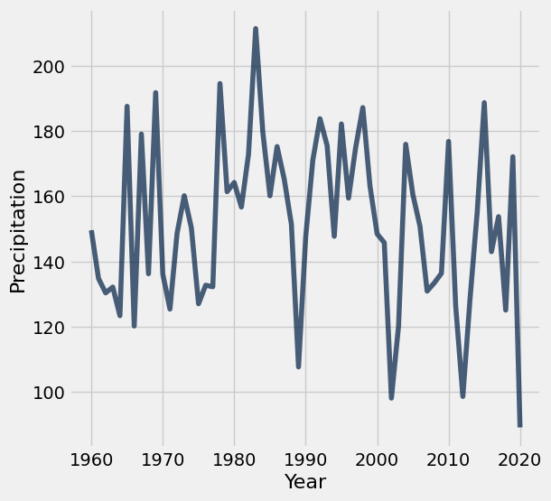

This plot isn't very revealing. Each year has a different amount of precipitation, and there is quite a bit of variability across years, as if each year's precipitation is a random draw from a distribution of possible outcomes. 

Could it be that these so-called "drought conditions" from 2002-2005 and 2012-2020 can be explained by chance? In other words, could it be that the annual precipitation amounts in the Southwest for these drought years are like **random draws from the same underlying distribution** as for other years? Perhaps nothing about the Earth's precipitation patterns has really changed, and the Southwest U.S. just happened to experience a few dry years close together. 

To assess this idea, let's conduct an A/B test in which **each year's total precipitation** is an outcome, and the condition is **whether or not the year is in the EPA's drought period**.

This `drought_label` function distinguishes between drought years as described in the U.S. EPA statement above (2002-2005 and 2012-2020) and other years. Note that the label "other" is perhaps misleading, since there were other droughts before 2000, such as the massive [1988 drought](https://en.wikipedia.org/wiki/1988%E2%80%9390_North_American_drought) that affected much of the U.S. However, if we're interested in whether these modern drought periods (2002-2005 and 2012-2020) are *normal* or *abnormal*, it makes sense to distinguish the years in this way.

**Code:**

```python
def drought_label(n):
    """Return the label for an input year n."""
    if 2002 <= n <= 2005 or 2012 <= n <= 2020:
        return 'drought'
    else:
        return 'other'
```

---

**Question 2.2.** Define null and alternative hypotheses for an A/B test that investigates whether drought years are **drier** (have less precipitation) than other years.

*Note:* Please format your answer using the following structure.

- *Null hypothesis:* ...
- *Alternative hypothesis:* ...

**SOLUTION:** 

- *Null hypothesis:* The drought year total precipitation amounts are sampled from the same distribution as other year total precipitation amounts. 

- *Alternative hypothesis:* The drought year total precipitation amounts are sampled from a drier distribution than the other year total precipitation amounts.

---

**Question 2.3.** First, define the table `drought`. It should contain one row per year and the following two columns:
- `"Label"`: Denotes if a year is part of a `"drought"` year or an `"other"` year
- `"Precipitation"`: The sum of the total precipitation in 13 Southwest cities that year

Then, construct an overlaid histogram of two observed distributions: the total precipitation in drought years and the total precipitation in other years. 

*Note*: Use the provided `bins` when creating your histogram, and do not re-assign the `southwest` table. Feel free to use as many lines as you need!

*Hint*: The optional `group` argument in a certain function might be helpful!

**Student scaffold:**

```python
bins = np.arange(85, 215+1, 13)
drought = ...
...
```

**Solution:**

```python
bins = np.arange(85, 215+1, 13)
drought = totals.with_column('Label', totals.apply(drought_label, 'Year')).select('Label', 'Precipitation') # SOLUTION
drought.hist("Precipitation", group="Label", bins=bins, unit='inch') # SOLUTION
```

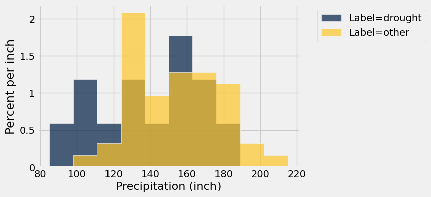

Before you continue, inspect the histogram you just created and try to guess the conclusion of the A/B test. Building intuition about the result of hypothesis testing from visualizations is quite useful for data science applications.

---

**Question 2.4.** Our next step is to choose a test statistic based on our alternative hypothesis in Question 2.2. Which of the following options are valid choices for the test statistic? Assign `ab_test_stat` to **an array of integers** corresponding to valid choices. Assume averages and totals are taken over the total precipitation sums for each year.

1. The difference between the **total** precipitation in **drought** years and the **total** precipitation in **other** years.
2. The difference between the **total** precipitation in **others** years and the **total** precipitation in **drought** years.
3. The **absolute** difference between the **total** precipitation in others years and the **total** precipitation in drought years.
1. The difference between the **average** precipitation in **drought** years and the **average** precipitation in **other** years.
2. The difference between the **average** precipitation in **others** years and the **average** precipitation in **drought** years.
3. The **absolute** difference between the **average** precipitation in others years and the **average** precipitation in drought years.

**Student scaffold:**

```python
ab_test_stat = ...
```

**Solution:**

```python
ab_test_stat = make_array(1, 2, 4, 5) # SOLUTION
```

**Test — `q2_4` (5 points)**

```python
>>> bool(type(ab_test_stat) == np.ndarray)
True

>>> bool(all([1 <= option <= 6 for option in ab_test_stat]))
True

>>> bool(all([type(option) in set([np.int64, np.int32, int]) for option in list(ab_test_stat)]))
True

# hidden test
>>> bool(all([option in list(ab_test_stat) for option in make_array(4, 5)]))
True

# hidden test
>>> bool(len(ab_test_stat) == 4 and np.all(np.sort(ab_test_stat) == make_array(1, 2, 4, 5)))
True
```

---

**Question 2.5.** Fellow climate scientists Noah and Sarah point out that there are more **other** years than **drought** years, and so measuring the difference between total precipitation will always favor the **other** years. They conclude that all of the options above involving **total** precipitation are invalid test statistic choices. Do you agree with them? Why or why not?

> *Hint 1:* Think about how permutation tests work with imbalanced classes! Does the number of labels in each group change?

> *Hint 2:* Do our test statistics have to be centered at 0?

**SOLUTION:** No. Permutation tests apply equally well to datasets with imbalanced classes, and an averaging test statistic is not required. A permutation test always ensures that there are the same number of each class during simulation, making the observed and simulated test statistics comparable.

Before going on, check your `drought` table. It should have two columns `"Label"` and `"Precipitation"` with 61 rows, 13 of which are for `"drought"` years.

**Code:**

```python
drought.show(3)
```

*Output:*

| Label | Precipitation |
| --- | --- |
| other | 149.58 |
| other | 134.82 |
| other | 130.41 |

**Code:**

```python
drought.group('Label')
```

*Output:*

| Label | count |
| --- | --- |
| drought | 13 |
| other | 48 |

---

**Question 2.6.** For our A/B test, we'll use the difference between the average precipitation in drought years and the average precipitation in other years as our test statistic:

$$\text{average precipitation in ``drought" years} - \text{average precipitation in ``other" years}$$

First, complete the function `test_statistic`. It should take in a two-column table `t` with one row per year and two columns:
- `"Label"`: the label for that year (either `"drought"` or `"other"`)
- `"Precipitation"`: the total precipitation in the 13 Southwest cities that year. 

Then, use the function you define to assign `observed_statistic` to the observed test statistic.

**Student scaffold:**

```python
def test_statistic(t):
    ...

observed_statistic = ...
observed_statistic
```

**Solution:**

```python
def test_statistic(t):
    means = t.group("Label", np.mean).column(1) # SOLUTION NO PROMPT
    return means.item(0) - means.item(1) # SOLUTION

observed_statistic = test_statistic(drought) # SOLUTION
observed_statistic
```

*Output:*

```text
-15.856714743589748
```

**Test — `q2_6` (4 points)**

```python
>>> bool(observed_statistic < 0)
True

# hidden test
>>> bool(test_statistic(drought.sample()) != test_statistic(drought.sample()))
True

# hidden test
>>> bool(np.isclose(test_statistic(drought), -15.856714743589748))
True

# hidden test
>>> bool(np.isclose(test_statistic(drought), observed_statistic))
True
```

Now that we have defined our hypotheses and test statistic, we are ready to conduct our hypothesis test. We’ll start by defining a function to simulate the test statistic under the null hypothesis, and then call that function 5,000 times to construct an empirical distribution under the null hypothesis.

---

**Question 2.7.** Write a function to simulate the test statistic under the null hypothesis. The `simulate_precipitation_null` function should simulate the null hypothesis once (not 5,000 times) and return the value of the test statistic for that simulated sample.

*Hint*: For example, using `t.with_column(...)` with a column name that already exists in an arbitrary table `t` will replace that column with the newly specified values.

**Student scaffold:**

```python
def simulate_precipitation_null():
    ...

# Run your function a couple times to make sure that it works
simulate_precipitation_null()
```

**Solution:**

```python
def simulate_precipitation_null():
    # BEGIN SOLUTION
    shuffled_frame = drought.sample(with_replacement=False)
    permuted_table = drought.with_column('Label', shuffled_frame.column('Label'))
    return test_statistic(permuted_table)
    # END SOLUTION

# Run your function a couple times to make sure that it works
simulate_precipitation_null()
```

*Output:*

```text
-9.699038461538464
```

**Test — `q2_7` (4 points)**

```python
>>> bool(-50 < simulate_precipitation_null() < 50)
True

# hidden test
>>> ts = [simulate_precipitation_null() for _ in range(1000)]
>>> bool(6 <= np.array(ts).std() <= 10)
True
```

---

**Question 2.8.** Fill in the blanks below to complete the simulation for the hypothesis test. Your simulation should compute 5,000 values of the test statistic under the null hypothesis and store the result in the array `sampled_stats`.

*Hint:* You should use the `simulate_precipitation_null` function you wrote in the previous question!

*Note:* Running this cell may take a few seconds. If it takes more than a minute, try to find a different (faster) way to implement your `simulate_precipitation_null` function.

**Student scaffold:**

```python
sampled_stats = ...

repetitions = ...
for i in np.arange(repetitions):
    ...

# Do not change these lines
Table().with_column('Difference Between Means', sampled_stats).hist()
plt.scatter(observed_statistic, 0, c="r", s=50);
plt.ylim(-0.01);
```

**Solution:**

```python
sampled_stats = make_array() # SOLUTION

repetitions = 5000 # SOLUTION
for i in np.arange(repetitions):
    # BEGIN SOLUTION
    new_difference = simulate_precipitation_null()
    sampled_stats = np.append(sampled_stats, new_difference)
    # END SOLUTION

# Do not change these lines
Table().with_column('Difference Between Means', sampled_stats).hist()
plt.scatter(observed_statistic, 0, c="r", s=50);
plt.ylim(-0.01);
```

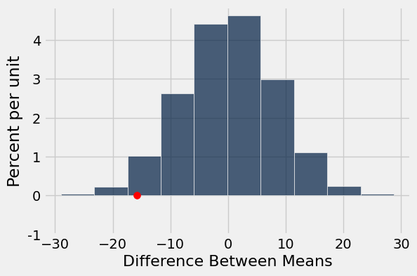

**Test — `q2_8` (4 points)**

```python
>>> bool(len(sampled_stats) == 5000)
True

>>> bool(np.std(sampled_stats) > 0)
True

# hidden test
>>> bool(6 < np.std(sampled_stats) < 10)
True

# hidden test
>>> bool(-11.5 < percentile(10, sampled_stats) < -9)
True
```

---

**Question 2.9.** Compute the p-value for this hypothesis test, and assign it to the variable `precipitation_p_val`.

**Student scaffold:**

```python
precipitation_p_val = ...
precipitation_p_val
```

**Solution:**

```python
precipitation_p_val = np.count_nonzero(sampled_stats <= observed_statistic) / repetitions # SOLUTION
precipitation_p_val
```

*Output:*

```text
0.025
```

**Test — `q2_9` (4 points)**

```python
>>> bool(type(precipitation_p_val) in set([float, np.float32, np.float64]))
True

>>> bool(0 <= precipitation_p_val <= 1)
True

# hidden test
>>> bool(0.015 < precipitation_p_val < 0.035)
True
```

---

**Question 2.10.** State a conclusion from this test using a p-value cutoff of 5%. What have you learned about the EPA's statement on drought?

**SOLUTION:** Because the p-value is less than the 5% p-value cutoff, our results are statistically significant and we reject the null hypothesis. We can conclude that the drought years were drier than the other years in these 13 cities.

---

**Question 2.11.** Does your conclusion from Question 2.10 apply to the entire Southwest region of the U.S.? Why or why not?

> *Note:* Feel free to do some research into geographical features of this region of the U.S.!

**SOLUTION:** We cannot generalize to the whole Southwestern U.S. because our sample only includes 13 cities. The cities we measured may not be representative of the whole region, which includes lots of mountains and deserts that aren't particularly suitable to city construction.

---
# Conclusion

Data science plays a central role in climate change research because massive simulations of the Earth's climate are necessary to assess the implications of climate data recorded from weather stations, satellites, and other sensors. [Berkeley Earth](http://berkeleyearth.org/data/) is a common source of data for these kinds of projects.

In this project, we found ways to apply our statistical inference techniques that rely on random sampling even in situations where the data were not generated randomly, but instead by some complicated natural process that appeared random. We made assumptions about randomness and then came to conclusions based on those assumptions. Great care must be taken to choose assumptions that are realistic, so that the resulting conclusions are not misleading. However, making assumptions about data can be productive when doing so allows inference techniques to apply to novel situations.

***Important Reminders:***

- If you worked on Project 2 with a partner, please remember to add your partner to your Pensive submission. If you resubmit, make sure to re-add your partner, as Pensive does not save any partner information.
- Make sure to wait until the autograder finishes running to ensure that your submission was processed properly and that you submitted to the correct assignment.


##### **Congratulations -- Cookie the Hamster is proud of you for finishing Project 2!**
She might recommend eating a delicious meal to reward yourself :)

---

To double-check your work, the cell below will rerun all of the autograder tests.

## Submission

Make sure you have run all cells in your notebook in order before running the cell below, so that all images/graphs appear in the output. The cell below will generate a zip file for you to submit. **Please save before exporting!**

---

## Datasets

Datasets this notebook loads with `Table.read_table`. Column names are exact, including spaces and capitalization. Only the schema is recorded here — the data itself is not in this document, so any question about its values must be answered by running code, not by reasoning over the rows shown elsewhere in this file.

### `city_info.csv`

461 rows, 8 columns.

| Column | Type |
| --- | --- |
| `Unnamed: 0` | int |
| `Name` | str |
| `ID` | str |
| `Lat` | float |
| `Lon` | float |
| `Stn.Name` | str |
| `Stn.stDate` | str |
| `Stn.edDate` | str |

### `phoenix.csv`

46,021 rows, 5 columns.

| Column | Type |
| --- | --- |
| `Unnamed: 0` | int |
| `Date` | str |
| `tmax` | float |
| `tmin` | float |
| `prcp` | float |

### `southwest.csv`

793 rows, 3 columns.

| Column | Type |
| --- | --- |
| `City` | str |
| `Year` | int |
| `Total Precipitation` | float |


---

# project2c

---
title: "Project 2: Climate Change - Temperatures and Precipitation"
assignment: project2c
semester: sp26
source: semester_assignments/sp26/project/project2c/autograder/project2c.ipynb
version: solution (autograder) with student scaffolds
student_source: semester_assignments/sp26/project/project2c/student/project2c.ipynb
language: python
---


# Project 2: Climate Change - Temperatures and Precipitation

In this project, you will investigate data on climate change, or the long-term shifts in temperatures and weather patterns!


### Logistics

**Deadline.**  This project is due at **5:00pm PT on Friday, 4/10**. You can receive 5 bonus points for submitting the project by **5:00pm PT on Thursday, 4/16.** Projects submitted fewer than 24 hours after the deadline will receive 80% credit. Any submissions later than 24 hours after the deadline will not be accepted. It's **much** better to be early than late, so start working now.

**Checkpoint.**  For full credit on the checkpoint, you must complete the questions up to the checkpoint, **pass all _public_ autograder tests** for those sections, and submit to the Pensieve Project 2 Checkpoint assignment by **5:00pm PT on Friday, 4/17**. <span style="color: #BC412B">**The checkpoint is worth 1 lab score**</span>. After you've submitted the checkpoint, you may still change your project answers before the final project deadline - **only your final submission, to the "Project 2 Autograder" assignment, will be graded for correctness** (including questions from before the checkpoint). You will have some lab time to work on these questions, but we recommend that you start the project before lab and leave time to finish the checkpoint afterward.

**Partners.** You may work with one other partner; your partner must be from your assigned lab section. **<span style="color: #BC412B">Only one partner should submit the project notebook to Pensieve.</span> If both partners submit, you will be docked 10% of your project grade. On Pensieve, the person who submits should also designate their partner so that both of you receive credit.** Once you submit, click into your submission, and there will be an option to Add Group Member in the top right corner. You may also reference [this walkthrough video](https://drive.google.com/file/d/1bs1l_f44tUeF1yKY_iljZMTE1X0dYKLl/view?usp=sharing) on how to add partners on Pensieve.

**Rules.** Don't share your code with anybody but your partner. You are welcome to discuss questions with other students, but don't share the answers. The experience of solving the problems in this project will prepare you for exams (and life). If someone asks you for the answer, resist! Instead, you can demonstrate how you would solve a similar problem.

**Support.** You are not alone! Come to office hours, post on Ed, and talk to your classmates. If you want to ask about the details of your solution to a problem, make a private Ed post and the staff will respond. If you're ever feeling overwhelmed or don't know how to make progress, email your TA or tutor for help. You can find contact information for the staff on the [course website](https://www.data8.org/su26/staff).

**Tests.** <span style="color: #BC412B">The tests that are given are **not comprehensive** and passing the tests for a question **does not** mean that you answered the question correctly.</span> Tests usually only check that your table has the correct column labels. However, more tests will be applied to verify the correctness of your submission in order to assign your final score, so be careful and check your work! You might want to create your own checks along the way to see if your answers make sense. Additionally, before you submit, make sure that none of your cells take a very long time to run (several minutes).

**Free Response Questions:** Make sure that you put the answers to the written questions in the indicated cell we provide. **Every free response question should include an explanation** that adequately answers the question. 

**Advice.** Develop your answers incrementally. To perform a complicated task, break it up into steps, perform each step on a different line, give a new name to each result, and check that each intermediate result is what you expect. You can add any additional names or functions you want to the provided cells. Make sure that you are using distinct and meaningful variable names throughout the notebook. Along that line, **DO NOT** reuse the variable names that we use when we grade your answers. 

You **never** have to use just one line in this project or any others. Use intermediate variables and multiple lines as much as you would like!

All of the concepts necessary for this project are found in the textbook. If you are stuck on a particular problem, reading through the relevant textbook section will often help to clarify concepts.

---

The point breakdown for this assignment is given in the table below:
| Category | Points |
| --- | --- |
| Autograder (Coding questions) | 60 |
| Written | 40 |
| **Total** | 100 |

---

To get started, load `datascience`, `numpy`, and `matplotlib`. Make sure to also run the first cell of this notebook to load `otter`.

**Code:**

```python
# Run this cell to set up the notebook, but please don't change it.
from datascience import *
import numpy as np

%matplotlib inline
import matplotlib.pyplot as plt
plt.style.use('fivethirtyeight')
np.set_printoptions(legacy='1.13')

import warnings
warnings.simplefilter('ignore')

import plotly.graph_objects as go
```

---
## Part 1: Temperatures

In the following analysis, we will investigate one of the 21st century's most prominent issues: climate change. While the details of climate science are beyond the scope of this course, we can start to learn about climate change just by analyzing public records of different cities' temperature and precipitation over time.

We will analyze a collection of historical daily temperature and precipitation measurements from weather stations in 210 U.S. cities. The dataset was compiled by Yuchuan Lai and David Dzombak [1]; a description of the data from the original authors and the data itself is available [here](https://kilthub.cmu.edu/articles/dataset/Compiled_daily_temperature_and_precipitation_data_for_the_U_S_cities/7890488). 

[1] Lai, Yuchuan; Dzombak, David (2019): Compiled historical daily temperature and precipitation data for selected 210 U.S. cities. Carnegie Mellon University. Dataset.

### Part 1, Section 1: Cities

Run the following cell to load information about the `cities` and preview the first few rows.

**Code:**

```python
cities = Table.read_table('city_info.csv', index_col=0)
cities.show(3)
```

*Output:*

| Name | ID | Lat | Lon | Stn.Name | Stn.stDate | Stn.edDate |
| --- | --- | --- | --- | --- | --- | --- |
| Lander | USW00024021 | 42.8153 | -108.726 | LANDER WBO | 1892-01-01 | 1946-05-28 |
| Lander | USW00024021 | 42.8153 | -108.726 | LANDER HUNT FIELD | 1946-05-29 | 2021-12-31 |
| Cheyenne | USW00024018 | 41.1519 | -104.806 | CHEYENNE WBO | 1871-01-01 | 1935-08-31 |

The `cities` table has one row per weather station and the following columns:

1. `"Name"`: The name of the US city
2. `"ID"`: The unique identifier for the US city
3. `"Lat"`: The latitude of the US city (measured in degrees of latitude)
4. `"Lon"`: The longitude of the US city (measured in degrees of longitude)
4. `"Stn.Name"`: The name of the weather station in which the data was collected
5. `"Stn.stDate"`: A string representing the date of the first recording at that particular station
6. `"Stn.edDate"`: A string representing the date of the last recording at that particular station

The data lists the weather stations at which temperature and precipitation data were collected. Note that although some cities have multiple weather stations, only one is collecting data for that city at any given point in time. Thus, we are able to just focus on the cities themselves.

---

**Question 1.1.1:** In the cell below, produce a scatter plot that plots the latitude and longitude of every city in the `cities` table so that the result places northern cities at the top and western cities at the left.

*Note*: It's okay to plot the same point multiple times!

*Hint*: A latitude is the set of horizontal lines that measures distances *north or south* of the equator. A longitude is the set of vertical lines that measures distances *east or west* of the prime meridian.

**Student scaffold:**

```python
...
```

**Solution:**

```python
cities.scatter("Lon", "Lat") # SOLUTION
```


These cities are all within the continental U.S., and so the general shape of the U.S. should be visible in your plot. The shape will appear distorted compared to most maps for two reasons: the scatter plot is square even though the U.S. is wider than it is tall, and this scatter plot is an [equirectangular projection](https://en.wikipedia.org/wiki/Equirectangular_projection) of the spherical Earth. A geographical map of the same data uses the common [Pseudo-Mercator projection](https://en.wikipedia.org/wiki/Web_Mercator_projection).

> *Note:* If this visualization doesn't load for you, please view a version of it online [here](https://github.jonathanferrari.com/static/city_map.html).

**Code:**

```python
# Just run this cell
fig = go.Figure(data=go.Scattergeo(
        lon = cities.column('Lon'),
        lat = cities.column('Lat'),
        text = cities.column('Name'),
        mode = 'markers'))

fig.update_layout(geo_scope='usa', width=800, height=500, margin={'r': 0, 't': 0, 'l': 0, 'b': 0})
fig.show()
```

*Output: interactive Plotly figure (not captured).*

---

**Question 1.1.2** Does it appear that these city locations are sampled uniformly at random from all the locations in the U.S.? Why or why not?

**SOLUTION:** No. The cities are very concentrated around the coasts; a uniform random sample would include more cities in the central regions.

---

**Question 1.1.3:** Assign `num_unique_cities` to the number of unique cities that appear in the `cities` table.

**Student scaffold:**

```python
num_unique_cities = ...

# Do not change this line
print(f"There are {num_unique_cities} unique cities that appear within our dataset.")
```

**Solution:**

```python
num_unique_cities = cities.group("Name").num_rows # SOLUTION

# Do not change this line
print(f"There are {num_unique_cities} unique cities that appear within our dataset.")
```

*Output (stdout):*

```text
There are 210 unique cities that appear within our dataset.
```

**Test — `q1_1_3`**

```python
>>> bool(type(num_unique_cities) in set([int, np.int32, np.int64]))
True

>>> bool(num_unique_cities > 0)
True
```

In order to investigate further, it will be helpful to determine what region of the United States each city was located in: Northeast, Northwest, Southeast, or Southwest. For our purposes, we will be using the following geographical boundaries:

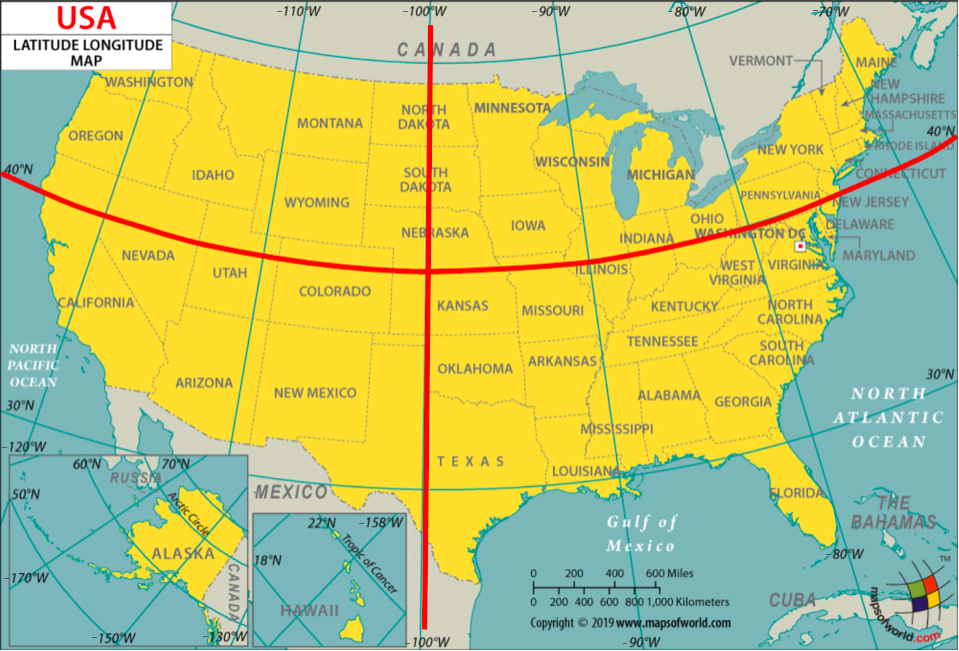

1. A station is located in the `"Northeast"` region if its latitude is above or equal to 40 degrees and its longitude is greater than or equal to -100 degrees.
2. A station is located in the `"Northwest"` region if its latitude is above or equal to 40 degrees and its longitude is less than -100 degrees.
3. A station is located in the `"Southeast"` region if its latitude is below 40 degrees and its longitude is greater than or equal to -100 degrees.
4. A station is located in the `"Southwest"` region if its latitude is below 40 degrees and its longitude is less than -100 degrees.

---

**Question 1.1.4**: Define the `coordinates_to_region` function below. It should take in two arguments, a city's latitude (`lat`) and longitude (`lon`) coordinates, and output a string representing the region it is located in.

**Student scaffold:**

```python
def coordinates_to_region(...):
    ...
```

**Solution:**

```python
""" # BEGIN PROMPT
def coordinates_to_region(...):
    ...
"""; # END PROMPT
# BEGIN SOLUTION NO PROMPT
def coordinates_to_region(lat, lon):
    """Returns a string representing the geographical region corresponding to the lat and lon"""
    if lat < 40:
        if lon < -100:
            return "Southwest"
        elif lon >= -100:
            return "Southeast"
    elif lat >= 40:
        if lon <-100:
            return "Northwest"
        elif lon >= -100:
            return "Northeast"
# END SOLUTION
```

**Test — `q1_1_4`**

```python
>>> bool(type(coordinates_to_region(50, 100)) == str)
True
```

---

**Question 1.1.5**: Add a new column in `cities` labeled `Region` that contains the region in which the city is located. For full credit, you must use the `coordinates_to_region` function you defined rather than reimplementing its logic.

**Student scaffold:**

```python
regions_array = ...
cities = ...
cities.show(5)
```

**Solution:**

```python
regions_array = cities.apply(coordinates_to_region, "Lat", "Lon") # SOLUTION
cities = cities.with_column("Region", regions_array) # SOLUTION
cities.show(5)
```

*Output:*

| Name | ID | Lat | Lon | Stn.Name | Stn.stDate | Stn.edDate | Region |
| --- | --- | --- | --- | --- | --- | --- | --- |
| Lander | USW00024021 | 42.8153 | -108.726 | LANDER WBO | 1892-01-01 | 1946-05-28 | Northwest |
| Lander | USW00024021 | 42.8153 | -108.726 | LANDER HUNT FIELD | 1946-05-29 | 2021-12-31 | Northwest |
| Cheyenne | USW00024018 | 41.1519 | -104.806 | CHEYENNE WBO | 1871-01-01 | 1935-08-31 | Northwest |
| Cheyenne | USW00024018 | 41.1519 | -104.806 | CHEYENNE MUNICIPAL ARPT | 1935-09-01 | 2021-12-31 | Northwest |
| Wausau | USW00014897 | 44.9258 | -89.6256 | Wausau Record Herald | 1896-01-01 | 1941-12-31 | Northeast |

**Test — `q1_1_5`**

```python
>>> bool(len(cities.labels) == 8)
True

>>> bool(cities.labels[-1] == 'Region')
True

>>> bool(cities.row(0).item('Region') == 'Northwest')
True
```

To confirm that you've defined your `coordinates_to_region` function correctly and successfully added the `Region` column to the `cities` table, run the following cell. Each region should have a different color in the result.

**Code:**

```python
# Just run this cell
cities.scatter("Lon", "Lat", group="Region")
```

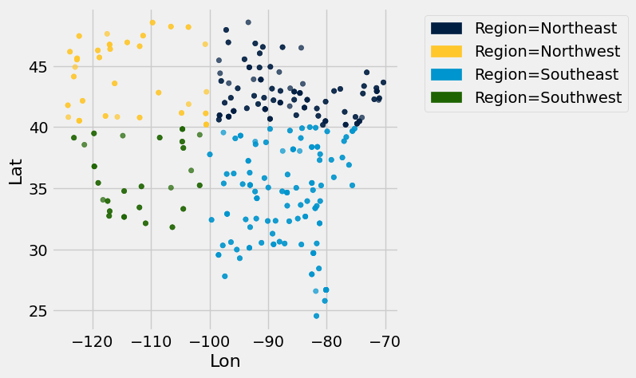

---

**Challenge Question 1.1.6 (OPTIONAL, ungraded)**: Create a new table called `cities_nearest`. It should contain the same columns as the `cities` table and an additional column called `"Nearest"` that contains the **name of the nearest city** that is in a different region from the city described by the row.

To approximate the distance between two cities, take the square root of the sum of the squared difference between their latitudes and the square difference between their longitudes. Don't use a `for` statement; instead, use the `apply` method and array arithmetic.

*Hint*: We have defined a `distance` function for you, which can be called on numbers `lat0` and `lon0` and arrays `lat1` and `lon1`.

**Solution:**

```python
def distance(lat0, lon0, lat1, lon1):
    "Approximate the distance between point (lat0, lon0) and (lat1, lon1) pairs in the arrays."
    return np.sqrt((lat0 - lat1) * (lat0 - lat1) + (lon0 - lon1) * (lon0 - lon1))

# BEGIN SOLUTION
def nearest(name):
    row = cities.where('Name', name).row(0)
    others = cities.where('Region', are.not_equal_to(row.item('Region')))
    distances = distance(row.item('Lat'), row.item('Lon'), 
                         others.column('Lat'), others.column('Lon'))
    return others.with_column('dist', distances).sort('dist').row(0).item('Name')

nearest_array = cities.apply(nearest, "Name")
# END SOLUTION

cities_nearest = cities.with_column("Nearest", nearest_array) # SOLUTION
cities_nearest.show(5)
```

*Output:*

| Name | ID | Lat | Lon | Stn.Name | Stn.stDate | Stn.edDate | Region | Nearest |
| --- | --- | --- | --- | --- | --- | --- | --- | --- |
| Lander | USW00024021 | 42.8153 | -108.726 | LANDER WBO | 1892-01-01 | 1946-05-28 | Northwest | GrandJunction |
| Lander | USW00024021 | 42.8153 | -108.726 | LANDER HUNT FIELD | 1946-05-29 | 2021-12-31 | Northwest | GrandJunction |
| Cheyenne | USW00024018 | 41.1519 | -104.806 | CHEYENNE WBO | 1871-01-01 | 1935-08-31 | Northwest | Denver |
| Cheyenne | USW00024018 | 41.1519 | -104.806 | CHEYENNE MUNICIPAL ARPT | 1935-09-01 | 2021-12-31 | Northwest | Denver |
| Wausau | USW00014897 | 44.9258 | -89.6256 | Wausau Record Herald | 1896-01-01 | 1941-12-31 | Northeast | Springfield |

### Part 1, Section 2: Welcome to Phoenix, Arizona

Each city has a different CSV file full of daily temperature and precipitation measurements. The file for Phoenix, Arizona is included with this project as `phoenix.csv`. The files for other cities can be downloaded [here](https://kilthub.cmu.edu/articles/dataset/Compiled_daily_temperature_and_precipitation_data_for_the_U_S_cities/7890488) by matching them to the ID of the city in the `cities` table.

Since Phoenix is located on the upper edge of the Sonoran Desert, it has some impressive temperatures.

Run the following cell to load in the `phoenix` table. It has one row per day and the following columns:

1. `"Date"`: The date (a string) representing the date of the recording in **YYYY-MM-DD** format
2. `"tmax"`: The maximum temperature for the  day (°F)
3. `"tmin"`: The minimum temperature for the day (°F)
4. `"prcp"`: The recorded precipitation for the day (inches)

**Code:**

```python
phoenix = Table.read_table("phoenix.csv", index_col=0)
phoenix.show(3)
```

*Output:*

| Date | tmax | tmin | prcp |
| --- | --- | --- | --- |
| 1896-01-01 | 66 | 30 | 0 |
| 1896-01-02 | 64 | 30 | 0 |
| 1896-01-03 | 68 | 30 | 0 |

---

**Question 1.2.1:** Assign the variable `largest_2010_range_date` to the date of the **largest temperature range** in Phoenix, Arizona for any day between January 1st, 2010 and December 31st, 2010. To get started, use the variable `phoenix_with_ranges_2010` to filter the phoenix table to days in 2010 with an additional column corresponding to the temperature range for that day. 

**Your answer should be a string in the "YYYY-MM-DD" format.** Feel free to use as many lines as you need. A temperature range is calculated as the difference between the max and min temperatures for the day.

*Hint*: To limit the values in a column to only those that *contain* a certain string, pick the right `are.` predicate from the [Python Reference Sheet](https://www.data8.org/sp25/reference/#table-filtering-predicates).

*Note:* Do **not** re-assign the `phoenix` variable; please use the `phoenix_with_ranges_2010` variable instead.

**Student scaffold:**

```python
...
phoenix_with_ranges_2010 = ...
largest_2010_range_date = ...
largest_2010_range_date
```

**Solution:**

```python
""" # BEGIN PROMPT
...
phoenix_with_ranges_2010 = ...
largest_2010_range_date = ...
"""; # END PROMPT
# BEGIN SOLUTION NO PROMPT
ranges_array = phoenix.column("tmax") - phoenix.column("tmin")
phoenix_with_ranges = phoenix.with_column("ranges", ranges_array)
phoenix_with_ranges_2010 = phoenix_with_ranges.where("Date", are.containing("2010"))
largest_2010_range_date = phoenix_with_ranges_2010.sort("ranges", descending=True).column("Date").item(0)
# END SOLUTION
largest_2010_range_date
```

*Output:*

```text
'2010-06-24'
```

**Test — `q1_2_1`**

```python
>>> bool(type(largest_2010_range_date) == str or isinstance(largest_2010_range_date, np.str_))
True
```

We can look back to our `phoenix` table to check the temperature readings for our `largest_2010_range_date` to see if anything special is going on. Run the cell below to find the row of the `phoenix` table that corresponds to the date we found above.

**Code:**

```python
# Just run this cell
phoenix.where("Date", largest_2010_range_date)
```

*Output:*

| Date | tmax | tmin | prcp |
| --- | --- | --- | --- |
| 2010-06-24 | 113 | 79 | 0 |

ZOO WEE MAMA! Look at the maximum temperature for that day. That's hot.

The function `extract_year_from_date` takes a date string in the **YYYY-MM-DD** format and returns an integer representing the **year**. The function `extract_month_from_date` takes a date string and returns a string describing the month. Run this cell, but you do not need to understand how this code works or edit it.

**Code:**

```python
# Just run this cell
import calendar

def extract_year_from_date(date):
    """Returns an integer corresponding to the year of the input string's date."""
    return int(date[:4])

def extract_month_from_date(date):
    "Return an abbreviation of the name of the month for a string's date."
    month = date[5:7]
    return f'{month} ({calendar.month_abbr[int(date[5:7])]})'


# Example
print('2022-04-01 has year', extract_year_from_date('2022-04-01'),
      'and month', extract_month_from_date('2022-04-01'))
```

*Output (stdout):*

```text
2022-04-01 has year 2022 and month 04 (Apr)
```

---

**Question 1.2.2:** Add two new columns called `Year` and `Month` to the `phoenix` table that contain the year as an **integer** and the month as a **string** (such as `"04 (Apr)"`) for each day, respectively. 

*Note*: The functions above may be helpful!

**Student scaffold:**

```python
years_array = ...
months_array = ...
...
phoenix.show(5)
```

**Solution:**

```python
years_array = phoenix.apply(extract_year_from_date, 'Date') # SOLUTION
months_array = phoenix.apply(extract_month_from_date, 'Date') # SOLUTION
# BEGIN SOLUTION
phoenix = phoenix.with_column('Year', years_array).with_column('Month', months_array)
# END SOLUTION
phoenix.show(5)
```

*Output:*

| Date | tmax | tmin | prcp | Year | Month |
| --- | --- | --- | --- | --- | --- |
| 1896-01-01 | 66 | 30 | 0 | 1896 | 01 (Jan) |
| 1896-01-02 | 64 | 30 | 0 | 1896 | 01 (Jan) |
| 1896-01-03 | 68 | 30 | 0 | 1896 | 01 (Jan) |
| 1896-01-04 | 69 | 34 | 0 | 1896 | 01 (Jan) |
| 1896-01-05 | 70 | 46 | 0 | 1896 | 01 (Jan) |

**Test — `q1_2_2`**

```python
>>> bool(phoenix.num_rows == 46021)
True

>>> bool(len(phoenix.labels) == 6)
True

>>> bool(phoenix.labels == ('Date', 'tmax', 'tmin', 'prcp', 'Year', 'Month'))
True
```

---

**Question 1.2.3:** Using the `phoenix` table, create an overlaid line plot of the **average maximum temperature** and **average minimum temperature** for each year between 1900 and 2020 (inclusive). 

*Hint:* To draw a line plot with more than one line, call `plot` on the column label of the x-axis values and all other columns will be treated as y-axis values.

**Student scaffold:**

```python
...
```

**Solution:**

```python
phoenix.select('Year', 'tmax', 'tmin').group("Year", np.mean).where('Year', are.between_or_equal_to(1900, 2020)).plot("Year") # SOLUTION
```

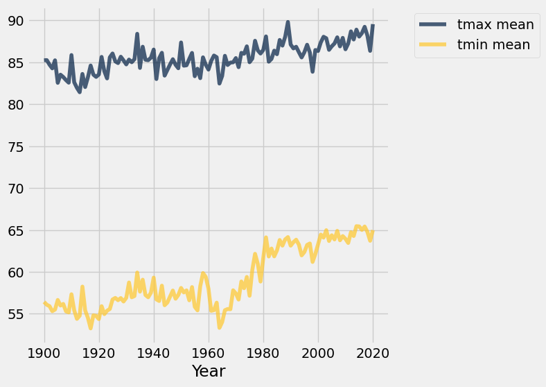

---

**Question 1.2.4:** Although still hotly debated (pun intended), many climate scientists agree that the effects of climate change began to surface in the early 1960s as a result of elevated levels of greenhouse gas emissions. How does the graph you produced in Question 1.2.3 support the claim that modern-day global warming began in the early 1960s?

**SOLUTION:** After about 1963, the minimum temperatures increase rapidly and the maximum temperatures increase slowly. Before then, they stayed within a consistent range.

Averaging temperatures across an entire year can obscure some effects of climate change. For example, if summers get hotter but winters get colder, the annual average may not change much. Let's investigate how average **monthly** maximum temperatures have changed over time in Phoenix.

---

**Question 1.2.5:** Create a copy of the `phoenix` table called `phoenix_periods` with a new column called 
`"period"` containing the corresponding **period** for each row. The period refers to whether the year is in the `"Past"`, `"Present"`, or `"Other"` category. You may find the `period` function helpful to see which years correspond to each period.

**Student scaffold:**

```python
def period(year):
    "Output if a year is in the Past, Present, or Other."
    if 1900 <= year <= 1960:
        return "Past"
    elif 2019 <= year <= 2021:
        return "Present"
    else:
        return "Other"
    
...
phoenix_periods = ...
phoenix_periods.show(5)
```

**Solution:**

```python
def period(year):
    "Output if a year is in the Past, Present, or Other."
    if 1900 <= year <= 1960:
        return "Past"
    elif 2019 <= year <= 2021:
        return "Present"
    else:
        return "Other"
    
""" # BEGIN PROMPT
...
phoenix_periods = ...
"""; # END PROMPT
# BEGIN SOLUTION NO PROMPT
periods = phoenix.apply(period, 'Year')
phoenix_periods = phoenix.with_column('period', periods)
# END SOLUTION
phoenix_periods.show(5)
```

*Output:*

| Date | tmax | tmin | prcp | Year | Month | period |
| --- | --- | --- | --- | --- | --- | --- |
| 1896-01-01 | 66 | 30 | 0 | 1896 | 01 (Jan) | Other |
| 1896-01-02 | 64 | 30 | 0 | 1896 | 01 (Jan) | Other |
| 1896-01-03 | 68 | 30 | 0 | 1896 | 01 (Jan) | Other |
| 1896-01-04 | 69 | 34 | 0 | 1896 | 01 (Jan) | Other |
| 1896-01-05 | 70 | 46 | 0 | 1896 | 01 (Jan) | Other |

**Test — `q1_2_5`**

```python
>>> bool(phoenix_periods.labels == ('Date', 'tmax', 'tmin', 'prcp', 'Year', 'Month', 'period'))
True

>>> bool(phoenix_periods.num_rows == 46021)
True
```

---

**Question 1.2.6:** Use `phoenix_periods` to create a `monthly_increases` table with one row per month and the following four columns in order: 
1. `"Month"`: The month (such as `"02 (Feb)"`)
2. `"Past"`: The average max temperature in that month from 1900-1960 (both ends inclusive)
3. `"Present"`: The average max temperature in that month from 2019-2021 (both ends inclusive)
4. `"Increase"`: The difference between the present and past average max temperatures in that month

Feel free to use as many lines as you need.

*Hint*: What table method can we use to get each **unique value** as its own column? 

*Note*: Please do **not** re-assign the `phoenix` variable!

**Student scaffold:**

```python
...
monthly_increases = ...
monthly_increases.show()
```

**Solution:**

```python
""" # BEGIN PROMPT
...
monthly_increases = ...
"""; # END PROMPT
# BEGIN SOLUTION NO PROMPT
p = phoenix_periods.pivot('period', 'Month', 'tmax', np.average).drop('Other')
monthly_increases = p.with_column('Increase', p.column(2) - p.column(1))
# END SOLUTION
monthly_increases.show()
```

*Output:*

| Month | Past | Present | Increase |
| --- | --- | --- | --- |
| 01 (Jan) | 65.0164 | 67.8312 | 2.81479 |
| 02 (Feb) | 68.8485 | 69.1859 | 0.337362 |
| 03 (Mar) | 74.6499 | 75.9796 | 1.32965 |
| 04 (Apr) | 82.6421 | 88.4 | 5.75792 |
| 05 (May) | 91.4299 | 94.571 | 3.14104 |
| 06 (Jun) | 101.166 | 105.734 | 4.56832 |
| 07 (Jul) | 103.599 | 107.245 | 3.64654 |
| 08 (Aug) | 101.416 | 107.384 | 5.96769 |
| 09 (Sep) | 97.6874 | 101.238 | 3.55035 |
| 10 (Oct) | 86.798 | 90.1667 | 3.36868 |
| 11 (Nov) | 74.6273 | 80.5178 | 5.89046 |
| 12 (Dec) | 65.9064 | 67.4548 | 1.54844 |

**Test — `q1_2_6`**

```python
>>> bool(monthly_increases.num_rows == 12)
True

>>> bool(monthly_increases.labels == ('Month', 'Past', 'Present', 'Increase'))
True

>>> bool(monthly_increases.row(2).item('Month') == '03 (Mar)')
True
```

### February in Phoenix

The `"Past"` column values are averaged over many decades, and so they are reliable estimates of the average high temperatures in those months before the effects of modern climate change. However, the `"Present"` column is based on only three years of observations. February, the shortest month, has the fewest total observations: only 85 days. Run the following cell to see this.

**Code:**

```python
# Just run this cell
feb_present = phoenix.where('Year', are.between_or_equal_to(2019, 2021)).where('Month', '02 (Feb)')
feb_present.num_rows
```

*Output:*

```text
85
```

Look back to your `monthly_increases` table. Compared to the other months, the increase for the month of February is quite small; the February difference is very close to zero. Run the following cell to print out our observed difference.

**Code:**

```python
# Just run this cell
print(f"February Difference: {monthly_increases.row(1).item('Increase')}")
```

*Output (stdout):*

```text
February Difference: 0.3373623297258632
```

Perhaps that small difference is somehow due to chance! To investigate this idea requires a thought experiment.

We can observe all of the February maximum temperatures from 2019 to 2021 (the present period), so we have access to the census; there's no random sampling involved. But, we can imagine that if more years pass with the same present-day climate, there would be different but similar maximum temperatures in future February days. From the data we observe, we can try to estimate the **average maximum February temperature** in this imaginary collection of all future February days that would occur in our modern climate, assuming the climate doesn't change any further and many years pass.

We can also imagine that the maximum temperature each day is like a **random draw from a distribution of max daily temperatures for that month**. Treating actual observations of natural events as if they were each *randomly* sampled from some unknown distribution is a simplifying assumption. These temperatures were not actually sampled at random—instead they occurred due to the complex interactions of the Earth's climate—but treating them as if they were random abstracts away the details of this naturally occuring process and allows us to carry out statistical inference.  Conclusions are only as valid as the assumptions upon which they rest, but in this case thinking of daily temperatures as random samples from some unknown climate distribution seems at least plausible.

If we assume that the **actual temperatures were drawn at random from some large population of possible February days** in our modern climate, then we can not only estimate the population average of this distribution, but also quantify our uncertainty about that estimate using a confidence interval.

**We will now compute the confidence interval of the present February average max daily temperature.** To unpack this statement, we are saying that this confidence interval is looking at present-day February conditions (think about which table is relevant to this), and the confidence interval is for present-day February average max daily temperatures. We will compare this confidence interval to the historical average (ie. the `"Past"` value in our `monthly_increases` table). How will we do the comparison? Well, since we are essentially interested in seeing if the average February max daily temperatures have ***changed*** since the past, we care about whether the historical average lies within the confidence interval we create.

---

**Question 1.2.7.** Based on the information above, define a null and alternative hypothesis for the investigation.

*Note:* Please format your answer as follows:
- Null Hypothesis: ...
- Alternative Hypothesis: ...

**SOLUTION:**

- *Null Hypothesis:* The average maximum February temperature in the present-period is the same as the average maximum February temperature in the past. Any observed difference is simply due to chance.

- *Alternative Hypothesis:* The average maximum February temperature in the present-period is different from the average maximum February temperature in the past. Any observed difference is not just due to chance.

---

**Question 1.2.8.** Complete the implementation of the function `make_ci`, which takes a one-column table `tbl` containing sample observations and a confidence `level` percentage such as 95 or 99. **It returns an array containing the lower and upper bound in that order, of a confidence interval** for the population mean constructed using 5,000 bootstrap resamples.

After defining `make_ci`, we have provided a line of code that calls `make_ci` on the present-day February max temperatures to output the 99% confidence interval for the average of daily max temperatures in February. The result should be around 67 degrees for the lower bound and around 71 degrees for the upper bound of the interval.

**Student scaffold:**

```python
def make_ci(tbl, level):
    """Compute a level% confidence interval of the average of the population for 
    which column 0 of Table tbl contains a sample. This function should return an 
    array of the lower and upper bounds of the confidence interval.
    """
    stats = make_array()
    for k in np.arange(5000):
        stat = ...
        stats = ...
    lower_bound = ...
    upper_bound = ...
    ...

# Call make_ci on the max temperatures in present-day February to find the lower and upper bound of a 99% confidence interval.
feb_present_ci = make_ci(feb_present.select('tmax'), 99)
feb_present_ci
```

**Solution:**

```python
def make_ci(tbl, level):
    """Compute a level% confidence interval of the average of the population for 
    which column 0 of Table tbl contains a sample. This function should return an 
    array of the lower and upper bounds of the confidence interval.
    """
    stats = make_array()
    for k in np.arange(5000):
        stat = np.average(tbl.sample().column(0)) # SOLUTION
        stats = np.append(stats, stat) # SOLUTION
    lower_bound = percentile((100 - level) / 2, stats) # SOLUTION
    upper_bound = percentile(100 - (100 - level) / 2, stats) # SOLUTION
    return make_array(lower_bound, upper_bound) # SOLUTION

# Call make_ci on the max temperatures in present-day February to find the lower and upper bound of a 99% confidence interval.
feb_present_ci = make_ci(feb_present.select('tmax'), 99)
feb_present_ci
```

*Output:*

```text
array([ 66.83764706,  71.24117647])
```

**Test — `q1_2_8`**

```python
>>> bool(66.6 <= feb_present_ci.item(0) <= 67.3)
True

>>> bool(70.7 <= feb_present_ci.item(1) <= 72)
True
```

---

**Question 1.2.9** The `feb_present_ci` 99% confidence interval contains the observed past February average maximum temperature of 68.8485 (from the `monthly_increases` table). What conclusion can you draw about the effect of climate change on February maximum temperatures in Phoenix from this information? Use a 1% p-value cutoff.

*Note*: If you're stuck on this question, consider your null and alternative hypotheses from Question 1.2.6. What does your conclusion imply about the effect of climate change? Re-reading the paragraphs under the *February* heading (particularly the first few) may be helpful.

**SOLUTION:** The confidence interval for the present average contains the past average, so we cannot reject the null hypothesis that the present average is in fact the past average. Under our assumptions, it's consistent with the data that climate change has not affected the average maximum February temperature at all.

### All Months

---

**Question 1.2.10.** Repeat the process of seeing whether the **past average for each month** is **contained within the 99% confidence interval** of the **present average**. Just as a note for the context, remember that these “averages” are averages of the max daily temperatures within those time periods. Code has already been written to print out the results in the format of a month (e.g., `02 (Feb)`), the observed past average, the confidence interval for the present average, and whether the past average was contained in the interval or not.

Use the provided call to `print` in order to format the result as one line per month.

*Hint*: Your code should follow the same format as our code from above (i.e. the *February* section).

**Student scaffold:**

```python
comparisons = make_array()
months = ...
for month in months:
    past_average = ...
    present_observations = ...
    present_ci = ...
    
    # Do not change the code below this line
    GREEN_BOLD = '\033[1;32m'
    RED_BOLD = '\033[1;31m'
    RESET_STYLE = '\033[0m'
    within = (past_average >= present_ci.item(0)) and (past_average <= present_ci.item(1))
    if within:
        comparison = f'{GREEN_BOLD}contained{RESET_STYLE}'
    else:
        comparison = f'{RED_BOLD}NOT contained{RESET_STYLE}'
    comparisons = np.append(comparisons, comparison)
    
    print('For', month, 'the past avg', round(past_average, 1),
    'is', comparison,
    'in the interval', np.round(present_ci, 1),
    ', the 99% CI of the present avg. \n')
```

**Solution:**

```python
comparisons = make_array()
months = monthly_increases.column('Month') # SOLUTION
for month in months:
    past_average = monthly_increases.where('Month', month).row(0).item('Past') # SOLUTION
    present_observations = phoenix.where('Year', are.between_or_equal_to(2019, 2021)).where('Month', month) # SOLUTION
    present_ci = make_ci(present_observations.select('tmax'), 99) # SOLUTION
    
    # Do not change the code below this line
    GREEN_BOLD = '\033[1;32m'
    RED_BOLD = '\033[1;31m'
    RESET_STYLE = '\033[0m'
    within = (past_average >= present_ci.item(0)) and (past_average <= present_ci.item(1))
    if within:
        comparison = f'{GREEN_BOLD}contained{RESET_STYLE}'
    else:
        comparison = f'{RED_BOLD}NOT contained{RESET_STYLE}'
    comparisons = np.append(comparisons, comparison)
    
    print('For', month, 'the past avg', round(past_average, 1),
    'is', comparison,
    'in the interval', np.round(present_ci, 1),
    ', the 99% CI of the present avg. \n')
```

*Output (stdout):*

```text
For 01 (Jan) the past avg 65.0 is NOT contained in the interval [ 66.3  69.3] , the 99% CI of the present avg.
```

*Output (stdout):*

```text
For 02 (Feb) the past avg 68.8 is contained in the interval [ 67.   71.3] , the 99% CI of the present avg.
```

*Output (stdout):*

```text
For 03 (Mar) the past avg 74.6 is contained in the interval [ 74.   77.8] , the 99% CI of the present avg.
```

*Output (stdout):*

```text
For 04 (Apr) the past avg 82.6 is NOT contained in the interval [ 86.4  90.4] , the 99% CI of the present avg.
```

*Output (stdout):*

```text
For 05 (May) the past avg 91.4 is NOT contained in the interval [ 92.5  96.6] , the 99% CI of the present avg.
```

*Output (stdout):*

```text
For 06 (Jun) the past avg 101.2 is NOT contained in the interval [ 104.2  107.2] , the 99% CI of the present avg.
```

*Output (stdout):*

```text
For 07 (Jul) the past avg 103.6 is NOT contained in the interval [ 105.5  108.7] , the 99% CI of the present avg.
```

*Output (stdout):*

```text
For 08 (Aug) the past avg 101.4 is NOT contained in the interval [ 105.8  108.9] , the 99% CI of the present avg.
```

*Output (stdout):*

```text
For 09 (Sep) the past avg 97.7 is NOT contained in the interval [  99.1  103.1] , the 99% CI of the present avg.
```

*Output (stdout):*

```text
For 10 (Oct) the past avg 86.8 is NOT contained in the interval [ 87.7  92.5] , the 99% CI of the present avg.
```

*Output (stdout):*

```text
For 11 (Nov) the past avg 74.6 is NOT contained in the interval [ 78.   82.8] , the 99% CI of the present avg.
```

*Output (stdout):*

```text
For 12 (Dec) the past avg 65.9 is contained in the interval [ 65.7  69.3] , the 99% CI of the present avg.
```

**Test — `q1_2_10`**

```python
>>> bool(type(months) == np.ndarray)
True
```

---

**Question 1.2.11.** Summarize your findings. After checking whether the past average (of max temperatures, as defined above 1.2.6)  is contained in the 99% confidence interval for each month, what conclusions can we make about the monthly average maximum temperature in historical (1900-1960) vs. modern (2019-2021) times in the twelve months? In other words, what null hypothesis should you consider, and for which months would you reject or fail to reject the null hypothesis? Use a 1% p-value cutoff.

*Hint*: Do you notice any seasonal patterns?

**SOLUTION:** For most months, the modern average maximum temperature for the month is above the historical average maximum temperature, indicating the climate has changed. But for some winter months—Feb, March, Dec—we fail to reject the null, as we do not have evidence that the average maximum temperature has changed.

> It is important to be wary of making conclusions based on the results of multiple hypothesis tests. Specifically, recall that a 1% p-value cutoff means that if the null is true, we would expect to incorrectly reject the null 1% of the time. Now, if we run multiple of these tests, the chance we observe an error will be greater than if we had just run one test – the error chance compounds.

---

To double-check your work, the cell below will rerun all of the autograder tests.

## Submission

Make sure you have run all cells in your notebook in order before running the cell below, so that all images/graphs appear in the output. The cell below will generate a zip file for you to submit. **Please save before exporting!**

---

## Datasets

Datasets this notebook loads with `Table.read_table`. Column names are exact, including spaces and capitalization. Only the schema is recorded here — the data itself is not in this document, so any question about its values must be answered by running code, not by reasoning over the rows shown elsewhere in this file.

### `city_info.csv`

461 rows, 8 columns.

| Column | Type |
| --- | --- |
| `Unnamed: 0` | int |
| `Name` | str |
| `ID` | str |
| `Lat` | float |
| `Lon` | float |
| `Stn.Name` | str |
| `Stn.stDate` | str |
| `Stn.edDate` | str |

### `phoenix.csv`

46,021 rows, 5 columns.

| Column | Type |
| --- | --- |
| `Unnamed: 0` | int |
| `Date` | str |
| `tmax` | float |
| `tmin` | float |
| `prcp` | float |


---

# project3

---
title: "Project 3: Movie Classification"
assignment: project3
semester: sp26
source: semester_assignments/sp26/project/project3/autograder/project3.ipynb
version: solution (autograder) with student scaffolds
student_source: semester_assignments/sp26/project/project3/student/project3.ipynb
total_points: 87.0
language: python
---


# Project 3: Movie Classification

Welcome to the third and final project of Data 8! You will build a classification model that guesses whether a movie is a comedy or a thriller by using only the number of times chosen words appear in the movie's screenplay. By the end of the project, you should know how to:

1. Build a k-nearest-neighbors classifier.
2. Test a classifier on data.

### Logistics

**Deadline.**  This project is due at **5:00pm PT on Friday, 5/1**. You can receive 5 bonus points for submitting the project by **5:00pm PT on Thursday, 4/30.** Projects will be accepted up to 1 day (24 hours) late. Projects submitted fewer than 24 hours after the deadline will receive 80% credit. Any submissions later than 24 hours after the deadline will not be accepted. It's **much** better to be early than late, so start working now.

**Checkpoint.** For full credit on the checkpoint, you must complete the questions up to the checkpoint, **pass all _public_ autograder tests** for those sections, and submit to the Pensieve Project 03 Checkpoint assignment by **5:00pm PT on Friday, 4/24**.  <span style="color: #BC412B">**The checkpoint is worth 1 lab score**</span>. After you've submitted the checkpoint, you may still change your project answers before the final project deadline - **only your final submission, to the "Project 03 Autograder" assignment, will be graded for correctness** (including questions from before the checkpoint). You will have some lab time to work on these questions, but we recommend that you start the project before lab and leave time to finish the checkpoint afterward.

**Partners.** You may work with one other partner; your partner must be from your assigned lab section. **<span style="color: #BC412B">Only one partner should submit the project notebook to Pensieve.</span> If both partners submit, you will be docked 10% of your project grade. On Pensieve, the person who submits should also designate their partner so that both of you receive credit.** Once you submit, click into your submission, and there will be an option to Add Group Member in the top right corner. You may also reference [this walkthrough video](https://drive.google.com/file/d/1bs1l_f44tUeF1yKY_iljZMTE1X0dYKLl/view?usp=sharing) on how to add partners on Pensieve.

**Rules.** Don't share your code with anybody but your partner. You are welcome to discuss questions with other students, but don't share the answers. The experience of solving the problems in this project will prepare you for exams (and life). If someone asks you for the answer, resist! Instead, you can demonstrate how you would solve a similar problem.

**Support.** You are not alone! Come to office hours, post on Ed, and talk to your classmates. If you want to ask about the details of your solution to a problem, make a private Ed post and the staff will respond. If you're ever feeling overwhelmed or don't know how to make progress, email your TA or tutor for help. You can find contact information for the staff on the [course website](https://data8.org/su26/staff/).

**Tests.** <span style="color: #BC412B">The tests that are given are **not comprehensive** and passing the tests for a question **does not** mean that you answered the question correctly.</span> For table manipulation questions, tests usually only check that your table has the correct column labels. Similarly, on multiple choice / select all that apply questions, tests are only checking that your response in the right format, not that it is correct. However, more tests will be applied to verify the correctness of your submission in order to assign your final score, so be careful and check your work! You might want to create your own checks along the way to see if your answers make sense. Additionally, before you submit, make sure that none of your cells take a very long time to run (several minutes).

**Free Response Questions:** Make sure that you put the answers to the written questions in the indicated cell we provide. **Every free response question should include an explanation** that adequately answers the question. 

**Advice.** Develop your answers incrementally. To perform a complicated task, break it up into steps, perform each step on a different line, give a new name to each result, and check that each intermediate result is what you expect. You can add any additional names or functions you want to the provided cells. Make sure that you are using distinct and meaningful variable names throughout the notebook. Along that line, **DO NOT** reuse the variable names that we use when we grade your answers. 

You **never** have to use just one line in this project or any others. Use intermediate variables and multiple lines as much as you would like!

**All of the concepts necessary for this project are found in the textbook.** If you are stuck on a particular problem, reading through the relevant textbook section will often help to clarify concepts.

---

The point breakdown for this assignment is given in the table below:
| Category | Points |
| --- | --- |
| Autograder (Coding questions) | 87 |
| Written | 13 |
| **Total** | 100 |

---

To get started, load `datascience`, `numpy`, and `matplotlib`. Make sure to also run the first cell of this notebook to load `otter`.

**Code:**

```python
# Run this cell to set up the notebook, but please don't change it.
import numpy as np
import math
import datascience
from datascience import *

# These lines set up the plotting functionality and formatting.
import matplotlib
%matplotlib inline
import matplotlib.pyplot as plots
plots.style.use('fivethirtyeight')
import warnings
warnings.simplefilter("ignore")
```

---
# Part 1: The Dataset

In this project, we are exploring movie screenplays. We'll be trying to predict each movie's genre from the text of its screenplay. In particular, we have compiled a list of 5,000 words that occur in conversations between movie characters. For each movie, our dataset tells us the frequency with which each of these words occurs in certain conversations in its screenplay. All words have been converted to lowercase.

Run the cell below to read the `movies` table. **It may take up to a minute to load.**

<span style="color: #BC412B">**Note: Outputting the full `movies` table will make exporting your Jupyter notebook very slow because the `movies` table is massive. Please avoid returning or using .show() for the entire `movies` table in your future cells!**</span>

**Code:**

```python
movies = Table.read_table('movies.csv')
```

Here is one row of the table and some of the frequencies of words that were said in the movie.

**Code:**

```python
movies.where("Title", "runaway bride").select(0, 1, 2, 3, 4, 14, 49, 1042, 4004)
```

*Output:*

| Title | Year | Rating | Genre | # Words | breez | england | it | bravo |
| --- | --- | --- | --- | --- | --- | --- | --- | --- |
| runaway bride | 1999 | 5.2 | comedy | 4895 | 0 | 0 | 0.0234092 | 0 |

The above cell prints a few columns of the row for the comedy movie *Runaway Bride*.  The movie contains 4895 words. The word "it" appears 115 times, as it makes up  $\frac{115}{4895} \approx 0.0234092$ of the words in the movie. The word "england" doesn't appear at all.

Additional context: This numerical representation of a body of text, which describes only the frequencies of individual words, is called a bag-of-words representation. Before the development of the [BERT](https://en.wikipedia.org/wiki/BERT_(language_model)) model for classification in 2018, bag-of-words was a common method of representing text in [NLP](https://en.wikipedia.org/wiki/Natural_language_processing). The bag-of-words representation is easy to interpret, but a lot of information is discarded: the order of the words, the context of each word, who said what, etc. It is therefore no longer commonly used. Still, investigating how to use a bag-of-words representation in a classifier builds useful intuitions about how to classify text.

At the end of this project, you'll have a chance to work with a more effective, but less interpretable, representation that uses a pretrained neural network to represent text.

All movie titles are unique. The `row_for_title` function provides fast access to the one row for each title. 

*Note: All movies in our dataset have their titles lower-cased.*

**Code:**

```python
title_index = movies.index_by('Title')
def row_for_title(title):
    """Return the row for a title, similar to the following expression (but faster)

    movies.where('Title', title).row(0)
    """
    return title_index.get(title)[0]

row_for_title('toy story')
```

*Output:*

```text
Row(Title='toy story', Year='1995', Rating=8.1999999999999993, Genre='comedy', # Words=3016, she=0.0017427675148135001, decid=0.00034855350296270001, talk=0.0017427675148135001, wit=0.0, razor=0.0, slam=0.0, credit=0.0, rai=0.0, hugh=0.0, breez=0.0, conscienc=0.0, audienc=0.0, cathi=0.0, log=0.0, met=0.0, chosen=0.0, grip=0.0, booz=0.0, bianca=0.0, doubl=0.00034855350296270001, agent=0.0, exit=0.0, carpent=0.0, underground=0.0, clemenza=0.0, gain=0.0, neg=0.00069710700592540001, majesti=0.0, studio=0.0, chri=0.0, spin=0.0, greater=0.0, eaten=0.0, vibrat=0.0, stupid=0.0010456605088881, cigarett=0.0, jesu=0.0, mani=0.0, violin=0.0, financi=0.00034855350296270001, bai=0.0, cop=0.0, neighbor=0.0, cd=0.0, england=0.0, made=0.00034855350296270001, conni=0.0, instinct=0.0, took=0.0, jacquelin=0.0, mace=0.0, disappear=0.0, waltz=0.0, behind=0.00034855350296270001, bourbon=0.0, favorit=0.00069710700592540001, benni=0.0, manhattan=0.0, nixon=0.0, lunch=0.0, principl=0.0, tradit=0.0, counterfeit=0.0, sophi=0.0, third=0.0, exist=0.0, wouldv=0.00034855350296270001, hero=0.0, theyr=0.0024398745207389002, anytim=0.0, christin=0.0, vallei=0.0, chess=0.0, paid=0.0, burglar=0.0, nostril=0.0, rubber=0.0, human=0.0, british=0.0, plissken=0.0, eddi=0.0, gee=0.0, offend=0.0, rebecca=0.0, anger=0.0, plant=0.0, famou=0.0, repres=0.0, latest=0.0, rent=0.0, dip=0.0, bell=0.0, andi=0.0069710700592541001, so=0.0017427675148135001, london=0.0, cooler=0.0, keaton=0.0, portland=0.0, headlin=0.0, whatta=0.0, fatal=0.0, sew=0.0, cheer=0.0, davi=0.0, feed=0.0, hudson=0.0, ambros=0.0, digest=0.0, redi=0.0, fri=0.0, staff=0.00069710700592540001, casino=0.0, occasion=0.0, shadow=0.0, work=0.00069710700592540001, restrain=0.00034855350296270001, face=0.0, exercis=0.0, sidnei=0.0, pile=0.0, whyd=0.0, teenag=0.0, her=0.0013942140118508, retir=0.0, hazard=0.0, roth=0.0, hurrican=0.0, impuls=0.0, ranger=0.0020913210177761999, pour=0.0, lester=0.0, slash=0.0, deer=0.0, could=0.0013942140118508, vital=0.0, qualiti=0.0, coma=0.0, incred=0.0, hank=0.0, famili=0.0, duchess=0.0, global=0.0, virgin=0.0, scientif=0.0, between=0.0, holidai=0.0, qualifi=0.0, moor=0.0, happili=0.0, arizona=0.0, non=0.0, bruce=0.0, ankl=0.0, constant=0.0, buzz=0.0163820146392471, harder=0.0, ing=0.0, christian=0.0, palmer=0.0, tent=0.0, sunset=0.0, damour=0.0, cohaagen=0.0, advertis=0.0, sensat=0.0, local=0.0, there=0.0080167305681421996, terri=0.0, sedat=0.0, rotten=0.0, struck=0.0, deck=0.0, past=0.0, bro=0.0, ann=0.0, dump=0.0, kane=0.0, slot=0.0, immun=0.0, block=0.00034855350296270001, lil=0.0, technic=0.0, tactic=0.0, pencil=0.0, outsid=0.0, laboratori=0.0, easi=0.0, nephew=0.0, coffin=0.0, pretti=0.0, coward=0.0, verbal=0.0, permiss=0.0, bartend=0.0, wont=0.0, watch=0.0013942140118508, lindenmey=0.0, cosmo=0.0, capabl=0.00034855350296270001, flirt=0.0, huge=0.0, berkelei=0.0, max=0.0, walter=0.0, lime=0.0, rico=0.0, marvin=0.0, aboard=0.0, bacon=0.0, account=0.0, kirk=0.0, quaid=0.0, stunt=0.00034855350296270001, closet=0.0, due=0.0, nuclear=0.0, blind=0.0, pussi=0.0, howdi=0.00034855350296270001, snuff=0.0, eas=0.00034855350296270001, now=0.0076681770651794998, leak=0.0, underwear=0.0, westlei=0.0, mayb=0.0, theo=0.0, limo=0.0, cousin=0.0, illeg=0.0, silli=0.0, against=0.0, done=0.00034855350296270001, district=0.0, invad=0.0, ryan=0.0, wait=0.0034855350296270002, grudg=0.0, charact=0.0, hick=0.0, jami=0.0, lifetim=0.0, lecktor=0.0, and=0.0083652840711049004, republican=0.0, life=0.0, hidden=0.0, wire=0.0, paranoia=0.0, network=0.0, messi=0.0, uthatu=0.0, effort=0.0, carri=0.0, windham=0.0, fun=0.00034855350296270001, psychologist=0.0, sean=0.0, scent=0.0, answer=0.0, mom=0.0031369815266642999, wake=0.0, sign=0.0, ho=0.0, relat=0.0, jame=0.0, fat=0.0, myself=0.0, disrupt=0.0, scan=0.0, vagu=0.0, basket=0.0, christma=0.00069710700592540001, estim=0.0, em=0.0013942140118508, union=0.0, involv=0.0, norman=0.0, suspici=0.0, becom=0.0, shoe=0.0, librari=0.0, administr=0.0, ford=0.0, complic=0.

... [output truncated, 64204 more characters]
```

For example, the fastest way to find the frequency of "fun" in the movie *Toy Story* is to access the `'fun'` item from its row. Check the original table to see if this worked for you!

**Code:**

```python
row_for_title('toy story').item('fun')
```

*Output:*

```text
0.00034855350296270001
```

---

**Question 1.0**

Set `expected_row_sum` to the number that you __expect__ will result from summing all proportions in each row, excluding the first five columns. Think about what any one row adds up to.

**Student scaffold:**

```python
# Set row_sum to a number that's the (approximate) sum of each row of word proportions.
expected_row_sum = ...
```

**Solution:**

```python
# Set row_sum to a number that's the (approximate) sum of each row of word proportions.
expected_row_sum = 1 # SOLUTION
```

**Test — `q1_0` (3 points)**

```python
>>> 0 < expected_row_sum
True

# hidden test
>>> int(expected_row_sum) == 1
True
```

This dataset was extracted from [a dataset from Cornell University](http://www.cs.cornell.edu/~cristian/Cornell_Movie-Dialogs_Corpus.html). After transforming the dataset (e.g., converting the words to lowercase, removing the inappropriate words, and converting the counts to frequencies), we created this new dataset containing the frequency of 5000 common words in each movie.

**Code:**

```python
print('Words with frequencies:', movies.drop(np.arange(5)).num_columns)
print('Movies with genres:', movies.num_rows)
```

*Output (stdout):*

```text
Words with frequencies: 5000
Movies with genres: 333
```

---
## 1.1. Word Stemming
The columns other than "Title", "Year", "Rating", "Genre", and "# Words" in the `movies` table are all words that appear in some of the movies in our dataset.  These words have been *stemmed*, or abbreviated heuristically, in an attempt to make different [inflected](https://en.wikipedia.org/wiki/Inflection) forms of the same base word into the same string.  For example, the column "manag" is the sum of proportions of the words "manage", "manager", "managed", and "managerial" (and perhaps others) in each movie. This is a common technique used in machine learning and natural language processing.

Stemming makes it a little tricky to search for the words you want to use, so we have provided another table called `vocab_table` that will let you see examples of unstemmed versions of each stemmed word. Run the code below to load it.

**Note:** You should use `vocab_table` for the rest of Section 1.1, not `vocab_mapping`.

**Code:**

```python
# Just run this cell.
vocab_mapping = Table.read_table('stem.csv')
stemmed = np.take(movies.labels, np.arange(3, len(movies.labels)))
vocab_table = Table().with_column('Stem', stemmed).join('Stem', vocab_mapping)
vocab_table.take(np.arange(1100, 1110))
```

*Output:*

| Stem | Word |
| --- | --- |
| bond | bonding |
| bone | bone |
| bone | boning |
| bone | bones |
| bonu | bonus |
| book | bookings |
| book | books |
| book | booking |
| book | booked |
| book | book |

---

**Question 1.1.1**

Using `vocab_table`, find the stemmed version of the word "elements" and assign the value to `stemmed_message`.

**Student scaffold:**

```python
stemmed_message = ...
stemmed_message
```

**Solution:**

```python
stemmed_message = vocab_table.where('Word', are.equal_to('elements')).column('Stem').item(0) # SOLUTION
stemmed_message
```

*Output:*

```text
'element'
```

**Test — `q1_1_1` (3 points)**

```python
>>> (type(stemmed_message) == str) | (type(stemmed_message) == np.str_)
True

>>> len(stemmed_message) < len('elements')
True

# hidden test
>>> stemmed_message
'element'
```

---

**Question 1.1.2**

What stem in the dataset has the most words that are shortened to it? Assign `most_stem` to that stem.

**Student scaffold:**

```python
most_stem = ...
most_stem
```

**Solution:**

```python
most_stem = vocab_table.group("Stem").sort("count", descending=True).column("Stem").item(0) # SOLUTION
most_stem
```

*Output:*

```text
'gener'
```

**Test — `q1_1_2` (3 points)**

```python
>>> (type(most_stem) == str) | (type(most_stem) == np.str_)
True

# hidden test
>>> most_stem
'gener'
```

---

**Question 1.1.3**

What is the longest word in the dataset whose stem is the same length as the original word? Assign that to `longest_uncut`. Break ties alphabetically from Z to A (so if your options are "cat" or "bat", you should pick "cat"). Note that when sorting letters, the letter `a` is smaller than the letter `z`. You may also want to sort more than once.

*Hint 1:* `vocab_table` has 2 columns: one for stems and one for the unstemmed (normal) word. Find the longest word that wasn't cut at all (same length as stem).

*Hint 2:* `apply` may be helpful here! Check [Python Reference](https://www.data8.org/su26/reference/).

*Hint 3:* In our solution, we found it useful to first add columns with the length of the word and the length of the stem, and then to add a column with the difference between those lengths. What will the difference be if the word is not shortened?

**Student scaffold:**

```python
tbl_with_lens = ...
tbl_with_diff = ...

longest_uncut = ...
longest_uncut
```

**Solution:**

```python
tbl_with_lens = vocab_table.with_columns("Word len", vocab_table.apply(len, "Word"), "Stem len", vocab_table.apply(len, "Stem")) # SOLUTION
tbl_with_diff = tbl_with_lens.with_column("len dif", tbl_with_lens.column("Word len") - tbl_with_lens.column("Stem len")) # SOLUTION

longest_uncut = tbl_with_diff.where("len dif", 0).sort("Word", descending=True).sort("Word len", descending=True).column("Word").item(0) # SOLUTION
longest_uncut
```

*Output:*

```text
'misunderstand'
```

**Test — `q1_1_3` (3 points)**

```python
>>> (type(longest_uncut) == str) | (type(longest_uncut) == np.str_)
True

# hidden test
>>> longest_uncut == 'misunderstand'
True
```

---

**Question 1.1.4**

How many stems have only one word that is shortened to them? For example, if the stem "book" only maps to the word "books" and if the stem "a" only maps to the word "a," both should be counted as stems that map only to a single word.

Assign `count_single_stems` to the count of stems that map to one word only.

**Student scaffold:**

```python
count_single_stems = ...
count_single_stems
```

**Solution:**

```python
count_single_stems = vocab_table.group("Stem").where("count", are.equal_to(1)).num_rows # SOLUTION
count_single_stems
```

*Output:*

```text
1408
```

**Test — `q1_1_4` (3 points)**

```python
>>> type(count_single_stems) == int
True

# hidden test
>>> count_single_stems == 1408
True
```

---
## 1.2. Exploratory Data Analysis: Linear Regression

Let's explore our dataset before trying to build a classifier. To start, we’ll use the associated proportions to investigate the relationship between different words.

The first association we'll investigate is the association between the proportion of words that are "outer" and the proportion of words that are "space". 

As usual, we'll investigate our data visually before performing any numerical analysis.

Run the cell below to plot a scatter diagram of "space" proportions vs "outer" proportions and to create the `outer_space` table. Each point on the scatter plot represents one movie.

**Code:**

```python
# Just run this cell!
outer_space = movies.select("outer", "space")
outer_space.scatter("outer", "space")
plots.axis([-0.0005, 0.001, -0.0005, 0.003]);
plots.xticks(rotation=45);
```

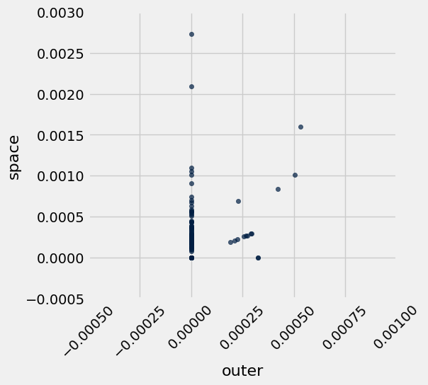

---

**Question 1.2.1**

Looking at that chart it is difficult to see if there is an association. Calculate the correlation coefficient for the potential linear association between proportion of words that are "outer" and the proportion of words that are "space" for every movie in the dataset, and assign it to `outer_space_r`. 

*Hint:* If you need a refresher on how to calculate the correlation coefficient check out [Ch 15.1](https://inferentialthinking.com/chapters/15/1/Correlation.html#calculating-r).

**Student scaffold:**

```python
# These two arrays should make your code cleaner!
outer = movies.column("outer")
space = movies.column("space")

outer_su = ...
space_su = ...

outer_space_r = ...
outer_space_r
```

**Solution:**

```python
# These two arrays should make your code cleaner!
outer = movies.column("outer")
space = movies.column("space")

outer_su = (outer - np.mean(outer)) / np.std(outer) # SOLUTION
space_su = (space - np.mean(space)) / np.std(space) # SOLUTION

outer_space_r = np.mean(space_su * outer_su) # SOLUTION
outer_space_r
```

*Output:*

```text
0.31942607876895912
```

**Test — `q1_2_1` (3 points)**

```python
>>> 0.2 < outer_space_r < 0.4
True

# hidden test
>>> np.round(outer_space_r, 3) == 0.319
True
```

---

**Question 1.2.2**

Choose two *different* words in the dataset with a magnitude (absolute value) of correlation higher than 0.2 and plot a scatter plot with a line of best fit for them. Please do not pick "outer" and "space" or "san" and "francisco". The code to plot the scatter plot and line of best fit is given for you, you just need to calculate the correct values to `r`, `slope` and `intercept`. 

*Hint 1:* It's easier to think of words with a positive correlation, i.e. words that are often mentioned together. Try to think of common phrases or idioms.

*Hint 2:* Refer to [Section 15.2](https://inferentialthinking.com/chapters/15/2/Regression_Line.html#the-equation-of-the-regression-line) of the textbook for the formulas. For additional past examples of regression, see Homework 9.

**Student scaffold:**

```python
word_x = ...
word_y = ...

# These arrays should make your code cleaner!
arr_x = movies.column(word_x)
arr_y = movies.column(word_y)

x_su = ...
y_su = ...

r = ...

slope = ...
intercept = ...

# DON'T CHANGE THESE LINES OF CODE
movies.scatter(word_x, word_y)
max_x = max(movies.column(word_x))
plots.title(f"Correlation: {r}, magnitude greater than .2: {abs(r) >= 0.2}")
plots.plot([0, max_x * 1.3], [intercept, intercept + slope * (max_x*1.3)], color='gold');
```

**Solution:**

```python
word_x = "cold" # SOLUTION
word_y = "warm" # SOLUTION

# These arrays should make your code cleaner!
arr_x = movies.column(word_x)
arr_y = movies.column(word_y)

x_su = (arr_x - np.mean(arr_x)) / np.std(arr_x) # SOLUTION
y_su = (arr_y - np.mean(arr_y)) / np.std(arr_y) # SOLUTION

r = np.mean(x_su * y_su) # SOLUTION

slope = np.std(arr_y) / np.std(arr_x) * r # SOLUTION
intercept = np.mean(arr_y) - (np.mean(arr_x) * slope) # SOLUTION

# DON'T CHANGE THESE LINES OF CODE
movies.scatter(word_x, word_y)
max_x = max(movies.column(word_x))
plots.title(f"Correlation: {r}, magnitude greater than .2: {abs(r) >= 0.2}")
plots.plot([0, max_x * 1.3], [intercept, intercept + slope * (max_x*1.3)], color='gold');
```

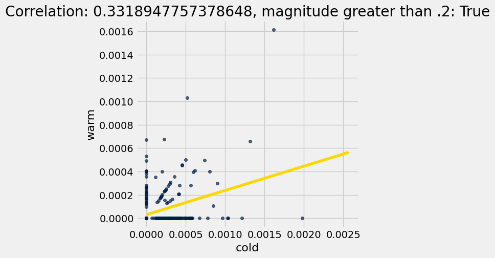

**Test — `q1_2_2` (0 points)**

```python
>>> {word_x, word_y} not in [{'san', 'francisco'}, {'outer', 'space'}]
True
```

---

**Question 1.2.3**

Imagine that you picked the words "san" and "francisco" as the two words that you would expect to be correlated because they compose the city name San Francisco. Assign `san_francisco` to either the integer 1 or the integer 2 according to which statement is true regarding the correlation between "san" and "francisco." 

1. "san" can also precede other city names like San Diego and San Jose. This might lead to "san" appearing in movies without "francisco," and would reduce the correlation between "san" and "francisco."
2. "san" can also precede other city names like San Diego and San Jose. The fact that "san" could appear more often in front of different cities and without "francisco" would increase the correlation between "san" and "francisco."

**Student scaffold:**

```python
san_francisco = ...
```

**Solution:**

```python
san_francisco = 1 # SOLUTION
```

**Test — `q1_2_3` (3 points)**

```python
>>> type(san_francisco) == int
True

# hidden test
>>> san_francisco == 1
True
```

---
## 1.3. Splitting the dataset
Now, we're going to use our `movies` dataset for two purposes.

1. First, we want to *train* movie genre classifiers.
2. Second, we want to *test* the performance of our classifiers. 

Hence, we need two different datasets: *training* and *test*. 

The purpose of a classifier is to classify unseen data that is similar to the training data. The test dataset will help us determine the accuracy of our predictions by comparing the actual genres of the movies with the genres that our classifier predicts. Therefore, we must ensure that there are no movies that appear in both sets. We do so by splitting the dataset randomly. The dataset has already been permuted randomly, so it's easy to split.  We just take the first 85% of the dataset for training and the rest for test. 

Run the code below (without changing it) to separate the datasets into two tables.

<span style="color: #BC412B">**Note: Outputting the full `train_movies` table will make exporting your Jupyter notebook very slow because the `train_movies` table is massive. Please avoid returning or using .show() for the entire `train_movies` table in your future cells!**</span>

**Code:**

```python
# Here we have defined the proportion of our data
# that we want to designate for training as 17/20ths (85%)
# and, of our total dataset 3/20ths (15%) of the data is
# reserved for testing

training_proportion = 17/20

num_movies = movies.num_rows
num_train = int(num_movies * training_proportion)
num_test = num_movies - num_train

train_movies = movies.take(np.arange(num_train))
test_movies = movies.take(np.arange(num_train, num_movies))

print("Training: ",   train_movies.num_rows, ";",
      "Test: ",       test_movies.num_rows)
```

*Output (stdout):*

```text
Training:  283 ; Test:  50
```

---

**Question 1.3.1**

Draw a horizontal bar chart with two bars that show the proportion of Comedy movies in each dataset (`train_movies` and `test_movies`). The two bars should be labeled "Training" and "Test". Complete the function `comedy_proportion` first; it should help you create the bar chart. 

*Hint*: Refer to [Section 7.1](https://inferentialthinking.com/chapters/07/1/Visualizing_Categorical_Distributions.html#bar-chart) of the textbook if you need a refresher on bar charts.

**Student scaffold:**

```python
def comedy_proportion(table):
    # Return the proportion of movies in a table that have the comedy genre.
    ...
    return ...

# The staff solution took multiple lines.  Start by creating a table.
# If you get stuck, think about what sort of table you need for barh to work
...
```

**Solution:**

```python
# BEGIN SOLUTION NO PROMPT
def comedy_proportion(table):
    """Return the proportion of movies in a table that have the comedy genre."""
    return table.where('Genre', are.equal_to('comedy')).num_rows / table.num_rows

datasets = make_array('Training', 'Test')
prop_comedy = make_array(comedy_proportion(train_movies), comedy_proportion(test_movies))
Table().with_columns(
        'Dataset', datasets,
        'Proportion of Comedy', prop_comedy)\
       .barh('Dataset')
# END SOLUTION
""" # BEGIN PROMPT
def comedy_proportion(table):
    # Return the proportion of movies in a table that have the comedy genre.
    ...
    return ...

# The staff solution took multiple lines.  Start by creating a table.
# If you get stuck, think about what sort of table you need for barh to work
...
"""; # END PROMPT
```

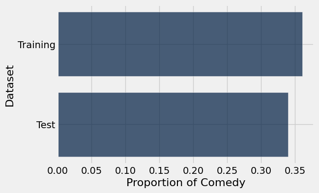

---
# Part 2: K-Nearest Neighbors - A Guided Example

[K-Nearest Neighbors (k-NN)](https://inferentialthinking.com/chapters/17/1/Nearest_Neighbors.html) is a classification algorithm. While it is no longer common to use k-NN with a bag-of-word representation of text (as we do below), the idea of informing prediction using nearest neighbors is still very common in modern machine learning systems.

Given some numerical *attributes* (also called *features*) of an unseen example, k-NN decides which category that example belongs to based on its similarity to previously seen examples. Predicting the category of an example is called *labeling*, and the predicted category is also called a *label*.

An attribute (feature) we have about each movie is *the proportion of times a particular word appears in the movie*, and the labels are two movie genres: comedy and thriller.  The algorithm requires many previously seen examples for which both the attributes and labels are known: that's the `train_movies` table.

To build understanding, we're going to visualize the algorithm instead of just describing it.

---
## 2.1. Classifying a movie

In k-NN, we classify a movie by finding the `k` movies in the *training set* that are most similar according to the features we choose. We call those movies with similar features the *nearest neighbors*.  The k-NN algorithm assigns the movie to the most common category among its `k` nearest neighbors.

Let's limit ourselves to just 2 features for now, so we can plot each movie.  The features we will use are the proportions of the words "water" and "feel" in the movie.  Taking the movie *Monty Python and the Holy Grail* (in the test set), 0.000804074 of its words are "water" and 0.0010721 are "feel". This movie appears in the test set, so let's imagine that we don't yet know its genre.

First, we need to make our notion of similarity more precise.  **We will say that the *distance* between two movies is the straight-line distance between them when we plot their features on a scatter diagram.**

**This distance is called the Euclidean ("yoo-KLID-ee-un") distance, whose formula is $\sqrt{(x_1 - x_2)^2 + (y_1 - y_2)^2}$.**

For example, in the movie *Clerks.* (in the training set), 0.00016293 of all the words in the movie are "water" and 0.00154786 are "feel".  Its distance from *Monty Python and the Holy Grail* on this 2-word feature set is $\sqrt{(0.000804074 - 0.000162933)^2 + (0.0010721 - 0.00154786)^2} \approx 0.000798379$.  (If we included more or different features, the distance could be different.)

A third movie, *The Godfather* (in the training set), has 0 "water" and 0.00015122 "feel". 

The function below creates a plot to display the "water" and "feel" features of a test movie and some training movies. As you can see in the result, *Monty Python and the Holy Grail* is more similar to *Clerks.* than to the *The Godfather* based on these features, which makes sense as both movies are comedy movies, while *The Godfather* is a thriller.

**Code:**

```python
# Just run this cell.
def plot_with_two_features(test_movie, training_movies, x_feature, y_feature):
    """Plot a test movie and training movies using two features."""
    test_row = row_for_title(test_movie)
    distances = Table().with_columns(
            x_feature, [test_row.item(x_feature)],
            y_feature, [test_row.item(y_feature)],
            'Color',   ['unknown'],
            'Title',   [test_movie]
        )
    for movie in training_movies:
        row = row_for_title(movie)
        distances.append([row.item(x_feature), row.item(y_feature), row.item('Genre'), movie])
    distances.scatter(x_feature, y_feature, group='Color', labels='Title', s=50)

training = ["clerks.", "the godfather"]
plot_with_two_features("monty python and the holy grail", training, "water", "feel")
plots.axis([-0.0008, 0.001, -0.004, 0.007]);
```

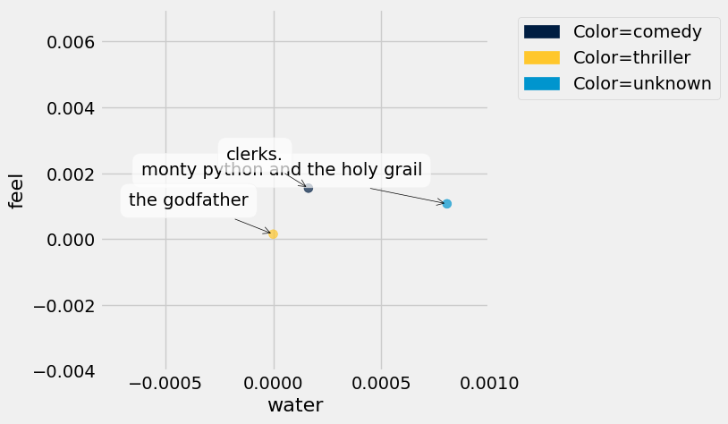

---

**Question 2.1.1**

Compute the Euclidean distance (defined in the section above) between the two movies, *Monty Python and the Holy Grail* and *The Godfather*, using the `water` and `feel` features only.  Assign it the name `one_distance`. 

*Hint 1:* If you have a row, you can use `item` to get a value from a column by its name.  For example, if `r` is a row, then `r.item("Genre")` is the value in column `"Genre"` in row `r`.

*Hint 2:* Refer to the beginning of Part 1 if you don't remember what `row_for_title` does.

*Hint 3:* In the formula for Euclidean distance, think carefully about what `x` and `y` represent. Refer to the example in the text above if you are unsure.

**Student scaffold:**

```python
python = row_for_title("monty python and the holy grail")
godfather = row_for_title("the godfather")

one_distance = ...
one_distance
```

**Solution:**

```python
python = row_for_title("monty python and the holy grail")
godfather = row_for_title("the godfather")

one_distance = ((python.item("water") - godfather.item("water"))**2 + (python.item("feel") - godfather.item("feel"))**2)**0.5 # SOLUTION
one_distance
```

*Output:*

```text
0.0012225209151294461
```

**Test — `q2_1_1` (3 points)**

```python
>>> 0 < one_distance < 0.01
True

# hidden test
>>> np.isclose(one_distance, 0.001223)
False
```

Below, we've added a third training movie, *The Silence of the Lambs*. Before, the point closest to *Monty Python and the Holy Grail* was *Clerks.*, a comedy movie. However, now the closest point is *The Silence of the Lambs*, a thriller movie.

**Code:**

```python
training = ["clerks.", "the godfather", "the silence of the lambs"]
plot_with_two_features("monty python and the holy grail", training, "water", "feel")
plots.axis([-0.0008, 0.001, -0.004, 0.007]);
```

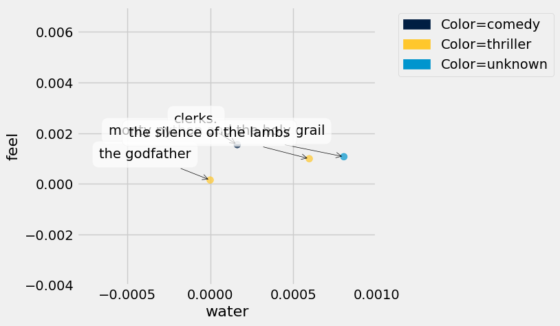

---

**Question 2.1.2**

Complete the function `distance_two_features` that computes the Euclidean distance between any two movies, using two features. The last two lines call your function to show that *Monty Python and the Holy Grail* is closer to *The Silence of the Lambs* than it is to *Clerks*.

**Student scaffold:**

```python
def distance_two_features(title0, title1, x_feature, y_feature):
    """Compute the distance between two movies with titles title0 and title1.

    Only the features named x_feature and y_feature are used when computing the distance.
    """
    row0 = ...
    row1 = ...
    ...

for movie in make_array("clerks.", "the silence of the lambs"):
    movie_distance = distance_two_features(movie, "monty python and the holy grail", "water", "feel")
    print(movie, 'distance:\t', movie_distance)
```

**Solution:**

```python
def distance_two_features(title0, title1, x_feature, y_feature):
    """Compute the distance between two movies with titles title0 and title1.

    Only the features named x_feature and y_feature are used when computing the distance.
    """
    row0 = row_for_title(title0) # SOLUTION
    row1 = row_for_title(title1) # SOLUTION
    return ((row0.item(x_feature) - row1.item(x_feature))**2 + (row0.item(y_feature) - row1.item(y_feature))**2)**0.5 # SOLUTION

for movie in make_array("clerks.", "the silence of the lambs"):
    movie_distance = distance_two_features(movie, "monty python and the holy grail", "water", "feel")
    print(movie, 'distance:\t', movie_distance)
```

*Output (stdout):*

```text
clerks. distance:	 0.000798381068723
the silence of the lambs distance:	 0.000222563148556
```

**Test — `q2_1_2` (3 points)**

```python
>>> correct_dis = 0.001406116
>>> dis = distance_two_features('clerks.', 'the godfather', 'water', 'feel')
>>> np.isclose(np.round(dis, 9), correct_dis)
True

>>> correct_dis = 0.005647119
>>> dis = distance_two_features('clerks.', 'the godfather', 'your', 'that')
>>> np.isclose(np.round(dis, 9), correct_dis)
True
```

---

**Question 2.1.3**

Define the function `distance_from_python` so that it works as described in its documentation/[docstring](https://www.geeksforgeeks.org/python-docstrings/) (the string right below where the function is defined).


**Note:** Your solution should not use arithmetic operations directly. Instead, it should make use of previously defined functions!

**Student scaffold:**

```python
def distance_from_python(title):
    """Return the distance between the given movie and "monty python and the holy grail",
    based on the features "water" and "feel".

    This function takes a single argument:
      title: A string, the name of a movie.
    """

    ...

# Calculate the distance between "Clerks." and "Monty Python and the Holy Grail"
distance_from_python('clerks.')
```

**Solution:**

```python
def distance_from_python(title):
    """Return the distance between the given movie and "monty python and the holy grail",
    based on the features "water" and "feel".

    This function takes a single argument:
      title: A string, the name of a movie.
    """

    return distance_two_features(title, "monty python and the holy grail", "water", "feel") # SOLUTION

# Calculate the distance between "Clerks." and "Monty Python and the Holy Grail"
distance_from_python('clerks.')
```

*Output:*

```text
0.00079838106872277164
```

**Test — `q2_1_3` (3 points)**

```python
>>> np.isclose(distance_from_python('clerks.'), 0.00079838)
True

# hidden test
>>> np.isclose(distance_from_python('the godfather'), 0.001222521)
True
```

---

**Question 2.1.4**

Using the features `water` and `feel`, what are the names and genres of the 5 movies in the **training set** closest to *Monty Python and the Holy Grail*?  To answer this question, make a **table** named `close_movies` containing those 5 movies with columns `"Title"`, `"Genre"`, `"water"`, and `"feel"`, as well as a column called `"distance from python"` that contains the distance from *Monty Python and the Holy Grail*.  The table should be **sorted in ascending order by `"distance from python"`**.

*Note:* Why are smaller distances from *Monty Python and the Holy Grail* more helpful in helping us classify the movie? (In other words, why is it helpful to focus on our nearest neighbors?)

*Hint:* Your final table should only have 5 rows. How can you get the first five rows of a table?

**Student scaffold:**

```python
# The staff solution took multiple lines.
...
close_movies = ...
close_movies
```

**Solution:**

```python
# BEGIN SOLUTION NO PROMPT
water_feel = train_movies.select("Title", "Genre", "water", "feel")
close_movies = water_feel.with_column('distance from python', water_feel.apply(distance_from_python, 'Title'))\
                       .sort('distance from python')\
                       .take(np.arange(5))
# END SOLUTION

""" # BEGIN PROMPT
# The staff solution took multiple lines.
...
close_movies = ...
close_movies
"""; # END PROMPT
```

**Test — `q2_1_4` (3 points)**

```python
>>> set(close_movies.labels) >= {'Genre', 'Title', 'feel', 'water'}
True

>>> close_movies.num_rows == 5
True

>>> close_movies.column('Title').item(0) != 'monty python and the holy grail'
True

# hidden test
>>> [title[:6] for title in close_movies.column('Title')] == ['alien', 'tomorr', 'the si', 'inners', 'some l']
True
```

---

**Question 2.1.5**

Next, we'll classify *Monty Python and the Holy Grail* based on the genres of the closest movies. 

To do so, define the function `most_common` so that it works as described in its documentation below.

**Student scaffold:**

```python
def most_common(label, table):
    """This function takes two arguments:
      label: The label of a column, a string.
      table: A table.

    It returns the most common value in the label column of the table.
    In case of a tie, it returns any one of the most common values.
    """
    ...

# Calling most_common on your table of 5 nearest neighbors classifies
# "monty python and the holy grail" as a thriller movie, 3 votes to 2.
most_common('Genre', close_movies)
```

**Solution:**

```python
def most_common(label, table):
    """This function takes two arguments:
      label: The label of a column, a string.
      table: A table.

    It returns the most common value in the label column of the table.
    In case of a tie, it returns any one of the most common values.
    """
    return table.group(label).sort('count', descending=True).column(label).item(0) # SOLUTION

# Calling most_common on your table of 5 nearest neighbors classifies
# "monty python and the holy grail" as a thriller movie, 3 votes to 2.
most_common('Genre', close_movies)
```

*Output:*

```text
'thriller'
```

**Test — `q2_1_5` (3 points)**

```python
>>> [most_common('Genre', close_movies.take(range(k))) for k in range(1, 6, 2)]
['thriller', 'thriller', 'thriller']
```

Congratulations are in order — you've classified your first movie! However, we can see that the classifier doesn't work very well, since it categorized *Monty Python and the Holy Grail* as a thriller movie (unless you count the thrilling [holy hand grenade](https://www.youtube.com/watch?v=xOrgLj9lOwk) scene). In next part, we will try to do better!

# Checkpoint (due Friday 4/24 by 5:00 pm PT)


Cookie the Frog gives your project checkpoint the Stare of Approval.

Run the following cells and submit to the Pensive assignment titled **Project 03 Checkpoint**. <span style="color: #BC412B">**Before that**, **remove any `tbl.show()` calls** (calls to `.show` with no argument) and any unneccessary print statements.</span> Forgetting to do this may cause issues when running your notebook on Pensieve.

**NOTE: This checkpoint does not represent the halfway point of the project. You are *highly* encouraged to continue on to the next section early.**

To get full credit for this checkpoint, you must pass all the public autograder tests above this cell. The cell below will rerun all of the autograder tests for Part 1 and Part 2 so that you can double check your work.

**Code:**

```python
checkpoint_tests = ["q1_0", "q1_1_1", "q1_1_2", "q1_1_3", "q1_1_4", 
                    "q1_2_1", "q1_2_3", "q1_2_2",
                    "q2_1_1", "q2_1_2", "q2_1_3", "q2_1_4", "q2_1_5"]

for test in checkpoint_tests:
    display(grader.check(test))
```

*Output (stdout):*

```text
Unexpected exception formatting exception. Falling back to standard exception
```

*Output (stderr):*

```text
Traceback (most recent call last):
  File "/Users/marissalumpkin/Desktop/data8/assignments_new/env/lib/python3.13/site-packages/IPython/core/interactiveshell.py", line 3577, in run_code
    exec(code_obj, self.user_global_ns, self.user_ns)
    ~~~~^^^^^^^^^^^^^^^^^^^^^^^^^^^^^^^^^^^^^^^^^^^^^
  File "/var/folders/xv/tl5mnl5s0mz_ykhsrhdyb_rm0000gn/T/ipykernel_54660/632573659.py", line 6, in <module>
    display(grader.check(test))
            ^^^^^^
NameError: name 'grader' is not defined

During handling of the above exception, another exception occurred:

Traceback (most recent call last):
  File "/Users/marissalumpkin/Desktop/data8/assignments_new/env/lib/python3.13/site-packages/IPython/core/interactiveshell.py", line 2168, in showtraceback
    stb = self.InteractiveTB.structured_traceback(
        etype, value, tb, tb_offset=tb_offset
    )
  File "/Users/marissalumpkin/Desktop/data8/assignments_new/env/lib/python3.13/site-packages/IPython/core/ultratb.py", line 1454, in structured_traceback
    return FormattedTB.structured_traceback(
           ~~~~~~~~~~~~~~~~~~~~~~~~~~~~~~~~^
        self, etype, evalue, etb, tb_offset, number_of_lines_of_context
        ^^^^^^^^^^^^^^^^^^^^^^^^^^^^^^^^^^^^^^^^^^^^^^^^^^^^^^^^^^^^^^^
    )
    ^
  File "/Users/marissalumpkin/Desktop/data8/assignments_new/env/lib/python3.13/site-packages/IPython/core/ultratb.py", line 1345, in structured_traceback
    return VerboseTB.structured_traceback(
           ~~~~~~~~~~~~~~~~~~~~~~~~~~~~~~^
        self, etype, value, tb, tb_offset, number_of_lines_of_context
        ^^^^^^^^^^^^^^^^^^^^^^^^^^^^^^^^^^^^^^^^^^^^^^^^^^^^^^^^^^^^^
    )
    ^
  File "/Users/marissalumpkin/Desktop/data8/assignments_new/env/lib/python3.13/site-packages/IPython/core/ultratb.py", line 1192, in structured_traceback
    formatted_exception = self.format_exception_as_a_whole(etype, evalue, etb, number_of_lines_of_context,
                                                           tb_offset)
  File "/Users/marissalumpkin/Desktop/data8/assignments_new/env/lib/python3.13/site-packages/IPython/core/ultratb.py", line 1082, in format_exception_as_a_whole
    self.get_records(etb, number_of_lines_of_context, tb_offset) if etb else []
    ~~~~~~~~~~~~~~~~^^^^^^^^^^^^^^^^^^^^^^^^^^^^^^^^^^^^^^^^^^^^
  File "/Users/marissalumpkin/Desktop/data8/assignments_new/env/lib/python3.13/site-packages/IPython/core/ultratb.py", line 1179, in get_records
    res = list(stack_data.FrameInfo.stack_data(etb, options=options))[tb_offset:]
          ~~~~^^^^^^^^^^^^^^^^^^^^^^^^^^^^^^^^^^^^^^^^^^^^^^^^^^^^^^^
  File "/Users/marissalumpkin/Desktop/data8/assignments_new/env/lib/python3.13/site-packages/stack_data/core.py", line 597, in stack_data
    yield from collapse_repeated(
    ...<4 lines>...
    )
  File "/Users/marissalumpkin/Desktop/data8/assignments_new/env/lib/python3.13/site-packages/stack_data/utils.py", line 83, in collapse_repeated
    yield from map(mapper, original_group)
  File "/Users/marissalumpkin/Desktop/data8/assignments_new/env/lib/python3.13/site-packages/stack_data/core.py", line 587, in mapper
    return cls(f, options)
  File "/Users/marissalumpkin/Desktop/data8/assignments_new/env/lib/python3.13/site-packages/stack_data/core.py", line 551, in __init__
    self.executing = Source.executing(frame_or_tb)
                     ~~~~~~~~~~~~~~~~^^^^^^^^^^^^^
  File "/Users/marissalumpkin/Desktop/data8/assignments_new/env/lib/python3.13/site-packages/executing/executing.py", line 283, in executing
    assert_(new_stmts <= stmts)
    ~~~~~~~^^^^^^^^^^^^^^^^^^^^
  File "/Users/marissalumpkin/Desktop/data8/assignments_new/env/lib/python3.13/site-packages/executing/executing.py", line 80, in assert_
    raise AssertionError(str(message))
AssertionError
```

## Submission

Make sure you have run all cells in your notebook in order before running the cell below, so that all images/graphs appear in the output. You can do this by going to `Cell > Run All`. The cell below will generate a zip file for you to submit. **Please save before exporting!**

**Reminders:**
- Please remember to **add your partner to your Pensieve submission**. If you resubmit, make sure to re-add your partner, as Pensieve does not save any partner information.
- Make sure to wait until the autograder finishes running to ensure that your submission was processed properly and that you submitted to the correct assignment.

---

---
# Part 3: Features

Now, we're going to extend our classifier to consider more than two features at a time to see if we can get a better classification of our movies.

Euclidean distance still makes sense with more than two features. For `n` different features, we compute the difference between corresponding feature values for two movies, square each of the `n`  differences, sum up the resulting numbers, and take the square root of the sum.

---

**Question 3.0**

Write a function called `distance` to compute the Euclidean distance between two **arrays** of **numerical** features (e.g. arrays of the proportions of times that different words appear). The function should be able to calculate the Euclidean distance between two arrays of arbitrary (but equal) length.

Next, use the function you just defined to compute the distance **between the first and second movie** in the **training set** *using all of the features*.  (Remember that the first five columns of your tables are not features.)

*Hint 1:* To convert rows to arrays, use `np.array`. For example, if `t` was a table, `np.array(t.row(0))` converts row 0 of `t` into an array.

*Hint 2:* Make sure to drop the first five columns of the table before you compute `distance_first_to_second`, as these columns do not contain any features (the proportions of words).

**Student scaffold:**

```python
def distance(features_array1, features_array2): 
    """The Euclidean distance between two arrays of feature values."""
    ...

array_values_movie_1  = ...
array_values_movie_2 = ...
distance_first_to_second = ...
distance_first_to_second
```

**Solution:**

```python
def distance(features_array1, features_array2): 
    """The Euclidean distance between two arrays of feature values."""
    return sum((features_array1 - features_array2)**2) ** 0.5 # SOLUTION

array_values_movie_1  = np.array(list(train_movies.drop(np.arange(5)).row(0))) # SOLUTION
array_values_movie_2 = np.array(list(train_movies.drop(np.arange(5)).row(1))) # SOLUTION
distance_first_to_second = distance(array_values_movie_1, array_values_movie_2) # SOLUTION
distance_first_to_second
```

*Output:*

```text
0.033354468908813176
```

**Test — `q3_0` (4 points)**

```python
>>> 0.0 <= distance_first_to_second and distance_first_to_second <= 0.1
True

>>> np.isclose(distance(make_array(1, 2), make_array(1, 2)), 0)
True

>>> np.isclose(distance(make_array(1, 2, 3), make_array(2, 4, 5)), 3)
True

# hidden test
>>> np.isclose(round(distance_first_to_second, 5), 0.03335)
True

# hidden test
>>> a1 = np.array([1, 2, 3])
>>> a2 = np.array([3, 4, 5])
>>> np.isclose(round(distance(a1, a2), 4), 3.4641)
True

# hidden test
>>> a2 = np.array([3, 4, 5])
>>> a3 = np.array([9, 5, 4])
>>> np.isclose(round(distance(a2, a3), 4), 6.1644)
True

# hidden test
>>> a1 = np.array([1, 2, 3])
>>> a3 = np.array([9, 5, 4])
>>> np.isclose(round(distance(a1, a3), 4), 8.6023)
True
```

---
## 3.1. Creating your own feature set

Unfortunately, using all of the features has some downsides.  One clear downside is the lack of *computational efficiency* -- computing Euclidean distances just takes a long time when we have lots of features.  You might have noticed that in the last question!

So we're going to select just 20.  We'd like to choose features that are very *discriminative*. That is, features which lead us to correctly classify as much of the test set as possible.  This process of choosing features that will make a classifier work well is sometimes called *feature selection*, or, more broadly, *feature engineering*. This once-critical step in machine learning has become less important as neural networks automate the process of feature selection, but there are still settings in which manual selection of features can prove worthwhile.

In this question, we will help you get started on selecting more effective features for distinguishing comedy from thriller movies. The plot below (generated for you) shows the average number of times each word occurs in a comedy movie on the horizontal axis and the average number of times it occurs in an thriller movie on the vertical axis. 


*Note: The line graphed is the line of best fit, NOT the line y=x.*

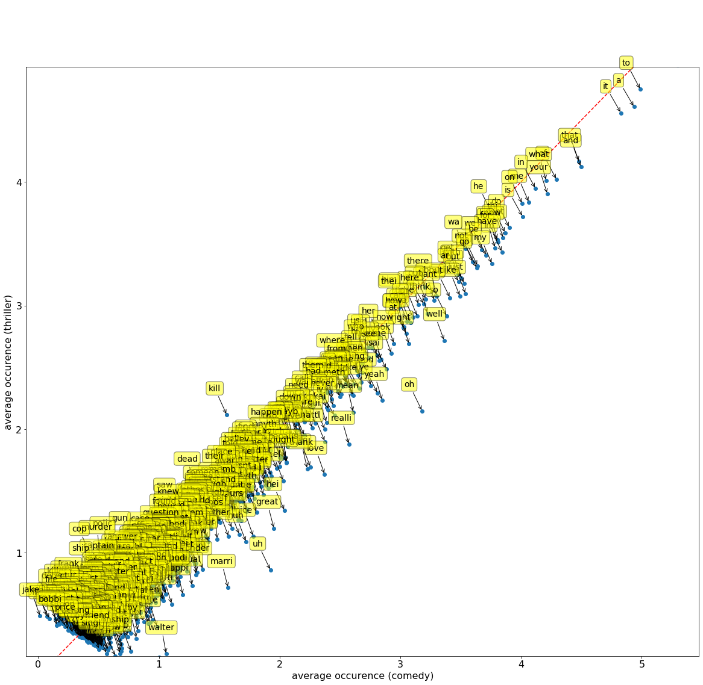

Run the cell below for an interactive plot! Hover over the invididual points to see what word each point is! For reference, the $\mu$ character you may see in some of the entries means to multiply by $10^{-6}$ or `0.000001`

**Code:**

```python
from IPython.display import HTML
HTML("https://raw.githubusercontent.com/jonathanferrari/static/main/word_plot.html")
```

Questions 3.1.1 through 3.1.4 will ask you to interpret the plot above. If no words are present in the specified area of the graph, try to think what characteristics would those words exhibit if points were located there. For each question, select one of the following choices and assign its number to the provided name.
1. The word is common in both comedy and thriller movies 
2. The word is uncommon in comedy movies and common in thriller movies
3. The word is common in comedy movies and uncommon in thriller movies
4. The word is uncommon in both comedy and thriller movies
5. It is not possible to say from the plot 

---
    
**Question 3.1.1**

What properties do words in the bottom left corner of the plot have? Your answer should be a single integer from 1 to 5, corresponding to the correct statement from the choices above.

**Student scaffold:**

```python
bottom_left = ...
```

**Solution:**

```python
bottom_left = 4 # SOLUTION
```

**Test — `q3_1_1` (4 points)**

```python
>>> isinstance(bottom_left, int)
True

>>> bottom_left >= 1 and bottom_left <= 5
True

# hidden test
>>> bottom_left == 4
True
```

---

**Question 3.1.2**

What properties do words in the bottom right corner have?

**Student scaffold:**

```python
bottom_right = ...
```

**Solution:**

```python
bottom_right = 3 # SOLUTION
```

**Test — `q3_1_2` (3 points)**

```python
>>> isinstance(bottom_right, int)
True

>>> bottom_right >= 1 and bottom_right <= 5
True

# hidden test
>>> bottom_right == 3
True
```

---

**Question 3.1.3**

What properties do words in the top right corner have?

**Student scaffold:**

```python
top_right = ...
```

**Solution:**

```python
top_right = 1 # SOLUTION
```

**Test — `q3_1_3` (4 points)**

```python
>>> isinstance(top_right, int)
True

>>> top_right >= 1 and top_right <= 5
True

# hidden test
>>> top_right == 1
True
```

---

**Question 3.1.4**

What properties do words in the top left corner have?

**Student scaffold:**

```python
top_left = ...
```

**Solution:**

```python
top_left = 2 # SOLUTION
```

**Test — `q3_1_4` (4 points)**

```python
>>> isinstance(top_left, int)
True

>>> top_left >= 1 and top_left <= 5
True

# hidden test
>>> top_left == 2
True
```

---

**Question 3.1.5**

If we see a movie with a lot of words that are common for comedy movies but uncommon for thriller movies, what would be a reasonable guess about the genre of the movie? Assign `movie_genre` to the integer corresponding to your answer:
1. It is a thriller movie.
2. It is a comedy movie.

**Student scaffold:**

```python
movie_genre_guess = ...
```

**Solution:**

```python
movie_genre_guess = 2 # SOLUTION
```

**Test — `q3_1_5` (4 points)**

```python
>>> isinstance(movie_genre_guess, int)
True

>>> movie_genre_guess >= 1 and movie_genre_guess <= 2
True

# hidden test
>>> movie_genre_guess == 2
True
```

---

**Question 3.1.6**

Using the plot above, make an array of at least 10 common words that you think might let you **distinguish** between comedy and thriller movies. Make sure to choose words that are **frequent enough** that every movie contains at least one of them. Don't just choose the most frequent words though--if they appear **too frequently**, they may not be helpful for distinguishing between comedy and thriller.

**Student scaffold:**

```python
# Set my_features to an array of at least 10 features (strings that are column labels)

my_features = ...

# Select the 10 features of interest from both the train and test sets
train_my_features = train_movies.select(my_features)
test_my_features = test_movies.select(my_features)
```

**Solution:**

```python
# Set my_features to an array of at least 10 features (strings that are column labels)

my_features = make_array('dead', 'gun', 'murder', 'kill', 'so', 'oh', 'well', 'he', 'she', 'who', 'where', 'thank', 'love', 'i', 'it', 'and', 'that', 'of', 'your', 'what') # SOLUTION

# Select the 10 features of interest from both the train and test sets
train_my_features = train_movies.select(my_features)
test_my_features = test_movies.select(my_features)
```

**Test — `q3_1_6` (3.0 points)**

```python
>>> len(my_features) >= 10
True

>>> np.all([f in test_movies.labels for f in my_features])
True

>>> len(set(my_features)) >= 10
True

>>> help_message = "It looks like there are many movies in the training set that \n                  don't have any of your chosen words.  That will make your\n                  classifier perform very poorly in some cases.  Try choosing\n                  at least one word that is used often.\n                  "
>>> train_f = train_movies.select(my_features)
>>> np.count_nonzero(train_f.apply(lambda r: np.sum(np.abs(np.array(list(r)))) == 0)) < len(my_features)
True

>>> help_message = "It looks like there are many movies in the test set that \n                  don't have any of your chosen words.  That will make your\n                  classifier perform very poorly in some cases.  Try choosing\n                  at least one word that is used often.\n                  "
>>> test_f = test_movies.select(my_features)
>>> np.count_nonzero(test_f.apply(lambda r: np.sum(np.abs(np.array(list(r)))) == 0)) < 5
True
```

This test makes sure that you have chosen words such that at least one appears in each movie. If you can't find words that satisfy this test just through intuition, try writing code to print out the titles of movies that do not contain any words from your list, then look at the words they do contain.

---
**Question 3.1.7**

In two sentences or less, describe how you selected your features.

**SOLUTION:** The staff features don't work very well. It's a good idea to pick words that are common in thriller movies but uncommon in comedy movies and vice-versa. These are points that are far away from the diagonal in the above plot.

Next, let's classify the first movie from our test set using these features.  You can examine the movie by running the cells below. Do you think it will be classified correctly?

**Code:**

```python
print("Movie:")
test_movies.take(0).select('Title', 'Genre').show()
print("Features:")
test_my_features.take(0).show()
```

*Output (stdout):*

```text
Movie:
```

*Output:*

| Title | Genre |
| --- | --- |
| ghostbusters ii | comedy |

*Output (stdout):*

```text
Features:
```

*Output:*

| dead | gun | murder | kill | so | oh | well | he | she | who | where | thank | love | i | it | ... |
| --- | --- | --- | --- | --- | --- | --- | --- | --- | --- | --- | --- | --- | --- | --- | --- |
| 0.000164853 | 0 | 0.000164853 | 0.000329707 | 0.00461589 | 0.00313221 | 0.00362677 | 0.00626442 | 0.00181339 | 0.00263765 | 0.00131883 | 0.00181339 | 0.000824266 | 0.0326409 | 0.0229146 | ... |

_... 5 more columns_

As before, we want to look for the movies in the training set that are most like our test movie.  We will calculate the Euclidean distances from the test movie (using `my_features`) to all movies in the training set.  You could do this with a `for` loop, but to make it computationally faster, we have provided a function, `fast_distances`, to do this for you.  Read its documentation to make sure you understand what it does.  (You don't need to understand the code in its body unless you want to.)

**Code:**

```python
# Just run this cell to define fast_distances.

def fast_distances(test_row, train_table):
    """Return an array of the distances between test_row and each row in train_table.

    Takes 2 arguments:
      test_row: A row of a table containing features of one
        test movie (e.g., test_my_features.row(0)).
      train_table: A table of features (for example, the whole
        table train_my_features)."""
    assert train_table.num_columns < 50, "Make sure you're not using all the features of the movies table."
    assert type(test_row) != datascience.tables.Table, "Make sure you are passing in a row object to fast_distances."
    assert len(test_row) == len(train_table.row(0)), "Make sure the length of test row is the same as the length of a row in train_table."
    counts_matrix = np.asmatrix(train_table.columns).transpose()
    diff = np.tile(np.array(list(test_row)), [counts_matrix.shape[0], 1]) - counts_matrix
    np.random.seed(0) # For tie breaking purposes
    distances = np.squeeze(np.asarray(np.sqrt(np.square(diff).sum(1))))
    eps = np.random.uniform(size=distances.shape)*1e-10 #Noise for tie break
    distances = distances + eps
    return distances
```

---

**Question 3.1.8**

Use the `fast_distances` function provided above to compute the distance from the first movie in your test set to all the movies in your training set, **using your set of features**. Make a new table called `genre_and_distances` with one row for each movie in the training set and two columns:
* The `"Genre"` of the training movie
* The `"Distance"` from the first movie in the test set 

Ensure that `genre_and_distances` is **sorted in ascending order by distance to the first test movie**.

*Hint:* Think about how you can use the variables you defined in 3.1.6.

**Student scaffold:**

```python
# The staff solution took multiple lines of code.
genre_and_distances = ...
genre_and_distances
```

**Solution:**

```python
# BEGIN SOLUTION NO PROMPT
distances = fast_distances(test_my_features.row(0), train_my_features)

genre_and_distances = Table().with_columns(
                               'Genre',    train_movies.column('Genre'),
                               'Distance', distances)\
                            .sort('Distance')
genre_and_distances.show(4)
# END SOLUTION
""" # BEGIN PROMPT
# The staff solution took multiple lines of code.
genre_and_distances = ...
genre_and_distances
"""; # END PROMPT
```

*Output:*

| Genre | Distance |
| --- | --- |
| comedy | 0.00539668 |
| thriller | 0.00634238 |
| comedy | 0.00665439 |
| thriller | 0.00768602 |

**Test — `q3_1_8` (3 points)**

```python
>>> genre_and_distances.labels == ('Genre', 'Distance')
True

>>> genre_and_distances.num_rows == train_movies.num_rows
True

>>> print(genre_and_distances.group('Genre'))
Genre    | count
comedy   | 102
thriller | 181

>>> np.allclose(genre_and_distances.column('Distance'), sorted(fast_distances(test_my_features.row(0), train_my_features)))
True
```

---

**Question 3.1.9**

Now compute the 7-nearest neighbors classification of the first movie in the test set.  That is, decide on its genre by finding the most common genre among its 7 nearest neighbors in the training set, according to the distances you've calculated.  Then check whether your classifier chose the right genre.  (Depending on the features you chose, your classifier might not get this movie right, and that's okay.)

*Hint 1:* You should use the `most_common` function that was defined earlier.

*Hint 2:* You should use a comparison operator.

**Student scaffold:**

```python
# Set my_assigned_genre to the most common genre among these.
my_assigned_genre = ...

# Set my_assigned_genre_was_correct to True if my_assigned_genre
# matches the actual genre of the first movie in the test set, False otherwise.
my_assigned_genre_was_correct = ...

print("The assigned genre, {}, was{}correct.".format(my_assigned_genre, " " if my_assigned_genre_was_correct else " not "))
```

**Solution:**

```python
# Set my_assigned_genre to the most common genre among these.
my_assigned_genre = most_common("Genre", genre_and_distances.take(np.arange(7))) # SOLUTION

# Set my_assigned_genre_was_correct to True if my_assigned_genre
# matches the actual genre of the first movie in the test set, False otherwise.
my_assigned_genre_was_correct = my_assigned_genre == test_movies.column("Genre").item(0) # SOLUTION

print("The assigned genre, {}, was{}correct.".format(my_assigned_genre, " " if my_assigned_genre_was_correct else " not "))
```

*Output (stdout):*

```text
The assigned genre, comedy, was correct.
```

**Test — `q3_1_9` (2 points)**

```python
>>> genre_and_distances.take(np.arange(7)).group('Genre').index_by('Genre')[my_assigned_genre][0].item('count') >= 4
True

>>> my_assigned_genre_was_correct == (my_assigned_genre == 'thriller')
False
```

---
## 3.2. A classifier function

Now we can write a single function that encapsulates the whole process of classification.

---
**Question 3.2.1**

Write a function called `classify`.  It should take the following three arguments:
* A list of distances between the test features and training features (e.g., `fast_distances(test_my_features.row(0), train_my_features)`).
* An array of classes (e.g. the labels "comedy" or "thriller") that has as many items as there are distances, and in the same order. *Hint:* What are the labels of each row in the training set? 
* `k`, the number of neighbors to use in classification.

It should return the class (the string `'comedy'` or the string `'thriller'`) a `k`-nearest neighbor classifier picks for the given row of features.

**Student scaffold:**

```python
def classify(distances, train_labels, k):
    """Return the most common class among k nearest neighbors given the distances and labels."""
    genre_and_distances = ...
    ...
```

**Solution:**

```python
def classify(distances, train_labels, k):
    """Return the most common class among k nearest neighbors given the distances and labels."""
    genre_and_distances = Table().with_columns('Genre', train_labels, 'Distance', distances).sort('Distance') # SOLUTION
    return most_common("Genre", genre_and_distances.take(np.arange(k))) # SOLUTION
```

**Test — `q3_2_1` (3.0 points)**

```python
>>> from collections import Counter
>>> g = train_movies.column('Genre')
>>> def check(r, k):
...     t = test_my_features.row(r)
...     distances = fast_distances(t, train_my_features)
...     return classify(distances, g, k) == Counter(np.take(g, np.argsort(fast_distances(t, train_my_features))[:k])).most_common(1)[0][0]
>>> check_5_nn = [check(i, 5) for i in np.arange(11)]
>>> all(check_5_nn)
True

>>> from collections import Counter
>>> g = train_movies.column('Genre')
>>> def check(r, k):
...     t = test_my_features.row(r)
...     distances = fast_distances(t, train_my_features)
...     return classify(distances, g, k) == Counter(np.take(g, np.argsort(fast_distances(t, train_my_features))[:k])).most_common(1)[0][0]
>>> check_11_nn = [check(i, 11) for i in np.arange(11)]
>>> all(check_11_nn)
True
```

---
**Question 3.2.2**

Assign `godzilla_genre` to the genre predicted by a **15-nearest neighors classifier** for the movie "godzilla" in the test set, using your `classify` function and your 10 features. 

*Hint:* The `row_for_title` function will not work here.

**Student scaffold:**

```python
# The staff solution first defined a row called godzilla_features.
godzilla_features = ...
godzilla_distances = fast_distances(godzilla_features, train_my_features)
godzilla_genre = ...
godzilla_genre
```

**Solution:**

```python
# The staff solution first defined a row called godzilla_features.
godzilla_features = test_movies.where("Title", "godzilla").select(my_features).row(0) # SOLUTION
godzilla_distances = fast_distances(godzilla_features, train_my_features)
godzilla_genre = classify(godzilla_distances, train_movies.column("Genre"), 15) # SOLUTION
godzilla_genre
```

*Output:*

```text
'thriller'
```

**Test — `q3_2_2` (3 points)**

```python
>>> from collections import Counter
>>> g = train_movies.column('Genre')
>>> r = np.where(test_movies['Title'] == 'godzilla')[0][0]
>>> t = test_my_features.row(r)
>>> godzilla_expected_genre = Counter(np.take(g, np.argsort(fast_distances(t, train_my_features))[:15])).most_common(1)[0][0]
>>> godzilla_genre == godzilla_expected_genre
True
```

Finally, when we evaluate our classifier, it will be useful to have a classification function that is specialized to use a fixed training set and a fixed value of `k`.

---
**Question 3.2.3**

Create a classification function that takes as its argument a row containing your 10 features and classifies that row using the 15-nearest neighbors algorithm with `train_my_features` as its training set.

**Student scaffold:**

```python
def classify_feature_row(row):
    ...

# When you're done, this should produce 'thriller' or 'comedy'.
classify_feature_row(test_my_features.row(0))
```

**Solution:**

```python
def classify_feature_row(row):
    return classify(fast_distances(row, train_my_features), train_movies.column('Genre'), 15) # SOLUTION

# When you're done, this should produce 'thriller' or 'comedy'.
classify_feature_row(test_my_features.row(0))
```

*Output:*

```text
'comedy'
```

**Test — `q3_2_3` (3 points)**

```python
>>> def check(r):
...     t = test_my_features.row(r)
...     return classify(fast_distances(t, train_my_features), train_movies.column('Genre'), 15) == classify_feature_row(t)
>>> all([check(i) for i in np.arange(15)])
True
```

---
## 3.3. Evaluating your classifier

Now that it's easy to use the classifier, let's see how accurate it is on the whole test set.

---

**Question 3.3.1**

Use `classify_feature_row` and `apply` to classify every movie in the test set.  Assign these guesses as an array to `test_guesses`.  Then, compute the proportion of correct classifications.

*Hint 1*: If you do not specify any columns in `t.apply(...)`, your function will be applied to every row object in Table `t`.

*Hint 2*: Which dataset do you want to apply this function to?

**Student scaffold:**

```python
test_guesses = ...
proportion_correct = ...
proportion_correct
```

**Solution:**

```python
test_guesses = test_my_features.apply(classify_feature_row) # SOLUTION
proportion_correct = np.count_nonzero(test_guesses == test_movies.column('Genre')) / test_movies.num_rows # SOLUTION
proportion_correct
```

*Output:*

```text
0.84
```

**Test — `q3_3_1` (3 points)**

```python
>>> 0 <= proportion_correct <= 1
True

# hidden test
>>> r = np.count_nonzero(test_guesses == test_movies.column('Genre')) / test_movies.num_rows
>>> proportion_correct == r
True
```

---

**Question 3.3.2** 

An important part of evaluating your classifiers is figuring out where they make mistakes. Assign the name `test_movie_correctness` to a table with three columns, `'Title'`, `'Genre'`, and `'Was correct'`. 

- The `'Genre'` column should contain the original genres, not the ones you predicted. 
- The `'Was correct'` column should contain `True` or `False` depending on whether or not the movie was classified correctly.

**Student scaffold:**

```python
# Feel free to use multiple lines of code
# but make sure to assign test_movie_correctness to the proper table!
test_movie_correctness = ...
test_movie_correctness.sort('Was correct', descending = True).show(5)
```

**Solution:**

```python
# Feel free to use multiple lines of code
# but make sure to assign test_movie_correctness to the proper table!
test_movie_correctness = test_movies.with_column('Was correct', test_guesses == test_movies.column('Genre')).select('Title', 'Genre', 'Was correct') # SOLUTION
test_movie_correctness.sort('Was correct', descending = True).show(5)
```

*Output:*

| Title | Genre | Was correct |
| --- | --- | --- |
| ghostbusters ii | comedy | True |
| intolerable cruelty | comedy | True |
| psycho | thriller | True |
| book of shadows: blair witch 2 | thriller | True |
| the getaway | thriller | True |

**Test — `q3_3_2` (3 points)**

```python
>>> test_movie_correctness.labels == ('Title', 'Genre', 'Was correct')
True

>>> test_movie_correctness.num_rows == test_movies.num_rows
True

>>> print(test_movie_correctness.group('Genre'))
Genre    | count
comedy   | 17
thriller | 33
```

---

**Question 3.3.3** 

Do you see a pattern in the types of movies your classifier misclassifies? In two sentences or less, describe any patterns you see in the results or any other interesting findings from the table above. If you need some help, try looking up the movies that your classifier got wrong on Wikipedia.

**SOLUTION:** The classifier tends to misclassify movies that have both comedy and thriller elements in them.

At this point, you've gone through one cycle of classifier design.  Let's summarize the steps:
1. From available data, select test and training sets.
2. Choose an algorithm you're going to use for k-NN classification.
3. Identify some features.
4. Define a classifier function using your features and the training set.
5. Evaluate its performance (the proportion of correct classifications) on the test set.

---
# Part 4: Explorations
Now that you know how to evaluate a classifier, it's time to build another one.

Your friends are big fans of comedy and thriller movies. They have created their own dataset of movies that they want to watch, but they need your help in determining the genre of each movie in their dataset (comedy or thriller). You have never seen any of the movies in your friends' dataset, so none of your friends' movies are present in your training or test set from earlier. In other words, this new dataset of movies can function as another test set that we are going to make predictions on based on our original training data. 

Run the following cell to load your friends' movie data.

> **Note:** The `friend_movies` table has $5005$ columns, so we only show the first $105$ to stop this cell from crashing your notebook.

**Code:**

```python
friend_movies = Table.read_table('friend_movies.csv')
friends_subset = friend_movies.select(np.arange(106))
friends_subset.show(5)
```

*Output:*

| Title | Year | Rating | Genre | # Words | she | decid | talk | wit | razor | slam | credit | rai | hugh | breez | ... |
| --- | --- | --- | --- | --- | --- | --- | --- | --- | --- | --- | --- | --- | --- | --- | --- |
| black rain | 1989/I | 6.4 | thriller | 2834 | 0.00336952 | 0 | 0.00149757 | 0 | 0 | 0 | 0 | 0 | 0 | 0 | ... |
| bringing out the dead | 1999 | 6.8 | thriller | 5415 | 0.0050077 | 0 | 0.00192604 | 0 | 0 | 0 | 0 | 0 | 0 | 0 | ... |
| basic | 2003 | 6.3 | thriller | 7538 | 0.0001374 | 0.000412201 | 0.00316021 | 0.000687002 | 0 | 0 | 0 | 0.00219841 | 0 | 0 | ... |
| detroit rock city | 1999 | 6.5 | comedy | 4710 | 0.00411429 | 0 | 0.000685714 | 0 | 0 | 0 | 0 | 0 | 0 | 0 | ... |
| panic room | 2002 | 6.9 | thriller | 2868 | 0.0112768 | 0 | 0.00109131 | 0 | 0 | 0 | 0 | 0 | 0 | 0 | ... |

_... 91 more columns_

---

**Question 4.1** 

Your friend's computer is not as powerful as yours, so they tell you that the classifier you create for them can only have up to 5 words as features. Develop a new classifier with the constraint of **using no more than 5 features.** Assign `new_features` to an array of your features.

Your new function should have the same arguments as `classify_feature_row` and return a classification. Name it `another_classifier`. Then, output your accuracy using code from earlier. We can look at the value to compare the new classifier to your old one. 

Some ways you can change your classifier are by using different features or trying different values of `k`. (Of course, you still have to use `train_movies` as your training set!)

**Make sure you don't reassign any previously used variables here**, such as `proportion_correct` from the previous question.

*Note:* There's no one right way to do this! Just make sure that you can explain your reasoning behind the new choices.

**Student scaffold:**

```python
new_features = ...

train_new = train_movies.select(new_features)
test_new = friend_movies.select(new_features)

def another_classifier(row):
    ...
```

**Solution:**

```python
new_features = make_array("laugh", "marri", "dead", "heart", "cop") # SOLUTION

train_new = train_movies.select(new_features)
test_new = friend_movies.select(new_features)

def another_classifier(row):
    return classify(fast_distances(row, train_new), train_movies.column('Genre'), 15) # SOLUTION
```

**Test — `q4_1` (3 points)**

```python
>>> len(new_features) <= 5
True

>>> another_classifier(test_new.row(0)) in ['comedy', 'thriller']
True
```

---

**Question 4.2** 

Do you see a pattern in the mistakes your new classifier makes? How good an accuracy were you able to get with your limited classifier? Did you notice an improvement from your first classifier to the second one? Describe in three sentences or less. 

*Hint:* You may not be able to see a pattern.

**SOLUTION:** Any reasonable student solution is fine.

---

**Question 4.3** 

Given the constraint of five words, how did you select those five? Describe in two sentences or less.

**SOLUTION:** You were meant to put in at least some minimal effort.

---
# (OPTIONAL) Part 5: Document Embeddings

<span style="color: #BC412B">**This optional part will not be scored.**</span>

Neural networks are an effective way to use numerical optimization to detect features automatically as an alternative to manual feature selection, which is what we did to build our own classifier in Parts 1-4. However, instead of picking an interpretable set of word features, neural networks typically represent text as a sequence of numerical features that don't individually have meaning, but together are very effective for computing similarity between different text documents.

For text classification, the best performing approaches all involve a *foundation model*, which is a neural network trained on large quantities of web text (such as Wikipedia) that can take in text as input and generate a fixed-length list of numerical features about that text called an *embedding* or *embedding vector*. These features are trained to predict more text (such as [hidden words in a sentence](https://en.wikipedia.org/wiki/BERT_(language_model))), but they can be used to predict many other properties of text (such as the genre of a movie script) because similar documents will have similar embeddings.

The file `embeddings.csv` contains a table with 333 columns, with the title of each movie as a column label, and 768 rows of numbers. Each column contains the numeric "features" of the embedding that a neural network chose to represent the screenplay of that movie.  The length 768 is called the *dimension* of the embedding vector and is determined by the neural network. Embeddings with larger dimension carry more information, but take more time and memory to compute.

These particular embeddings were generated from full screenplays using the public [`sentence-transformers/all-mpnet-base-v2`](https://huggingface.co/sentence-transformers/all-mpnet-base-v2) model. 
This model can only embed about 200 words at a time, and so each screenplay was split into overlapping 200-word chunks, each chunk was embedded separately, and the per-chunk embeddings were averaged.

## 5.1. Load the embeddings

Generating embeddings took about an hour on a 2024 Macbook Air and involved a few features of Python that are beyond the scope of Data 8, but most of the work was done by this code:

```
!pip install sentence-transformers

from sentence_transformers import SentenceTransformer

MODEL_NAME = 'sentence-transformers/all-mpnet-base-v2'
model = SentenceTransformer(MODEL_NAME)

embeddings = model.encode(
    screenplay_texts,  # the text had to be read from files first
    batch_size=32,
    normalize_embeddings=True,
    convert_to_numpy=True)
```

However, generating embeddings required access to the text of the screenplays, which are protected by copyright and therefore can't be published as part of this project. (Collecting all the screenplays was the hard part of setting this up!) Therefore, in this project we'll just load embeddings rather than generating them.

**Important:** The embeddings table has one **column** per movie, and so for some movie title `t`, `embeddings.column(t)` is an array containing the embedding for that movie. By contrast, the `movies` table had one **row** per movie.

**Code:**

```python
embeddings = Table.read_table('embeddings.csv')
print('Rows:', embeddings.num_rows, 'Columns:', embeddings.num_columns)
print('The first 10 numbers in the ghostbusters embedding:')
embeddings.take(np.arange(10)).column('ghostbusters')
```

*Output (stdout):*

```text
Rows: 768 Columns: 333
The first 10 numbers in the ghostbusters embedding:
```

*Output:*

```text
array([ 0.0350976,  0.0225712,  0.0117734,  0.0302478, -0.0401758,
        0.0247453,  0.0159186,  0.0137001, -0.0476095, -0.0105427])
```

## 5.2. Implementing a k-NN Classifier Using These Embeddings as Features

The similarity of two screenplay embeddings uses a different notion of distance than the Euclidean distance we used before. Instead of summing the square difference between feature values, we sum the product of feature values. This way of computing similarity, called a [dot product](https://en.wikipedia.org/wiki/Dot_product) or [cosine similarity](https://en.wikipedia.org/wiki/Cosine_similarity), is the standard way that embeddings are compared in neural networks. Due to how the embeddings were constructed, the cosine similarity is always between 0 and 1. Larger similarities correspond to smaller distances, so we subtract the cosine similarity from 1 to get a distance between embeddings.

**Code:**

```python
def embedding_distance(embedding1, embedding2): 
    """1 - the cosine similarity between two arrays of feature values."""
    return 1 - sum(embedding1 * embedding2)

def embedding_distances(one_embedding, embedding_table):
    """Returns the embedding distances between a single movie `one_embedding` and all movies in `embedding_table`"""
    return [embedding_distance(one_embedding, other) for other in embedding_table.columns]
```

We split the embeddings into the same collection of train and test movies used previously.

**Code:**

```python
train_embeddings = embeddings.select(train_movies.column(0))
test_embeddings = embeddings.select(test_movies.column(0))
```

Run the cells below to see what `train_embeddings` and `test_embeddings` look like.

**Code:**

```python
train_embeddings.show(5)
```

*Output:*

| 10 things i hate about you | sister act | the boondock saints | mystery men | blade | i am legend | shock treatment | pleasantville | from dusk till dawn | moonstruck | léon | alien nation | a nightmare on elm street 4: the dream master | scream 3 | virtuosity | ... |
| --- | --- | --- | --- | --- | --- | --- | --- | --- | --- | --- | --- | --- | --- | --- | --- |
| 0.0469586 | 0.0039873 | 0.00333046 | 0.0141143 | 0.0396959 | 0.0287893 | 0.0173495 | 0.0346308 | 0.0118968 | 0.0223673 | -0.000392627 | 0.000191517 | 0.0597783 | 0.0183814 | 0.00102015 | ... |
| 0.00346249 | 0.0740435 | 0.00897714 | 0.0130988 | -0.0423213 | -0.0433262 | 0.0291455 | 0.0573025 | -0.00942935 | 0.0145713 | -0.0134694 | -0.0219475 | 0.0125905 | 0.0189361 | 0.0320754 | ... |
| -0.00213907 | 3.38439e-05 | 0.0120304 | 0.005265 | 0.0200688 | 0.0123978 | 0.00936564 | -0.00112931 | 0.00811167 | -0.0124665 | -0.0126748 | 0.0214689 | -0.025597 | 0.0271983 | 0.0141517 | ... |
| 0.0155936 | 0.0325617 | 0.0189684 | 0.0348103 | 0.0516701 | -0.00090423 | 0.0127574 | -0.0143826 | 0.00803517 | 0.0381227 | 0.0570683 | 0.0228714 | 0.00898003 | 0.00791753 | 0.0363468 | ... |
| -0.0106944 | -0.0585625 | -0.0594621 | -0.0124971 | -0.0545942 | -0.0684297 | -0.0195075 | -0.00416745 | -0.0509507 | -0.0566781 | -0.0222475 | -0.0608558 | -0.0212319 | -0.0331815 | -0.0381351 | ... |

_... 268 more columns_

**Code:**

```python
test_embeddings.show(5)
```

*Output:*

| ghostbusters ii | intolerable cruelty | psycho | book of shadows: blair witch 2 | the getaway | broadcast news | mission: impossible | meet john doe | arctic blue | the world is not enough | leviathan | the atomic submarine | the adventures of buckaroo banzai across the 8th dimension | halloween 4: the return of michael myers | the french connection | ... |
| --- | --- | --- | --- | --- | --- | --- | --- | --- | --- | --- | --- | --- | --- | --- | --- |
| 0.0364849 | 0.0145892 | 0.0120136 | -0.00640824 | 0.0188365 | 0.0157983 | 0.0213665 | 0.0178835 | 0.020165 | 0.0377392 | 0.0136473 | 0.0504422 | 0.0442396 | -0.0033382 | -0.0333481 | ... |
| 0.0253633 | 0.0608128 | 0.0188091 | -0.0147766 | 0.0143326 | -0.00446131 | -0.00293852 | 0.0133455 | 0.0209694 | -0.0326822 | 0.00352147 | -0.00916806 | -0.00203301 | -0.0012572 | 0.028067 | ... |
| 0.00723184 | 0.015014 | -0.0166357 | -0.00161786 | 0.00724065 | 0.00903097 | 0.000250128 | 0.0309874 | 0.0260898 | 0.0155423 | 0.0135257 | 0.00819304 | 0.0427162 | -0.0100295 | 0.0239392 | ... |
| 0.022336 | 0.0102866 | 0.035797 | 0.0421161 | 0.0283772 | -0.00689689 | 0.0244427 | 0.0266206 | 0.0269378 | 0.0365846 | -0.0131198 | -0.0456212 | 0.0228802 | 0.0400442 | 0.0479148 | ... |
| -0.046498 | -0.066838 | -0.079656 | -0.0572747 | -0.0610997 | -0.0180762 | -0.0682271 | -0.0437503 | -0.0484994 | -0.0549126 | -0.0543545 | -0.0306108 | -0.000779182 | -0.0443094 | -0.0556951 | ... |

_... 35 more columns_

`classify_embedding` predicts a genre label for a test movie embedding by finding the `k` training movies with the highest cosine similarity and returning their most common genre.

**Code:**

```python
def classify_embedding(test_embedding, train_embeddings, train_labels, k):
    distances = embedding_distances(test_embedding, train_embeddings)
    return classify(distances, train_labels, k)    

# Try it on the first test movie
print(test_embeddings.labels[0])
classify_embedding(test_embeddings.column(0), train_embeddings, train_movies.column('Genre'), 7)
```

*Output (stdout):*

```text
ghostbusters ii
```

*Output:*

```text
'comedy'
```

## 5.3. Evaluate on the test set

It's up to you to complete the evaluation of a k-NN classifier that uses these embeddings. Call `classify_embedding` on each of the `test_embeddings` and see how often the genre is correct. Assign your accuracy to `accuracy`. With `k=15`, you should get an accuracy of roughly 90%. Not bad, considering we didn't have to perform any feature selection!


*Hint:* The movie in column i of `test_embeddings` corresponds to the same movie in row i of `test_movies`.

**Student scaffold:**

```python
embedding_predictions = ...
...
    predicted_label = ...
    embedding_predictions = ...
accuracy = ...
accuracy
```

**Solution:**

```python
""" # BEGIN PROMPT
embedding_predictions = ...
...
    predicted_label = ...
    embedding_predictions = ...
accuracy = ...
accuracy
"""; # END PROMPT
# BEGIN SOLUTION NO PROMPT
embedding_predictions = make_array()
for c in np.arange(test_movies.num_rows):
    predicted_label = classify_embedding(test_embeddings.column(c), train_embeddings, train_movies.column('Genre'), 15)
    embedding_predictions = np.append(embedding_predictions, predicted_label)
accuracy = np.mean(embedding_predictions == test_movies.column('Genre'))
accuracy
# END SOLUTION
```

*Output:*

```text
0.90000000000000002
```

**Test — `q5_3` (0 points)**

```python
>>> from project3_check import correctness_check_5
>>> correctness_check_5(accuracy)
True
```

Next, you could investigate the mistakes that this classifier makes and compare it to the one you created using word frequency features.

---
Please make sure you have added your partner on Pensive. If you have done it, set `add_partner` to True.

*Note:* The variable should be set to True if you don’t have a partner.

**Student scaffold:**

```python
add_partner = ...
```

**Solution:**

```python
add_partner = True # SOLUTION
```

**Test — `q5_1` (2 points)**

```python
>>> add_partner == add_partner
True
```

You're finished! Time to submit. 


**Reminders:**
- Please remember to **add your partner to your Pensive submission**. If you resubmit, make sure to re-add your partner, as Pensive does not save any partner information. 
- Please note that filling out the Official Project 2 Partner form is NOT the same as adding your partner to your Pensive submission.
- <span style="color: #BC412B">**Remove any `tbl.show()` calls** (calls to `.show` with no argument) and any unneccessary print statements.</span> Forgetting to do this may cause issues when running your notebook on Pensive.
- Make sure to wait until the autograder finishes running to ensure that your submission was processed properly and that you submitted to the correct assignment.


##### **Congratulations -- MaoMao is proud of you for finishing Project 3!**

---

To double-check your work, the cell below will rerun all of the autograder tests.

## Submission

Make sure you have run all cells in your notebook in order before running the cell below, so that all images/graphs appear in the output. The cell below will generate a zip file for you to submit. **Please save before exporting!**

---

## Datasets

Datasets this notebook loads with `Table.read_table`. Column names are exact, including spaces and capitalization. Only the schema is recorded here — the data itself is not in this document, so any question about its values must be answered by running code, not by reasoning over the rows shown elsewhere in this file.

### `movies.csv`

333 rows, 5005 columns.

| Column | Type |
| --- | --- |
| `Title` | str |
| `Year` | str |
| `Rating` | float |
| `Genre` | str |
| `# Words` | int |
| `she` | float |
| `decid` | float |
| `talk` | float |
| `wit` | float |
| `razor` | float |
| `slam` | float |
| `credit` | float |
| `rai` | float |
| `hugh` | float |
| `breez` | float |
| `conscienc` | float |
| `audienc` | float |
| `cathi` | float |
| `log` | float |
| `met` | float |
| `chosen` | float |
| `grip` | float |
| `booz` | float |
| `bianca` | float |
| `doubl` | float |
| `agent` | float |
| `exit` | float |
| `carpent` | float |
| `underground` | float |
| `clemenza` | float |
| `gain` | float |
| `neg` | float |
| `majesti` | float |
| `studio` | float |
| `chri` | float |
| `spin` | float |
| `greater` | float |
| `eaten` | float |
| `vibrat` | float |
| `stupid` | float |

_... 4,965 more columns, all float_

### `stem.csv`

40,053 rows, 2 columns.

| Column | Type |
| --- | --- |
| `Stem` | str |
| `Word` | str |

### `friend_movies.csv`

37 rows, 5005 columns.

| Column | Type |
| --- | --- |
| `Title` | str |
| `Year` | str |
| `Rating` | float |
| `Genre` | str |
| `# Words` | int |
| `she` | float |
| `decid` | float |
| `talk` | float |
| `wit` | float |
| `razor` | float |
| `slam` | float |
| `credit` | float |
| `rai` | float |
| `hugh` | float |
| `breez` | float |
| `conscienc` | float |
| `audienc` | float |
| `cathi` | float |
| `log` | float |
| `met` | float |
| `chosen` | float |
| `grip` | float |
| `booz` | float |
| `bianca` | float |
| `doubl` | float |
| `agent` | float |
| `exit` | float |
| `carpent` | float |
| `underground` | float |
| `clemenza` | float |
| `gain` | float |
| `neg` | float |
| `majesti` | float |
| `studio` | float |
| `chri` | float |
| `spin` | float |
| `greater` | float |
| `eaten` | float |
| `vibrat` | float |
| `stupid` | float |

_... 4,965 more columns, all float_

### `embeddings.csv`

768 rows, 333 columns.

| Column | Type |
| --- | --- |
| `10 things i hate about you` | float |
| `sister act` | float |
| `the boondock saints` | float |
| `mystery men` | float |
| `blade` | float |
| `i am legend` | float |
| `shock treatment` | float |
| `pleasantville` | float |
| `from dusk till dawn` | float |
| `moonstruck` | float |
| `léon` | float |
| `alien nation` | float |
| `a nightmare on elm street 4: the dream master` | float |
| `scream 3` | float |
| `virtuosity` | float |
| `vertigo` | float |
| `waxwork` | float |
| `star trek: first contact` | float |
| `insomnia` | float |
| `it happened one night` | float |
| `bean` | float |
| `true romance` | float |
| `air force one` | float |
| `gattaca` | float |
| `someone to watch over me` | float |
| `the hebrew hammer` | float |
| `the negotiator` | float |
| `strange days` | float |
| `dark angel` | float |
| `the devil and daniel webster` | float |
| `chinatown` | float |
| `crime spree` | float |
| `the seventh victim` | float |
| `indiana jones and the last crusade` | float |
| `ghostbusters` | float |
| `the apartment` | float |
| `my girl` | float |
| `agnes of god` | float |
| `man on the moon` | float |
| `notting hill` | float |

_... 293 more columns, all float_


---

# project3c

---
title: "Project 3: Movie Classification"
assignment: project3c
semester: sp26
source: semester_assignments/sp26/project/project3c/autograder/project3c.ipynb
version: solution (autograder) with student scaffolds
student_source: semester_assignments/sp26/project/project3c/student/project3c.ipynb
language: python
---


# Project 3: Movie Classification

Welcome to the third and final project of Data 8! You will build a classification model that guesses whether a movie is a comedy or a thriller by using only the number of times chosen words appear in the movie's screenplay. By the end of the project, you should know how to:

1. Build a k-nearest-neighbors classifier.
2. Test a classifier on data.

### Logistics

**Deadline.**  This project is due at **5:00pm PT on Friday, 5/1**. You can receive 5 bonus points for submitting the project by **5:00pm PT on Thursday, 4/30.** Projects will be accepted up to 1 day (24 hours) late. Projects submitted fewer than 24 hours after the deadline will receive 80% credit. Any submissions later than 24 hours after the deadline will not be accepted. It's **much** better to be early than late, so start working now.

**Checkpoint.** For full credit on the checkpoint, you must complete the questions up to the checkpoint, **pass all _public_ autograder tests** for those sections, and submit to the Pensieve Project 03 Checkpoint assignment by **5:00pm PT on Friday, 11/21**.  <span style="color: #BC412B">**The checkpoint is worth 1 lab score**</span>. After you've submitted the checkpoint, you may still change your project answers before the final project deadline - **only your final submission, to the "Project 03 Autograder" assignment, will be graded for correctness** (including questions from before the checkpoint). You will have some lab time to work on these questions, but we recommend that you start the project before lab and leave time to finish the checkpoint afterward.

**Partners.** You may work with one other partner; your partner must be from your assigned lab section. **<span style="color: #BC412B">Only one partner should submit the project notebook to Pensieve.</span> If both partners submit, you will be docked 10% of your project grade. On Pensieve, the person who submits should also designate their partner so that both of you receive credit.** Once you submit, click into your submission, and there will be an option to Add Group Member in the top right corner. You may also reference [this walkthrough video](https://drive.google.com/file/d/1bs1l_f44tUeF1yKY_iljZMTE1X0dYKLl/view?usp=sharing) on how to add partners on Pensieve.

**Rules.** Don't share your code with anybody but your partner. You are welcome to discuss questions with other students, but don't share the answers. The experience of solving the problems in this project will prepare you for exams (and life). If someone asks you for the answer, resist! Instead, you can demonstrate how you would solve a similar problem.

**Support.** You are not alone! Come to office hours, post on Ed, and talk to your classmates. If you want to ask about the details of your solution to a problem, make a private Ed post and the staff will respond. If you're ever feeling overwhelmed or don't know how to make progress, email your TA or tutor for help. You can find contact information for the staff on the [course website](https://www.data8.org/su26/).

**Tests.** <span style="color: #BC412B">The tests that are given are **not comprehensive** and passing the tests for a question **does not** mean that you answered the question correctly.</span> For table manipulation questions, tests usually only check that your table has the correct column labels. Similarly, on multiple choice / select all that apply questions, tests are only checking that your response in the right format, not that it is correct. However, more tests will be applied to verify the correctness of your submission in order to assign your final score, so be careful and check your work! You might want to create your own checks along the way to see if your answers make sense. Additionally, before you submit, make sure that none of your cells take a very long time to run (several minutes).

**Free Response Questions:** Make sure that you put the answers to the written questions in the indicated cell we provide. **Every free response question should include an explanation** that adequately answers the question. 

**Advice.** Develop your answers incrementally. To perform a complicated task, break it up into steps, perform each step on a different line, give a new name to each result, and check that each intermediate result is what you expect. You can add any additional names or functions you want to the provided cells. Make sure that you are using distinct and meaningful variable names throughout the notebook. Along that line, **DO NOT** reuse the variable names that we use when we grade your answers. 

You **never** have to use just one line in this project or any others. Use intermediate variables and multiple lines as much as you would like!

**All of the concepts necessary for this project are found in the textbook.** If you are stuck on a particular problem, reading through the relevant textbook section will often help to clarify concepts.

---

The point breakdown for this assignment is given in the table below:
| Category | Points |
| --- | --- |
| Autograder (Coding questions) | 87 |
| Written | 13 |
| **Total** | 100 |

---

To get started, load `datascience`, `numpy`, and `plots`. Make sure to also run the first cell of this notebook to load `otter`.

**Code:**

```python
# Run this cell to set up the notebook, but please don't change it.
import numpy as np
import math
import datascience 
from datascience import *

# These lines set up the plotting functionality and formatting.
import matplotlib
%matplotlib inline
import matplotlib.pyplot as plots
plots.style.use('fivethirtyeight')
import warnings
warnings.simplefilter("ignore")
```

---
# Part 1: The Dataset

In this project, we are exploring movie screenplays. We'll be trying to predict each movie's genre from the text of its screenplay. In particular, we have compiled a list of 5,000 words that occur in conversations between movie characters. For each movie, our dataset tells us the frequency with which each of these words occurs in certain conversations in its screenplay. All words have been converted to lowercase.

Run the cell below to read the `movies` table. **It may take up to a minute to load.**

**Code:**

```python
movies = Table.read_table('movies.csv')
```

Here is one row of the table and some of the frequencies of words that were said in the movie.

**Code:**

```python
movies.where("Title", "runaway bride").select(0, 1, 2, 3, 4, 14, 49, 1042, 4004)
```

*Output:*

| Title | Year | Rating | Genre | # Words | breez | england | it | bravo |
| --- | --- | --- | --- | --- | --- | --- | --- | --- |
| runaway bride | 1999 | 5.2 | comedy | 4895 | 0 | 0 | 0.0234092 | 0 |

The above cell prints a few columns of the row for the comedy movie *Runaway Bride*.  The movie contains 4895 words. The word "it" appears 115 times, as it makes up  $\frac{115}{4895} \approx 0.0234092$ of the words in the movie. The word "england" doesn't appear at all.

Additional context: This numerical representation of a body of text, one that describes only the frequencies of individual words, is called a bag-of-words representation. This is a model that is often used in [NLP](https://en.wikipedia.org/wiki/Natural_language_processing). A lot of information is discarded in this representation: the order of the words, the context of each word, who said what, the cast of characters and actors, etc. However, a bag-of-words representation is often used for machine learning applications as a reasonable starting point, because a great deal of information is also retained and expressed in a convenient and compact format. 

In this project, we will investigate whether this representation is sufficient to build an accurate genre classifier.

All movie titles are unique. The `row_for_title` function provides fast access to the one row for each title. 

*Note: All movies in our dataset have their titles lower-cased.*

**Code:**

```python
title_index = movies.index_by('Title')
def row_for_title(title):
    """Return the row for a title, similar to the following expression (but faster)
    
    movies.where('Title', title).row(0)
    """
    return title_index.get(title)[0]

row_for_title('toy story')
```

*Output:*

```text
Row(Title='toy story', Year='1995', Rating=8.1999999999999993, Genre='comedy', # Words=3016, she=0.0017427675148135001, decid=0.00034855350296270001, talk=0.0017427675148135001, wit=0.0, razor=0.0, slam=0.0, credit=0.0, rai=0.0, hugh=0.0, breez=0.0, conscienc=0.0, audienc=0.0, cathi=0.0, log=0.0, met=0.0, chosen=0.0, grip=0.0, booz=0.0, bianca=0.0, doubl=0.00034855350296270001, agent=0.0, exit=0.0, carpent=0.0, underground=0.0, clemenza=0.0, gain=0.0, neg=0.00069710700592540001, majesti=0.0, studio=0.0, chri=0.0, spin=0.0, greater=0.0, eaten=0.0, vibrat=0.0, stupid=0.0010456605088881, cigarett=0.0, jesu=0.0, mani=0.0, violin=0.0, financi=0.00034855350296270001, bai=0.0, cop=0.0, neighbor=0.0, cd=0.0, england=0.0, made=0.00034855350296270001, conni=0.0, instinct=0.0, took=0.0, jacquelin=0.0, mace=0.0, disappear=0.0, waltz=0.0, behind=0.00034855350296270001, bourbon=0.0, favorit=0.00069710700592540001, benni=0.0, manhattan=0.0, nixon=0.0, lunch=0.0, principl=0.0, tradit=0.0, counterfeit=0.0, sophi=0.0, third=0.0, exist=0.0, wouldv=0.00034855350296270001, hero=0.0, theyr=0.0024398745207389002, anytim=0.0, christin=0.0, vallei=0.0, chess=0.0, paid=0.0, burglar=0.0, nostril=0.0, rubber=0.0, human=0.0, british=0.0, plissken=0.0, eddi=0.0, gee=0.0, offend=0.0, rebecca=0.0, anger=0.0, plant=0.0, famou=0.0, repres=0.0, latest=0.0, rent=0.0, dip=0.0, bell=0.0, andi=0.0069710700592541001, so=0.0017427675148135001, london=0.0, cooler=0.0, keaton=0.0, portland=0.0, headlin=0.0, whatta=0.0, fatal=0.0, sew=0.0, cheer=0.0, davi=0.0, feed=0.0, hudson=0.0, ambros=0.0, digest=0.0, redi=0.0, fri=0.0, staff=0.00069710700592540001, casino=0.0, occasion=0.0, shadow=0.0, work=0.00069710700592540001, restrain=0.00034855350296270001, face=0.0, exercis=0.0, sidnei=0.0, pile=0.0, whyd=0.0, teenag=0.0, her=0.0013942140118508, retir=0.0, hazard=0.0, roth=0.0, hurrican=0.0, impuls=0.0, ranger=0.0020913210177761999, pour=0.0, lester=0.0, slash=0.0, deer=0.0, could=0.0013942140118508, vital=0.0, qualiti=0.0, coma=0.0, incred=0.0, hank=0.0, famili=0.0, duchess=0.0, global=0.0, virgin=0.0, scientif=0.0, between=0.0, holidai=0.0, qualifi=0.0, moor=0.0, happili=0.0, arizona=0.0, non=0.0, bruce=0.0, ankl=0.0, constant=0.0, buzz=0.0163820146392471, harder=0.0, ing=0.0, christian=0.0, palmer=0.0, tent=0.0, sunset=0.0, damour=0.0, cohaagen=0.0, advertis=0.0, sensat=0.0, local=0.0, there=0.0080167305681421996, terri=0.0, sedat=0.0, rotten=0.0, struck=0.0, deck=0.0, past=0.0, bro=0.0, ann=0.0, dump=0.0, kane=0.0, slot=0.0, immun=0.0, block=0.00034855350296270001, lil=0.0, technic=0.0, tactic=0.0, pencil=0.0, outsid=0.0, laboratori=0.0, easi=0.0, nephew=0.0, coffin=0.0, pretti=0.0, coward=0.0, verbal=0.0, permiss=0.0, bartend=0.0, wont=0.0, watch=0.0013942140118508, lindenmey=0.0, cosmo=0.0, capabl=0.00034855350296270001, flirt=0.0, huge=0.0, berkelei=0.0, max=0.0, walter=0.0, lime=0.0, rico=0.0, marvin=0.0, aboard=0.0, bacon=0.0, account=0.0, kirk=0.0, quaid=0.0, stunt=0.00034855350296270001, closet=0.0, due=0.0, nuclear=0.0, blind=0.0, pussi=0.0, howdi=0.00034855350296270001, snuff=0.0, eas=0.00034855350296270001, now=0.0076681770651794998, leak=0.0, underwear=0.0, westlei=0.0, mayb=0.0, theo=0.0, limo=0.0, cousin=0.0, illeg=0.0, silli=0.0, against=0.0, done=0.00034855350296270001, district=0.0, invad=0.0, ryan=0.0, wait=0.0034855350296270002, grudg=0.0, charact=0.0, hick=0.0, jami=0.0, lifetim=0.0, lecktor=0.0, and=0.0083652840711049004, republican=0.0, life=0.0, hidden=0.0, wire=0.0, paranoia=0.0, network=0.0, messi=0.0, uthatu=0.0, effort=0.0, carri=0.0, windham=0.0, fun=0.00034855350296270001, psychologist=0.0, sean=0.0, scent=0.0, answer=0.0, mom=0.0031369815266642999, wake=0.0, sign=0.0, ho=0.0, relat=0.0, jame=0.0, fat=0.0, myself=0.0, disrupt=0.0, scan=0.0, vagu=0.0, basket=0.0, christma=0.00069710700592540001, estim=0.0, em=0.0013942140118508, union=0.0, involv=0.0, norman=0.0, suspici=0.0, becom=0.0, shoe=0.0, librari=0.0, administr=0.0, ford=0.0, complic=0.

... [output truncated, 64204 more characters]
```

For example, the fastest way to find the frequency of "fun" in the movie *Toy Story* is to access the `'fun'` item from its row. Check the original table to see if this worked for you!

**Code:**

```python
row_for_title('toy story').item('fun')
```

*Output:*

```text
0.00034855350296270001
```

---

#### Question 1.0
Set `expected_row_sum` to the number that you __expect__ will result from summing all proportions in each row, excluding the first five columns. Think about what any one row adds up to.

**Student scaffold:**

```python
# Set row_sum to a number that's the (approximate) sum of each row of word proportions.
expected_row_sum = ...
```

**Solution:**

```python
# Set row_sum to a number that's the (approximate) sum of each row of word proportions.
expected_row_sum = 1 # SOLUTION
```

**Test — `q1_0`**

```python
>>> 0 < expected_row_sum
True
```

This dataset was extracted from [a dataset from Cornell University](http://www.cs.cornell.edu/~cristian/Cornell_Movie-Dialogs_Corpus.html). After transforming the dataset (e.g., converting the words to lowercase, removing the inappropriate words, and converting the counts to frequencies), we created this new dataset containing the frequency of 5000 common words in each movie.

**Code:**

```python
print('Words with frequencies:', movies.drop(np.arange(5)).num_columns) 
print('Movies with genres:', movies.num_rows)
```

*Output (stdout):*

```text
Words with frequencies: 5000
Movies with genres: 333
```

---
## 1.1. Word Stemming
The columns other than "Title", "Year", "Rating", "Genre", and "# Words" in the `movies` table are all words that appear in some of the movies in our dataset.  These words have been *stemmed*, or abbreviated heuristically, in an attempt to make different [inflected](https://en.wikipedia.org/wiki/Inflection) forms of the same base word into the same string.  For example, the column "manag" is the sum of proportions of the words "manage", "manager", "managed", and "managerial" (and perhaps others) in each movie. This is a common technique used in machine learning and natural language processing.

Stemming makes it a little tricky to search for the words you want to use, so we have provided another table called `vocab_table` that will let you see examples of unstemmed versions of each stemmed word. Run the code below to load it.

**Note:** You should use `vocab_table` for the rest of Section 1.1, not `vocab_mapping`.

**Code:**

```python
# Just run this cell.
vocab_mapping = Table.read_table('stem.csv')
stemmed = np.take(movies.labels, np.arange(3, len(movies.labels)))
vocab_table = Table().with_column('Stem', stemmed).join('Stem', vocab_mapping)
vocab_table.take(np.arange(1100, 1110))
```

*Output:*

| Stem | Word |
| --- | --- |
| bond | bonding |
| bone | bone |
| bone | boning |
| bone | bones |
| bonu | bonus |
| book | bookings |
| book | books |
| book | booking |
| book | booked |
| book | book |

---

#### Question 1.1.1
Using `vocab_table`, find the stemmed version of the word "elements" and assign the value to `stemmed_message`.

**Student scaffold:**

```python
stemmed_message = ...
stemmed_message
```

**Solution:**

```python
stemmed_message = vocab_table.where('Word', are.equal_to('elements')).column('Stem').item(0) # SOLUTION
stemmed_message
```

*Output:*

```text
'element'
```

**Test — `q1_1_1`**

```python
>>> (type(stemmed_message) == str) | (type(stemmed_message) == np.str_)
True

>>> len(stemmed_message) < len('elements')
True
```

---

#### Question 1.1.2
What stem in the dataset has the most words that are shortened to it? Assign `most_stem` to that stem.

**Student scaffold:**

```python
most_stem = ...
most_stem
```

**Solution:**

```python
most_stem = vocab_table.group("Stem").sort("count", descending=True).column("Stem").item(0) # SOLUTION
most_stem
```

*Output:*

```text
'gener'
```

**Test — `q1_1_2`**

```python
>>> (type(most_stem) == str) | (type(most_stem) == np.str_)
True
```

---

#### Question 1.1.3
What is the longest word in the dataset whose stem wasn't shortened? Assign that to `longest_uncut`. Break ties alphabetically from Z to A (so if your options are "cat" or "bat", you should pick "cat"). Note that when sorting letters, the letter `a` is smaller than the letter `z`.

*Hint 1:* `vocab_table` has 2 columns: one for stems and one for the unstemmed (normal) word. Find the longest word that wasn't cut at all (same length as stem).

*Hint 2:* `apply` may be helpful here! Check [Python Reference](https://www.data8.org/su25/reference/).

*Hint 3:* Check the comments in the cell below if you are stuck.

**Student scaffold:**

```python
# In our solution, we found it useful to first add columns with
# the length of the word and the length of the stem,
# and then to add a column with the difference between those lengths.
# What will the difference be if the word is not shortened?

tbl_with_lens = ...
tbl_with_diff = ...

longest_uncut = ...
longest_uncut
```

**Solution:**

```python
# In our solution, we found it useful to first add columns with
# the length of the word and the length of the stem,
# and then to add a column with the difference between those lengths.
# What will the difference be if the word is not shortened?

tbl_with_lens = vocab_table.with_columns("Word len", vocab_table.apply(len, "Word"), "Stem len", vocab_table.apply(len, "Stem")) # SOLUTION
tbl_with_diff = tbl_with_lens.with_column("len dif", tbl_with_lens.column("Word len") - tbl_with_lens.column("Stem len")) # SOLUTION

longest_uncut = tbl_with_diff.where("len dif", 0).sort("Word", descending=True).sort("Word len", descending=True).column("Word").item(0) # SOLUTION
longest_uncut
```

*Output:*

```text
'misunderstand'
```

**Test — `q1_1_3`**

```python
>>> (type(longest_uncut) == str) | (type(longest_uncut) == np.str_)
True
```

---

#### Question 1.1.4
How many stems have only one word that is shortened to them? For example, if the stem "book" only maps to the word "books" and if the stem "a" only maps to the word "a," both should be counted as stems that map only to a single word.

Assign `count_single_stems` to the count of stems that map to one word only.

**Student scaffold:**

```python
count_single_stems = ...
count_single_stems
```

**Solution:**

```python
count_single_stems = vocab_table.group("Stem").where("count", are.equal_to(1)).num_rows # SOLUTION
count_single_stems
```

*Output:*

```text
1408
```

**Test — `q1_1_4`**

```python
>>> type(count_single_stems) == int
True
```

---
## 1.2. Exploratory Data Analysis: Linear Regression

Let's explore our dataset before trying to build a classifier. To start, we’ll use the associated proportions to investigate the relationship between different words.

The first association we'll investigate is the association between the proportion of words that are "outer" and the proportion of words that are "space". 

As usual, we'll investigate our data visually before performing any numerical analysis.

Run the cell below to plot a scatter diagram of "space" proportions vs "outer" proportions and to create the `outer_space` table. Each point on the scatter plot represents one movie.

**Code:**

```python
# Just run this cell!
outer_space = movies.select("outer", "space")
outer_space.scatter("outer", "space")
plots.axis([-0.0005, 0.001, -0.001, 0.003]);
plots.xticks(rotation=45);
```

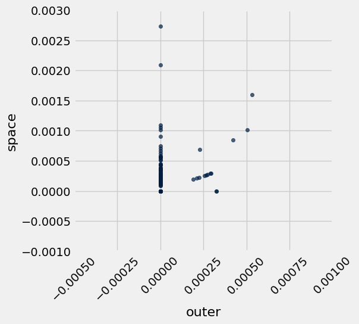

---

#### Question 1.2.1
Looking at that chart it is difficult to see if there is an association. Calculate the correlation coefficient for the potential linear association between proportion of words that are "outer" and the proportion of words that are "space" for every movie in the dataset, and assign it to `outer_space_r`. 

*Hint:* If you need a refresher on how to calculate the correlation coefficient check out [Ch 15.1](https://inferentialthinking.com/chapters/15/1/Correlation.html#calculating-r).

**Student scaffold:**

```python
# These two arrays should make your code cleaner!
outer = movies.column("outer")
space = movies.column("space")

outer_su = ...
space_su = ...

outer_space_r = ...
outer_space_r
```

**Solution:**

```python
# These two arrays should make your code cleaner!
outer = movies.column("outer")
space = movies.column("space")

outer_su = (outer - np.mean(outer)) / np.std(outer) # SOLUTION
space_su = (space - np.mean(space)) / np.std(space) # SOLUTION

outer_space_r = np.mean(space_su * outer_su) # SOLUTION
outer_space_r
```

*Output:*

```text
0.31942607876895912
```

**Test — `q1_2_1`**

```python
>>> 0.2 < outer_space_r < 0.4
True
```

---

#### Question 1.2.2
Choose two *different* words in the dataset with a magnitude (absolute value) of correlation higher than 0.2 and plot a scatter plot with a line of best fit for them. Please do not pick "outer" and "space" or "san" and "francisco". The code to plot the scatter plot and line of best fit is given for you, you just need to calculate the correct values to `r`, `slope` and `intercept`. 

*Hint: It's easier to think of words with a positive correlation, i.e. words that are often mentioned together*.

*Hint 2: Try to think of common phrases or idioms*.

**Student scaffold:**

```python
word_x = ...
word_y = ...

# These arrays should make your code cleaner!
arr_x = movies.column(word_x)
arr_y = movies.column(word_y)

x_su = ...
y_su = ...

r = ...

slope = ...
intercept = ...

# DON'T CHANGE THESE LINES OF CODE
movies.scatter(word_x, word_y)
max_x = max(movies.column(word_x))
plots.title(f"Correlation: {r}, magnitude greater than .2: {abs(r) >= 0.2}")
plots.plot([0, max_x * 1.3], [intercept, intercept + slope * (max_x*1.3)], color='gold');
```

**Solution:**

```python
word_x = "cold" # SOLUTION
word_y = "warm" # SOLUTION

# These arrays should make your code cleaner!
arr_x = movies.column(word_x)
arr_y = movies.column(word_y)

x_su = (arr_x - np.mean(arr_x)) / np.std(arr_x) # SOLUTION
y_su = (arr_y - np.mean(arr_y)) / np.std(arr_y) # SOLUTION

r = np.mean(x_su * y_su) # SOLUTION

slope = np.std(arr_y) / np.std(arr_x) * r # SOLUTION
intercept = np.mean(arr_y) - (np.mean(arr_x) * slope) # SOLUTION

# DON'T CHANGE THESE LINES OF CODE
movies.scatter(word_x, word_y)
max_x = max(movies.column(word_x))
plots.title(f"Correlation: {r}, magnitude greater than .2: {abs(r) >= 0.2}")
plots.plot([0, max_x * 1.3], [intercept, intercept + slope * (max_x*1.3)], color='gold');
```


**Test — `q1_2_2`**

```python
>>> {word_x, word_y} not in [{'san', 'francisco'}, {'outer', 'space'}]
True
```

---

#### Question 1.2.3
Imagine that you picked the words "san" and "francisco" as the two words that you would expect to be correlated because they compose the city name San Francisco. Assign `san_francisco` to either the number 1 or the number 2 according to which statement is true regarding the correlation between "san" and "francisco." 

1. "san" can also preceed other city names like San Diego and San Jose. This might lead to "san" appearing in movies without "francisco," and would reduce the correlation between "san" and "francisco."
2. "san" can also preceed other city names like San Diego and San Jose. The fact that "san" could appear more often in front of different cities and without "francisco" would increase the correlation between "san" and "francisco."

**Student scaffold:**

```python
san_francisco = ...
```

**Solution:**

```python
san_francisco = 1 # SOLUTION
```

**Test — `q1_2_3`**

```python
>>> type(san_francisco) == int
True
```

---
## 1.3. Splitting the dataset
Now, we're going to use our `movies` dataset for two purposes.

1. First, we want to *train* movie genre classifiers.
2. Second, we want to *test* the performance of our classifiers. 

Hence, we need two different datasets: *training* and *test*. 

The purpose of a classifier is to classify unseen data that is similar to the training data. The test dataset will help us determine the accuracy of our predictions by comparing the actual genres of the movies with the genres that our classifier predicts. Therefore, we must ensure that there are no movies that appear in both sets. We do so by splitting the dataset randomly. The dataset has already been permuted randomly, so it's easy to split.  We just take the top for training and the rest for test. 

Run the code below (without changing it) to separate the datasets into two tables.

**Code:**

```python
# Here we have defined the proportion of our data
# that we want to designate for training as 17/20ths
# of our total dataset.  3/20ths of the data is
# reserved for testing.

training_proportion = 17/20

num_movies = movies.num_rows
num_train = int(num_movies * training_proportion)
num_test = num_movies - num_train

train_movies = movies.take(np.arange(num_train))
test_movies = movies.take(np.arange(num_train, num_movies))

print("Training: ",   train_movies.num_rows, ";",
      "Test: ",       test_movies.num_rows)
```

*Output (stdout):*

```text
Training:  283 ; Test:  50
```

---

#### Question 1.3.1
Draw a horizontal bar chart with two bars that show the proportion of Comedy movies in each dataset (`train_movies` and `test_movies`). The two bars should be labeled "Training" and "Test". Complete the function `comedy_proportion` first; it should help you create the bar chart. 

*Hint*: Refer to [Section 7.1](https://inferentialthinking.com/chapters/07/1/Visualizing_Categorical_Distributions.html#bar-chart) of the textbook if you need a refresher on bar charts.

**Student scaffold:**

```python
def comedy_proportion(table):
    # Return the proportion of movies in a table that have the Comedy genre.
    ...
    return ...

# The staff solution took multiple lines.  Start by creating a table.
# If you get stuck, think about what sort of table you need for barh to work
...
```

**Solution:**

```python
# BEGIN SOLUTION NO PROMPT
def comedy_proportion(table):
    """Return the proportion of movies in a table that have the Comedy genre."""
    return table.where('Genre', are.equal_to('comedy')).num_rows / table.num_rows

datasets = make_array('Training', 'Test')
prop_comedy = make_array(comedy_proportion(train_movies), comedy_proportion(test_movies))
Table().with_columns(
        'Dataset', datasets,
        'Proportion of Comedy', prop_comedy)\
       .barh('Dataset')
# END SOLUTION
""" # BEGIN PROMPT
def comedy_proportion(table):
    # Return the proportion of movies in a table that have the Comedy genre.
    ...
    return ...

# The staff solution took multiple lines.  Start by creating a table.
# If you get stuck, think about what sort of table you need for barh to work
...
"""; # END PROMPT
```


---
# Part 2: K-Nearest Neighbors - A Guided Example

K-Nearest Neighbors (k-NN) is a classification algorithm.  Given some numerical *attributes* (also called *features*) of an unseen example, it decides which category that example belongs to based on its similarity to previously seen examples. Predicting the category of an example is called *labeling*, and the predicted category is also called a *label*.

An attribute (feature) we have about each movie is *the proportion of times a particular word appears in the movie*, and the labels are two movie genres: comedy and thriller.  The algorithm requires many previously seen examples for which both the attributes and labels are known: that's the `train_movies` table.

To build understanding, we're going to visualize the algorithm instead of just describing it.

---
## 2.1. Classifying a movie

In k-NN, we classify a movie by finding the `k` movies in the *training set* that are most similar according to the features we choose. We call those movies with similar features the *nearest neighbors*.  The k-NN algorithm assigns the movie to the most common category among its `k` nearest neighbors.

Let's limit ourselves to just 2 features for now, so we can plot each movie.  The features we will use are the proportions of the words "water" and "feel" in the movie.  Taking the movie *Monty Python and the Holy Grail* (in the test set), 0.000804074 of its words are "water" and 0.0010721 are "feel". This movie appears in the test set, so let's imagine that we don't yet know its genre.

First, we need to make our notion of similarity more precise.  We will say that the *distance* between two movies is the straight-line distance between them when we plot their features on a scatter diagram. 

**This distance is called the Euclidean ("yoo-KLID-ee-un") distance, whose formula is $\sqrt{(x_1 - x_2)^2 + (y_1 - y_2)^2}$.**

For example, in the movie *Clerks.* (in the training set), 0.00016293 of all the words in the movie are "water" and 0.00154786 are "feel".  Its distance from *Monty Python and the Holy Grail* on this 2-word feature set is $\sqrt{(0.000804074 - 0.000162933)^2 + (0.0010721 - 0.00154786)^2} \approx 0.000798379$.  (If we included more or different features, the distance could be different.)

A third movie, *The Godfather* (in the training set), has 0 "water" and 0.00015122 "feel". 

The function below creates a plot to display the "water" and "feel" features of a test movie and some training movies. As you can see in the result, *Monty Python and the Holy Grail* is more similar to *Clerks.* than to the *The Godfather* based on these features, which makes sense as both movies are comedy movies, while *The Godfather* is a thriller.

**Code:**

```python
# Just run this cell.
def plot_with_two_features(test_movie, training_movies, x_feature, y_feature):
    """Plot a test movie and training movies using two features."""
    test_row = row_for_title(test_movie)
    distances = Table().with_columns(
            x_feature, [test_row.item(x_feature)],
            y_feature, [test_row.item(y_feature)],
            'Color',   ['unknown'],
            'Title',   [test_movie]
        )
    for movie in training_movies:
        row = row_for_title(movie)
        distances.append([row.item(x_feature), row.item(y_feature), row.item('Genre'), movie])
    distances.scatter(x_feature, y_feature, group='Color', labels='Title', s=50)
    
training = ["clerks.", "the godfather"] 
plot_with_two_features("monty python and the holy grail", training, "water", "feel")
plots.axis([-0.0008, 0.001, -0.004, 0.007]);
```


---

#### Question 2.1.1

Compute the Euclidean distance (defined in the section above) between the two movies, *Monty Python and the Holy Grail* and *The Godfather*, using the `water` and `feel` features only.  Assign it the name `one_distance`. 

*Hint:* If you have a row, you can use `item` to get a value from a column by its name.  For example, if `r` is a row, then `r.item("Genre")` is the value in column `"Genre"` in row `r`.

**Student scaffold:**

```python
python = row_for_title("monty python and the holy grail") 
godfather = row_for_title("the godfather") 

one_distance = ...
one_distance
```

**Solution:**

```python
python = row_for_title("monty python and the holy grail") 
godfather = row_for_title("the godfather") 

one_distance = ((python.item("water") - godfather.item("water"))**2 + (python.item("feel") - godfather.item("feel"))**2)**0.5 # SOLUTION
one_distance
```

*Output:*

```text
0.0012225209151294461
```

**Test — `q2_1_1`**

```python
>>> 0 < one_distance < 0.01
True
```

Below, we've added a third training movie, *The Silence of the Lambs*. Before, the point closest to *Monty Python and the Holy Grail* was *Clerks.*, a comedy movie. However, now the closest point is *The Silence of the Lambs*, a thriller movie.

**Code:**

```python
training = ["clerks.", "the godfather", "the silence of the lambs"] 
plot_with_two_features("monty python and the holy grail", training, "water", "feel") 
plots.axis([-0.0008, 0.001, -0.004, 0.007]);
```


---

#### Question 2.1.2
Complete the function `distance_two_features` that computes the Euclidean distance between any two movies, using two features. The last two lines call your function to show that *Monty Python and the Holy Grail* is closer to *The Silence of the Lambs* than it is to *Clerks*.

**Student scaffold:**

```python
def distance_two_features(title0, title1, x_feature, y_feature):
    """Compute the distance between two movies with titles title0 and title1.
    
    Only the features named x_feature and y_feature are used when computing the distance.
    """
    row0 = ...
    row1 = ...
    ...

for movie in make_array("clerks.", "the silence of the lambs"):
    movie_distance = distance_two_features(movie, "monty python and the holy grail", "water", "feel")
    print(movie, 'distance:\t', movie_distance)
```

**Solution:**

```python
def distance_two_features(title0, title1, x_feature, y_feature):
    """Compute the distance between two movies with titles title0 and title1.
    
    Only the features named x_feature and y_feature are used when computing the distance.
    """
    row0 = row_for_title(title0) # SOLUTION
    row1 = row_for_title(title1) # SOLUTION
    return ((row0.item(x_feature) - row1.item(x_feature))**2 + (row0.item(y_feature) - row1.item(y_feature))**2)**0.5 # SOLUTION

for movie in make_array("clerks.", "the silence of the lambs"):
    movie_distance = distance_two_features(movie, "monty python and the holy grail", "water", "feel")
    print(movie, 'distance:\t', movie_distance)
```

*Output (stdout):*

```text
clerks. distance:	 0.000798381068723
the silence of the lambs distance:	 0.000222563148556
```

**Test — `q2_1_2`**

```python
>>> correct_dis = 0.001406116
>>> dis = distance_two_features('clerks.', 'the godfather', 'water', 'feel')
>>> np.isclose(np.round(dis, 9), correct_dis)
True

>>> correct_dis = 0.005647119
>>> dis = distance_two_features('clerks.', 'the godfather', 'your', 'that')
>>> np.isclose(np.round(dis, 9), correct_dis)
True
```

---

#### Question 2.1.3
Define the function `distance_from_python` so that it works as described in its documentation. 

**Note:** Your solution should not use arithmetic operations directly. Instead, it should make use of existing functionality above!

**Student scaffold:**

```python
def distance_from_python(title):
    """The distance between the given movie and "monty python and the holy grail", 
    based on the features "water" and "feel".
    
    This function takes a single argument:
      title: A string, the name of a movie.
    """
    
    ...

# Calculate the distance between "Clerks." and "Monty Python and the Holy Grail"
distance_from_python('clerks.')
```

**Solution:**

```python
def distance_from_python(title):
    """The distance between the given movie and "monty python and the holy grail", 
    based on the features "water" and "feel".
    
    This function takes a single argument:
      title: A string, the name of a movie.
    """
    
    return distance_two_features(title, "monty python and the holy grail", "water", "feel") # SOLUTION

# Calculate the distance between "Clerks." and "Monty Python and the Holy Grail"
distance_from_python('clerks.')
```

*Output:*

```text
0.00079838106872277164
```

**Test — `q2_1_3`**

```python
>>> np.isclose(distance_from_python('clerks.'), 0.00079838)
True
```

---

#### Question 2.1.4

Using the features `"water"` and `"feel"`, what are the names and genres of the 5 movies in the **training set** closest to *Monty Python and the Holy Grail*?  To answer this question, make a table named `close_movies` containing those 5 movies with columns `"Title"`, `"Genre"`, `"water"`, and `"feel"`, as well as a column called `"distance from python"` that contains the distance from *Monty Python and the Holy Grail*.  The table should be **sorted in ascending order by `"distance from python"`**.

**Student scaffold:**

```python
# The staff solution took multiple lines.
...
close_movies = ...
close_movies
```

**Solution:**

```python
# BEGIN SOLUTION NO PROMPT
water_feel = train_movies.select("Title", "Genre", "water", "feel")
close_movies = water_feel.with_column('distance from python', water_feel.apply(distance_from_python, 'Title'))\
                       .sort('distance from python')\
                       .take(np.arange(5))
# END SOLUTION

""" # BEGIN PROMPT
# The staff solution took multiple lines.
...
close_movies = ...
close_movies
"""; # END PROMPT
```

**Test — `q2_1_4`**

```python
>>> set(close_movies.labels) >= {'Genre', 'Title', 'feel', 'water'}
True

>>> close_movies.num_rows == 5
True

>>> close_movies.column('Title').item(0) != 'monty python and the holy grail'
True
```

---

#### Question 2.1.5
Next, we'll clasify *Monty Python and the Holy Grail* based on the genres of the closest movies. 

To do so, define the function `most_common` so that it works as described in its documentation below.

**Student scaffold:**

```python
def most_common(label, table):
    """The most common element in a column of a table.
    
    This function takes two arguments:
      label: The label of a column, a string.
      table: A table.
     
    It returns the most common value in that column of that table.
    In case of a tie, it returns any one of the most common values
    """
    ...

# Calling most_common on your table of 5 nearest neighbors classifies
# "monty python and the holy grail" as a thriller movie, 3 votes to 2. 
most_common('Genre', close_movies)
```

**Solution:**

```python
def most_common(label, table):
    """The most common element in a column of a table.
    
    This function takes two arguments:
      label: The label of a column, a string.
      table: A table.
     
    It returns the most common value in that column of that table.
    In case of a tie, it returns any one of the most common values
    """
    return table.group(label).sort('count', descending=True).column(label).item(0) # SOLUTION

# Calling most_common on your table of 5 nearest neighbors classifies
# "monty python and the holy grail" as a thriller movie, 3 votes to 2. 
most_common('Genre', close_movies)
```

*Output:*

```text
'thriller'
```

**Test — `q2_1_5`**

```python
>>> [most_common('Genre', close_movies.take(range(k))) for k in range(1, 6, 2)]
['thriller', 'thriller', 'thriller']
```

Congratulations are in order -- you've classified your first movie! However, we can see that the classifier doesn't work too well since it categorized *Monty Python and the Holy Grail* as a thriller movie (unless you count the thrilling holy hand grenade scene). Let's see if we can do better!

# Checkpoint (due Friday 8/8 by 8:00 pm PT)
Congratulations, you have reached the checkpoint! Run the following cells and submit to the Gradescope assignment titled **Project 2 Checkpoint**.

**NOTE: This checkpoint does not represent the halfway point of the project. You are *highly* encouraged to continue on to the next section early.**

To get full credit for this checkpoint, you must pass all the public autograder tests above this cell. The cell below will rerun all of the autograder tests for Part 1 and Part 2 so that you can double check your work.

## Submission

Make sure you have run all cells in your notebook in order before running the cell below, so that all images/graphs appear in the output. You can do this by going to `Cell > Run All`. The cell below will generate a zip file for you to submit. Please save before exporting!

**Reminders:**
- Please remember to **add your partner to your Gradescope submission**. If you resubmit, make sure to re-add your partner, as Gradescope does not save any partner information.
- Make sure to wait until the autograder finishes running to ensure that your submission was processed properly and that you submitted to the correct assignment.

---

To double-check your work, the cell below will rerun all of the autograder tests.

## Submission

Make sure you have run all cells in your notebook in order before running the cell below, so that all images/graphs appear in the output. The cell below will generate a zip file for you to submit. **Please save before exporting!**

---

## Datasets

Datasets this notebook loads with `Table.read_table`. Column names are exact, including spaces and capitalization. Only the schema is recorded here — the data itself is not in this document, so any question about its values must be answered by running code, not by reasoning over the rows shown elsewhere in this file.

### `movies.csv`

333 rows, 5005 columns.

| Column | Type |
| --- | --- |
| `Title` | str |
| `Year` | str |
| `Rating` | float |
| `Genre` | str |
| `# Words` | int |
| `she` | float |
| `decid` | float |
| `talk` | float |
| `wit` | float |
| `razor` | float |
| `slam` | float |
| `credit` | float |
| `rai` | float |
| `hugh` | float |
| `breez` | float |
| `conscienc` | float |
| `audienc` | float |
| `cathi` | float |
| `log` | float |
| `met` | float |
| `chosen` | float |
| `grip` | float |
| `booz` | float |
| `bianca` | float |
| `doubl` | float |
| `agent` | float |
| `exit` | float |
| `carpent` | float |
| `underground` | float |
| `clemenza` | float |
| `gain` | float |
| `neg` | float |
| `majesti` | float |
| `studio` | float |
| `chri` | float |
| `spin` | float |
| `greater` | float |
| `eaten` | float |
| `vibrat` | float |
| `stupid` | float |

_... 4,965 more columns, all float_

### `stem.csv`

40,053 rows, 2 columns.

| Column | Type |
| --- | --- |
| `Stem` | str |
| `Word` | str |
