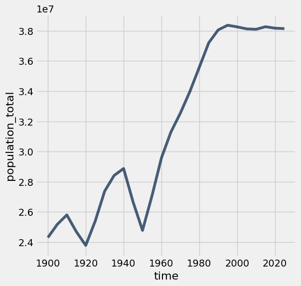
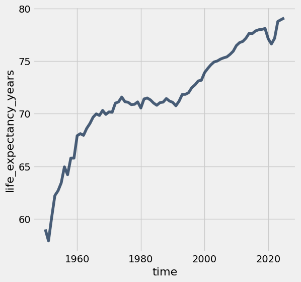
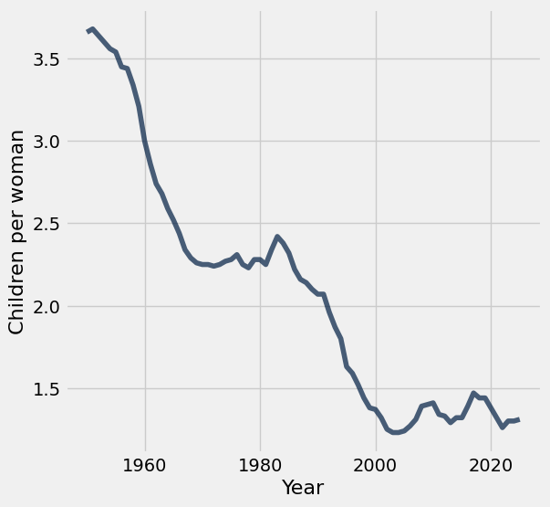
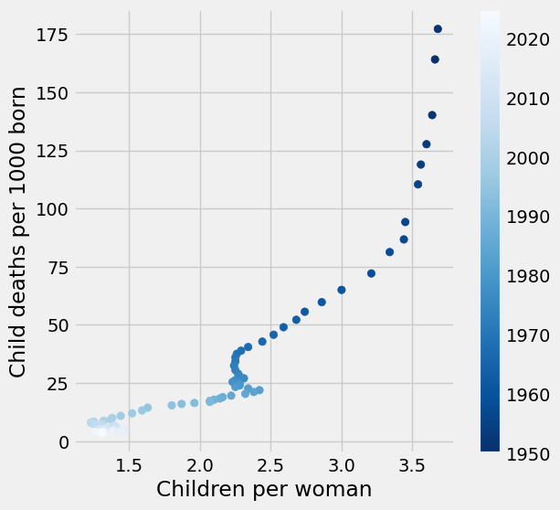

# Project 1: World Population and Poverty

In this project, you'll explore data from [Gapminder.org](http://gapminder.org), a website dedicated to providing a fact-based view of the world and how it has changed. That site includes several data visualizations and presentations, but also publishes the raw data that we will use in this project to recreate and extend some of their most famous visualizations.

The Gapminder website collects data from many sources and compiles them into tables that describe many countries around the world. All of the data they aggregate are published in the [Systema Globalis](https://github.com/open-numbers/ddf--gapminder--systema_globalis/blob/master/README.md). Their goal is "to compile all public statistics; Social, Economic and Environmental; into a comparable total dataset." All data sets in this project are copied directly from the Systema Globalis without any changes.

This project is dedicated to [Hans Rosling](https://en.wikipedia.org/wiki/Hans_Rosling) (1948-2017), who championed the use of data to understand and prioritize global development challenges.

### Logistics

**Deadline.**  This project is due at **5:00pm PT on Friday 2/27**. Projects will be accepted up to 1 day (24 hours) late. Projects submitted fewer than 24 hours after the deadline will receive 80% credit. It's **much** better to be early than late, so start working now.

**Checkpoint.**  For full credit on the checkpoint, you must complete the questions up to the checkpoint, **pass all _public_ autograder tests** for those sections, and submit to the Pensieve Project 1 Checkpoint assignment by **5:00pm PT on Friday, 2/20**. <span style="color: #BC412B">**The checkpoint is worth 1 lab score**</span>. After you've submitted the checkpoint, you may still change your project answers before the final project deadline - only your final submission, to the "Project 1" assignment, will be graded for correctness. You will have some lab time to work on these questions, but we recommend that you start the project before lab and leave time to finish the checkpoint afterward. Additionally, the second half of the project is longer than the first, so if you have time, we encourage you to continue working past the checkpoint.

**Partners.** You may work with one other partner; your partner must be from your assigned lab section. **<span style="color: #BC412B">Only one partner should submit the project notebook to Pensieve.</span> If both partners submit, you will be docked 10% of your project grade. On Pensieve, the person who submits should also designate their partner so that both of you receive credit.** Once you submit, click into your submission, and there will be an option to Add Group Member in the top right corner. You may also reference [this walkthrough video](https://drive.google.com/file/d/1bs1l_f44tUeF1yKY_iljZMTE1X0dYKLl/view?usp=sharing) on how to add partners on Pensieve.


**Rules.** Don't share your code with anybody but your partner. You are welcome to discuss questions with other students, but don't share the answers. The experience of solving the problems in this project will prepare you for exams (and life). If someone asks you for the answer, resist! Instead, you can demonstrate how you would solve a similar problem.

**Support.** You are not alone! Come to office hours, post on Ed, and talk to your classmates. If you want to ask about the details of your solution to a problem, make a private Ed post and the staff will respond. If you're ever feeling overwhelmed or don't know how to make progress, email your TA or tutor for help. You can find contact information for the staff on the [course website](https://www.data8.org/su26/).

**Tests.** <span style="color: #BC412B">The tests that are given are **not comprehensive** and passing the tests for a question **does not** mean that you answered the question correctly.</span> Tests usually only check that your table has the correct column labels. However, more tests will be applied to verify the correctness of your submission in order to assign your final score, so be careful and check your work! You might want to create your own checks along the way to see if your answers make sense. Additionally, before you submit, make sure that none of your cells take a very long time to run (several minutes).

**Free Response Questions:** Make sure that you put the answers to the written questions in the indicated cell we provide. **Every free response question should include an explanation** that adequately answers the question.

**Tabular Thinking Guide:** Feel free to reference [Tabular Thinking Guide](https://drive.google.com/file/d/1NvbBECCBdI0Ku380oPcTUOcpjH3RI230/view) for extra guidance.

**Advice.** Develop your answers incrementally. To perform a complicated table manipulation, break it up into steps, perform each step on a different line, give a new name to each result, and check that each intermediate result is what you expect. You can add any additional names or functions you want to the provided cells. Make sure that you are using distinct and meaningful variable names throughout the notebook. Along that line, **DO NOT** reuse the variable names that we use when we grade your answers. For example, in Question 1 of the Global Poverty section we ask you to assign an answer to `latest`. Do not reassign the variable name `latest` to anything else in your notebook, otherwise there is the chance that our tests grade against what `latest` was reassigned to.

You are **never** restricted to using only one line of code to solve a question in this project or any others. Feel free to use intermediate variables and multiple lines as much as you would like!

---

The point breakdown for this assignment is given in the table below:
| Category | Points |
| --- | --- |
| Autograder (Coding questions) | 65 |
| Written | 35 |
| **Total** | 100 |

---

To get started, load `datascience`, `numpy`, `plots`, and `otter`.

**Code:**

```python
# Run this cell to set up the notebook, but please don't change it. 

# These lines import the NumPy and Datascience modules.
from datascience import *
import numpy as np

# These lines do some fancy plotting magic.
%matplotlib inline
import matplotlib.pyplot as plots
plots.style.use('fivethirtyeight')

from ipywidgets import interact, interactive, fixed, interact_manual
import ipywidgets as widgets
```

---
## 0. Hazards with `.show`

As a heads up, please do not run the function `tbl.show()` in this assignment without an argument. For instance if you want to view a table, please type `tbl.show(10)` instead of `tbl.show()`. This may break your notebook and we cannot guarantee that we will have the capacity to aid you in this. Please answer the question below, and set the value to `True` to confirm you have read this and agree.

**Student scaffold:**

```python
i_wont_use_show_without_an_argument = ...
```

**Solution:**

```python
i_wont_use_show_without_an_argument = True # SOLUTION
```

**Test — `q0` (0 points)**

```python
>>> i_wont_use_show_without_an_argument == True
True
```

---
## 1. Global Population Growth

The global population of humans reached 1 billion around 1800, 3 billion around 1960, 7 billion around 2011, and 8 billion around 2022. The potential impact of population growth has concerned scientists, economists, and politicians alike.

The United Nations Population Division estimates that the world population will likely continue to grow throughout the 21st century, but at a slower rate, perhaps reaching and stabilizing at 10 billion by 2100. However, the UN does not rule out scenarios of slower or more extreme growth. These projections help us understand long-term population processes, even if they leave out possible global catastrophic events like war or climate crises.

<a href="https://population.un.org/wpp/Graphs/Probabilistic/POP/TOT/900"> 
 ![UN line chart titled 'World: Total Population', population in billions from 1950 to 2100. A black observed curve rises from about 2.5 billion in 1950 to about 8 billion in 2022, then projections fan out: a red median curve peaking near 10.3 billion around 2080 and easing to about 10.2 billion by 2100, with 80% and 95% prediction intervals, 60 sample trajectories, and a +/- 0.5 child scenario band spanning roughly 6.3 to 14 billion by 2100. Source: UN DESA Population Division, World Population Prospects 2024.](project1c_assets/un_population_projection.png) 
</a>

In this part of the project, we will examine some of the factors that influence population growth and how they have been changing over the years and around the world. There are two main sub-parts of this analysis.

- First, we will examine the data for one country, Poland. We will see how factors such as life expectancy, fertility rate, and child mortality have changed over time in Poland, and how they are related to the rate of population growth.
- Next, we will examine whether the changes we have observed for Poland are particular to that country or whether they reflect general patterns observable in other countries too. We will study aspects of world population growth and see how they have been changing.

The first table we will consider contains the total population of each country over time. Run the cell below.

**Code:**

```python
population = Table.read_table('population.csv').where("time", are.below(2026))
population.show(3)
```

*Output:*

| geo | time | population_total |
| --- | --- | --- |
| afg | 1800 | 3280000 |
| afg | 1801 | 3280000 |
| afg | 1802 | 3280000 |

**Note:** The population data can also be found [here](https://www.gapminder.org/data/documentation/gd003/).

### Poland

The Central European nation of Poland has undergone many changes over the centuries. In modern times it was (re)created as a democratic republic in 1919 after World War I. It was invaded and divided in World War II between Germany and the Soviet Union. War and the Holocaust had a devastating impact on its people. Poland was constituted in its current borders at the end of World War II (1945) under a communist government. In 1989, with the fall of the Soviet Union, Poland re-established itself as a democratic republic.

In this section of the project, we will examine aspects of the population of Poland since 1900. Poland's borders have changed, so we will look at the population within its current (2025) borders.

In the `population` table, the `geo` column contains three-letter codes established by the [International Organization for Standardization](https://en.wikipedia.org/wiki/International_Organization_for_Standardization) (ISO) in the [Alpha-3](https://en.wikipedia.org/wiki/ISO_3166-1_alpha-3#Current_codes) standard. **Use the Alpha-3 link to find the 3-letter code for Poland.**

---

**Question 1.** Create a table called `p_pop` that has two columns labeled `time` and `population_total`. The first column should contain the years from 1900 through 2025 (including both 1900 and 2025) and the second column should contain the population of Poland in each of those years.

**Student scaffold:**

```python
p_pop = ...
p_pop
```

**Solution:**

```python
p_pop = population.where('geo', 'pol').where('time', are.between(1900, 2026)).drop('geo') # SOLUTION
p_pop
```

*Output:*

| time | population_total |
| --- | --- |
| 1900 | 24308265 |
| 1901 | 24485193 |
| 1902 | 24660489 |
| 1903 | 24834119 |
| 1904 | 25008969 |
| 1905 | 25185047 |
| 1906 | 25362361 |
| 1907 | 25540920 |
| 1908 | 25720733 |
| 1909 | 25808244 |

**Test — `q1_1`**

```python
>>> p_pop.labels == ('time', 'population_total')
True

>>> all(p_pop.sort('time').column('time') == np.arange(1900, 2026))
True
```

Run the following cell to create a table called `p_five` that has the population of Poland every five years.

**Code:**

```python
p_pop.set_format('population_total', NumberFormatter)

fives = np.arange(1900, 2026, 5) # 1900, 1905, 1910, ..., 2025
p_five = p_pop.sort('time').where('time', are.contained_in(fives))
p_five.show(3)
```

*Output:*

| time | population_total |
| --- | --- |
| 1900 | 24,308,265 |
| 1905 | 25,185,047 |
| 1910 | 25,803,855 |

Run the following cell to visualize the population over time. Following the devastating effects of World War I and World War II, Poland's population increased steadily from 1950 to 2000 and then leveled off. In the following questions we'll investigate this period of population growth.

**Code:**

```python
p_five.plot(0, 1)
```



---

**Question 2.** Assign `initial` to an array that contains the population for every five year interval from **1900 to 2020** (inclusive). Then, assign `changed` to an array that contains the population for every five year interval from **1905 to 2025** (inclusive). The first array should include both 1900 and 2020, and the second array should include both 1905 and 2025. You should use the `p_five` table to create both arrays, by first filtering the table to only contain the relevant years.

The annual growth rate for a time period is equal to:

$$\left(\left(\frac{\text{Population at end of period}}{\text{Population at start of period}}\right)^{\displaystyle\frac{1}{\text{number of years}}}\right) -1$$

We have provided the code below that uses `initial` and `changed` in order to add a column to `p_five` called `annual_growth`. **Don't worry about the calculation of the growth rates**; run the test below to test your solution.

If you are interested in how we came up with the formula for growth rates, consult the [growth rates](https://inferentialthinking.com/chapters/03/2/1/Growth.html) section of the textbook.

**Student scaffold:**

```python
initial = ...
changed = ...

p_1900_through_2020 = p_five.where('time', are.below_or_equal_to(2020)) 
p_five_growth = p_1900_through_2020.with_column('annual_growth', (changed/initial)**0.2-1)
p_five_growth.set_format('annual_growth', PercentFormatter)
```

**Solution:**

```python
initial = p_five.where("time", are.below(2021)).column('population_total') # SOLUTION
changed = p_five.where("time", are.above(1900)).column('population_total') # SOLUTION

p_1900_through_2020 = p_five.where('time', are.below_or_equal_to(2020)) 
p_five_growth = p_1900_through_2020.with_column('annual_growth', (changed/initial)**0.2-1)
p_five_growth.set_format('annual_growth', PercentFormatter)
```

*Output:*

| time | population_total | annual_growth |
| --- | --- | --- |
| 1900 | 24,308,265 | 0.71% |
| 1905 | 25,185,047 | 0.49% |
| 1910 | 25,803,855 | -0.87% |
| 1915 | 24,696,678 | -0.75% |
| 1920 | 23,785,820 | 1.32% |
| 1925 | 25,395,008 | 1.52% |
| 1930 | 27,378,955 | 0.75% |
| 1935 | 28,414,953 | 0.32% |
| 1940 | 28,876,472 | -1.58% |
| 1945 | 26,666,588 | -1.46% |

**Test — `q1_2`**

```python
>>> first = round(p_five_growth.sort(0).column(2).item(0), 8)
>>> 0.005 <= first <= 0.5
True

>>> max(p_five_growth.column(2)) < 0.03
True
```

The annual growth rate in Poland has been declining since 1950, as shown in the table below.

**Code:**

```python
# Run this cell to view annual growth rates in Poland since 1950.
p_five_growth.where('time', are.above_or_equal_to(1950)).show()
```

*Output:*

| time | population_total | annual_growth |
| --- | --- | --- |
| 1950 | 24,780,161 | 1.78% |
| 1955 | 27,063,640 | 1.79% |
| 1960 | 29,575,966 | 1.13% |
| 1965 | 31,288,336 | 0.79% |
| 1970 | 32,542,633 | 0.86% |
| 1975 | 33,964,399 | 0.93% |
| 1980 | 35,576,519 | 0.90% |
| 1985 | 37,200,853 | 0.46% |
| 1990 | 38,055,455 | 0.16% |
| 1995 | 38,364,667 | -0.06% |
| 2000 | 38,258,071 | -0.07% |
| 2005 | 38,124,379 | -0.02% |
| 2010 | 38,095,351 | 0.09% |
| 2015 | 38,266,314 | -0.05% |
| 2020 | 38,171,012 | -0.02% |

Next, we'll try to understand what has changed in Poland that might explain the slowing population growth rate. Run the next cell to load three additional tables of measurements about countries over time.

**Code:**

```python
life_expectancy = Table.read_table('life_expectancy.csv').where('time', are.below(2026))
child_mortality = Table.read_table('child_mortality.csv').relabel(2, 'child_mortality_under_5_per_1000_born').where('time', are.below(2026))
fertility = Table.read_table('fertility.csv').where('time', are.below(2026))
```

The `life_expectancy` table contains a statistic that is often used to measure how long people live, called _life expectancy at birth_. This number, for a country in a given year, [does not measure how long babies born in that year are expected to live](http://blogs.worldbank.org/opendata/what-does-life-expectancy-birth-really-mean). Instead, it measures how long someone would live, on average, if the _mortality conditions_ in that year persisted throughout their lifetime. These "mortality conditions" describe what fraction of people for each age survived the year. So, it is a way of measuring the proportion of people that are staying alive, aggregated over different age groups in the population.

The `child_mortality` table has the column _child_mortality_under_5_per_1000_born_ which records the number of children who died before age 5, per 1,000 births.

The `fertility` table contains a statistic that is often used to measure how many babies are being born, the _total fertility rate_. This number describes the [number of children a woman would have in her lifetime](https://www.data4impactproject.org/prh/family-planning/fertility/total-fertility-rate/), on average, if the current rates of birth by age of the mother persisted throughout her child bearing years, assuming she survived through age 49.

Run the following cells below to see `life_expectancy`, `child_mortality`, and `fertility`. Refer back to these tables as they will be helpful for answering further questions!

**Code:**

```python
life_expectancy.show(3)
```

*Output:*

| geo | time | life_expectancy_years |
| --- | --- | --- |
| afg | 1800 | 28.21 |
| afg | 1801 | 28.2 |
| afg | 1802 | 28.19 |

**Code:**

```python
child_mortality.show(3)
```

*Output:*

| geo | time | child_mortality_under_5_per_1000_born |
| --- | --- | --- |
| afg | 1800 | 468.58 |
| afg | 1801 | 468.58 |
| afg | 1802 | 468.58 |

**Code:**

```python
fertility.show(3)
```

*Output:*

| geo | time | children_per_woman_total_fertility |
| --- | --- | --- |
| afg | 1800 | 7 |
| afg | 1801 | 7 |
| afg | 1802 | 7 |

---

**Question 3.** Is population growing more slowly perhaps because people aren’t living as long? Use the `life_expectancy` table to draw a line graph with the years 1950 and later on the horizontal axis that shows how the _life expectancy at birth_ has changed in Poland.

_Hint_: Make sure you filter the table properly; otherwise, the graph may look funky!

**Student scaffold:**

```python
# Fill in code here
...
```

**Solution:**

```python
# Fill in code here
life_expectancy.where("geo", are.equal_to("pol")).where("time", are.above_or_equal_to(1950)).plot("time", "life_expectancy_years") # SOLUTION
```



---

**Question 4.** Assuming no other factors, such as birth rates or fertility rates, have changed, do the trends in life expectancy in the graph above directly explain why the population growth rate decreased since 1950 in Poland? Why or why not?

**SOLUTION:** No. This graph indicates that people are living longer, which would increase population growth if everything else stayed the same.

The `fertility` table contains a statistic that is often used to measure how many babies are being born, the _total fertility rate_. This number describes the [number of children a woman would have in her lifetime](https://www.measureevaluation.org/prh/rh_indicators/specific/fertility/total-fertility-rate), on average, if the current rates of birth by age of the mother persisted throughout her child bearing years, assuming she survived through age 49.

---

**Question 5.** Complete the function `fertility_over_time`. It takes two input arguments, the Alpha-3 code of a country (denoted as `country_code`) and a year to `start` from (denoted as start). It returns a two-column table with the column labels `Year` and `Children per woman`. These columns can be used to generate a line chart of the country’s fertility rate each year, starting from the year given by `start`. The plot should include the start year and all later years that appear in the fertility table.

Then, determine the Alpha-3 code for **Poland**. The code at the very bottom for `poland_code` and the year `1950` are inputted to your `fertility_over_time` function. The function returns a table which we use in order to plot how Poland's fertility rate has changed since `1950`. Note that the function `fertility_over_time` should not return the plot itself – it returns a two-column table. The expression that draws the line plot is provided for you; please don’t change it.

_Hint_: Read about `tbl.relabeled` in the [Python Reference](https://www.data8.org/fa25/reference/) to rename columns.

_Hint_: You might fine [8.0](https://inferentialthinking.com/chapters/08/Functions_and_Tables.html) helpful.

**Student scaffold:**

```python
def fertility_over_time(country_code, start):
    """Create a two-column table that describes a country's total fertility rate each year."""
    # It's a good idea (but not required) to use multiple lines in your solution.
    ...


poland_code = ...
fertility_over_time(poland_code, 1950)
```

**Solution:**

```python
def fertility_over_time(country_code, start):
    """Create a two-column table that describes a country's total fertility rate each year."""
    # It's a good idea (but not required) to use multiple lines in your solution.
    # BEGIN SOLUTION
    country_fertility = fertility.where('geo', are.equal_to(country_code))
    country_fertility_after_start = country_fertility.where('time', are.above_or_equal_to(start))
    cleaned_table = country_fertility_after_start.select('time', 'children_per_woman_total_fertility').relabeled('time', 'Year').relabeled('children_per_woman_total_fertility', 'Children per woman')
    return cleaned_table
    # END SOLUTION


poland_code = 'pol' # SOLUTION
fertility_over_time(poland_code, 1950)
```

*Output:*

| Year | Children per woman |
| --- | --- |
| 1950 | 3.66 |
| 1951 | 3.68 |
| 1952 | 3.64 |
| 1953 | 3.6 |
| 1954 | 3.56 |
| 1955 | 3.54 |
| 1956 | 3.45 |
| 1957 | 3.44 |
| 1958 | 3.34 |
| 1959 | 3.21 |

**Test — `q1_5`**

```python
>>> fertility_over_time('usa', 2010).labels == ('Year', 'Children per woman')
True

>>> all(fertility_over_time('usa', 2010).column('Year') == np.arange(2010, 2026))
True

>>> all(fertility_over_time('usa', 2005).column('Year') == np.arange(2005, 2026))
True
```

Plotting the fertility rate in Poland since 1950, we see a downward trend.

**Code:**

```python
fertility_over_time(poland_code, 1950).plot(0, 1)
```



---

**Question 6.** Assuming everything else is constant, do the trends in fertility in the graph above help directly explain why the population growth rate decreased since 1950 in Poland? Why or why not?

**SOLUTION:** Yes, a declining fertility rate shows that fewer babies are being born each year, which contributes to decreasing population growth. (It's ok to point out that the population growth curve and the fertility curve do not match up exactly, but this is not necessary for a correct solution.)

It has been [observed](https://www.ageing.ox.ac.uk/download/143) that lower fertility rates are often associated with lower child mortality rates. We can see if this association is evident in Poland by plotting the relationship between total fertility rate and [child mortality rate per 1000 children](https://en.wikipedia.org/wiki/Child_mortality).

---

**Question 7.** Create a table `poland_since_1950` that contains one row per year starting with 1950 and:

- A column `Year` containing the year
- A column `Children per woman` describing total fertility in Poland that year
- A column `Child deaths per 1000 born` describing child mortality in Poland that year

**Student scaffold:**

```python
pol_fertility = fertility_over_time(poland_code, 1950)  # Try starting with the table you built already!
# It's a good idea (but not required) to use multiple lines in your solution.
pol_child_mortality = ...
pol_fertility_and_child_mortality = ...
poland_since_1950 = ...
poland_since_1950
```

**Solution:**

```python
pol_fertility = fertility_over_time(poland_code, 1950)  # Try starting with the table you built already!
# It's a good idea (but not required) to use multiple lines in your solution.
pol_child_mortality = child_mortality.where('geo', are.equal_to('pol')).drop('geo') # SOLUTION
pol_fertility_and_child_mortality = pol_fertility.join('Year', pol_child_mortality, 'time') # SOLUTION
poland_since_1950 = pol_fertility_and_child_mortality.relabel('child_mortality_under_5_per_1000_born', 'Child deaths per 1000 born') # SOLUTION
poland_since_1950
```

*Output:*

| Year | Children per woman | Child deaths per 1000 born |
| --- | --- | --- |
| 1950 | 3.66 | 164.08 |
| 1951 | 3.68 | 177.18 |
| 1952 | 3.64 | 140.16 |
| 1953 | 3.6 | 127.65 |
| 1954 | 3.56 | 118.9 |
| 1955 | 3.54 | 110.38 |
| 1956 | 3.45 | 94.19 |
| 1957 | 3.44 | 86.72 |
| 1958 | 3.34 | 81.28 |
| 1959 | 3.21 | 72.1 |

**Test — `q1_7`**

```python
>>> poland_since_1950.num_rows
76

>>> all([label in poland_since_1950.labels for label in ['Children per woman', 'Child deaths per 1000 born']])
True
```

Run the following cell to generate a scatter plot from the `poland_since_1950` table you created.

The plot uses **color** to encode data about the `Year` column. The colors, ranging from dark blue to white, represent the passing of time between 1950 and 2025. For example, a point on the scatter plot representing data from the 1950s would appear as **dark blue** and a point from the 2010s would appear as **light blue**.

**Code:**

```python
x_births = poland_since_1950.column("Children per woman")
y_deaths = poland_since_1950.column("Child deaths per 1000 born")
time_colors = poland_since_1950.column("Year")

plots.figure(figsize=(6,6))
plots.scatter(x_births, y_deaths, c=time_colors, cmap="Blues_r")
plots.colorbar()                  
plots.xlabel("Children per woman")
plots.ylabel("Child deaths per 1000 born");
```



---

**Question 8.** In one or two sentences, describe the association (if any) that is illustrated by this scatter plot. Does the diagram show any causal relation between fertility and child mortality?

**SOLUTION:** We can observe that fertility rates and child mortality rates decrease together over time, although the association is not entirely linear or consistent. However, this association does not tell us whether one of these changes caused a change in the other. (It's ok to point out that decreases in child mortality sometimes precede decreases in fertility, but this observation is not necessary for a correct response.)

_Optional food for thought_: What other context or information you would need in order to better understand the factors affecting life expectancy, child mortality, and fertility?

---

To double-check your work, the cell below will rerun all of the autograder tests.

## Submission

Make sure you have run all cells in your notebook in order before running the cell below, so that all images/graphs appear in the output. The cell below will generate a zip file for you to submit. **Please save before exporting!**

---

## Datasets

Datasets this notebook loads with `Table.read_table`. Column names are exact, including spaces and capitalization. Only the schema is recorded here — the data itself is not in this document, so any question about its values must be answered by running code, not by reasoning over the rows shown elsewhere in this file.

### `population.csv`

59,297 rows, 3 columns.

| Column | Type |
| --- | --- |
| `geo` | str |
| `time` | int |
| `population_total` | int |

### `life_expectancy.csv`

57,496 rows, 3 columns.

| Column | Type |
| --- | --- |
| `geo` | str |
| `time` | int |
| `life_expectancy_years` | float |

### `child_mortality.csv`

57,497 rows, 3 columns.

| Column | Type |
| --- | --- |
| `geo` | str |
| `time` | int |
| `child_mortality_0_5_year_olds_dying_per_1000_born` | float |

### `fertility.csv`

59,297 rows, 3 columns.

| Column | Type |
| --- | --- |
| `geo` | str |
| `time` | int |
| `children_per_woman_total_fertility` | float |
