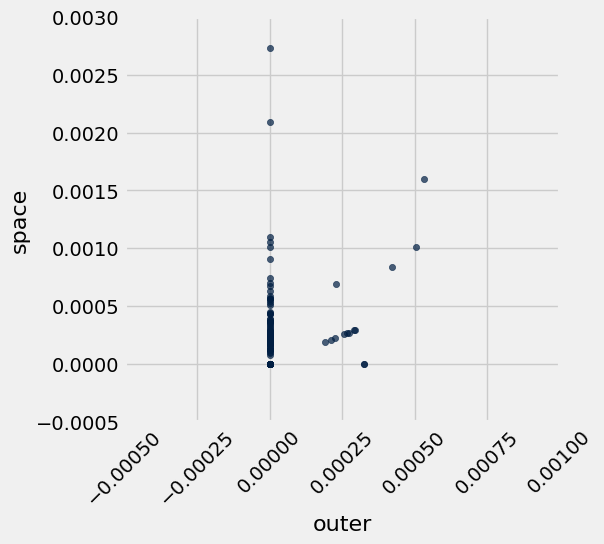
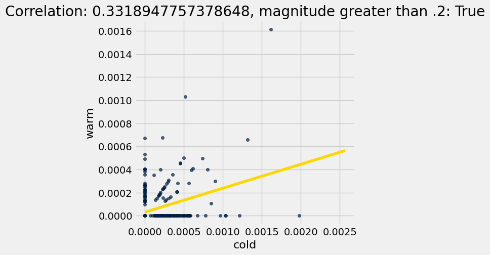
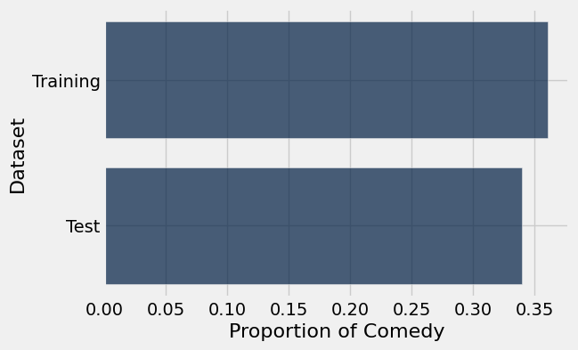
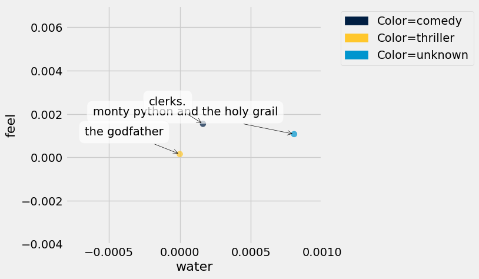
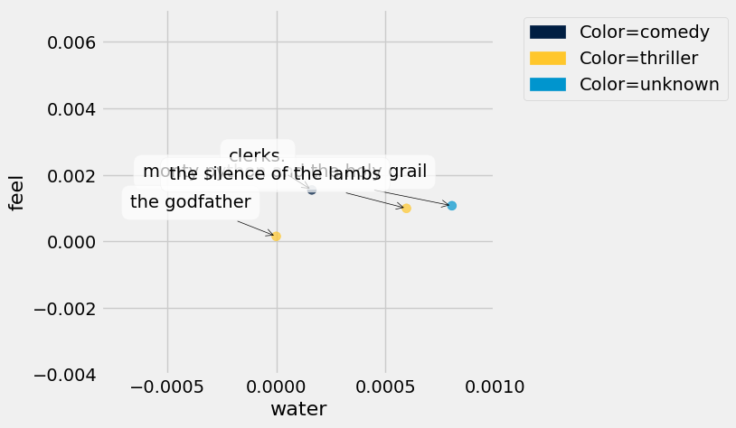
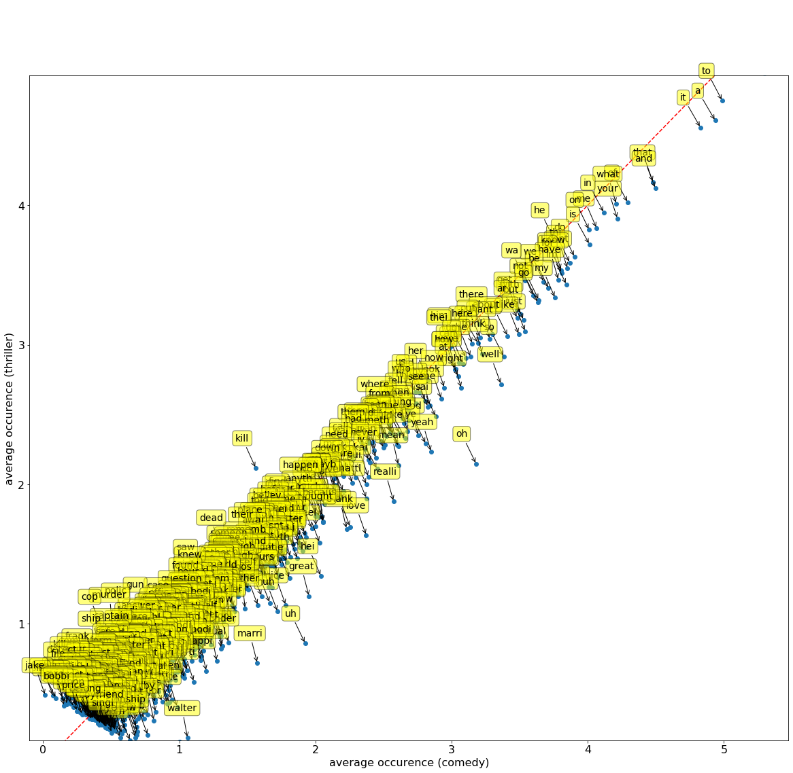

# Project 3: Movie Classification

Welcome to the third and final project of Data 8! You will build a classification model that guesses whether a movie is a comedy or a thriller by using only the number of times chosen words appear in the movie's screenplay. By the end of the project, you should know how to:

1. Build a k-nearest-neighbors classifier.
2. Test a classifier on data.

### Logistics

**Deadline.**  This project is due at **5:00pm PT on Friday, 5/1**. You can receive 5 bonus points for submitting the project by **5:00pm PT on Thursday, 4/30.** Projects will be accepted up to 1 day (24 hours) late. Projects submitted fewer than 24 hours after the deadline will receive 80% credit. Any submissions later than 24 hours after the deadline will not be accepted. It's **much** better to be early than late, so start working now.

**Checkpoint.** For full credit on the checkpoint, you must complete the questions up to the checkpoint, **pass all _public_ autograder tests** for those sections, and submit to the Pensieve Project 03 Checkpoint assignment by **5:00pm PT on Friday, 4/24**.  <span style="color: #BC412B">**The checkpoint is worth 1 lab score**</span>. After you've submitted the checkpoint, you may still change your project answers before the final project deadline - **only your final submission, to the "Project 03 Autograder" assignment, will be graded for correctness** (including questions from before the checkpoint). You will have some lab time to work on these questions, but we recommend that you start the project before lab and leave time to finish the checkpoint afterward.

**Partners.** You may work with one other partner; your partner must be from your assigned lab section. **<span style="color: #BC412B">Only one partner should submit the project notebook to Pensieve.</span> If both partners submit, you will be docked 10% of your project grade. On Pensieve, the person who submits should also designate their partner so that both of you receive credit.** Once you submit, click into your submission, and there will be an option to Add Group Member in the top right corner. You may also reference [this walkthrough video](https://drive.google.com/file/d/1bs1l_f44tUeF1yKY_iljZMTE1X0dYKLl/view?usp=sharing) on how to add partners on Pensieve.

**Rules.** Don't share your code with anybody but your partner. You are welcome to discuss questions with other students, but don't share the answers. The experience of solving the problems in this project will prepare you for exams (and life). If someone asks you for the answer, resist! Instead, you can demonstrate how you would solve a similar problem.

**Support.** You are not alone! Come to office hours, post on Ed, and talk to your classmates. If you want to ask about the details of your solution to a problem, make a private Ed post and the staff will respond. If you're ever feeling overwhelmed or don't know how to make progress, email your TA or tutor for help. You can find contact information for the staff on the [course website](https://data8.org/su26/staff/).

**Tests.** <span style="color: #BC412B">The tests that are given are **not comprehensive** and passing the tests for a question **does not** mean that you answered the question correctly.</span> For table manipulation questions, tests usually only check that your table has the correct column labels. Similarly, on multiple choice / select all that apply questions, tests are only checking that your response in the right format, not that it is correct. However, more tests will be applied to verify the correctness of your submission in order to assign your final score, so be careful and check your work! You might want to create your own checks along the way to see if your answers make sense. Additionally, before you submit, make sure that none of your cells take a very long time to run (several minutes).

**Free Response Questions:** Make sure that you put the answers to the written questions in the indicated cell we provide. **Every free response question should include an explanation** that adequately answers the question. 

**Advice.** Develop your answers incrementally. To perform a complicated task, break it up into steps, perform each step on a different line, give a new name to each result, and check that each intermediate result is what you expect. You can add any additional names or functions you want to the provided cells. Make sure that you are using distinct and meaningful variable names throughout the notebook. Along that line, **DO NOT** reuse the variable names that we use when we grade your answers. 

You **never** have to use just one line in this project or any others. Use intermediate variables and multiple lines as much as you would like!

**All of the concepts necessary for this project are found in the textbook.** If you are stuck on a particular problem, reading through the relevant textbook section will often help to clarify concepts.

---

The point breakdown for this assignment is given in the table below:
| Category | Points |
| --- | --- |
| Autograder (Coding questions) | 87 |
| Written | 13 |
| **Total** | 100 |

---

To get started, load `datascience`, `numpy`, and `matplotlib`. Make sure to also run the first cell of this notebook to load `otter`.

**Code:**

```python
# Run this cell to set up the notebook, but please don't change it.
import numpy as np
import math
import datascience
from datascience import *

# These lines set up the plotting functionality and formatting.
import matplotlib
%matplotlib inline
import matplotlib.pyplot as plots
plots.style.use('fivethirtyeight')
import warnings
warnings.simplefilter("ignore")
```

---
# Part 1: The Dataset

In this project, we are exploring movie screenplays. We'll be trying to predict each movie's genre from the text of its screenplay. In particular, we have compiled a list of 5,000 words that occur in conversations between movie characters. For each movie, our dataset tells us the frequency with which each of these words occurs in certain conversations in its screenplay. All words have been converted to lowercase.

Run the cell below to read the `movies` table. **It may take up to a minute to load.**

<span style="color: #BC412B">**Note: Outputting the full `movies` table will make exporting your Jupyter notebook very slow because the `movies` table is massive. Please avoid returning or using .show() for the entire `movies` table in your future cells!**</span>

**Code:**

```python
movies = Table.read_table('movies.csv')
```

Here is one row of the table and some of the frequencies of words that were said in the movie.

**Code:**

```python
movies.where("Title", "runaway bride").select(0, 1, 2, 3, 4, 14, 49, 1042, 4004)
```

*Output:*

| Title | Year | Rating | Genre | # Words | breez | england | it | bravo |
| --- | --- | --- | --- | --- | --- | --- | --- | --- |
| runaway bride | 1999 | 5.2 | comedy | 4895 | 0 | 0 | 0.0234092 | 0 |

The above cell prints a few columns of the row for the comedy movie *Runaway Bride*.  The movie contains 4895 words. The word "it" appears 115 times, as it makes up  $\frac{115}{4895} \approx 0.0234092$ of the words in the movie. The word "england" doesn't appear at all.

Additional context: This numerical representation of a body of text, which describes only the frequencies of individual words, is called a bag-of-words representation. Before the development of the [BERT](https://en.wikipedia.org/wiki/BERT_(language_model)) model for classification in 2018, bag-of-words was a common method of representing text in [NLP](https://en.wikipedia.org/wiki/Natural_language_processing). The bag-of-words representation is easy to interpret, but a lot of information is discarded: the order of the words, the context of each word, who said what, etc. It is therefore no longer commonly used. Still, investigating how to use a bag-of-words representation in a classifier builds useful intuitions about how to classify text.

At the end of this project, you'll have a chance to work with a more effective, but less interpretable, representation that uses a pretrained neural network to represent text.

All movie titles are unique. The `row_for_title` function provides fast access to the one row for each title. 

*Note: All movies in our dataset have their titles lower-cased.*

**Code:**

```python
title_index = movies.index_by('Title')
def row_for_title(title):
    """Return the row for a title, similar to the following expression (but faster)

    movies.where('Title', title).row(0)
    """
    return title_index.get(title)[0]

row_for_title('toy story')
```

*Output:*

```text
Row(Title='toy story', Year='1995', Rating=8.1999999999999993, Genre='comedy', # Words=3016, she=0.0017427675148135001, decid=0.00034855350296270001, talk=0.0017427675148135001, wit=0.0, razor=0.0, slam=0.0, credit=0.0, rai=0.0, hugh=0.0, breez=0.0, conscienc=0.0, audienc=0.0, cathi=0.0, log=0.0, met=0.0, chosen=0.0, grip=0.0, booz=0.0, bianca=0.0, doubl=0.00034855350296270001, agent=0.0, exit=0.0, carpent=0.0, underground=0.0, clemenza=0.0, gain=0.0, neg=0.00069710700592540001, majesti=0.0, studio=0.0, chri=0.0, spin=0.0, greater=0.0, eaten=0.0, vibrat=0.0, stupid=0.0010456605088881, cigarett=0.0, jesu=0.0, mani=0.0, violin=0.0, financi=0.00034855350296270001, bai=0.0, cop=0.0, neighbor=0.0, cd=0.0, england=0.0, made=0.00034855350296270001, conni=0.0, instinct=0.0, took=0.0, jacquelin=0.0, mace=0.0, disappear=0.0, waltz=0.0, behind=0.00034855350296270001, bourbon=0.0, favorit=0.00069710700592540001, benni=0.0, manhattan=0.0, nixon=0.0, lunch=0.0, principl=0.0, tradit=0.0, counterfeit=0.0, sophi=0.0, third=0.0, exist=0.0, wouldv=0.00034855350296270001, hero=0.0, theyr=0.0024398745207389002, anytim=0.0, christin=0.0, vallei=0.0, chess=0.0, paid=0.0, burglar=0.0, nostril=0.0, rubber=0.0, human=0.0, british=0.0, plissken=0.0, eddi=0.0, gee=0.0, offend=0.0, rebecca=0.0, anger=0.0, plant=0.0, famou=0.0, repres=0.0, latest=0.0, rent=0.0, dip=0.0, bell=0.0, andi=0.0069710700592541001, so=0.0017427675148135001, london=0.0, cooler=0.0, keaton=0.0, portland=0.0, headlin=0.0, whatta=0.0, fatal=0.0, sew=0.0, cheer=0.0, davi=0.0, feed=0.0, hudson=0.0, ambros=0.0, digest=0.0, redi=0.0, fri=0.0, staff=0.00069710700592540001, casino=0.0, occasion=0.0, shadow=0.0, work=0.00069710700592540001, restrain=0.00034855350296270001, face=0.0, exercis=0.0, sidnei=0.0, pile=0.0, whyd=0.0, teenag=0.0, her=0.0013942140118508, retir=0.0, hazard=0.0, roth=0.0, hurrican=0.0, impuls=0.0, ranger=0.0020913210177761999, pour=0.0, lester=0.0, slash=0.0, deer=0.0, could=0.0013942140118508, vital=0.0, qualiti=0.0, coma=0.0, incred=0.0, hank=0.0, famili=0.0, duchess=0.0, global=0.0, virgin=0.0, scientif=0.0, between=0.0, holidai=0.0, qualifi=0.0, moor=0.0, happili=0.0, arizona=0.0, non=0.0, bruce=0.0, ankl=0.0, constant=0.0, buzz=0.0163820146392471, harder=0.0, ing=0.0, christian=0.0, palmer=0.0, tent=0.0, sunset=0.0, damour=0.0, cohaagen=0.0, advertis=0.0, sensat=0.0, local=0.0, there=0.0080167305681421996, terri=0.0, sedat=0.0, rotten=0.0, struck=0.0, deck=0.0, past=0.0, bro=0.0, ann=0.0, dump=0.0, kane=0.0, slot=0.0, immun=0.0, block=0.00034855350296270001, lil=0.0, technic=0.0, tactic=0.0, pencil=0.0, outsid=0.0, laboratori=0.0, easi=0.0, nephew=0.0, coffin=0.0, pretti=0.0, coward=0.0, verbal=0.0, permiss=0.0, bartend=0.0, wont=0.0, watch=0.0013942140118508, lindenmey=0.0, cosmo=0.0, capabl=0.00034855350296270001, flirt=0.0, huge=0.0, berkelei=0.0, max=0.0, walter=0.0, lime=0.0, rico=0.0, marvin=0.0, aboard=0.0, bacon=0.0, account=0.0, kirk=0.0, quaid=0.0, stunt=0.00034855350296270001, closet=0.0, due=0.0, nuclear=0.0, blind=0.0, pussi=0.0, howdi=0.00034855350296270001, snuff=0.0, eas=0.00034855350296270001, now=0.0076681770651794998, leak=0.0, underwear=0.0, westlei=0.0, mayb=0.0, theo=0.0, limo=0.0, cousin=0.0, illeg=0.0, silli=0.0, against=0.0, done=0.00034855350296270001, district=0.0, invad=0.0, ryan=0.0, wait=0.0034855350296270002, grudg=0.0, charact=0.0, hick=0.0, jami=0.0, lifetim=0.0, lecktor=0.0, and=0.0083652840711049004, republican=0.0, life=0.0, hidden=0.0, wire=0.0, paranoia=0.0, network=0.0, messi=0.0, uthatu=0.0, effort=0.0, carri=0.0, windham=0.0, fun=0.00034855350296270001, psychologist=0.0, sean=0.0, scent=0.0, answer=0.0, mom=0.0031369815266642999, wake=0.0, sign=0.0, ho=0.0, relat=0.0, jame=0.0, fat=0.0, myself=0.0, disrupt=0.0, scan=0.0, vagu=0.0, basket=0.0, christma=0.00069710700592540001, estim=0.0, em=0.0013942140118508, union=0.0, involv=0.0, norman=0.0, suspici=0.0, becom=0.0, shoe=0.0, librari=0.0, administr=0.0, ford=0.0, complic=0.

... [output truncated, 64204 more characters]
```

For example, the fastest way to find the frequency of "fun" in the movie *Toy Story* is to access the `'fun'` item from its row. Check the original table to see if this worked for you!

**Code:**

```python
row_for_title('toy story').item('fun')
```

*Output:*

```text
0.00034855350296270001
```

---

**Question 1.0**

Set `expected_row_sum` to the number that you __expect__ will result from summing all proportions in each row, excluding the first five columns. Think about what any one row adds up to.

**Student scaffold:**

```python
# Set row_sum to a number that's the (approximate) sum of each row of word proportions.
expected_row_sum = ...
```

**Solution:**

```python
# Set row_sum to a number that's the (approximate) sum of each row of word proportions.
expected_row_sum = 1 # SOLUTION
```

**Test — `q1_0` (3 points)**

```python
>>> 0 < expected_row_sum
True

# hidden test
>>> int(expected_row_sum) == 1
True
```

This dataset was extracted from [a dataset from Cornell University](http://www.cs.cornell.edu/~cristian/Cornell_Movie-Dialogs_Corpus.html). After transforming the dataset (e.g., converting the words to lowercase, removing the inappropriate words, and converting the counts to frequencies), we created this new dataset containing the frequency of 5000 common words in each movie.

**Code:**

```python
print('Words with frequencies:', movies.drop(np.arange(5)).num_columns)
print('Movies with genres:', movies.num_rows)
```

*Output (stdout):*

```text
Words with frequencies: 5000
Movies with genres: 333
```

---
## 1.1. Word Stemming
The columns other than "Title", "Year", "Rating", "Genre", and "# Words" in the `movies` table are all words that appear in some of the movies in our dataset.  These words have been *stemmed*, or abbreviated heuristically, in an attempt to make different [inflected](https://en.wikipedia.org/wiki/Inflection) forms of the same base word into the same string.  For example, the column "manag" is the sum of proportions of the words "manage", "manager", "managed", and "managerial" (and perhaps others) in each movie. This is a common technique used in machine learning and natural language processing.

Stemming makes it a little tricky to search for the words you want to use, so we have provided another table called `vocab_table` that will let you see examples of unstemmed versions of each stemmed word. Run the code below to load it.

**Note:** You should use `vocab_table` for the rest of Section 1.1, not `vocab_mapping`.

**Code:**

```python
# Just run this cell.
vocab_mapping = Table.read_table('stem.csv')
stemmed = np.take(movies.labels, np.arange(3, len(movies.labels)))
vocab_table = Table().with_column('Stem', stemmed).join('Stem', vocab_mapping)
vocab_table.take(np.arange(1100, 1110))
```

*Output:*

| Stem | Word |
| --- | --- |
| bond | bonding |
| bone | bone |
| bone | boning |
| bone | bones |
| bonu | bonus |
| book | bookings |
| book | books |
| book | booking |
| book | booked |
| book | book |

---

**Question 1.1.1**

Using `vocab_table`, find the stemmed version of the word "elements" and assign the value to `stemmed_message`.

**Student scaffold:**

```python
stemmed_message = ...
stemmed_message
```

**Solution:**

```python
stemmed_message = vocab_table.where('Word', are.equal_to('elements')).column('Stem').item(0) # SOLUTION
stemmed_message
```

*Output:*

```text
'element'
```

**Test — `q1_1_1` (3 points)**

```python
>>> (type(stemmed_message) == str) | (type(stemmed_message) == np.str_)
True

>>> len(stemmed_message) < len('elements')
True

# hidden test
>>> stemmed_message
'element'
```

---

**Question 1.1.2**

What stem in the dataset has the most words that are shortened to it? Assign `most_stem` to that stem.

**Student scaffold:**

```python
most_stem = ...
most_stem
```

**Solution:**

```python
most_stem = vocab_table.group("Stem").sort("count", descending=True).column("Stem").item(0) # SOLUTION
most_stem
```

*Output:*

```text
'gener'
```

**Test — `q1_1_2` (3 points)**

```python
>>> (type(most_stem) == str) | (type(most_stem) == np.str_)
True

# hidden test
>>> most_stem
'gener'
```

---

**Question 1.1.3**

What is the longest word in the dataset whose stem is the same length as the original word? Assign that to `longest_uncut`. Break ties alphabetically from Z to A (so if your options are "cat" or "bat", you should pick "cat"). Note that when sorting letters, the letter `a` is smaller than the letter `z`. You may also want to sort more than once.

*Hint 1:* `vocab_table` has 2 columns: one for stems and one for the unstemmed (normal) word. Find the longest word that wasn't cut at all (same length as stem).

*Hint 2:* `apply` may be helpful here! Check [Python Reference](https://www.data8.org/su26/reference/).

*Hint 3:* In our solution, we found it useful to first add columns with the length of the word and the length of the stem, and then to add a column with the difference between those lengths. What will the difference be if the word is not shortened?

**Student scaffold:**

```python
tbl_with_lens = ...
tbl_with_diff = ...

longest_uncut = ...
longest_uncut
```

**Solution:**

```python
tbl_with_lens = vocab_table.with_columns("Word len", vocab_table.apply(len, "Word"), "Stem len", vocab_table.apply(len, "Stem")) # SOLUTION
tbl_with_diff = tbl_with_lens.with_column("len dif", tbl_with_lens.column("Word len") - tbl_with_lens.column("Stem len")) # SOLUTION

longest_uncut = tbl_with_diff.where("len dif", 0).sort("Word", descending=True).sort("Word len", descending=True).column("Word").item(0) # SOLUTION
longest_uncut
```

*Output:*

```text
'misunderstand'
```

**Test — `q1_1_3` (3 points)**

```python
>>> (type(longest_uncut) == str) | (type(longest_uncut) == np.str_)
True

# hidden test
>>> longest_uncut == 'misunderstand'
True
```

---

**Question 1.1.4**

How many stems have only one word that is shortened to them? For example, if the stem "book" only maps to the word "books" and if the stem "a" only maps to the word "a," both should be counted as stems that map only to a single word.

Assign `count_single_stems` to the count of stems that map to one word only.

**Student scaffold:**

```python
count_single_stems = ...
count_single_stems
```

**Solution:**

```python
count_single_stems = vocab_table.group("Stem").where("count", are.equal_to(1)).num_rows # SOLUTION
count_single_stems
```

*Output:*

```text
1408
```

**Test — `q1_1_4` (3 points)**

```python
>>> type(count_single_stems) == int
True

# hidden test
>>> count_single_stems == 1408
True
```

---
## 1.2. Exploratory Data Analysis: Linear Regression

Let's explore our dataset before trying to build a classifier. To start, we’ll use the associated proportions to investigate the relationship between different words.

The first association we'll investigate is the association between the proportion of words that are "outer" and the proportion of words that are "space". 

As usual, we'll investigate our data visually before performing any numerical analysis.

Run the cell below to plot a scatter diagram of "space" proportions vs "outer" proportions and to create the `outer_space` table. Each point on the scatter plot represents one movie.

**Code:**

```python
# Just run this cell!
outer_space = movies.select("outer", "space")
outer_space.scatter("outer", "space")
plots.axis([-0.0005, 0.001, -0.0005, 0.003]);
plots.xticks(rotation=45);
```



---

**Question 1.2.1**

Looking at that chart it is difficult to see if there is an association. Calculate the correlation coefficient for the potential linear association between proportion of words that are "outer" and the proportion of words that are "space" for every movie in the dataset, and assign it to `outer_space_r`. 

*Hint:* If you need a refresher on how to calculate the correlation coefficient check out [Ch 15.1](https://inferentialthinking.com/chapters/15/1/Correlation.html#calculating-r).

**Student scaffold:**

```python
# These two arrays should make your code cleaner!
outer = movies.column("outer")
space = movies.column("space")

outer_su = ...
space_su = ...

outer_space_r = ...
outer_space_r
```

**Solution:**

```python
# These two arrays should make your code cleaner!
outer = movies.column("outer")
space = movies.column("space")

outer_su = (outer - np.mean(outer)) / np.std(outer) # SOLUTION
space_su = (space - np.mean(space)) / np.std(space) # SOLUTION

outer_space_r = np.mean(space_su * outer_su) # SOLUTION
outer_space_r
```

*Output:*

```text
0.31942607876895912
```

**Test — `q1_2_1` (3 points)**

```python
>>> 0.2 < outer_space_r < 0.4
True

# hidden test
>>> np.round(outer_space_r, 3) == 0.319
True
```

---

**Question 1.2.2**

Choose two *different* words in the dataset with a magnitude (absolute value) of correlation higher than 0.2 and plot a scatter plot with a line of best fit for them. Please do not pick "outer" and "space" or "san" and "francisco". The code to plot the scatter plot and line of best fit is given for you, you just need to calculate the correct values to `r`, `slope` and `intercept`. 

*Hint 1:* It's easier to think of words with a positive correlation, i.e. words that are often mentioned together. Try to think of common phrases or idioms.

*Hint 2:* Refer to [Section 15.2](https://inferentialthinking.com/chapters/15/2/Regression_Line.html#the-equation-of-the-regression-line) of the textbook for the formulas. For additional past examples of regression, see Homework 9.

**Student scaffold:**

```python
word_x = ...
word_y = ...

# These arrays should make your code cleaner!
arr_x = movies.column(word_x)
arr_y = movies.column(word_y)

x_su = ...
y_su = ...

r = ...

slope = ...
intercept = ...

# DON'T CHANGE THESE LINES OF CODE
movies.scatter(word_x, word_y)
max_x = max(movies.column(word_x))
plots.title(f"Correlation: {r}, magnitude greater than .2: {abs(r) >= 0.2}")
plots.plot([0, max_x * 1.3], [intercept, intercept + slope * (max_x*1.3)], color='gold');
```

**Solution:**

```python
word_x = "cold" # SOLUTION
word_y = "warm" # SOLUTION

# These arrays should make your code cleaner!
arr_x = movies.column(word_x)
arr_y = movies.column(word_y)

x_su = (arr_x - np.mean(arr_x)) / np.std(arr_x) # SOLUTION
y_su = (arr_y - np.mean(arr_y)) / np.std(arr_y) # SOLUTION

r = np.mean(x_su * y_su) # SOLUTION

slope = np.std(arr_y) / np.std(arr_x) * r # SOLUTION
intercept = np.mean(arr_y) - (np.mean(arr_x) * slope) # SOLUTION

# DON'T CHANGE THESE LINES OF CODE
movies.scatter(word_x, word_y)
max_x = max(movies.column(word_x))
plots.title(f"Correlation: {r}, magnitude greater than .2: {abs(r) >= 0.2}")
plots.plot([0, max_x * 1.3], [intercept, intercept + slope * (max_x*1.3)], color='gold');
```



**Test — `q1_2_2` (0 points)**

```python
>>> {word_x, word_y} not in [{'san', 'francisco'}, {'outer', 'space'}]
True
```

---

**Question 1.2.3**

Imagine that you picked the words "san" and "francisco" as the two words that you would expect to be correlated because they compose the city name San Francisco. Assign `san_francisco` to either the integer 1 or the integer 2 according to which statement is true regarding the correlation between "san" and "francisco." 

1. "san" can also precede other city names like San Diego and San Jose. This might lead to "san" appearing in movies without "francisco," and would reduce the correlation between "san" and "francisco."
2. "san" can also precede other city names like San Diego and San Jose. The fact that "san" could appear more often in front of different cities and without "francisco" would increase the correlation between "san" and "francisco."

**Student scaffold:**

```python
san_francisco = ...
```

**Solution:**

```python
san_francisco = 1 # SOLUTION
```

**Test — `q1_2_3` (3 points)**

```python
>>> type(san_francisco) == int
True

# hidden test
>>> san_francisco == 1
True
```

---
## 1.3. Splitting the dataset
Now, we're going to use our `movies` dataset for two purposes.

1. First, we want to *train* movie genre classifiers.
2. Second, we want to *test* the performance of our classifiers. 

Hence, we need two different datasets: *training* and *test*. 

The purpose of a classifier is to classify unseen data that is similar to the training data. The test dataset will help us determine the accuracy of our predictions by comparing the actual genres of the movies with the genres that our classifier predicts. Therefore, we must ensure that there are no movies that appear in both sets. We do so by splitting the dataset randomly. The dataset has already been permuted randomly, so it's easy to split.  We just take the first 85% of the dataset for training and the rest for test. 

Run the code below (without changing it) to separate the datasets into two tables.

<span style="color: #BC412B">**Note: Outputting the full `train_movies` table will make exporting your Jupyter notebook very slow because the `train_movies` table is massive. Please avoid returning or using .show() for the entire `train_movies` table in your future cells!**</span>

**Code:**

```python
# Here we have defined the proportion of our data
# that we want to designate for training as 17/20ths (85%)
# and, of our total dataset 3/20ths (15%) of the data is
# reserved for testing

training_proportion = 17/20

num_movies = movies.num_rows
num_train = int(num_movies * training_proportion)
num_test = num_movies - num_train

train_movies = movies.take(np.arange(num_train))
test_movies = movies.take(np.arange(num_train, num_movies))

print("Training: ",   train_movies.num_rows, ";",
      "Test: ",       test_movies.num_rows)
```

*Output (stdout):*

```text
Training:  283 ; Test:  50
```

---

**Question 1.3.1**

Draw a horizontal bar chart with two bars that show the proportion of Comedy movies in each dataset (`train_movies` and `test_movies`). The two bars should be labeled "Training" and "Test". Complete the function `comedy_proportion` first; it should help you create the bar chart. 

*Hint*: Refer to [Section 7.1](https://inferentialthinking.com/chapters/07/1/Visualizing_Categorical_Distributions.html#bar-chart) of the textbook if you need a refresher on bar charts.

**Student scaffold:**

```python
def comedy_proportion(table):
    # Return the proportion of movies in a table that have the comedy genre.
    ...
    return ...

# The staff solution took multiple lines.  Start by creating a table.
# If you get stuck, think about what sort of table you need for barh to work
...
```

**Solution:**

```python
# BEGIN SOLUTION NO PROMPT
def comedy_proportion(table):
    """Return the proportion of movies in a table that have the comedy genre."""
    return table.where('Genre', are.equal_to('comedy')).num_rows / table.num_rows

datasets = make_array('Training', 'Test')
prop_comedy = make_array(comedy_proportion(train_movies), comedy_proportion(test_movies))
Table().with_columns(
        'Dataset', datasets,
        'Proportion of Comedy', prop_comedy)\
       .barh('Dataset')
# END SOLUTION
""" # BEGIN PROMPT
def comedy_proportion(table):
    # Return the proportion of movies in a table that have the comedy genre.
    ...
    return ...

# The staff solution took multiple lines.  Start by creating a table.
# If you get stuck, think about what sort of table you need for barh to work
...
"""; # END PROMPT
```



---
# Part 2: K-Nearest Neighbors - A Guided Example

[K-Nearest Neighbors (k-NN)](https://inferentialthinking.com/chapters/17/1/Nearest_Neighbors.html) is a classification algorithm. While it is no longer common to use k-NN with a bag-of-word representation of text (as we do below), the idea of informing prediction using nearest neighbors is still very common in modern machine learning systems.

Given some numerical *attributes* (also called *features*) of an unseen example, k-NN decides which category that example belongs to based on its similarity to previously seen examples. Predicting the category of an example is called *labeling*, and the predicted category is also called a *label*.

An attribute (feature) we have about each movie is *the proportion of times a particular word appears in the movie*, and the labels are two movie genres: comedy and thriller.  The algorithm requires many previously seen examples for which both the attributes and labels are known: that's the `train_movies` table.

To build understanding, we're going to visualize the algorithm instead of just describing it.

---
## 2.1. Classifying a movie

In k-NN, we classify a movie by finding the `k` movies in the *training set* that are most similar according to the features we choose. We call those movies with similar features the *nearest neighbors*.  The k-NN algorithm assigns the movie to the most common category among its `k` nearest neighbors.

Let's limit ourselves to just 2 features for now, so we can plot each movie.  The features we will use are the proportions of the words "water" and "feel" in the movie.  Taking the movie *Monty Python and the Holy Grail* (in the test set), 0.000804074 of its words are "water" and 0.0010721 are "feel". This movie appears in the test set, so let's imagine that we don't yet know its genre.

First, we need to make our notion of similarity more precise.  **We will say that the *distance* between two movies is the straight-line distance between them when we plot their features on a scatter diagram.**

**This distance is called the Euclidean ("yoo-KLID-ee-un") distance, whose formula is $\sqrt{(x_1 - x_2)^2 + (y_1 - y_2)^2}$.**

For example, in the movie *Clerks.* (in the training set), 0.00016293 of all the words in the movie are "water" and 0.00154786 are "feel".  Its distance from *Monty Python and the Holy Grail* on this 2-word feature set is $\sqrt{(0.000804074 - 0.000162933)^2 + (0.0010721 - 0.00154786)^2} \approx 0.000798379$.  (If we included more or different features, the distance could be different.)

A third movie, *The Godfather* (in the training set), has 0 "water" and 0.00015122 "feel". 

The function below creates a plot to display the "water" and "feel" features of a test movie and some training movies. As you can see in the result, *Monty Python and the Holy Grail* is more similar to *Clerks.* than to the *The Godfather* based on these features, which makes sense as both movies are comedy movies, while *The Godfather* is a thriller.

**Code:**

```python
# Just run this cell.
def plot_with_two_features(test_movie, training_movies, x_feature, y_feature):
    """Plot a test movie and training movies using two features."""
    test_row = row_for_title(test_movie)
    distances = Table().with_columns(
            x_feature, [test_row.item(x_feature)],
            y_feature, [test_row.item(y_feature)],
            'Color',   ['unknown'],
            'Title',   [test_movie]
        )
    for movie in training_movies:
        row = row_for_title(movie)
        distances.append([row.item(x_feature), row.item(y_feature), row.item('Genre'), movie])
    distances.scatter(x_feature, y_feature, group='Color', labels='Title', s=50)

training = ["clerks.", "the godfather"]
plot_with_two_features("monty python and the holy grail", training, "water", "feel")
plots.axis([-0.0008, 0.001, -0.004, 0.007]);
```



---

**Question 2.1.1**

Compute the Euclidean distance (defined in the section above) between the two movies, *Monty Python and the Holy Grail* and *The Godfather*, using the `water` and `feel` features only.  Assign it the name `one_distance`. 

*Hint 1:* If you have a row, you can use `item` to get a value from a column by its name.  For example, if `r` is a row, then `r.item("Genre")` is the value in column `"Genre"` in row `r`.

*Hint 2:* Refer to the beginning of Part 1 if you don't remember what `row_for_title` does.

*Hint 3:* In the formula for Euclidean distance, think carefully about what `x` and `y` represent. Refer to the example in the text above if you are unsure.

**Student scaffold:**

```python
python = row_for_title("monty python and the holy grail")
godfather = row_for_title("the godfather")

one_distance = ...
one_distance
```

**Solution:**

```python
python = row_for_title("monty python and the holy grail")
godfather = row_for_title("the godfather")

one_distance = ((python.item("water") - godfather.item("water"))**2 + (python.item("feel") - godfather.item("feel"))**2)**0.5 # SOLUTION
one_distance
```

*Output:*

```text
0.0012225209151294461
```

**Test — `q2_1_1` (3 points)**

```python
>>> 0 < one_distance < 0.01
True

# hidden test
>>> np.isclose(one_distance, 0.001223)
False
```

Below, we've added a third training movie, *The Silence of the Lambs*. Before, the point closest to *Monty Python and the Holy Grail* was *Clerks.*, a comedy movie. However, now the closest point is *The Silence of the Lambs*, a thriller movie.

**Code:**

```python
training = ["clerks.", "the godfather", "the silence of the lambs"]
plot_with_two_features("monty python and the holy grail", training, "water", "feel")
plots.axis([-0.0008, 0.001, -0.004, 0.007]);
```



---

**Question 2.1.2**

Complete the function `distance_two_features` that computes the Euclidean distance between any two movies, using two features. The last two lines call your function to show that *Monty Python and the Holy Grail* is closer to *The Silence of the Lambs* than it is to *Clerks*.

**Student scaffold:**

```python
def distance_two_features(title0, title1, x_feature, y_feature):
    """Compute the distance between two movies with titles title0 and title1.

    Only the features named x_feature and y_feature are used when computing the distance.
    """
    row0 = ...
    row1 = ...
    ...

for movie in make_array("clerks.", "the silence of the lambs"):
    movie_distance = distance_two_features(movie, "monty python and the holy grail", "water", "feel")
    print(movie, 'distance:\t', movie_distance)
```

**Solution:**

```python
def distance_two_features(title0, title1, x_feature, y_feature):
    """Compute the distance between two movies with titles title0 and title1.

    Only the features named x_feature and y_feature are used when computing the distance.
    """
    row0 = row_for_title(title0) # SOLUTION
    row1 = row_for_title(title1) # SOLUTION
    return ((row0.item(x_feature) - row1.item(x_feature))**2 + (row0.item(y_feature) - row1.item(y_feature))**2)**0.5 # SOLUTION

for movie in make_array("clerks.", "the silence of the lambs"):
    movie_distance = distance_two_features(movie, "monty python and the holy grail", "water", "feel")
    print(movie, 'distance:\t', movie_distance)
```

*Output (stdout):*

```text
clerks. distance:	 0.000798381068723
the silence of the lambs distance:	 0.000222563148556
```

**Test — `q2_1_2` (3 points)**

```python
>>> correct_dis = 0.001406116
>>> dis = distance_two_features('clerks.', 'the godfather', 'water', 'feel')
>>> np.isclose(np.round(dis, 9), correct_dis)
True

>>> correct_dis = 0.005647119
>>> dis = distance_two_features('clerks.', 'the godfather', 'your', 'that')
>>> np.isclose(np.round(dis, 9), correct_dis)
True
```

---

**Question 2.1.3**

Define the function `distance_from_python` so that it works as described in its documentation/[docstring](https://www.geeksforgeeks.org/python-docstrings/) (the string right below where the function is defined).


**Note:** Your solution should not use arithmetic operations directly. Instead, it should make use of previously defined functions!

**Student scaffold:**

```python
def distance_from_python(title):
    """Return the distance between the given movie and "monty python and the holy grail",
    based on the features "water" and "feel".

    This function takes a single argument:
      title: A string, the name of a movie.
    """

    ...

# Calculate the distance between "Clerks." and "Monty Python and the Holy Grail"
distance_from_python('clerks.')
```

**Solution:**

```python
def distance_from_python(title):
    """Return the distance between the given movie and "monty python and the holy grail",
    based on the features "water" and "feel".

    This function takes a single argument:
      title: A string, the name of a movie.
    """

    return distance_two_features(title, "monty python and the holy grail", "water", "feel") # SOLUTION

# Calculate the distance between "Clerks." and "Monty Python and the Holy Grail"
distance_from_python('clerks.')
```

*Output:*

```text
0.00079838106872277164
```

**Test — `q2_1_3` (3 points)**

```python
>>> np.isclose(distance_from_python('clerks.'), 0.00079838)
True

# hidden test
>>> np.isclose(distance_from_python('the godfather'), 0.001222521)
True
```

---

**Question 2.1.4**

Using the features `water` and `feel`, what are the names and genres of the 5 movies in the **training set** closest to *Monty Python and the Holy Grail*?  To answer this question, make a **table** named `close_movies` containing those 5 movies with columns `"Title"`, `"Genre"`, `"water"`, and `"feel"`, as well as a column called `"distance from python"` that contains the distance from *Monty Python and the Holy Grail*.  The table should be **sorted in ascending order by `"distance from python"`**.

*Note:* Why are smaller distances from *Monty Python and the Holy Grail* more helpful in helping us classify the movie? (In other words, why is it helpful to focus on our nearest neighbors?)

*Hint:* Your final table should only have 5 rows. How can you get the first five rows of a table?

**Student scaffold:**

```python
# The staff solution took multiple lines.
...
close_movies = ...
close_movies
```

**Solution:**

```python
# BEGIN SOLUTION NO PROMPT
water_feel = train_movies.select("Title", "Genre", "water", "feel")
close_movies = water_feel.with_column('distance from python', water_feel.apply(distance_from_python, 'Title'))\
                       .sort('distance from python')\
                       .take(np.arange(5))
# END SOLUTION

""" # BEGIN PROMPT
# The staff solution took multiple lines.
...
close_movies = ...
close_movies
"""; # END PROMPT
```

**Test — `q2_1_4` (3 points)**

```python
>>> set(close_movies.labels) >= {'Genre', 'Title', 'feel', 'water'}
True

>>> close_movies.num_rows == 5
True

>>> close_movies.column('Title').item(0) != 'monty python and the holy grail'
True

# hidden test
>>> [title[:6] for title in close_movies.column('Title')] == ['alien', 'tomorr', 'the si', 'inners', 'some l']
True
```

---

**Question 2.1.5**

Next, we'll classify *Monty Python and the Holy Grail* based on the genres of the closest movies. 

To do so, define the function `most_common` so that it works as described in its documentation below.

**Student scaffold:**

```python
def most_common(label, table):
    """This function takes two arguments:
      label: The label of a column, a string.
      table: A table.

    It returns the most common value in the label column of the table.
    In case of a tie, it returns any one of the most common values.
    """
    ...

# Calling most_common on your table of 5 nearest neighbors classifies
# "monty python and the holy grail" as a thriller movie, 3 votes to 2.
most_common('Genre', close_movies)
```

**Solution:**

```python
def most_common(label, table):
    """This function takes two arguments:
      label: The label of a column, a string.
      table: A table.

    It returns the most common value in the label column of the table.
    In case of a tie, it returns any one of the most common values.
    """
    return table.group(label).sort('count', descending=True).column(label).item(0) # SOLUTION

# Calling most_common on your table of 5 nearest neighbors classifies
# "monty python and the holy grail" as a thriller movie, 3 votes to 2.
most_common('Genre', close_movies)
```

*Output:*

```text
'thriller'
```

**Test — `q2_1_5` (3 points)**

```python
>>> [most_common('Genre', close_movies.take(range(k))) for k in range(1, 6, 2)]
['thriller', 'thriller', 'thriller']
```

Congratulations are in order — you've classified your first movie! However, we can see that the classifier doesn't work very well, since it categorized *Monty Python and the Holy Grail* as a thriller movie (unless you count the thrilling [holy hand grenade](https://www.youtube.com/watch?v=xOrgLj9lOwk) scene). In next part, we will try to do better!

# Checkpoint (due Friday 4/24 by 5:00 pm PT)


Cookie the Frog gives your project checkpoint the Stare of Approval.

Run the following cells and submit to the Pensive assignment titled **Project 03 Checkpoint**. <span style="color: #BC412B">**Before that**, **remove any `tbl.show()` calls** (calls to `.show` with no argument) and any unneccessary print statements.</span> Forgetting to do this may cause issues when running your notebook on Pensieve.

**NOTE: This checkpoint does not represent the halfway point of the project. You are *highly* encouraged to continue on to the next section early.**

To get full credit for this checkpoint, you must pass all the public autograder tests above this cell. The cell below will rerun all of the autograder tests for Part 1 and Part 2 so that you can double check your work.

**Code:**

```python
checkpoint_tests = ["q1_0", "q1_1_1", "q1_1_2", "q1_1_3", "q1_1_4", 
                    "q1_2_1", "q1_2_3", "q1_2_2",
                    "q2_1_1", "q2_1_2", "q2_1_3", "q2_1_4", "q2_1_5"]

for test in checkpoint_tests:
    display(grader.check(test))
```

*Output (stdout):*

```text
Unexpected exception formatting exception. Falling back to standard exception
```

*Output (stderr):*

```text
Traceback (most recent call last):
  File "/Users/marissalumpkin/Desktop/data8/assignments_new/env/lib/python3.13/site-packages/IPython/core/interactiveshell.py", line 3577, in run_code
    exec(code_obj, self.user_global_ns, self.user_ns)
    ~~~~^^^^^^^^^^^^^^^^^^^^^^^^^^^^^^^^^^^^^^^^^^^^^
  File "/var/folders/xv/tl5mnl5s0mz_ykhsrhdyb_rm0000gn/T/ipykernel_54660/632573659.py", line 6, in <module>
    display(grader.check(test))
            ^^^^^^
NameError: name 'grader' is not defined

During handling of the above exception, another exception occurred:

Traceback (most recent call last):
  File "/Users/marissalumpkin/Desktop/data8/assignments_new/env/lib/python3.13/site-packages/IPython/core/interactiveshell.py", line 2168, in showtraceback
    stb = self.InteractiveTB.structured_traceback(
        etype, value, tb, tb_offset=tb_offset
    )
  File "/Users/marissalumpkin/Desktop/data8/assignments_new/env/lib/python3.13/site-packages/IPython/core/ultratb.py", line 1454, in structured_traceback
    return FormattedTB.structured_traceback(
           ~~~~~~~~~~~~~~~~~~~~~~~~~~~~~~~~^
        self, etype, evalue, etb, tb_offset, number_of_lines_of_context
        ^^^^^^^^^^^^^^^^^^^^^^^^^^^^^^^^^^^^^^^^^^^^^^^^^^^^^^^^^^^^^^^
    )
    ^
  File "/Users/marissalumpkin/Desktop/data8/assignments_new/env/lib/python3.13/site-packages/IPython/core/ultratb.py", line 1345, in structured_traceback
    return VerboseTB.structured_traceback(
           ~~~~~~~~~~~~~~~~~~~~~~~~~~~~~~^
        self, etype, value, tb, tb_offset, number_of_lines_of_context
        ^^^^^^^^^^^^^^^^^^^^^^^^^^^^^^^^^^^^^^^^^^^^^^^^^^^^^^^^^^^^^
    )
    ^
  File "/Users/marissalumpkin/Desktop/data8/assignments_new/env/lib/python3.13/site-packages/IPython/core/ultratb.py", line 1192, in structured_traceback
    formatted_exception = self.format_exception_as_a_whole(etype, evalue, etb, number_of_lines_of_context,
                                                           tb_offset)
  File "/Users/marissalumpkin/Desktop/data8/assignments_new/env/lib/python3.13/site-packages/IPython/core/ultratb.py", line 1082, in format_exception_as_a_whole
    self.get_records(etb, number_of_lines_of_context, tb_offset) if etb else []
    ~~~~~~~~~~~~~~~~^^^^^^^^^^^^^^^^^^^^^^^^^^^^^^^^^^^^^^^^^^^^
  File "/Users/marissalumpkin/Desktop/data8/assignments_new/env/lib/python3.13/site-packages/IPython/core/ultratb.py", line 1179, in get_records
    res = list(stack_data.FrameInfo.stack_data(etb, options=options))[tb_offset:]
          ~~~~^^^^^^^^^^^^^^^^^^^^^^^^^^^^^^^^^^^^^^^^^^^^^^^^^^^^^^^
  File "/Users/marissalumpkin/Desktop/data8/assignments_new/env/lib/python3.13/site-packages/stack_data/core.py", line 597, in stack_data
    yield from collapse_repeated(
    ...<4 lines>...
    )
  File "/Users/marissalumpkin/Desktop/data8/assignments_new/env/lib/python3.13/site-packages/stack_data/utils.py", line 83, in collapse_repeated
    yield from map(mapper, original_group)
  File "/Users/marissalumpkin/Desktop/data8/assignments_new/env/lib/python3.13/site-packages/stack_data/core.py", line 587, in mapper
    return cls(f, options)
  File "/Users/marissalumpkin/Desktop/data8/assignments_new/env/lib/python3.13/site-packages/stack_data/core.py", line 551, in __init__
    self.executing = Source.executing(frame_or_tb)
                     ~~~~~~~~~~~~~~~~^^^^^^^^^^^^^
  File "/Users/marissalumpkin/Desktop/data8/assignments_new/env/lib/python3.13/site-packages/executing/executing.py", line 283, in executing
    assert_(new_stmts <= stmts)
    ~~~~~~~^^^^^^^^^^^^^^^^^^^^
  File "/Users/marissalumpkin/Desktop/data8/assignments_new/env/lib/python3.13/site-packages/executing/executing.py", line 80, in assert_
    raise AssertionError(str(message))
AssertionError
```

## Submission

Make sure you have run all cells in your notebook in order before running the cell below, so that all images/graphs appear in the output. You can do this by going to `Cell > Run All`. The cell below will generate a zip file for you to submit. **Please save before exporting!**

**Reminders:**
- Please remember to **add your partner to your Pensieve submission**. If you resubmit, make sure to re-add your partner, as Pensieve does not save any partner information.
- Make sure to wait until the autograder finishes running to ensure that your submission was processed properly and that you submitted to the correct assignment.

---

---
# Part 3: Features

Now, we're going to extend our classifier to consider more than two features at a time to see if we can get a better classification of our movies.

Euclidean distance still makes sense with more than two features. For `n` different features, we compute the difference between corresponding feature values for two movies, square each of the `n`  differences, sum up the resulting numbers, and take the square root of the sum.

---

**Question 3.0**

Write a function called `distance` to compute the Euclidean distance between two **arrays** of **numerical** features (e.g. arrays of the proportions of times that different words appear). The function should be able to calculate the Euclidean distance between two arrays of arbitrary (but equal) length.

Next, use the function you just defined to compute the distance **between the first and second movie** in the **training set** *using all of the features*.  (Remember that the first five columns of your tables are not features.)

*Hint 1:* To convert rows to arrays, use `np.array`. For example, if `t` was a table, `np.array(t.row(0))` converts row 0 of `t` into an array.

*Hint 2:* Make sure to drop the first five columns of the table before you compute `distance_first_to_second`, as these columns do not contain any features (the proportions of words).

**Student scaffold:**

```python
def distance(features_array1, features_array2): 
    """The Euclidean distance between two arrays of feature values."""
    ...

array_values_movie_1  = ...
array_values_movie_2 = ...
distance_first_to_second = ...
distance_first_to_second
```

**Solution:**

```python
def distance(features_array1, features_array2): 
    """The Euclidean distance between two arrays of feature values."""
    return sum((features_array1 - features_array2)**2) ** 0.5 # SOLUTION

array_values_movie_1  = np.array(list(train_movies.drop(np.arange(5)).row(0))) # SOLUTION
array_values_movie_2 = np.array(list(train_movies.drop(np.arange(5)).row(1))) # SOLUTION
distance_first_to_second = distance(array_values_movie_1, array_values_movie_2) # SOLUTION
distance_first_to_second
```

*Output:*

```text
0.033354468908813176
```

**Test — `q3_0` (4 points)**

```python
>>> 0.0 <= distance_first_to_second and distance_first_to_second <= 0.1
True

>>> np.isclose(distance(make_array(1, 2), make_array(1, 2)), 0)
True

>>> np.isclose(distance(make_array(1, 2, 3), make_array(2, 4, 5)), 3)
True

# hidden test
>>> np.isclose(round(distance_first_to_second, 5), 0.03335)
True

# hidden test
>>> a1 = np.array([1, 2, 3])
>>> a2 = np.array([3, 4, 5])
>>> np.isclose(round(distance(a1, a2), 4), 3.4641)
True

# hidden test
>>> a2 = np.array([3, 4, 5])
>>> a3 = np.array([9, 5, 4])
>>> np.isclose(round(distance(a2, a3), 4), 6.1644)
True

# hidden test
>>> a1 = np.array([1, 2, 3])
>>> a3 = np.array([9, 5, 4])
>>> np.isclose(round(distance(a1, a3), 4), 8.6023)
True
```

---
## 3.1. Creating your own feature set

Unfortunately, using all of the features has some downsides.  One clear downside is the lack of *computational efficiency* -- computing Euclidean distances just takes a long time when we have lots of features.  You might have noticed that in the last question!

So we're going to select just 20.  We'd like to choose features that are very *discriminative*. That is, features which lead us to correctly classify as much of the test set as possible.  This process of choosing features that will make a classifier work well is sometimes called *feature selection*, or, more broadly, *feature engineering*. This once-critical step in machine learning has become less important as neural networks automate the process of feature selection, but there are still settings in which manual selection of features can prove worthwhile.

In this question, we will help you get started on selecting more effective features for distinguishing comedy from thriller movies. The plot below (generated for you) shows the average number of times each word occurs in a comedy movie on the horizontal axis and the average number of times it occurs in an thriller movie on the vertical axis. 


*Note: The line graphed is the line of best fit, NOT the line y=x.*



Run the cell below for an interactive plot! Hover over the invididual points to see what word each point is! For reference, the $\mu$ character you may see in some of the entries means to multiply by $10^{-6}$ or `0.000001`

**Code:**

```python
from IPython.display import HTML
HTML("https://raw.githubusercontent.com/jonathanferrari/static/main/word_plot.html")
```

Questions 3.1.1 through 3.1.4 will ask you to interpret the plot above. If no words are present in the specified area of the graph, try to think what characteristics would those words exhibit if points were located there. For each question, select one of the following choices and assign its number to the provided name.
1. The word is common in both comedy and thriller movies 
2. The word is uncommon in comedy movies and common in thriller movies
3. The word is common in comedy movies and uncommon in thriller movies
4. The word is uncommon in both comedy and thriller movies
5. It is not possible to say from the plot 

---
    
**Question 3.1.1**

What properties do words in the bottom left corner of the plot have? Your answer should be a single integer from 1 to 5, corresponding to the correct statement from the choices above.

**Student scaffold:**

```python
bottom_left = ...
```

**Solution:**

```python
bottom_left = 4 # SOLUTION
```

**Test — `q3_1_1` (4 points)**

```python
>>> isinstance(bottom_left, int)
True

>>> bottom_left >= 1 and bottom_left <= 5
True

# hidden test
>>> bottom_left == 4
True
```

---

**Question 3.1.2**

What properties do words in the bottom right corner have?

**Student scaffold:**

```python
bottom_right = ...
```

**Solution:**

```python
bottom_right = 3 # SOLUTION
```

**Test — `q3_1_2` (3 points)**

```python
>>> isinstance(bottom_right, int)
True

>>> bottom_right >= 1 and bottom_right <= 5
True

# hidden test
>>> bottom_right == 3
True
```

---

**Question 3.1.3**

What properties do words in the top right corner have?

**Student scaffold:**

```python
top_right = ...
```

**Solution:**

```python
top_right = 1 # SOLUTION
```

**Test — `q3_1_3` (4 points)**

```python
>>> isinstance(top_right, int)
True

>>> top_right >= 1 and top_right <= 5
True

# hidden test
>>> top_right == 1
True
```

---

**Question 3.1.4**

What properties do words in the top left corner have?

**Student scaffold:**

```python
top_left = ...
```

**Solution:**

```python
top_left = 2 # SOLUTION
```

**Test — `q3_1_4` (4 points)**

```python
>>> isinstance(top_left, int)
True

>>> top_left >= 1 and top_left <= 5
True

# hidden test
>>> top_left == 2
True
```

---

**Question 3.1.5**

If we see a movie with a lot of words that are common for comedy movies but uncommon for thriller movies, what would be a reasonable guess about the genre of the movie? Assign `movie_genre` to the integer corresponding to your answer:
1. It is a thriller movie.
2. It is a comedy movie.

**Student scaffold:**

```python
movie_genre_guess = ...
```

**Solution:**

```python
movie_genre_guess = 2 # SOLUTION
```

**Test — `q3_1_5` (4 points)**

```python
>>> isinstance(movie_genre_guess, int)
True

>>> movie_genre_guess >= 1 and movie_genre_guess <= 2
True

# hidden test
>>> movie_genre_guess == 2
True
```

---

**Question 3.1.6**

Using the plot above, make an array of at least 10 common words that you think might let you **distinguish** between comedy and thriller movies. Make sure to choose words that are **frequent enough** that every movie contains at least one of them. Don't just choose the most frequent words though--if they appear **too frequently**, they may not be helpful for distinguishing between comedy and thriller.

**Student scaffold:**

```python
# Set my_features to an array of at least 10 features (strings that are column labels)

my_features = ...

# Select the 10 features of interest from both the train and test sets
train_my_features = train_movies.select(my_features)
test_my_features = test_movies.select(my_features)
```

**Solution:**

```python
# Set my_features to an array of at least 10 features (strings that are column labels)

my_features = make_array('dead', 'gun', 'murder', 'kill', 'so', 'oh', 'well', 'he', 'she', 'who', 'where', 'thank', 'love', 'i', 'it', 'and', 'that', 'of', 'your', 'what') # SOLUTION

# Select the 10 features of interest from both the train and test sets
train_my_features = train_movies.select(my_features)
test_my_features = test_movies.select(my_features)
```

**Test — `q3_1_6` (3.0 points)**

```python
>>> len(my_features) >= 10
True

>>> np.all([f in test_movies.labels for f in my_features])
True

>>> len(set(my_features)) >= 10
True

>>> help_message = "It looks like there are many movies in the training set that \n                  don't have any of your chosen words.  That will make your\n                  classifier perform very poorly in some cases.  Try choosing\n                  at least one word that is used often.\n                  "
>>> train_f = train_movies.select(my_features)
>>> np.count_nonzero(train_f.apply(lambda r: np.sum(np.abs(np.array(list(r)))) == 0)) < len(my_features)
True

>>> help_message = "It looks like there are many movies in the test set that \n                  don't have any of your chosen words.  That will make your\n                  classifier perform very poorly in some cases.  Try choosing\n                  at least one word that is used often.\n                  "
>>> test_f = test_movies.select(my_features)
>>> np.count_nonzero(test_f.apply(lambda r: np.sum(np.abs(np.array(list(r)))) == 0)) < 5
True
```

This test makes sure that you have chosen words such that at least one appears in each movie. If you can't find words that satisfy this test just through intuition, try writing code to print out the titles of movies that do not contain any words from your list, then look at the words they do contain.

---
**Question 3.1.7**

In two sentences or less, describe how you selected your features.

**SOLUTION:** The staff features don't work very well. It's a good idea to pick words that are common in thriller movies but uncommon in comedy movies and vice-versa. These are points that are far away from the diagonal in the above plot.

Next, let's classify the first movie from our test set using these features.  You can examine the movie by running the cells below. Do you think it will be classified correctly?

**Code:**

```python
print("Movie:")
test_movies.take(0).select('Title', 'Genre').show()
print("Features:")
test_my_features.take(0).show()
```

*Output (stdout):*

```text
Movie:
```

*Output:*

| Title | Genre |
| --- | --- |
| ghostbusters ii | comedy |

*Output (stdout):*

```text
Features:
```

*Output:*

| dead | gun | murder | kill | so | oh | well | he | she | who | where | thank | love | i | it | ... |
| --- | --- | --- | --- | --- | --- | --- | --- | --- | --- | --- | --- | --- | --- | --- | --- |
| 0.000164853 | 0 | 0.000164853 | 0.000329707 | 0.00461589 | 0.00313221 | 0.00362677 | 0.00626442 | 0.00181339 | 0.00263765 | 0.00131883 | 0.00181339 | 0.000824266 | 0.0326409 | 0.0229146 | ... |

_... 5 more columns_

As before, we want to look for the movies in the training set that are most like our test movie.  We will calculate the Euclidean distances from the test movie (using `my_features`) to all movies in the training set.  You could do this with a `for` loop, but to make it computationally faster, we have provided a function, `fast_distances`, to do this for you.  Read its documentation to make sure you understand what it does.  (You don't need to understand the code in its body unless you want to.)

**Code:**

```python
# Just run this cell to define fast_distances.

def fast_distances(test_row, train_table):
    """Return an array of the distances between test_row and each row in train_table.

    Takes 2 arguments:
      test_row: A row of a table containing features of one
        test movie (e.g., test_my_features.row(0)).
      train_table: A table of features (for example, the whole
        table train_my_features)."""
    assert train_table.num_columns < 50, "Make sure you're not using all the features of the movies table."
    assert type(test_row) != datascience.tables.Table, "Make sure you are passing in a row object to fast_distances."
    assert len(test_row) == len(train_table.row(0)), "Make sure the length of test row is the same as the length of a row in train_table."
    counts_matrix = np.asmatrix(train_table.columns).transpose()
    diff = np.tile(np.array(list(test_row)), [counts_matrix.shape[0], 1]) - counts_matrix
    np.random.seed(0) # For tie breaking purposes
    distances = np.squeeze(np.asarray(np.sqrt(np.square(diff).sum(1))))
    eps = np.random.uniform(size=distances.shape)*1e-10 #Noise for tie break
    distances = distances + eps
    return distances
```

---

**Question 3.1.8**

Use the `fast_distances` function provided above to compute the distance from the first movie in your test set to all the movies in your training set, **using your set of features**. Make a new table called `genre_and_distances` with one row for each movie in the training set and two columns:
* The `"Genre"` of the training movie
* The `"Distance"` from the first movie in the test set 

Ensure that `genre_and_distances` is **sorted in ascending order by distance to the first test movie**.

*Hint:* Think about how you can use the variables you defined in 3.1.6.

**Student scaffold:**

```python
# The staff solution took multiple lines of code.
genre_and_distances = ...
genre_and_distances
```

**Solution:**

```python
# BEGIN SOLUTION NO PROMPT
distances = fast_distances(test_my_features.row(0), train_my_features)

genre_and_distances = Table().with_columns(
                               'Genre',    train_movies.column('Genre'),
                               'Distance', distances)\
                            .sort('Distance')
genre_and_distances.show(4)
# END SOLUTION
""" # BEGIN PROMPT
# The staff solution took multiple lines of code.
genre_and_distances = ...
genre_and_distances
"""; # END PROMPT
```

*Output:*

| Genre | Distance |
| --- | --- |
| comedy | 0.00539668 |
| thriller | 0.00634238 |
| comedy | 0.00665439 |
| thriller | 0.00768602 |

**Test — `q3_1_8` (3 points)**

```python
>>> genre_and_distances.labels == ('Genre', 'Distance')
True

>>> genre_and_distances.num_rows == train_movies.num_rows
True

>>> print(genre_and_distances.group('Genre'))
Genre    | count
comedy   | 102
thriller | 181

>>> np.allclose(genre_and_distances.column('Distance'), sorted(fast_distances(test_my_features.row(0), train_my_features)))
True
```

---

**Question 3.1.9**

Now compute the 7-nearest neighbors classification of the first movie in the test set.  That is, decide on its genre by finding the most common genre among its 7 nearest neighbors in the training set, according to the distances you've calculated.  Then check whether your classifier chose the right genre.  (Depending on the features you chose, your classifier might not get this movie right, and that's okay.)

*Hint 1:* You should use the `most_common` function that was defined earlier.

*Hint 2:* You should use a comparison operator.

**Student scaffold:**

```python
# Set my_assigned_genre to the most common genre among these.
my_assigned_genre = ...

# Set my_assigned_genre_was_correct to True if my_assigned_genre
# matches the actual genre of the first movie in the test set, False otherwise.
my_assigned_genre_was_correct = ...

print("The assigned genre, {}, was{}correct.".format(my_assigned_genre, " " if my_assigned_genre_was_correct else " not "))
```

**Solution:**

```python
# Set my_assigned_genre to the most common genre among these.
my_assigned_genre = most_common("Genre", genre_and_distances.take(np.arange(7))) # SOLUTION

# Set my_assigned_genre_was_correct to True if my_assigned_genre
# matches the actual genre of the first movie in the test set, False otherwise.
my_assigned_genre_was_correct = my_assigned_genre == test_movies.column("Genre").item(0) # SOLUTION

print("The assigned genre, {}, was{}correct.".format(my_assigned_genre, " " if my_assigned_genre_was_correct else " not "))
```

*Output (stdout):*

```text
The assigned genre, comedy, was correct.
```

**Test — `q3_1_9` (2 points)**

```python
>>> genre_and_distances.take(np.arange(7)).group('Genre').index_by('Genre')[my_assigned_genre][0].item('count') >= 4
True

>>> my_assigned_genre_was_correct == (my_assigned_genre == 'thriller')
False
```

---
## 3.2. A classifier function

Now we can write a single function that encapsulates the whole process of classification.

---
**Question 3.2.1**

Write a function called `classify`.  It should take the following three arguments:
* A list of distances between the test features and training features (e.g., `fast_distances(test_my_features.row(0), train_my_features)`).
* An array of classes (e.g. the labels "comedy" or "thriller") that has as many items as there are distances, and in the same order. *Hint:* What are the labels of each row in the training set? 
* `k`, the number of neighbors to use in classification.

It should return the class (the string `'comedy'` or the string `'thriller'`) a `k`-nearest neighbor classifier picks for the given row of features.

**Student scaffold:**

```python
def classify(distances, train_labels, k):
    """Return the most common class among k nearest neighbors given the distances and labels."""
    genre_and_distances = ...
    ...
```

**Solution:**

```python
def classify(distances, train_labels, k):
    """Return the most common class among k nearest neighbors given the distances and labels."""
    genre_and_distances = Table().with_columns('Genre', train_labels, 'Distance', distances).sort('Distance') # SOLUTION
    return most_common("Genre", genre_and_distances.take(np.arange(k))) # SOLUTION
```

**Test — `q3_2_1` (3.0 points)**

```python
>>> from collections import Counter
>>> g = train_movies.column('Genre')
>>> def check(r, k):
...     t = test_my_features.row(r)
...     distances = fast_distances(t, train_my_features)
...     return classify(distances, g, k) == Counter(np.take(g, np.argsort(fast_distances(t, train_my_features))[:k])).most_common(1)[0][0]
>>> check_5_nn = [check(i, 5) for i in np.arange(11)]
>>> all(check_5_nn)
True

>>> from collections import Counter
>>> g = train_movies.column('Genre')
>>> def check(r, k):
...     t = test_my_features.row(r)
...     distances = fast_distances(t, train_my_features)
...     return classify(distances, g, k) == Counter(np.take(g, np.argsort(fast_distances(t, train_my_features))[:k])).most_common(1)[0][0]
>>> check_11_nn = [check(i, 11) for i in np.arange(11)]
>>> all(check_11_nn)
True
```

---
**Question 3.2.2**

Assign `godzilla_genre` to the genre predicted by a **15-nearest neighors classifier** for the movie "godzilla" in the test set, using your `classify` function and your 10 features. 

*Hint:* The `row_for_title` function will not work here.

**Student scaffold:**

```python
# The staff solution first defined a row called godzilla_features.
godzilla_features = ...
godzilla_distances = fast_distances(godzilla_features, train_my_features)
godzilla_genre = ...
godzilla_genre
```

**Solution:**

```python
# The staff solution first defined a row called godzilla_features.
godzilla_features = test_movies.where("Title", "godzilla").select(my_features).row(0) # SOLUTION
godzilla_distances = fast_distances(godzilla_features, train_my_features)
godzilla_genre = classify(godzilla_distances, train_movies.column("Genre"), 15) # SOLUTION
godzilla_genre
```

*Output:*

```text
'thriller'
```

**Test — `q3_2_2` (3 points)**

```python
>>> from collections import Counter
>>> g = train_movies.column('Genre')
>>> r = np.where(test_movies['Title'] == 'godzilla')[0][0]
>>> t = test_my_features.row(r)
>>> godzilla_expected_genre = Counter(np.take(g, np.argsort(fast_distances(t, train_my_features))[:15])).most_common(1)[0][0]
>>> godzilla_genre == godzilla_expected_genre
True
```

Finally, when we evaluate our classifier, it will be useful to have a classification function that is specialized to use a fixed training set and a fixed value of `k`.

---
**Question 3.2.3**

Create a classification function that takes as its argument a row containing your 10 features and classifies that row using the 15-nearest neighbors algorithm with `train_my_features` as its training set.

**Student scaffold:**

```python
def classify_feature_row(row):
    ...

# When you're done, this should produce 'thriller' or 'comedy'.
classify_feature_row(test_my_features.row(0))
```

**Solution:**

```python
def classify_feature_row(row):
    return classify(fast_distances(row, train_my_features), train_movies.column('Genre'), 15) # SOLUTION

# When you're done, this should produce 'thriller' or 'comedy'.
classify_feature_row(test_my_features.row(0))
```

*Output:*

```text
'comedy'
```

**Test — `q3_2_3` (3 points)**

```python
>>> def check(r):
...     t = test_my_features.row(r)
...     return classify(fast_distances(t, train_my_features), train_movies.column('Genre'), 15) == classify_feature_row(t)
>>> all([check(i) for i in np.arange(15)])
True
```

---
## 3.3. Evaluating your classifier

Now that it's easy to use the classifier, let's see how accurate it is on the whole test set.

---

**Question 3.3.1**

Use `classify_feature_row` and `apply` to classify every movie in the test set.  Assign these guesses as an array to `test_guesses`.  Then, compute the proportion of correct classifications.

*Hint 1*: If you do not specify any columns in `t.apply(...)`, your function will be applied to every row object in Table `t`.

*Hint 2*: Which dataset do you want to apply this function to?

**Student scaffold:**

```python
test_guesses = ...
proportion_correct = ...
proportion_correct
```

**Solution:**

```python
test_guesses = test_my_features.apply(classify_feature_row) # SOLUTION
proportion_correct = np.count_nonzero(test_guesses == test_movies.column('Genre')) / test_movies.num_rows # SOLUTION
proportion_correct
```

*Output:*

```text
0.84
```

**Test — `q3_3_1` (3 points)**

```python
>>> 0 <= proportion_correct <= 1
True

# hidden test
>>> r = np.count_nonzero(test_guesses == test_movies.column('Genre')) / test_movies.num_rows
>>> proportion_correct == r
True
```

---

**Question 3.3.2** 

An important part of evaluating your classifiers is figuring out where they make mistakes. Assign the name `test_movie_correctness` to a table with three columns, `'Title'`, `'Genre'`, and `'Was correct'`. 

- The `'Genre'` column should contain the original genres, not the ones you predicted. 
- The `'Was correct'` column should contain `True` or `False` depending on whether or not the movie was classified correctly.

**Student scaffold:**

```python
# Feel free to use multiple lines of code
# but make sure to assign test_movie_correctness to the proper table!
test_movie_correctness = ...
test_movie_correctness.sort('Was correct', descending = True).show(5)
```

**Solution:**

```python
# Feel free to use multiple lines of code
# but make sure to assign test_movie_correctness to the proper table!
test_movie_correctness = test_movies.with_column('Was correct', test_guesses == test_movies.column('Genre')).select('Title', 'Genre', 'Was correct') # SOLUTION
test_movie_correctness.sort('Was correct', descending = True).show(5)
```

*Output:*

| Title | Genre | Was correct |
| --- | --- | --- |
| ghostbusters ii | comedy | True |
| intolerable cruelty | comedy | True |
| psycho | thriller | True |
| book of shadows: blair witch 2 | thriller | True |
| the getaway | thriller | True |

**Test — `q3_3_2` (3 points)**

```python
>>> test_movie_correctness.labels == ('Title', 'Genre', 'Was correct')
True

>>> test_movie_correctness.num_rows == test_movies.num_rows
True

>>> print(test_movie_correctness.group('Genre'))
Genre    | count
comedy   | 17
thriller | 33
```

---

**Question 3.3.3** 

Do you see a pattern in the types of movies your classifier misclassifies? In two sentences or less, describe any patterns you see in the results or any other interesting findings from the table above. If you need some help, try looking up the movies that your classifier got wrong on Wikipedia.

**SOLUTION:** The classifier tends to misclassify movies that have both comedy and thriller elements in them.

At this point, you've gone through one cycle of classifier design.  Let's summarize the steps:
1. From available data, select test and training sets.
2. Choose an algorithm you're going to use for k-NN classification.
3. Identify some features.
4. Define a classifier function using your features and the training set.
5. Evaluate its performance (the proportion of correct classifications) on the test set.

---
# Part 4: Explorations
Now that you know how to evaluate a classifier, it's time to build another one.

Your friends are big fans of comedy and thriller movies. They have created their own dataset of movies that they want to watch, but they need your help in determining the genre of each movie in their dataset (comedy or thriller). You have never seen any of the movies in your friends' dataset, so none of your friends' movies are present in your training or test set from earlier. In other words, this new dataset of movies can function as another test set that we are going to make predictions on based on our original training data. 

Run the following cell to load your friends' movie data.

> **Note:** The `friend_movies` table has $5005$ columns, so we only show the first $105$ to stop this cell from crashing your notebook.

**Code:**

```python
friend_movies = Table.read_table('friend_movies.csv')
friends_subset = friend_movies.select(np.arange(106))
friends_subset.show(5)
```

*Output:*

| Title | Year | Rating | Genre | # Words | she | decid | talk | wit | razor | slam | credit | rai | hugh | breez | ... |
| --- | --- | --- | --- | --- | --- | --- | --- | --- | --- | --- | --- | --- | --- | --- | --- |
| black rain | 1989/I | 6.4 | thriller | 2834 | 0.00336952 | 0 | 0.00149757 | 0 | 0 | 0 | 0 | 0 | 0 | 0 | ... |
| bringing out the dead | 1999 | 6.8 | thriller | 5415 | 0.0050077 | 0 | 0.00192604 | 0 | 0 | 0 | 0 | 0 | 0 | 0 | ... |
| basic | 2003 | 6.3 | thriller | 7538 | 0.0001374 | 0.000412201 | 0.00316021 | 0.000687002 | 0 | 0 | 0 | 0.00219841 | 0 | 0 | ... |
| detroit rock city | 1999 | 6.5 | comedy | 4710 | 0.00411429 | 0 | 0.000685714 | 0 | 0 | 0 | 0 | 0 | 0 | 0 | ... |
| panic room | 2002 | 6.9 | thriller | 2868 | 0.0112768 | 0 | 0.00109131 | 0 | 0 | 0 | 0 | 0 | 0 | 0 | ... |

_... 91 more columns_

---

**Question 4.1** 

Your friend's computer is not as powerful as yours, so they tell you that the classifier you create for them can only have up to 5 words as features. Develop a new classifier with the constraint of **using no more than 5 features.** Assign `new_features` to an array of your features.

Your new function should have the same arguments as `classify_feature_row` and return a classification. Name it `another_classifier`. Then, output your accuracy using code from earlier. We can look at the value to compare the new classifier to your old one. 

Some ways you can change your classifier are by using different features or trying different values of `k`. (Of course, you still have to use `train_movies` as your training set!)

**Make sure you don't reassign any previously used variables here**, such as `proportion_correct` from the previous question.

*Note:* There's no one right way to do this! Just make sure that you can explain your reasoning behind the new choices.

**Student scaffold:**

```python
new_features = ...

train_new = train_movies.select(new_features)
test_new = friend_movies.select(new_features)

def another_classifier(row):
    ...
```

**Solution:**

```python
new_features = make_array("laugh", "marri", "dead", "heart", "cop") # SOLUTION

train_new = train_movies.select(new_features)
test_new = friend_movies.select(new_features)

def another_classifier(row):
    return classify(fast_distances(row, train_new), train_movies.column('Genre'), 15) # SOLUTION
```

**Test — `q4_1` (3 points)**

```python
>>> len(new_features) <= 5
True

>>> another_classifier(test_new.row(0)) in ['comedy', 'thriller']
True
```

---

**Question 4.2** 

Do you see a pattern in the mistakes your new classifier makes? How good an accuracy were you able to get with your limited classifier? Did you notice an improvement from your first classifier to the second one? Describe in three sentences or less. 

*Hint:* You may not be able to see a pattern.

**SOLUTION:** Any reasonable student solution is fine.

---

**Question 4.3** 

Given the constraint of five words, how did you select those five? Describe in two sentences or less.

**SOLUTION:** You were meant to put in at least some minimal effort.

---
# (OPTIONAL) Part 5: Document Embeddings

<span style="color: #BC412B">**This optional part will not be scored.**</span>

Neural networks are an effective way to use numerical optimization to detect features automatically as an alternative to manual feature selection, which is what we did to build our own classifier in Parts 1-4. However, instead of picking an interpretable set of word features, neural networks typically represent text as a sequence of numerical features that don't individually have meaning, but together are very effective for computing similarity between different text documents.

For text classification, the best performing approaches all involve a *foundation model*, which is a neural network trained on large quantities of web text (such as Wikipedia) that can take in text as input and generate a fixed-length list of numerical features about that text called an *embedding* or *embedding vector*. These features are trained to predict more text (such as [hidden words in a sentence](https://en.wikipedia.org/wiki/BERT_(language_model))), but they can be used to predict many other properties of text (such as the genre of a movie script) because similar documents will have similar embeddings.

The file `embeddings.csv` contains a table with 333 columns, with the title of each movie as a column label, and 768 rows of numbers. Each column contains the numeric "features" of the embedding that a neural network chose to represent the screenplay of that movie.  The length 768 is called the *dimension* of the embedding vector and is determined by the neural network. Embeddings with larger dimension carry more information, but take more time and memory to compute.

These particular embeddings were generated from full screenplays using the public [`sentence-transformers/all-mpnet-base-v2`](https://huggingface.co/sentence-transformers/all-mpnet-base-v2) model. 
This model can only embed about 200 words at a time, and so each screenplay was split into overlapping 200-word chunks, each chunk was embedded separately, and the per-chunk embeddings were averaged.

## 5.1. Load the embeddings

Generating embeddings took about an hour on a 2024 Macbook Air and involved a few features of Python that are beyond the scope of Data 8, but most of the work was done by this code:

```
!pip install sentence-transformers

from sentence_transformers import SentenceTransformer

MODEL_NAME = 'sentence-transformers/all-mpnet-base-v2'
model = SentenceTransformer(MODEL_NAME)

embeddings = model.encode(
    screenplay_texts,  # the text had to be read from files first
    batch_size=32,
    normalize_embeddings=True,
    convert_to_numpy=True)
```

However, generating embeddings required access to the text of the screenplays, which are protected by copyright and therefore can't be published as part of this project. (Collecting all the screenplays was the hard part of setting this up!) Therefore, in this project we'll just load embeddings rather than generating them.

**Important:** The embeddings table has one **column** per movie, and so for some movie title `t`, `embeddings.column(t)` is an array containing the embedding for that movie. By contrast, the `movies` table had one **row** per movie.

**Code:**

```python
embeddings = Table.read_table('embeddings.csv')
print('Rows:', embeddings.num_rows, 'Columns:', embeddings.num_columns)
print('The first 10 numbers in the ghostbusters embedding:')
embeddings.take(np.arange(10)).column('ghostbusters')
```

*Output (stdout):*

```text
Rows: 768 Columns: 333
The first 10 numbers in the ghostbusters embedding:
```

*Output:*

```text
array([ 0.0350976,  0.0225712,  0.0117734,  0.0302478, -0.0401758,
        0.0247453,  0.0159186,  0.0137001, -0.0476095, -0.0105427])
```

## 5.2. Implementing a k-NN Classifier Using These Embeddings as Features

The similarity of two screenplay embeddings uses a different notion of distance than the Euclidean distance we used before. Instead of summing the square difference between feature values, we sum the product of feature values. This way of computing similarity, called a [dot product](https://en.wikipedia.org/wiki/Dot_product) or [cosine similarity](https://en.wikipedia.org/wiki/Cosine_similarity), is the standard way that embeddings are compared in neural networks. Due to how the embeddings were constructed, the cosine similarity is always between 0 and 1. Larger similarities correspond to smaller distances, so we subtract the cosine similarity from 1 to get a distance between embeddings.

**Code:**

```python
def embedding_distance(embedding1, embedding2): 
    """1 - the cosine similarity between two arrays of feature values."""
    return 1 - sum(embedding1 * embedding2)

def embedding_distances(one_embedding, embedding_table):
    """Returns the embedding distances between a single movie `one_embedding` and all movies in `embedding_table`"""
    return [embedding_distance(one_embedding, other) for other in embedding_table.columns]
```

We split the embeddings into the same collection of train and test movies used previously.

**Code:**

```python
train_embeddings = embeddings.select(train_movies.column(0))
test_embeddings = embeddings.select(test_movies.column(0))
```

Run the cells below to see what `train_embeddings` and `test_embeddings` look like.

**Code:**

```python
train_embeddings.show(5)
```

*Output:*

| 10 things i hate about you | sister act | the boondock saints | mystery men | blade | i am legend | shock treatment | pleasantville | from dusk till dawn | moonstruck | léon | alien nation | a nightmare on elm street 4: the dream master | scream 3 | virtuosity | ... |
| --- | --- | --- | --- | --- | --- | --- | --- | --- | --- | --- | --- | --- | --- | --- | --- |
| 0.0469586 | 0.0039873 | 0.00333046 | 0.0141143 | 0.0396959 | 0.0287893 | 0.0173495 | 0.0346308 | 0.0118968 | 0.0223673 | -0.000392627 | 0.000191517 | 0.0597783 | 0.0183814 | 0.00102015 | ... |
| 0.00346249 | 0.0740435 | 0.00897714 | 0.0130988 | -0.0423213 | -0.0433262 | 0.0291455 | 0.0573025 | -0.00942935 | 0.0145713 | -0.0134694 | -0.0219475 | 0.0125905 | 0.0189361 | 0.0320754 | ... |
| -0.00213907 | 3.38439e-05 | 0.0120304 | 0.005265 | 0.0200688 | 0.0123978 | 0.00936564 | -0.00112931 | 0.00811167 | -0.0124665 | -0.0126748 | 0.0214689 | -0.025597 | 0.0271983 | 0.0141517 | ... |
| 0.0155936 | 0.0325617 | 0.0189684 | 0.0348103 | 0.0516701 | -0.00090423 | 0.0127574 | -0.0143826 | 0.00803517 | 0.0381227 | 0.0570683 | 0.0228714 | 0.00898003 | 0.00791753 | 0.0363468 | ... |
| -0.0106944 | -0.0585625 | -0.0594621 | -0.0124971 | -0.0545942 | -0.0684297 | -0.0195075 | -0.00416745 | -0.0509507 | -0.0566781 | -0.0222475 | -0.0608558 | -0.0212319 | -0.0331815 | -0.0381351 | ... |

_... 268 more columns_

**Code:**

```python
test_embeddings.show(5)
```

*Output:*

| ghostbusters ii | intolerable cruelty | psycho | book of shadows: blair witch 2 | the getaway | broadcast news | mission: impossible | meet john doe | arctic blue | the world is not enough | leviathan | the atomic submarine | the adventures of buckaroo banzai across the 8th dimension | halloween 4: the return of michael myers | the french connection | ... |
| --- | --- | --- | --- | --- | --- | --- | --- | --- | --- | --- | --- | --- | --- | --- | --- |
| 0.0364849 | 0.0145892 | 0.0120136 | -0.00640824 | 0.0188365 | 0.0157983 | 0.0213665 | 0.0178835 | 0.020165 | 0.0377392 | 0.0136473 | 0.0504422 | 0.0442396 | -0.0033382 | -0.0333481 | ... |
| 0.0253633 | 0.0608128 | 0.0188091 | -0.0147766 | 0.0143326 | -0.00446131 | -0.00293852 | 0.0133455 | 0.0209694 | -0.0326822 | 0.00352147 | -0.00916806 | -0.00203301 | -0.0012572 | 0.028067 | ... |
| 0.00723184 | 0.015014 | -0.0166357 | -0.00161786 | 0.00724065 | 0.00903097 | 0.000250128 | 0.0309874 | 0.0260898 | 0.0155423 | 0.0135257 | 0.00819304 | 0.0427162 | -0.0100295 | 0.0239392 | ... |
| 0.022336 | 0.0102866 | 0.035797 | 0.0421161 | 0.0283772 | -0.00689689 | 0.0244427 | 0.0266206 | 0.0269378 | 0.0365846 | -0.0131198 | -0.0456212 | 0.0228802 | 0.0400442 | 0.0479148 | ... |
| -0.046498 | -0.066838 | -0.079656 | -0.0572747 | -0.0610997 | -0.0180762 | -0.0682271 | -0.0437503 | -0.0484994 | -0.0549126 | -0.0543545 | -0.0306108 | -0.000779182 | -0.0443094 | -0.0556951 | ... |

_... 35 more columns_

`classify_embedding` predicts a genre label for a test movie embedding by finding the `k` training movies with the highest cosine similarity and returning their most common genre.

**Code:**

```python
def classify_embedding(test_embedding, train_embeddings, train_labels, k):
    distances = embedding_distances(test_embedding, train_embeddings)
    return classify(distances, train_labels, k)    

# Try it on the first test movie
print(test_embeddings.labels[0])
classify_embedding(test_embeddings.column(0), train_embeddings, train_movies.column('Genre'), 7)
```

*Output (stdout):*

```text
ghostbusters ii
```

*Output:*

```text
'comedy'
```

## 5.3. Evaluate on the test set

It's up to you to complete the evaluation of a k-NN classifier that uses these embeddings. Call `classify_embedding` on each of the `test_embeddings` and see how often the genre is correct. Assign your accuracy to `accuracy`. With `k=15`, you should get an accuracy of roughly 90%. Not bad, considering we didn't have to perform any feature selection!


*Hint:* The movie in column i of `test_embeddings` corresponds to the same movie in row i of `test_movies`.

**Student scaffold:**

```python
embedding_predictions = ...
...
    predicted_label = ...
    embedding_predictions = ...
accuracy = ...
accuracy
```

**Solution:**

```python
""" # BEGIN PROMPT
embedding_predictions = ...
...
    predicted_label = ...
    embedding_predictions = ...
accuracy = ...
accuracy
"""; # END PROMPT
# BEGIN SOLUTION NO PROMPT
embedding_predictions = make_array()
for c in np.arange(test_movies.num_rows):
    predicted_label = classify_embedding(test_embeddings.column(c), train_embeddings, train_movies.column('Genre'), 15)
    embedding_predictions = np.append(embedding_predictions, predicted_label)
accuracy = np.mean(embedding_predictions == test_movies.column('Genre'))
accuracy
# END SOLUTION
```

*Output:*

```text
0.90000000000000002
```

**Test — `q5_3` (0 points)**

```python
>>> from project3_check import correctness_check_5
>>> correctness_check_5(accuracy)
True
```

Next, you could investigate the mistakes that this classifier makes and compare it to the one you created using word frequency features.

---
Please make sure you have added your partner on Pensive. If you have done it, set `add_partner` to True.

*Note:* The variable should be set to True if you don’t have a partner.

**Student scaffold:**

```python
add_partner = ...
```

**Solution:**

```python
add_partner = True # SOLUTION
```

**Test — `q5_1` (2 points)**

```python
>>> add_partner == add_partner
True
```

You're finished! Time to submit. 


**Reminders:**
- Please remember to **add your partner to your Pensive submission**. If you resubmit, make sure to re-add your partner, as Pensive does not save any partner information. 
- Please note that filling out the Official Project 2 Partner form is NOT the same as adding your partner to your Pensive submission.
- <span style="color: #BC412B">**Remove any `tbl.show()` calls** (calls to `.show` with no argument) and any unneccessary print statements.</span> Forgetting to do this may cause issues when running your notebook on Pensive.
- Make sure to wait until the autograder finishes running to ensure that your submission was processed properly and that you submitted to the correct assignment.


##### **Congratulations -- MaoMao is proud of you for finishing Project 3!**

---

To double-check your work, the cell below will rerun all of the autograder tests.

## Submission

Make sure you have run all cells in your notebook in order before running the cell below, so that all images/graphs appear in the output. The cell below will generate a zip file for you to submit. **Please save before exporting!**

---

## Datasets

Datasets this notebook loads with `Table.read_table`. Column names are exact, including spaces and capitalization. Only the schema is recorded here — the data itself is not in this document, so any question about its values must be answered by running code, not by reasoning over the rows shown elsewhere in this file.

### `movies.csv`

333 rows, 5005 columns.

| Column | Type |
| --- | --- |
| `Title` | str |
| `Year` | str |
| `Rating` | float |
| `Genre` | str |
| `# Words` | int |
| `she` | float |
| `decid` | float |
| `talk` | float |
| `wit` | float |
| `razor` | float |
| `slam` | float |
| `credit` | float |
| `rai` | float |
| `hugh` | float |
| `breez` | float |
| `conscienc` | float |
| `audienc` | float |
| `cathi` | float |
| `log` | float |
| `met` | float |
| `chosen` | float |
| `grip` | float |
| `booz` | float |
| `bianca` | float |
| `doubl` | float |
| `agent` | float |
| `exit` | float |
| `carpent` | float |
| `underground` | float |
| `clemenza` | float |
| `gain` | float |
| `neg` | float |
| `majesti` | float |
| `studio` | float |
| `chri` | float |
| `spin` | float |
| `greater` | float |
| `eaten` | float |
| `vibrat` | float |
| `stupid` | float |

_... 4,965 more columns, all float_

### `stem.csv`

40,053 rows, 2 columns.

| Column | Type |
| --- | --- |
| `Stem` | str |
| `Word` | str |

### `friend_movies.csv`

37 rows, 5005 columns.

| Column | Type |
| --- | --- |
| `Title` | str |
| `Year` | str |
| `Rating` | float |
| `Genre` | str |
| `# Words` | int |
| `she` | float |
| `decid` | float |
| `talk` | float |
| `wit` | float |
| `razor` | float |
| `slam` | float |
| `credit` | float |
| `rai` | float |
| `hugh` | float |
| `breez` | float |
| `conscienc` | float |
| `audienc` | float |
| `cathi` | float |
| `log` | float |
| `met` | float |
| `chosen` | float |
| `grip` | float |
| `booz` | float |
| `bianca` | float |
| `doubl` | float |
| `agent` | float |
| `exit` | float |
| `carpent` | float |
| `underground` | float |
| `clemenza` | float |
| `gain` | float |
| `neg` | float |
| `majesti` | float |
| `studio` | float |
| `chri` | float |
| `spin` | float |
| `greater` | float |
| `eaten` | float |
| `vibrat` | float |
| `stupid` | float |

_... 4,965 more columns, all float_

### `embeddings.csv`

768 rows, 333 columns.

| Column | Type |
| --- | --- |
| `10 things i hate about you` | float |
| `sister act` | float |
| `the boondock saints` | float |
| `mystery men` | float |
| `blade` | float |
| `i am legend` | float |
| `shock treatment` | float |
| `pleasantville` | float |
| `from dusk till dawn` | float |
| `moonstruck` | float |
| `léon` | float |
| `alien nation` | float |
| `a nightmare on elm street 4: the dream master` | float |
| `scream 3` | float |
| `virtuosity` | float |
| `vertigo` | float |
| `waxwork` | float |
| `star trek: first contact` | float |
| `insomnia` | float |
| `it happened one night` | float |
| `bean` | float |
| `true romance` | float |
| `air force one` | float |
| `gattaca` | float |
| `someone to watch over me` | float |
| `the hebrew hammer` | float |
| `the negotiator` | float |
| `strange days` | float |
| `dark angel` | float |
| `the devil and daniel webster` | float |
| `chinatown` | float |
| `crime spree` | float |
| `the seventh victim` | float |
| `indiana jones and the last crusade` | float |
| `ghostbusters` | float |
| `the apartment` | float |
| `my girl` | float |
| `agnes of god` | float |
| `man on the moon` | float |
| `notting hill` | float |

_... 293 more columns, all float_
