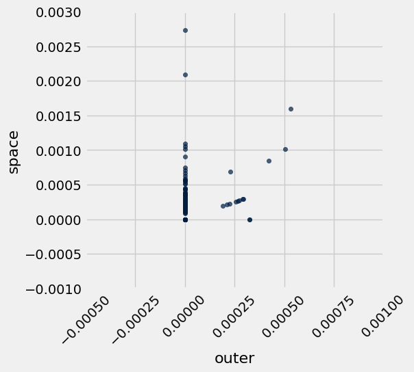
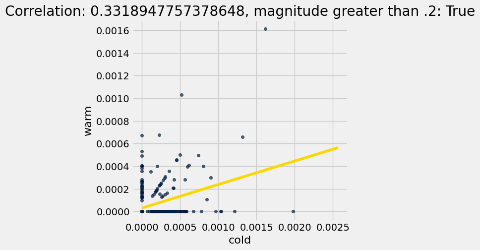
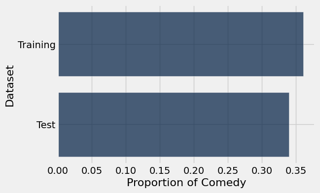
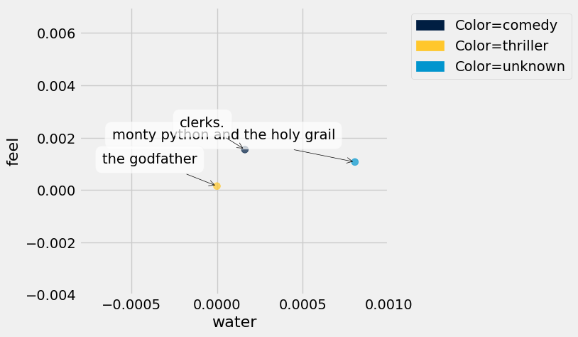
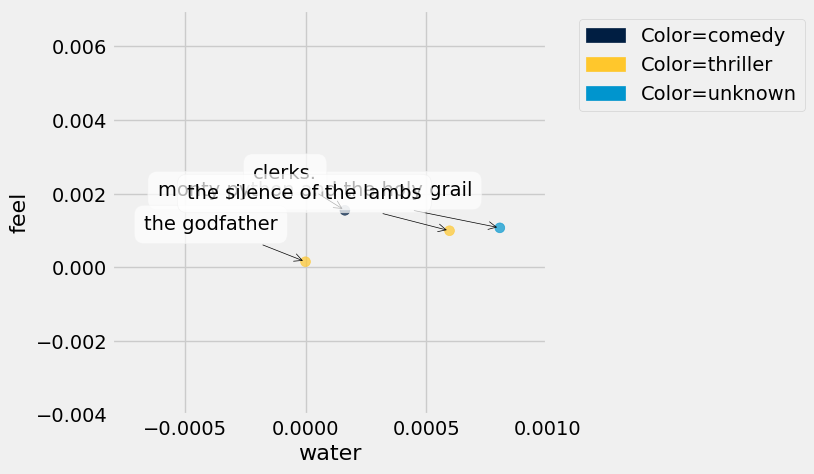

# Project 3: Movie Classification

Welcome to the third and final project of Data 8! You will build a classification model that guesses whether a movie is a comedy or a thriller by using only the number of times chosen words appear in the movie's screenplay. By the end of the project, you should know how to:

1. Build a k-nearest-neighbors classifier.
2. Test a classifier on data.

### Logistics

**Deadline.**  This project is due at **5:00pm PT on Friday, 5/1**. You can receive 5 bonus points for submitting the project by **5:00pm PT on Thursday, 4/30.** Projects will be accepted up to 1 day (24 hours) late. Projects submitted fewer than 24 hours after the deadline will receive 80% credit. Any submissions later than 24 hours after the deadline will not be accepted. It's **much** better to be early than late, so start working now.

**Checkpoint.** For full credit on the checkpoint, you must complete the questions up to the checkpoint, **pass all _public_ autograder tests** for those sections, and submit to the Pensieve Project 03 Checkpoint assignment by **5:00pm PT on Friday, 11/21**.  <span style="color: #BC412B">**The checkpoint is worth 1 lab score**</span>. After you've submitted the checkpoint, you may still change your project answers before the final project deadline - **only your final submission, to the "Project 03 Autograder" assignment, will be graded for correctness** (including questions from before the checkpoint). You will have some lab time to work on these questions, but we recommend that you start the project before lab and leave time to finish the checkpoint afterward.

**Partners.** You may work with one other partner; your partner must be from your assigned lab section. **<span style="color: #BC412B">Only one partner should submit the project notebook to Pensieve.</span> If both partners submit, you will be docked 10% of your project grade. On Pensieve, the person who submits should also designate their partner so that both of you receive credit.** Once you submit, click into your submission, and there will be an option to Add Group Member in the top right corner. You may also reference [this walkthrough video](https://drive.google.com/file/d/1bs1l_f44tUeF1yKY_iljZMTE1X0dYKLl/view?usp=sharing) on how to add partners on Pensieve.

**Rules.** Don't share your code with anybody but your partner. You are welcome to discuss questions with other students, but don't share the answers. The experience of solving the problems in this project will prepare you for exams (and life). If someone asks you for the answer, resist! Instead, you can demonstrate how you would solve a similar problem.

**Support.** You are not alone! Come to office hours, post on Ed, and talk to your classmates. If you want to ask about the details of your solution to a problem, make a private Ed post and the staff will respond. If you're ever feeling overwhelmed or don't know how to make progress, email your TA or tutor for help. You can find contact information for the staff on the [course website](https://www.data8.org/su26/).

**Tests.** <span style="color: #BC412B">The tests that are given are **not comprehensive** and passing the tests for a question **does not** mean that you answered the question correctly.</span> For table manipulation questions, tests usually only check that your table has the correct column labels. Similarly, on multiple choice / select all that apply questions, tests are only checking that your response in the right format, not that it is correct. However, more tests will be applied to verify the correctness of your submission in order to assign your final score, so be careful and check your work! You might want to create your own checks along the way to see if your answers make sense. Additionally, before you submit, make sure that none of your cells take a very long time to run (several minutes).

**Free Response Questions:** Make sure that you put the answers to the written questions in the indicated cell we provide. **Every free response question should include an explanation** that adequately answers the question. 

**Advice.** Develop your answers incrementally. To perform a complicated task, break it up into steps, perform each step on a different line, give a new name to each result, and check that each intermediate result is what you expect. You can add any additional names or functions you want to the provided cells. Make sure that you are using distinct and meaningful variable names throughout the notebook. Along that line, **DO NOT** reuse the variable names that we use when we grade your answers. 

You **never** have to use just one line in this project or any others. Use intermediate variables and multiple lines as much as you would like!

**All of the concepts necessary for this project are found in the textbook.** If you are stuck on a particular problem, reading through the relevant textbook section will often help to clarify concepts.

---

The point breakdown for this assignment is given in the table below:
| Category | Points |
| --- | --- |
| Autograder (Coding questions) | 87 |
| Written | 13 |
| **Total** | 100 |

---

To get started, load `datascience`, `numpy`, and `plots`. Make sure to also run the first cell of this notebook to load `otter`.

**Code:**

```python
# Run this cell to set up the notebook, but please don't change it.
import numpy as np
import math
import datascience 
from datascience import *

# These lines set up the plotting functionality and formatting.
import matplotlib
%matplotlib inline
import matplotlib.pyplot as plots
plots.style.use('fivethirtyeight')
import warnings
warnings.simplefilter("ignore")
```

---
# Part 1: The Dataset

In this project, we are exploring movie screenplays. We'll be trying to predict each movie's genre from the text of its screenplay. In particular, we have compiled a list of 5,000 words that occur in conversations between movie characters. For each movie, our dataset tells us the frequency with which each of these words occurs in certain conversations in its screenplay. All words have been converted to lowercase.

Run the cell below to read the `movies` table. **It may take up to a minute to load.**

**Code:**

```python
movies = Table.read_table('movies.csv')
```

Here is one row of the table and some of the frequencies of words that were said in the movie.

**Code:**

```python
movies.where("Title", "runaway bride").select(0, 1, 2, 3, 4, 14, 49, 1042, 4004)
```

*Output:*

| Title | Year | Rating | Genre | # Words | breez | england | it | bravo |
| --- | --- | --- | --- | --- | --- | --- | --- | --- |
| runaway bride | 1999 | 5.2 | comedy | 4895 | 0 | 0 | 0.0234092 | 0 |

The above cell prints a few columns of the row for the comedy movie *Runaway Bride*.  The movie contains 4895 words. The word "it" appears 115 times, as it makes up  $\frac{115}{4895} \approx 0.0234092$ of the words in the movie. The word "england" doesn't appear at all.

Additional context: This numerical representation of a body of text, one that describes only the frequencies of individual words, is called a bag-of-words representation. This is a model that is often used in [NLP](https://en.wikipedia.org/wiki/Natural_language_processing). A lot of information is discarded in this representation: the order of the words, the context of each word, who said what, the cast of characters and actors, etc. However, a bag-of-words representation is often used for machine learning applications as a reasonable starting point, because a great deal of information is also retained and expressed in a convenient and compact format. 

In this project, we will investigate whether this representation is sufficient to build an accurate genre classifier.

All movie titles are unique. The `row_for_title` function provides fast access to the one row for each title. 

*Note: All movies in our dataset have their titles lower-cased.*

**Code:**

```python
title_index = movies.index_by('Title')
def row_for_title(title):
    """Return the row for a title, similar to the following expression (but faster)
    
    movies.where('Title', title).row(0)
    """
    return title_index.get(title)[0]

row_for_title('toy story')
```

*Output:*

```text
Row(Title='toy story', Year='1995', Rating=8.1999999999999993, Genre='comedy', # Words=3016, she=0.0017427675148135001, decid=0.00034855350296270001, talk=0.0017427675148135001, wit=0.0, razor=0.0, slam=0.0, credit=0.0, rai=0.0, hugh=0.0, breez=0.0, conscienc=0.0, audienc=0.0, cathi=0.0, log=0.0, met=0.0, chosen=0.0, grip=0.0, booz=0.0, bianca=0.0, doubl=0.00034855350296270001, agent=0.0, exit=0.0, carpent=0.0, underground=0.0, clemenza=0.0, gain=0.0, neg=0.00069710700592540001, majesti=0.0, studio=0.0, chri=0.0, spin=0.0, greater=0.0, eaten=0.0, vibrat=0.0, stupid=0.0010456605088881, cigarett=0.0, jesu=0.0, mani=0.0, violin=0.0, financi=0.00034855350296270001, bai=0.0, cop=0.0, neighbor=0.0, cd=0.0, england=0.0, made=0.00034855350296270001, conni=0.0, instinct=0.0, took=0.0, jacquelin=0.0, mace=0.0, disappear=0.0, waltz=0.0, behind=0.00034855350296270001, bourbon=0.0, favorit=0.00069710700592540001, benni=0.0, manhattan=0.0, nixon=0.0, lunch=0.0, principl=0.0, tradit=0.0, counterfeit=0.0, sophi=0.0, third=0.0, exist=0.0, wouldv=0.00034855350296270001, hero=0.0, theyr=0.0024398745207389002, anytim=0.0, christin=0.0, vallei=0.0, chess=0.0, paid=0.0, burglar=0.0, nostril=0.0, rubber=0.0, human=0.0, british=0.0, plissken=0.0, eddi=0.0, gee=0.0, offend=0.0, rebecca=0.0, anger=0.0, plant=0.0, famou=0.0, repres=0.0, latest=0.0, rent=0.0, dip=0.0, bell=0.0, andi=0.0069710700592541001, so=0.0017427675148135001, london=0.0, cooler=0.0, keaton=0.0, portland=0.0, headlin=0.0, whatta=0.0, fatal=0.0, sew=0.0, cheer=0.0, davi=0.0, feed=0.0, hudson=0.0, ambros=0.0, digest=0.0, redi=0.0, fri=0.0, staff=0.00069710700592540001, casino=0.0, occasion=0.0, shadow=0.0, work=0.00069710700592540001, restrain=0.00034855350296270001, face=0.0, exercis=0.0, sidnei=0.0, pile=0.0, whyd=0.0, teenag=0.0, her=0.0013942140118508, retir=0.0, hazard=0.0, roth=0.0, hurrican=0.0, impuls=0.0, ranger=0.0020913210177761999, pour=0.0, lester=0.0, slash=0.0, deer=0.0, could=0.0013942140118508, vital=0.0, qualiti=0.0, coma=0.0, incred=0.0, hank=0.0, famili=0.0, duchess=0.0, global=0.0, virgin=0.0, scientif=0.0, between=0.0, holidai=0.0, qualifi=0.0, moor=0.0, happili=0.0, arizona=0.0, non=0.0, bruce=0.0, ankl=0.0, constant=0.0, buzz=0.0163820146392471, harder=0.0, ing=0.0, christian=0.0, palmer=0.0, tent=0.0, sunset=0.0, damour=0.0, cohaagen=0.0, advertis=0.0, sensat=0.0, local=0.0, there=0.0080167305681421996, terri=0.0, sedat=0.0, rotten=0.0, struck=0.0, deck=0.0, past=0.0, bro=0.0, ann=0.0, dump=0.0, kane=0.0, slot=0.0, immun=0.0, block=0.00034855350296270001, lil=0.0, technic=0.0, tactic=0.0, pencil=0.0, outsid=0.0, laboratori=0.0, easi=0.0, nephew=0.0, coffin=0.0, pretti=0.0, coward=0.0, verbal=0.0, permiss=0.0, bartend=0.0, wont=0.0, watch=0.0013942140118508, lindenmey=0.0, cosmo=0.0, capabl=0.00034855350296270001, flirt=0.0, huge=0.0, berkelei=0.0, max=0.0, walter=0.0, lime=0.0, rico=0.0, marvin=0.0, aboard=0.0, bacon=0.0, account=0.0, kirk=0.0, quaid=0.0, stunt=0.00034855350296270001, closet=0.0, due=0.0, nuclear=0.0, blind=0.0, pussi=0.0, howdi=0.00034855350296270001, snuff=0.0, eas=0.00034855350296270001, now=0.0076681770651794998, leak=0.0, underwear=0.0, westlei=0.0, mayb=0.0, theo=0.0, limo=0.0, cousin=0.0, illeg=0.0, silli=0.0, against=0.0, done=0.00034855350296270001, district=0.0, invad=0.0, ryan=0.0, wait=0.0034855350296270002, grudg=0.0, charact=0.0, hick=0.0, jami=0.0, lifetim=0.0, lecktor=0.0, and=0.0083652840711049004, republican=0.0, life=0.0, hidden=0.0, wire=0.0, paranoia=0.0, network=0.0, messi=0.0, uthatu=0.0, effort=0.0, carri=0.0, windham=0.0, fun=0.00034855350296270001, psychologist=0.0, sean=0.0, scent=0.0, answer=0.0, mom=0.0031369815266642999, wake=0.0, sign=0.0, ho=0.0, relat=0.0, jame=0.0, fat=0.0, myself=0.0, disrupt=0.0, scan=0.0, vagu=0.0, basket=0.0, christma=0.00069710700592540001, estim=0.0, em=0.0013942140118508, union=0.0, involv=0.0, norman=0.0, suspici=0.0, becom=0.0, shoe=0.0, librari=0.0, administr=0.0, ford=0.0, complic=0.

... [output truncated, 64204 more characters]
```

For example, the fastest way to find the frequency of "fun" in the movie *Toy Story* is to access the `'fun'` item from its row. Check the original table to see if this worked for you!

**Code:**

```python
row_for_title('toy story').item('fun')
```

*Output:*

```text
0.00034855350296270001
```

---

#### Question 1.0
Set `expected_row_sum` to the number that you __expect__ will result from summing all proportions in each row, excluding the first five columns. Think about what any one row adds up to.

**Student scaffold:**

```python
# Set row_sum to a number that's the (approximate) sum of each row of word proportions.
expected_row_sum = ...
```

**Solution:**

```python
# Set row_sum to a number that's the (approximate) sum of each row of word proportions.
expected_row_sum = 1 # SOLUTION
```

**Test — `q1_0`**

```python
>>> 0 < expected_row_sum
True
```

This dataset was extracted from [a dataset from Cornell University](http://www.cs.cornell.edu/~cristian/Cornell_Movie-Dialogs_Corpus.html). After transforming the dataset (e.g., converting the words to lowercase, removing the inappropriate words, and converting the counts to frequencies), we created this new dataset containing the frequency of 5000 common words in each movie.

**Code:**

```python
print('Words with frequencies:', movies.drop(np.arange(5)).num_columns) 
print('Movies with genres:', movies.num_rows)
```

*Output (stdout):*

```text
Words with frequencies: 5000
Movies with genres: 333
```

---
## 1.1. Word Stemming
The columns other than "Title", "Year", "Rating", "Genre", and "# Words" in the `movies` table are all words that appear in some of the movies in our dataset.  These words have been *stemmed*, or abbreviated heuristically, in an attempt to make different [inflected](https://en.wikipedia.org/wiki/Inflection) forms of the same base word into the same string.  For example, the column "manag" is the sum of proportions of the words "manage", "manager", "managed", and "managerial" (and perhaps others) in each movie. This is a common technique used in machine learning and natural language processing.

Stemming makes it a little tricky to search for the words you want to use, so we have provided another table called `vocab_table` that will let you see examples of unstemmed versions of each stemmed word. Run the code below to load it.

**Note:** You should use `vocab_table` for the rest of Section 1.1, not `vocab_mapping`.

**Code:**

```python
# Just run this cell.
vocab_mapping = Table.read_table('stem.csv')
stemmed = np.take(movies.labels, np.arange(3, len(movies.labels)))
vocab_table = Table().with_column('Stem', stemmed).join('Stem', vocab_mapping)
vocab_table.take(np.arange(1100, 1110))
```

*Output:*

| Stem | Word |
| --- | --- |
| bond | bonding |
| bone | bone |
| bone | boning |
| bone | bones |
| bonu | bonus |
| book | bookings |
| book | books |
| book | booking |
| book | booked |
| book | book |

---

#### Question 1.1.1
Using `vocab_table`, find the stemmed version of the word "elements" and assign the value to `stemmed_message`.

**Student scaffold:**

```python
stemmed_message = ...
stemmed_message
```

**Solution:**

```python
stemmed_message = vocab_table.where('Word', are.equal_to('elements')).column('Stem').item(0) # SOLUTION
stemmed_message
```

*Output:*

```text
'element'
```

**Test — `q1_1_1`**

```python
>>> (type(stemmed_message) == str) | (type(stemmed_message) == np.str_)
True

>>> len(stemmed_message) < len('elements')
True
```

---

#### Question 1.1.2
What stem in the dataset has the most words that are shortened to it? Assign `most_stem` to that stem.

**Student scaffold:**

```python
most_stem = ...
most_stem
```

**Solution:**

```python
most_stem = vocab_table.group("Stem").sort("count", descending=True).column("Stem").item(0) # SOLUTION
most_stem
```

*Output:*

```text
'gener'
```

**Test — `q1_1_2`**

```python
>>> (type(most_stem) == str) | (type(most_stem) == np.str_)
True
```

---

#### Question 1.1.3
What is the longest word in the dataset whose stem wasn't shortened? Assign that to `longest_uncut`. Break ties alphabetically from Z to A (so if your options are "cat" or "bat", you should pick "cat"). Note that when sorting letters, the letter `a` is smaller than the letter `z`.

*Hint 1:* `vocab_table` has 2 columns: one for stems and one for the unstemmed (normal) word. Find the longest word that wasn't cut at all (same length as stem).

*Hint 2:* `apply` may be helpful here! Check [Python Reference](https://www.data8.org/su25/reference/).

*Hint 3:* Check the comments in the cell below if you are stuck.

**Student scaffold:**

```python
# In our solution, we found it useful to first add columns with
# the length of the word and the length of the stem,
# and then to add a column with the difference between those lengths.
# What will the difference be if the word is not shortened?

tbl_with_lens = ...
tbl_with_diff = ...

longest_uncut = ...
longest_uncut
```

**Solution:**

```python
# In our solution, we found it useful to first add columns with
# the length of the word and the length of the stem,
# and then to add a column with the difference between those lengths.
# What will the difference be if the word is not shortened?

tbl_with_lens = vocab_table.with_columns("Word len", vocab_table.apply(len, "Word"), "Stem len", vocab_table.apply(len, "Stem")) # SOLUTION
tbl_with_diff = tbl_with_lens.with_column("len dif", tbl_with_lens.column("Word len") - tbl_with_lens.column("Stem len")) # SOLUTION

longest_uncut = tbl_with_diff.where("len dif", 0).sort("Word", descending=True).sort("Word len", descending=True).column("Word").item(0) # SOLUTION
longest_uncut
```

*Output:*

```text
'misunderstand'
```

**Test — `q1_1_3`**

```python
>>> (type(longest_uncut) == str) | (type(longest_uncut) == np.str_)
True
```

---

#### Question 1.1.4
How many stems have only one word that is shortened to them? For example, if the stem "book" only maps to the word "books" and if the stem "a" only maps to the word "a," both should be counted as stems that map only to a single word.

Assign `count_single_stems` to the count of stems that map to one word only.

**Student scaffold:**

```python
count_single_stems = ...
count_single_stems
```

**Solution:**

```python
count_single_stems = vocab_table.group("Stem").where("count", are.equal_to(1)).num_rows # SOLUTION
count_single_stems
```

*Output:*

```text
1408
```

**Test — `q1_1_4`**

```python
>>> type(count_single_stems) == int
True
```

---
## 1.2. Exploratory Data Analysis: Linear Regression

Let's explore our dataset before trying to build a classifier. To start, we’ll use the associated proportions to investigate the relationship between different words.

The first association we'll investigate is the association between the proportion of words that are "outer" and the proportion of words that are "space". 

As usual, we'll investigate our data visually before performing any numerical analysis.

Run the cell below to plot a scatter diagram of "space" proportions vs "outer" proportions and to create the `outer_space` table. Each point on the scatter plot represents one movie.

**Code:**

```python
# Just run this cell!
outer_space = movies.select("outer", "space")
outer_space.scatter("outer", "space")
plots.axis([-0.0005, 0.001, -0.001, 0.003]);
plots.xticks(rotation=45);
```



---

#### Question 1.2.1
Looking at that chart it is difficult to see if there is an association. Calculate the correlation coefficient for the potential linear association between proportion of words that are "outer" and the proportion of words that are "space" for every movie in the dataset, and assign it to `outer_space_r`. 

*Hint:* If you need a refresher on how to calculate the correlation coefficient check out [Ch 15.1](https://inferentialthinking.com/chapters/15/1/Correlation.html#calculating-r).

**Student scaffold:**

```python
# These two arrays should make your code cleaner!
outer = movies.column("outer")
space = movies.column("space")

outer_su = ...
space_su = ...

outer_space_r = ...
outer_space_r
```

**Solution:**

```python
# These two arrays should make your code cleaner!
outer = movies.column("outer")
space = movies.column("space")

outer_su = (outer - np.mean(outer)) / np.std(outer) # SOLUTION
space_su = (space - np.mean(space)) / np.std(space) # SOLUTION

outer_space_r = np.mean(space_su * outer_su) # SOLUTION
outer_space_r
```

*Output:*

```text
0.31942607876895912
```

**Test — `q1_2_1`**

```python
>>> 0.2 < outer_space_r < 0.4
True
```

---

#### Question 1.2.2
Choose two *different* words in the dataset with a magnitude (absolute value) of correlation higher than 0.2 and plot a scatter plot with a line of best fit for them. Please do not pick "outer" and "space" or "san" and "francisco". The code to plot the scatter plot and line of best fit is given for you, you just need to calculate the correct values to `r`, `slope` and `intercept`. 

*Hint: It's easier to think of words with a positive correlation, i.e. words that are often mentioned together*.

*Hint 2: Try to think of common phrases or idioms*.

**Student scaffold:**

```python
word_x = ...
word_y = ...

# These arrays should make your code cleaner!
arr_x = movies.column(word_x)
arr_y = movies.column(word_y)

x_su = ...
y_su = ...

r = ...

slope = ...
intercept = ...

# DON'T CHANGE THESE LINES OF CODE
movies.scatter(word_x, word_y)
max_x = max(movies.column(word_x))
plots.title(f"Correlation: {r}, magnitude greater than .2: {abs(r) >= 0.2}")
plots.plot([0, max_x * 1.3], [intercept, intercept + slope * (max_x*1.3)], color='gold');
```

**Solution:**

```python
word_x = "cold" # SOLUTION
word_y = "warm" # SOLUTION

# These arrays should make your code cleaner!
arr_x = movies.column(word_x)
arr_y = movies.column(word_y)

x_su = (arr_x - np.mean(arr_x)) / np.std(arr_x) # SOLUTION
y_su = (arr_y - np.mean(arr_y)) / np.std(arr_y) # SOLUTION

r = np.mean(x_su * y_su) # SOLUTION

slope = np.std(arr_y) / np.std(arr_x) * r # SOLUTION
intercept = np.mean(arr_y) - (np.mean(arr_x) * slope) # SOLUTION

# DON'T CHANGE THESE LINES OF CODE
movies.scatter(word_x, word_y)
max_x = max(movies.column(word_x))
plots.title(f"Correlation: {r}, magnitude greater than .2: {abs(r) >= 0.2}")
plots.plot([0, max_x * 1.3], [intercept, intercept + slope * (max_x*1.3)], color='gold');
```



**Test — `q1_2_2`**

```python
>>> {word_x, word_y} not in [{'san', 'francisco'}, {'outer', 'space'}]
True
```

---

#### Question 1.2.3
Imagine that you picked the words "san" and "francisco" as the two words that you would expect to be correlated because they compose the city name San Francisco. Assign `san_francisco` to either the number 1 or the number 2 according to which statement is true regarding the correlation between "san" and "francisco." 

1. "san" can also preceed other city names like San Diego and San Jose. This might lead to "san" appearing in movies without "francisco," and would reduce the correlation between "san" and "francisco."
2. "san" can also preceed other city names like San Diego and San Jose. The fact that "san" could appear more often in front of different cities and without "francisco" would increase the correlation between "san" and "francisco."

**Student scaffold:**

```python
san_francisco = ...
```

**Solution:**

```python
san_francisco = 1 # SOLUTION
```

**Test — `q1_2_3`**

```python
>>> type(san_francisco) == int
True
```

---
## 1.3. Splitting the dataset
Now, we're going to use our `movies` dataset for two purposes.

1. First, we want to *train* movie genre classifiers.
2. Second, we want to *test* the performance of our classifiers. 

Hence, we need two different datasets: *training* and *test*. 

The purpose of a classifier is to classify unseen data that is similar to the training data. The test dataset will help us determine the accuracy of our predictions by comparing the actual genres of the movies with the genres that our classifier predicts. Therefore, we must ensure that there are no movies that appear in both sets. We do so by splitting the dataset randomly. The dataset has already been permuted randomly, so it's easy to split.  We just take the top for training and the rest for test. 

Run the code below (without changing it) to separate the datasets into two tables.

**Code:**

```python
# Here we have defined the proportion of our data
# that we want to designate for training as 17/20ths
# of our total dataset.  3/20ths of the data is
# reserved for testing.

training_proportion = 17/20

num_movies = movies.num_rows
num_train = int(num_movies * training_proportion)
num_test = num_movies - num_train

train_movies = movies.take(np.arange(num_train))
test_movies = movies.take(np.arange(num_train, num_movies))

print("Training: ",   train_movies.num_rows, ";",
      "Test: ",       test_movies.num_rows)
```

*Output (stdout):*

```text
Training:  283 ; Test:  50
```

---

#### Question 1.3.1
Draw a horizontal bar chart with two bars that show the proportion of Comedy movies in each dataset (`train_movies` and `test_movies`). The two bars should be labeled "Training" and "Test". Complete the function `comedy_proportion` first; it should help you create the bar chart. 

*Hint*: Refer to [Section 7.1](https://inferentialthinking.com/chapters/07/1/Visualizing_Categorical_Distributions.html#bar-chart) of the textbook if you need a refresher on bar charts.

**Student scaffold:**

```python
def comedy_proportion(table):
    # Return the proportion of movies in a table that have the Comedy genre.
    ...
    return ...

# The staff solution took multiple lines.  Start by creating a table.
# If you get stuck, think about what sort of table you need for barh to work
...
```

**Solution:**

```python
# BEGIN SOLUTION NO PROMPT
def comedy_proportion(table):
    """Return the proportion of movies in a table that have the Comedy genre."""
    return table.where('Genre', are.equal_to('comedy')).num_rows / table.num_rows

datasets = make_array('Training', 'Test')
prop_comedy = make_array(comedy_proportion(train_movies), comedy_proportion(test_movies))
Table().with_columns(
        'Dataset', datasets,
        'Proportion of Comedy', prop_comedy)\
       .barh('Dataset')
# END SOLUTION
""" # BEGIN PROMPT
def comedy_proportion(table):
    # Return the proportion of movies in a table that have the Comedy genre.
    ...
    return ...

# The staff solution took multiple lines.  Start by creating a table.
# If you get stuck, think about what sort of table you need for barh to work
...
"""; # END PROMPT
```



---
# Part 2: K-Nearest Neighbors - A Guided Example

K-Nearest Neighbors (k-NN) is a classification algorithm.  Given some numerical *attributes* (also called *features*) of an unseen example, it decides which category that example belongs to based on its similarity to previously seen examples. Predicting the category of an example is called *labeling*, and the predicted category is also called a *label*.

An attribute (feature) we have about each movie is *the proportion of times a particular word appears in the movie*, and the labels are two movie genres: comedy and thriller.  The algorithm requires many previously seen examples for which both the attributes and labels are known: that's the `train_movies` table.

To build understanding, we're going to visualize the algorithm instead of just describing it.

---
## 2.1. Classifying a movie

In k-NN, we classify a movie by finding the `k` movies in the *training set* that are most similar according to the features we choose. We call those movies with similar features the *nearest neighbors*.  The k-NN algorithm assigns the movie to the most common category among its `k` nearest neighbors.

Let's limit ourselves to just 2 features for now, so we can plot each movie.  The features we will use are the proportions of the words "water" and "feel" in the movie.  Taking the movie *Monty Python and the Holy Grail* (in the test set), 0.000804074 of its words are "water" and 0.0010721 are "feel". This movie appears in the test set, so let's imagine that we don't yet know its genre.

First, we need to make our notion of similarity more precise.  We will say that the *distance* between two movies is the straight-line distance between them when we plot their features on a scatter diagram. 

**This distance is called the Euclidean ("yoo-KLID-ee-un") distance, whose formula is $\sqrt{(x_1 - x_2)^2 + (y_1 - y_2)^2}$.**

For example, in the movie *Clerks.* (in the training set), 0.00016293 of all the words in the movie are "water" and 0.00154786 are "feel".  Its distance from *Monty Python and the Holy Grail* on this 2-word feature set is $\sqrt{(0.000804074 - 0.000162933)^2 + (0.0010721 - 0.00154786)^2} \approx 0.000798379$.  (If we included more or different features, the distance could be different.)

A third movie, *The Godfather* (in the training set), has 0 "water" and 0.00015122 "feel". 

The function below creates a plot to display the "water" and "feel" features of a test movie and some training movies. As you can see in the result, *Monty Python and the Holy Grail* is more similar to *Clerks.* than to the *The Godfather* based on these features, which makes sense as both movies are comedy movies, while *The Godfather* is a thriller.

**Code:**

```python
# Just run this cell.
def plot_with_two_features(test_movie, training_movies, x_feature, y_feature):
    """Plot a test movie and training movies using two features."""
    test_row = row_for_title(test_movie)
    distances = Table().with_columns(
            x_feature, [test_row.item(x_feature)],
            y_feature, [test_row.item(y_feature)],
            'Color',   ['unknown'],
            'Title',   [test_movie]
        )
    for movie in training_movies:
        row = row_for_title(movie)
        distances.append([row.item(x_feature), row.item(y_feature), row.item('Genre'), movie])
    distances.scatter(x_feature, y_feature, group='Color', labels='Title', s=50)
    
training = ["clerks.", "the godfather"] 
plot_with_two_features("monty python and the holy grail", training, "water", "feel")
plots.axis([-0.0008, 0.001, -0.004, 0.007]);
```



---

#### Question 2.1.1

Compute the Euclidean distance (defined in the section above) between the two movies, *Monty Python and the Holy Grail* and *The Godfather*, using the `water` and `feel` features only.  Assign it the name `one_distance`. 

*Hint:* If you have a row, you can use `item` to get a value from a column by its name.  For example, if `r` is a row, then `r.item("Genre")` is the value in column `"Genre"` in row `r`.

**Student scaffold:**

```python
python = row_for_title("monty python and the holy grail") 
godfather = row_for_title("the godfather") 

one_distance = ...
one_distance
```

**Solution:**

```python
python = row_for_title("monty python and the holy grail") 
godfather = row_for_title("the godfather") 

one_distance = ((python.item("water") - godfather.item("water"))**2 + (python.item("feel") - godfather.item("feel"))**2)**0.5 # SOLUTION
one_distance
```

*Output:*

```text
0.0012225209151294461
```

**Test — `q2_1_1`**

```python
>>> 0 < one_distance < 0.01
True
```

Below, we've added a third training movie, *The Silence of the Lambs*. Before, the point closest to *Monty Python and the Holy Grail* was *Clerks.*, a comedy movie. However, now the closest point is *The Silence of the Lambs*, a thriller movie.

**Code:**

```python
training = ["clerks.", "the godfather", "the silence of the lambs"] 
plot_with_two_features("monty python and the holy grail", training, "water", "feel") 
plots.axis([-0.0008, 0.001, -0.004, 0.007]);
```



---

#### Question 2.1.2
Complete the function `distance_two_features` that computes the Euclidean distance between any two movies, using two features. The last two lines call your function to show that *Monty Python and the Holy Grail* is closer to *The Silence of the Lambs* than it is to *Clerks*.

**Student scaffold:**

```python
def distance_two_features(title0, title1, x_feature, y_feature):
    """Compute the distance between two movies with titles title0 and title1.
    
    Only the features named x_feature and y_feature are used when computing the distance.
    """
    row0 = ...
    row1 = ...
    ...

for movie in make_array("clerks.", "the silence of the lambs"):
    movie_distance = distance_two_features(movie, "monty python and the holy grail", "water", "feel")
    print(movie, 'distance:\t', movie_distance)
```

**Solution:**

```python
def distance_two_features(title0, title1, x_feature, y_feature):
    """Compute the distance between two movies with titles title0 and title1.
    
    Only the features named x_feature and y_feature are used when computing the distance.
    """
    row0 = row_for_title(title0) # SOLUTION
    row1 = row_for_title(title1) # SOLUTION
    return ((row0.item(x_feature) - row1.item(x_feature))**2 + (row0.item(y_feature) - row1.item(y_feature))**2)**0.5 # SOLUTION

for movie in make_array("clerks.", "the silence of the lambs"):
    movie_distance = distance_two_features(movie, "monty python and the holy grail", "water", "feel")
    print(movie, 'distance:\t', movie_distance)
```

*Output (stdout):*

```text
clerks. distance:	 0.000798381068723
the silence of the lambs distance:	 0.000222563148556
```

**Test — `q2_1_2`**

```python
>>> correct_dis = 0.001406116
>>> dis = distance_two_features('clerks.', 'the godfather', 'water', 'feel')
>>> np.isclose(np.round(dis, 9), correct_dis)
True

>>> correct_dis = 0.005647119
>>> dis = distance_two_features('clerks.', 'the godfather', 'your', 'that')
>>> np.isclose(np.round(dis, 9), correct_dis)
True
```

---

#### Question 2.1.3
Define the function `distance_from_python` so that it works as described in its documentation. 

**Note:** Your solution should not use arithmetic operations directly. Instead, it should make use of existing functionality above!

**Student scaffold:**

```python
def distance_from_python(title):
    """The distance between the given movie and "monty python and the holy grail", 
    based on the features "water" and "feel".
    
    This function takes a single argument:
      title: A string, the name of a movie.
    """
    
    ...

# Calculate the distance between "Clerks." and "Monty Python and the Holy Grail"
distance_from_python('clerks.')
```

**Solution:**

```python
def distance_from_python(title):
    """The distance between the given movie and "monty python and the holy grail", 
    based on the features "water" and "feel".
    
    This function takes a single argument:
      title: A string, the name of a movie.
    """
    
    return distance_two_features(title, "monty python and the holy grail", "water", "feel") # SOLUTION

# Calculate the distance between "Clerks." and "Monty Python and the Holy Grail"
distance_from_python('clerks.')
```

*Output:*

```text
0.00079838106872277164
```

**Test — `q2_1_3`**

```python
>>> np.isclose(distance_from_python('clerks.'), 0.00079838)
True
```

---

#### Question 2.1.4

Using the features `"water"` and `"feel"`, what are the names and genres of the 5 movies in the **training set** closest to *Monty Python and the Holy Grail*?  To answer this question, make a table named `close_movies` containing those 5 movies with columns `"Title"`, `"Genre"`, `"water"`, and `"feel"`, as well as a column called `"distance from python"` that contains the distance from *Monty Python and the Holy Grail*.  The table should be **sorted in ascending order by `"distance from python"`**.

**Student scaffold:**

```python
# The staff solution took multiple lines.
...
close_movies = ...
close_movies
```

**Solution:**

```python
# BEGIN SOLUTION NO PROMPT
water_feel = train_movies.select("Title", "Genre", "water", "feel")
close_movies = water_feel.with_column('distance from python', water_feel.apply(distance_from_python, 'Title'))\
                       .sort('distance from python')\
                       .take(np.arange(5))
# END SOLUTION

""" # BEGIN PROMPT
# The staff solution took multiple lines.
...
close_movies = ...
close_movies
"""; # END PROMPT
```

**Test — `q2_1_4`**

```python
>>> set(close_movies.labels) >= {'Genre', 'Title', 'feel', 'water'}
True

>>> close_movies.num_rows == 5
True

>>> close_movies.column('Title').item(0) != 'monty python and the holy grail'
True
```

---

#### Question 2.1.5
Next, we'll clasify *Monty Python and the Holy Grail* based on the genres of the closest movies. 

To do so, define the function `most_common` so that it works as described in its documentation below.

**Student scaffold:**

```python
def most_common(label, table):
    """The most common element in a column of a table.
    
    This function takes two arguments:
      label: The label of a column, a string.
      table: A table.
     
    It returns the most common value in that column of that table.
    In case of a tie, it returns any one of the most common values
    """
    ...

# Calling most_common on your table of 5 nearest neighbors classifies
# "monty python and the holy grail" as a thriller movie, 3 votes to 2. 
most_common('Genre', close_movies)
```

**Solution:**

```python
def most_common(label, table):
    """The most common element in a column of a table.
    
    This function takes two arguments:
      label: The label of a column, a string.
      table: A table.
     
    It returns the most common value in that column of that table.
    In case of a tie, it returns any one of the most common values
    """
    return table.group(label).sort('count', descending=True).column(label).item(0) # SOLUTION

# Calling most_common on your table of 5 nearest neighbors classifies
# "monty python and the holy grail" as a thriller movie, 3 votes to 2. 
most_common('Genre', close_movies)
```

*Output:*

```text
'thriller'
```

**Test — `q2_1_5`**

```python
>>> [most_common('Genre', close_movies.take(range(k))) for k in range(1, 6, 2)]
['thriller', 'thriller', 'thriller']
```

Congratulations are in order -- you've classified your first movie! However, we can see that the classifier doesn't work too well since it categorized *Monty Python and the Holy Grail* as a thriller movie (unless you count the thrilling holy hand grenade scene). Let's see if we can do better!

# Checkpoint (due Friday 8/8 by 8:00 pm PT)
Congratulations, you have reached the checkpoint! Run the following cells and submit to the Gradescope assignment titled **Project 2 Checkpoint**.

**NOTE: This checkpoint does not represent the halfway point of the project. You are *highly* encouraged to continue on to the next section early.**

To get full credit for this checkpoint, you must pass all the public autograder tests above this cell. The cell below will rerun all of the autograder tests for Part 1 and Part 2 so that you can double check your work.

## Submission

Make sure you have run all cells in your notebook in order before running the cell below, so that all images/graphs appear in the output. You can do this by going to `Cell > Run All`. The cell below will generate a zip file for you to submit. Please save before exporting!

**Reminders:**
- Please remember to **add your partner to your Gradescope submission**. If you resubmit, make sure to re-add your partner, as Gradescope does not save any partner information.
- Make sure to wait until the autograder finishes running to ensure that your submission was processed properly and that you submitted to the correct assignment.

---

To double-check your work, the cell below will rerun all of the autograder tests.

## Submission

Make sure you have run all cells in your notebook in order before running the cell below, so that all images/graphs appear in the output. The cell below will generate a zip file for you to submit. **Please save before exporting!**

---

## Datasets

Datasets this notebook loads with `Table.read_table`. Column names are exact, including spaces and capitalization. Only the schema is recorded here — the data itself is not in this document, so any question about its values must be answered by running code, not by reasoning over the rows shown elsewhere in this file.

### `movies.csv`

333 rows, 5005 columns.

| Column | Type |
| --- | --- |
| `Title` | str |
| `Year` | str |
| `Rating` | float |
| `Genre` | str |
| `# Words` | int |
| `she` | float |
| `decid` | float |
| `talk` | float |
| `wit` | float |
| `razor` | float |
| `slam` | float |
| `credit` | float |
| `rai` | float |
| `hugh` | float |
| `breez` | float |
| `conscienc` | float |
| `audienc` | float |
| `cathi` | float |
| `log` | float |
| `met` | float |
| `chosen` | float |
| `grip` | float |
| `booz` | float |
| `bianca` | float |
| `doubl` | float |
| `agent` | float |
| `exit` | float |
| `carpent` | float |
| `underground` | float |
| `clemenza` | float |
| `gain` | float |
| `neg` | float |
| `majesti` | float |
| `studio` | float |
| `chri` | float |
| `spin` | float |
| `greater` | float |
| `eaten` | float |
| `vibrat` | float |
| `stupid` | float |

_... 4,965 more columns, all float_

### `stem.csv`

40,053 rows, 2 columns.

| Column | Type |
| --- | --- |
| `Stem` | str |
| `Word` | str |
