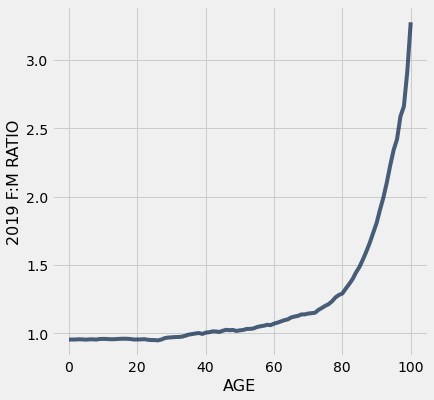

# Chapter 6: Tables

Tables are a fundamental object type for representing data sets. A table can be viewed in two ways:
* a sequence of named columns that each describe a single aspect of all entries in a data set, or
* a sequence of rows that each contain all information about a single entry in a data set.

In order to use tables, import all of the module called `datascience`, a module created for this text.

```python
import numpy as np
np.set_printoptions(threshold=50)
path_data = '../../assets/data/'
```

```python
from datascience import *
```

Empty tables can be created using the `Table` function. An empty table is useful because it can be extended to contain new rows and columns.

```python
Table()
```

The `with_columns` method on a table constructs a new table with additional labeled columns. Each column of a table is an array. To add one new column to a table, call `with_columns` with a label and an array. (The `with_column` method can be used with the same effect.)

Below, we begin each example with an empty table that has no columns.

```python
Table().with_columns('Number of petals', make_array(8, 34, 5))
```

*Output:*

| Number of petals |
| --- |
| 8 |
| 34 |
| 5 |

To add two (or more) new columns, provide the label and array for each column. All columns must have the same length, or an error will occur.

```python
Table().with_columns(
    'Number of petals', make_array(8, 34, 5),
    'Name', make_array('lotus', 'sunflower', 'rose')
)
```

*Output:*

| Number of petals | Name |
| --- | --- |
| 8 | lotus |
| 34 | sunflower |
| 5 | rose |

We can give this table a name, and then extend the table with another column.

```python
flowers = Table().with_columns(
    'Number of petals', make_array(8, 34, 5),
    'Name', make_array('lotus', 'sunflower', 'rose')
)

flowers.with_columns(
    'Color', make_array('pink', 'yellow', 'red')
)
```

*Output:*

| Number of petals | Name | Color |
| --- | --- | --- |
| 8 | lotus | pink |
| 34 | sunflower | yellow |
| 5 | rose | red |

The `with_columns` method creates a new table each time it is called, so the original table is not affected. For example, the table `flowers` still has only the two columns that it had when it was created.

```python
flowers
```

*Output:*

| Number of petals | Name |
| --- | --- |
| 8 | lotus |
| 34 | sunflower |
| 5 | rose |

Creating tables in this way involves a lot of typing. If the data have already been entered somewhere, it is usually possible to use Python to read it into a table, instead of typing it all in cell by cell.

Often, tables are created from files that contain comma-separated values. Such files are called CSV files.

Below, we use the Table method `read_table` to read a CSV file that contains some of the data used by Minard in his graphic about Napoleon's Russian campaign. The data are placed in a table named `minard`.

```python
minard = Table.read_table(path_data + 'minard.csv')
minard
```

*Output:*

| Longitude | Latitude | City | Direction | Survivors |
| --- | --- | --- | --- | --- |
| 32 | 54.8 | Smolensk | Advance | 145000 |
| 33.2 | 54.9 | Dorogobouge | Advance | 140000 |
| 34.4 | 55.5 | Chjat | Advance | 127100 |
| 37.6 | 55.8 | Moscou | Advance | 100000 |
| 34.3 | 55.2 | Wixma | Retreat | 55000 |
| 32 | 54.6 | Smolensk | Retreat | 24000 |
| 30.4 | 54.4 | Orscha | Retreat | 20000 |
| 26.8 | 54.3 | Moiodexno | Retreat | 12000 |

We will use this small table to demonstrate some useful Table methods. We will then use those same methods, and develop other methods, on much larger tables of data.

**The Size of the Table**

The method `num_columns` gives the number of columns in the table, and `num_rows` the number of rows.

```python
minard.num_columns
```

*Output:*

```text
5
```

```python
minard.num_rows
```

*Output:*

```text
8
```

**Column Labels**

The method `labels` can be used to list the labels of all the columns. With `minard` we don't gain much by this, but it can be very useful for tables that are so large that not all columns are visible on the screen.

```python
minard.labels
```

*Output:*

```text
('Longitude', 'Latitude', 'City', 'Direction', 'Survivors')
```

We can change column labels using the `relabeled` method. This creates a new table and leaves `minard` unchanged.

```python
minard.relabeled('City', 'City Name')
```

*Output:*

| Longitude | Latitude | City Name | Direction | Survivors |
| --- | --- | --- | --- | --- |
| 32 | 54.8 | Smolensk | Advance | 145000 |
| 33.2 | 54.9 | Dorogobouge | Advance | 140000 |
| 34.4 | 55.5 | Chjat | Advance | 127100 |
| 37.6 | 55.8 | Moscou | Advance | 100000 |
| 34.3 | 55.2 | Wixma | Retreat | 55000 |
| 32 | 54.6 | Smolensk | Retreat | 24000 |
| 30.4 | 54.4 | Orscha | Retreat | 20000 |
| 26.8 | 54.3 | Moiodexno | Retreat | 12000 |

However, this method does not change the original table.

```python
minard
```

*Output:*

| Longitude | Latitude | City | Direction | Survivors |
| --- | --- | --- | --- | --- |
| 32 | 54.8 | Smolensk | Advance | 145000 |
| 33.2 | 54.9 | Dorogobouge | Advance | 140000 |
| 34.4 | 55.5 | Chjat | Advance | 127100 |
| 37.6 | 55.8 | Moscou | Advance | 100000 |
| 34.3 | 55.2 | Wixma | Retreat | 55000 |
| 32 | 54.6 | Smolensk | Retreat | 24000 |
| 30.4 | 54.4 | Orscha | Retreat | 20000 |
| 26.8 | 54.3 | Moiodexno | Retreat | 12000 |

A common pattern is to assign the original name `minard` to the new table, so that all future uses of `minard` will refer to the relabeled table.

```python
minard = minard.relabeled('City', 'City Name')
minard
```

*Output:*

| Longitude | Latitude | City Name | Direction | Survivors |
| --- | --- | --- | --- | --- |
| 32 | 54.8 | Smolensk | Advance | 145000 |
| 33.2 | 54.9 | Dorogobouge | Advance | 140000 |
| 34.4 | 55.5 | Chjat | Advance | 127100 |
| 37.6 | 55.8 | Moscou | Advance | 100000 |
| 34.3 | 55.2 | Wixma | Retreat | 55000 |
| 32 | 54.6 | Smolensk | Retreat | 24000 |
| 30.4 | 54.4 | Orscha | Retreat | 20000 |
| 26.8 | 54.3 | Moiodexno | Retreat | 12000 |

**Accessing the Data in a Column**

We can use a column's label to access the array of data in the column.

```python
minard.column('Survivors')
```

*Output:*

```text
array([145000, 140000, 127100, 100000,  55000,  24000,  20000,  12000])
```

The 5 columns are indexed 0, 1, 2, 3, and 4. The column `Survivors` can also be accessed by using its column index.

```python
minard.column(4)
```

*Output:*

```text
array([145000, 140000, 127100, 100000,  55000,  24000,  20000,  12000])
```

The 8 items in the array are indexed 0, 1, 2, and so on, up to 7. The items in the column can be accessed using `item`, as with any array.

```python
minard.column(4).item(0)
```

*Output:*

```text
145000
```

```python
minard.column(4).item(5)
```

*Output:*

```text
24000
```

**Working with the Data in a Column**

Because columns are arrays, we can use array operations on them to discover new information. For example, we can create a new column that contains the percent of all survivors at each city after Smolensk.

```python
initial = minard.column('Survivors').item(0)
minard = minard.with_columns(
    'Percent Surviving', minard.column('Survivors')/initial
)
minard
```

*Output:*

| Longitude | Latitude | City Name | Direction | Survivors | Percent Surviving |
| --- | --- | --- | --- | --- | --- |
| 32 | 54.8 | Smolensk | Advance | 145000 | 1 |
| 33.2 | 54.9 | Dorogobouge | Advance | 140000 | 0.965517 |
| 34.4 | 55.5 | Chjat | Advance | 127100 | 0.876552 |
| 37.6 | 55.8 | Moscou | Advance | 100000 | 0.689655 |
| 34.3 | 55.2 | Wixma | Retreat | 55000 | 0.37931 |
| 32 | 54.6 | Smolensk | Retreat | 24000 | 0.165517 |
| 30.4 | 54.4 | Orscha | Retreat | 20000 | 0.137931 |
| 26.8 | 54.3 | Moiodexno | Retreat | 12000 | 0.0827586 |

To make the proportions in the new columns appear as percents, we can use the method `set_format` with the option `PercentFormatter`. The `set_format` method takes `Formatter` objects, which exist for dates (`DateFormatter`), currencies (`CurrencyFormatter`), numbers, and percentages.

```python
minard.set_format('Percent Surviving', PercentFormatter)
```

*Output:*

| Longitude | Latitude | City Name | Direction | Survivors | Percent Surviving |
| --- | --- | --- | --- | --- | --- |
| 32 | 54.8 | Smolensk | Advance | 145000 | 100.00% |
| 33.2 | 54.9 | Dorogobouge | Advance | 140000 | 96.55% |
| 34.4 | 55.5 | Chjat | Advance | 127100 | 87.66% |
| 37.6 | 55.8 | Moscou | Advance | 100000 | 68.97% |
| 34.3 | 55.2 | Wixma | Retreat | 55000 | 37.93% |
| 32 | 54.6 | Smolensk | Retreat | 24000 | 16.55% |
| 30.4 | 54.4 | Orscha | Retreat | 20000 | 13.79% |
| 26.8 | 54.3 | Moiodexno | Retreat | 12000 | 8.28% |

**Choosing Sets of Columns**

The method `select` creates a new table that contains only the specified columns.

```python
minard.select('Longitude', 'Latitude')
```

*Output:*

| Longitude | Latitude |
| --- | --- |
| 32 | 54.8 |
| 33.2 | 54.9 |
| 34.4 | 55.5 |
| 37.6 | 55.8 |
| 34.3 | 55.2 |
| 32 | 54.6 |
| 30.4 | 54.4 |
| 26.8 | 54.3 |

The same selection can be made using column indices instead of labels.

```python
minard.select(0, 1)
```

*Output:*

| Longitude | Latitude |
| --- | --- |
| 32 | 54.8 |
| 33.2 | 54.9 |
| 34.4 | 55.5 |
| 37.6 | 55.8 |
| 34.3 | 55.2 |
| 32 | 54.6 |
| 30.4 | 54.4 |
| 26.8 | 54.3 |

The result of using `select` is a new table, even when you select just one column.

```python
minard.select('Survivors')
```

*Output:*

| Survivors |
| --- |
| 145000 |
| 140000 |
| 127100 |
| 100000 |
| 55000 |
| 24000 |
| 20000 |
| 12000 |

Notice that the result is a table, unlike the result of `column`, which is an array.

```python
minard.column('Survivors')
```

*Output:*

```text
array([145000, 140000, 127100, 100000,  55000,  24000,  20000,  12000])
```

Another way to create a new table consisting of a set of columns is to `drop` the columns you don't want.

```python
minard.drop('Longitude', 'Latitude', 'Direction')
```

*Output:*

| City Name | Survivors | Percent Surviving |
| --- | --- | --- |
| Smolensk | 145000 | 100.00% |
| Dorogobouge | 140000 | 96.55% |
| Chjat | 127100 | 87.66% |
| Moscou | 100000 | 68.97% |
| Wixma | 55000 | 37.93% |
| Smolensk | 24000 | 16.55% |
| Orscha | 20000 | 13.79% |
| Moiodexno | 12000 | 8.28% |

Neither `select` nor `drop` change the original table. Instead, they create new smaller tables that share the same data. The fact that the original table is preserved is useful! You can generate multiple different tables that only consider certain columns without worrying that one analysis will affect the other.

```python
minard
```

*Output:*

| Longitude | Latitude | City Name | Direction | Survivors | Percent Surviving |
| --- | --- | --- | --- | --- | --- |
| 32 | 54.8 | Smolensk | Advance | 145000 | 100.00% |
| 33.2 | 54.9 | Dorogobouge | Advance | 140000 | 96.55% |
| 34.4 | 55.5 | Chjat | Advance | 127100 | 87.66% |
| 37.6 | 55.8 | Moscou | Advance | 100000 | 68.97% |
| 34.3 | 55.2 | Wixma | Retreat | 55000 | 37.93% |
| 32 | 54.6 | Smolensk | Retreat | 24000 | 16.55% |
| 30.4 | 54.4 | Orscha | Retreat | 20000 | 13.79% |
| 26.8 | 54.3 | Moiodexno | Retreat | 12000 | 8.28% |

All of the methods that we have used above can be applied to any table.

## 6.1 Sorting Rows

"The NBA is the highest paying professional sports league in the world," [reported CNN](http://edition.cnn.com/2015/12/04/sport/gallery/highest-paid-nba-players/) in March 2016. The table `nba_salaries` contains the salaries of all National Basketball Association players in 2015-2016.

Each row represents one player. The columns are:

| **Column Label**   | Description                                         |
|--------------------|-----------------------------------------------------|
| `PLAYER`           | Player's name                                       |
| `POSITION`         | Player's position on team                           |
| `TEAM`             | Team name                                           |
|`'15-'16 SALARY`    | Player's salary in 2015-2016, in millions of dollars|
 
The code for the positions is PG (Point Guard), SG (Shooting Guard), PF (Power Forward), SF (Small Forward), and C (Center). But what follows doesn't involve details about how basketball is played.

The first row shows that Paul Millsap, Power Forward for the Atlanta Hawks, had a salary of almost $\$18.7$ million in 2015-2016.

```python
from datascience import *
import numpy as np
path_data = '../../../assets/data/'
np.set_printoptions(threshold=50)
```

```python
# This table can be found online: https://www.statcrunch.com/app/index.php?dataid=1843341
nba_salaries = Table.read_table(path_data + 'nba_salaries.csv')
nba_salaries
```

*Output:*

| PLAYER | POSITION | TEAM | '15-'16 SALARY |
| --- | --- | --- | --- |
| Paul Millsap | PF | Atlanta Hawks | 18.6717 |
| Al Horford | C | Atlanta Hawks | 12 |
| Tiago Splitter | C | Atlanta Hawks | 9.75625 |
| Jeff Teague | PG | Atlanta Hawks | 8 |
| Kyle Korver | SG | Atlanta Hawks | 5.74648 |
| Thabo Sefolosha | SF | Atlanta Hawks | 4 |
| Mike Scott | PF | Atlanta Hawks | 3.33333 |
| Kent Bazemore | SF | Atlanta Hawks | 2 |
| Dennis Schroder | PG | Atlanta Hawks | 1.7634 |
| Tim Hardaway Jr. | SG | Atlanta Hawks | 1.30452 |

The table contains 417 rows, one for each player. Only 10 of the rows are displayed. The `show` method allows us to specify the number of rows, with the default (no specification) being all the rows of the table.

```python
nba_salaries.show(3)
```

*Output:*

| PLAYER | POSITION | TEAM | '15-'16 SALARY |
| --- | --- | --- | --- |
| Paul Millsap | PF | Atlanta Hawks | 18.6717 |
| Al Horford | C | Atlanta Hawks | 12 |
| Tiago Splitter | C | Atlanta Hawks | 9.75625 |

Glance through about 20 rows or so, and you will see that the rows are in alphabetical order by team name. It's also possible to list the same rows in alphabetical order by player name using the `sort` method. The argument to `sort` is a column label or index.

```python
nba_salaries.sort('PLAYER').show(5)
```

*Output:*

| PLAYER | POSITION | TEAM | '15-'16 SALARY |
| --- | --- | --- | --- |
| Aaron Brooks | PG | Chicago Bulls | 2.25 |
| Aaron Gordon | PF | Orlando Magic | 4.17168 |
| Aaron Harrison | SG | Charlotte Hornets | 0.525093 |
| Adreian Payne | PF | Minnesota Timberwolves | 1.93884 |
| Al Horford | C | Atlanta Hawks | 12 |

To examine the players' salaries, it would be much more helpful if the data were ordered by salary.

To do this, we will first simplify the label of the column of salaries (just for convenience), and then sort by the new label `SALARY`. 

This arranges all the rows of the table in *increasing* order of salary, with the lowest salary appearing first. The output is a new table with the same columns as the original but with the rows rearranged.

```python
nba = nba_salaries.relabeled("'15-'16 SALARY", 'SALARY')
nba.sort('SALARY')
```

*Output:*

| PLAYER | POSITION | TEAM | SALARY |
| --- | --- | --- | --- |
| Thanasis Antetokounmpo | SF | New York Knicks | 0.030888 |
| Jordan McRae | SG | Phoenix Suns | 0.049709 |
| Cory Jefferson | PF | Phoenix Suns | 0.049709 |
| Elliot Williams | SG | Memphis Grizzlies | 0.055722 |
| Orlando Johnson | SG | Phoenix Suns | 0.055722 |
| Phil Pressey | PG | Phoenix Suns | 0.055722 |
| Keith Appling | PG | Orlando Magic | 0.061776 |
| Sean Kilpatrick | SG | Denver Nuggets | 0.099418 |
| Erick Green | PG | Utah Jazz | 0.099418 |
| Jeff Ayres | PF | Los Angeles Clippers | 0.111444 |

These figures are somewhat difficult to compare as some of these players changed teams during the season and received salaries from more than one team; only the salary from the last team appears in the table. Point Guard Phil Pressey, for example, moved from Philadelphia to Phoenix during the year, and might be moving yet again to the Golden State Warriors. 

The CNN report is about the other end of the salary scale – the players who are among the highest paid in the world. 

To order the rows of the table in *decreasing* order of salary, we must use `sort` with the option `descending=True`.

```python
nba.sort('SALARY', descending=True)
```

*Output:*

| PLAYER | POSITION | TEAM | SALARY |
| --- | --- | --- | --- |
| Kobe Bryant | SF | Los Angeles Lakers | 25 |
| Joe Johnson | SF | Brooklyn Nets | 24.8949 |
| LeBron James | SF | Cleveland Cavaliers | 22.9705 |
| Carmelo Anthony | SF | New York Knicks | 22.875 |
| Dwight Howard | C | Houston Rockets | 22.3594 |
| Chris Bosh | PF | Miami Heat | 22.1927 |
| Chris Paul | PG | Los Angeles Clippers | 21.4687 |
| Kevin Durant | SF | Oklahoma City Thunder | 20.1586 |
| Derrick Rose | PG | Chicago Bulls | 20.0931 |
| Dwyane Wade | SG | Miami Heat | 20 |

Kobe Bryant, in his final season with the Lakers, was the highest paid at a salary of $\$25$ million. Notice that the MVP Stephen Curry doesn't appear among the top 10. He is quite a bit further down the list, as we will see later.

### Named Arguments

The `descending=True` portion of this call expression is called a *named argument*. When a function or method is called, each argument has both a position and a name. Both are evident from the help text of a function or method.

```python
help(nba.sort)
```

*Output (stdout):*

```text
Help on method sort in module datascience.tables:

sort(column_or_label, descending=False, distinct=False) method of datascience.tables.Table instance
    Return a Table of rows sorted according to the values in a column.
    
    Args:
        ``column_or_label``: the column whose values are used for sorting.
    
        ``descending``: if True, sorting will be in descending, rather than
            ascending order.
    
        ``distinct``: if True, repeated values in ``column_or_label`` will
            be omitted.
    
    Returns:
        An instance of ``Table`` containing rows sorted based on the values
        in ``column_or_label``.
    
    >>> marbles = Table().with_columns(
    ...    "Color", make_array("Red", "Green", "Blue", "Red", "Green", "Green"),
    ...    "Shape", make_array("Round", "Rectangular", "Rectangular", "Round", "Rectangular", "Round"),
    ...    "Amount", make_array(4, 6, 12, 7, 9, 2),
    ...    "Price", make_array(1.30, 1.30, 2.00, 1.75, 1.40, 1.00))
    >>> marbles
    Color | Shape       | Amount | Price
    Red   | Round       | 4      | 1.3
    Green | Rectangular | 6      | 1.3
    Blue  | Rectangular | 12     | 2
    Red   | Round       | 7      | 1.75
    Green | Rectangular | 9      | 1.4
    Green | Round       | 2      | 1
    >>> marbles.sort("Amount")
    Color | Shape       | Amount | Price
    Green | Round       | 2      | 1
    Red   | Round       | 4      | 1.3
    Green | Rectangular | 6      | 1.3
    Red   | Round       | 7      | 1.75
    Green | Rectangular | 9      | 1.4
    Blue  | Rectangular | 12     | 2
    >>> marbles.sort("Amount", descending = True)
    Color | Shape       | Amount | Price
    Blue  | Rectangular | 12     | 2
    Green | Rectangular | 9      | 1.4
    Red   | Round       | 7      | 1.75
    Green | Rectangular | 6      | 1.3
    Red   | Round       | 4      | 1.3
    Green | Round       | 2      | 1
    >>> marbles.sort(3) # the Price column
    Color | Shape       | Amount | Price
    Green | Round       | 2      | 1
    Red   | Round       | 4      | 1.3
    Green | Rectangular | 6      | 1.3
    Green | Rectangular | 9      | 1.4
    Red   | Round       | 7      | 1.75
    Blue  | Rectangular | 12     | 2
    >>> marbles.sort(3, distinct = True)
    Color | Shape       | Amount | Price
    Green | Round       | 2      | 1
    Red   | Round       | 4      | 1.3
    Green | Rectangular | 9      | 1.4
    Red   | Round       | 7      | 1.75
    Blue  | Rectangular | 12     | 2
```

At the very top of this `help` text, the *signature* of the `sort` method appears:

    sort(column_or_label, descending=False, distinct=False)
    
This describes the positions, names, and default values of the three arguments to `sort`. When calling this method, you can use either positional arguments or named arguments, so the following three calls do exactly the same thing.

    sort('SALARY', True)
    sort('SALARY', descending=True)
    sort(column_or_label='SALARY', descending=True)
    
When an argument is simply `True` or `False`, it's a useful convention to include the argument name so that it's more obvious what the argument value means.

## 6.2 Selecting Rows

Often, we would like to extract just those rows that correspond to entries with a particular feature. For example, we might want only the rows corresponding to the Warriors, or to players who earned more than $\$10$ million. Or we might just want the top five earners.

```python
from datascience import *
import numpy as np
path_data = '../../../assets/data/'
np.set_printoptions(threshold=50)
```

### Specified Rows
The Table method `take` does just that – it takes a specified set of rows. Its argument is a row index or array of indices, and it creates a new table consisting of only those rows.

For example, if we wanted just the first row of `nba`, we could use `take` as follows.

```python
nba
```

*Output:*

| PLAYER | POSITION | TEAM | SALARY |
| --- | --- | --- | --- |
| Paul Millsap | PF | Atlanta Hawks | 18.6717 |
| Al Horford | C | Atlanta Hawks | 12 |
| Tiago Splitter | C | Atlanta Hawks | 9.75625 |
| Jeff Teague | PG | Atlanta Hawks | 8 |
| Kyle Korver | SG | Atlanta Hawks | 5.74648 |
| Thabo Sefolosha | SF | Atlanta Hawks | 4 |
| Mike Scott | PF | Atlanta Hawks | 3.33333 |
| Kent Bazemore | SF | Atlanta Hawks | 2 |
| Dennis Schroder | PG | Atlanta Hawks | 1.7634 |
| Tim Hardaway Jr. | SG | Atlanta Hawks | 1.30452 |

```python
nba.take(0)
```

*Output:*

| PLAYER | POSITION | TEAM | SALARY |
| --- | --- | --- | --- |
| Paul Millsap | PF | Atlanta Hawks | 18.6717 |

This is a new table with just the single row that we specified.

We could also get the fourth, fifth, and sixth rows by specifying a range of indices as the argument.

```python
nba.take(np.arange(3, 6))
```

*Output:*

| PLAYER | POSITION | TEAM | SALARY |
| --- | --- | --- | --- |
| Jeff Teague | PG | Atlanta Hawks | 8 |
| Kyle Korver | SG | Atlanta Hawks | 5.74648 |
| Thabo Sefolosha | SF | Atlanta Hawks | 4 |

If we want a table of the top 5 highest paid players, we can first sort the list by salary and then `take` the first five rows:

```python
nba.sort('SALARY', descending=True).take(np.arange(5))
```

*Output:*

| PLAYER | POSITION | TEAM | SALARY |
| --- | --- | --- | --- |
| Kobe Bryant | SF | Los Angeles Lakers | 25 |
| Joe Johnson | SF | Brooklyn Nets | 24.8949 |
| LeBron James | SF | Cleveland Cavaliers | 22.9705 |
| Carmelo Anthony | SF | New York Knicks | 22.875 |
| Dwight Howard | C | Houston Rockets | 22.3594 |

### Rows Corresponding to a Specified Feature
More often, we will want to access data in a set of rows that have a certain feature, but whose indices we don't know ahead of time. For example, we might want data on all the players who made more than $\$10$ million, but we don't want to spend time counting rows in the sorted table.

The method `where` does the job for us. Its output is a table with the same columns as the original but only the rows *where* the feature occurs.

The first argument of `where` is the label of the column that contains the information about whether or not a row has the feature we want. If the feature is "made more than $\$10$ million", the column is `SALARY`.

The second argument of `where` is a way of specifying the feature. A couple of examples will make the general method of specification easier to understand.

In the first example, we extract the data for all those who earned more than $\$10$ million.

```python
nba.where('SALARY', are.above(10))
```

*Output:*

| PLAYER | POSITION | TEAM | SALARY |
| --- | --- | --- | --- |
| Paul Millsap | PF | Atlanta Hawks | 18.6717 |
| Al Horford | C | Atlanta Hawks | 12 |
| Joe Johnson | SF | Brooklyn Nets | 24.8949 |
| Thaddeus Young | PF | Brooklyn Nets | 11.236 |
| Al Jefferson | C | Charlotte Hornets | 13.5 |
| Nicolas Batum | SG | Charlotte Hornets | 13.1253 |
| Kemba Walker | PG | Charlotte Hornets | 12 |
| Derrick Rose | PG | Chicago Bulls | 20.0931 |
| Jimmy Butler | SG | Chicago Bulls | 16.4075 |
| Joakim Noah | C | Chicago Bulls | 13.4 |

The use of the argument `are.above(10)` ensured that each selected row had a value of `SALARY` that was greater than 10.

There are 69 rows in the new table, corresponding to the 69 players who made more than $10$ million dollars. Arranging these rows in order makes the data easier to analyze. DeMar DeRozan of the Toronto Raptors was the "poorest" of this group, at a salary of just over $10$ million dollars.

```python
nba.where('SALARY', are.above(10)).sort('SALARY')
```

*Output:*

| PLAYER | POSITION | TEAM | SALARY |
| --- | --- | --- | --- |
| DeMar DeRozan | SG | Toronto Raptors | 10.05 |
| Gerald Wallace | SF | Philadelphia 76ers | 10.1059 |
| Luol Deng | SF | Miami Heat | 10.1516 |
| Monta Ellis | SG | Indiana Pacers | 10.3 |
| Wilson Chandler | SF | Denver Nuggets | 10.4494 |
| Brendan Haywood | C | Cleveland Cavaliers | 10.5225 |
| Jrue Holiday | PG | New Orleans Pelicans | 10.5955 |
| Tyreke Evans | SG | New Orleans Pelicans | 10.7346 |
| Marcin Gortat | C | Washington Wizards | 11.2174 |
| Thaddeus Young | PF | Brooklyn Nets | 11.236 |

How much did Stephen Curry make? For the answer, we have to access the row where the value of `PLAYER` is equal to `Stephen Curry`. That is placed a table consisting of just one line:

```python
nba.where('PLAYER', are.equal_to('Stephen Curry'))
```

*Output:*

| PLAYER | POSITION | TEAM | SALARY |
| --- | --- | --- | --- |
| Stephen Curry | PG | Golden State Warriors | 11.3708 |

Curry made just under $\$11.4$ million dollars. That's a lot of money, but it's less than half the salary of LeBron James. You'll find that salary in the "Top 5" table earlier in this section, or you could find it replacing `'Stephen Curry'` by `'LeBron James'` in the line of code above.

In the code, `are` is used again, but this time with the *predicate* `equal_to` instead of `above`. Thus for example you can get a table of all the Warriors:

```python
nba.where('TEAM', are.equal_to('Golden State Warriors')).show()
```

*Output:*

| PLAYER | POSITION | TEAM | SALARY |
| --- | --- | --- | --- |
| Klay Thompson | SG | Golden State Warriors | 15.501 |
| Draymond Green | PF | Golden State Warriors | 14.2609 |
| Andrew Bogut | C | Golden State Warriors | 13.8 |
| Andre Iguodala | SF | Golden State Warriors | 11.7105 |
| Stephen Curry | PG | Golden State Warriors | 11.3708 |
| Jason Thompson | PF | Golden State Warriors | 7.00847 |
| Shaun Livingston | PG | Golden State Warriors | 5.54373 |
| Harrison Barnes | SF | Golden State Warriors | 3.8734 |
| Marreese Speights | C | Golden State Warriors | 3.815 |
| Leandro Barbosa | SG | Golden State Warriors | 2.5 |
| Festus Ezeli | C | Golden State Warriors | 2.00875 |
| Brandon Rush | SF | Golden State Warriors | 1.27096 |
| Kevon Looney | SF | Golden State Warriors | 1.13196 |
| Anderson Varejao | PF | Golden State Warriors | 0.289755 |

This portion of the table is already sorted by salary, because the original table listed players sorted by salary within the same team. The `.show()` at the end of the line ensures that all rows are shown, not just the first 10.

It is so common to ask for the rows for which some column is equal to some value that the `are.equal_to` call is optional. Instead, the `where` method can be called with only a column name and a value to achieve the same effect.

```python
nba.where('TEAM', 'Denver Nuggets') # equivalent to nba.where('TEAM', are.equal_to('Denver Nuggets'))
```

*Output:*

| PLAYER | POSITION | TEAM | SALARY |
| --- | --- | --- | --- |
| Danilo Gallinari | SF | Denver Nuggets | 14 |
| Kenneth Faried | PF | Denver Nuggets | 11.236 |
| Wilson Chandler | SF | Denver Nuggets | 10.4494 |
| JJ Hickson | C | Denver Nuggets | 5.6135 |
| Jameer Nelson | PG | Denver Nuggets | 4.345 |
| Will Barton | SF | Denver Nuggets | 3.53333 |
| Emmanuel Mudiay | PG | Denver Nuggets | 3.10224 |
| Darrell Arthur | PF | Denver Nuggets | 2.814 |
| Jusuf Nurkic | C | Denver Nuggets | 1.842 |
| Joffrey Lauvergne | C | Denver Nuggets | 1.70972 |

### Multiple Features
You can access rows that have multiple specified features, by using `where` repeatedly. For example, here is a way to extract all the Point Guards whose salaries were over $\$15$ million.

```python
nba.where('POSITION', 'PG').where('SALARY', are.above(15))
```

*Output:*

| PLAYER | POSITION | TEAM | SALARY |
| --- | --- | --- | --- |
| Derrick Rose | PG | Chicago Bulls | 20.0931 |
| Kyrie Irving | PG | Cleveland Cavaliers | 16.4075 |
| Chris Paul | PG | Los Angeles Clippers | 21.4687 |
| Russell Westbrook | PG | Oklahoma City Thunder | 16.7442 |
| John Wall | PG | Washington Wizards | 15.852 |

### General Form
By now you will have realized that the general way to create a new table by selecting rows with a given feature is to use `where` and `are` with the appropriate condition:

`original_table_name.where(column_label_string, are.condition)`

```python
nba.where('SALARY', are.between(10, 10.3))
```

*Output:*

| PLAYER | POSITION | TEAM | SALARY |
| --- | --- | --- | --- |
| Luol Deng | SF | Miami Heat | 10.1516 |
| Gerald Wallace | SF | Philadelphia 76ers | 10.1059 |
| Danny Green | SG | San Antonio Spurs | 10 |
| DeMar DeRozan | SG | Toronto Raptors | 10.05 |

Notice that the table above includes Danny Green who made $\$10$ million, but *not* Monta Ellis who made $\$10.3$ million. As elsewhere in Python, the range `between` includes the left end but not the right.

If we specify a condition that isn't satisfied by any row, we get a table with column labels but no rows.

```python
nba.where('PLAYER', are.equal_to('Barack Obama'))
```

*Output:*

| PLAYER | POSITION | TEAM | SALARY |
| --- | --- | --- | --- |

### Some More Conditions
Here are some predicates of `are` that you might find useful. Note that `x` and `y` are numbers, `STRING` is a string, and `Z` is either a number or a string; you have to specify these depending on the feature you want.

| **Predicate**              | Description                              |
|----------------------------|------------------------------------------|
| `are.equal_to(Z)`          | Equal to `Z`                             |        
| `are.above(x)`             | Greater than `x`                         |
| `are.above_or_equal_to(x)` | Greater than or equal to `x`             |
| `are.below(x)`             | Less than `x`                            |
| `are.below_or_equal_to(x)` | Less than or equal to `x`                |
| `are.between(x, y)`        | Greater than or equal to `x`, and less than `y` |
| `are.strictly_between(x, y)` | Greater than `x` and less than `y`     |
| `are.between_or_equal_to(x, y)` | Greater than or equal to `x`, and less than or equal to `y` |
| `are.containing(S)`        | Contains the string `S`                   |

You can also specify the negation of any of these conditions, by using `.not_` before the condition:

| **Predicate**              | Description                              |
|----------------------------|------------------------------------------|
| `are.not_equal_to(Z)`      | Not equal to `Z`                         |    
| `are.not_above(x)`         | Not above `x`                            |

... and so on. The usual rules of logic apply – for example, "not above x" is the same as "below or equal to x".

We end the section with a series of examples.

The use of `are.containing` can help save some typing. For example, you can just specify `Warriors` instead of `Golden State Warriors`:

```python
nba.where('TEAM', are.containing('Warriors')).show()
```

*Output:*

| PLAYER | POSITION | TEAM | SALARY |
| --- | --- | --- | --- |
| Klay Thompson | SG | Golden State Warriors | 15.501 |
| Draymond Green | PF | Golden State Warriors | 14.2609 |
| Andrew Bogut | C | Golden State Warriors | 13.8 |
| Andre Iguodala | SF | Golden State Warriors | 11.7105 |
| Stephen Curry | PG | Golden State Warriors | 11.3708 |
| Jason Thompson | PF | Golden State Warriors | 7.00847 |
| Shaun Livingston | PG | Golden State Warriors | 5.54373 |
| Harrison Barnes | SF | Golden State Warriors | 3.8734 |
| Marreese Speights | C | Golden State Warriors | 3.815 |
| Leandro Barbosa | SG | Golden State Warriors | 2.5 |
| Festus Ezeli | C | Golden State Warriors | 2.00875 |
| Brandon Rush | SF | Golden State Warriors | 1.27096 |
| Kevon Looney | SF | Golden State Warriors | 1.13196 |
| Anderson Varejao | PF | Golden State Warriors | 0.289755 |

You can extract data for all the guards, both Point Guards and Shooting Guards:

```python
nba.where('POSITION', are.containing('G'))
```

*Output:*

| PLAYER | POSITION | TEAM | SALARY |
| --- | --- | --- | --- |
| Jeff Teague | PG | Atlanta Hawks | 8 |
| Kyle Korver | SG | Atlanta Hawks | 5.74648 |
| Dennis Schroder | PG | Atlanta Hawks | 1.7634 |
| Tim Hardaway Jr. | SG | Atlanta Hawks | 1.30452 |
| Jason Richardson | SG | Atlanta Hawks | 0.947276 |
| Lamar Patterson | SG | Atlanta Hawks | 0.525093 |
| Terran Petteway | SG | Atlanta Hawks | 0.525093 |
| Avery Bradley | PG | Boston Celtics | 7.73034 |
| Isaiah Thomas | PG | Boston Celtics | 6.91287 |
| Marcus Smart | PG | Boston Celtics | 3.43104 |

You can get all the players who were not Cleveland Cavaliers and had a salary of no less than $\$20$ million:

```python
other_than_Cavs = nba.where('TEAM', are.not_equal_to('Cleveland Cavaliers'))
other_than_Cavs.where('SALARY', are.not_below(20))
```

*Output:*

| PLAYER | POSITION | TEAM | SALARY |
| --- | --- | --- | --- |
| Joe Johnson | SF | Brooklyn Nets | 24.8949 |
| Derrick Rose | PG | Chicago Bulls | 20.0931 |
| Dwight Howard | C | Houston Rockets | 22.3594 |
| Chris Paul | PG | Los Angeles Clippers | 21.4687 |
| Kobe Bryant | SF | Los Angeles Lakers | 25 |
| Chris Bosh | PF | Miami Heat | 22.1927 |
| Dwyane Wade | SG | Miami Heat | 20 |
| Carmelo Anthony | SF | New York Knicks | 22.875 |
| Kevin Durant | SF | Oklahoma City Thunder | 20.1586 |

The same table can be created in many ways. Here is another, and no doubt you can think of more.

```python
other_than_Cavs.where('SALARY', are.above_or_equal_to(20))
```

*Output:*

| PLAYER | POSITION | TEAM | SALARY |
| --- | --- | --- | --- |
| Joe Johnson | SF | Brooklyn Nets | 24.8949 |
| Derrick Rose | PG | Chicago Bulls | 20.0931 |
| Dwight Howard | C | Houston Rockets | 22.3594 |
| Chris Paul | PG | Los Angeles Clippers | 21.4687 |
| Kobe Bryant | SF | Los Angeles Lakers | 25 |
| Chris Bosh | PF | Miami Heat | 22.1927 |
| Dwyane Wade | SG | Miami Heat | 20 |
| Carmelo Anthony | SF | New York Knicks | 22.875 |
| Kevin Durant | SF | Oklahoma City Thunder | 20.1586 |

As you can see, the use of `where` with `are` gives you great flexibility in accessing rows with features that interest you. Don't hesitate to experiment!

## 6.3 Example: Population Trends

We are now ready to work with large tables of data. The file below contains "Annual Estimates of the Resident Population by Single Year of Age and Sex for the United States." Notice that `read_table` can read data directly from a URL.

```python
from datascience import *
import numpy as np
path_data = '../../../assets/data/'
np.set_printoptions(threshold=50)
```

```python
# As of August 2021, this census file is online here: 
data = 'http://www2.census.gov/programs-surveys/popest/technical-documentation/file-layouts/2010-2019/nc-est2019-agesex-res.csv'

# A local copy can be accessed here in case census.gov moves the file:
# data = path_data + 'nc-est2019-agesex-res.csv'

full_census_table = Table.read_table(data)
full_census_table
```

*Output:*

| SEX | AGE | CENSUS2010POP | ESTIMATESBASE2010 | POPESTIMATE2010 | POPESTIMATE2011 | POPESTIMATE2012 | POPESTIMATE2013 | POPESTIMATE2014 | POPESTIMATE2015 | POPESTIMATE2016 | POPESTIMATE2017 | POPESTIMATE2018 | POPESTIMATE2019 |
| --- | --- | --- | --- | --- | --- | --- | --- | --- | --- | --- | --- | --- | --- |
| 0 | 0 | 3944153 | 3944160 | 3951430 | 3963092 | 3926570 | 3931258 | 3954787 | 3983981 | 3954773 | 3893990 | 3815343 | 3783052 |
| 0 | 1 | 3978070 | 3978090 | 3957730 | 3966225 | 3977549 | 3942698 | 3948891 | 3973133 | 4002903 | 3972711 | 3908830 | 3829599 |
| 0 | 2 | 4096929 | 4096939 | 4090621 | 3970654 | 3978925 | 3991740 | 3958711 | 3966321 | 3991349 | 4020045 | 3987032 | 3922044 |
| 0 | 3 | 4119040 | 4119051 | 4111688 | 4101644 | 3981531 | 3991017 | 4005928 | 3974351 | 3982984 | 4006946 | 4033038 | 3998665 |
| 0 | 4 | 4063170 | 4063186 | 4077346 | 4121488 | 4111490 | 3992502 | 4004032 | 4020292 | 3989750 | 3997280 | 4018719 | 4043323 |
| 0 | 5 | 4056858 | 4056872 | 4064521 | 4087054 | 4131049 | 4121876 | 4004576 | 4017589 | 4035033 | 4003452 | 4008443 | 4028281 |
| 0 | 6 | 4066381 | 4066412 | 4072904 | 4074531 | 4096631 | 4141126 | 4133372 | 4017388 | 4031568 | 4048018 | 4014057 | 4017227 |
| 0 | 7 | 4030579 | 4030594 | 4042990 | 4082821 | 4084175 | 4106756 | 4152666 | 4145872 | 4030888 | 4044139 | 4058370 | 4022319 |
| 0 | 8 | 4046486 | 4046497 | 4025501 | 4052773 | 4092559 | 4094513 | 4118349 | 4165033 | 4158848 | 4042924 | 4054236 | 4066194 |
| 0 | 9 | 4148353 | 4148369 | 4125312 | 4035319 | 4062726 | 4103052 | 4106068 | 4130887 | 4177895 | 4170813 | 4053179 | 4061874 |

Only the first 10 rows of the table are displayed. Later we will see how to display the entire table; however, this is typically not useful with large tables.

A [description of the table](https://www2.census.gov/programs-surveys/popest/technical-documentation/file-layouts/2010-2019/nc-est2019-agesex-res.pdf) appears online. 

The `SEX` column contains numeric codes: `0` stands for the total, `1` for male, and `2` for female. The assumptions underlying this binary categorization are questionable. We will discuss them in the next section.

In this section we will focus on age and population size.

The `AGE` column contains ages in completed years, but the special value `999` is a sum of the total population. The "age" `100` too has a special status. In that category, the Census Bureau includes all people aged 100 or more.

The other columns contain estimates of the US population in each category of sex and age in the years 2010 through 2019. The Census is decennial: it takes place every 10 years. The most recent Census was held in 2020 and the one before that in 2010. The Census Bureau also estimates population changes each year. As explained in the Bureau's description of its [methodology](https://www2.census.gov/programs-surveys/popest/technical-documentation/methodology/2010-2020/methods-statement-v2020-final.pdf), it "adds [the estimated changes] to the last decennial census to produce updated population estimates every year."

Typically, a publicly available table will contain more information than necessary for a particular investigation or analysis. To get the large table into a more usable form, we have to do some *data cleaning*.

Suppose we are only interested in the population changes from 2014 to 2019. Let's `select` the relevant columns.

```python
partial_census_table = full_census_table.select('SEX', 'AGE', 'POPESTIMATE2014', 'POPESTIMATE2019')
partial_census_table
```

*Output:*

| SEX | AGE | POPESTIMATE2014 | POPESTIMATE2019 |
| --- | --- | --- | --- |
| 0 | 0 | 3954787 | 3783052 |
| 0 | 1 | 3948891 | 3829599 |
| 0 | 2 | 3958711 | 3922044 |
| 0 | 3 | 4005928 | 3998665 |
| 0 | 4 | 4004032 | 4043323 |
| 0 | 5 | 4004576 | 4028281 |
| 0 | 6 | 4133372 | 4017227 |
| 0 | 7 | 4152666 | 4022319 |
| 0 | 8 | 4118349 | 4066194 |
| 0 | 9 | 4106068 | 4061874 |

We can simplify the labels of the selected columns.

```python
us_pop = partial_census_table.relabeled('POPESTIMATE2014', '2014').relabeled('POPESTIMATE2019', '2019')
us_pop
```

*Output:*

| SEX | AGE | 2014 | 2019 |
| --- | --- | --- | --- |
| 0 | 0 | 3954787 | 3783052 |
| 0 | 1 | 3948891 | 3829599 |
| 0 | 2 | 3958711 | 3922044 |
| 0 | 3 | 4005928 | 3998665 |
| 0 | 4 | 4004032 | 4043323 |
| 0 | 5 | 4004576 | 4028281 |
| 0 | 6 | 4133372 | 4017227 |
| 0 | 7 | 4152666 | 4022319 |
| 0 | 8 | 4118349 | 4066194 |
| 0 | 9 | 4106068 | 4061874 |

### Ages 97-100
As a warm-up, let's examine the total population, labeled by `SEX` code 0. Since all these rows will have the same value 0 in the `SEX` column, we will drop that column.

```python
us_pop_by_age = us_pop.where('SEX', are.equal_to(0)).drop('SEX')
us_pop_by_age
```

*Output:*

| AGE | 2014 | 2019 |
| --- | --- | --- |
| 0 | 3954787 | 3783052 |
| 1 | 3948891 | 3829599 |
| 2 | 3958711 | 3922044 |
| 3 | 4005928 | 3998665 |
| 4 | 4004032 | 4043323 |
| 5 | 4004576 | 4028281 |
| 6 | 4133372 | 4017227 |
| 7 | 4152666 | 4022319 |
| 8 | 4118349 | 4066194 |
| 9 | 4106068 | 4061874 |

Now let's look at the population in the highest ages.

```python
us_pop_by_age.where('AGE', are.between(97, 101))
```

*Output:*

| AGE | 2014 | 2019 |
| --- | --- | --- |
| 97 | 82948 | 116969 |
| 98 | 59546 | 86150 |
| 99 | 41277 | 57124 |
| 100 | 70685 | 100322 |

Not surprisingly, the numbers of people are smaller at higher ages. For example, there are fewer 99-year-olds than 98-year-olds. 

But the numbers for `AGE` 100 are quite a bit larger than those for age 99. That is because the row with `AGE` 100 doesn't just represent 100-year-olds. It also includes those who are older than 100.

### Percent Change

Each column of the table `us_pop_by_age` is an array of the same length, and so columns can be combined using arithmetic. The array below contains the change in population between 2014 and 2019. There is one entry corresponding to each row of `us_pop_by_age`.

```python
change = us_pop_by_age.column('2019') - us_pop_by_age.column('2014')
change
```

*Output:*

```text
array([-171735, -119292,  -36667, ...,   15847,   29637, 9938515])
```

We can augment `us_pop_by_age` with a column that contains these changes, both in absolute terms and as percents relative to the value in 2014.

```python
us_pop_change = us_pop_by_age.with_columns(
    'Change', change,
    'Percent Change', change/us_pop_by_age.column('2014')
)
us_pop_change.set_format('Percent Change', PercentFormatter)
```

*Output:*

| AGE | 2014 | 2019 | Change | Percent Change |
| --- | --- | --- | --- | --- |
| 0 | 3954787 | 3783052 | -171735 | -4.34% |
| 1 | 3948891 | 3829599 | -119292 | -3.02% |
| 2 | 3958711 | 3922044 | -36667 | -0.93% |
| 3 | 4005928 | 3998665 | -7263 | -0.18% |
| 4 | 4004032 | 4043323 | 39291 | 0.98% |
| 5 | 4004576 | 4028281 | 23705 | 0.59% |
| 6 | 4133372 | 4017227 | -116145 | -2.81% |
| 7 | 4152666 | 4022319 | -130347 | -3.14% |
| 8 | 4118349 | 4066194 | -52155 | -1.27% |
| 9 | 4106068 | 4061874 | -44194 | -1.08% |

Almost all the entries displayed in the `Percent Change` column are negative, demonstrating a drop in population at the youngest ages. However, the overall population grew by about 9.9 million people, a percent change of just over 3%.

```python
us_pop_change.where('AGE', are.equal_to(999))
```

*Output:*

| AGE | 2014 | 2019 | Change | Percent Change |
| --- | --- | --- | --- | --- |
| 999 | 318301008 | 328239523 | 9938515 | 3.12% |

Let us compare this to the change at each age. For ease of interpretation, we will sort the table in decreasing order of the absolute change in population, contained in the column `Change`.

```python
us_pop_change.where(
    'AGE', are.below(999)
).sort('Change', descending=True)
```

*Output:*

| AGE | 2014 | 2019 | Change | Percent Change |
| --- | --- | --- | --- | --- |
| 72 | 2191642 | 3191048 | 999406 | 45.60% |
| 68 | 2567511 | 3345475 | 777964 | 30.30% |
| 69 | 2530460 | 3252423 | 721963 | 28.53% |
| 70 | 2461426 | 3136704 | 675278 | 27.43% |
| 71 | 2516392 | 3083083 | 566691 | 22.52% |
| 76 | 1692960 | 2222392 | 529432 | 31.27% |
| 62 | 3677408 | 4156645 | 479237 | 13.03% |
| 28 | 4345247 | 4818725 | 473478 | 10.90% |
| 64 | 3481789 | 3950578 | 468789 | 13.46% |
| 38 | 3848856 | 4305576 | 456720 | 11.87% |

Take a look at the top few rows. While the percent change is about 3% for the overall population, it jumps to well over 20% for the people in their late sixties and early seventies. This stunning change contributes to what is known as the greying of America.

What could explain this large increase? We can explore this question by examining the years in which the relevant groups were born.

- Those who were in the age group 69 to 72 in 2014 were born in the years 1942 to 1945. The attack on Pearl Harbor was in late 1941, and by 1942 U.S. forces were heavily engaged in a massive war that ended in 1945. 

- Those who were 69 to 72 years old in 2019 were born in the years 1947 to 1950, at the height of the post-WWII baby boom in the United States. 

The post-war jump in births is a major reason for the large changes that we have observed.

## 6.4 Example: Sex Ratios

In this section we will continue using the `us_pop` table from the previous section. But this time we will focus on population trends in relation to the `SEX` column.

```python
from datascience import *
import numpy as np
path_data = '../../../assets/data/'
import matplotlib
matplotlib.use('Agg')
%matplotlib inline
import matplotlib.pyplot as plots
plots.style.use('fivethirtyeight')
```

```python
us_pop
```

*Output:*

| SEX | AGE | 2014 | 2019 |
| --- | --- | --- | --- |
| 0 | 0 | 3954787 | 3783052 |
| 0 | 1 | 3948891 | 3829599 |
| 0 | 2 | 3958711 | 3922044 |
| 0 | 3 | 4005928 | 3998665 |
| 0 | 4 | 4004032 | 4043323 |
| 0 | 5 | 4004576 | 4028281 |
| 0 | 6 | 4133372 | 4017227 |
| 0 | 7 | 4152666 | 4022319 |
| 0 | 8 | 4118349 | 4066194 |
| 0 | 9 | 4106068 | 4061874 |

### The Code Used in the `SEX` Column

The contents of the `AGE`, `2014`, and `2019` columns are straightforward to understand. The `AGE` column contains ages in completed years. The special value `999` represents the entire population regardless of age, and `100` represents "100 or more". The `2014` and `2019` columns contain estimates of the US population in each of the two years.

The SEX column, however, is more difficult to interpret. 
 
The Census form asks respondents to provide the sex of each household member by checking one of two boxes labeled Male and Female. The `SEX` column contains numeric codes: `1` for male, `2` for female, and `0` for the total.

This question has been asked in essentially the same way since 1790. But since then there has been considerable [research](https://pubmed.ncbi.nlm.nih.gov/11534012/) on whether the sex of human beings lends itself to simple binary categorization. For example, nonbinary people do not identify exclusively as male or female. A [study](https://williamsinstitute.law.ucla.edu/publications/nonbinary-lgbtq-adults-us/) by the Williams Institute at the UCLA School of Law in 2021 estimated that at least 1.2 million individuals in the United States identify as nonbinary. 

By continuing to use the historical form of the question, the Census fails to reflect the complexity of sex classification. The [explanation](https://www2.census.gov/programs-surveys/decennial/2020/partners/outreach-materials/handouts/why-we-ask-the-sex-question.pdf) provided in the 2020 Census and reproduced in the quotation below does not include instructions for those who do not identify as one of Male or Female.

> **Responding to the sex question is easy.**
>
>A question on sex has been included since the first census in 1790. All 2020 Census questions that involve personal characteristics are based on self-identification. When you complete your census, select the box for the biological sex you identify with.
>

Regardless of the opinion expressed above, responding to this question isn’t easy for everyone. Difficulties with answering the question can lead to non-response or inaccurate responses. This can reduce the accuracy of Census data for informing policy decisions and allocating resources.

Before the 2020 Census, the Census Bureau considered revising this question or including broader questions about sexual orientation and gender identity. In the end the Bureau decided [not to change](https://www.census.gov/newsroom/blogs/director/2017/03/planned_subjects_2020.html) the planned Census. 

However, Census Director John Thompson wrote, “The Census Bureau remains committed to reflecting the information needs of our changing society.” Census forms do change. For example, [new questions on race and ethnicity](https://www.census.gov/library/stories/2021/08/improved-race-ethnicity-measures-reveal-united-states-population-much-more-multiracial.html) in the 2020 Census have led to a more accurate understanding of US demographics. We can hope that the 2030 Census will be more inclusive and accurate in all respects.

In what follows, we will use the data provided by the Census keeping in mind the issues described above. We will use the term "male" to mean an individual for whom "Male" (`SEX` code 1) was selected on the Census form. We will use "female" to mean an individual for whom "Female" (`SEX`code 2) was selected.

### Overall Proportions
We will now begin looking at sex ratios in 2019. First, let's look at all the age groups together. Remember that this means looking at the rows where the "age" is coded 999. The table `all_ages` contains this information. There are three rows: one for the total population, one for males, and one for females.

```python
us_pop_2019 = us_pop.drop('2014')
all_ages = us_pop_2019.where('AGE', are.equal_to(999))
all_ages
```

*Output:*

| SEX | AGE | 2019 |
| --- | --- | --- |
| 0 | 999 | 328239523 |
| 1 | 999 | 161657324 |
| 2 | 999 | 166582199 |

Row 0 of `all_ages` contains the total U.S. population in each of the two years. The United States had about 330 million people in 2019.

Row 1 contains the counts for males and Row 2 for females. Compare these two rows to see that in 2019, there were more females than males in the United States. 

The population counts in Row 1 and Row 2 add up to the total population in Row 0. 

For comparability with other quantities, we will need to convert these counts to percents out of the total population. Let's access the total for 2019 and name it. Then, we'll show a population table with a proportion column. Consistent with our earlier observation that there were more females than males, 50.75% of the population in 2019 was female and about 49.25% was male.

```python
pop_2019 = all_ages.column('2019').item(0)
all_ages.with_column(
    'Proportion', all_ages.column('2019')/pop_2019
).set_format('Proportion', PercentFormatter)
```

*Output:*

| SEX | AGE | 2019 | Proportion |
| --- | --- | --- | --- |
| 0 | 999 | 328239523 | 100.00% |
| 1 | 999 | 161657324 | 49.25% |
| 2 | 999 | 166582199 | 50.75% |

### Proportions Among Infants

When we look at infants, however, the opposite is true. Let's define infants to be babies who have not yet completed one year, represented in the rows corresponding to `AGE` 0. Here are their numbers in the population. You can see that male infants outnumbered female infants.

```python
infants = us_pop_2019.where('AGE', are.equal_to(0))
infants
```

*Output:*

| SEX | AGE | 2019 |
| --- | --- | --- |
| 0 | 0 | 3783052 |
| 1 | 0 | 1935117 |
| 2 | 0 | 1847935 |

As before, we can convert these counts to percents out of the total numbers of infants. The resulting table shows that in 2019, just over 51% of infants in the U.S. were male.

```python
infants_2019 = infants.column('2019').item(0)
infants.with_column(
    'Proportion', infants.column('2019')/infants_2019
).set_format('Proportion', PercentFormatter)
```

*Output:*

| SEX | AGE | 2019 | Proportion |
| --- | --- | --- | --- |
| 0 | 0 | 3783052 | 100.00% |
| 1 | 0 | 1935117 | 51.15% |
| 2 | 0 | 1847935 | 48.85% |

In fact, it has long been observed that the proportion of males among newborns is slightly more than 1/2. The reason for this is not thoroughly understood, and [scientists are still working on it](http://www.npr.org/sections/health-shots/2015/03/30/396384911/why-are-more-baby-boys-born-than-girls).

### Sex Ratio at Each Age

We have seen that while there are more male infants than female, there are more females than males in the population overall. That means the split between sexes must vary across age groups.

To study this variation, we will separate out the data for the females and the males, and eliminate the row where all the ages are aggregated and `AGE` is coded as 999.

The tables `females` and `males` contain the data for each the two sex codes.

```python
females_all_rows = us_pop_2019.where('SEX', are.equal_to(2))
females = females_all_rows.where('AGE', are.not_equal_to(999))
females
```

*Output:*

| SEX | AGE | 2019 |
| --- | --- | --- |
| 2 | 0 | 1847935 |
| 2 | 1 | 1871014 |
| 2 | 2 | 1916500 |
| 2 | 3 | 1955655 |
| 2 | 4 | 1976372 |
| 2 | 5 | 1967081 |
| 2 | 6 | 1964271 |
| 2 | 7 | 1966584 |
| 2 | 8 | 1986471 |
| 2 | 9 | 1988726 |

```python
males_all_rows = us_pop_2019.where('SEX', are.equal_to(1))
males = males_all_rows.where('AGE', are.not_equal_to(999))
males
```

*Output:*

| SEX | AGE | 2019 |
| --- | --- | --- |
| 1 | 0 | 1935117 |
| 1 | 1 | 1958585 |
| 1 | 2 | 2005544 |
| 1 | 3 | 2043010 |
| 1 | 4 | 2066951 |
| 1 | 5 | 2061200 |
| 1 | 6 | 2052956 |
| 1 | 7 | 2055735 |
| 1 | 8 | 2079723 |
| 1 | 9 | 2073148 |

The plan now is to compare the number of females and the number of males at each age, for each of the two years. Array and Table methods give us straightforward ways to do this. Both these tables have one row for each age.

```python
males.column('AGE')
```

*Output:*

```text
array([  0,   1,   2,   3,   4,   5,   6,   7,   8,   9,  10,  11,  12,
        13,  14,  15,  16,  17,  18,  19,  20,  21,  22,  23,  24,  25,
        26,  27,  28,  29,  30,  31,  32,  33,  34,  35,  36,  37,  38,
        39,  40,  41,  42,  43,  44,  45,  46,  47,  48,  49,  50,  51,
        52,  53,  54,  55,  56,  57,  58,  59,  60,  61,  62,  63,  64,
        65,  66,  67,  68,  69,  70,  71,  72,  73,  74,  75,  76,  77,
        78,  79,  80,  81,  82,  83,  84,  85,  86,  87,  88,  89,  90,
        91,  92,  93,  94,  95,  96,  97,  98,  99, 100])
```

```python
females.column('AGE')
```

*Output:*

```text
array([  0,   1,   2,   3,   4,   5,   6,   7,   8,   9,  10,  11,  12,
        13,  14,  15,  16,  17,  18,  19,  20,  21,  22,  23,  24,  25,
        26,  27,  28,  29,  30,  31,  32,  33,  34,  35,  36,  37,  38,
        39,  40,  41,  42,  43,  44,  45,  46,  47,  48,  49,  50,  51,
        52,  53,  54,  55,  56,  57,  58,  59,  60,  61,  62,  63,  64,
        65,  66,  67,  68,  69,  70,  71,  72,  73,  74,  75,  76,  77,
        78,  79,  80,  81,  82,  83,  84,  85,  86,  87,  88,  89,  90,
        91,  92,  93,  94,  95,  96,  97,  98,  99, 100])
```

For any given age, we can get the Female:Male sex ratio by dividing the number of females by the number of males. 

To do this in one step, we can use `column` to extract the array of female counts and the corresponding array of male counts, and then simply divide one array by the other. Elementwise division will create an array of sex ratios for all the years.

```python
ratios = Table().with_columns(
    'AGE', females.column('AGE'),
    '2019 F:M RATIO', females.column('2019')/males.column('2019')
)
ratios
```

*Output:*

| AGE | 2019 F:M RATIO |
| --- | --- |
| 0 | 0.954947 |
| 1 | 0.955289 |
| 2 | 0.955601 |
| 3 | 0.957242 |
| 4 | 0.956177 |
| 5 | 0.954338 |
| 6 | 0.956801 |
| 7 | 0.956633 |
| 8 | 0.955161 |
| 9 | 0.959278 |

You can see from the display that the ratios are all around 0.96 for children aged nine or younger. When the Female:Male ratio is less than 1, there are fewer females than males. Thus we are seeing that there were fewer girls than boys in each of the age groups 0, 1, 2, and so on through 9. More precisely, in each of these age groups there were about 96 girls for every 100 boys.

Then how can the overall proportion of females in the population be higher than the males? 

Something quite different happens when we examine the other end of the age range. Here are the Female:Male ratios for people aged more than 75.

```python
ratios.where('AGE', are.above(75)).show()
```

*Output:*

| AGE | 2019 F:M RATIO |
| --- | --- |
| 76 | 1.21422 |
| 77 | 1.23558 |
| 78 | 1.26373 |
| 79 | 1.28129 |
| 80 | 1.29209 |
| 81 | 1.32745 |
| 82 | 1.36101 |
| 83 | 1.39749 |
| 84 | 1.44603 |
| 85 | 1.48588 |
| 86 | 1.53967 |
| 87 | 1.59775 |
| 88 | 1.66125 |
| 89 | 1.73365 |
| 90 | 1.80539 |
| 91 | 1.90275 |
| 92 | 1.99252 |
| 93 | 2.10192 |
| 94 | 2.2271 |
| 95 | 2.34042 |

_... 5 more rows_

Not only are all of these ratios greater than 1, signifying more women than men in all of these age groups, many of them are considerably greater than 1. 

- At ages 92 and 93 the ratios are close to 2, meaning that there were about twice as many women as men at those ages in 2019.
- At ages 99 there were about 3 times as many women as men. 

If you are wondering how many people there were at these advanced ages, you can use Python to find out:

```python
males.where('AGE', are.contained_in(make_array(92, 93, 99)))
```

*Output:*

| SEX | AGE | 2019 |
| --- | --- | --- |
| 1 | 92 | 131684 |
| 1 | 93 | 103415 |
| 1 | 99 | 14596 |

```python
females.where('AGE', are.contained_in(make_array(92, 93, 99)))
```

*Output:*

| SEX | AGE | 2019 |
| --- | --- | --- |
| 2 | 92 | 262383 |
| 2 | 93 | 217370 |
| 2 | 99 | 42528 |

The graph below shows sex ratios plotted against age. The blue curve shows the 2019 ratios by age.

The ratios are almost 1 (signifying close to equal numbers of males and females) for ages 0 through 60. But they start shooting up dramatically (more females than males) starting in the 65 to 70 range.

That females outnumber males in the U.S. is partly due to the marked imbalance in favor of women among senior citizens.

```python
ratios.plot('AGE')
```


