# Chapter 7: Visualization

Tables are a powerful way of organizing and visualizing data. However, large tables of numbers can be difficult to interpret, no matter how organized they are. Sometimes it is much easier to interpret graphs than numbers.

In this chapter we will develop some of the fundamental graphical methods of data analysis. Our source of data is the [Internet Movie Database](http://www.imdb.com), an online database that contains information about movies, television shows, video games, and so on. The site [Box Office Mojo](http://www.boxofficemojo.com) provides many summaries of IMDB data, some of which we have adapted. We have also used data summaries from [The Numbers](http://www.the-numbers.com), a site with a tagline that says it is "where data and the movie business meet."

```python
from datascience import *
import matplotlib
path_data = '../../assets/data/'
matplotlib.use('Agg')
%matplotlib inline
import matplotlib.pyplot as plots
from matplotlib.ticker import MaxNLocator
plots.style.use('fivethirtyeight')
import numpy as np
np.set_printoptions(threshold=50)
```

**Scatter Plots and Line Graphs**

The table `actors` contains data on Hollywood actors, both male and female. The columns are:

| Column        | Contents |
|---------------------|----------|
|`Actor`              | Name of actor |
|`Total Gross`        | Total gross domestic box office receipt, in millions of dollars, of all of the actor's movies |
| `Number of Movies`  | The number of movies the actor has been in |
| `Average per Movie` | Total gross divided by number of movies |
| `#1 Movie`          | The highest grossing movie the actor has been in |
| `Gross`             | Gross domestic box office receipt, in millions of dollars, of the actor's `#1 Movie` |

In the calculation of the gross receipt, the data tabulators did not include movies where an actor had a cameo role or a speaking role that did not involve much screen time.

The table has 50 rows, corresponding to the 50 top grossing actors. The table is already sorted by `Total Gross`, so it is easy to see that Harrison Ford is the highest grossing actor. At the time when the table was created, his movies had brought in more money at the domestic box office than the movies of any other actor in the table.

```python
actors = Table.read_table(path_data + 'actors.csv')
actors
```

*Output:*

| Actor | Total Gross | Number of Movies | Average per Movie | #1 Movie | Gross |
| --- | --- | --- | --- | --- | --- |
| Harrison Ford | 4871.7 | 41 | 118.8 | Star Wars: The Force Awakens | 936.7 |
| Samuel L. Jackson | 4772.8 | 69 | 69.2 | The Avengers | 623.4 |
| Morgan Freeman | 4468.3 | 61 | 73.3 | The Dark Knight | 534.9 |
| Tom Hanks | 4340.8 | 44 | 98.7 | Toy Story 3 | 415 |
| Robert Downey, Jr. | 3947.3 | 53 | 74.5 | The Avengers | 623.4 |
| Eddie Murphy | 3810.4 | 38 | 100.3 | Shrek 2 | 441.2 |
| Tom Cruise | 3587.2 | 36 | 99.6 | War of the Worlds | 234.3 |
| Johnny Depp | 3368.6 | 45 | 74.9 | Dead Man's Chest | 423.3 |
| Michael Caine | 3351.5 | 58 | 57.8 | The Dark Knight | 534.9 |
| Scarlett Johansson | 3341.2 | 37 | 90.3 | The Avengers | 623.4 |

**Terminology.**
A *variable* is a formal name for what we have been calling a "feature" or "attribute", such as 'number of movies.' The term *variable* emphasizes the point that a feature can have different values for different individuals. For example, the numbers of movies that actors have been in vary across all the actors.

Variables that have numerical values and can be measured numerically, such as 'number of movies' or 'average gross receipts per movie' are called *quantitative* or *numerical* variables.

**Scatter Plots**

A *scatter plot* displays the relation between two numerical variables. You saw an example of a scatter plot in an early section where we looked at the number of periods and number of characters in two classic novels.

The Table method `scatter` draws a scatter plot consisting of one point for each row of the table. Its first argument is the label of the column to be plotted on the horizontal axis, and its second argument is the label of the column on the vertical.

```python
actors.scatter('Number of Movies', 'Total Gross')
```

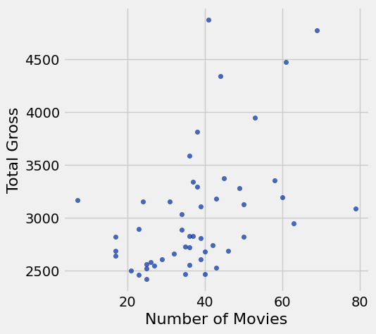

The plot contains 50 points, one point for each actor in the table. You can see that it slopes upwards, in general. The more movies an actor has been in, the more the total gross of all of those movies – in general.

Formally, we say that the plot shows an *association* between the variables, and that the association is *positive*: high values of one variable tend to be associated with high values of the other, and low values of one with low values of the other, in general. 

Of course there is some variability. Some actors have high numbers of movies but middling total gross receipts. Others have middling numbers of movies but high receipts. That the association is positive is simply a statement about the broad general trend.

Later in the course we will study how to quantify association. For the moment, we will just think about it qualitatively.

Now that we have explored how the number of movies is related to the *total* gross receipt, let's turn our attention to how it is related to the *average* gross receipt per movie.

```python
actors.scatter('Number of Movies', 'Average per Movie')
```

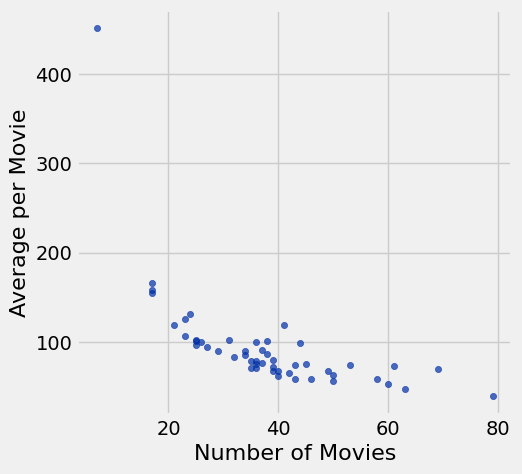

This is a markedly different picture and shows a *negative* association. In general, the more movies an actor has been in, the *less* the average receipt per movie.

Also, one of the points is quite high and off to the left of the plot. It corresponds to one actor who has a low number of movies and high average per movie. This point is an *outlier*. It lies outside the general range of the data. Indeed, it is quite far from all the other points in the plot.

We will examine the negative association further by looking at points at the right and left ends of the plot. 

For the right end, let's zoom in on the main body of the plot by just looking at the portion that doesn't have the outlier.

```python
no_outlier = actors.where('Number of Movies', are.above(10))
no_outlier.scatter('Number of Movies', 'Average per Movie')
```

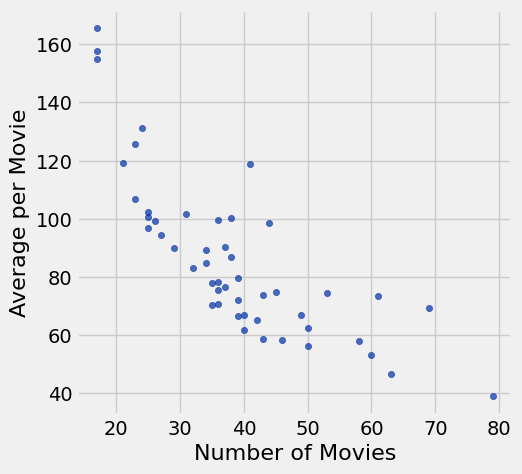

The negative association is still clearly visible. Let's identify the actors corresponding to the points that lie on the right hand side of the plot where the number of movies is large:

```python
actors.where('Number of Movies', are.above(60))
```

*Output:*

| Actor | Total Gross | Number of Movies | Average per Movie | #1 Movie | Gross |
| --- | --- | --- | --- | --- | --- |
| Samuel L. Jackson | 4772.8 | 69 | 69.2 | The Avengers | 623.4 |
| Morgan Freeman | 4468.3 | 61 | 73.3 | The Dark Knight | 534.9 |
| Robert DeNiro | 3081.3 | 79 | 39 | Meet the Fockers | 279.3 |
| Liam Neeson | 2942.7 | 63 | 46.7 | The Phantom Menace | 474.5 |

The great actor Robert DeNiro has the highest number of movies and the lowest average receipt per movie. Other fine actors are at points that are not very far away, but DeNiro's is at the extreme end.

To understand the negative association, note that the more movies an actor is in, the more variable those movies might be, in terms of style, genre, and box office draw. For example, an actor might be in some high-grossing action movies or comedies (such as Meet the Fockers), and also in a large number of smaller films that may be excellent but don't draw large crowds. Thus the actor's value of average receipts per movie might be relatively low.

To approach this argument from a different direction, let us now take a look at the outlier.

```python
actors.where('Number of Movies', are.below(10))
```

*Output:*

| Actor | Total Gross | Number of Movies | Average per Movie | #1 Movie | Gross |
| --- | --- | --- | --- | --- | --- |
| Anthony Daniels | 3162.9 | 7 | 451.8 | Star Wars: The Force Awakens | 936.7 |

As an actor, Anthony Daniels might not have the stature of Robert DeNiro. But his 7 movies had an astonishingly high average receipt of nearly $452$ million dollars per movie.

What were these movies? You might know about the droid C-3PO in Star Wars:


That's [Anthony Daniels](https://en.wikipedia.org/wiki/Anthony_Daniels) inside the metallic suit. He plays C-3PO.

Mr. Daniels' entire filmography (apart from cameos) consists of movies in the high-grossing Star Wars franchise. That explains both his high average receipt and his low number of movies.

Variables such as genre and production budget have an effect on the association between the number of movies and the average receipt per movie. This example is a reminder that studying the association between two variables often involves understanding other related variables as well.

**Line Plots**

Line plots, sometimes known as line graphs, are among the most common visualizations. They are often used to study chronological trends and patterns.

The table `movies_by_year` contains data on movies produced by U.S. studios in each of the years 1980 through 2015. The columns are:

| **Column** | Content |
|------------|---------|
| `Year` | Year |
| `Total Gross` | Total domestic box office gross, in millions of dollars, of all movies released |
| `Number of Movies` | Number of movies released |
| `#1 Movie` | Highest grossing movie |

```python
movies_by_year = Table.read_table(path_data + 'movies_by_year.csv')
movies_by_year
```

*Output:*

| Year | Total Gross | Number of Movies | #1 Movie |
| --- | --- | --- | --- |
| 2015 | 11128.5 | 702 | Star Wars: The Force Awakens |
| 2014 | 10360.8 | 702 | American Sniper |
| 2013 | 10923.6 | 688 | Catching Fire |
| 2012 | 10837.4 | 667 | The Avengers |
| 2011 | 10174.3 | 602 | Harry Potter / Deathly Hallows (P2) |
| 2010 | 10565.6 | 536 | Toy Story 3 |
| 2009 | 10595.5 | 521 | Avatar |
| 2008 | 9630.7 | 608 | The Dark Knight |
| 2007 | 9663.8 | 631 | Spider-Man 3 |
| 2006 | 9209.5 | 608 | Dead Man's Chest |

The Table method `plot` produces a line plot. Its two arguments are the same as those for `scatter`: first the column on the horizontal axis, then the column on the vertical. Here is a line plot of the number of movies released each year over the years 1980 through 2015.

```python
movies_by_year.plot('Year', 'Number of Movies')
```

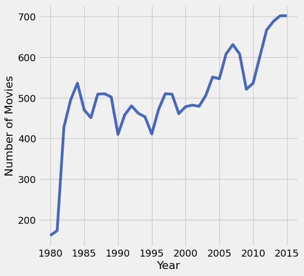

The graph rises sharply and then has a gentle upwards trend though the numbers vary noticeably from year to year. The sharp rise in the early 1980's is due in part to studios returning to the forefront of movie production after some years of filmmaker driven movies in the 1970's. 

Our focus will be on more recent years. In keeping with the theme of movies, the table of rows corresponding to the years 2000 through 2015 have been assigned to the name `century_21`.

```python
century_21 = movies_by_year.where('Year', are.above(1999))
```

```python
century_21.plot('Year', 'Number of Movies')

# Ensure the plot only shows integers
plots.gca().xaxis.set_major_locator(MaxNLocator(integer=True))
```

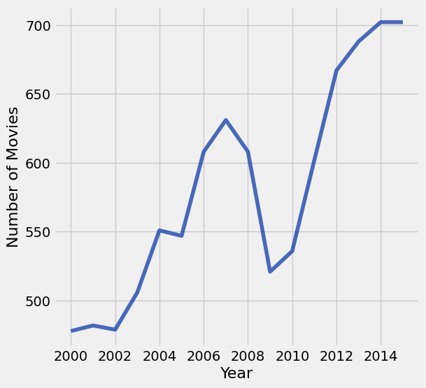

The global financial crisis of 2008 has a visible effect – in 2009 there is a sharp drop in the number of movies released.

The dollar figures, however, didn't suffer much.

```python
century_21.plot('Year', 'Total Gross')

# Ensure the plot only shows integers
plots.gca().xaxis.set_major_locator(MaxNLocator(integer=True))
```

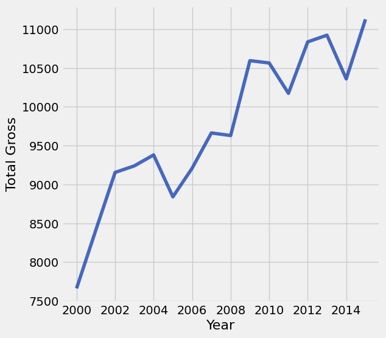

The total domestic gross receipt was higher in 2009 than in 2008, even though there was a financial crisis and a much smaller number of movies were released.

One reason for this apparent contradiction is that people tend to go to the movies when there is a recession. ["In Downturn, Americans Flock to the Movies,"](http://www.nytimes.com/2009/03/01/movies/01films.html?_r=0) said the New York Times in February 2009. The article quotes Martin Kaplan of the University of Southern California saying, "People want to forget their troubles, and they want to be with other people." When holidays and expensive treats are unaffordable, movies provide welcome entertainment and relief.

In 2009, another reason for high box office receipts was the movie Avatar and its 3D release. Not only was Avatar the \#1 movie of 2009, it is also by some calculations one of the highest grossing movies of all time, as we will see later.

```python
century_21.where('Year', are.equal_to(2009))
```

*Output:*

| Year | Total Gross | Number of Movies | #1 Movie |
| --- | --- | --- | --- |
| 2009 | 10595.5 | 521 | Avatar |

## 7.1 Visualizing Categorical Distributions

Data come in many forms that are not numerical. Data can be pieces of music, or places on a map. They can also be categories into which you can place individuals. Here are some examples of *categorical* variables.

- The individuals are cartons of ice-cream, and the variable is the flavor in the carton.
- The individuals are professional basketball players, and the variable is the player's team.
- The individuals are years, and the variable is the genre of the highest grossing movie of the year.
- The individuals are survey respondents, and the variable is the response they choose from among "Not at all satisfied," "Somewhat satisfied," and "Very satisfied."

```python
from datascience import *
import matplotlib
path_data = '../../../assets/data/'
matplotlib.use('Agg')
%matplotlib inline
import matplotlib.pyplot as plots
plots.style.use('fivethirtyeight')
import numpy as np
np.set_printoptions(threshold=50)
```

The table `icecream` contains data on 30 cartons of ice-cream.

```python
icecream = Table().with_columns(
    'Flavor', make_array('Chocolate', 'Strawberry', 'Vanilla'),
    'Number of Cartons', make_array(16, 5, 9)
)
icecream
```

*Output:*

| Flavor | Number of Cartons |
| --- | --- |
| Chocolate | 16 |
| Strawberry | 5 |
| Vanilla | 9 |

The *values* of the categorical variable "flavor" are chocolate, strawberry, and vanilla. 

Each of the cartons had exactly one of the three flavors. In a *distribution*, each individual belongs to exactly one category and thus has exactly one value. So we have a distribution of flavors.

The table shows the number of cartons of each flavor. We call this a *distribution table*. A distribution table shows all the values of the variable along with the frequency of each one.

### Bar Chart
The bar chart is a familiar way of visualizing categorical distributions. It displays a bar for each category. The bars are equally spaced and equally wide. The length of each bar is proportional to the frequency of the corresponding category.

We will draw bar charts with horizontal bars because it's easier to label the bars that way. The Table method is therefore called `barh`. It takes two arguments: the first is the column label of the categories, and the second is the column label of the frequencies.

```python
icecream.barh('Flavor', 'Number of Cartons')
```

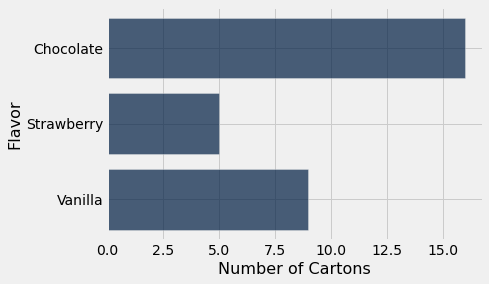

If the table consists just of a column of categories and a column of frequencies, as in `icecream`, the method call is even simpler. You can just specify the column containing the categories, and `barh` will use the values in the other column as frequencies.

```python
icecream.barh('Flavor')
```


### Design Aspects of Bar Charts
Apart from purely visual differences, there is an important fundamental distinction between bar charts and the two graphs that we saw in the previous sections. Those were the scatter plot and the line plot, both of which display two quantitative variables – the variables on both axes are quantitative. In contrast, the bar chart has categories on one axis and numerical quantities on the other.

This has consequences for the chart. First, the width of each bar and the space between consecutive bars is entirely up to the person who is producing the graph, or to the program being used to produce it. Python made those choices for us. If you were to draw the bar graph by hand, you could make completely different choices and still have a perfectly correct bar graph, provided you drew all the bars with the same width and kept all the spaces the same.

Most importantly, the bars can be drawn in any order. The categories "chocolate," "vanilla," and "strawberry" have no universal rank order, unlike for example the numbers 5, 7, and 10.

This means that we can draw a bar chart that is easier to interpret, by rearranging the bars in decreasing order. To do this, we first rearrange the rows of `icecream` in decreasing order of `Number of Cartons`, and then draw the bar chart.

```python
icecream.sort('Number of Cartons', descending=True).barh('Flavor')
```

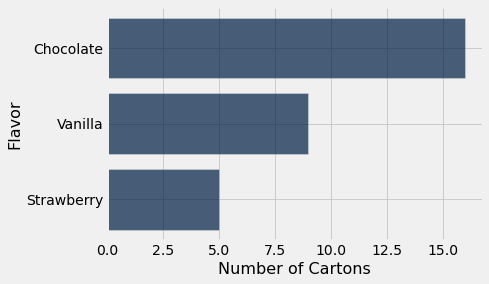

This bar chart contains exactly the same information as the previous ones, but it is a little easier to read. While this is not a huge gain in reading a chart with just three bars, it can be quite significant when the number of categories is large.

### Grouping Categorical Data
To construct the table `icecream`, someone had to look at all 30 cartons of ice-cream and count the number of each flavor. But if our table does not already include frequencies, we have to compute the frequencies before we can draw a bar chart. Here is an example where this is necessary.

The table `top` consists of U.S.A.'s top grossing movies of all time, as of 2017. The first column contains the title of the movie; *Star Wars: The Force Awakens* has the top rank, with a box office gross amount of more than 900 million dollars in the United States. The second column contains the name of the studio that produced the movie. The third contains the domestic box office gross in dollars, and the fourth contains the  gross amount that would have been earned from ticket sales at 2016 prices. The fifth contains the year in which the movie was released. 

There are 200 movies on the list. Here are the top ten according to the gross receipts adjusted for inflation.

```python
top = Table.read_table(path_data + 'top_movies_2017.csv')
top
```

*Output:*

| Title | Studio | Gross | Gross (Adjusted) | Year |
| --- | --- | --- | --- | --- |
| Gone with the Wind | MGM | 198676459 | 1796176700 | 1939 |
| Star Wars | Fox | 460998007 | 1583483200 | 1977 |
| The Sound of Music | Fox | 158671368 | 1266072700 | 1965 |
| E.T.: The Extra-Terrestrial | Universal | 435110554 | 1261085000 | 1982 |
| Titanic | Paramount | 658672302 | 1204368000 | 1997 |
| The Ten Commandments | Paramount | 65500000 | 1164590000 | 1956 |
| Jaws | Universal | 260000000 | 1138620700 | 1975 |
| Doctor Zhivago | MGM | 111721910 | 1103564200 | 1965 |
| The Exorcist | Warner Brothers | 232906145 | 983226600 | 1973 |
| Snow White and the Seven Dwarves | Disney | 184925486 | 969010000 | 1937 |

The studios MGM, Fox, Universal, and Paramount show up more than once in the top ten. Which studios will appear most frequently if we look among all 200 rows?

To figure this out, first notice that all we need is a table with the movies and the studios; the other information is unnecessary.

```python
movies_and_studios = top.select('Title', 'Studio')
```

The Table method `group` allows us to count how frequently each studio appears in the table, by calling each studio a category and collecting all the rows in each of these new categories. 

The `group` method takes as its argument the label of the column that contains the categories. It returns a table of counts of rows in each category. 

Thus `group` creates a distribution table that shows how the individuals (movies) are distributed among the categories (studios). 

The `group` method lists the categories in ascending order. Since our categories are studio names and therefore represented as strings, ascending order means alphabetical order.

The column of counts is always called `count`, but you can change that if you like by using `relabeled`.

```python
studio_distribution = movies_and_studios.group('Studio')
studio_distribution
```

*Output:*

| Studio | count |
| --- | --- |
| AVCO | 1 |
| Buena Vista | 35 |
| Columbia | 9 |
| Disney | 11 |
| Dreamworks | 3 |
| Fox | 24 |
| IFC | 1 |
| Lionsgate | 3 |
| MGM | 7 |
| Metro | 1 |

The table shows that there are 23 different studios and provides the count of movies released by each one. The total of the count is 200, the total number of movies.

```python
sum(studio_distribution.column('count'))
```

*Output:*

```text
200
```

We can now use this table, along with the graphing skills acquired above, to draw a bar chart that shows which studios are most frequent among the 200 highest grossing movies.

```python
studio_distribution.sort('count', descending=True).barh('Studio')
```

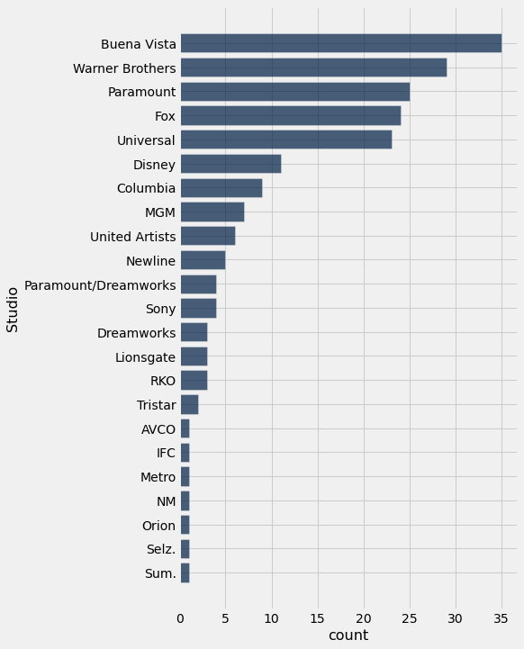

Buena Vista and Warner Brothers are the most common studios among the top 200 movies. Warner Brothers produces the Harry Potter movies and Buena Vista produces Star Wars.

### Towards Quantitative Variables

Though years are numerical, we could treat the year of release as a categorical variable and plot its distribution. That is, for every year we could find how many movies were released that year, and then draw the bar chart of that distribution.

Let's do that and just look at the 10 earliest years in the distribution.

```python
movies_and_years = top.select('Title', 'Year')
movies_and_years.group('Year').take(np.arange(10)).barh('Year')
```

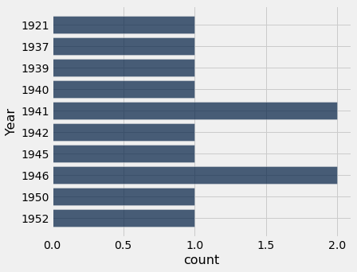

The years appear in increasing order because `group` sorts the categories from lowest to highest. That is important here because years have a chronological order that has to be maintained. But there is something disquieting about this bar chart. The bars at 1921 and 1937 are just as far apart from each other as the bars at 1937 and 1939. The bar chart doesn't show that none of the 200 movies were released in the years 1922 through 1936, nor in 1938. Such inconsistencies and omissions make the distribution in the early years hard to understand based on this visualization.

The distribution of a categorical variable can be displayed using a bar chart. But if the variable is not categorical but quantitative, then the numerical relations between its values have to be taken into account when we create visualizations. That is the topic of the next section.

## 7.2 Visualizing Numerical Distributions

Many of the variables that data scientists study are *quantitative* or *numerical*. Their values are numbers on which you can perform arithmetic. Examples that we have seen include the number of periods in chapters of a book, the amount of money made by movies, and the age of people in the United States.

The values of a categorical variable can be given numerical codes, but that doesn't make the variable quantitative. In the example in which we studied Census data broken down by age group, the categorial variable `SEX` had the numerical codes `1` for 'Male,' `2` for 'Female,' and `0` for the aggregate of both groups `1` and `2`. While 0, 1, and 2 are numbers, in this context it doesn't make sense to subtract 1 from 2, or take the average of 0, 1, and 2, or perform other arithmetic on the three values. `SEX` is a categorical variable even though the values have been given a numerical code.

```python
from datascience import *
import numpy as np
path_data = '../../../assets/data/'
%matplotlib inline
import matplotlib.pyplot as plots
plots.style.use('fivethirtyeight')
```

For our main example, we will return to a dataset that we studied when we were visualizing categorical data. It is the table `top`, which consists of data from U.S.A.'s top grossing movies of all time (as of 2017). For convenience, here is the description of the table again.

The first column contains the title of the movie. The second column contains the name of the studio that produced the movie. The third contains the domestic box office gross in dollars, and the fourth contains the  gross amount that would have been earned from ticket sales at 2016 prices. The fifth contains the release year of the movie. 

There are 200 movies on the list. Here are the top ten according to the unadjusted gross receipts in the column `Gross`.

```python
top = Table.read_table(path_data + 'top_movies_2017.csv')
# Make the numbers in the Gross and Gross (Adjusted) columns look nicer:
top.set_format([2, 3], NumberFormatter)
```

*Output:*

| Title | Studio | Gross | Gross (Adjusted) | Year |
| --- | --- | --- | --- | --- |
| Gone with the Wind | MGM | 198,676,459 | 1,796,176,700 | 1939 |
| Star Wars | Fox | 460,998,007 | 1,583,483,200 | 1977 |
| The Sound of Music | Fox | 158,671,368 | 1,266,072,700 | 1965 |
| E.T.: The Extra-Terrestrial | Universal | 435,110,554 | 1,261,085,000 | 1982 |
| Titanic | Paramount | 658,672,302 | 1,204,368,000 | 1997 |
| The Ten Commandments | Paramount | 65,500,000 | 1,164,590,000 | 1956 |
| Jaws | Universal | 260,000,000 | 1,138,620,700 | 1975 |
| Doctor Zhivago | MGM | 111,721,910 | 1,103,564,200 | 1965 |
| The Exorcist | Warner Brothers | 232,906,145 | 983,226,600 | 1973 |
| Snow White and the Seven Dwarves | Disney | 184,925,486 | 969,010,000 | 1937 |

In this section we will draw graphs of the distribution of the numerical variable in the column `Gross (Adjusted)`. For simplicity, let's create a smaller table that has the information that we need. And since three-digit numbers are easier to work with than nine-digit numbers, let's measure the `Adjusted Gross` receipts in millions of dollars. Note how `np.round` is used to retain only two decimal places in each entry of the column.

```python
millions = top.select(0).with_columns('Adjusted Gross', 
                                     np.round(top.column(3)/1e6, 2))
millions
```

*Output:*

| Title | Adjusted Gross |
| --- | --- |
| Gone with the Wind | 1796.18 |
| Star Wars | 1583.48 |
| The Sound of Music | 1266.07 |
| E.T.: The Extra-Terrestrial | 1261.08 |
| Titanic | 1204.37 |
| The Ten Commandments | 1164.59 |
| Jaws | 1138.62 |
| Doctor Zhivago | 1103.56 |
| The Exorcist | 983.23 |
| Snow White and the Seven Dwarves | 969.01 |

### Binning the Data ##
Look at the values of the quantitative variable `Adjusted Gross`. There is likely to be only one movie at each individual value, since the values are being measured rather finely. It is more interesting to group the values into intervals, known as *bins*, and see how many movies are in each bin. This process is called *binning*.

The counts of individuals (that is, rows) in the bins can be computed using the `bin` method, analogous to the `group` method used in the case of categorical data. The `bin` method takes as its argument a column label or index, and an optional argument in which you can specify the bins that you want. 

The result is a two-column table that contains the number of rows in each bin. The first column lists the left endpoints of the bins (but see the note about the last bin, below). 

Let's try out the method and examine the details of the output. To choose some bins, we will start by looking at the smallest and largest values of `Adjusted Gross`.

```python
adj_gross = millions.column('Adjusted Gross')
min(adj_gross), max(adj_gross)
```

*Output:*

```text
(338.41, 1796.18)
```

Let's try bins of width 100, starting at 300 and going to 2000. You are welcome to make other choices. It is common to start with something that seems reasonable and then adjust based on the results.

```python
bin_counts = millions.bin('Adjusted Gross', bins=np.arange(300,2001,100))
bin_counts.show()
```

*Output:*

| bin | Adjusted Gross count |
| --- | --- |
| 300 | 68 |
| 400 | 60 |
| 500 | 32 |
| 600 | 15 |
| 700 | 7 |
| 800 | 7 |
| 900 | 3 |
| 1000 | 0 |
| 1100 | 3 |
| 1200 | 3 |
| 1300 | 0 |
| 1400 | 0 |
| 1500 | 1 |
| 1600 | 0 |
| 1700 | 1 |
| 1800 | 0 |
| 1900 | 0 |
| 2000 | 0 |

Let's examine Column 0, the `bin` column. This column specifies the left end of each bin, except in the last row as explained below. 

Since the bins split the number line into intervals, they are contiguous. So we must be careful about values at the endpoints. By the usual Python convention, each bin except the last includes its left endpoint but not its right endpoint.

To make this point, we will use the notation [*a, b*) to refer to the bin that contains all the values that are greater than or equal to *a* and strictly less than *b*.

To understand the first row of the table, you have to look at the second row as well. These two rows tell us that there were 68 movies in the bin [300, 400). That is, 68 movies had adjusted gross receipts of at least 300 million dollars but less than 400 million dollars.

In general, each element in the `Adjusted Gross count` column counts all the `Adjusted Gross` values that are greater than or equal to the value in `bin`, but less than the next value in `bin`.

**The last bin:** Notice the `bin` value 2000 in the last row. That's not the left endpoint of any bin. Instead, it's the right endpoint of the last bin. This bin is different from all the others in that it has the form [a, b]. It includes the data at *both* endpoints. In our example it doesn't matter because no movie made 2 billion dollars (that is, 2000 million). But this aspect of binning is important to keep in mind in case you want the bins to end exactly at the maximum value of the data. All the counts for this last bin appear in the second-to-last row, and the count for the last row is always zero. 

There are other ways to use the `bin` method. If you don't specify any bins, the default is to produce 10 equally wide bins between the minimum and maximum values of the data. This is often useful for getting a quick sense of the distribution, but the endpoints of the bins tend to be alarming.

```python
millions.bin('Adjusted Gross').show()
```

*Output:*

| bin | Adjusted Gross count |
| --- | --- |
| 338.41 | 115 |
| 484.187 | 50 |
| 629.964 | 14 |
| 775.741 | 10 |
| 921.518 | 3 |
| 1067.3 | 4 |
| 1213.07 | 2 |
| 1358.85 | 0 |
| 1504.63 | 1 |
| 1650.4 | 1 |
| 1796.18 | 0 |

You can specify a number of equally wide bins. For example, the option `bins=4` leads to 4 equally spaced bins.

```python
millions.bin('Adjusted Gross', bins=4)
```

*Output:*

| bin | Adjusted Gross count |
| --- | --- |
| 338.41 | 177 |
| 702.852 | 15 |
| 1067.3 | 6 |
| 1431.74 | 2 |
| 1796.18 | 0 |

But with quantitative data, the bins don't have to be equally wide. We will see an example of unequal bins later.

### Histogram
A *histogram* is a visualization of the distribution of a quantitative variable. It looks very much like a bar chart but there are some important differences that we will examine in this section. First, let's just draw a histogram of the adjusted receipts.

The `hist` method generates a histogram of the values in a column. The optional `unit` argument is used in the labels on the two axes. The histogram below shows the distribution of the adjusted gross amounts, in millions of 2016 dollars. We have not specified the bins, so `hist` creates 10 equally wide bins between the minimum and maximum values of the data.

```python
millions.hist('Adjusted Gross', unit="Million Dollars")
```

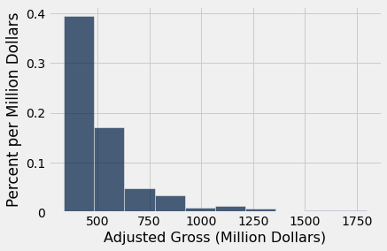

This figure has two numerical axes. We will take a quick look at the horizontal axis first, and then examine the vertical axis carefully. For now, just note that **the vertical axis does not represent percents**.

### The Horizontal Axis

Although in this dataset no movie grossed an amount that is exactly on the edge between two bins, `hist` does have to account for situations where there might have been values at the edges. So `hist` uses the same *endpoint convention* as the `bin` method. Bins include the data at their left endpoint, but not the data at their right endpoint, except for the rightmost bin which includes both endpoints. 

We can see that there are 10 bins (some bars are so low that they are hard to see), and that they all have the same width. We can also see that none of the movies grossed fewer than 300 million dollars; that is because we are considering only the top grossing movies. 

It is a little harder to see exactly where the ends of the bins are situated. So it is hard to judge exactly where one bar ends and the next begins.

The optional argument `bins` can be used with `hist` to specify the endpoints of the bins exactly as with the `bin` method. We will start by setting the numbers in `bins` to be 300, 400, 500, and so on, ending with 2000.

```python
millions.hist('Adjusted Gross', bins=np.arange(300,2001,100), unit="Million Dollars")
```

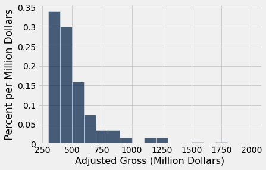

The horizontal axis of this figure is easier to read. For example, you can see exactly where 600 is, even though it is not labeled.

A very small number of movies grossed a billion dollars (1000 million) or more. This results in the figure being *skewed to the right*, or, less formally, having *a long right hand tail*. Distributions of variables like income or rent in large populations also often have this kind of shape.

### The Area Principle ##
Both axes of a histogram are numerical, so you can do arithmetic on both of them. For example, you can multiply the values on either or both of the axes by a factor. To see how this could affect visual perception, let's step back from histograms and look at a graphic provided for this purpose by the site [Flowing Data](https://flowingdata.com/2012/03/16/new-ipad-battery-size-is-huge/). It is a comparison between the battery sizes of two iPad models.


The larger of the batteries is supposed to be 70% bigger than the smaller. So it's meant to be bigger but not quite twice as big. However, the larger battery in the picture looks almost four times the size of the smaller one.

The reason for this problem is that the eye picks up *area* as the measure of size, not just height or just width. In the picture, both dimensions have been increased by 70%, leading to a multiplicative effect in the area.

The area principle of visualization says that when we represent a magnitude by a figure that has two dimensions, such as a rectangle, then the *area* of the figure should represent the magnitude.

### The Histogram: General Principles and Calculation

Histograms follow the area principle and have two defining properties:

1. The bins are drawn to scale and are contiguous (though some might be empty), because the values on the horizontal axis are numerical and therefore have fixed positions on the number line.
2. The **area** of each bar is proportional to the number of entries in the bin. 

Property 2 is the key to drawing a histogram, and is usually achieved as follows:

$$
\mbox{area of bar} ~=~ \mbox{percent of entries in bin}
$$

Since areas represent percents, heights represent something other than percents. The numerical calculation of the heights just uses the fact that the bar is a rectangle:

$$
\mbox{area of bar} = \mbox{height of bar} \times \mbox{width of bin}
$$

and so

$$
\mbox{height of bar} ~=~ 
\frac{\mbox{area of bar}}{\mbox{width of bin}} ~=~
\frac{\mbox{percent of entries in bin}}{\mbox{width of bin}}
$$

The units of height are "percent per unit on the horizontal axis." The height is the percent in the bin relative to the width of the bin. So it is called *density* or *crowdedness*.

When drawn using this method, the histogram is said to be drawn on the *density scale*. On this scale:
- The area of each bar is equal to the percent of data values that are in the corresponding bin.
- The total area of all the bars in the histogram is 100%. In terms of proportions, we can say that the areas of all the bars in a histogram "sum to 1".

### The Vertical Axis: Density Scale

As we have just seen, the height of each bar is the percent of elements that fall into the corresponding bin, relative to the width of the bin. We will now see how `hist` calculated the heights of all the bars of the histogram above. 

Here is the histogram again for ease of reference.

```python
millions.hist('Adjusted Gross', bins=np.arange(300,2001,100), unit="Million Dollars")
```


Recall that the table `bin_counts` has the counts in all the bins of the histogram, specified by `bins=np.arange(300, 2000, 100)`. Also remember that there are 200 movies in all.

```python
bin_counts.show(3)
```

*Output:*

| bin | Adjusted Gross count |
| --- | --- |
| 300 | 68 |
| 400 | 60 |
| 500 | 32 |

The [300, 400) bin contains 68 movies. That's 34% of all the movies:

$$
\mbox{Percent} = \frac{68}{200} \cdot 100 = 34
$$

The width of the [300, 400) bin is $400 - 300 = 100$. So

$$
\mbox{Height} = \frac{34}{100} = 0.34
$$

**Units:** The height of the bar is 34% divided by 100 million dollars, and so the height is 0.34% per million dollars. 

The height of bar is **not** the percent of entries in the bin. It is the percent of entries in the bin relative to the amount of space in the bin. That is why the height measures crowdedness or density. The vertical axis is said to be on the density scale.

### Why Not Simply Plot the Counts?

The main reason for plotting density on the vertical axis instead of counts or percents is to be able to compare histograms and approximate them with smooth curves where proportions are represented by areas under the curve.

For example, later in the course you will see histograms that are approximately bell-shaped. The figure below shows such a shape. The gold shaded area happens to be 95% of the total area under the curve. Notice that this is quite believeable based on the areas you see in the figure, even though there are no numbers on the axes. That is why we draw histograms so that areas represent percents.

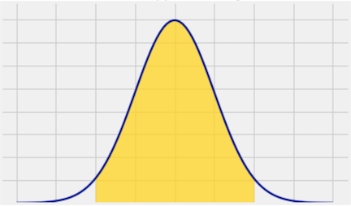

Drawing histograms on the density scale also allows us to compare histograms that are based on data sets of different sizes or have different choices of bins. In such cases, neither bin counts nor percents may be directly comparable. But if both histograms are drawn to the density scale then areas and densities are comparable.

If a histogram has unequal bins, then plotting on the density scale is a requirement for interpretability. For some variables, unequal bins may be natural. For example, in the U.S. education system, elementary school consists of Grades 1-5, middle school is Grades 6-8, high school is Grades 9-12, and a Bachelor's degree takes a further four years. Data on years of education might be binned using these intervals. In fact, no matter what the variable, bins don't have to be equal. It is quite common to have one very wide bin towards the left end or right end of the data, where there are not many values.

Let's plot a histogram of adjusted gross receipts using unequal bins, and then see what happens if we plot counts instead.

```python
uneven = make_array(300, 350, 400, 500, 1800)
millions.hist('Adjusted Gross', bins=uneven, unit="Million Dollars")
```


Notice that the [400, 500) bar has the same height (0.3% per million dollars) as in the histograms above. 

The areas of the other bars represent the percents in the bins, as usual. The `bin` method allows us to see the counts in each bin.

```python
millions.bin('Adjusted Gross', bins=uneven)
```

*Output:*

| bin | Adjusted Gross count |
| --- | --- |
| 300 | 14 |
| 350 | 54 |
| 400 | 60 |
| 500 | 72 |
| 1800 | 0 |

The [300, 350) bin has only 14 movies whereas the [500, 1800] bin has 72 movies. But the bar over the [500, 1800] bin is much shorter than the bar over [300, 350). The [500, 1800] bin is so wide that its 72 movies are much less crowded than the 14 movies in the narrow [300, 350) bin. In other words, there is less density over the [500, 1800] interval.

If instead you just plot the counts using the `normed=False` option as shown below, the figure looks completely different and misrepresents the data.

```python
millions.hist('Adjusted Gross', bins=uneven, normed=False)
```

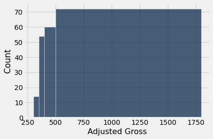

Even though `hist` has been used, **the figure above is NOT A HISTOGRAM.** It misleadingly exaggerates the movies grossing at least 500 million dollars. The height of each bar is simply plotted at the number of movies in the bin, without accounting for the difference in the widths of the bins. In this count-based figure, the shape of the distribution of movies is lost entirely.

### Flat Tops and the Level of Detail

Even though the density scale correctly represents percents using area, some detail is lost by grouping values into bins.

Take another look at the [400, 500) bin in the figure below. The flat top of the bar, at the level 0.3% per million dollars, hides the fact that the movies are somewhat unevenly distributed across that bin.

```python
millions.hist('Adjusted Gross', bins=uneven, unit="Million Dollars")
```

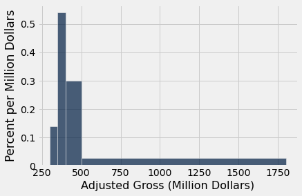

To see this, let us split the [400, 500) bin into 10 narrower bins, each of width 10 million dollars.

```python
some_tiny_bins = make_array(
    300, 350, 400, 410, 420, 430, 440, 450, 460, 470, 480, 490, 500, 1800)
millions.hist('Adjusted Gross', bins=some_tiny_bins, unit='Million Dollars')
```

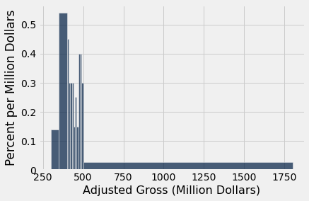

Some of the skinny bars are taller than 0.3 and others are shorter. By putting a flat top at the level 0.3 across the whole bin, we are deciding to ignore the finer detail and are using the flat level as a rough approximation. Often, though not always, this is sufficient for understanding the general shape of the distribution.

**The height as a rough approximation.**
This observation gives us a different way of thinking about the height.
Look again at the [400, 500) bin in the earlier histograms. As we have seen, the bin is 100 million dollars wide and contains 30% of the data. Therefore the height of the corresponding bar is 0.3% per million dollars.

Now think of the bin as consisting of 100 narrow bins that are each 1 million dollars wide. The bar's height of "0.3% per million dollars" means that as a rough approximation, 0.3% of the movies are in each of those 100 skinny bins of width 1 million dollars.

We have the entire dataset that is being used to draw the histograms. So we can draw the histograms to as fine a level of detail as the data and our patience will allow. Smaller bins will lead to a more detailed picture. However, if you are looking at a histogram in a book or on a website, and you don't have access to the underlying dataset, then it becomes important to have a clear understanding of the "rough approximation" created by the flat tops.

### Computing All Heights ##
We know how to find the height of each histogram bar. Let's use that to develop code that computes all the heights at once. 

We will use the histogram below as our example. The bins are specified in the array `uneven`.

```python
millions.hist('Adjusted Gross', bins=uneven, unit="Million Dollars")
```


We will start by getting the counts in the bins.

```python
histogram_elements = millions.bin('Adjusted Gross', bins=uneven).relabeled(1, 'count')
histogram_elements
```

*Output:*

| bin | count |
| --- | --- |
| 300 | 14 |
| 350 | 54 |
| 400 | 60 |
| 500 | 72 |
| 1800 | 0 |

We can now add a column containing the percent in each bin.

```python
total_count = sum(histogram_elements.column('count'))
percents = np.round(100*histogram_elements.column('count')/total_count, 2)
histogram_elements = histogram_elements.with_columns('percent', percents)
histogram_elements
```

*Output:*

| bin | count | percent |
| --- | --- | --- |
| 300 | 14 | 7 |
| 350 | 54 | 27 |
| 400 | 60 | 30 |
| 500 | 72 | 36 |
| 1800 | 0 | 0 |

Column 0 contains the left ends of all the bins, except for its last element which is the right end of the last bin. So we can use `np.diff` to find the widths of all the bins. Then we will add the widths to the `histogram_elements` table, by first removing the last row.

```python
bin_widths = np.diff(histogram_elements.column('bin'))
num_bins = histogram_elements.num_rows - 1    # the number of bins
histogram_elements = histogram_elements.take(
    np.arange(num_bins)).with_columns(
    'width', bin_widths
)
histogram_elements
```

*Output:*

| bin | count | percent | width |
| --- | --- | --- | --- |
| 300 | 14 | 7 | 50 |
| 350 | 54 | 27 | 50 |
| 400 | 60 | 30 | 100 |
| 500 | 72 | 36 | 1300 |

Finally, we can add a column of heights.

```python
heights = np.round(
    histogram_elements.column('percent')/histogram_elements.column('width'),2)
histogram_elements = histogram_elements.with_columns('height', heights)
histogram_elements
```

*Output:*

| bin | count | percent | width | height |
| --- | --- | --- | --- | --- |
| 300 | 14 | 7 | 50 | 0.14 |
| 350 | 54 | 27 | 50 | 0.54 |
| 400 | 60 | 30 | 100 | 0.3 |
| 500 | 72 | 36 | 1300 | 0.03 |

Here is the histogram again for convenience. Compare it with the table above to confirm that the calculation of heights looks good.

```python
millions.hist('Adjusted Gross', bins=uneven)
```

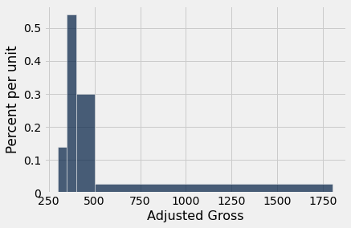

### Differences Between Bar Charts and Histograms 

- Bar charts display one numerical quantity per category. They are often used to display the distributions of categorical variables. Histograms display the distributions of quantitative variables. 
- All the bars in a bar chart have the same width, and there is an equal amount of space between consecutive bars. The bars can be in any order because the distribution is categorical. The bars of a histogram are contiguous; the bins are drawn to scale on the number line.
- The lengths (or heights, if the bars are drawn vertically) of the bars in a bar chart are proportional to the count in each category. The heights of bars in a histogram measure densities; the *areas* of bars in a histogram are proportional to the counts in the bins.

## 7.3 Overlaid Graphs

In this chapter, we have learned how to visualize data by drawing graphs. A common use of such visualizations is to compare two datasets. In this section, we will see how to *overlay* plots, that is, draw them in a single graphic on a common pair of axes.

For the overlay to make sense, the graphs that are being overlaid must represent the same variables and be measured in the same units. 

To draw overlaid graphs, the methods `scatter`, `plot`, and `barh` can all be called in the same way. For `scatter` and `plot`, one column must serve as the common horizontal axis for all the overlaid graphs. For `barh`, one column must serve as the common axis which is the set of categories. The general call looks like:

`name_of_table.method(column_label_of_common_axis, array_of_labels_of_variables_to_plot)`

More commonly, we will first select only the columns needed for our graph, and then call the method by just specifying the variable on the common axis:

`name_of_table.method(column_label_of_common_axis)`

```python
from datascience import *
import numpy as np
path_data = '../../../assets/data/'
%matplotlib inline
import matplotlib.pyplot as plots
plots.style.use('fivethirtyeight')
```

### Overlaid Scatter Plots

The table `sons_heights` is part of a historical data set on the heights of parents and their children. Specifically, the population consists of 179 men who were the first-born in their families. The data are their own heights and the heights of their parents. All heights were measured in inches.

```python
sons_heights = Table.read_table(path_data + 'sons_heights.csv')
sons_heights
```

*Output:*

| father | mother | son |
| --- | --- | --- |
| 78.5 | 67 | 73.2 |
| 75.5 | 66.5 | 73.5 |
| 75 | 64 | 71 |
| 75 | 64 | 70.5 |
| 75 | 58.5 | 72 |
| 74 | 68 | 76.5 |
| 74 | 62 | 74 |
| 73 | 67 | 71 |
| 73 | 67 | 68 |
| 73 | 66.5 | 71 |

The `scatter` method allows us to visualize how the sons' heights are related to the heights of both their parents. In the graph, the sons' heights will form the common horizontal axis.

```python
sons_heights.scatter('son')
```

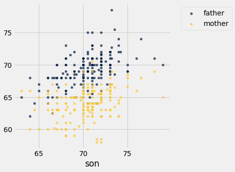

Notice how we only specified the variable (sons' heights) on the common horizontal axis. Python drew two scatter plots: one each for the relation between this variable and the other two.

Each point represents a row of the table, that is, a "father, mother, son" trio. For all points, the horizontal axis represents the son's height. In the blue points, the vertical axis represents the father's height. In the gold points, the vertical axis represents the mother's heights.

Both the gold and the blue scatter plots slope upwards and show a positive association between the sons' heights and the heights of both their parents. The blue (fathers) plot is in general higher than the gold, because the fathers were in general taller than the mothers.

### Overlaid Line Plots

Our next example involves data on children of more recent times. We will return to the Census data table `us_pop`, created below again for reference. From this table, we will extract the counts of all children in each of the age categories 0 through 18 years.

```python
# Read the full Census table
data = 'http://www2.census.gov/programs-surveys/popest/technical-documentation/file-layouts/2010-2019/nc-est2019-agesex-res.csv'
full_census_table = Table.read_table(data)

# Select columns from the full table and relabel some of them
partial_census_table = full_census_table.select('SEX', 'AGE', 'POPESTIMATE2014', 'POPESTIMATE2019')
us_pop = partial_census_table.relabeled('POPESTIMATE2014', '2014').relabeled('POPESTIMATE2019', '2019')

# Access the rows corresponding to all children, ages 0-18
children = us_pop.where('SEX', are.equal_to(0)).where('AGE', are.below(19)).drop('SEX')
children.show()
```

*Output:*

| AGE | 2014 | 2019 |
| --- | --- | --- |
| 0 | 3954787 | 3783052 |
| 1 | 3948891 | 3829599 |
| 2 | 3958711 | 3922044 |
| 3 | 4005928 | 3998665 |
| 4 | 4004032 | 4043323 |
| 5 | 4004576 | 4028281 |
| 6 | 4133372 | 4017227 |
| 7 | 4152666 | 4022319 |
| 8 | 4118349 | 4066194 |
| 9 | 4106068 | 4061874 |
| 10 | 4114558 | 4060940 |
| 11 | 4084457 | 4189261 |
| 12 | 4067187 | 4208387 |
| 13 | 4168095 | 4175221 |
| 14 | 4231353 | 4164459 |
| 15 | 4162828 | 4175459 |
| 16 | 4165925 | 4150420 |
| 17 | 4181940 | 4142425 |
| 18 | 4221344 | 4255827 |

We can now draw two overlaid line plots, showing the numbers of children in the different age groups for each of the years 2014 and 2019. The call is analogous to the `scatter` call in the previous example.

```python
children.plot('AGE')
```

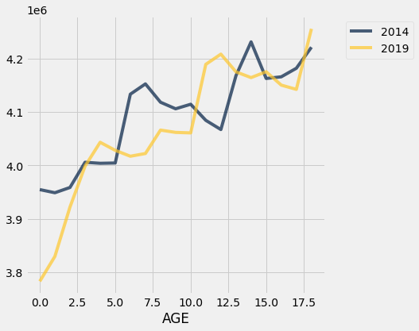

Though the horizontal axis labels include some half-integers, it's important to remember that we only have data at ages 0, 1, 2, and so on. The line plots "join the dots" in between.

The two graphs cross each other in a few places. For example, there were more 6-year-olds in 2014 than in 2019, and there were more 12-year-olds in 2019 than in 2014.

Of course, the 12-year-olds in 2019 mostly consist of the children who were 7-year-olds in 2014. To see this on the plots, compare the gold graph at `AGE` 12 and the blue graph at `AGE` 7. You will notice that the gold graph (2019) looks very much like the blue graph (2014) slid over to the right by 5 years. The slide is accompanied by a slight rise due to the net effect of children who entered the country between 2014 and 2019 outnumbering those who left. Fortunately at these ages there is not much loss of life.

### Bar Charts

The Kaiser Family Foundation has complied Census data on the distribution of race and ethnicity in the U.S. The Foundation's website provides compilations of data for [the entire U.S. population](http://kff.org/other/state-indicator/distribution-by-raceethnicity/) in 2019, as well as for [U.S. children](http://kff.org/other/state-indicator/children-by-raceethnicity/) who were younger than 18 years old that year.

The table `usa_ca` is adapted from their data for the United States and California. The columns represent everyone in the U.S.A., everyone in California, children in the U.S.A., and children in California. 

The body of the table contains percents in the different categories. Each column shows the distribution of the `Ethnicity/Race` variable in the group of people corresponding to that column. So in each column, the entries add up to 100. The `API` category consists of Asians and Pacific Islanders including Native Hawaiians. The `Other` category includes Native Americans, Alaskan natives, and people who identify with multiple races.

```python
usa_ca = Table.read_table(path_data + 'usa_ca_2019.csv')
usa_ca
```

*Output:*

| Ethnicity/Race | USA All | CA All | USA Children | CA Children |
| --- | --- | --- | --- | --- |
| API | 5.8 | 15.1 | 4.9 | 11.5 |
| Black | 12.2 | 5.3 | 13.4 | 4.9 |
| Hispanic | 18.5 | 39.5 | 25.6 | 52.1 |
| White | 60.1 | 36.4 | 50 | 25.5 |
| Other | 3.4 | 3.7 | 6.1 | 6 |

It is natural to want to compare these distributions. It makes sense to compare the columns directly, because all the entries are percents and are therefore on the same scale.

The method `barh` allows us to visualize the comparisons by drawing multiple bar charts on the same axes. The call is analogous to those for `scatter` and `plot`: we have to specify the common axis of categories.

```python
usa_ca.barh('Ethnicity/Race')
```

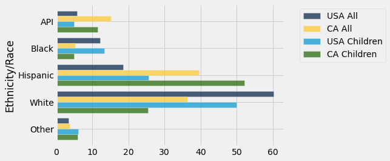

While drawing the overlaid bar charts is straightforward, there is a bit too much information on this graph for us to be able to sort out similarities and differences between populations. It is much easier to compare the populations one pair at a time. 

Let's start by comparing the entire populations of the U.S.A. and California.

```python
usa_ca.select('Ethnicity/Race', 'USA All', 'CA All').barh('Ethnicity/Race')
```

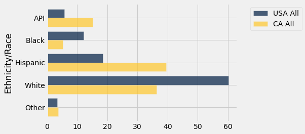

The two distributions are quite different. California has higher percents in the `API` and `Hispanic` categories, and correspondingly lower percents in the`Black` and `White` categories. The percents in the `Other` category are quite similar in the two populations. The differences are largely due to California's geographical location and patterns of immigration and migration, both historically and in more recent decades. 

As you can see from the graph, almost 40% of the Californian population in 2019 was `Hispanic`. A comparison with the population of children in the state indicates that the `Hispanic` proportion is likely to be greater in future years. Among Californian children in 2019, more than 50% were in the `Hispanic` category.

```python
usa_ca.select('Ethnicity/Race', 'CA All', 'CA Children').barh('Ethnicity/Race')
```

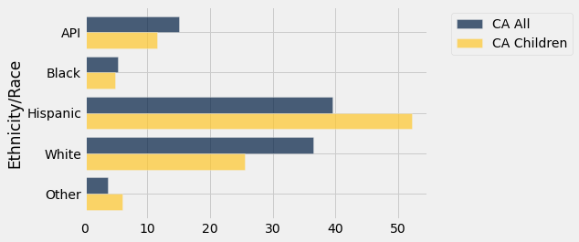

More complex data sets naturally give rise to varied and interesting visualizations, including overlaid graphs of different kinds. To analyze such data, it helps to have some more skills in data manipulation, so that we can get the data into a form that allows us to use methods like those in this section. In the next chapter we will develop some of these skills.
